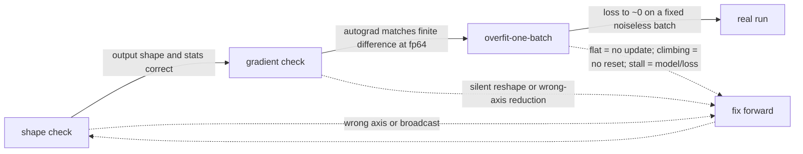
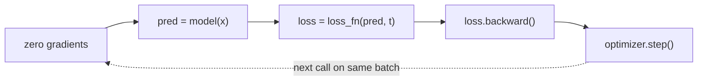

# A0 - Harness and primitives

This course is organized around one rule: prove a mechanism is correct on a tiny problem before
running it in real training. This assignment introduces the two correctness checks that make that
rule operational, and builds three of the primitives a transformer block is built from: layer
normalization, the GELU (Gaussian error linear unit) activation, and the position-wise MLP
(multilayer perceptron). The first check is a gradient test
that compares autograd against a finite-difference estimate at double precision; the second is
overfit-one-batch, which trains a model on a single fixed batch until the loss reaches zero. The
primitives come first because they are the smallest pieces the rest of the course reuses.

Build the three primitives and the optimization step from low-level operations: the exact GELU,
layer normalization from mean and variance, the two-layer MLP, and one optimization step of a
generic training loop, which overfit-one-batch exercises. The gradient checker, the determinism helpers, the toy datasets, and the
loss-curve plotting are provided. Everything runs on CPU in seconds.

This is also the assignment that introduces the course harness: the `make` targets that run the
tests, the reference solution that every assignment ships with, and the switch that chooses between
that reference and the code written here. The assignment section at the end covers it.

Required reading before starting:
- Ba, Kiros, Hinton 2016, "Layer Normalization",
  [arXiv:1607.06450](https://arxiv.org/abs/1607.06450).
- Hendrycks, Gimpel 2016, "Gaussian Error Linear Units (GELUs)",
  [arXiv:1606.08415](https://arxiv.org/abs/1606.08415).

## Lecture notes

### What the checks are for

#### The task

Almost every later assignment trains a neural network: a vision transformer that classifies
images, a diffusion model that generates them, a radiance field that renders a 3D scene. Each of
those is a few hundred lines of tensor code, followed by thousands of steps of gradient descent.
When the code is right, the loss falls and the model learns. When it is wrong, the loss usually
still falls, a little.

#### Why watching the loss curve is not enough

Training failures rarely announce themselves. A forward pass with a subtle bug (a normalization
over the wrong axis, a transposed weight, a broadcast that silently does the wrong thing) does not
crash. It produces tensors of the right shape and a loss that drops a little and then plateaus. The
only evidence left is a loss curve, one scalar per step, from which to infer which of dozens of
lines is wrong, and each hypothesis costs a training run, which can take hours.

#### The idea, checking each piece before any training

The alternative is to make correctness observable at the level of the operation, before any
optimizer touches a parameter. Two checks do that, and the course runs them on every new mechanism.

The **gradient check** takes one layer on a tiny input and compares the derivatives that PyTorch
computes for it against derivatives estimated by nudging the input and re-running the layer. If the
two disagree, the layer's code does something other than what it appears to do, and the check
reports which entry disagrees.

**Overfit-one-batch** takes the whole model and training loop and trains on a single fixed batch,
over and over, until the loss reaches approximately zero. A correct model and loop can memorize a
handful of examples; if they cannot, something in the loop is disconnected, and the shape of the
loss curve says what.

Both checks run in seconds on a CPU, and both are cheap compared to one wasted training run. The
rest of these notes explain why each check catches what it catches, and build the three primitives
the checks are first applied to.

### Our GELU-at-1 example (one entry of a Jacobian)

The gradient check reduces to a computation that fits in one line. Take GELU, the activation
function built later in these notes, $\operatorname{GELU}(x) = x\,\Phi(x)$ with $\Phi$ the standard
normal cumulative distribution function. Its exact derivative at $x = 1$ is
$\Phi(1) + \phi(1) = 0.8413 + 0.2420 = 1.0833$, where $\phi$ is the standard normal density. A
gradient check does not know the formula. It estimates the derivative by evaluating the function
just to the right and just to the left of the point, $x = 1 \pm h$ for a small step $h$, and
dividing the difference by $2h$.

We call this our GELU-at-1 example. It is one entry of what a real gradient check computes: for a
layer with many inputs and outputs, the check repeats the same estimate for every pair of an input
entry and an output entry and compares each against PyTorch's answer. Our example keeps the parts
that decide whether the check works, namely the formula, the step size $h$, and the floating-point
format the arithmetic is done in. It drops the size of the layer and the comparison step.

Done with the step $h = 10^{-6}$ that the course's gradient-check helper uses, the estimate is off by
a relative $3.3\times10^{-11}$ in double precision (float64) and by $3.7\times10^{-2}$ in single
precision (float32). The first is far better than any tolerance a check would use; the second is a
percent-level error. The figure plots the relative error against $h$ for both formats. Each curve is
a V: on the right, error falls as $h$ shrinks; on the left, it climbs again. The sections on
finite differences and on float64 explain both arms and why the float32 valley is too shallow for a
check. (Below about $h = 3\times10^{-8}$, both $1 + h$ and $1 - h$ round to exactly $1$ in float32, the
two evaluations are identical, and the estimate is 0, a relative error of 1.)


### Overview of the rest of the notes

Most of what follows is numerical analysis and estimation applied to a new setting.

1. Where the primitives sit. The transformer block and the three slots in it that this assignment
   fills.
2. Automatic differentiation. How PyTorch computes gradients: the chain rule as a product of
   Jacobians, evaluated from the left. This is reverse mode, the same structure as the adjoint
   method in optimal control.
3. The gradient check. The central difference from numerical differentiation, applied entry by
   entry, and the trade between truncation error and roundoff error that forces double precision.
4. Overfit-one-batch. Fitting a model to noiseless data it can represent exactly, as in system
   identification with a known model structure, and reading faults off the loss curve.
5. Layer normalization. Standardizing each token vector by its own mean and variance, so that
   activations keep a fixed scale through a deep stack.
6. GELU and dropout. A smooth activation defined as the expected value of a random gate, and the
   random gate (dropout) it is derived from.
7. The MLP and the optimization step. The per-token half of a transformer block, and the order of
   operations in one gradient step, which follows from how autograd stores gradients.
8. Adam. Gradient descent with a per-coordinate step size, a diagonal preconditioner estimated from
   recent gradients.

Five exercises, placed after the sections they test, are meant to be worked by hand. Each has a
worked answer that can be expanded.

### Where these primitives sit

A transformer operates on a set of tokens. A token is one vector of length $d$: a word piece in a
language model, a 16x16 image patch in a vision transformer, a sampled point along a ray in a 3D
model. A batch of $B$ sequences of $S$ tokens each is a tensor of shape $(B, S, d)$, and $d$ is
fixed for the whole stack, so every layer takes $(B, S, d)$ in and returns $(B, S, d)$ out. Unlike
a Kalman filter or a recurrent network, nothing is carried along the sequence axis from one step to
the next; a transformer rewrites all $S$ token vectors at once, a fixed number of times.

Each layer does two things in turn. Attention mixes information across the token axis: every output
token is a weighted average of all the input tokens, with the weights computed from the token
contents. The other half touches one token at a time. The same two-layer MLP runs on each of the $S$
token vectors independently, with the same weights, and nothing crosses between positions. That is
what position-wise means: a map $\mathbb{R}^d \to \mathbb{R}^d$ broadcast over the leading batch and
sequence axes. (The original transformer paper calls this half the position-wise feed-forward
network; these notes call it the MLP.)

Both halves are wrapped the same way. The layer's input is normalized, the mechanism runs on the
normalized copy, and its result is added back to the un-normalized input:

$$x' = x + \operatorname{Attn}(\operatorname{Norm}(x)), \qquad y = x' + \operatorname{MLP}(\operatorname{Norm}(x')).$$

Those additions leave a path from the input of the stack to its output that no layer multiplies,
called the residual stream. Putting the norm inside the branch rather than after the addition makes
this a pre-norm block, which the transformer assignment covers in full.

Three parts of that expression are built here: $\operatorname{Norm}$ (layer normalization), the MLP,
and the GELU nonlinearity inside the MLP. Attention is the transformer assignment's subject. Modern
LLaMA-style stacks swap RMSNorm in for layer normalization and a SwiGLU feed-forward in for the GELU
MLP; both are refinements of the same two slots, added to the same module later.

### Automatic differentiation

Training needs $\partial L / \partial \theta$ for every parameter $\theta$, where $L$ is a single
scalar loss. Nothing in this course writes that derivative by hand; PyTorch's autograd computes it.
Since the gradient check compares autograd against an independent estimate, it helps to be concrete
about what autograd does.

A network is a chain of maps $u_k = f_k(u_{k-1})$ for $k = 1, \dots, n$, where $u_0$ holds the
inputs and parameters, the intermediate $u_k$ are vectors of activations, and $u_n$ is the scalar
loss. The chain rule for a composition of vector-valued maps is a product of Jacobians: with $J_k =
\partial u_k / \partial u_{k-1}$,

$$\frac{\partial u_n}{\partial u_0} = J_n J_{n-1} \cdots J_1.$$

None of those matrices is ever formed. Forming one would be hopeless: a layer with a million inputs
and a million outputs has a Jacobian with $10^{12}$ entries. What is needed is the product's action
on a vector, and there are two orders in which to evaluate it.

Grouping from the right, $J v = J_n(J_{n-1}(\cdots(J_1 v)))$, pushes one input direction $v$
forward through the chain, one matrix-vector product per layer, and returns how every output
changes along that direction. That is forward mode, and it costs one pass per input direction.

Grouping from the left, $w^\top J = ((w^\top J_n) J_{n-1}) \cdots J_1$, pulls one output direction
$w$ backwards through the chain and returns how that one output changes with respect to every
input. That is reverse mode, one pass per output direction.

Deep learning has millions of inputs (the parameters) and exactly one output (the scalar loss), so
reverse mode wins by that ratio. A single backward pass, seeded with $w = 1$, yields the gradient
with respect to every parameter at a cost within a small constant factor of the forward pass.
Reverse mode is backpropagation.

Grouping from the left means each layer only ever has to supply one operation: given a row vector
$w^\top$ holding the derivative with respect to $u_k$, return $w^\top J_k$, the derivative with
respect to $u_{k-1}$. This is a vector-Jacobian product, and every PyTorch operation ships one,
written in terms of quantities the forward pass already computed. Elementwise multiplication by a
vector $a$ shows why that matters: its Jacobian is the diagonal matrix $\operatorname{diag}(a)$, but
the vector-Jacobian product is just $w \odot a$, and the $n \times n$ diagonal matrix is never
allocated.

To chain them, autograd records what happened. Every operation on a tensor that requires gradients
appends a node to a directed acyclic graph, storing the operation, its inputs, and whatever it needs
for its vector-Jacobian product. `loss.backward()` walks that graph backwards from the loss,
applying each node's vector-Jacobian product, and accumulates the result into the `.grad` field of
each leaf tensor (a tensor created directly, such as a parameter, rather than computed from other
tensors). The graph is rebuilt by every forward pass, which is why ordinary Python control flow
inside a model is allowed.

Two consequences matter below. First, `.grad` accumulates by adding rather than overwriting. That is
deliberate, because it makes summing gradients over several backward calls work with no special
support, as when a batch too large for memory is split into pieces or when two losses are applied to
one model. It also means the gradients have to be cleared before each step, or the current step is
polluted by the previous ones. Second, a tensor can be cut out of the graph with `.detach()`, which
returns the same numbers with no recorded history, so the backward walk stops there. Detaching on
purpose is common, for instance on a target that should not be trained through. Detaching by
accident, or calling `.item()` or converting to NumPy in the middle of a model, silently disconnects
everything upstream and those parameters stop moving.

### Checking a gradient against finite differences

The gradient check compares the derivatives autograd reports against a second estimate that shares
none of autograd's machinery, obtained by perturbing the input and re-running the forward pass.
PyTorch provides it as
[`torch.autograd.gradcheck`](https://pytorch.org/docs/stable/generated/torch.autograd.gradcheck.html).

The estimate is a central difference, the formula from our GELU-at-1 example. For a scalar function
$f$ and a step $h$, subtracting the Taylor expansion of $f(x - h)$ from that of $f(x + h)$ cancels
every even-order term and leaves

$$\frac{f(x + h) - f(x - h)}{2h} = f'(x) + \frac{h^2}{6} f'''(x) + O(h^4).$$

The $\frac{h^2}{6} f'''(x)$ term is the truncation error, the part of the Taylor series the formula
cuts off. It is the right arm of the V in the figure of our GELU-at-1 example, falling by a factor
of 100 for every factor of 10 in $h$. (PyTorch and the course's helper both call this step `eps`;
it is written $h$ here because $\varepsilon$ is already the layer-norm constant further down.)

A gradient check applies that formula one entry at a time. Perturbing input entry $j$ and recording
the change in every output entry $i$ fills column $j$ of the numerical Jacobian $\partial
y_i/\partial x_j$. The analytic Jacobian comes from running the backward pass once per output
entry, each seeded with a one-hot vector. The two matrices are then compared entry by entry with an
absolute and a relative tolerance (in the course's helper, `atol=1e-4` and `rtol=1e-3`). Every
entry has to match, so a wrong reduction axis or a dropped term surfaces as a specific pair of
indices rather than as one summary number.

What agreement establishes is narrower than "the code is right". It establishes that the derivative
autograd propagates is the derivative of the forward pass as written, with no silent reshape,
wrong-axis reduction, or broadcast that quietly sums where it should not, and it establishes that
without a line of backward pass being written. It does not establish that the forward pass computes
the intended function: a layer norm that takes its statistics over the wrong axis is perfectly
self-consistent and passes. The shape check, a test of output shapes and statistics, runs first
for that reason. The
check also covers only the tensors handed to it, which here are the module's inputs, so the
derivatives with respect to the parameters $\gamma$ and $\beta$ (introduced with layer
normalization below) are exercised through the same graph but not compared directly.

> **Exercise 1 (a central difference by hand).** Estimate the derivative of $f(x) = x^3$ at $x = 1$
> with a central difference and $h = 0.1$. Compare the error with the truncation term
> $\frac{h^2}{6} f'''(x)$. Why is the agreement exact here, rather than approximate?

<details>
<summary>Answer</summary>

$f(1.1) = 1.331$ and $f(0.9) = 0.729$, so the estimate is $(1.331 - 0.729)/0.2 = 0.602/0.2 = 3.01$.
The exact derivative is $f'(1) = 3$, so the error is $0.01$.

The truncation term is $\frac{h^2}{6} f'''(x) = \frac{0.01}{6}\cdot 6 = 0.01$, the same number.

The agreement is exact because the $O(h^4)$ remainder comes from the fifth and higher derivatives,
which are all zero for a cubic. For a cubic the Taylor expansion stops at the $h^3$ term, so the
formula with its $h^2$ correction is exact. For GELU every derivative is nonzero and the higher
terms contribute, but at small $h$ they are negligible next to the $h^2$ term, which is why the
right arm of the V in our GELU-at-1 figure is a straight line of slope 2 on log-log axes.

</details>

### Why the check runs in float64

Two error sources sit on the finite-difference estimate and they pull in opposite directions.
Truncation error is the $h^2 f'''/6$ term above, and it shrinks as $h$ shrinks. Roundoff error is
the other one: $f(x + h)$ and $f(x - h)$ are each computed to a relative accuracy of about $u$, the
unit roundoff of the floating-point format (the largest relative error from rounding one real
number to the nearest representable one), so their difference carries an absolute error around
$u|f|$, and dividing by $2h$ inflates that to $u|f|/h$. That grows as $h$ shrinks, and it is the
left arm of the V. The relative error of the estimate therefore behaves like

$$e(h) \approx \frac{h^2}{6}\frac{|f'''|}{|f'|} + \frac{u}{h}\frac{|f|}{|f'|}.$$

Treating the two ratios as order 1 and setting $de/dh = 0$ puts the best step at $h \sim u^{1/3}$,
where the error is about $u^{2/3}$. That is the entire argument for double precision, because $u$
differs between the formats by nine orders of magnitude: $u = 2^{-53} \approx 1.1\times10^{-16}$ in
float64 and $u = 2^{-24} \approx 6.0\times10^{-8}$ in float32. The solid lines in the figure of our
GELU-at-1 example are this model with both ratios set to 1, and the measured points follow them.

Put the two formats through it. Float64 has its optimum near $h \approx 7\times10^{-6}$ with an
error around $2.4\times10^{-11}$ (Exercise 2 derives both), and the valley is broad, so the helper's default $h = 10^{-6}$ still
gives roughly ten correct digits of the derivative. Comparing at a relative tolerance of $10^{-3}$
is then about seven orders of magnitude looser than the noise floor, so a real bug, which changes a
derivative by far more than a part in a thousand, cannot hide under the noise. Float32 cannot do
better than about $1.6\times10^{-5}$ relative error at any $h$ (about $1.5\times10^{-5}$ in the
cruder estimate $u^{2/3}$), and at the $h = 10^{-6}$ actually
configured the roundoff term alone is of order $u/h \approx 6\times10^{-2}$, a percent-level error
on a quantity being compared to a part in a thousand. A float32 check either fails on correct code
or has to be loosened past the point where it can tell a correct gradient from a wrong one.

Casting the module and its floating-point inputs to double before running the check is the whole
fix. It costs nothing because the checks run on tiny tensors, a few rows of six features.

> **Exercise 2 (the best step size).** Take the error model with both ratios equal to 1,
> $e(h) = h^2/6 + u/h$. Find the $h$ that minimizes it, and evaluate the minimum for float64
> ($u = 1.1\times10^{-16}$) and float32 ($u = 6.0\times10^{-8}$). Then evaluate $e(10^{-6})$ for
> float32.

<details>
<summary>Answer</summary>

$de/dh = h/3 - u/h^2 = 0$ gives $h^3 = 3u$, so $h^\ast = (3u)^{1/3}$, which is $u^{1/3}$ up to the
factor $3^{1/3} \approx 1.44$.

Float64: $h^\ast = (3.3\times10^{-16})^{1/3} \approx 6.9\times10^{-6}$. The two terms are
$h^{\ast 2}/6 \approx 8.0\times10^{-12}$ and $u/h^\ast \approx 1.6\times10^{-11}$, so
$e(h^\ast) \approx 2.4\times10^{-11}$.

Float32: $h^\ast = (1.8\times10^{-7})^{1/3} \approx 5.6\times10^{-3}$. The terms are
$5.3\times10^{-6}$ and $1.06\times10^{-5}$, so $e(h^\ast) \approx 1.6\times10^{-5}$.

Float32 at $h = 10^{-6}$: the truncation term is $1.7\times10^{-13}$ and the roundoff term is
$6.0\times10^{-8}/10^{-6} = 6.0\times10^{-2}$, so $e \approx 0.06$. The measured error in our
GELU-at-1 example at that step is $3.7\times10^{-2}$, the same order.

At the optimum the roundoff term is exactly twice the truncation term, since $h^{\ast 3} = 3u$
gives $u/h^\ast = h^{\ast 2}/3$. Both minima equal $1.04\,u^{2/3}$, so their ratio is
$(2^{29})^{2/3} \approx 6.6\times10^{5}$: the best float32 estimate is still several hundred
thousand times less accurate than the best float64 one.

</details>

### Overfit-one-batch

The second check takes one fixed batch and trains on it, and only it, until the loss reaches
approximately zero. Suppose the model has the capacity to represent that batch, meaning the batch's
input-to-output map lies inside the set of functions the parameters can express, so that some
setting of $\theta$ achieves zero loss. A correctly wired training loop then has to find it. The
course's test makes representability hold by construction: it generates a noiseless
linear-regression batch, whose targets are a fixed linear function of the inputs plus a bias, and
fits it with a single linear layer whose parameters are a weight vector and a bias of matching size.
This is the system-identification case where the model structure is known to be right and the data
has no noise, so the only thing left to fail is the fitting machinery.

The shape of the resulting curve names the failure. The figure shows the course's test batch fitted
four ways.


A loss that falls smoothly to zero means the forward pass, the loss, the backward pass, and the
optimizer step are all connected and the gradients point downhill.

A loss that is flat from step one means no parameter moved at all, which is a wiring failure: a
missing backward call, a missing optimizer step, an optimizer constructed over the wrong parameter
list, or a `.detach()` sitting between the parameters and the loss.

A loss that falls briefly and then climbs and oscillates means parameters are moving, but not along
the current gradient. A missing gradient reset produces this: the gradients accumulate, so each step
follows the sum of every gradient so far. Once the parameters pass the minimum, the old gradients in
the sum still push them the same way, and the loss swings back up. With plain gradient descent this
is a mass on a spring with no damping: the loss oscillates between its minimum and its starting
value and never settles. With Adam, as in the figure, the loss climbs far above its starting value,
likely because Adam's per-coordinate normalization keeps every step near length $\eta$ however the
accumulated sum behaves.

A loss that drops a little and then stalls well above zero points at the model or the loss rather
than at the loop. Insufficient capacity is one cause; the green curve is a linear layer followed by
a ReLU, which cannot output negative numbers and stalls at exactly the error from predicting zero on
the five negative targets. A dead unit is another: a unit whose activation function has zero
derivative across the whole range its pre-activation currently occupies passes zero gradient to
everything upstream of it, and since nothing pushes it back, it stays dead for the rest of training.
ReLU units stuck at negative pre-activation are the standard example, and avoiding them is part of
the argument for GELU below.

Because the batch is fixed and noiseless, generalization (whether the model would do anything
sensible on data it has not seen) is not a confound. The only question is whether the machine can
fit data it has full capacity to fit.

The two checks form a fixed sequence of cheap-to-expensive gates. The shape check runs first and
catches axis and broadcast mistakes for almost no cost. The gradient check runs next and certifies
that the backward pass matches the forward pass as written. Overfit-one-batch runs last and proves
the whole loop.



### Normalization and the scale of activations

A deep stack has a scale problem before it has any other problem. The backward pass is the product
of Jacobians $J_n \cdots J_1$ from the autograd section. Let $\kappa_k$ be the typical factor by
which layer $k$'s Jacobian scales a vector. The gradient arriving at layer 1 has been scaled by
$\prod_k \kappa_k$, so a stack whose gains sit consistently above 1 amplifies it geometrically in
depth and a stack whose gains sit below 1 attenuates it geometrically. At $\kappa = 1.2$ and 40
layers that factor is about 1500; at $\kappa = 0.8$ it is about $1.3\times10^{-4}$. Those are the
exploding and vanishing gradient regimes. The forward pass has the mirror-image problem: activations
that grow or shrink layer over layer eventually overflow, underflow, or land where a nonlinearity is
saturated and its derivative is near zero. Training does not correct this on its own, because the
gains are set by the weights, and training is the thing moving the weights.

Normalizing each layer's input removes the drift by construction: whatever scale the previous layer
produced, the next layer sees a fixed one.

Batch normalization (Ioffe, Szegedy 2015) does this with statistics taken across the batch. For each
feature, subtract that feature's mean and divide by its standard deviation, both computed over the
$B$ examples in the current batch. It works, and it made deep convolutional networks far easier to
train, but the per-batch statistic brings three costs. The output for one example depends on which
other examples happened to share its batch. There are no other examples at inference time, so batch
norm keeps running averages during training and switches to them afterwards, making the training and
test functions two different functions. And small batches give noisy statistics, so the method
degrades exactly where memory is tightest.

Layer normalization (Ba, Kiros, Hinton 2016) takes the same kind of statistic over a different axis:
for each token vector on its own, over its own $d$ features. With the sum running over the feature
axis,

$$\mu = \frac{1}{d}\sum_i x_i, \qquad \sigma^2 = \frac{1}{d}\sum_i (x_i - \mu)^2, \qquad
y_i = \frac{x_i - \mu}{\sqrt{\sigma^2 + \varepsilon}}\,\gamma_i + \beta_i.$$

This is the familiar standardization of a vector (subtract the mean, divide by the standard
deviation), applied to each token separately. Each token is normalized alone, so the result does not
depend on batch composition, is identical at training and test time, and is unchanged at batch size
1. Ba, Kiros, and Hinton were after exactly that for recurrent and sequence models, where the batch
axis is not the natural one to normalize over: sequences in a batch have different lengths, and a
recurrent state at a given time step has no fixed population of comparable states to be normalized
against. The same property makes the pre-norm block behave identically on a batch of 512 sequences
and on a batch of one.

The gain $\gamma$ and shift $\beta$ are learned vectors of length $d$, initialized to ones and
zeros, so a freshly constructed layer norm outputs zero mean and unit standard deviation over the
last axis, and training is free to move away from that if a layer wants a different scale. The
constant $\varepsilon$, here $10^{-5}$, guards the divide when a token's features are all equal.
The variance is biased, dividing by $d$ rather than $d - 1$: the $d - 1$ correction exists to make a
sample variance an unbiased estimate of a population variance, and there is no population here,
since the $d$ features are the entire thing being normalized rather than a sample drawn from
something larger.

> **Exercise 3 (layer norm on one token).** Normalize the token $x = (1, 2, 3, 6)$ with
> $\gamma = 1$, $\beta = 0$, and $\varepsilon$ neglected. Then compute the standard deviation of the
> output twice, once dividing by $d$ and once by $d - 1$. Which one does a test of a fresh layer
> norm have to use?

<details>
<summary>Answer</summary>

$\mu = 12/4 = 3$. The deviations are $(-2, -1, 0, 3)$, their squares $(4, 1, 0, 9)$ sum to 14, and
$\sigma^2 = 14/4 = 3.5$, so $\sigma = 1.871$. The output is
$y = (-2, -1, 0, 3)/1.871 = (-1.069, -0.535, 0, 1.604)$.

The output has mean 0. Its squares sum to $14/3.5 = 4$, so dividing by $d = 4$ gives variance 1 and
standard deviation 1. Dividing by $d - 1 = 3$ gives variance $4/3$ and standard deviation
$\sqrt{4/3} = 1.155$.

The test has to use the biased form (divide by $d$), the same one the layer uses; with the unbiased
form a correct layer norm would appear to output standard deviation 1.155 and fail. With
$\varepsilon = 10^{-5}$ included the values change only in the sixth digit.

</details>

### GELU

ReLU, $\max(0, x)$, was the standard activation through the 2010s, and it has the dead-unit failure
from the overfit section built into it: its derivative is exactly 0 for every $x < 0$, so a unit
whose pre-activation is pushed negative receives no gradient and has no route back.

GELU (Hendrycks, Gimpel 2016) replaces the hard cutoff with a smooth one. The derivation explains
the formula, which otherwise looks arbitrary. Dropout, described below, multiplies an activation by
a Bernoulli mask that is 0 or 1 with a fixed probability. ReLU multiplies it by a mask that is 0 or 1
depending deterministically on the sign. Hendrycks and Gimpel combine the two: multiply $x$ by a
mask $z \sim \mathrm{Bernoulli}(\Phi(x))$, where $\Phi$ is the standard normal cumulative
distribution function, so the probability of keeping an input rises smoothly with how large it is.
Replacing that random transform by its expectation gives a deterministic function,
$\mathbb{E}[z x] = x\,\Phi(x)$, and that is GELU. Writing $\Phi$ through the error function
$\operatorname{erf}$ gives the exact form:

$$\operatorname{GELU}(x) = x\,\Phi(x) = x\cdot\tfrac{1}{2}\big(1 + \operatorname{erf}(x/\sqrt{2})\big).$$

The shape follows from that expression. $\operatorname{GELU}(0) = 0$ exactly, since the leading
factor of $x$ vanishes. For large positive $x$, $\Phi(x) \to 1$ and GELU approaches the identity,
matching ReLU; for large negative $x$ it approaches 0 from below, again close to ReLU. In between it
is smooth and slightly non-monotonic, dipping to a minimum of about $-0.170$ near $x = -0.752$ and
climbing back to zero at the origin. Its derivative is $\Phi(x) + x\,\phi(x)$, with $\phi$ the
standard normal density, and it vanishes at exactly one point, the $x \approx -0.752$ minimum. That
is the difference from ReLU that matters for dead units: ReLU's derivative is zero on the whole
half-line $x < 0$, so anything pushed there is stuck, whereas GELU's zero set is a single point and
the derivative stays nonzero on either side of it, decaying toward zero only as $x \to -\infty$
(about $-0.012$ at $x = -3$). A unit driven far negative still gets a small gradient and can climb
back.

The original paper also gives a tanh approximation,

$$\tfrac{1}{2}x\Big(1 + \tanh\big[\sqrt{2/\pi}\,(x + 0.044715\,x^3)\big]\Big),$$

which predates fast vectorized error functions and is still what some frameworks mean by "gelu". The
two forms differ by at most about $5\times10^{-4}$, small enough to be invisible in a loss curve and
far too large to be invisible when comparing two implementations of the same primitive. This course
uses the exact form: the error function is fast now, and the primitive should have one unambiguous
definition.

> **Exercise 4 (the gradient of GELU far from zero).** Derive $\frac{d}{dx}\big[x\,\Phi(x)\big]$ and
> evaluate it at $x = -3$ and $x = 1$, using $\Phi(-3) = 0.00135$, $\phi(-3) = 0.00443$,
> $\Phi(1) = 0.8413$, $\phi(1) = 0.2420$. Compare with ReLU's derivative at the same points.

<details>
<summary>Answer</summary>

By the product rule and $\Phi' = \phi$, the derivative is $\Phi(x) + x\,\phi(x)$.

At $x = -3$: $0.00135 + (-3)(0.00443) = 0.00135 - 0.01330 = -0.0119$. ReLU's derivative there is
exactly 0.

At $x = 1$: $0.8413 + 0.2420 = 1.0833$, the exact value our GELU-at-1 example estimates. ReLU's
derivative there is 1.

The value at $x = -3$ is small but not zero, and it is negative: the gradient still reaches the
unit's input, so a unit sitting at $-3$ is not cut off from training the way a ReLU unit at $-3$ is.
At $x = 1$ GELU is steeper than ReLU, because $\Phi$ is still rising there and adds the $x\,\phi(x)$
term to the slope.

</details>

### Dropout

Dropout (Srivastava et al. 2014) is a regularizer. During training each activation is independently
set to zero with probability $p$, and the survivors are divided by $1 - p$ so the output's expected
value matches the input's. At evaluation time the mechanism switches off entirely and activations
pass through unchanged, and the training-time rescaling is there so the two modes agree in
expectation. Zeroing a random subset on every step stops a layer from depending on any particular
unit being present, which is the regularizing effect.

A module therefore has two modes, training and evaluation, and code that runs a model has to put
it in the right one. The training step puts the model in training mode before the forward pass.
The gradient check puts it in evaluation mode, because a function that returns different values on
repeated calls with the same input has no meaningful finite difference: the $f(x + h)$ and
$f(x - h)$ evaluations would draw different masks and their difference would be dominated by the
mask change rather than by $h$.

### The MLP

The MLP is the per-token half of a transformer block: two linear layers with the activation between
them, applied independently at every position. For feature dimension $d$ and inner width
$d_{\mathrm{ff}}$, the first linear maps $d \to d_{\mathrm{ff}}$, the activation runs elementwise,
dropout follows, and the second linear maps $d_{\mathrm{ff}} \to d$:

$$\operatorname{MLP}(x) = W_2\,\operatorname{drop}\big(\operatorname{gelu}(W_1 x + b_1)\big) + b_2.$$

That formula is written for $x$ a column vector, with $W_1$ of shape $(d_{\mathrm{ff}}, d)$ and $W_2$
of shape $(d, d_{\mathrm{ff}})$. Code usually stores tokens as rows of a $(B, S, d)$ tensor, and
PyTorch's linear layer computes $xW^\top + b$, the same map transposed for row vectors, with its
weight stored in the $(d_{\mathrm{ff}}, d)$ shape of $W_1$ above.

Every step is elementwise or position-wise, so any leading batch and sequence dimensions pass
through untouched: an input of shape $(5, 7, 16)$ comes out as $(5, 7, 16)$. Attention moves
information between tokens; the MLP transforms each token on its own, and it holds most of a
transformer's parameters. With the usual $d_{\mathrm{ff}} = 4d$ the two MLP matrices hold $8d^2$
weights while attention's four projections hold $4d^2$, so two thirds of a block's parameters sit
here.

### The optimization step

One step of gradient descent on a batch $(x, t)$ has a fixed rhythm: clear the previous step's
gradients, run the forward pass, compute the scalar loss, backpropagate to fill the gradients, then
let the optimizer update the parameters.



The order is dictated by autograd's accumulation rule. `.grad` adds rather than overwrites, so
without the reset the gradient the optimizer reads is the sum of every step so far, and the
parameters follow a direction that is not the current gradient. The reset has to come before
the backward pass that fills the gradients, and the optimizer has to read them before the next reset
wipes them. Drop the backward call or the optimizer step, or move the reset between them, and the
loss goes flat. Drop the reset and the loss falls for a few steps and then climbs and oscillates.
These are the signatures overfit-one-batch was built to catch.

### From gradient descent to Adam

Plain gradient descent updates every parameter by the same rule, $\theta \leftarrow \theta - \eta g$
with $g = \partial L/\partial\theta$ and one global step size $\eta$. Two problems appear
immediately. The gradient from one batch is a noisy estimate of the gradient over the whole dataset,
so consecutive steps partly cancel. And the loss is badly scaled: different parameters have
gradients differing by orders of magnitude, so a single $\eta$ is too large for some coordinates and
too small for others. In the language of classical optimization, the Hessian is ill-conditioned and
steepest descent zig-zags across the narrow directions while creeping along the flat ones.

Adam (Kingma, Ba 2014) addresses both with two exponential moving averages of the per-coordinate
gradient, its first and second raw moments:

$$m_t = \beta_1 m_{t-1} + (1 - \beta_1)\,g_t, \qquad v_t = \beta_2 v_{t-1} + (1 - \beta_2)\,g_t^2,$$

with $g_t^2$ taken elementwise and PyTorch's defaults $\beta_1 = 0.9$, $\beta_2 = 0.999$. The first,
$m_t$, is momentum: averaging recent gradients cancels the batch-to-batch noise and keeps the
component that stays consistent across steps. The second, $v_t$, tracks the recent mean squared
gradient per coordinate, so $\sqrt{v_t}$ estimates that coordinate's gradient magnitude. (These
$\beta$ are Adam's averaging rates, unrelated to layer norm's shift $\beta$.)

Both averages start at zero, which biases them toward zero for the first steps: after one step $m_1
= (1 - \beta_1) g_1$, a tenth of the gradient rather than the gradient. Dividing by $1 - \beta_1^t$
and $1 - \beta_2^t$ cancels exactly that bias, and the correction fades as $\beta^t$ does:

$$\hat m_t = \frac{m_t}{1 - \beta_1^t}, \qquad \hat v_t = \frac{v_t}{1 - \beta_2^t}, \qquad
\theta_t = \theta_{t-1} - \eta\,\frac{\hat m_t}{\sqrt{\hat v_t} + \varepsilon}.$$

The $\varepsilon$ here, $10^{-8}$ by default, plays the same guard-the-divide role as layer norm's,
keeping the step finite for a coordinate whose gradient has been zero throughout.

Dividing by $\sqrt{\hat v_t}$ changes the character of the method. It puts each coordinate's step in
units of that coordinate's own recent gradient magnitude, so the update is at most about $\eta$ per
coordinate no matter how large the raw gradients are, and multiplying the whole loss by a constant
leaves the trajectory nearly unchanged. In estimation terms, Adam is gradient descent with a
diagonal preconditioner, the inverse of a running estimate of each coordinate's gradient scale. A
consequence is that $\eta$ is chosen in units of parameter change rather than in units of gradient,
so a learning rate such as $\eta = 0.1$ is reasonable for a small problem even when the initial loss
and gradients are large: the step length does not scale with the gradient's size.

> **Exercise 5 (Adam's first step).** Write out Adam's first update ($t = 1$, $m_0 = v_0 = 0$) for
> one coordinate with gradient $g_1$. With $\eta = 0.1$, what is the change in the parameter when
> $g_1 = 30$, when $g_1 = -500$, and when $g_1 = 0.003$? What would plain gradient descent with the
> same $\eta$ do with $g_1 = 30$?

<details>
<summary>Answer</summary>

$m_1 = (1 - \beta_1) g_1$ and $v_1 = (1 - \beta_2) g_1^2$. The bias corrections divide by exactly
$1 - \beta_1$ and $1 - \beta_2$, so $\hat m_1 = g_1$ and $\hat v_1 = g_1^2$. The update is

$$\theta_1 - \theta_0 = -\eta\,\frac{g_1}{|g_1| + \varepsilon} \approx -\eta\,\operatorname{sign}(g_1).$$

With $\eta = 0.1$: $g_1 = 30$ moves the parameter by $-0.1$, and $g_1 = -500$ by $+0.1$. For
$g_1 = 0.003$ the $\varepsilon = 10^{-8}$ is just visible: $-0.1 \times 0.003/(0.003 + 10^{-8}) =
-0.0999967$. All three steps have the same length, $\eta$, whatever the size of the gradient.

Plain gradient descent would move the parameter by $-\eta g_1 = -3$ for $g_1 = 30$, thirty times
Adam's step, and by $+50$ for $g_1 = -500$. With gradients of that size it would need a learning
rate hundreds of times smaller, chosen by knowing the gradient scale in advance.

</details>

## The assignment

Fill these holes, in order. Each is one `NotImplementedError` with a matching test. The docstring in
each file gives the signature, shapes, and constraints.

| # | Function | File | Concept from the notes |
|---|---|---|---|
| 1 | [`gelu()`](primitives.py) | `primitives.py` | exact GELU, $x\,\Phi(x)$ through the error function |
| 2 | [`LayerNorm.forward()`](primitives.py) | `primitives.py` | layer normalization over the last axis |
| 3 | [`MLP.forward()`](primitives.py) | `primitives.py` | the position-wise MLP |
| 4 | [`Trainer.step()`](trainer.py) | `trainer.py` | one optimization step |

Notes on specific holes:
- `gelu`: use `torch.erf`, not the tanh approximation and not `nn.GELU`.
- `LayerNorm.forward`: compute the mean and the biased variance over the last axis directly (no
  `nn.LayerNorm`). `self.weight` and `self.bias` are $\gamma$ and $\beta$, and `self.eps` is
  $\varepsilon$.
- `MLP.forward`: chain `self.fc1`, `self.act`, `self.drop`, and `self.fc2`. `nn.Linear(dim, hidden)`
  stores its weight with shape $(d_{\mathrm{ff}}, d)$, matching $W_1$; the `hidden` argument is
  $d_{\mathrm{ff}}$. `MLP(16, 32)` accepts $(5, 7, 16)$ and returns $(5, 7, 16)$. The `MLP` here
  defaults to `dropout=0.0`, so the tests would pass with dropout in either mode, but later
  assignments set it nonzero and rely on the modes being right.
- `Trainer.step`: move the batch with `self._to_device(batch)`, call `self.model.train()` before
  the forward pass (`nn.Dropout` reads the module's `training` flag, which `model.train()` and
  `model.eval()` set), then reset, forward, loss, backward, and optimizer step in the order from the
  notes. Return the loss as a Python float with `loss.item()`, after the backward pass.

Provided code:
- `nanovision/gradcheck.py` holds `check_gradients`, a thin wrapper over `torch.autograd.gradcheck`.
  It casts the module and its floating-point inputs to float64, calls `.eval()` to switch dropout
  off, and compares at `eps=1e-6`, `atol=1e-4`, `rtol=1e-3`. It also holds `assert_shapes`, a
  table-driven shape test.
- `nanovision/data/toy.py` holds `linreg_batch`, which generates the noiseless linear-regression
  batch: `X` of shape $(n, d)$ and `y = X @ w + b` with a fixed random `w` and `b`.
- `nanovision/determinism.py` holds `set_seed`, and `nanovision/viz.py` holds `plot_loss_curve`.
- The rest of `trainer.py` (`overfit_one_batch`, `fit`, CSV logging) is given and calls `step`.

### How the harness works

Every assignment directory has the same layout. The top-level files (`primitives.py`, `trainer.py`
here) contain the holes and are the files to edit. `solution/` holds the reference answer key with the same
file names; read it if stuck. `tests/` holds the graded tests, and `viz.py` renders figures to
`out/`.

One environment variable chooses which of the two implementations runs. With `NANOVISION_IMPL`
unset, imports resolve to the top-level files. With `NANOVISION_IMPL=solution`, they resolve to
`solution/`. Two mechanisms honor it. The assignment's `conftest.py` puts the right directory first
on `sys.path` for files the tests import by bare name. `nanovision/_student.py` handles the shared
library: its `load` function calls `importlib.import_module` on
`assignments.<assignment>.solution.<module>` when the variable is `solution` and on
`assignments.<assignment>.<module>` otherwise, without touching `sys.path`.

Two modules of the shared library, `nanovision.primitives` and `nanovision.trainer`, are shims that
hold no implementations: `nanovision.primitives` loads `gelu`, `LayerNorm`, and `MLP` from this
assignment's `primitives.py`, and `nanovision.trainer` loads `Trainer` from `trainer.py`. The rest
of the library (`gradcheck.py`, `data/toy.py`, `determinism.py`, `viz.py`) is ordinary provided
code. The tests import the primitives and the trainer through `nanovision`, and so do later
assignments: the transformer block imports `LayerNorm` and `MLP` from here, and the transformer and
vision transformer overfit tests run `Trainer.step` from here. So `make test` in a later assignment
depends on the holes in this one being filled; `make verify` uses the reference versions
throughout and does not.

The dependency runs the other way too. `nanovision.primitives` also loads the transformer
assignment's `primitives.py` and the vision transformer assignment's `convnext.py` when it is
imported, so a syntax error in a half-edited file in either of those assignments breaks
`make test A=a00_harness`.

### Running and validating

Activate the environment (`conda activate nanovision`), then run from the repo root:

```
make test     A=a00_harness   # run the tests against the top-level files (the ones with holes)
make verify   A=a00_harness   # run the same tests against the reference solution/
make viz      A=a00_harness   # render the loss curve from the reference solution
make viz-mine A=a00_harness   # render the loss curve from the top-level code (once the holes are filled)
```

`make test` is the command to run while working. It runs the suite in
`assignments/a00_harness/tests/` against the top-level files, and goes from red (the holes raise
`NotImplementedError`) to green as they are filled. `make verify` runs the identical suite with
`NANOVISION_IMPL=solution`, so it is green from the start and confirms that the tests and the
environment work. The goal is to bring `make test` to the same green as `make verify`.

`make test` also takes options for working on one function at a time, and they combine:
- `K="gradcheck"` passes `-k` to pytest, running only the tests whose names or module names
  match. `K="gradcheck"` selects all three tests in `test_gradcheck.py`, including
  `test_assert_shapes_helper`.
- `SKIP_HOLES=1` turns a test that fails only because it reached an unfilled hole into a skip, so
  the output shows pass or fail for the functions already written. A real bug still fails.
- `ARGS="-x -q"` passes arguments to pytest verbatim.

`make test-all` and `make verify-all` run every assignment, each in its own pytest process, and
ignore `K`, `SKIP_HOLES`, and `ARGS`. `test-all` continues past failing assignments; `verify-all`
stops at the first failure.

The tests run in the cheap-to-expensive order from the notes:

- `tests/test_shapes.py` checks the output shapes for the three primitives, that a fresh layer norm
  produces zero mean and unit standard deviation over the last axis (compared with
  `torch.std(..., unbiased=False)`, the biased form of Exercise 3), and that
  $\operatorname{GELU}(0) = 0$.
- `tests/test_gradcheck.py` runs the float64 gradient check on `LayerNorm` with input shape $(4, 6)$
  and on `MLP` with input shape $(3, 6)$, plus a smoke test of the `assert_shapes` helper.
- `tests/test_overfit.py` drives a noiseless linear-regression batch to mean-squared error below
  $10^{-4}$ in 500 steps through `Trainer.overfit_one_batch`. Mean-squared error is the ordinary
  least-squares objective, the mean of $(\text{prediction} - \text{target})^2$ over the batch.

`make viz` overfits the same linear-regression batch and writes `out/loss_curve.png`. It uses the
reference solution, so it works on a fresh checkout before any hole is filled. It writes a PNG rather
than opening a window: the plot uses matplotlib's headless Agg backend, so the command behaves the
same over SSH, in WSL, and in CI with no display attached. `make viz-mine` runs the same script
against the top-level code instead, for checking a finished implementation, and needs the holes
filled. Add `SHOW=1` to either to also open an interactive window when a display is available.

The figures in the notes are generated by `assets/make_figures.py` (run it from `assets/`). It
uses its own GELU and its own copy of the optimization step, with faults inserted for the overfit
figure, and none of the hole files.

What you should see when you run this. The overfit test uses Adam at learning rate 0.1 for 500 steps
on a noiseless linear-regression batch ($n=64$, $d=8$) that a single `Linear(8, 1)` represents
exactly. With the seed fixed, the reference run starts near a mean-squared error of 14.5 and reaches
about $2\times10^{-13}$ by step 500, so the loss curve on a log axis drops almost straight down
(the blue curve in the overfit figure). That learning rate works although the error starts near 14
because Adam's step length does not scale with the gradient (Exercise 5). A curve that stays flat
from the start means the step is wired wrong (a missing backward or optimizer update, or the reset
placed between them), not a tuning problem. A curve that falls and then climbs points at a missing
gradient reset. A curve that drops then stalls well above zero on this batch points at the model or
loss, not the optimizer.

## Where this goes next

- The transformer block imports `LayerNorm`, `gelu`, and `MLP` from `nanovision.primitives` to
  assemble the pre-norm residual block, and adds RMSNorm (layer normalization without the mean
  subtraction) and the SwiGLU feed-forward (a gated three-matrix MLP) to the same module for the
  LLaMA-style default.
- Every assignment after this one verifies its new mechanism with the gradient check and proves its
  model-plus-loop with overfit-one-batch, both introduced here. The trainer, the determinism helpers, and
  the loss-curve plotting are reused unchanged.

## References

- Ba, Kiros, Hinton 2016, "Layer Normalization",
  [arXiv:1607.06450](https://arxiv.org/abs/1607.06450). Per-sample normalization over features,
  independent of batch size, identical at train and test.
- Hendrycks, Gimpel 2016, "Gaussian Error Linear Units (GELUs)",
  [arXiv:1606.08415](https://arxiv.org/abs/1606.08415). The smooth $x\,\Phi(x)$ activation; both the
  exact error-function form and the tanh approximation.
- Ioffe, Szegedy 2015, "Batch Normalization: Accelerating Deep Network Training by Reducing Internal
  Covariate Shift", [arXiv:1502.03167](https://arxiv.org/abs/1502.03167). The per-batch
  normalization layer norm was proposed as an alternative to.
- Srivastava, Hinton, Krizhevsky, Sutskever, Salakhutdinov 2014, "Dropout: A Simple Way to Prevent
  Neural Networks from Overfitting", Journal of Machine Learning Research 15(56):1929-1958. The
  random zeroing regularizer whose Bernoulli mask the GELU derivation adapts.
- Kingma, Ba 2014, "Adam: A Method for Stochastic Optimization",
  [arXiv:1412.6980](https://arxiv.org/abs/1412.6980). The adaptive optimizer the overfit test and most
  later assignments use.
