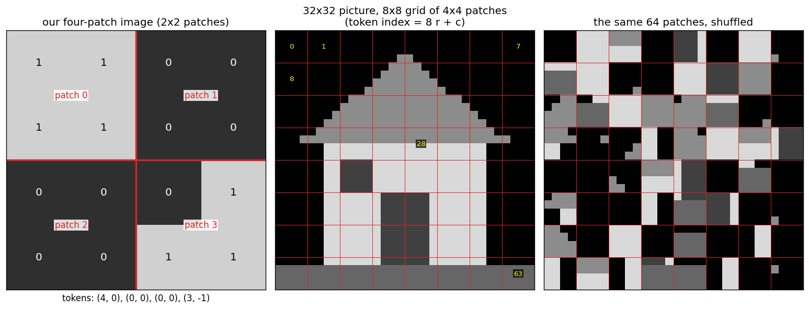
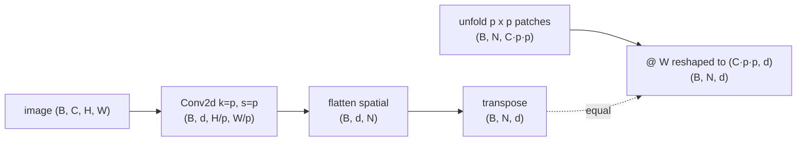
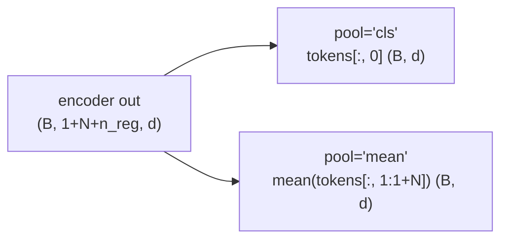
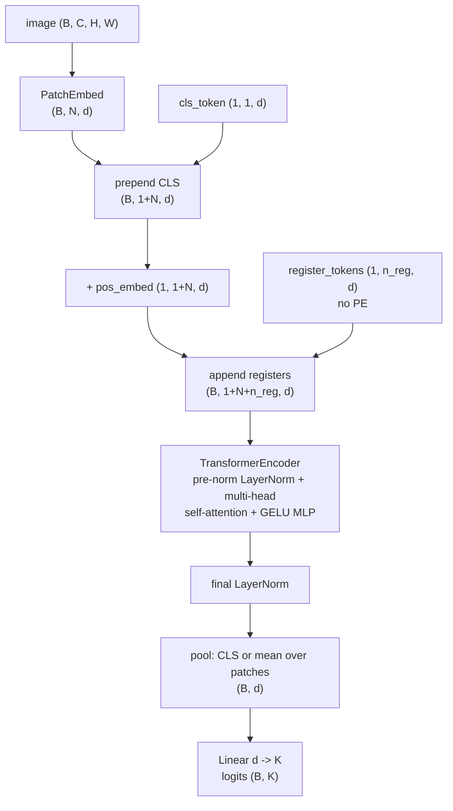
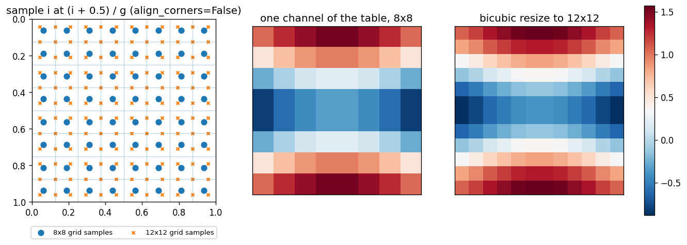
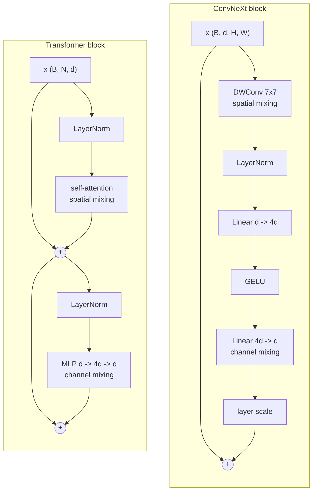

# A2 - Vision transformers, from scratch

The vision transformer (ViT) classifies an image with the same transformer encoder that is used for
text. It cuts the image into a grid of square patches, turns each patch into a token vector with
one shared linear map, adds a learned vector that says where the patch was, and runs the token
sequence through the encoder. One extra token, the class token, collects a summary of the image,
and a linear layer turns that summary into class scores.

A convolutional network builds two assumptions about images into its weights: that nearby pixels
matter most (locality) and that a pattern means the same thing wherever it appears (translation
equivariance). The ViT drops both and learns every spatial relationship from data. These notes
cover what those two assumptions are worth and what giving them up costs, patch embedding as a
strided convolution, the class token and the choice between class-token and mean pooling, the
learned absolute positional embedding and how to interpolate it to a new resolution, register
tokens, and the ConvNeXt block, a convolutional block redesigned to match the ViT.

Build a vision transformer from scratch and overfit it on a small batch of synthetic images.
Implement the patch tokenizer, the token-sequence assembly (class token, positional embedding,
register tokens), the pooling head, the positional-embedding interpolation, and the ConvNeXt block.
The transformer encoder is the pre-norm encoder built earlier in the course, instantiated in the
classic ViT configuration: LayerNorm instead of RMSNorm, a GELU MLP instead of SwiGLU, no causal
mask, and no rotary position, since position arrives here as an absolute table added before the
encoder. The module construction and the CIFAR-10 wiring are provided. Everything runs on CPU in
seconds.

Required reading before starting:
- Dosovitskiy et al. 2020, "An Image is Worth 16x16 Words: Transformers for Image Recognition at
  Scale", [arXiv:2010.11929](https://arxiv.org/abs/2010.11929).
- Liu et al. 2022, "A ConvNet for the 2020s",
  [arXiv:2201.03545](https://arxiv.org/abs/2201.03545).
- Darcet et al. 2024, "Vision Transformers Need Registers",
  [arXiv:2309.16588](https://arxiv.org/abs/2309.16588).

## Lecture notes

### What the vision transformer is for

#### The task

Image classification takes a picture and returns one label from a fixed list. The optional training
run in this assignment uses CIFAR-10: 32x32 color pictures, each labeled with one of 10 classes
(airplane, cat, ship, and so on). The benchmark the ViT was built for is ImageNet-1k: pictures
resized to 224x224, each labeled with one of 1000 classes. A color picture is an array of shape
$(C, H, W)$ with $C = 3$ channels, so a 224x224 picture is about 150,000 numbers, and the network
has to map those numbers to the right label.

The same network, with the classification layer removed, is the image encoder of most later models
in this course: CLIP, the masked autoencoder, DINO, and the vision-language model all start from it.

#### Why not feed pixels to a transformer

The transformer encoder reads a sequence of tokens and lets every token attend to every other one.
The obvious way to apply it to a picture is to make each pixel a token. Attention compares every
pair of tokens, so its cost grows with the square of the sequence length. A 224x224 picture has
50,176 pixels, and one attention matrix over them has $50176^2 \approx 2.5 \times 10^9$ entries,
for every head in every layer. That is far too large to train.

#### The idea, an image as a sequence of patches

The ViT makes tokens out of patches instead of pixels. With $16 \times 16$ patches, a 224x224
picture becomes a $14 \times 14$ grid of 196 patches, and the attention matrix has
$196^2 = 38{,}416$ entries, smaller by a factor of $16^4 = 65{,}536$. Each patch is flattened into a
vector of $3 \cdot 16 \cdot 16 = 768$ numbers and mapped by one shared linear layer to a token of
width $d$. A learned vector for each grid position is added to the token, so the encoder can tell
which patch came from where. A class token is placed in front of the sequence, the whole sequence
goes through the encoder, and the class token's output is fed to a linear classifier.

Nothing in this pipeline is specific to images after the first linear map. The encoder does not
know that patch 0 and patch 1 are neighbors, or that the tokens came from a picture at all. The
title of the paper, "An Image is Worth 16x16 Words", refers to this: the picture is treated as a
sentence of 196 words, each a $16\times16$ patch.

#### What it gives up and why it matters

A convolutional network knows two things about images before it sees any data: nearby pixels
matter most, and a cat is a cat wherever it is in the frame. The ViT knows neither and has to learn
them from the training set. The cost is data: trained on ImageNet-1k alone, the original ViT lost
to a comparable convolutional network, and it only pulled ahead after pretraining on a dataset
hundreds of times larger.

The gain is generality. The same transformer block runs on text tokens and on image patch tokens,
so models that combine vision and language can use one kind of network for both. And attention is
global from the first layer: any patch can use information from any other patch immediately,
instead of waiting for a deep stack of small filters to connect distant regions.

### Our four-patch image (a 4x4 picture cut into four 2x2 patches)

The pictures above have tens of thousands of numbers. To see the mechanism with numbers that fit
on a page, we use a single-channel 4x4 picture with a bright square in the top-left corner and a
bright L-shape in the bottom-right corner:

$$\begin{pmatrix} 1 & 1 & 0 & 0 \\ 1 & 1 & 0 & 0 \\ 0 & 0 & 0 & 1 \\ 0 & 0 & 1 & 1 \end{pmatrix}.$$

With patch size $p = 2$ it is cut into a $2 \times 2$ grid of four patches, numbered row by row:
patch 0 is the top-left $2 \times 2$ block, patch 1 the top-right, patch 2 the bottom-left, and
patch 3 the bottom-right. We call this our four-patch image. It stands for the 32x32 CIFAR-10
picture of this assignment, which with patch size 4 is cut into an $8 \times 8$ grid of 64 patches,
and for the 224x224 ImageNet picture, which with patch size 16 becomes 196 patches.

For a token width of $d = 2$, the patch-embedding map has two $2 \times 2$ filters. We pick them by
hand so that the tokens are easy to read: the first filter is all ones, so the first token entry is
the patch's total brightness, and the second filter is $+1$ on the top row and $-1$ on the bottom
row, so the second entry is top-row brightness minus bottom-row brightness. (In a trained ViT the
filters are learned.) The four tokens are

$$t_0 = (4, 0), \qquad t_1 = (0, 0), \qquad t_2 = (0, 0), \qquad t_3 = (3, -1).$$



The encoder receives the tokens as a list, and, as the section on position explains, its computation does not depend on the order of
that list. Swap patches 0 and 3 of our four-patch image and the picture changes (the square moves
to the bottom right), but the encoder receives the same four tokens in a different order. The same
holds at full size: the middle and right pictures in the figure are made of the same 64 patches,
and without a positional embedding a ViT gives the same output for both, up to floating-point
round-off. Everything the model knows about the arrangement of patches has to come from the
positional embedding.

Our four-patch image keeps the parts of the real problem these notes are about: the linear map
from a patch to a token, the row-by-row numbering of the grid, the order-blindness of attention,
the class token and pooling, and a positional table defined on a grid. It drops the three color
channels, the realistic token width (64 in this assignment, 768 in the base ViT), and the depth of
the encoder.

### Overview of the rest of the notes

Each part below builds on an idea that is familiar from estimation or signal processing.

1. What a convolution assumes. Choosing a network architecture restricts the functions it can
   represent, like choosing the model order in a least-squares fit. A convolution assumes locality
   and translation equivariance.
2. The data cost of dropping those assumptions, and the training recipe (data augmentation,
   regularization, distillation) that makes up for it.
3. Patch embedding. One linear map applied to every patch, which is a convolution whose stride
   equals its kernel size.
4. Position. Attention computes the same thing whatever the order of its inputs, so position is
   added to each token from a learned lookup table.
5. The class token and pooling. Two ways to average the encoder's outputs into one vector per
   image: with weights computed by attention, or with fixed equal weights.
6. Register tokens. Extra tokens that give the encoder storage space, so that it does not overwrite
   patch tokens to get it.
7. The token sequence, assembled from the pieces above.
8. Positional-embedding interpolation. Resizing the learned table to a new grid is resampling a
   sampled 2D signal, as in image resizing.
9. The ConvNeXt block, a convolutional block built from separable filters that matches the ViT at
   equal compute.

Our four-patch image is used in the patch embedding, position, pooling, and interpolation sections.
Five exercises, placed after the sections they test, are meant to be worked by hand (a calculator
helps for some). Each has a worked answer that can be expanded.

### What a convolution assumes

Fitting a model means picking a function out of a family. The family, and the way it is
parameterized, decides what is cheap to express and what is expensive, before a single training
image is seen. That built-in preference is the inductive bias. Least-squares line fitting has a
strong one: the family is straight lines, so two points nearly determine the answer, and no
quantity of data will ever make it produce a curve. A degree-20 polynomial fit has a weak one: it
can match almost any shape, and it needs far more points to pin down which shape. A strong bias
means fewer samples are needed and less can be expressed. The ViT moves toward the weak end
of this range: it needs more data than a convolutional network and assumes less about images.

A convolutional network's inductive bias is two assumptions wired into the shape of its weights.

Locality is the first. A convolution kernel reads a $k \times k$ neighborhood and nothing else, so
one layer can only relate pixels within $k$ of each other. The set of input pixels that can affect
a given output activation is its receptive field. Stack $L$ stride-1 layers with $k \times k$
kernels and the receptive field is $1 + L(k-1)$ pixels on a side: with $3\times3$ kernels it grows
by two pixels per layer, so relating opposite corners of a 224-pixel image would take over a
hundred layers.

Real convolutional networks avoid that by downsampling. Every so often a stride-2 convolution, or a
pooling layer that replaces each $2\times2$ block by its maximum or its mean, halves the spatial
resolution, so one step in the next feature map covers two input pixels, then four, then eight. The
receptive field then grows geometrically, and four or five such stages cover the image. A network
built from stages at decreasing resolution is called hierarchical. Long-range structure is still
assembled hop by hop, just on a coarser grid at each stage.

Translation equivariance is the second assumption. The same kernel slides across every position, so
shifting the input shifts the output the same way. Writing $T_\delta$ for a shift by an integer
offset $\delta$,

$$\operatorname{conv}(T_\delta\, x) = T_\delta\, \operatorname{conv}(x)$$

away from the image boundary. Weight sharing produces this property: there is one set of kernel
weights, not one per location. A cat seen once in the top-left corner therefore trains the same
detector that will fire in the bottom-right, and the network never has to learn an object
separately at each position. Downsampling narrows the exact identity to shifts that are multiples
of the stride, since a one-pixel shift changes which pixel a pooling window keeps.

Together the two assumptions make convolutional networks sample-efficient, meaning they reach a
given accuracy from fewer labeled images: a large part of what a general model would have to learn,
that vision is local and roughly translation-equivariant, comes with the architecture. The standard
convolutional backbone of the 2010s was the ResNet (He et al. 2016), a deep stack of convolution
blocks with an additive shortcut $x + f(x)$ around each. The shortcut is the same residual form the
transformer block uses, and it lets the stack reach 50 to 152 layers (ResNet-50, -101, and -152)
without the optimization degrading. The ResNet is the baseline the ViT was measured against and the
starting point that ConvNeXt modernizes later in these notes.

> **Exercise 1 (receptive fields by hand).** (a) How many stride-1 $3\times3$ convolution layers are
> needed before one output pixel can see a whole 32x32 CIFAR-10 picture, that is, before the
> receptive field reaches 32 pixels? (b) Now repeat the pattern "$3\times3$ convolution, $3\times3$
> convolution, $2\times2$ max-pool with stride 2". After which layer does the receptive field first
> reach 32? Use the rule that a layer with kernel $k$ adds $(k-1)\,j$ to the receptive field, where
> $j$ is the product of the strides of all earlier layers, and then multiplies $j$ by its own
> stride. (c) How many attention layers does a ViT with $4\times4$ patches need before the class
> token can draw on every pixel?

<details>
<summary>Answer</summary>

(a) The receptive field after $L$ layers is $1 + 2L$, so $1 + 2L \ge 32$ needs $L = 16$, which gives
33. For a 224-pixel picture it would take $L = 112$.

(b) Start with receptive field 1 and $j = 1$. The two convolutions add 2 each: 3, 5. The pool adds
$1 \cdot 1$: 6, and $j$ becomes 2. The next two convolutions add $2 \cdot 2 = 4$ each: 10, 14. The
pool adds 2: 16, and $j = 4$. The next two convolutions add 8 each: 24, 32. The receptive field
reaches 32 at the sixth convolution, the eighth layer overall, against 16 layers without pooling.
Each pool doubles the step size of every later layer, which is why the hierarchical design reaches
the whole image in a few stages.

(c) One. Every token attends to every token in the first layer, and each $4\times4$ patch token
already depends on all 16 pixels of its patch, so after one attention layer the class token's
output can depend on every pixel. Whether it actually uses that information is learned.

</details>

### The data cost of dropping the assumptions

The vision transformer (Dosovitskiy et al. 2020) dropped both convolutional assumptions. There is
no convolution after the patch step, no downsampling between stages, no locality, and no
translation equivariance. Every spatial relationship the model uses, including the basic fact that
adjacent patches are adjacent, is learned from data through self-attention and a learned positional
embedding.

The original ViT only beat strong convolutional networks after pretraining on JFT-300M, a Google
internal dataset of roughly 300 million labeled images. Trained on ImageNet-1k alone, which is
about 1.28 million images across 1000 classes and was the standard vision benchmark of the era, it
lost to a comparable ResNet. Without locality and translation equivariance it had to learn those
regularities from the training set, and a million images were not enough.

DeiT (Touvron et al. 2021) closed most of that gap without the giant dataset, training a
competitive ViT on ImageNet-1k alone. In place of more data it used a training recipe that supplies
the missing assumptions in other ways. Its ingredients reappear across modern vision training, so
they are described here.

Data augmentation applies label-preserving transforms to each training image, so a fixed dataset
yields a fresh variant every epoch and the model is pushed to be invariant to whatever the transform
changed. An invariance the architecture does not have is then learned at the cost of extra
training compute instead of extra labeled images. RandAugment (Cubuk et al. 2020) picks $n$ operations at random from a fixed list (rotate,
shear, translate, posterize, adjust color or contrast, and so on) and applies them in sequence at a
single shared magnitude $m$, which reduces the design of an augmentation policy to the two integers
$n$ and $m$. MixUp (Zhang et al. 2018) trains on convex combinations of pairs: draw $\lambda$ from a
Beta distribution and train on $\tilde{x} = \lambda x_i + (1-\lambda) x_j$ with the soft target
$\tilde{y} = \lambda y_i + (1-\lambda) y_j$, so the model is forced to behave linearly between
examples rather than assigning full confidence everywhere. CutMix (Yun et al. 2019) does the same
spatially: cut a rectangle out of one image, paste the corresponding rectangle from another, and
mix the labels in proportion to the pasted area.

Regularization then limits how much of what remains the model can memorize. Label smoothing
(Szegedy et al. 2016) replaces the one-hot target over $K$ classes with a mixture of the one-hot
vector (weight $1-\varepsilon$) and the uniform distribution over all $K$ classes (weight
$\varepsilon$). The true class gets $1-\varepsilon+\varepsilon/K$ and every other class gets
$\varepsilon/K$. A classifier outputs one unnormalized score per class, called a logit, and the
softmax turns the logits into probabilities; with a one-hot target the loss keeps falling as the
correct logit moves further above the others, and label smoothing removes that incentive. Stochastic depth (Huang et al. 2016) drops each residual branch independently with
probability $p$ during training, so the block computes $y = x$ instead of $y = x + f(x)$ and each
step trains a randomly shallower sub-network. All branches are kept at test time, with each
branch's output scaled by its keep probability $1-p$ so that its average contribution matches
training (many implementations instead divide by $1-p$ during training, which is equivalent). The
CIFAR script in this assignment uses label smoothing 0.1 and weight decay 0.05 (a penalty that shrinks every weight toward zero
by a small fraction at each step) and leaves the rest
of the recipe out.

Distillation supplies the missing assumptions directly. Knowledge distillation (Hinton et al. 2015)
trains a student against a teacher network's output distribution instead of, or alongside, the hard
label; the teacher's spread over the wrong classes carries information a one-hot label does not.
DeiT's version adds a distillation token, a second learnable token alongside the class token whose
output is trained against the prediction of a convolutional teacher. The ViT ends up copying a
convolutional network's behavior, so the locality and translation-equivariance assumptions reach it
secondhand, through the teacher's outputs.

A ViT therefore needs either a very large dataset or a strong training recipe to make up for the
assumptions it does not have.

### Patch embedding

An input batch of images has shape $(B, C, H, W)$. Patch embedding with patch size $p$ produces
$N = (H/p)(W/p)$ patch tokens of width $d$. A 2D convolution with kernel size and stride both equal
to $p$ applies one shared linear map to each $p\times p$ patch, and since the stride equals the
kernel size, the patches do not overlap. That is exactly "flatten each patch and project it",
written as a convolution. The convolution output has shape $(B, d, H/p, W/p)$; flattening the two
spatial dimensions and swapping the last two axes gives $(B, N, d)$.



The strided-convolution path and an explicit unfold-then-linear path produce the same tokens. The
convolution weight has shape $(d, C, p, p)$: output channel $j$ of the convolution is the inner
product of the $j$-th of those $(C, p, p)$ kernels with the patch under it, plus a bias. Flatten
the weight to $(d, C p^2)$ and transpose it, and that inner product becomes a matrix product: each
flattened patch, as a row of length $Cp^2$, times a $(Cp^2, d)$ matrix, plus the same bias. The
only thing that has to line up is the flattening order: the patch and the kernel must be unrolled
the same way (channel, then row, then column).

In our four-patch image, $C = 1$, $p = 2$, and $d = 2$. Unrolling each patch row by row, patch 3 is
the row $(0, 1, 1, 1)$. The two filters unroll to the columns $(1, 1, 1, 1)$ and $(1, 1, -1, -1)$
of a $4 \times 2$ matrix, and the product is $(0+1+1+1,\ 0+1-1-1) = (3, -1)$, the token $t_3$. The
convolution computes the same two inner products by sliding the filters over the picture with
stride 2.

The patch-embedding layer is the only place where the ViT looks at pixels. Its parameter count is
$Cp^2 d + d$: for the base ViT with $16\times16$ patches and $d = 768$ that is
$3 \cdot 256 \cdot 768 + 768 = 590{,}592$.

> **Exercise 2 (counting tokens and attention entries).** The ViT in this assignment takes 32x32 RGB
> pictures with patch size $p = 4$ and token width $d = 64$, and it adds one class token and 4
> register tokens (described later) to the patch tokens. (a) How many patch tokens are there, and
> how many parameters does the patch embedding have? (b) How long is the sequence the encoder sees,
> and how many entries does one attention matrix have? (c) Compare with making every pixel a token.

<details>
<summary>Answer</summary>

(a) $N = (32/4)^2 = 64$ patch tokens, on an $8\times8$ grid. Each patch has $3 \cdot 4 \cdot 4 = 48$
numbers, so the weight has $48 \cdot 64 = 3072$ entries, plus 64 biases: 3136 parameters.

(b) $1 + 64 + 4 = 69$ tokens, and an attention matrix of $69^2 = 4761$ entries per head per layer.

(c) With one token per pixel there are $32^2 = 1024$ tokens and $1024^2 = 1{,}048{,}576$ entries per
attention matrix, 256 times more than the $64^2 = 4096$ entries for the patch tokens alone. The
factor is $p^4 = 4^4$: patching divides the sequence length by $p^2$, and the attention matrix
grows with the square of the length. At ImageNet size with $p = 16$ the same factor is
$16^4 = 65{,}536$.

</details>

### Why position has to be added separately

Attention operates on a set. As in the transformer notes, the output at query position $i$ is
$\sum_j a_{ij} v_j$, a weighted sum over all positions, and the weights come from comparing the
content of query $i$ against the content of each key $j$. Permute the input rows and exactly the
same terms are summed in a different order, so the output rows permute the same way and nothing
else changes. This property is called permutation equivariance, and it means the encoder cannot
tell where anything is unless position is supplied inside the token vectors themselves. The
per-token parts of a block (the normalization and the MLP) act on each row separately, so they keep
this property.

For images the missing information is two-dimensional. The patch grid is flattened row by row
(row-major order), so the patch at row $r$ and column $c$ of a $g \times g$ grid lands at sequence
index $g\,r + c$ (before the class token is prepended). Tokens $i$ and $i+1$ are horizontal
neighbors, tokens $i$ and $i+g$ are vertical neighbors, and none of that reaches the encoder, which
sees an unordered bag of $d$-dimensional rows. In our four-patch image, $g = 2$, and the encoder
sees $t_0, \dots, t_3$ with no indication that $t_0$ and $t_3$ sit at opposite corners.

The ViT supplies the missing information with a learned absolute positional embedding: a parameter
table with one vector per sequence position, of shape $(1, 1+N, d)$ for the class token and the $N$
patch tokens, added elementwise to the tokens before the first block. It is initialized to small
random values and trained like any other weight. Nothing about the table knows the grid is a grid;
the mapping from position to vector is whatever gradient descent finds useful. Dosovitskiy et al.
looked at what it converges to and found that the tables recover the geometry on their own: the
embedding of a patch is most similar to the embeddings of its immediate neighbors, and the
similarity matrix shows clear row and column structure. The model rediscovers 2D adjacency because
the task rewards it. The adjacency information is learned from the training data instead of being
built into the architecture.

### The class token and pooling

The classifier needs one vector per image, and the encoder produces one row per token. Turning the
rows into one vector is called pooling, and the ViT literature uses two kinds.

#### The class token

The ViT borrows its first solution from BERT (Devlin et al. 2019), the bidirectional text
transformer that prepended a special classification token, written [CLS], to every input sequence
and used its final row as the sentence representation.

The class token is a single learned vector of width $d$, the same for every image, placed at
sequence index 0. Because its input value is the same for every image, anything its output row
carries about a particular image had to arrive through attention. Trace one layer: the class row
emits a query, compares it against the keys of all the patch tokens, and its output is
$\sum_j a_{0j} v_j$, a weighted average of the patch value vectors. The token is fixed but the
weights are not, since they depend on each image's patch contents, so the class token acts as a
learned query that pools the image with data-dependent weights. Stacking layers lets the pooled
summary feed back into what it attends to next. Class-token pooling reads row 0 of the encoder
output.

#### Mean pooling

Mean pooling, also called global average pooling, averages the output rows of the $N$ patch tokens,
rows $1$ through $N$. It excludes the class token at index 0 and the register tokens at the end of
the sequence (introduced in the next section); averaging the registers in would mix content-free
storage vectors into the image representation.



The two differ in where the pooling weights come from. Class-token pooling is a weighted average
whose weights are attention scores, learned and recomputed per image; mean pooling is a weighted
average with the weights fixed at $1/N$. Mean pooling asks nothing of the encoder beyond making the
patch rows individually informative, while class-token pooling depends on the encoder having routed
a summary into one particular row. Dosovitskiy et al. compared the two and reported that they reach
comparable accuracy once the learning rate is tuned separately for each. Later models split both
ways: the masked autoencoder uses average pooling, and CLIP's image tower uses the class token. The
assignment implements both, so that either can be used by the models built later.

> **Exercise 3 (one attention step from the class token).** Take the tokens of our four-patch image,
> $t_0 = (4, 0)$, $t_1 = t_2 = (0, 0)$, $t_3 = (3, -1)$, and a class token $c = (1, 1)$ placed in
> front of them. Use one attention head whose query, key, and value maps are the identity, so the
> class token's query is $c$, the keys and values are the sequence entries themselves (including
> $c$), and the scores are dot products divided by $\sqrt{d} = \sqrt{2}$. (a) Compute the class
> token's attention weights and output, and compare the output with mean pooling of
> $t_0, \dots, t_3$. (b) Swap patches 0 and 3, so the sequence is $c, t_3, t_1, t_2, t_0$. What is
> the output now? (c) Add the positional vectors $(0, 1), (0, 1), (0, -1), (0, -1)$ to the four
> patch slots in sequence order (top row $+1$, bottom row $-1$; the class token's positional vector
> is zero) and redo (a) and (b).

<details>
<summary>Answer</summary>

(a) The dot products of $c$ with $c, t_0, t_1, t_2, t_3$ are $2, 4, 0, 0, 2$. Dividing by
$\sqrt{2}$ gives scores $1.414, 2.828, 0, 0, 1.414$, and the softmax gives weights
$0.152, 0.623, 0.037, 0.037, 0.152$. The output is
$0.152\,(1,1) + 0.623\,(4,0) + 0.152\,(3,-1) \approx (3.10, 0)$. Mean pooling gives
$\tfrac14\big((4,0) + (3,-1)\big) = (1.75, -0.25)$. The class token weights the bright patch 0
heavily because its key matches the query best; mean pooling weights every patch equally.

(b) The same five scores appear in a different order, so the same weights multiply the same vectors
and the output is again $(3.10, 0)$. The class token cannot tell the two pictures apart.

(c) With position, the sequence entries become $c = (1,1)$, $(4, 1)$, $(0, 1)$, $(0, -1)$,
$(3, -2)$. The dot products are $2, 5, 1, -1, 1$, the weights $0.096, 0.798, 0.047, 0.011, 0.047$,
and the output is about $(3.43, 0.84)$. After the swap the patch entries are $(3, 0)$, $(0, 1)$,
$(0, -1)$, $(4, -1)$ (patch 3's token now sits in a top-row slot and gets $+1$), the dot products
are $2, 3, 1, -1, 3$, the weights $0.176, 0.358, 0.087, 0.021, 0.358$, and the output is about
$(2.68, -0.12)$. The two pictures now give different outputs, because each entry carries where its
patch was.

</details>

### Register tokens

Register tokens come from an observation about self-supervised ViTs, so those need a definition
first. Self-supervised training uses no labels; the training target is manufactured from the image
itself, by predicting patches that were masked out or by requiring two augmented crops of the same
image to produce matching features. DINO and DINOv2 are the family of self-supervised ViTs this
course covers later, and their appeal is that the patch tokens they produce are useful directly:
the map of what the class token attends to, read as an image, lands on object boundaries with no
segmentation labels involved anywhere in training.

Darcet et al. 2024 found that this map is not clean. Trained ViTs, DINOv2 among them, produce a
small number of patch tokens whose feature norm is far above every other token's, and these tokens
sit in patches whose content is redundant, typically flat background. Probing those outlier tokens
shows they hold little information about their own patch and unusually much about the image as a
whole. The interpretation is that the model takes over a few low-information patches as storage for
global computation and overwrites their local content in the process.

Two things break as a result. Attention maps become blotchy, since the class token attends heavily
to those patches rather than to the object, which damages object discovery: locating objects in an
image by reading those features, with no bounding-box supervision anywhere. And dense prediction,
meaning any task whose output is per-pixel or per-patch, such as segmentation or depth, reads the
patch tokens directly and gets garbage wherever an outlier sits.

The fix is to give the model storage it does not have to take from the patches. Register tokens are
a few extra learnable vectors appended at the end of the sequence. They carry no image content,
they take part in attention like any other token, and they are discarded after the encoder, so
nothing downstream reads them. With them in place the high-norm outliers disappear, the attention
maps clean up, and object-discovery and dense-prediction scores improve. They get no positional
embedding, because they have no position in the image: the positional table is added before the
registers are appended.

Registers cost little. DINOv2 at 518x518 with $14\times14$ patches has a $37 \times 37$ grid of
1369 patch tokens; adding 4 registers to those and the class token grows the sequence from 1370 to
1374 tokens and the attention matrix by about 0.6%.

### The token sequence

Assembly is patch embedding, then prepend the class token, then add the positional table over the
class row and the $N$ patch rows, then append the registers.



The encoder is non-causal, so every token attends to every other in both directions; a classifier
wants that, and an autoregressive text decoder cannot have it. After the encoder come a final
LayerNorm, the pooling step, and a linear layer from $d$ to the $K$ class scores (logits).

The shapes at module boundaries are: images $(B, C, H, W)$; patch tokens $(B, N, d)$; the encoder
input and output $(B, 1+N+n_{\text{reg}}, d)$; the pooled representation $(B, d)$; the logits
$(B, K)$ for $K$ classes.

### Positional-embedding interpolation

The learned table is tied to the grid it was trained on. A table of $1 + g^2$ rows has no row to
supply for a $g' \times g'$ grid when $g' \ne g$, so running the backbone at a different input
resolution requires resizing it. A model trained on 32x32 pictures with $4\times4$ patches has an
$8\times8$ grid; run on 48x48 pictures it sees a $12\times12$ grid and needs 144 patch rows instead
of 64.

The table is resized as an image. Each of the $d$ channels of the patch part of the table is a
scalar defined on the $g \times g$ grid, that is, a small single-channel image, and resizing a
sampled 2D signal means evaluating it at a new set of sample locations. Bilinear interpolation
computes each new sample as a weighted average of the four surrounding grid samples, with weights
linear in distance. Bicubic interpolation, the usual choice for positional tables, uses the
$4\times4$ surrounding samples. PyTorch's `F.interpolate` uses the cubic convolution kernel of Keys
(1981) with parameter $a = -0.75$: the weight of each of the 16 samples is a piecewise-cubic
function of its distance, applied along rows and then along columns. The result passes through the
original samples and has a continuous first derivative, so it avoids the visible creases bilinear
leaves along grid lines. Because some of its weights are negative, it can overshoot slightly near a
sharp change.

In order, the resize does the following. Keep the class row unchanged, since it has no spatial
position. Reshape the patch rows from the flat $(1, g^2, d)$ sequence back to the $(1, g, g, d)$
spatial grid. Move the channel axis to the front, $(1, d, g, g)$, resize bicubically to
$g' \times g'$, then move it back and flatten to $(1, g'^2, d)$. Concatenate the kept class row,
giving $(1, 1+g'^2, d)$.

The resize uses the convention in which sample $i$ of a $g$-sample axis sits at normalized
coordinate $(i + 0.5)/g$, at the center of its cell, rather than pinning the first and last samples
to the edges (PyTorch's `align_corners=False`). The map from an output coordinate to an input
coordinate is then a pure scale, so resizing to the same size is the identity up to floating-point
round-off. The left panel of the figure shows the sample centers of an $8\times8$ grid and a
$12\times12$ grid covering the same square, and the other two panels show one channel of a smooth
example table before and after the bicubic resize.



Interpolation is required whenever a ViT backbone runs at a resolution other than the one it was
trained at. That includes CLIP run at varying input sizes and detectors run at high resolution, and
DINOv2 keeps the learned table and interpolates it in the same way.

The learned-table-plus-interpolation design is from 2020, and two later schemes carry position
without a fixed-size table. Fixed 2D sinusoidal embeddings evaluate the 2017 transformer's
$\sin/\cos(\text{pos}/10000^{2i/d})$ formula on the row index for half the channels and on the
column index for the other half, then concatenate. Nothing is learned, so a new grid is handled by
evaluating the formula at new indices and no resize step exists; the masked autoencoder
([arXiv:2111.06377](https://arxiv.org/abs/2111.06377)) uses this. 2D axial rotary embeddings (Heo
et al. 2024, [arXiv:2403.13298](https://arxiv.org/abs/2403.13298)) extend rotary position
embedding, which rotates pairs of query and key channels by an angle proportional to position so
that the attention score depends only on the offset between the two positions. The axial version
assigns half the channel pairs to the row coordinate and half to the column, so the score depends
on the 2D offset $(\Delta r, \Delta c)$, and a larger grid only produces larger offsets.

> **Exercise 4 (resizing a table by hand).** Use one channel along one axis, with linear
> interpolation so the arithmetic stays short (the 2D bilinear and bicubic resizes apply the same
> coordinate rule along each axis). Take one row of one channel of the positional table of our
> four-patch image, with values $(0, 4)$ on $g = 2$ samples, and resize it for a picture twice as
> large, $g' = 4$. (a) With sample $i$ at $(i+0.5)/g$, output sample $i$ reads the input at position
> $(i + 0.5)\,g/g' - 0.5$ in input-sample units, clamped to the valid range. Compute the four output
> values. (b) Under the other convention, which pins the first and last samples to the edges
> (`align_corners=True`), output sample $i$ reads position $i\,(g-1)/(g'-1)$. Compute the four
> values. (c) Show that under the first convention a resize from $g$ to $g$ samples returns the
> input unchanged.

<details>
<summary>Answer</summary>

(a) The read positions are $(i + 0.5)/2 - 0.5 = -0.25, 0.25, 0.75, 1.25$. Clamping the first and
last to $0$ and $1$ and interpolating linearly between the values $0$ and $4$ gives $(0, 1, 3, 4)$.

(b) The read positions are $0, 1/3, 2/3, 1$, giving $(0, 4/3, 8/3, 4) \approx (0, 1.33, 2.67, 4)$.
The two conventions disagree in the interior, so a table must be resized with the convention the
rest of the code assumes; a mismatch shifts every position slightly.

(c) With $g' = g$ the read position is $(i + 0.5) - 0.5 = i$, exactly input sample $i$, so the
interpolation weight is 1 on that sample and 0 elsewhere. The same holds for the bicubic kernel,
which is 1 at distance 0 and 0 at distances 1 and 2.

For comparison, PyTorch's bicubic resize of $(0, 4)$ to 4 samples gives about
$(-0.42, 0.91, 3.09, 4.42)$: with only two input samples, the cubic kernel overshoots both ends.

</details>

### The ConvNeXt block

The ConvNeXt block (Liu et al. 2022) is the convolutional side's answer to the ViT. Its authors
measured it against two transformers: the plain ViT and Swin (Liu et al. 2021), a hierarchical ViT
that restores locality and a resolution pyramid by computing attention inside shifted local
windows. They first trained a ResNet with the modern training recipe (the DeiT-style
augmentation and regularization above, plus layer scale, described below). They then changed the
ResNet toward the transformer one step at a time at a fixed compute budget: the stage compute
ratios and a patchify stem (a first layer that cuts the image into non-overlapping patches, like
the ViT's patch embedding) borrowed from Swin, a depthwise $7\times7$ convolution in place of the
$3\times3$, an inverted bottleneck, layer normalization in place of batch normalization (which
normalizes each channel with statistics computed across the training batch, so its output depends
on the other images in the batch), GELU in place of ReLU, and fewer normalization and activation
layers per block. The result matched the plain ViT and Swin at equal compute, with no attention
anywhere in it.

Three of those pieces need definitions.

A depthwise convolution is a convolution with no cross-channel mixing. An ordinary $k \times k$
convolution from $d$ channels to $d$ channels holds $d^2k^2$ weights, because every output channel
reads every input channel. A depthwise one gives each channel its own $k \times k$ kernel and keeps
the channels separate, so it holds $dk^2$ weights. At $d = 64$ and $k = 7$ this is 3136 weights
instead of 200704. That saving makes a $7\times7$ kernel affordable, and a $7\times7$ window per
layer moves the block toward the large window of self-attention. Spatial mixing and channel mixing
are then done by separate operators, which is the separable-filter idea (a 2D operation factored
into cheaper parts) that the MobileNet line of networks applied to convolutions.

An inverted bottleneck is the channel-mixing half. The classic ResNet bottleneck squeezes channels
down (a $1\times1$ convolution to $d/4$, a $3\times3$ convolution there, a $1\times1$ back up) to
keep the expensive spatial convolution narrow. The inverted version, from MobileNetV2 (Sandler et
al. 2018), goes the other way and widens instead of squeezing; ConvNeXt expands to $4d$, applies
the nonlinearity, and projects back to $d$. That is the same widen-then-narrow shape as the
transformer's feed-forward network, at the same $4\times$ ratio. A $1\times1$ convolution is the
same operation as a linear layer applied at every pixel with the channel axis last.

Layer scale (Touvron et al. 2021, the CaiT paper) is a per-channel learned gain
$\gamma \in \mathbb{R}^d$ multiplying the branch output before the residual add, initialized at
$10^{-6}$. At initialization the branch contributes about a millionth of its output, so the block
starts as the identity and each block's contribution grows only as training finds it useful. This
keeps deep stacks stable early in training, when many randomly initialized branches adding into
one residual stream would otherwise swamp it.

The block runs the depthwise convolution and the residual add channels-first, $(B, d, H, W)$, and
the normalization and the two pointwise linear layers channels-last, $(B, H, W, d)$:

$$y = x + \operatorname{LayerScale}\!\Big(W_2\,\operatorname{GELU}\big(W_1\,\operatorname{LN}(\operatorname{DWConv}_{7\times7}(x))\big)\Big).$$



Both blocks separate a spatial-mixing operator from a channel-mixing MLP. Only the spatial operator
differs: the convolution mixes a fixed $7\times7$ neighborhood with weights that do not depend on
the input, while attention mixes all positions with weights computed from the input. The $4\times$
expansion ratio, LayerNorm, GELU, and the residual structure are shared (the transformer block puts
each half on its own residual branch, while the ConvNeXt block puts both on one). ConvNeXt's
conclusion is that the ViT's accuracy gains came largely from that shared macro design, the stage
layout and block structure, together with the modern training recipe, rather than from attention
beating convolution as an operator.

> **Exercise 5 (where the parameters are).** Count the parameters of one ConvNeXt block at $d = 64$
> (depthwise $7\times7$ convolution with bias, LayerNorm with a gain and a bias per channel, the
> two linear layers with biases, and $\gamma$). Then count one ViT block at $d = 64$: LayerNorm,
> attention with query, key, value, and output projections that are $d \times d$ with biases,
> LayerNorm, and an MLP $d \to 4d \to d$ with biases. In each block, how many parameters go to
> spatial mixing and how many to channel mixing?

<details>
<summary>Answer</summary>

ConvNeXt block: depthwise convolution $64 \cdot 49 + 64 = 3200$; LayerNorm $2 \cdot 64 = 128$;
first linear $64 \cdot 256 + 256 = 16{,}640$; second linear $256 \cdot 64 + 64 = 16{,}448$;
$\gamma$ 64. Total 36,480.

ViT block: two LayerNorms $4 \cdot 64 = 256$; attention $4\,(64^2 + 64) = 16{,}640$; MLP
$64 \cdot 256 + 256 + 256 \cdot 64 + 64 = 33{,}088$. Total 49,984.

Channel mixing is the same 33,088 parameters in both. Spatial mixing costs 3200 parameters in
ConvNeXt and 16,640 in the ViT block. Those 16,640 are the query, key, value, and output
projections, linear maps applied to each token separately; the mixing across positions itself, the
softmax-weighted sum, has no parameters. Most of either block is the channel-mixing MLP, and the
operator that differs between the two architectures is the smaller part. (The computation in
attention also grows with the square of the number of tokens, which a parameter count does not
show.)

</details>

## The assignment

Fill these holes, in order. Each is one `NotImplementedError` with a matching test; the docstring
in each file gives the signature, shapes, and constraints.

| # | Function | File | Concept from the notes |
|---|---|---|---|
| 1 | [`ConvNeXtBlock.forward()`](convnext.py) | `convnext.py` | the ConvNeXt block |
| 2 | [`PatchEmbed.forward()`](vit.py) | `vit.py` | patch embedding as a strided convolution |
| 3 | [`ViT._assemble_tokens()`](vit.py) | `vit.py` | the token sequence: class token, positional embedding, registers |
| 4 | [`ViT._pool()`](vit.py) | `vit.py` | class-token and mean pooling |
| 5 | [`interpolate_pos_embed()`](vit.py) | `vit.py` | positional-embedding interpolation |

Notes on specific holes:
- `ConvNeXtBlock.forward`: `self.dwconv` is the depthwise convolution (`groups=dim`), `self.pw1`
  and `self.pw2` are the two `nn.Linear` layers, and `self.gamma` is the layer-scale gain, applied
  only when it is not `None`. The two permutes are needed because `Conv2d` wants channels at
  dimension 1, while LayerNorm normalizes over the last axis and `nn.Linear` contracts the last
  axis. Use the course's own `LayerNorm` and `gelu` (already imported in the file), not
  `nn.LayerNorm`; the forbidden-imports test enforces this.
- `PatchEmbed.forward`: the strided `Conv2d` is provided as `self.proj`; the hole turns its
  $(B, d, H/p, W/p)$ output into $(B, N, d)$. `F.unfold` emits patch entries ordered as (channel,
  row, column), which matches how the $(C, p, p)$ kernel flattens, so the convolution and the
  unfold-then-linear path agree to floating-point tolerance; `tests/test_patch_equivalence.py`
  checks that equality.
- `ViT._assemble_tokens`: `self.cls_token` is $(1, 1, d)$, `self.pos_embed` is $(1, 1+N, d)$, and
  `self.register_tokens` is $(1, n_{\text{reg}}, d)$, all initialized from a truncated normal with
  standard deviation 0.02. Broadcast the class token and the registers across the batch, add
  `pos_embed` before appending the registers, and append them only when `n_registers > 0`.
- `ViT._pool`: `self.pool` is `"cls"` or `"mean"`, and `self.n_patches` is $N$.
- `interpolate_pos_embed`: `F.interpolate` treats dimension 1 as channels and interpolates the
  trailing spatial dimensions, which is why the table is permuted to $(1, d, g, g)$ first. Use
  `mode="bicubic"` and `align_corners=False`.
- Provided: the module construction, `ViT.forward`, and `ViT.forward_features`, which runs the same
  stack but returns only the $N$ patch rows, dropping the class token and the registers, for
  downstream models that want one feature vector per patch. The encoder is
  `TransformerEncoder(..., norm="layer", ffn="mlp", pos="none")` from the transformer assignment.
  `train_cifar.py` (and its copy in `solution/`) wires the ViT to CIFAR-10 with AdamW at learning
  rate $10^{-3}$, weight decay 0.05, and label smoothing 0.1. `config.py` holds the default sizes.

### Running and validating

Activate the environment (`conda activate nanovision`), then run from the repo root:

```
make test     A=a02_vit   # run the tests against the top-level files (the ones with holes)
make verify   A=a02_vit   # run the same tests against the reference solution/
make viz      A=a02_vit   # render the figures from the reference solution
make viz-mine A=a02_vit   # render the figures from your own code (once the holes are filled)
```

`make test` is the command to run while working. It runs the suite in `assignments/a02_vit/tests/`
against the top-level files. The tests fail while the holes raise `NotImplementedError` and pass as
the holes are filled in correctly. `make verify` runs the same suite against the reference answer
key in `solution/`: it sets `NANOVISION_IMPL=solution`, which makes the tests import the reference
implementation instead of the top-level files. It passes from the start, which confirms the tests
and environment work. The goal is to make `make test` pass as `make verify` does. The reference is
visible in `solution/vit.py` and `solution/convnext.py`; read it if stuck.

The tests, in the order that doubles as the workflow:
- `tests/test_shapes.py` checks that the ConvNeXt block preserves its shape, that patch embedding
  maps a 32x32 image to 64 tokens, that the full ViT maps an image batch to class logits, and that
  the encoder sequence length is $1 + 64 + n_{\text{reg}}$.
- `tests/test_gradcheck.py` runs the float64 gradient check on the ConvNeXt block and patch
  embedding, comparing each analytic gradient against a finite-difference estimate of the same
  quantity.
- `tests/test_patch_equivalence.py` checks that the convolutional patch embedding equals the
  unfold-then-linear path with the convolution weight reshaped to $(C\,p\,p, d)$.
- `tests/test_pos_interp.py` checks that an 8x8 table resizes to a 12x12 grid of the right shape,
  that a same-grid resize is near-identity, and that a 32x32-trained ViT runs a 48x48 forward after
  swapping in the interpolated table.
- `tests/test_registers.py` checks that the register tokens enter the sequence, receive gradients
  after a backward pass, and are excluded from mean pooling along with the class token, and that
  class-token pooling reads index 0.
- `tests/test_overfit.py` overfits a batch of 8 seeded random-noise images with random labels to
  cross-entropy below 0.02 in 500 steps, for both class-token and mean pooling.
- `tests/test_forbidden_imports.py` checks that the top-level files, the solution, and the
  shared-library shim use no prebuilt attention or transformer module, fused attention,
  `nn.LayerNorm`, `timm`, or `torchvision.models` in actual code; mentions in prose are allowed,
  and this test passes with the holes in place too.

`make viz` renders from the reference solution, so it works on a fresh checkout and shows the
target figures. `make viz-mine` runs the same script against the top-level code, to check a
finished implementation by eye; it needs the holes filled. Both write PNG files to `out/` instead
of opening windows, using matplotlib's headless Agg backend, so they behave the same over SSH, in
WSL, and in CI with no display. Add `SHOW=1` to either to also open interactive windows when a
display is available. The figures are:
- `vit_overfit.png`: the loss curve of the overfit run.
- `cls_attention.png`: a class-token attention rollout over the patch grid on a synthetic image
  with a bright off-center blob.
- `dinov2_registers.png`, only if `timm` (the PyTorch Image Models library, the usual source of
  pretrained vision weights) and the DINOv2 weights are reachable: the norm of every patch token of
  DINOv2 ViT-B (`vit_base_patch14_dinov2`) and its register version (`vit_base_patch14_reg4_dinov2`)
  on matplotlib's bundled `grace_hopper.jpg` photo at 518x518, a $37\times37$ grid. The norms are
  taken from the output of encoder block 9 of 12, captured with a forward hook before the final
  norm, with the class and register tokens dropped. The first run downloads about 331 MB of weights
  per model (about 660 MB in total) into the Hugging Face cache; later runs work offline. The
  script prints a message and skips the figure if `timm` or the weights are unavailable.

The attention rollout in `cls_attention.png` is not a raw attention matrix. One layer's attention
matrix says how much each output row draws on each input row, but by layer two those input rows
are already mixtures, so the class row attending to patch $j$ in layer two says nothing about how
much of its content came from image patch $j$. Rollout (Abnar and Zuidema 2020) approximates the
composition: average the heads to get one $S \times S$ matrix per layer, add the identity and
renormalize each row to account for the residual connection carrying every row's own content past
the attention, then multiply the layer matrices together. Row 0 of the product, restricted to the
patch columns, is the estimated fraction of the class token's final content traceable to each
patch, and it reshapes to the $g \times g$ grid. It ignores the MLP and the value projections, so
it is an estimate of routing rather than an exact accounting.

The figures in the notes are generated by `assets/make_vit_figures.py` (run it from `assets/`). It
draws our four-patch image and a 32x32 picture with its patches shuffled, and it resizes a smooth
example table with `F.interpolate`. It does not use the assignment code.

What you should see when you run this. The overfit test uses dimension 64, patch 4 (so 64 patch
tokens), depth 2, 4 heads, 4 register tokens, batch 8 synthetic images, Adam at learning rate
$3\times10^{-3}$, and 500 steps. It reaches cross-entropy well under 0.02 for both pooling modes (in
one run of the reference solution, $2.7 \times 10^{-4}$ for class-token pooling and
$1.5 \times 10^{-4}$ for mean pooling, 10 to 15 seconds each on a CPU limited to 2 threads, and less with more threads), so the
loss curve drops steeply. A flat curve usually means a wrong mechanism, most often pooling over the
wrong index range or a misshaped positional-embedding add, not a tuning problem. The class-token
attention rollout is on an untrained model, so it is a sanity figure for the rollout mechanics
rather than a meaningful saliency map. In the DINOv2 comparison, the model without registers has 4 patch
tokens whose block-9 norm is far above the rest (median 8.6, maximum 425.9, about 49 times the
median), while the register model's largest token is 1.5 times its median (29.0 against 19.6),
which is the effect Darcet et al. report. Two differences from the paper show up in these
checkpoints. The 4 outliers always sit in the same $2\times2$ corner of the grid (rows and columns 0
and 1), and they appear there for a random-noise input too, so in this model their location does
not depend on the image content. And they are present only in blocks 9 to 11: at the output of
block 12, the last block, the largest token norm is 1.2 times the median. That is why the figure
reads an intermediate block. Why the last block removes them in these released checkpoints was
not investigated. DINOv2 ViT-S shows no outliers at any block, consistent with the paper's finding
that only the larger models produce them. The optional CIFAR-10 run (`solution/train_cifar.py`) is a wiring sanity run,
not a convergence run: a tiny ViT from scratch underfits CIFAR-10 without the full DeiT recipe, and
that gap is the missing inductive bias rather than a bug. These are toy artifacts and say nothing
about quality at scale.

## Where this goes next

This is the visual backbone the rest of the course imports. The masked autoencoder and DINO reuse
the patch embedding and the class-token output. CLIP uses the ViT as its image tower and the
class-token output as the image embedding aligned with text. The vision-language model feeds the
per-patch tokens, not just the class token, into a projector that maps image features into the
language model's token space. Detection and segmentation and the bird's-eye-view lift reshape the
patch tokens from a $(B, N, d)$ sequence back to a $(B, H/p, W/p, d)$ spatial feature map, because
a detector or a lift needs to know which patch sits where.

## References

- Dosovitskiy et al. 2020, "An Image is Worth 16x16 Words",
  [arXiv:2010.11929](https://arxiv.org/abs/2010.11929). The original ViT: patches as tokens, the
  plain transformer applied to vision, the data-hunger ablation, the class-token versus
  average-pooling ablation, and the learned position tables recovering grid structure.
- Touvron et al. 2021, "Training data-efficient image transformers & distillation through
  attention" (DeiT), [arXiv:2012.12877](https://arxiv.org/abs/2012.12877). The augmentation and
  distillation recipe that trains a competitive ViT on ImageNet-1k alone.
- Liu et al. 2022, "A ConvNet for the 2020s" (ConvNeXt),
  [arXiv:2201.03545](https://arxiv.org/abs/2201.03545). A modernized convolutional network that
  matches ViT at equal compute; the block built here.
- Darcet et al. 2024, "Vision Transformers Need Registers",
  [arXiv:2309.16588](https://arxiv.org/abs/2309.16588). The high-norm background artifacts in
  self-supervised ViTs and the register-token fix.
- He et al. 2022, "Masked Autoencoders Are Scalable Vision Learners",
  [arXiv:2111.06377](https://arxiv.org/abs/2111.06377). 75% patch masking on the same patch
  embedding; 2D sinusoidal positional embeddings; average pooling for the classification head.
- Oquab et al. 2023, "DINOv2", [arXiv:2304.07193](https://arxiv.org/abs/2304.07193). Emergent ViT
  features and the model used in the optional viz comparison.
- Heo et al. 2024, "Rotary Position Embedding for Vision Transformer",
  [arXiv:2403.13298](https://arxiv.org/abs/2403.13298). 2D axial rotary position for
  resolution-agnostic ViTs, the modern alternative to an interpolated learned table.
- Caron et al. 2021, "Emerging Properties in Self-Supervised Vision Transformers" (DINO),
  [arXiv:2104.14294](https://arxiv.org/abs/2104.14294). Class-token self-attention that segments
  objects without labels.
- He et al. 2016, "Deep Residual Learning for Image Recognition" (ResNet),
  [arXiv:1512.03385](https://arxiv.org/abs/1512.03385). The convolutional baseline and the residual
  block ConvNeXt starts from.
- Liu et al. 2021, "Swin Transformer: Hierarchical Vision Transformer using Shifted Windows",
  [arXiv:2103.14030](https://arxiv.org/abs/2103.14030). Windowed attention with a resolution
  pyramid, the hybrid ConvNeXt is measured against.
- Devlin et al. 2019, "BERT: Pre-training of Deep Bidirectional Transformers for Language
  Understanding", [arXiv:1810.04805](https://arxiv.org/abs/1810.04805). The origin of the
  prepended classification token.
- Sandler et al. 2018, "MobileNetV2: Inverted Residuals and Linear Bottlenecks",
  [arXiv:1801.04381](https://arxiv.org/abs/1801.04381). The inverted bottleneck.
- Touvron et al. 2021, "Going deeper with Image Transformers" (CaiT). Layer scale, the small
  initialized gain on each residual branch.
- Hinton et al. 2015, "Distilling the Knowledge in a Neural Network",
  [arXiv:1503.02531](https://arxiv.org/abs/1503.02531). Training a student against a teacher's
  output distribution.
- Cubuk et al. 2020, "RandAugment: Practical automated data augmentation with a reduced search
  space", [arXiv:1909.13719](https://arxiv.org/abs/1909.13719).
- Zhang et al. 2018, "mixup: Beyond Empirical Risk Minimization",
  [arXiv:1710.09412](https://arxiv.org/abs/1710.09412).
- Yun et al. 2019, "CutMix: Regularization Strategy to Train Strong Classifiers with Localizable
  Features", [arXiv:1905.04899](https://arxiv.org/abs/1905.04899).
- Huang et al. 2016, "Deep Networks with Stochastic Depth",
  [arXiv:1603.09382](https://arxiv.org/abs/1603.09382).
- Szegedy et al. 2016, "Rethinking the Inception Architecture for Computer Vision",
  [arXiv:1512.00567](https://arxiv.org/abs/1512.00567). Label smoothing.
- Abnar and Zuidema 2020, "Quantifying Attention Flow in Transformers". Attention rollout, used by
  the viz.
- Keys 1981, "Cubic convolution interpolation for digital image processing", IEEE Transactions on
  Acoustics, Speech, and Signal Processing. The bicubic kernel used for the positional-table resize.
