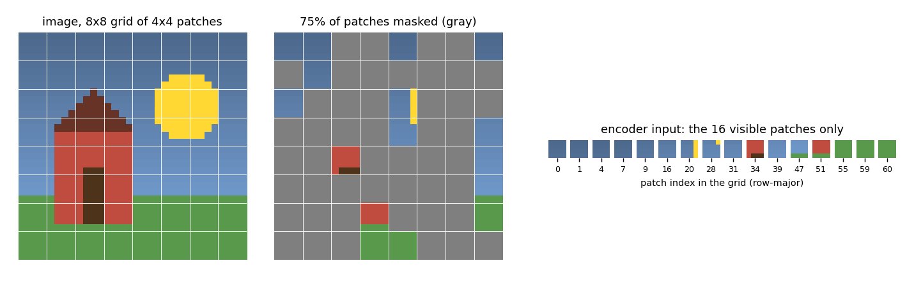
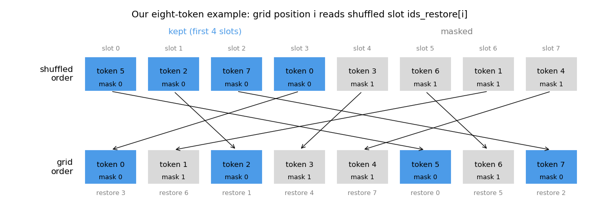
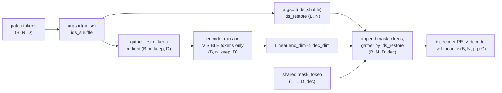
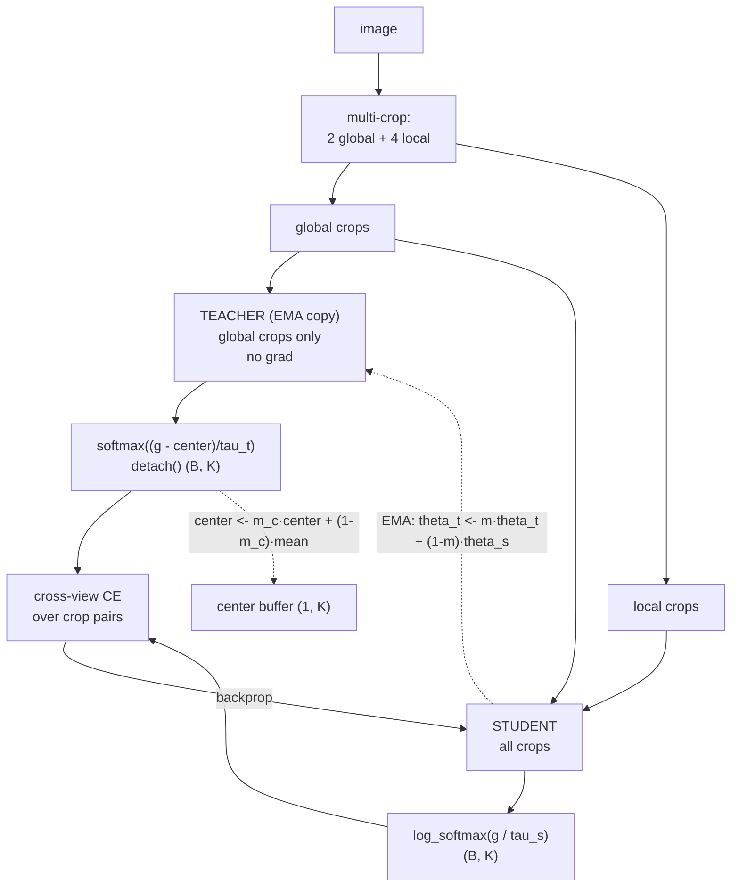
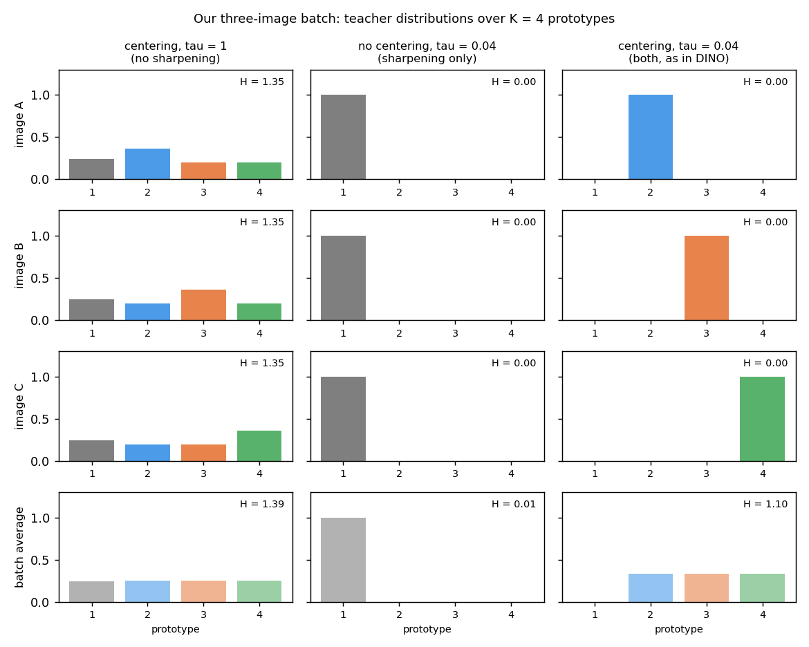
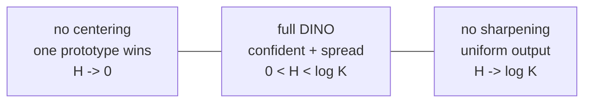
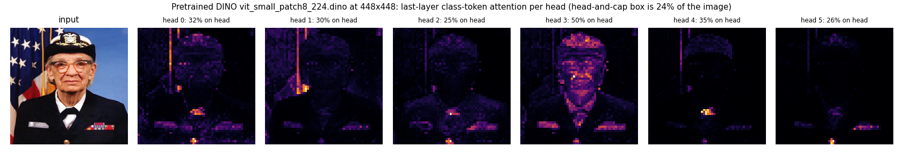

# A3 - Self-supervised learning (MAE and DINO)

Self-supervised learning (SSL) trains a representation from unlabeled images. It invents a pretext
task, a training objective whose targets are computed from the image itself by a fixed rule, so
that no human annotator is needed. When the pretext task is chosen well, pretraining scales with
the number of raw images instead of with the annotation budget, and the trained network (the
backbone) transfers to detection, segmentation, retrieval, and depth estimation with a small
labeled head trained on top.

This assignment covers the two methods that most later image SSL builds on. The masked autoencoder
(MAE) hides most of an image and reconstructs the missing pixels with an asymmetric
encoder-decoder: a large encoder that sees only the visible patches and a small decoder that fills
in the rest. DINO trains a student network to match the output of a teacher network, which is an
exponential moving average of the student, across different crops of the same image. The output
is a probability distribution over learned prototypes, and two cheap operations on the teacher,
centering and sharpening, keep the representation from collapsing to a constant.

Build both methods on a tiny vision transformer (ViT) over 32x32 images. Implement MAE's random
masking, its decoder-side reassembly, and its masked-patch loss; then DINO's cross-view
distillation loss, the teacher and centering updates, and the entropy measurement that shows
whether training has collapsed. The ViT backbone, the multi-crop augmentation, the projection
head, and the training-step wiring are provided. Everything runs on CPU with synthetic seeded
tensors in under a minute.

Required reading before starting:
- He et al. 2022, "Masked Autoencoders Are Scalable Vision Learners",
  [arXiv:2111.06377](https://arxiv.org/abs/2111.06377).
- Caron et al. 2021, "Emerging Properties in Self-Supervised Vision Transformers",
  [arXiv:2104.14294](https://arxiv.org/abs/2104.14294). Algorithm 1 is the spec for the DINO
  loss, the teacher update, and centering.

## Lecture notes

### What self-supervised learning is for

#### The task

A perception system needs a backbone: a network that maps an image to a feature vector, or to a
grid of feature vectors with one per image patch, such that the features describe what is in the
image. A detector, a segmentation network, or a depth estimator is then a small head on top of
those features. The question these notes answer is how to train the backbone when almost none of
the available images have labels.

Take the 32x32 picture below: a house, the sun, sky, and grass. A good backbone should produce
features from which a small head can tell where the house is, which pixels are sky, and that the
yellow disk is the same kind of object as the sun in another picture. Nothing in the training data
says any of this; there is only a large pile of pictures like this one.



#### Why labels are the bottleneck

A ViT carries no built-in assumption that nearby pixels belong together or that a shifted object
is the same object. A convolution builds both in; a transformer has to learn them from data. So a
ViT needs either a large labeled dataset or a heavy augmentation recipe before its representation
is worth anything.

Labels are the part that does not scale. ImageNet-1k has 1.3 million images, each carrying a human
decision; the internet has billions of images carrying none. Self-supervised learning aims at the
second pile.

#### The pretext task

The pretext task is a training objective whose targets come from the input by a fixed rule, so any
image can be turned into a training example with no annotator. The rule is chosen because solving
it is believed to require understanding the image, not because anyone wants its answer for its own
sake. Early examples give the flavor. Cut two patches from an image and predict their relative
arrangement (Doersch et al. 2015). Rotate an image by a multiple of 90 degrees and predict which
rotation was applied (Gidaris et al. 2018). Strip the color and predict it back (Zhang et al.
2016). In each case the answer is free, because the pipeline generated it.

Pretraining splits the network in two. The backbone is the stack that maps an image to features.
The head is the small set of layers on top that turns those features into whatever the current
task wants. Pretraining trains both on the pretext task, then discards the head and keeps the
backbone. A downstream task (detection, segmentation, depth, retrieval) attaches a fresh head and
trains it on however few labels it has. All of the value of SSL is in the quality of the backbone
it leaves behind.

#### Why the obvious pretext tasks fail

Each pretext task has a trivial solution, a way to drive the loss down without learning anything
about objects, and a method works only if it blocks that solution.

The most obvious task is to reconstruct the input. A network asked to output its own input can
copy it, and if a few pixels are hidden it can fill them by averaging their neighbors. Both reduce
the loss and neither needs to know that the red block is a house.

The second obvious task is to show the network two different crops of the same picture (say the
left two thirds and the right two thirds) and train it to produce the same features for both. A
network that ignores its input and outputs the same constant vector for every image satisfies this
perfectly. That failure is called collapse.

#### The idea of MAE and DINO

MAE blocks the trivial reconstruction by hiding most of the picture. In the figure, 48 of the 64
patches are gray and only 16 remain. The roof is gone, and of the sun and the door only thin
slivers at the edges of three visible patches remain. The missing parts cannot be filled in by
averaging the neighbors, because most neighbors are missing too; a network that reconstructs them
has to infer from the visible pieces what the scene contains. MAE also gives the expensive encoder
only the 16 visible patches (the strip on the right of the figure), which makes training several
times cheaper.

DINO keeps the "two crops should agree" task and blocks collapse. The target for one crop is the
output of a teacher network on another crop. The teacher is a slowly moving average of the network
being trained, and before its output is used as a target it is centered (a running batch average is
subtracted, which removes any preference shared by all images) and sharpened (made confident about
each image, which keeps the output from becoming uniform). The result is a network whose outputs differ from image to image but agree across crops of
one image.

#### Why it matters

These two methods are the basis of the self-supervised backbones in common use. DINOv2, which
combines DINO with a masked-prediction term in the spirit of MAE, was released in 2023 as a
general-purpose frozen backbone, and its features are used with small trained heads for dense
prediction (one output per pixel or per patch, as in segmentation and depth). Neither method needs
labels. Neither needs negative examples either, pairs of different images that the network is
trained to push apart, which the earlier contrastive methods (described below) required.

### Overview of the rest of the notes

Most of the steps below are familiar ideas applied to a new problem.

1. How a representation is judged. The linear probe, k-nearest-neighbor evaluation, and
   fine-tuning, all of which need labeled held-out data.
2. Why the field moved away from contrastive learning, whose need for negative examples is where
   DINO's teacher construction comes from.
3. MAE. Masked prediction from BERT to MAE; the masking itself, which is a random permutation and
   its inverse; reassembling the patch grid for the decoder; and the loss, a mean squared error on
   per-patch-whitened pixels.
4. The probability tools DINO is written in. Softmax with a temperature (the Boltzmann
   distribution), entropy, and cross-entropy.
5. DINO. Distillation; the teacher, which is a one-pole low-pass filter run on the student's
   weights; the prototypes, which make the head a soft k-means on a sphere; the cross-view loss;
   and centering and sharpening, which remove the two kinds of collapse.
6. Reading collapse off one scalar, the teacher's entropy, and what DINO's features turned out to
   do.

Two small examples make the formulas concrete. Our eight-token example is a single image cut into
8 patches, of which 4 are kept, small enough to follow the masking permutation by hand. Our
three-image batch is a batch of 3 images scored against 4 prototypes, small enough to compute
centering and sharpening by hand. Each is introduced in the section that uses it. Five exercises,
placed after the sections they test, are meant to be worked by hand (a calculator helps for a
few), and each has a worked answer that can be expanded.

### How a self-supervised representation is judged

A falling pretext loss means the pretext task is being solved, which is not the same as the
representation being useful. A network can drive a reconstruction loss down by learning local
smoothing and nothing else. Three standard protocols measure the thing actually wanted, and all
three need labeled held-out data.

The linear probe freezes the backbone, runs a labeled set through it once, and trains a single
linear layer on the resulting features. Its accuracy asks whether the classes are linearly
separable in feature space. Nothing inside the backbone can adapt, so the number describes the
representation rather than how much further training the backbone received.

k-nearest-neighbor (k-NN) evaluation trains nothing at all. Store the features of the labeled
training images, embed a test image, find its nearest stored features by cosine similarity, and
let them vote on the label. This is a stricter test than a linear probe, because it depends on
local distance structure: same-class features have to be close together, not merely on the same
side of some hyperplane.

Full fine-tuning unfreezes everything and trains on the labeled set. It gives the highest number
and says the least about the representation, since a long enough fine-tune can rescue a mediocre
initialization.

The two methods here separate under these protocols. DINO's features are strong under k-NN and a
linear probe (Caron et al. 2021). MAE's are comparatively weak under a linear probe and strong
after fine-tuning. He et al. (2022) report this: their ViT-L reaches 75.8% linear-probe accuracy on
ImageNet against 77.6% for the contrastive method MoCo v3, while with ViT-B fine-tuning MAE reaches
83.6% against 82.8% for DINO and 83.2% for MoCo v3. They find linear-probe and fine-tuning accuracy
largely uncorrelated, and argue against treating linear probing as the only yardstick.

None of the three fits inside this assignment: they need a real dataset and more compute than a
short overfit run. The tests here check that the mechanisms are wired correctly, which is a
precondition for a good representation and not evidence of one.

### Contrastive learning and the cost of negatives

The 2018-2020 wave of image SSL was contrastive. Take an image, apply two random augmentations to
get two views, and train the network so the two views land near each other in feature space while
views of other images are pushed apart. The two views of one image are a positive pair; a pair
drawn from two different images is a negative pair. Pushing negatives apart is how contrastive
methods prevent collapse: a constant output would put the negatives on top of each other.

The standard loss turns this into a classification problem. Given one view, score its similarity
against its positive and against $M$ negatives, softmax the $M+1$ scores, and maximize the
probability assigned to the positive. This is the InfoNCE loss. The more negatives, the harder the
classification and the stronger the learning signal, so negatives have to be supplied in bulk, and
the two systems that made contrastive learning work differ mainly in how they supply them. SimCLR
(Chen et al. 2020, [arXiv:2002.05709](https://arxiv.org/abs/2002.05709)) uses the other images in
the same batch, which pushes batch sizes into the thousands. MoCo (He et al. 2020,
[arXiv:1911.05722](https://arxiv.org/abs/1911.05722)) decouples the negative count from the batch
size with a first-in-first-out queue of features computed on earlier batches (65536 features, the
last 256 minibatches of 256 images). Those features are encoded by a second network whose weights
are a slowly moving average of the trained one, so a feature that entered the queue a few hundred
steps ago is still roughly comparable with today's. That slowly moving copy is the same
construction DINO later uses as its teacher.

Underneath all of it sits the assumption that two different images are dissimilar, and that
assumption is often false. Two photographs of different dogs form a negative pair by construction
and get pushed apart, even though a good representation should place them near each other.

Both methods in this assignment drop negatives. MAE stops comparing images at all and predicts
pixels instead. DINO keeps the comparison but only ever between views of the same image, which
removes the false-negative problem and brings back the collapse problem, since nothing pushes
anything apart.

### Masked prediction, from BERT to MAE

BERT (Devlin et al. 2018, [arXiv:1810.04805](https://arxiv.org/abs/1810.04805)) is the
masked-prediction pretext task in language. Replace about 15% of the tokens in a sentence with a
special `[MASK]` symbol, run the whole sequence through a transformer, and predict the original
token at each masked position from the surrounding context. The supervision is the words that were
hidden, so any text corpus is training data, and predicting a missing word usually requires the
rest of the sentence rather than the two words next to the gap.

A patch is not a word. Images are spatially redundant in a way text is not: a missing 4x4 patch is
usually well approximated by interpolating its neighbors, so a 15% mask on an image is solvable by
local smoothing and teaches nothing about objects.

BEiT (Bao et al. 2021, [arXiv:2106.08254](https://arxiv.org/abs/2106.08254)) carried the recipe
across with three properties inherited from BERT. It masked a modest fraction of the patches. It
predicted discrete visual tokens rather than pixels: a separately trained discrete autoencoder maps
each patch to one integer code out of a fixed vocabulary, so the pretext task becomes
classification over that vocabulary, and the tokenizer has to be trained first. And it ran the
encoder over the whole patch grid, with a learned mask token (one shared vector standing in for
every hidden patch) at the masked positions.

MAE changed all three. It predicts pixels directly, with the per-patch normalization described
below, so no tokenizer has to be trained; He et al. (2022) find that a BEiT-style token target gives
no fine-tuning gain over normalized pixels and lowers linear-probe accuracy. The other two changes made pretraining much cheaper.

First, mask 75% of the patches, not 15%. At that ratio no amount of interpolation from surviving
neighbors reconstructs the missing region, so the model has to infer global structure: what object
this is and how it continues.

Second, run the heavy encoder on the visible 25% only, and give the mask tokens to a small
separate decoder that runs over the full grid. With three quarters of the tokens dropped before the
expensive part, He et al. (2022) report pretraining speedups of 3x or more.

The split has a second benefit beyond cost. The encoder never sees a mask token during
pretraining, and it never sees one downstream either, since a probed or fine-tuned backbone is fed
complete images. An encoder trained on inputs containing a symbol that never appears at deployment
spends capacity on a distribution it will not meet again, and MAE's asymmetry removes that
mismatch. After pretraining the decoder is discarded and the encoder is the backbone.

### The patch grid, and masking as a permutation

The setup shared by both methods is ViT's patch embedding. An image is a tensor of shape
$(B, C, H, W)$ (batch, channels, height, width). It is cut into square patches of side $p$, and
each patch is mapped by a linear layer to a vector of dimension $D$, called a patch token. That
gives $N = (H/p)(W/p)$ tokens per image. Here $H = W = 32$ and $p = 4$, so $N = 64$, the 8x8 grid
in the figure above, and at mask ratio $r = 0.75$ each image keeps
$n_{\text{keep}} = \mathrm{round}((1 - r)\,N) = 16$ tokens.

Which 16 has to differ per image, and that is the awkward part. Selecting a different subset in
each row of a batch with a boolean index gives a ragged result, since there is no dense
$(B, ?, D)$ tensor when rows keep different positions. Sorting solves it. Draw one uniform random
score per token and sort the scores; the order in which the token indices come out is a uniformly
random permutation, and its first $n_{\text{keep}}$ entries are a uniformly random subset of
guaranteed equal size in every row. The operation that returns the sorting order is called
$\operatorname{argsort}$. What remains is a way to get back to the original order, and that is
the inverse permutation. The whole procedure is often called the shuffle-keep-unshuffle trick.

Our eight-token example shows it on a single image cut into $N = 8$ patches with
$n_{\text{keep}} = 4$ (a mask ratio of 0.5, chosen so both halves are visible). It stands for one
image's 64-token sequence in the real problem; each image in a batch draws its own permutation.
Suppose the argsort of the random scores is

$$\text{ids}_{\text{shuffle}} = [5,\, 2,\, 7,\, 0,\, 3,\, 6,\, 1,\, 4].$$

Read it as a listing of original token indices in shuffled order: shuffled slot 0 holds original
token 5, slot 1 holds token 2, and so on. Keeping the first four slots keeps original tokens
$\{5, 2, 7, 0\}$.

Undoing the shuffle needs the opposite lookup: in which shuffled slot did original token $i$ end
up? That is the inverse permutation, and $\operatorname{argsort}$ computes it when applied a second
time, because sorting the values of a permutation returns the positions those values came from:

$$\text{ids}_{\text{restore}} = \operatorname{argsort}(\text{ids}_{\text{shuffle}}) = [3,\, 6,\, 1,\, 4,\, 7,\, 0,\, 5,\, 2].$$

Original token 0 sits in shuffled slot 3, token 1 in slot 6, token 2 in slot 1. A gather by an
index array builds its output by reading $\text{out}[i] = \text{in}[\text{idx}[i]]$. So gathering
any array held in shuffled order by $\text{ids}_{\text{restore}}$ returns it to original patch
order: position $i$ reads slot $\text{ids}_{\text{restore}}[i]$, which holds token $i$. As a check,
gathering $\text{ids}_{\text{shuffle}}$ itself by $\text{ids}_{\text{restore}}$ gives
$[0, 1, \dots, N-1]$.

The binary mask uses this directly. In shuffled order the kept tokens are the first
$n_{\text{keep}}$ slots by construction, so the mask there is $n_{\text{keep}}$ zeros followed by
$N - n_{\text{keep}}$ ones. Gathering it by $\text{ids}_{\text{restore}}$ moves each entry to its
patch position: $[0,0,0,0,1,1,1,1]$ becomes $[0,1,0,1,1,0,1,0]$, which is 1 exactly on the four
tokens $\{1, 3, 4, 6\}$ that were not among the kept $\{5, 2, 7, 0\}$. An entry of the mask is 1
if and only if its patch was dropped. The figure draws the gather: each grid position reads the
shuffled slot its arrow comes from.



> **Exercise 1 (a mask by hand).** Take our eight-token example with a different draw,
> $\text{ids}_{\text{shuffle}} = [6, 1, 3, 0, 7, 2, 5, 4]$, and the real mask ratio $r = 0.75$.
> Compute $n_{\text{keep}}$, the kept tokens, $\text{ids}_{\text{restore}}$, and the mask in grid
> order. Then, after the decoder input is assembled as [kept tokens; mask tokens] in shuffled
> order and gathered by $\text{ids}_{\text{restore}}$ (the next section), what sits at grid
> positions 0 and 6?

<details>
<summary>Answer</summary>

$n_{\text{keep}} = \mathrm{round}(0.25 \cdot 8) = 2$, so the kept tokens are the first two slots,
tokens $6$ and $1$. The inverse permutation lists, for each token $0, \dots, 7$, the slot holding
it: token 0 is in slot 3, token 1 in slot 1, token 2 in slot 5, token 3 in slot 2, token 4 in slot
7, token 5 in slot 6, token 6 in slot 0, token 7 in slot 4, so
$\text{ids}_{\text{restore}} = [3, 1, 5, 2, 7, 6, 0, 4]$.

The mask in shuffled order is $[0, 0, 1, 1, 1, 1, 1, 1]$. Position $i$ of the grid-order mask reads
slot $\text{ids}_{\text{restore}}[i]$, giving $[1, 0, 1, 1, 1, 1, 0, 1]$: zeros exactly at tokens
1 and 6, the two kept ones.

In the assembled decoder input, slot 0 holds encoded token 6, slot 1 holds encoded token 1, and
slots 2 to 7 hold the mask token. Grid position 0 reads slot 3, a mask token; grid position
6 reads slot 0, the encoded token 6. Each visible token returns to its own position, which is the
property the unshuffle has to guarantee.

</details>

### Reassembling the grid for the decoder

The encoder consumed $n_{\text{keep}}$ tokens; the decoder has to emit a prediction at all $N$
patch positions, so the missing slots need something to hold. MAE uses one learned vector, the
mask token, of decoder width $D_{\text{dec}}$, copied into every masked slot. It is the same vector in
every slot: it carries no information about which patch it stands in for or what that patch
contains. The decoder positional embedding, a learned vector per grid position added immediately
after reassembly, is the only thing that tells one masked slot from another. What the decoder
receives at a masked position therefore amounts to "something is missing, and it is at this grid
location".

The assembly order reduces the unshuffle to a single gather. The encoded visible tokens are
already in shuffled order, having been gathered by the first $n_{\text{keep}}$ entries of
$\text{ids}_{\text{shuffle}}$, so concatenating $[\text{visible};\ \text{mask tokens}]$ reproduces
exactly the shuffled layout the mask was built in. One gather by $\text{ids}_{\text{restore}}$ then
sends the whole set back to grid order, where every position holds either its own encoded token or
the shared mask token.



The asymmetry makes MAE cheap. The encoder is wide and deep and sees a quarter of the tokens; the
decoder is narrow and shallow and sees all of them. Attention cost grows with the square of the
sequence length, so running the encoder on 16 tokens instead of 64 cuts its attention cost by a
factor of 16 and the rest of its cost by a factor of 4.

### The masked-patch loss

The reconstruction target is pixels, cut into the same patch grid and then normalized per patch:
each patch vector is shifted to zero mean and scaled to unit variance over its own
$p \cdot p \cdot C$ values, the way a measurement is whitened before it is compared. Two
consequences follow. Every patch contributes on the same scale, so a bright high-contrast patch
does not dominate a flat one, and the model predicts within-patch structure rather than average
brightness. He et al. (2022) found this variant improves the learned representation.

The loss is mean squared error on the masked patches only:

$$\mathrm{mse}_i = \operatorname*{mean}_{\text{pixels}}\big[(\mathrm{pred}_i - \mathrm{target}_i)^2\big], \qquad
L_{\text{mae}} = \frac{\sum_i \mathrm{mask}_i \cdot \mathrm{mse}_i}{\sum_i \mathrm{mask}_i},$$

with $i$ running over every patch of every image in the batch and $\mathrm{mask}_i$ the binary mask
from the previous sections (1 on dropped patches). The mask weight zeroes the visible patches,
because predicting a patch the encoder was shown is free and teaches nothing.

The normalization also fixes the scale of the loss curve, which helps when reading training plots.
The target has zero mean and unit variance per patch, so a model that emits a constant (which is
what an untrained decoder does) lands at a mean squared error of about 1. A masked-patch loss
sitting near 1.0 is the do-nothing baseline rather than a small number.

> **Exercise 2 (the masked-patch loss by hand).** Use 2x2 grayscale patches ($p = 2$, $C = 1$, four
> pixels each). Patch 1 is masked and has raw pixels $(2, 4, 4, 6)$; patch 2 is visible and has
> raw pixels $(1, 1, 3, 3)$. Normalize both targets per patch (use the population variance, dividing
> by 4). The decoder predicts $(-1, 0, 0, 1)$ for patch 1 and $(0, 0, 0, 0)$ for patch 2. Compute
> $L_{\text{mae}}$, the loss that would result if the visible patch were wrongly included, and the
> loss of predicting all zeros on patch 1.

<details>
<summary>Answer</summary>

Patch 1 has mean 4 and variance $(4 + 0 + 0 + 4)/4 = 2$, so its target is
$(-\sqrt2, 0, 0, \sqrt2) \approx (-1.414, 0, 0, 1.414)$. Patch 2 has mean 2 and variance 1, so its
target is $(-1, -1, 1, 1)$.

Patch 1's error is $2(\sqrt2 - 1)^2/4 = (\sqrt2 - 1)^2/2 \approx 0.0858$. Patch 2's error is
$(1 + 1 + 1 + 1)/4 = 1$. With mask $(1, 0)$, $L_{\text{mae}} = 0.0858$. Including the visible
patch would give $(0.0858 + 1)/2 \approx 0.543$, a number dominated by a patch the model was never
asked to predict. Predicting all zeros on patch 1 gives $(2 + 0 + 0 + 2)/4 = 1$, the do-nothing
baseline: after normalization any patch's mean squared value is exactly its variance, 1.

</details>

### Softmax, temperature, and entropy

DINO's objective is written entirely in terms of probability distributions over a finite set, so
the operations it uses come first.

A network's last layer emits $K$ real numbers with no constraint on sign or scale. Those are the
logits, written $g$ here. The softmax turns them into a probability distribution by
exponentiating and normalizing:

$$p(k) = \frac{\exp(g_k/\tau)}{\sum_{j=1}^{K}\exp(g_j/\tau)}.$$

This is the Boltzmann distribution with energy $-g_k$ and temperature $\tau$. The entries are
positive and sum to 1. Only differences of logits matter: adding the same constant to every $g_k$
multiplies numerator and denominator by the same factor and leaves $p$ untouched. Centering, later,
relies on this.

The temperature $\tau > 0$ controls how peaked the result is. Dividing by a small $\tau$ magnifies
the gaps between logits before they are exponentiated, so the largest entry takes almost all the
mass; as $\tau \to 0$ the distribution approaches a one-hot vector at the argmax. A large $\tau$
shrinks the gaps and pushes the distribution toward uniform. When the logits are bounded, which is
the case in DINO's head, temperature is the only control over sharpness there is.

Entropy measures how spread out a distribution is:

$$H(p) = -\sum_{k=1}^{K} p(k)\,\log p(k),$$

in nats, with the natural logarithm. It is 0 when all the mass sits on one entry, and maximal at
$\log K$ when $p$ is uniform. In between it reads as the log of the number of entries carrying real
mass: a distribution spread evenly over $m$ of the $K$ entries has entropy $\log m$. With the
$K = 128$ prototypes used here, $\log K = 4.85$, and a teacher spread over about four prototypes
per image would read $\log 4 = 1.39$.

Cross-entropy compares two distributions over the same set:

$$H(p, q) = -\sum_{k=1}^{K} p(k)\,\log q(k).$$

It decomposes as $H(p, q) = H(p) + D_{\mathrm{KL}}(p \,\|\, q)$, where the Kullback-Leibler
divergence $D_{\mathrm{KL}}(p \,\|\, q) = \sum_k p(k)\log\frac{p(k)}{q(k)}$ is non-negative and
zero only when $q = p$. When $p$ is held fixed, as DINO holds the teacher's distribution fixed, $H(p)$
is a constant and minimizing cross-entropy over $q$ is minimizing the KL divergence. "Match the
teacher's distribution" and "minimize cross-entropy against it" are therefore the same
instruction. The decomposition also gives the smallest value the cross-entropy can take: $H(p)$,
reached at $q = p$. Unless the target is one-hot, a student that matches it perfectly still has a
positive loss.

> **Exercise 3 (temperature, entropy, and the cross-entropy floor).** Take $K = 4$ logits
> $g = (1, 0, 0, 0)$. (a) Compute $p$ and $H(p)$ at $\tau = 1$ and at $\tau = 0.1$. (b) For the
> $\tau = 1$ distribution, compute the cross-entropy against itself and against the uniform
> distribution, and the KL divergence between them.

<details>
<summary>Answer</summary>

(a) At $\tau = 1$: $p(1) = e/(e + 3) \approx 0.475$ and the other three are $1/(e + 3) \approx
0.175$. $H = -(0.475 \log 0.475 + 3 \cdot 0.175 \log 0.175) \approx 1.27$, a little below
$\log 4 \approx 1.386$. At $\tau = 0.1$ the gap of 1 becomes a gap of 10:
$p(1) = e^{10}/(e^{10} + 3) \approx 0.99986$ and $H \approx 0.0015$. The same logits give a
near-uniform or a near-one-hot distribution depending only on $\tau$.

(b) $H(p, p) = H(p) \approx 1.268$. Against uniform $q$, every $\log q(k) = -\log 4$, so
$H(p, q) = \log 4 \approx 1.386$, and $D_{\mathrm{KL}} = 1.386 - 1.268 \approx 0.118$. The
cross-entropy of a perfect match is 1.268, not 0. A cross-entropy loss against a soft target
therefore has a floor at the target's entropy, and a loss curve that flattens there has finished
its job.

</details>

### Distillation, and a teacher made from the student

Knowledge distillation (Hinton et al. 2015,
[arXiv:1503.02531](https://arxiv.org/abs/1503.02531)) trains a student network to reproduce the
output distribution of a trained teacher instead of training it on hard labels. The soft target
carries more than the label does: a teacher that splits its mass between husky and malamute and
gives almost none to truck is telling the student which classes are confusable, which a one-hot
label cannot express. Both outputs are temperature-softened before the comparison so the small
probabilities are visible in the loss at all.

DINO removes two things from that recipe. There is no pretrained teacher: the teacher is a copy of
the student, moved by a running average of it. And there are no labels: the target is a
distribution over learned prototypes rather than over classes. What is left is "predict the
teacher's output", applied to a teacher derived from the student, which is self-distillation. The
name DINO is from self-distillation with no labels.

The obvious objection is that a network trained to match a copy of itself has a trivial way out,
both networks ignoring the input and emitting the same constant. That objection is correct, and
most of the rest of the method exists to block it.

### Exponential moving averages

The teacher's weights $\theta_t$ are an exponential moving average (EMA) of the student's weights
$\theta_s$, applied to every parameter and every floating-point buffer after each training step,
with momentum $m$:

$$\theta_t \leftarrow m\,\theta_t + (1 - m)\,\theta_s.$$

(The subscripts $t$ and $s$ name the teacher and the student, not time.) This is a one-pole
low-pass filter driven by the sequence of student weights, the same first-order recursion used to
smooth a noisy sensor signal. Unrolling the recursion shows what it computes: after step $n$,

$$\theta_t^{(n)} = (1 - m)\sum_{j \ge 0} m^{\,j}\,\theta_s^{(n-j)},$$

a weighted average of all past student weights with geometrically decaying weights that sum to 1.
The mean age of a contributing sample is $m/(1-m)$ steps, so $1/(1-m)$ is the effective window
length. At $m = 0.996$ the teacher is roughly an average of the last 250 student iterates; at
$m = 0.9$ it is an average of the last 10 and follows the student closely.

Two properties matter. The target moves slowly, so over any few consecutive steps the student is
chasing something nearly fixed rather than chasing its own instantaneous output. And an average of
past iterates is a better parameter estimate than any single iterate, the same reason Polyak
averaging (reporting the average of the iterates of stochastic gradient descent instead of the
last one, which reduces the noise in the estimate) helps in stochastic optimization, so the teacher is not merely slower than the student
but generally better than it. Caron et al. (2021) report the momentum teacher outperforming the
student throughout training, so "match the teacher" points somewhere worth going.

Integer buffers (counters, for example) are copied rather than mixed, since an average of a
counter is meaningless. No gradient ever reaches the teacher; this recursion is the only thing
that moves it.

> **Exercise 4 (how fast the teacher follows).** A single teacher weight starts at 0. At step 1 the
> corresponding student weight jumps to 1 and stays there. After how many steps has the teacher
> covered half the distance, for $m = 0.9$ and for $m = 0.996$? What fraction has it covered after
> 150 steps in each case?

<details>
<summary>Answer</summary>

After $n$ steps the teacher is at $1 - m^n$. Half the distance needs $m^n = 0.5$, so
$n = \log 0.5 / \log m$: $6.6$ steps for $m = 0.9$ (so 7 updates) and $172.9$ steps for
$m = 0.996$ (so 173 updates). After 150 steps, $1 - 0.9^{150} \approx 1 - 1.4 \cdot 10^{-7}$, so
the fast teacher has essentially arrived, while $1 - 0.996^{150} \approx 0.452$, so the slow teacher
has covered less than half. A 150-step experiment run with $m = 0.996$ would therefore show the
teacher still close to its initialization. To see where the teacher's dynamics lead within 150
steps, the momentum has to be much lower.

</details>

### Prototypes and the projection head

Each crop runs through the backbone ViT, whose patch-token features are averaged into one vector
per image (in this assignment; DINO itself uses a class token, an extra learned token appended to
the patch tokens whose output summarizes the image), and then through a projection head that emits $(B, K)$ logits.

The head is a small multilayer perceptron (MLP), an L2 normalization of its output onto the unit
sphere, and a final linear layer with no bias whose weight rows are constrained to unit norm.
Together the two normalizations make each logit a cosine similarity: with $\lVert z\rVert = 1$ and
$\lVert w_k\rVert = 1$, the $k$-th logit is $w_k^\top z = \cos\angle(w_k, z) \in [-1, 1]$.

Each row $w_k$ is a prototype, a learned direction on the unit sphere in the head's bottleneck
space, trained by backpropagation like any other weight. Scoring a feature against all $K$
prototypes and taking the softmax gives a soft assignment of the image to those prototypes, so the
head is doing something close to k-means with $K$ centroids on a sphere, with two differences: the
assignment is soft rather than hard, and the centroids and the feature extractor are learned
jointly.

The unit-norm constraint on the rows comes from weight normalization (Salimans and Kingma 2016),
which reparameterizes a weight vector as $w = g\,v/\lVert v\rVert$ and learns the direction $v$
and the magnitude $g$ separately. Here $g$ is fixed at 1 and excluded from the optimizer, so only
the direction trains. The consequence for the loss is a hard bound: logits stay in $[-1, 1]$
whatever the network does, the softmax cannot sharpen itself by inflating its logits, and
temperature becomes the only sharpness control.

### The cross-view objective

Each image is turned into several views, called crops. Two global crops cover a large fraction of
the image at full resolution, and several local crops are smaller regions resized to a lower
resolution (in this assignment, four local crops, with global crops at 32x32 and local crops at
16x16). Producing all of them is called multi-crop augmentation. The teacher sees only the global
crops; the student sees all six. Asking the student, looking at a small local region, to reproduce
the distribution the teacher produced from a whole-image view makes the task local-to-global:
recognize the whole from a part.

The objective compares the teacher's distribution against the student's, with the teacher branch
centered, sharpened, and stop-gradiented:

$$p_{\text{teacher}} = \operatorname{softmax}\!\big((g_{\text{teacher}} - \text{center})/\tau_{\text{teacher}}\big), \qquad
\log p_{\text{student}} = \log\operatorname{softmax}(g_{\text{student}}/\tau_{\text{student}}),$$

$$H(p_{\text{teacher}}, p_{\text{student}}) = -\sum_k p_{\text{teacher}}(k)\,\log p_{\text{student}}(k).$$

The center and the two temperatures are explained in the next section. Stop-gradient means the
teacher's distribution contributes its value to the loss, but the backward pass treats it as a
constant and does not differentiate through it. Without it, the optimizer could lower the loss by
moving the target as well as the prediction, and the quickest way to move a target toward a
prediction is to flatten both into a constant. Since the teacher's weights are never trained by
gradient anyway, the stop-gradient here mainly marks which branch is the target.

The cross-entropy is summed over every (teacher global crop, student crop) pair except the matched
same-index pair, since distilling a crop against the teacher's reading of that same crop teaches
nothing about invariance, and averaged over the counted pairs. With 2 global and 4 local crops
that is $2 \times 6 - 2 = 10$ pairs.



### Collapse, centering, and sharpening

Collapse is the failure in which the networks stop depending on the input. A constant output
matches a constant target perfectly, so the loss reaches its floor and nothing in "match the
teacher" rules it out.

There are two distinct constant outputs to worry about, and they sit at opposite ends of the
entropy scale. In what we call one-prototype collapse, a single prototype takes everything: every
image maps to the same near-one-hot distribution, and teacher entropy goes to 0. In what we call
uniform collapse, every prototype gets an equal share: every image maps to a near-uniform
distribution, and entropy goes to $\log K$. (Caron et al. describe these as one dimension
dominating and collapse to the uniform distribution.) Both are useless, and no single fix addresses
both, which is why DINO carries two.

Centering subtracts a running mean of the teacher's logits before the softmax. The mean is taken
over the batch and over the teacher's crops, and tracked by an EMA of its own with momentum $m_c$,

$$\text{center} \leftarrow m_c\,\text{center} + (1 - m_c)\operatorname{mean}(g_{\text{teacher}}),$$

with $m_c = 0.9$, so its window is about 10 steps. If the teacher begins to favor prototype $k$
across the batch, the center's $k$-th entry grows and subtracting it removes that batch-wide
preference from the logits. Because the softmax ignores a constant added to every logit, a center
with the same value in every coordinate would do nothing; only its variation across prototypes has
any effect, and that variation is exactly the batch-level imbalance. It is the same operation as
removing a DC bias from a set of measurements before comparing them. Left on its own, centering
drives the teacher distribution toward uniform.

Sharpening is the small teacher temperature, $\tau_{\text{teacher}} = 0.04$ against the student's
$\tau_{\text{student}} = 0.1$. Dividing by 0.04 multiplies the logit gaps by 25, which turns cosine
similarities confined to $[-1, 1]$ into a strongly peaked distribution. Left on its own, sharpening
drives the teacher toward a one-hot output per image.

Our three-image batch shows both effects. It is a batch of 3 images, A, B, and C, scored by the
teacher against $K = 4$ prototypes, and it stands for one batch of teacher logits in the real
problem (there, 128 prototypes and many more images). The logits are cosine similarities:

| image | prototype 1 | prototype 2 | prototype 3 | prototype 4 |
|---|---|---|---|---|
| A | 0.9 | 0.6 | 0.0 | 0.0 |
| B | 0.9 | 0.0 | 0.6 | 0.0 |
| C | 0.9 | 0.0 | 0.0 | 0.6 |

Every image scores highest on prototype 1. That is a batch-wide preference, carrying no
information about which image is which; what distinguishes the images is their second-highest
score. Take the center to be the batch mean, $(0.9, 0.2, 0.2, 0.2)$, the value a running mean
settles at if every batch looks like this one.

The figure shows the teacher distributions three ways. The bottom row is the average distribution
over the batch, which shows how many prototypes the batch uses. With centering and $\tau = 1$ (no
sharpening), each image's distribution is close to uniform: per-image entropy 1.35, near
$\log 4 = 1.39$. With sharpening and no centering, every image puts more than 99.9% of its mass on
prototype 1: per-image entropy near 0, and the batch average is one-hot too, which is one-prototype
collapse. With both, each image is one-hot on its own prototype (A on 2, B on 3, C on 4): per-image
entropy near 0, while the batch average is spread over three prototypes with entropy
$\log 3 = 1.10$.



The two act on different axes, which is why they combine rather than cancel. Centering acts across
the batch, since it can only remove a preference many images share, and pushes toward uniform.
Sharpening acts within a single image's distribution and pushes toward confident. The stable point
between them is a teacher that is confident about each individual image while using all $K$
prototypes across the batch, which is the same condition a good clustering satisfies.

The temperature asymmetry does one more thing. The teacher's distribution is sharper than anything
the student produces at $\tau_{\text{student}} = 0.1$ from the same logits, so the target always
leans further toward one prototype than the student's current output does, and the student is
pulled toward committing rather than hedging.

> **Exercise 5 (centering and sharpening on our three-image batch).** For image A, compute the
> teacher distribution at $\tau_{\text{teacher}} = 0.04$ without centering and with the center
> $(0.9, 0.2, 0.2, 0.2)$. Then add 0.5 to every entry of the center and say what changes.

<details>
<summary>Answer</summary>

Without centering, the logit gaps from prototype 1 are $0.3$, $0.9$, $0.9$, which become $7.5$,
$22.5$, $22.5$ after dividing by 0.04. So
$p = (1, e^{-7.5}, e^{-22.5}, e^{-22.5}) / (1 + e^{-7.5} + 2e^{-22.5}) \approx (0.99945,
0.00055, 0, 0)$. The image's own information (its 0.6 on prototype 2) survives only as a 0.06%
entry, and B and C give the same picture on prototype 1.

With centering, the logits become $(0, 0.4, -0.2, -0.2)$. The gaps from prototype 2 are $0.4$,
$0.6$, $0.6$, which become $10$, $15$, $15$, so
$p \approx (e^{-10}, 1, e^{-15}, e^{-15}) \approx (0.000045, 0.99995, 0.0000003, 0.0000003)$.
Image A now commits to prototype 2, the one that distinguishes it from B and C.

Adding 0.5 to every entry of the center subtracts 0.5 from every logit, which leaves all gaps and
therefore the distribution unchanged. Only the differences between the center's entries matter.

</details>

### Reading collapse off the entropy

One scalar reads out which way training has gone, the mean entropy of the teacher's distribution
over the images in a batch:

$$H = \operatorname*{mean}_{\text{batch}}\Big[-\sum_k p_{\text{teacher}}(k)\,\log p_{\text{teacher}}(k)\Big].$$

In practice $\log(p + 10^{-8})$ is evaluated rather than $\log p$, because a prototype whose
probability underflows to exactly 0 would otherwise produce $0 \cdot (-\infty)$ and a NaN.



Remove centering and the teacher collapses onto a single prototype, entropy near 0. Remove
sharpening, by running the teacher at a large temperature, and the teacher goes uniform, entropy
near $\log K$. Keep both and entropy sits in the middle. Per-image entropy alone does not separate
a healthy teacher from one-prototype collapse when both are fully confident: in our three-image
batch, both give per-image entropy near 0. The entropy of the batch-average distribution does
separate them (the bottom row of the three-image figure): 1.10 when the images use different
prototypes, 0.01 when they all use the same one.

### What DINO turned out to do

The result that made DINO matter was one nobody trained for. The self-attention maps of a
DINO-trained ViT, read out from the class token (the extra summary token described under the
projection head) over the patch tokens, segment the main object in
the image without the model ever having seen a segmentation label. Caron et al. (2021) show this
in their Figure 1 for the last block of a ViT-S/8 (the small ViT with 8x8 patches), one map per
attention head, on 480p images. Different heads pick out different parts of the object.

The figure below repeats that readout with the released DINO ViT-S/8 weights on a portrait photo
at 448x448 (a 56x56 patch grid). Each map shows, for one head of the last block, how the class
token's attention is spread over the patches. The maps trace the cap, face, jacket, and ribbons,
while the flag and the blue backdrop stay mostly dark. The assignment section gives the measured
fractions.



Its frozen features also do
k-nearest-neighbor classification on ImageNet at high accuracy with no fine-tuning and no linear
layer trained on top. The representation organizes itself around objects rather than around
whatever the pretext task literally asked for.

### Later developments

MAE and DINO are the parents of the production self-supervised backbone. DINOv2 (Oquab et al.
2023, [arXiv:2304.07193](https://arxiv.org/abs/2304.07193)) is DINO plus three additions.

iBOT (Zhou et al. 2021, [arXiv:2111.07832](https://arxiv.org/abs/2111.07832)) adds a second,
patch-level distillation term. Mask some of the student's patch tokens, and make the student's
output at those positions match the unmasked teacher's output at the same positions, through the
same prototype-softmax machinery the image-level loss uses. It is masked prediction with the
teacher's distribution as the target instead of pixels, which puts MAE's pretext task and DINO's
objective inside one model.

KoLeo is a feature-spreading regularizer. It penalizes features in a batch that sit too close to
their nearest neighbor, which stops the batch from clumping and keeps distances between features
informative, the property k-NN and retrieval depend on.

The third addition is curated data, from a pipeline that deduplicates a large uncurated image pool
and rebalances it by retrieving images similar to a smaller curated seed set.

The result was released as a general-purpose frozen backbone, and Oquab et al. evaluate it on
dense prediction by training only small heads on its frozen features. Dense prediction covers the tasks whose output is one value per pixel or per patch rather than
one per image, such as semantic segmentation, monocular depth, and surface normals; they benefit
most from good patch-level features and are usually run by freezing the backbone and training a
small head.

On the masked-prediction side, I-JEPA (Assran et al. 2023,
[arXiv:2301.08243](https://arxiv.org/abs/2301.08243)) predicts the features of the masked region,
as produced by an EMA target encoder, instead of its pixels.

## The assignment

Fill these holes, in order. Each is one `NotImplementedError` with a matching test. The docstring in
each file gives the signature, shapes, and constraints.

| # | Function | File | Concept from the notes |
|---|---|---|---|
| 1 | [`random_masking()`](mae.py) | `mae.py` | masking as a permutation: $\text{ids}_{\text{shuffle}}$, $\text{ids}_{\text{restore}}$, the mask |
| 2 | [`append_mask_tokens()`](mae.py) | `mae.py` | reassembling the grid for the decoder |
| 3 | [`mae_loss()`](mae.py) | `mae.py` | the masked-patch loss $L_{\text{mae}}$ |
| 4 | [`dino_loss()`](dino.py) | `dino.py` | the cross-view objective |
| 5 | [`ema_update()`](dino.py) | `dino.py` | the EMA teacher update |
| 6 | [`update_center()`](dino.py) | `dino.py` | the centering update |
| 7 | [`teacher_entropy()`](dino.py) | `dino.py` | the mean teacher entropy $H$ |

Notes on specific holes:
- `random_masking` and `append_mask_tokens` use `torch.argsort` and `torch.gather`.
  `torch.gather(t, 1, idx)` computes `out[i] = t[idx[i]]` along dimension 1, so the index has to be
  expanded to the token dimension $D$ before gathering a $(B, N, D)$ tensor. The mask is returned
  in original patch order, 1 on masked patches.
- `append_mask_tokens` receives the shared `mask_token` of shape $(1, 1, D_{\text{dec}})$; expand it
  to the $N - n_{\text{keep}}$ masked slots. The caller adds the decoder positional embedding after
  this function returns.
- `mae_loss` receives the target already per-patch normalized (`per_patch_normalize` in
  `backbone.py` is provided).
- `dino_loss` marks the teacher's distribution with `.detach()`. The teacher is built with
  `requires_grad=False` on every parameter and runs inside `torch.no_grad()`, so the detach is
  redundant in this wiring, but it marks which branch is the target.
- `ema_update` runs under `torch.no_grad()` and walks `parameters()` and `buffers()` of both models
  together; floating-point buffers are mixed and integer buffers copied.
- The model sizes are in `config.py`: a 64-wide, 4-block MAE encoder against a 48-wide, 2-block
  decoder, $K = 128$ prototypes, $m = 0.996$ as the default teacher momentum, $m_c = 0.9$,
  $\tau_{\text{teacher}} = 0.04$, $\tau_{\text{student}} = 0.1$.

### Running and validating

Activate the environment (`conda activate nanovision`), then:

```
make test     A=a03_0_ssl   # run the tests against the top-level files (the ones with holes)
make verify   A=a03_0_ssl   # run the same tests against the reference solution/
make viz      A=a03_0_ssl   # render the figures from the reference solution
make viz-mine A=a03_0_ssl   # render the figures from your own code (once the holes are filled)
```

`make test` is the command to run while working. It runs the suite in
`assignments/a03_0_ssl/tests/` against the top-level files. The tests fail while the holes raise
`NotImplementedError` and pass as the holes are filled in correctly. `make verify` runs the same
suite against the reference answer key in `solution/`: it sets `NANOVISION_IMPL=solution`, which
makes the tests import the reference implementation instead of the top-level files. It passes from
the start, which confirms the tests and environment work. The goal is to make `make test` pass as
`make verify` does.

The tests check:
- `test_shapes.py`: output shapes of masking, the MAE forward pass, the DINO heads, and the center
  buffer.
- `test_gradcheck.py`: `torch.autograd.gradcheck` on the MAE encode-decode-loss pipeline and on
  `dino_loss`. It compares the analytic backward pass against finite differences of the forward
  pass, which needs float64 to be accurate. The same file checks that the teacher's parameters
  have `requires_grad=False` and receive no gradient from a student backward pass.
- `test_mae_masking.py`: masking keeps exactly $\mathrm{round}((1-r)N)$ tokens, masks the rest,
  unshuffles correctly, and is deterministic under a fixed seed.
- `test_ema.py`: `ema_update` and `update_center` move toward their targets by exactly the EMA
  formula.
- `test_mae_overfit.py`: a short overfit of the MAE on one fixed batch, with the mask held fixed;
  the masked-patch MSE must end below 0.05.
- `test_dino_overfit.py`: a short overfit of the DINO student against a frozen teacher; the loss
  must fall below 0.85 of its starting value.
- `test_dino_collapse.py`: the collapse ordering described below.
- `test_forbidden_imports.py`: no prebuilt attention or transformer module is imported.

An overfit test feeds the same small batch every step and asks the model to memorize it. A correct
implementation always can, so a failure points at a wiring bug rather than at capacity or data.

`make viz` renders from the reference solution, so it works on a fresh checkout before any holes
are filled. `make viz-mine` runs the same script against the top-level code, which needs the holes
filled (it trains a model with them). Both write PNG files to `out/` using matplotlib's headless
Agg backend, so they work over SSH, in WSL, and in CI with no display, and the figures open inline
in VSCode. Add `SHOW=1` (for example `make viz-mine A=a03_0_ssl SHOW=1`) to also open interactive
windows when a display is available. The figures are:
- `mae_reconstruction.png`: a smooth synthetic image, the masked input, and the reconstruction.
- `dino_collapse.png`: teacher entropy against training step for the three collapse variants.
- `dino_attention.png`: written only if `timm` is installed and the pretrained
  `vit_small_patch8_224.dino` weights (about 85 MB, downloaded once into the Hugging Face cache)
  can be fetched. `pretrained_dino_cls_attention` runs DINO ViT-S/8 on matplotlib's bundled
  sample photo `grace_hopper.jpg` at 448x448 and plots the class token's last-block attention for
  each of the 6 heads, the readout of Caron et al. (2021), Figure 1. The model name and input size
  are arguments. The copy in the notes, `assets/dino_cls_attention.png`, is this figure.

The figures in the notes are generated by `assets/make_ssl_figures.py`, which does not use the
assignment code.

What you should see when you run this. The MAE overfit drops masked-patch MSE from about 1.2 at the
first step (an untrained decoder predicting roughly a constant) to about 2e-3 in the provided CPU
run, against the 0.05 threshold; the single-image viz run reaches about 1e-4. A curve flat at
about 1.0 means the loss is not seeing the masked patches (check the mask weighting); one that
drops then stalls high points at the reassembly putting tokens back in the wrong order.

For DINO, the overfit test freezes the teacher and captures its output once, then trains the
student against that fixed target. The loss falls to about 0.74 of its start (from about 2.59 to
1.90), not to zero, because a cross-entropy against a soft target cannot go below the target's
entropy (Exercise 3). The frozen teacher's distribution has entropy about 1.90, so the student has
matched it almost exactly.

The collapse test runs three short variants on one batch and reads `teacher_entropy`. With
$K = 128$ so $\log K = 4.85$, averaged over the last 10 of 150 steps, full DINO settles around 1.5,
no-centering near 0, and no-sharpening (teacher temperature 1.0) near 4.85. The collapse test uses
the fast-tracking teacher momentum $m = 0.9$ (`collapse_momentum` in `config.py`) so the teacher
follows the student into the degenerate state within about 150 steps (Exercise 4), while the
overfit test uses a frozen teacher; these are opposite teacher regimes on purpose.

These are toy runs on 32x32 synthetic images. They confirm the mechanisms run; they say nothing
about representation quality, which shows only at scale and is measured by a linear probe or k-NN
on held-out data. A frozen-feature linear probe, in the sense described under judging a
representation above, run on DINO features, MAE features, and a random initialization on
CIFAR-10, would measure whether the representation is good rather than whether the loss went down.
It is not part of the tests because it needs the dataset and more than overfit-scale compute.

The pretrained attention figure is a real-model result rather than a toy run. The function
prints, per head, the share of the class token's patch attention that falls in two rough regions
of the photo, given as fractions of its width and height: a head-and-cap box (x from 150/512 to
375/512, y from 20/600 to 340/600), which covers 0.239 of the patches, and a background region
made of the flag on the left (x up to 140/512, y up to 330/600) and the backdrop on the right (x
from 380/512, y up to 300/600), which covers 0.273. Averaged over the 6 heads, 0.331 of the
attention lands in the head-and-cap box (per head 0.254 to 0.505) and 0.137 in the background
(per head 0.081 to 0.311). Five heads put well under the background's area share there; head 1,
at 0.311, puts slightly more, spread over the flag. The flagpole shows as a bright vertical line
in several maps, but a strip around it (11% of the background area) holds only 18% of the
background attention, in every head, so most of the residual background attention is spread
thinly over the flag and backdrop. The rest of the person (jacket, collar, ribbons) is outside
both regions, which is why the head-and-cap and background shares do not add up to 1.

## Where this goes next

- CLIP, built next, is the third SSL family, trading a hand-designed pretext task for language
  supervision. Seeing MAE and DINO first makes clear what CLIP gains by paying for paired text.
- DINOv2 (Oquab et al. 2023) is the production backbone: DINO plus iBOT, the KoLeo regularizer,
  and curated data, as described under "Later developments".
- I-JEPA (Assran et al. 2023) is the masked-prediction route after MAE: predict in feature space
  instead of pixel space.
- BYOL (Grill et al. 2020, [arXiv:2006.07733](https://arxiv.org/abs/2006.07733)) is the EMA-teacher
  predecessor that avoids collapse without negatives, the idea DINO inherits.

## References

- He et al. 2022, "Masked Autoencoders Are Scalable Vision Learners" (MAE),
  [arXiv:2111.06377](https://arxiv.org/abs/2111.06377).
- Caron et al. 2021, "Emerging Properties in Self-Supervised Vision Transformers" (DINO),
  [arXiv:2104.14294](https://arxiv.org/abs/2104.14294).
- Oquab et al. 2023, "DINOv2: Learning Robust Visual Features without Supervision",
  [arXiv:2304.07193](https://arxiv.org/abs/2304.07193).
- Zhou et al. 2021, "iBOT: Image BERT Pre-Training with Online Tokenizer",
  [arXiv:2111.07832](https://arxiv.org/abs/2111.07832).
- Assran et al. 2023, "Self-Supervised Learning from Images with a Joint-Embedding Predictive
  Architecture" (I-JEPA), [arXiv:2301.08243](https://arxiv.org/abs/2301.08243).
- Grill et al. 2020, "Bootstrap Your Own Latent" (BYOL),
  [arXiv:2006.07733](https://arxiv.org/abs/2006.07733).
- Chen et al. 2020, "A Simple Framework for Contrastive Learning of Visual Representations"
  (SimCLR), [arXiv:2002.05709](https://arxiv.org/abs/2002.05709).
- He et al. 2020, "Momentum Contrast for Unsupervised Visual Representation Learning" (MoCo),
  [arXiv:1911.05722](https://arxiv.org/abs/1911.05722).
- Bao et al. 2021, "BEiT: BERT Pre-Training of Image Transformers",
  [arXiv:2106.08254](https://arxiv.org/abs/2106.08254).
- Devlin et al. 2018, BERT, [arXiv:1810.04805](https://arxiv.org/abs/1810.04805).
- Hinton, Vinyals and Dean 2015, "Distilling the Knowledge in a Neural Network",
  [arXiv:1503.02531](https://arxiv.org/abs/1503.02531).
- Doersch et al. 2015, "Unsupervised Visual Representation Learning by Context Prediction", ICCV.
- Zhang et al. 2016, "Colorful Image Colorization", ECCV.
- Gidaris et al. 2018, "Unsupervised Representation Learning by Predicting Image Rotations", ICLR.
- Salimans and Kingma 2016, "Weight Normalization: A Simple Reparameterization to Accelerate
  Training of Deep Neural Networks", NeurIPS.
