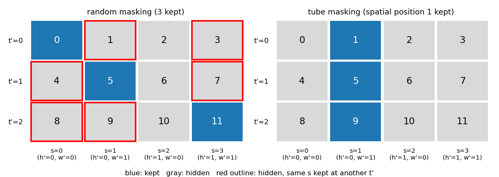
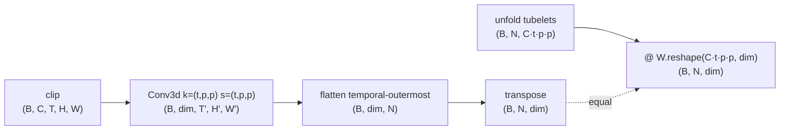
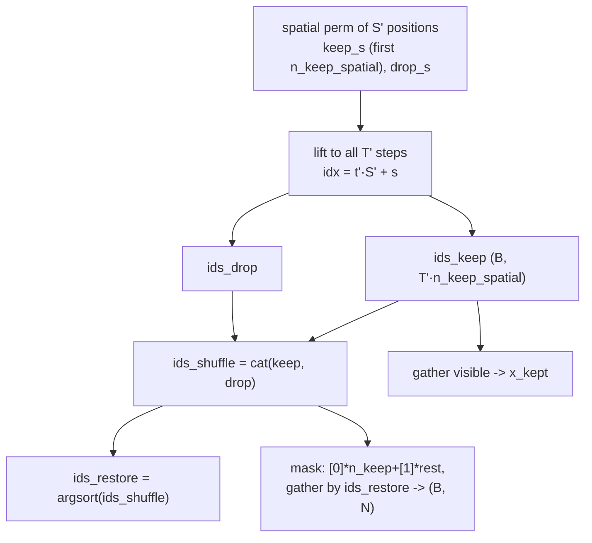

# A3.5 - Video and temporal modeling (video MAE)

A single frame cannot tell a person sitting down from a person standing up: both pass through the
same half-crouched pose, and only the order of the frames says which way the motion goes. Much of
real perception is temporal in this way. A self-driving stack reasons about how other cars move,
and a world model predicts the next frame from the current ones. A video backbone, a network that
maps a short clip to features, is the starting point for all of these.

This assignment extends the masked autoencoder (MAE), the self-supervised method that trains an
image backbone by hiding most of an image and reconstructing the hidden pixels, from images to
video clips. Most of the extension is mechanical. The transformer encoder is unchanged and simply
runs over a longer token sequence. Two things are new. The first is how a clip becomes tokens:
instead of one token per square patch of one frame, a token covers a small block of pixels
spanning several consecutive frames, called a tubelet. The second is which tokens to hide.
Neighboring video frames nearly repeat each other, so the image recipe of hiding tokens
independently at random leaves the network a shortcut, copying from the next frame. The fix,
called tube masking, hides the same spatial positions in every frame, at a much higher ratio than
for images.

Build a video MAE on tiny toy clips. Implement the tubelet embedding, the tube mask, and the
masked-tubelet reconstruction loss. The decoder-side reassembly, the video ViT encoder, and the
module wiring carry over from the image MAE and are provided. Everything runs on CPU with
synthetic seeded clips in under a minute.

Required reading before starting:
- Tong et al. 2022, "VideoMAE: Masked Autoencoders are Data-Efficient Learners for
  Self-Supervised Video Pre-Training", [arXiv:2203.12602](https://arxiv.org/abs/2203.12602).
  Tube masking and the 90-95% ratio.
- Arnab et al. 2021, "ViViT: A Video Vision Transformer",
  [arXiv:2103.15691](https://arxiv.org/abs/2103.15691). Tubelet embedding and the factorized
  space-time attention variants.

## Lecture notes

### What a video MAE is for

#### The task

The goal is a video backbone trained without labels. Labeled video is far more expensive than
labeled images (someone has to watch each clip and mark what happens and when), while unlabeled
video is plentiful. The image MAE showed how to pretrain an image backbone from pixels alone, and
the question here is how to do the same for clips, so that a small head on top of the features can
later recognize actions, track objects, or predict motion.

The clips in this assignment are a scaled-down version of that problem. Each clip is 6 frames of
16x16 RGB pixels showing three soft colored blobs on a black background. Each blob has its own
start position, color channel, width, brightness, and constant velocity, so the blobs drift
independently across the frame. To reconstruct a hidden part of such a clip, a network has to
know where each blob is and how it moves, which is the toy version of knowing what is in a scene
and what it is doing.

#### Why frames one at a time are not enough

The simplest video model runs an image backbone on each frame and combines the per-frame features
afterwards. Its tokens are purely spatial: each describes one patch of one frame. Every relation
between a position and its own past, where motion shows up, then has to be rebuilt
later from tokens that know nothing about time. The token count also grows with the number of
frames, one full image's worth per frame.

#### Why the image masking recipe fails on video

Applying the image MAE recipe to video means cutting the clip into tokens and hiding most of them
independently at random. The problem is temporal redundancy: consecutive frames are nearly
identical, because a scene changes little in a fraction of a second. If tokens are hidden
independently, a hidden token often has a visible token at the same spatial position one or two
steps earlier or later, holding nearly the same content shifted by a small motion. The network can
then fill the hole by finding the matching block in a neighboring frame and copying it, the same
operation a video codec performs with block matching. That operation is cheap to learn and teaches the
network almost nothing about appearance or meaning. VideoMAE calls this information leakage.

The figure shows it on one of the toy clips. The clip is cut into tokens that each cover a 4x4
pixel square over 2 consecutive frames, giving 3 temporal steps of 16 positions (the grid lines). Both
masked rows hide 42 of the 48 tokens. In the middle row the 6 visible tokens were chosen
independently; a red outline marks a hidden token whose position is visible at another temporal step,
where the network can look up nearly the same content. In the bottom row the visible tokens were
chosen as 2 positions kept in every temporal step, and nothing is outlined.


#### The idea of tubelets and tube masking

The video MAE changes the image MAE in two places. It cuts the clip into tubelets, blocks of
pixels that extend across a few consecutive frames as well as across space, so each token already
contains a short piece of motion. And it hides whole tubes, where a tube is the stack of tubelets at one spatial position across
the whole clip: it picks a set of spatial positions and hides them in every temporal step at once. A hidden position is then absent for the whole clip,
there is no neighboring frame to copy from, and the network has to infer the content from other
positions and from how the scene moves. Because the remaining spatial redundancy is still high,
VideoMAE also raises the fraction of hidden tokens from the image MAE's 75 percent to 90-95
percent.

#### Why it matters

In VideoMAE's ablation on Something-Something V2 (a dataset of short clips of hand actions where
the direction of motion decides the label, such as "pushing something from left to right"), tube
masking at 90 percent gave 69.6 percent accuracy after fine-tuning, random masking at the
same ratio 68.3, and hiding whole frames at 87.5 percent 61.5 (Tong et al. 2022, Table 1b, ViT-B,
800 epochs of pretraining). The paper's title states its main practical result: masked video
pretraining is data-efficient, and the abstract reports strong results on datasets of about 3k-4k
videos with no extra data. The high ratio also makes pretraining cheap, because the encoder only
processes the tokens it sees.

### Our twelve-token clip (a 3-step, 2x2 tubelet grid)

The toy clips have 48 tokens, too many to follow by hand. To make the index arithmetic and the
masking concrete we use a smaller grid, which we call our twelve-token clip: a clip of 6 frames of
8x8 pixels, cut into tubelets of 2 frames by 4x4 pixels. That gives 3 temporal steps and a 2x2 grid of
4 spatial positions, so 12 tokens. It stands for the toy clips' 3-step, 4x4 grid: it has the same
number of temporal steps, the same tubelet shape, and the same token numbering, and it drops the pixel
content and 12 of the 16 spatial positions.

The figure lays out its tokens with temporal steps as rows and spatial positions as columns. Each
token's number is its position in the sequence the transformer sees, explained in the tubelet
embedding section below. On the left, 3 tokens are kept independently at random, and 6 of the 9
hidden tokens have their spatial position visible in another row. On the right, spatial position 1
is kept in every row: the visible tokens form one tube (all temporal steps at one spatial
position, here the whole column), and no hidden token has
a visible copy of its position anywhere.



### Overview of the rest of the notes

1. What the video MAE inherits from the image MAE: the asymmetric encoder-decoder, masking as a
   permutation and its inverse, reassembly with a mask token, and the normalized pixel target.
   These carry over unchanged.
2. Tubelets. A tubelet is the 3D analog of ViT's patch, and the tubelet embedding is one shared
   linear map applied to every tubelet, which a strided 3D convolution computes. The token order
   that turns the 3D grid into a sequence is fixed here.
3. Why random masking leaks across time, measured as the probability that a hidden token has a
   visible copy of its position.
4. Tube masking, built so that it still produces a permutation and its inverse, which lets the
   image MAE's reassembly run unchanged; and why the achievable mask ratio comes in steps.
5. The masked-tubelet loss and how to read its value.
6. The cost of attention over space and time, and the factorized forms that reduce it.

Our twelve-token clip is used in the exercises. Five exercises, placed after the sections they
test, are meant to be worked by hand, and each has a worked answer that can be expanded.

### What the video MAE inherits from the image MAE

Four pieces of the image MAE are reused here unchanged, and the video-specific sections are
written on top of them, so they are restated here.

The first is the asymmetric encoder-decoder. A large transformer encoder runs on the visible
tokens only, never on placeholders for the hidden ones. A small decoder then sees the full grid,
with the hidden slots filled by a stand-in, and predicts pixels. Dropping most tokens before the
expensive stage is where the saving in training cost comes from. After pretraining the encoder is
kept as the backbone and the decoder is thrown away.

The second is the way the visible subset is selected and later put back. Selecting a subset with
a boolean test does not batch: different samples would keep different counts, and the result is
not a rectangular tensor. So the selection is done with permutations instead. A permutation of
$N$ items is stored as an index vector $\pi$ where $\pi[i]$ names the source slot whose content
lands in output slot $i$. Applying it is $y[i] = x[\pi[i]]$, an operation called a gather. As a
matrix this is $P$ with $P_{i,\pi[i]} = 1$, one 1 per row and per column, so $P$ is orthogonal
and $P^{-1} = P^{\top}$.

The index-vector form of that inverse is an $\operatorname{argsort}$, the operation that returns
the order in which a sort would take the entries. Sorting the values of $\pi$ into increasing
order returns the slots they came from, and since $\pi$ holds each of $0,\dots,N-1$ exactly once,
entry $j$ of the result is the slot $i$ where the value $j$ sat, that is $\pi^{-1}[j]$. So for a
permutation, and only for a permutation, $\operatorname{argsort}$ is inversion:

$$\text{ids}_{\text{restore}} = \operatorname{argsort}(\text{ids}_{\text{shuffle}}),
\qquad \text{ids}_{\text{restore}}[\,\text{ids}_{\text{shuffle}}[i]\,] = i.$$

The image MAE uses this as the shuffle-keep-unshuffle trick. Draw one random score per token,
$\operatorname{argsort}$ the scores into a random permutation $\text{ids}_{\text{shuffle}}$, keep
the first $n_{\text{keep}}$ entries as the visible set, and record
$\text{ids}_{\text{restore}}$. The binary mask is built in shuffled order as $n_{\text{keep}}$
zeros followed by ones and gathered by $\text{ids}_{\text{restore}}$ back into grid order, so an
entry is 1 exactly when that token was dropped. VideoMAE calls this image recipe random masking:
every token's fate is drawn independently of where and when it is.

The third piece is the reassembly. The decoder needs a full grid, so the encoded visible tokens
are concatenated with copies of one shared learned vector, the mask token, in shuffled order, and
that sequence is gathered by $\text{ids}_{\text{restore}}$. Every grid position then holds either
its own encoded token or a mask token, and the decoder positional embedding tells the decoder
which position each slot is. The only thing this step requires is that
$\text{ids}_{\text{restore}}$ invert the order in which visible and dropped indices were
concatenated. It does not require the keep set to be random per token, which is why the
structured mask introduced below can use the same reassembly unchanged.

The fourth piece is the target. The loss compares predicted pixels against per-patch-normalized
pixels: each patch is separately shifted to zero mean and scaled to unit variance before the
squared error. This puts every patch on the same scale, so a bright high-contrast patch does not
dominate the gradient, and He et al. report better representations from normalized targets than
from raw ones. It also fixes the meaning of the loss value, which is used below to read the
training curve.

Everything on that list survives the move to video unchanged. Only the tokenization and the
choice of what to hide have to change.

### From frames to tubelets

A clip is a tensor of shape $(B, C, T, H, W)$: batch, channels, $T$ frames, and $H \times W$
pixels each. The obvious tokenization reuses ViT's patch embedding on every frame independently,
giving $T \cdot (H/p)(W/p)$ tokens for spatial patch size $p$. That works, and ViViT calls it
uniform frame sampling, but it has the two costs named in the motivation: the token count grows
linearly in $T$, and every token is purely spatial.

The alternative is to cut the clip along time as well. A **tubelet** is a $t \times p \times p$
block of pixels over all $C$ channels: one spatial patch, extended across $t$ consecutive frames.
It is the 3D analog of a patch, and it is the token used here. In these notes $t$ is always the
tubelet's length in frames, $t'$ (below) indexes tubelets along time, and $T'$ is their count. With tubelet length $t$
the grid is

$$T' = T/t \ \text{temporal steps}, \qquad H' = H/p, \quad W' = W/p, \quad S' = H'W'
\ \text{spatial positions}, \qquad N = T'S' \ \text{tokens}.$$

A temporal step $t' \in \{0, \dots, T'-1\}$ is one slab of $t$ frames, and a spatial position
$s \in \{0, \dots, S'-1\}$ is one $p \times p$ square of the frame. The set of all $T'$ tubelets
at one spatial position is called a **tube**; in the figures above it is one column of the grid.

Compared with per-frame patches, tubelets cut the token count by a factor of $t$, and each token
already carries a short slice of local motion before any attention runs. ViViT introduced tubelet
embedding as the alternative to uniform frame sampling. VideoMAE uses $t = 2$ with $p = 16$, and
the toy here uses $t = 2$ with $p = 4$: 6 frames of 16x16 pixels give $T' = 3$, $S' = 16$, and
$N = 48$.

> **Exercise 1 (tokens in a real clip).** VideoMAE's input is 16 RGB frames of 224x224 pixels, cut
> into tubelets with $t = 2$ and $p = 16$. Compute $T'$, $S'$, and $N$, and the number of tokens
> uniform frame sampling would give with the same $p$. How many numbers does one tubelet contain,
> and what is the shape of the weight matrix that maps a tubelet to a token of width 768?

<details>
<summary>Answer</summary>

$T' = 16/2 = 8$, $H' = W' = 224/16 = 14$, so $S' = 196$ and $N = 8 \cdot 196 = 1568$. Uniform frame
sampling gives $16 \cdot 196 = 3136$ tokens, twice as many, since $t = 2$. One tubelet holds
$C\,t\,p\,p = 3 \cdot 2 \cdot 16 \cdot 16 = 1536$ numbers, so the shared linear map is a
$768 \times 1536$ matrix plus a bias of length 768 (1,180,416 parameters). The same matrix is
applied to all 1568 tubelets; its size does not depend on the clip length.

</details>

### Tubelet embedding as a strided convolution

Each tubelet has to be mapped to a vector of length $\dim$ by one shared linear map, the same map
for every tubelet. A 3D convolution whose kernel size and stride are both $(t, p, p)$ does exactly
that. Equal kernel and stride means the receptive fields tile the clip without overlapping and
without gaps, so each output position sees exactly one tubelet, and a convolution applies the same
weights at every position by construction.

The equivalence is short to write out. Write $V$ for one clip, $W$ for the convolution weight of
shape $(\dim, C, t, p, p)$, and $b$ for its bias. The convolution output at grid position
$(t', h', w')$ and output channel $d$ is

$$y_{d,t',h',w'} = b_d + \sum_{c,i,j,k} W_{d,c,i,j,k}\; V_{c,\; t't+i,\; h'p+j,\; w'p+k},$$

with $i \in [0,t)$, $j,k \in [0,p)$. The index arithmetic $t't+i$ comes from the stride equaling
the kernel size: output step $t'$ starts at frame $t't$. Flatten $(c,i,j,k)$ into one axis of
length $Ctpp$ on both sides and the sum is a plain dot product: the tubelet unfolded into a
$Ctpp$-vector, dotted with row $d$ of the weight reshaped to $(\dim, Ctpp)$. Stack the output
channels and the whole embedding is one matrix multiply,

$$\text{embed}(V) = \operatorname{tubeletify}(V)\, W_{\text{flat}}^{\top} + b,
\qquad \operatorname{tubeletify}(V) \in \mathbb{R}^{B \times N \times Ctpp},$$

where $\operatorname{tubeletify}$ is our name for the unfold that cuts the clip into tubelets and
flattens each one, laid out $(C, t, p_{\text{row}}, p_{\text{col}})$ to match the weight layout,
and $W_{\text{flat}}$ is the weight reshaped to $(\dim, Ctpp)$. The convolution is an
implementation of that matrix multiply, not a different operation. This is the same fact as for
ViT's patch embedding, with one more axis.



The convolution output is a 3D grid of shape $(B, \dim, T', H', W')$, and the transformer needs a
sequence, so the grid has to be flattened in some order. The order used everywhere here is
temporal-outermost:

$$\text{idx} = t'S' + s, \qquad s = h'W' + w'.$$

Tokens 0 through $S'-1$ are the first temporal step in row-major spatial order, the next $S'$ are
the second, and so on. In our twelve-token clip ($S' = 4$, $W' = 2$), tokens 0 to 3 are temporal step
0, and token 6 is temporal step 1 at spatial position 2, the bottom-left square. The convention is
fixed, not incidental, because three separate components rely on it: the positional embedding is a
learned table with one row per token index, the tube mask is built by arithmetic on $t'$ and $s$,
and the reconstruction target is unfolded in the same order. All three break together if the
flatten order changes.

> **Exercise 2 (from a token index to pixels and back).** On the toy grid ($T = 6$, $t = 2$,
> $16 \times 16$ frames, $p = 4$, so $T' = 3$, $H' = W' = 4$, $S' = 16$), which frames, pixel rows,
> and pixel columns does token 37 cover? Which token covers the pixel in frame 3, row 9,
> column 14?

<details>
<summary>Answer</summary>

$37 = 2 \cdot 16 + 5$, so $t' = 2$ and $s = 5$. Then $s = 5 = 1 \cdot 4 + 1$ gives $h' = 1$,
$w' = 1$. Token 37 covers frames $t't = 4$ and 5, rows $h'p = 4$ to 7, and columns 4 to 7, in all
three channels.

For the pixel: frame 3 is in temporal step $\lfloor 3/2 \rfloor = 1$, row 9 in $h' = 2$, and
column 14 in $w' = 3$. So $s = 2 \cdot 4 + 3 = 11$ and $\text{idx} = 1 \cdot 16 + 11 = 27$. Unfolding
a clip that is 1 only on token 37's block and checking which row of the unfolded tensor is nonzero
gives 37, which confirms the layout.

</details>

### Why video needs a different mask

Adjacent video frames are nearly identical, and that redundancy makes random masking a
weak pretext task (the training objective whose targets come from the data itself). Under
random masking, a hidden tubelet often has a visible tubelet at the same spatial position in
another temporal step, holding nearly the same content shifted by a small motion. Reconstruction
then reduces to motion-compensated copying: find the matching block in a neighboring frame, shift
it, paste it. This is the operation video codecs perform with block matching, it is cheap to
learn, and a network that has learned it has learned almost nothing about appearance or
semantics.

How often a hidden token has such a copy can be computed. With $N$ tokens of which $k$ are kept at
random, consider one hidden token and the other $N - 1$ positions in the grid, $k$ of which are
kept. The chance that none of its $m$ same-position tokens in other steps is kept is
$\binom{N-1-m}{k}\big/\binom{N-1}{k}$, which for large grids is close to $r^m$, where
$r = 1 - k/N$ is the mask ratio. On VideoMAE's grid ($T' = 8$, $S' = 196$) at the image MAE's 75
percent, about 44 percent of hidden tubelets in the interior steps have their position visible in
an adjacent step (one step before or after, $m = 2$), and about 87 percent have it visible in some
step ($m = 7$). At 90 percent the figures are about 19 and 52 percent. Raising the ratio alone
reduces the leak but leaves half the hidden tokens with a copy somewhere in the clip.

VideoMAE's fix is **tube masking**. Draw the set of spatial positions to drop once, then drop
those positions in every temporal step. A dropped position is absent for the whole clip, so the
same-position probability above is exactly zero, and filling the position requires inferring
content from other spatial positions and from how the scene moves.

Removing the temporal shortcut is not sufficient on its own, because the remaining spatial
redundancy is still high. VideoMAE therefore also raises the masked fraction to 90-95 percent,
against 75 percent for the image MAE (the 90-95% figure is stated in the VideoMAE abstract). The
higher ratio is affordable for the same reason as in the image MAE: the encoder only pays for the
tokens it sees.

> **Exercise 3 (the leak on the toy grid).** The toy grid has $N = 48$ tokens in $T' = 3$ steps.
> Suppose 6 tokens are kept by random masking, the same number tube masking keeps at the
> toy's mask ratio. For one hidden token, what is the probability that at least one of its 2
> same-position tokens in the other steps is visible? Compare with the approximation $1 - r^2$.

<details>
<summary>Answer</summary>

Given that the token is hidden, the 6 kept tokens are a uniformly random 6-subset of the other 47
positions. Both of its same-position tokens are hidden when all 6 kept tokens fall among the other
45 positions:

$$\frac{\binom{45}{6}}{\binom{47}{6}} = \frac{41 \cdot 40}{47 \cdot 46} = \frac{1640}{2162} \approx 0.759.$$

So the probability of a visible copy is about $0.241$, almost one hidden token in four. The
approximation with $r = 42/48 = 0.875$ gives $1 - 0.875^2 \approx 0.234$, close because sampling
without replacement from 47 positions differs little from independent draws. A simulation of
20,000 random masks gives $0.241$. The toy clip in the figure at the start, with 12 of its 42
hidden tokens outlined, is one such draw. Under tube masking the probability is 0.

</details>

### Tube masking

The construction cannot be the image MAE's per-token $\operatorname{argsort}(\text{noise})$,
because the keep set is structured rather than independent per token. It is built explicitly
instead, in a form that still produces an $\text{ids}_{\text{shuffle}}$ and an
$\text{ids}_{\text{restore}}$, so the reassembly described above still applies. Per sample:

1. Permute the $S'$ spatial positions at random and keep the first
   $n_{\text{keep,spatial}} = \mathrm{round}((1-r)\,S')$ of them, where $r$ is the requested mask
   ratio. Call the two parts $\text{keep}_s$ and $\text{drop}_s$.
2. Lift each spatial index to full-token indices for all $T'$ temporal steps using
   $\text{idx} = t'S' + s$. A kept spatial position contributes $T'$ token indices, one per step.
   Collect the lifted kept indices as $\text{ids}_{\text{keep}}$ and the lifted dropped ones as
   $\text{ids}_{\text{drop}}$.
3. Concatenate $[\text{ids}_{\text{keep}}; \text{ids}_{\text{drop}}]$ into
   $\text{ids}_{\text{shuffle}}$ and take
   $\text{ids}_{\text{restore}} = \operatorname{argsort}(\text{ids}_{\text{shuffle}})$.

$\text{ids}_{\text{shuffle}}$ is still a permutation of $0,\dots,N-1$, just no longer a uniformly
random one, so the inverse-by-argsort identity and the gather-based mask and reassembly all hold
as before. The visible tokens are gathered by $\text{ids}_{\text{keep}}$, and the mask is built as
in the image MAE: $n_{\text{keep}} = T' \, n_{\text{keep,spatial}}$ zeros followed by ones, in
shuffled order, gathered by $\text{ids}_{\text{restore}}$.



The defining property is that the mask, reshaped to $(B, T', S')$, is identical across all $T'$
temporal steps. Random masking fails that check except by chance; tube masking passes it by
construction.

One consequence of the tube structure is that the achievable mask ratio is quantized. Whole tubes
are kept, so with $k$ kept tubes the ratio is exactly $1 - k/S'$ and nothing in between is
reachable. On the toy grid $S' = 16$, so the reachable ratios near the top are
$1 - 1/16 = 0.9375$ and $1 - 2/16 = 0.875$. Requesting $r = 0.9$ gives
$\mathrm{round}(0.1 \times 16) = 2$ kept tubes, an effective ratio of $0.875$; requesting
$r = 0.95$ gives 1 tube and an effective $0.9375$. The quantization is coarse here only because
$S'$ is small. At 224x224 with $p = 16$ the spatial grid is 14 by 14, so $S' = 196$ and the steps
are well under a percent.

> **Exercise 4 (a tube mask by hand).** In our twelve-token clip ($T' = 3$, $S' = 4$) with
> requested ratio $r = 0.75$, the random spatial permutation comes out as $[2, 0, 3, 1]$. Compute
> $n_{\text{keep,spatial}}$, $\text{ids}_{\text{keep}}$, $\text{ids}_{\text{drop}}$ (lifting each
> temporal step in turn, in the order of $\text{drop}_s$), $\text{ids}_{\text{shuffle}}$,
> $\text{ids}_{\text{restore}}$, and the mask in grid order. Then: what would $r = 0.9$ give on
> this grid, and on VideoMAE's $S' = 196$?

<details>
<summary>Answer</summary>

$n_{\text{keep,spatial}} = \mathrm{round}(0.25 \cdot 4) = 1$, so $\text{keep}_s = [2]$ and
$\text{drop}_s = [0, 3, 1]$. Lifting with $\text{idx} = 4t' + s$ gives
$\text{ids}_{\text{keep}} = [2, 6, 10]$ and
$\text{ids}_{\text{drop}} = [0, 3, 1,\ 4, 7, 5,\ 8, 11, 9]$, so

$$\text{ids}_{\text{shuffle}} = [2, 6, 10, 0, 3, 1, 4, 7, 5, 8, 11, 9].$$

Entry $j$ of $\text{ids}_{\text{restore}}$ is the slot holding token $j$: token 0 is in slot 3,
token 1 in slot 5, token 2 in slot 0, and so on, giving
$\text{ids}_{\text{restore}} = [3, 5, 0, 4, 6, 8, 1, 7, 9, 11, 2, 10]$. Gathering
$\text{ids}_{\text{shuffle}}$ by it returns $[0, 1, \dots, 11]$, as it should.

The shuffled mask is three zeros followed by nine ones. Gathered by $\text{ids}_{\text{restore}}$,
position $j$ is 0 exactly when $\text{ids}_{\text{restore}}[j] < 3$, which happens at tokens 2, 6,
and 10: the mask is $[1,1,0,1,\ 1,1,0,1,\ 1,1,0,1]$. Reshaped to $3 \times 4$, every row is
$[1, 1, 0, 1]$, the tube property.

With $r = 0.9$, $\mathrm{round}(0.4) = 0$ tubes are kept and the encoder sees nothing, so a grid
of 4 positions cannot express a 90 percent ratio at all. With $S' = 196$,
$\mathrm{round}(19.6) = 20$ tubes are kept, $8 \cdot 20 = 160$ tokens, an effective ratio of
$1 - 20/196 \approx 0.898$.

</details>

### Reconstruction and the masked-tubelet loss

The asymmetric pipeline carries over with the patch replaced by the tubelet. The encoder sees
only the visible tubelets, the shared mask token fills the dropped slots, the light decoder sees
the full grid of $N$ tokens, and a linear head predicts $(B, N, t\,p\,p\,C)$ per-tubelet pixels.
The loss is the image MAE's masked-patch mean squared error with the patch enlarged from $p\,p$ to
$t\,p\,p$, on per-tubelet-normalized targets, averaged over masked tubelets only:

$$L_{\text{video}} = \frac{\sum_i \mathrm{mask}_i \cdot \operatorname*{mean}_{\text{pixels}}\big[(\mathrm{pred}_i - \mathrm{target}_i)^2\big]}{\sum_i \mathrm{mask}_i},
\qquad \mathrm{target} = \text{per-tubelet-normalize}(\operatorname{tubeletify}(\mathrm{clip})).$$

Here $i$ runs over every tubelet of every clip in the batch, and $\mathrm{mask}_i$ is 1 on hidden
tubelets. Visible tubelets are excluded because the encoder was shown them, so reconstructing them
is a much easier task; He et al. report that also computing the loss on visible patches costs a
small amount of accuracy (about 0.5 percent).

The normalization also sets the scale of the number this loss reports, which makes the training
curve readable. A target tubelet has zero mean and unit variance, so a prediction of all zeros,
which after undoing the normalization means predicting every pixel of a tubelet equal to that
tubelet's own mean, scores

$$\operatorname*{mean}_{\text{pixels}}\big[(0 - \mathrm{target}_i)^2\big] = \operatorname{Var}(\mathrm{target}_i) \approx 1$$

on any tubelet with content in it. A completely flat tubelet is the exception: the normalization
divides by $\sqrt{\operatorname{Var} + \varepsilon}$ with $\varepsilon = 10^{-6}$, so a constant
tubelet normalizes to zeros and scores 0. A loss near 1 therefore means the model is doing no
better than guessing each hidden tubelet's mean brightness, and the distance below 1 is the share
of the hidden content actually recovered.

### Joint versus factorized space-time attention

The encoder here uses **joint space-time attention**: the transformer attends over all $N = T'S'$
tubelet tokens in one sequence, with no distinction between the space and time axes. Attention
forms a score for every ordered pair of tokens, so this builds an $N \times N$ matrix and costs
$O(N^2)$ in both time and memory. With $N = T'S'$ that is $O(T'^2S'^2)$, quadratic in the number
of temporal steps and quadratic in the number of spatial positions at the same time, which is why
early video transformers were expensive.

TimeSformer's **divided space-time attention** splits one attention layer into two. Each token
first attends only to the $T'$ tokens sharing its spatial position across time, then only to the
$S'$ tokens sharing its temporal step. A token therefore attends to $T' + S'$ tokens instead of
$T'S'$, and the layer costs

$$O\big(N(T' + S')\big) = O\big(T'S'^2 + T'^2S'\big)$$

instead of $O(T'^2S'^2)$. The information still mixes across both axes, just over two sub-layers
rather than one. On the toy grid ($T' = 3$, $S' = 16$, $N = 48$) the pair counts are 2304 joint
against 912 divided, a gap too small to matter. On a 16-frame 224x224 clip at $p = 16$ and
$t = 2$, $T' = 8$ and $S' = 196$ give $N = 1568$, and the counts are 2,458,624 against 319,872.

ViViT proposes several factorizations of the same idea. Its factorized encoder runs a spatial
transformer over the tokens within each temporal step, then a temporal transformer over the
per-step summaries. Its factorized self-attention does the split inside each block, spatial
attention followed by temporal attention, as TimeSformer does. Its factorized dot-product
attention keeps one attention layer and splits the heads instead, half attending spatially and
half temporally, with the outputs concatenated.

Masked pretraining changes this trade-off. VideoMAE itself uses a plain ViT with joint space-time
attention, because at a 90 percent tube mask the encoder sees only about a tenth of the 1568
tokens during pretraining, and the quadratic cost on that short sequence is small. The full
sequence is processed only during fine-tuning and inference. Joint attention is used in this
assignment because it is the transformer encoder unchanged, and at $N = 48$ the quadratic cost is
irrelevant.

> **Exercise 5 (what the attention costs).** For a 16-frame clip at 112x112 with $p = 16$ and
> $t = 2$, compute $N$ and the number of attention pairs per layer for joint and divided attention.
> Then return to VideoMAE's 224x224 grid: how many pairs does joint attention cost on the tokens
> left visible by a requested 90 percent tube mask (from Exercise 4), compared with divided
> attention on all 1568 tokens?

<details>
<summary>Answer</summary>

At 112x112, $S' = 7 \cdot 7 = 49$ and $T' = 8$, so $N = 392$. Joint attention scores
$392^2 = 153{,}664$ pairs; divided attention scores $392 \cdot (8 + 49) = 22{,}344$, about 6.9
times fewer.

With 160 visible tokens, joint attention scores $160^2 = 25{,}600$ pairs, about a twelfth of
divided attention's 319,872 on the full clip and about a hundredth of joint attention's 2,458,624.
During masked pretraining, dropping 90 percent of the tokens before the encoder saves more than
factorizing the attention does.

</details>

## The assignment

Fill these holes, in order. Each is one `NotImplementedError` with a matching test. The docstring
in each file gives the signature, shapes, and constraints.

| # | Function | File | Concept from the notes |
|---|---|---|---|
| 1 | [`TubeletEmbedding.forward()`](tubelet.py) | `tubelet.py` | the tubelet embedding and the temporal-outermost token order $\text{idx} = t'S' + s$ |
| 2 | [`tube_masking()`](video_mae.py) | `video_mae.py` | tube masking: $\text{ids}_{\text{keep}}$, $\text{ids}_{\text{shuffle}}$, $\text{ids}_{\text{restore}}$, the mask |
| 3 | [`video_mae_loss()`](video_mae.py) | `video_mae.py` | the masked-tubelet loss $L_{\text{video}}$ |

Notes on specific holes:
- `TubeletEmbedding` already builds the `Conv3d` with kernel and stride $(t, p, p)$ in
  `__init__`; `forward` applies it and turns the $(B, \dim, T', H', W')$ output into a
  $(B, N, \dim)$ sequence. `flatten(2)` on the convolution output produces the temporal-outermost
  order. The class is exposed to the rest of the course as `nanovision.transformer.TubeletEmbedding`.
- `tube_masking` uses `torch.argsort` and `torch.gather`, as the image MAE's random masking did.
  The lifted indices for all temporal steps can be built at once by broadcasting offsets
  $t' S'$ of shape $(1, T', 1)$ against the spatial indices. The mask is returned in grid order,
  1 on masked tubelets, and `ids_restore` must invert the $[\text{keep}; \text{drop}]$ order,
  because the provided `_append_mask_tokens` gathers by it.
- `video_mae_loss` receives the target already per-tubelet normalized. `tubeletify` and
  `per_tubelet_normalize` in `backbone.py` are provided, and `tubeletify` is the unfold from the
  notes.
- `backbone.py` (the video ViT encoder with a learned positional embedding over all $N$ tokens)
  and the `VideoMAE` module in `video_mae.py` are provided.

### Running and validating

Activate the environment (`conda activate nanovision`), then:

```
make test     A=a03_5_video   # run the tests against the top-level files (the ones with holes)
make verify   A=a03_5_video   # run the same tests against the reference solution/
make viz      A=a03_5_video   # render the figures from the reference solution
make viz-mine A=a03_5_video   # render the figures from your own code (once the holes are filled)
```

`make test` is the command to run while working. It runs the suite in
`assignments/a03_5_video/tests/` against the top-level files. The tests fail while the holes raise
`NotImplementedError` and pass as the holes are filled in correctly. `make verify` runs the same
suite against the reference answer key in `solution/` by setting `NANOVISION_IMPL=solution`, so it
passes from the start, which confirms the tests and environment work. The goal is to make
`make test` pass as `make verify` does.

The tests check:
- `test_shapes.py`: output shapes of the tubelet embedding, of tube masking (including the exact
  number of masked tokens), and of the full forward pass.
- `test_tube_masking.py`: the keep count, the tube property (the mask reshaped to
  $(B, T', S')$ is identical across all temporal steps), that concatenating
  [visible; placeholders] and gathering by `ids_restore` puts every visible tubelet back at its
  own position, and that the mask is deterministic under a fixed seed.
- `test_tubelet_equivalence.py`: the convolution-equals-unfold identity from the notes, the
  embedding output against `tubeletify(clip) @ W_flat.T + b`, to $10^{-5}$.
- `test_gradcheck.py`: a gradcheck of the tubelet embedding and of the encode-decode-loss pipeline
  with respect to the convolution weight.
- `test_overfit.py`: a short overfit on one fixed batch (masked-tubelet MSE below 0.05 and below a
  tenth of its starting value).
- `test_forbidden_imports.py`: no prebuilt attention or transformer module, fused attention kernel,
  `nn.LayerNorm`, or prebuilt video model is imported. `Conv3d` is allowed, since it is the
  tubelet mechanism.

A gradcheck (`torch.autograd.gradcheck`, wrapped in `nanovision/gradcheck.py`) compares the
gradient autograd derives from the forward pass against a numerical estimate obtained by nudging
each input entry by $\varepsilon$ and measuring how the output moves. It runs in float64 because
the finite-difference estimate in float32 is too noisy to tell a correct gradient from a subtly
wrong one. It catches wrong reductions, wrong index arithmetic, and detached tensors that a shape
test cannot see.

The overfit test is the end-to-end signal. One fixed batch of eight clips is trained with the mask
held fixed by a re-seed each step, so the only thing being measured is whether the pipeline can
memorize a single target, which a correct pipeline does within 800 steps.

`make viz` renders from the reference solution, so it works on a fresh checkout before any holes
are filled. `make viz-mine` runs the same script against the top-level code, which needs the holes
filled (it trains a model with them). Both write PNG files to `out/` using matplotlib's headless
Agg backend, so they work over SSH, in WSL, and in CI with no display, and the figures open inline
in VSCode. Add `SHOW=1` (for example `make viz-mine A=a03_5_video SHOW=1`) to also open interactive
windows when a display is available. The figures are:
- `video_mae_reconstruction.png`: one clip as a filmstrip in three rows, the original, the
  tube-masked input (hidden tubelets blanked, the same squares in every frame), and the
  reconstruction (visible tubelets pasted from the input, hidden ones from the model with the
  normalization undone).
- `video_mae_loss.png`: the overfit loss curve on a log scale.

The figures in the notes are generated by `assets/make_video_figures.py`, from a toy clip of the
same generator (`video_batch` in `nanovision/data/toy.py`) and from our twelve-token clip. Neither
uses the assignment code.

What you should see when you run this. The toy config is $T = 6$ frames at $t = 2$, so $T' = 3$;
16x16 frames at $p = 4$, so $S' = 16$; giving $N = 48$ tubelets. Mask ratio 0.875 keeps 2 of the
16 tubes, so 6 tubelets are visible and 42 are hidden. Over 800 Adam steps the masked-tubelet MSE
starts a little above 1 (1.26 in a CPU run) and settles around $5 \times 10^{-3}$,
against the 0.05 threshold; the last digits change with the number of CPU threads, which changes
the order of floating-point sums. Read those numbers against the scale derived above. On this
batch the all-zeros prediction scores 0.88 on the hidden tubelets rather than 1, because about one
hidden tubelet in eight is near-empty background whose raw variance is below
$\varepsilon = 10^{-6}$, so the normalization shrinks it toward zero instead of scaling it to unit
variance. If the curve stays near that level, or falls but stalls well above the threshold, check
the tube indexing and the token order the reassembly assumes.

One part of the toy differs from the recipe. The 0.875 ratio is below VideoMAE's 90-95 percent,
lowered only so a depth-4 model can memorize one clip. The joint space-time attention matches
VideoMAE's. The overfit verifies the mechanism
plumbing, not that the learned representation is good; the representation benefit of tube masking
shows only at real video scale.

## Where this goes next

Adding time is a tokenization change plus the one masking change that video's redundancy forces.
Both recur later in the course.

- BEVFormer's temporal self-attention is the same idea applied to a different token set. Its tokens
  are cells of a bird's-eye-view grid, a top-down feature map in ego coordinates rather than a
  space-time patch grid, and its temporal step warps the previous frame's grid by the measured ego
  motion so that a cell lines up with the same piece of the world, then attends the current cell
  against that warped history. The token layout and the alignment step differ; the operation, one
  attention over tokens indexed by both position and time, does not.
- World models replace reconstruction of hidden content with prediction of future content. A
  masked autoencoder hides a random subset of a clip and reconstructs it from the rest; a world
  model conditions on the past latent state and the action taken and predicts the next latent
  state. Neither needs human labels, and the world model is the harder case: the hidden part is
  always in the future, so there is no later frame to interpolate from.
- Wang et al. 2023, "VideoMAE V2: Scaling Video Masked Autoencoders with Dual Masking",
  [arXiv:2303.16727](https://arxiv.org/abs/2303.16727). Adds decoder masking and scales the
  recipe.
- Bertasius et al. 2021, "Is Space-Time Attention All You Need for Video Understanding?"
  (TimeSformer), [arXiv:2102.05095](https://arxiv.org/abs/2102.05095). Divided space-time
  attention, the factorization described in the notes.

## References

- Tong et al. 2022, VideoMAE, [arXiv:2203.12602](https://arxiv.org/abs/2203.12602).
- Arnab et al. 2021, ViViT, [arXiv:2103.15691](https://arxiv.org/abs/2103.15691).
- Bertasius et al. 2021, TimeSformer, [arXiv:2102.05095](https://arxiv.org/abs/2102.05095).
- Wang et al. 2023, VideoMAE V2, [arXiv:2303.16727](https://arxiv.org/abs/2303.16727).
- He et al. 2022, MAE, [arXiv:2111.06377](https://arxiv.org/abs/2111.06377). The image MAE this
  extends to space-time.
