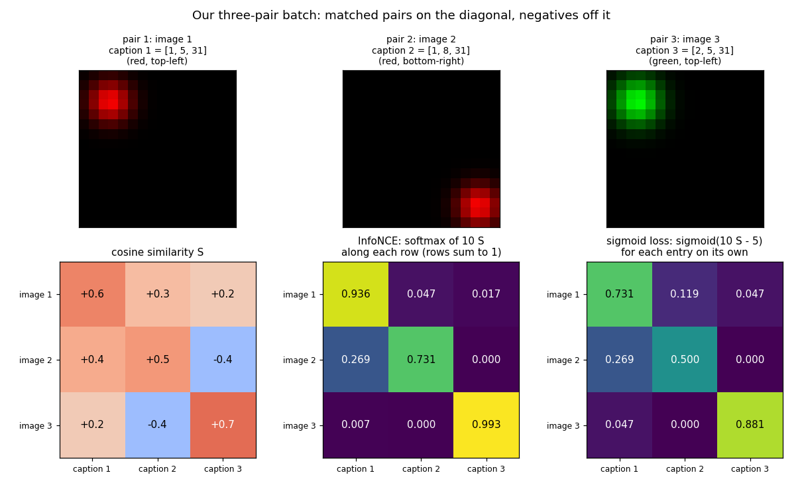
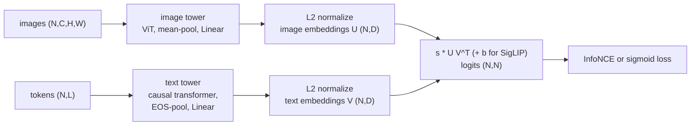
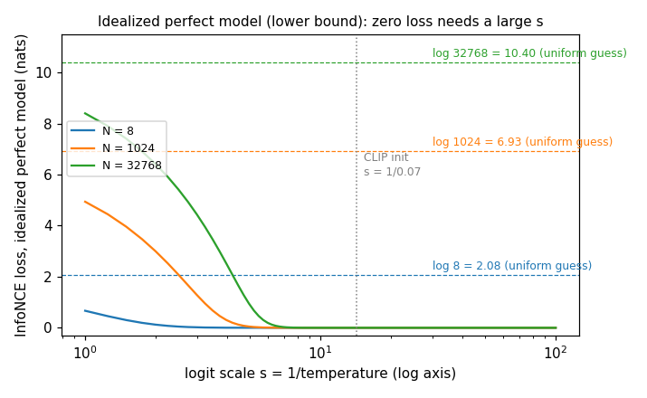

# A4 - CLIP and SigLIP (contrastive image-text)

CLIP trains an image encoder and a text encoder so that an image and its caption land near each
other in a shared embedding space, and an image and an unrelated caption land far apart. The
supervision is paired (image, text) data scraped from the web, with no per-class annotation.
Because the text encoder accepts arbitrary language at inference, the model is open-vocabulary:
it can classify into any set of classes once they are written as text prompts, with no fine-tuning
and no new output layer. This assignment builds the training objective in two forms, CLIP's
softmax InfoNCE loss and SigLIP's per-pair sigmoid loss, and the zero-shot inference procedure.

Build the contrastive objective and zero-shot inference on a tiny dual encoder. Implement the
symmetric InfoNCE loss (the cross-entropy built by hand so that the sum over in-batch negatives is
visible), the sigmoid loss with its learnable bias, and the cosine-similarity zero-shot
classifier. The image and text towers, the L2 normalization, the learnable temperature and bias,
the text pooling, and the toy (image, caption) data are provided. Everything runs on CPU with
synthetic seeded pairs in under a minute.

Required reading before starting:
- Radford et al. 2021, "Learning Transferable Visual Models From Natural Language Supervision"
  (CLIP), [arXiv:2103.00020](https://arxiv.org/abs/2103.00020).
- Zhai et al. 2023, "Sigmoid Loss for Language Image Pre-Training" (SigLIP),
  [arXiv:2303.15343](https://arxiv.org/abs/2303.15343). Read Algorithm 1 and the batch-size
  ablations.

## Lecture notes

### What CLIP is for

#### The task

Take a photo from a robot's camera and ask whether it shows a forklift, a pallet, or a person, or
ask for the ten images in a fleet's logs that best match the text "a wet floor with a warning
sign". Neither list of classes nor the query was known when the model was trained. A model that
handles both has to compare an image with a piece of text it has never seen in that combination,
and decide how well they match.

CLIP solves this with two networks. The image encoder turns an image into a vector of $D$ numbers,
the text encoder turns a sentence into a vector of the same $D$ numbers, and both are trained so
that the vectors of an image and a sentence describing it point in nearly the same direction. To
classify, write each class as a sentence ("a photo of a forklift"), encode the sentences, and pick
the one whose vector points closest to the image's vector. To search, encode the query once and
rank the stored image vectors by how closely they point toward it.

#### Why the obvious approaches fail

Two other sources of image supervision exist. The first is human labels: a fixed list of
classes and one integer per image. That caps what the model can be asked about, since the output
layer has one slot per class and adding a class means retraining, and it costs an annotation
budget that grows with the dataset. The second is self-supervision on images alone, where the
supervision is invented from the data: the masked autoencoder (MAE) hides most of an image and
reconstructs the missing patches, and DINO matches a student network's distribution over learned
prototypes to a teacher's. That removes the annotation cost, but what comes out is a feature
vector with no names attached, so a labeled head still has to be trained before the model can
answer any question.

The web supplies a third source: the text that already sits next to images on web pages. CLIP
(Radford et al. 2021) trained on 400 million (image, text) pairs collected this way, with no
per-image annotation step. The direct way to use such pairs is to train the image network to
generate the caption word by word. The CLIP paper reports that this is slow to learn from. A
transformer language model that predicts the caption learned to recognize ImageNet classes zero-shot
3x more slowly than a model that predicts only which words occur in the caption (a bag of words)
(Figure 2 of the paper). Both of these objectives try to predict the words of the caption, and the
paper's diagnosis is that this is a hard task, because the text next to an image can describe,
comment on, or merely mention it in a wide variety of ways.

#### The idea, picking the right caption out of a batch

CLIP drops word prediction and asks an easier question, which caption as a whole goes with which
image, without predicting any of its words. Training proceeds in minibatches of $N$
(image, caption) pairs. The model encodes all $N$ images and all $N$ captions and has to say which
caption belongs to which image. Each image's own caption is the right answer, and the other $N-1$
captions in the batch, written for other images, are wrong answers that cost nothing extra to
obtain. Replacing the bag-of-words prediction with this matching objective made zero-shot ImageNet
learning a further 4x more efficient in the paper's comparison. The objective is called
contrastive, because it trains by contrasting a correct pair with incorrect ones.

Two terms describe what a model trained this way can do, and both are used throughout these notes. A model is
**zero-shot** on a task when it is evaluated on that task without having been trained or
fine-tuned on a single example of it; the only thing supplied at test time is a description of
what the classes are. It is **open-vocabulary** when the set of possible answers is not fixed at
training time, because answers are supplied as free-form text rather than selected from a list
baked into the architecture. A labeled classifier is neither: its last layer has a fixed width, and
it has seen labeled examples of every class it can name.

### Our three-pair batch (three image-caption pairs from the toy data)

The real setting has hundreds of millions of photos and English captions, and batches of tens of
thousands of pairs. To see the mechanism we shrink it to three pairs from the toy data used in this
assignment, and call it our three-pair batch.

The toy data draws each image as a single soft colored blob on a 16x16 black background. Each pair
has two hidden factors, a class and an attribute. The attribute sets the blob's position, one of
the four corners of the image. The class sets the blob's color channel and its width: there are
four classes and three color channels, so the classes with tokens 1 and 4 are both red and differ
only in blob width (a Gaussian of standard deviation 1.5 pixels against 2.0). The caption is a
sequence of token ids, the integer codes a text encoder reads in place of words: a class token, an
attribute token, and an end-of-sequence (EOS) token, padded to length 8. The vocabulary has 32
ids: $0$ is the pad token, $1$ to $4$ are the class tokens, $5$ to $8$ are the attribute tokens,
and $31$ is EOS. In our three-pair batch we read the class tokens as color words (token 1 as "red",
token 2 as "green") and the attribute tokens as position words:

1. a red blob at the top left, caption `[1, 5, 31]` ("red, top-left"),
2. a red blob at the bottom right, caption `[1, 8, 31]` ("red, bottom-right"),
3. a green blob at the top left, caption `[2, 5, 31]` ("green, top-left").

Suppose a partly trained model encodes these three images and three captions, and the cosine
similarity between image $i$ and caption $j$ comes out as the matrix below. The cosine similarity
is the cosine of the angle between the two embedding vectors: $+1$ when they point the same way,
$0$ when they are perpendicular, $-1$ when they point in opposite directions (the next section
defines it formally).

$$S^{\text{ours}} = \begin{pmatrix} 0.6 & 0.3 & 0.2 \\ 0.4 & 0.5 & -0.4 \\ 0.2 & -0.4 & 0.7 \end{pmatrix}.$$

Row $i$ is image $i$ compared with every caption, column $j$ is caption $j$ compared with every
image. The diagonal holds the three correct pairs, and training should make each diagonal entry
win its row and its column. The off-diagonal entries are graded the way a sensible model would
grade them: image 2 and caption 1 share the word "red" and score $0.4$, image 1 and caption 3 share
"top-left" and score $0.2$, and image 2 and caption 3 share nothing and score $-0.4$. The figure
shows the three pairs, $S^{\text{ours}}$, and how each of the two losses in these notes reads it.



Our three-pair batch stands for one minibatch of web data. It keeps what the losses act on: an
$N \times N$ similarity matrix with the correct pairs on the diagonal, negatives that come free
from the other pairs, and negatives that partly match, the way a photo of a red car partly matches
someone else's caption "a red bus". It drops the encoders, real language, and scale, and the
size of the batch turns out to matter a great deal. The numbers in $S^{\text{ours}}$ are chosen by
hand, not produced by a trained network. Every formula below is evaluated on it.

### Overview of the rest of the notes

The notes follow the path from an image and a caption to a loss and back to a classifier, and most
steps are familiar estimation ideas applied to a new problem.

1. The shared embedding space. Both encoders end with an L2 normalization, so every embedding is a
   unit vector and similarity is a dot product, the same comparison as normalized
   cross-correlation.
2. The two towers. How each encoder reduces its input to one vector, and why the text encoder
   reads its summary off the EOS position.
3. Softmax, cross-entropy, and the temperature. Row $i$ of the similarity matrix is treated as an
   $N$-way classification, which is multinomial logistic regression with a maximum-likelihood
   loss. A learned scale on the similarities decides how sharp that classification can be.
4. InfoNCE. The row-wise classification is a discrimination of the true partner from distractors,
   like the association probabilities a probabilistic data association filter assigns to the
   candidate measurements for one track. CLIP applies it to rows and columns.
5. Why the batch must be large. The InfoNCE loss certifies at most $\log N$ nats of shared
   information between images and captions.
6. The sigmoid loss. SigLIP replaces the row-wise softmax with an independent logistic regression
   per entry, with a learned prior log-odds like the prior in an occupancy grid.
7. Zero-shot classification. Class prompts are encoded once and act as the weights of a linear
   classifier; averaging several prompts per class is averaging noisy measurements.

Five exercises, placed after the sections they test, are meant to be worked by hand with a
calculator. Each has a worked answer that can be expanded.

### The shared embedding space

A **dual encoder** is two separate networks, one per modality, that never talk to each other
except through the geometry of their common output space. The image tower maps an image to a
vector in $\mathbb{R}^D$, the text tower maps a token sequence to a vector in the same
$\mathbb{R}^D$ ($D = 64$ in this toy), and both finish with an L2 normalization that divides each
vector by its own Euclidean length:

$$u = \frac{\tilde u}{\lVert \tilde u \rVert_2}, \qquad \lVert u \rVert_2 = 1.$$

Every embedding then lies on the unit sphere, and the dot product of two of them is the cosine of
the angle between them, $\langle u, v \rangle = \cos\theta \in [-1, 1]$. This is the **cosine
similarity**. Cross-modal similarity is a single inner product on a common scale, so comparing an
image vector to a text vector is meaningful even though the two towers share no weights. Bounding
every score to $[-1, 1]$ also matters later, because it lets one scalar control how sharply those
scores are converted into a loss (the temperature section depends on this). Normalizing also
removes one way to cheat. An unnormalized model could lower its loss by growing the lengths of
matched embeddings rather than by rotating them into agreement, inflating the scores without
improving the angles that inference reads.

A batch of $N$ pairs produces $N$ image embeddings $u_1, \dots, u_N$ and $N$ text embeddings
$v_1, \dots, v_N$. Stacking them as rows of $U \in \mathbb{R}^{N \times D}$ and
$V \in \mathbb{R}^{N \times D}$ gives the full table of cross-modal similarities in one matrix
product:

$$S = U V^\top \in \mathbb{R}^{N \times N}, \qquad S_{ij} = \langle u_i, v_j \rangle.$$

$S$ is the **similarity matrix**, and both losses act on it. Its diagonal holds the $N$ matched
pairs (the **positives**), image $i$ against its own caption $i$. Its $N(N-1)$ off-diagonal entries
are mismatched pairs, the **in-batch negatives**: pairs the model is told to push apart, obtained
for free from data that was already encoded for its own row. In our three-pair batch $N = 3$, there
are 3 positives and 6 negatives, and $S^{\text{ours}}$ above is this matrix. Both losses below
score a matrix whose diagonal is supposed to win.

Some negatives are not really wrong. In a batch of web data two photos of dogs with two different
captions are each other's negatives, although each caption describes the other photo reasonably
well. These are **false negatives**. In our three-pair batch, caption 1 ("red, top-left") is a
negative for image 2 although both are red. The loss still pushes such pairs apart, only less hard
than unrelated ones once the model has learned what they share.



### The two towers

The image tower is a small vision transformer (ViT): a strided convolution cuts the 16x16 image
into a 4x4 grid of 16 patch tokens (ViT's patch embedding), a learned positional embedding is
added, three encoder blocks run, the token sequence is mean-pooled to one vector, and a linear head
projects to $D$.

The text tower is a small causal transformer. Causal here means each position attends only to
itself and to earlier positions, the same masked attention used by a decoder-only language model.
That masking decides where a summary of the whole sentence can be read from. Position $t$ has seen
tokens $1$ through $t$ and nothing after, so no position except the last real one has seen the
entire caption. Mean-pooling the sequence would average vectors that each saw a different prefix,
and most of them saw only a fragment. CLIP instead takes the hidden state at the end-of-sequence
(EOS) token, the marker appended to close every caption, because that position is the only one
downstream of the whole sentence. This is **EOS pooling**.

Finding the EOS position is a common source of bugs. Captions are variable length and padded to
a fixed width, so EOS is not at the last index. CLIP locates it with an argmax over the token ids,
which works because of how the vocabulary is numbered: EOS has the largest id. In the toy
vocabulary that id is $31$ (one less than the vocabulary size of 32), and a caption is
`[class, attribute, EOS, pad, pad, pad, pad, pad]`, for instance `[2, 7, 31, 0, 0, 0, 0, 0]`. The
largest id in that row is $31$, sitting at index $2$, so the argmax returns $2$, the EOS position.
The last index, $7$, is padding and its hidden state is meaningless. The trick holds only as long
as EOS keeps the largest id in the vocabulary. With a tokenizer that gives some other token a
larger id than EOS, the argmax returns that token's position instead, and no error is raised.

SigLIP's real text tower is bidirectional with a different pooling rule. This toy uses the CLIP
causal-EOS convention for both losses so that the only thing changing between them is the loss.

### Softmax and cross-entropy

Row $i$ of $S$ holds $N$ real numbers, one score per candidate caption, and the training signal has
to say that entry $i$ should be the largest. The standard way to turn a vector of real scores
$\ell_1, \dots, \ell_N$ into a probability distribution is the **softmax**: exponentiate, then
divide by the total.

$$p_j = \frac{e^{\ell_j}}{\sum_{k=1}^{N} e^{\ell_k}}.$$

The exponential makes everything positive, the division makes it sum to one, and the ordering of
the $\ell$ values is preserved, so the largest score gets the largest probability. Scores fed to a
softmax are called **logits**, from log-odds: a difference of two logits is the log of the ratio of
their probabilities, $\ell_j - \ell_k = \log(p_j / p_k)$. This is the model of multinomial logistic
regression.

**Cross-entropy** is the loss that goes with it. When the target is a single correct index $c$, the
cross-entropy is the negative log-probability the model assigned to that index:

$$L = -\log p_c = -\ell_c + \log \sum_{k=1}^{N} e^{\ell_k}.$$

This is the negative log-likelihood of the correct answer, so minimizing it is maximum-likelihood
fitting, measured in nats (the natural-log unit of information; one nat is
$1/\ln 2 \approx 1.44$ bits). Two reference values anchor the scale. A model that is certain and
right has $p_c = 1$ and a loss of $0$. A model that is uniform over all $N$ candidates has
$p_c = 1/N$ and a loss of $\log N$, so $\log N$ is the loss of knowing nothing: $\log 3 \approx 1.10$
for our three-pair batch and $\log 8 \approx 2.08$ at the batch size used in this assignment's
training run.

The right-hand form above is the one to compute with. Exponentiating raw logits overflows in
float32 once they pass about $88$, and the temperature below makes logits as large as $100$, so the
second term has to be computed as a log-sum-exp with the maximum pulled out:

$$\log \sum_k e^{\ell_k} = m + \log \sum_k e^{\ell_k - m}, \qquad m = \max_k \ell_k.$$

This is the same trick used to normalize particle-filter weights kept in log space. The
log-sum-exp term is also where the negatives enter the loss: it is a sum over every candidate in
the row, so each negative caption in the batch contributes to it.

### The temperature

Cosine similarities live in $[-1, 1]$, and that range is too narrow to feed a softmax directly.
Work out the best case. Take a model that has solved the problem perfectly at $N = 8$: every
matched pair has cosine $+1$ and every mismatched pair has cosine $-1$. The softmax probability on
the diagonal is then

$$p_{ii} = \frac{e^{1}}{e^{1} + 7e^{-1}} = \frac{2.718}{2.718 + 2.575} \approx 0.514,$$

for a cross-entropy of about $0.67$ nats. A perfect model cannot get its loss below two thirds of a
nat, and the gradient at that point still pushes hard on embeddings that are already exactly where
they should be. At $N = 32768$ the same perfect model scores
$e^{1} / (e^{1} + 32767 e^{-1}) \approx 2.3 \times 10^{-4}$ on the diagonal, a loss of about
$8.4$ nats, which is barely better than the $10.4$ nats of knowing nothing.

This perfect model is an idealization that makes the arithmetic easy. For $N \ge 3$ no set of unit
vectors can have cosine $-1$ between every mismatched image and caption. With matched pairs at
cosine $+1$, the lowest possible common cosine for the mismatched pairs is $-1/(N-1)$, reached when
the $N$ embeddings form a regular simplex, so the achievable loss is higher still. At $N = 8$ and
$s = 1$ it is about $1.17$ nats rather than $0.67$. The numbers above are lower bounds, so the
real floor at $s = 1$ is even further from zero.

The fix is to multiply the similarities by a scale $s > 1$ before the softmax, so that the logits
span $[-s, s]$ instead of $[-1, 1]$:

$$\ell_{ij} = s\,\langle u_i, v_j\rangle.$$

Writing $s = 1/\tau$, the quantity $\tau$ is the **temperature**, named after the Boltzmann
distribution $p \propto e^{-E/kT}$, where a low temperature concentrates probability on the
lowest-energy state and a high temperature flattens the distribution toward uniform. Small $\tau$
means a sharp softmax that puts almost all mass on the top-scoring caption; large $\tau$ means a
flat one. The scale plays the same role as $1/\sigma^2$ in a Gaussian likelihood: a smaller
assumed noise turns the same residuals into a more decisive posterior. With $s = 100$ the perfect
model above gets $p_{ii}$ indistinguishable from $1$ and a loss indistinguishable from $0$. The
figure plots the idealized perfect model's loss, $\log\big(1 + (N-1)e^{-2s}\big)$, against $s$. It
is a lower bound on what any real embedding can reach at each $s$.



The scale is not tuned by hand. It is a learned scalar $\lambda$ stored in log space, with
$s = e^{\lambda}$. Storing the log keeps $s$ positive for any value the optimizer lands on and makes
a fixed gradient step on $\lambda$ a fixed multiplicative change in $s$, which suits a quantity that
has to sweep an order of magnitude. CLIP initializes $\lambda$ to $\log(1/0.07)$, so $s$ starts
near $14.3$. SigLIP initializes it to $\log 10$, so $s$ starts at $10$; this assignment's toy uses
CLIP's value for both losses.

Left alone, this parameter runs away. Once the diagonal entry is the largest in every row and every
column, increasing $s$ increases the gap between each diagonal logit and the rest of its row and
column, which increases every $p_{ii}$ in both directions and decreases the loss, with no term
anywhere pulling back. (If some row or column still ranks a negative first, a larger $s$ makes that
term worse, so the runaway starts once the batch is ranked correctly.) So there is a permanent downhill direction
in $s$ that costs the model nothing and teaches it nothing. CLIP clamps $\lambda$ at $\log(100)$,
capping $s$ at $100$ and the temperature at $0.01$; in practice training pushes it up against that
clamp and it sits there.

> **Exercise 1 (the temperature on our three-pair batch).** Row 1 of $S^{\text{ours}}$ is
> $(0.6, 0.3, 0.2)$, with the correct caption first. Compute the softmax probability of caption 1
> and the cross-entropy of row 1 at $s = 1$ and at $s = 10$. Compare both with the loss of knowing
> nothing.

<details>
<summary>Answer</summary>

At $s = 1$ the logits are $(0.6, 0.3, 0.2)$ and
$p_1 = e^{0.6}/(e^{0.6} + e^{0.3} + e^{0.2}) = 1.822/(1.822 + 1.350 + 1.221) \approx 0.415$, a loss
of $-\log 0.415 \approx 0.880$ nats. That is only $0.22$ below $\log 3 \approx 1.099$, the loss of a
uniform guess, although caption 1 is the clear winner of the row.

At $s = 10$ the logits are $(6, 3, 2)$ and
$p_1 = e^{6}/(e^{6} + e^{3} + e^{2}) = 403.4/(403.4 + 20.1 + 7.4) \approx 0.936$, a loss of about
$0.066$ nats. The cosines are the same; only the scale changed. At $s = 1$ the loss would keep
pushing the embeddings of a row that is already ranked correctly, and at $s = 10$ it has mostly
stopped. The middle panel of the figure of our three-pair batch shows the $s = 10$ probabilities
for all three rows.

</details>

### Noise-contrastive estimation

The loss in the next section is called InfoNCE, and the "NCE" is **noise-contrastive estimation**,
an idea from density estimation. Gutmann and Hyvärinen (2010) were fitting unnormalized
probability models, where the awkward part is the normalizing constant: an unnormalized density is
easy to write down and the integral that makes it a proper distribution is usually intractable.
Their move was to stop estimating a density and start training a classifier. Mix real samples with
samples from a known noise distribution, train a logistic classifier to tell which is which, and
the optimal classifier's output turns out to be a fixed function of the ratio between the data
density and the noise density. Discrimination against noise recovers the density ratio, which
direct estimation could not.

Van den Oord et al. (2018), in Contrastive Predictive Coding, changed the classification from
binary to $N$-way. Present the model with one true partner and $N-1$ distractors drawn from the
noise distribution and ask which of the $N$ is the true one. That is an $N$-way classification, so
the loss is a softmax cross-entropy over the $N$ scores with the true partner as the target index,
and they named it **InfoNCE**. For a tracking engineer this is the probabilistic data association
step for one track: several candidate measurements, one of which is the track's own, scored and
normalized into association probabilities. CLIP is this construction with the true partner being
an image's own caption and the distractors being the other captions in the same batch. Drawing the
distractors from the batch rather than from a separate sampler makes it cheap: those captions were
encoded anyway for their own rows, so the negatives cost one matrix product and nothing else.

### Symmetric InfoNCE

CLIP applies InfoNCE in both directions on the same matrix. Reading across row $i$, the model has
to pick image $i$'s caption out of all $N$ captions. Reading down column $j$, it has to pick
caption $j$'s image out of all $N$ images. Both are cross-entropies against the diagonal, and the
loss is their average. With $\ell_{ij} = s\,\langle u_i, v_j\rangle$:

$$L_{\text{clip}} = \tfrac{1}{2}\left[\,-\frac{1}{N}\sum_{i=1}^{N} \log\frac{e^{\ell_{ii}}}{\sum_{j=1}^{N} e^{\ell_{ij}}}\;-\;\frac{1}{N}\sum_{j=1}^{N} \log\frac{e^{\ell_{jj}}}{\sum_{i=1}^{N} e^{\ell_{ij}}}\,\right].$$

The first term normalizes over each row, the second over each column, and both read their
numerator off the diagonal. In our three-pair batch at $s = 10$ the three row losses are $0.066$,
$0.313$, and $0.007$ nats, the three column losses are $0.143$, $0.127$, and $0.007$, and
$L_{\text{clip}} \approx 0.110$. Row 2 has the largest loss because caption 1 (also red) scores
$0.4$ against image 2's own $0.5$.

The two directions are not redundant: a model can rank every image's caption first while some
caption still ranks the wrong image first, because a row-wise argmax and a column-wise argmax are
independent conditions on the same matrix. Exercise 3 is such a case.

> **Exercise 2 (where the gradient of a row goes).** Differentiate the one-row cross-entropy
> $L = -\ell_c + \log \sum_k e^{\ell_k}$ with respect to each logit $\ell_j$. Evaluate the result
> for row 2 of our three-pair batch at $s = 10$, where the logits are $(4, 5, -4)$ and $c = 2$.
> Which caption does the gradient push away from image 2, and what happens when $N = 1$?

<details>
<summary>Answer</summary>

$\partial L/\partial \ell_j = e^{\ell_j}/\sum_k e^{\ell_k} - [j = c] = p_j - [j = c]$: each logit's
gradient is its softmax probability, minus one for the correct entry. For row 2,
$p = (e^4, e^5, e^{-4})/(e^4 + e^5 + e^{-4}) \approx (0.269, 0.731, 0.0001)$, so the gradient is
$(+0.269, -0.269, +0.0001)$. A gradient step lowers $\ell_{21}$ and raises $\ell_{22}$ by the same
amount, and leaves $\ell_{23}$ almost alone. Since $\ell = s \langle u, v\rangle$, the gradient
with respect to each cosine is $s$ times these numbers.

So nearly all of the push goes to caption 1, the negative that already scores close to the correct
caption (it shares the color), and almost none to caption 3, which is already far away. InfoNCE
spends its effort on the hardest negatives in the batch. A small batch of unrelated captions has
few hard negatives, which is one reason CLIP needs large batches (next sections).

With $N = 1$ the row has a single logit, $p_1 = 1$, and the gradient is $1 - 1 = 0$. The loss is
exactly $0$ whatever the embeddings are, and nothing is learned.

</details>

> **Exercise 3 (rows right, a column wrong).** Take
> $M = \begin{pmatrix} 0.9 & 0.7 & 0.1 \\ 0.2 & 0.5 & 0.1 \\ 0.1 & 0.2 & 0.8 \end{pmatrix}$ at
> $s = 10$. Check that every row's largest entry is on the diagonal. Is the same true of the
> columns? Compute the image-to-text term (the mean of the row losses) and the text-to-image term
> (the mean of the column losses).

<details>
<summary>Answer</summary>

The rows peak at $0.9$, $0.5$, $0.8$, all on the diagonal. Column 2 holds $(0.7, 0.5, 0.2)$, so
caption 2 is closest to image 1, not to its own image 2. The row losses are $0.127$, $0.066$, and
$0.003$, with mean $0.065$. Column 2's loss is
$-10 \cdot 0.5 + \log(e^{7} + e^{5} + e^{2}) \approx 2.133$, and the other two columns are
$0.001$ and $0.002$, with mean $0.712$. The symmetric loss is $\tfrac12(0.065 + 0.712) \approx 0.389$.
A loss over rows alone would report this matrix as nearly solved, while a retrieval from caption 2
returns the wrong image. In our three-pair batch this is the situation where image 1 and caption 2
share the color red and the model has not yet learned to weigh the position word.

</details>

### Why the batch must be large

The negatives all come from inside the batch, so their number and their variety are set by the
batch size, and CLIP trained with a batch of 32,768. Two arguments push in that direction. The
direct one is difficulty. With $N = 8$ each row has 7 alternatives, they are mostly unrelated, and
telling the right one apart takes only a coarse feature; the loss reaches its floor while the
representation is still crude, and once it is there no gradient asks for more (Exercise 2 showed
that the gradient goes almost entirely to negatives that still score close to the positive). With
32,767 alternatives some are close to the right answer, and separating those forces fine
distinctions into the embedding. The second argument comes from what the loss can certify at all.

**Mutual information** is the standard measure of how much two random variables say about each
other. For an image $X$ and a caption $Y$ with joint distribution $p(x, y)$,

$$I(X; Y) = \mathbb{E}_{p(x,y)}\!\left[\log \frac{p(x, y)}{p(x)\,p(y)}\right],$$

the Kullback-Leibler divergence between the true joint and the product of the marginals, that is,
between the world as it is and a world where captions were shuffled at random across images. It is
zero exactly when the two are independent, it is measured in nats, and it is the average number of
nats of uncertainty about the caption that seeing the image removes.

Van den Oord et al. proved a bound relating InfoNCE to this quantity. Writing $L_N$ for the
one-directional InfoNCE loss with $N$ candidates,

$$L_N \;\ge\; \log N - I(X; Y), \qquad \text{equivalently} \qquad I(X; Y) \;\ge\; \log N - L_N.$$

So driving the loss down raises a certified lower bound on the mutual information between the two
towers' inputs, which is the sense in which the objective is doing representation learning and not
just ranking. The bound comes with a hard ceiling. Since $L_N \ge 0$ always, the quantity
$\log N - L_N$ can never exceed $\log N$, no matter how good the model is.

That ceiling is the concrete content of "large batches help". At $N = 8$, $\log 8 \approx 2.08$
nats, or 3 bits: a loss of exactly zero certifies only 3 bits of image-caption dependence, which is
roughly the information in naming one of eight things, and real image-caption pairs share far more
than that. At $N = 32768$ the ceiling is $\log 32768 \approx 10.4$ nats, or 15 bits. Nothing about
the batch size changes the true $I(X; Y)$; what changes is how much of it the objective can see,
and therefore how much of it the objective has any reason to encode. The bound itself is known to
be loose in practice (Poole et al. 2019 survey these estimators and their failure modes), so it is
the motivation for the design rather than a measurement of the trained model.

### The sigmoid loss

Needing tens of thousands of examples in a batch is a problem on a single GPU, which motivates the
second loss. It is built from two pieces, taken in turn before the loss itself.

The **sigmoid** $\sigma(z) = 1/(1 + e^{-z})$ maps a real number to $(0, 1)$ and is the two-outcome
softmax written for one score instead of two. Its inverse is the log-odds,
$z = \log\!\big(p/(1-p)\big)$, so the number fed to a sigmoid is directly interpretable: $z = 0$ is
even odds, $z = +2$ is odds of about 7 to 1 in favor, $z = -10$ is odds of about 1 in 22,000
against. **Binary cross-entropy** is the matching loss, the loss of ordinary logistic regression.
With a label written as $y \in \{+1, -1\}$ rather than $\{1, 0\}$, and using
$\sigma(-z) = 1 - \sigma(z)$, both cases collapse into one expression:

$$L = -\log \sigma(y z) \quad = \quad \begin{cases} -\log \sigma(z) & \text{label } +1 \\ -\log\big(1 - \sigma(z)\big) & \text{label } -1.\end{cases}$$

SigLIP (Zhai et al. 2023) applies exactly this to every entry of the similarity matrix
independently. Each of the $N^2$ entries becomes its own yes-or-no question, matched or not, with
label $+1$ on the diagonal and $-1$ off it. The logit adds a learnable **bias** $b$ to the scaled
similarity, and the loss is the sum over the whole matrix divided by $N$, following the paper's
Algorithm 1:

$$\ell_{ij} = s\,\langle u_i, v_j\rangle + b, \qquad
y_{ij} = \begin{cases}+1 & i = j \\ -1 & i \neq j\end{cases}, \qquad
L_{\text{sig}} = -\frac{1}{N}\sum_{i=1}^{N}\sum_{j=1}^{N}\log\sigma\big(y_{ij}\,\ell_{ij}\big).$$

Dividing by $N$ rather than $N^2$ follows the paper. Each image contributes the sum over its
entire row, so the reported number is per image, not per pair, and it is not comparable in
magnitude to the InfoNCE loss.

The right panel of the figure of our three-pair batch shows $\sigma(\ell_{ij})$ with $s = 10$ and
$b = -5$. The difference from the softmax panel is in row 2. Under the softmax, image 2's own
caption gets probability $0.731$, because the row is normalized and caption 2 beats the others.
Under the sigmoid, the same entry gets $\sigma(10 \cdot 0.5 - 5) = \sigma(0) = 0.5$, because
nothing is normalized: the entry is judged by its own value against the threshold $-b/s = 0.5$ on
the cosine, not by how it ranks within its row. The sigmoid loss asks every positive to clear an
absolute cosine threshold and every negative to stay below it.

The bias exists because the matrix is overwhelmingly negative: $N$ matched pairs against
$N^2 - N$ mismatched ones, so at $N = 8$ that is 8 against 56, and at CLIP's batch size it is
32,768 against about a billion. Through the log-odds interpretation, $b$ is the model's prior
log-odds that any given pair matches, applied before the similarity is consulted at all, in the
same way an occupancy grid starts every cell at a prior log-odds and adds evidence to it. The paper
initializes $b$ to $-10$, prior odds of about 1 in 22,000, the right order of magnitude for the
actual fraction of matched entries in a large batch (Exercise 4 makes this exact).

The arithmetic at initialization shows what the bias does. Embeddings start near-random, so the
cosines start near zero and every logit starts near $b$. With $b = -10$ and $N = 8$, each of the 56
negatives contributes $-\log\sigma(10) \approx 4.5 \times 10^{-5}$ and each of the 8 positives
contributes $-\log\sigma(-10) \approx 10$; after dividing by $N = 8$ the loss is about $10.0004$, of
which the negatives are $3 \times 10^{-4}$. With $b = 0$ instead, every one of the 64 entries
contributes $-\log\sigma(0) = \log 2 \approx 0.693$, giving $5.55$ after dividing by 8, and $4.85$
of that (87 percent) comes from negative pairs that were never in danger of being called matches.
The bias starts the model at a point where the loss is almost entirely about the pairs it is
supposed to be learning.

> **Exercise 4 (the best constant bias).** At initialization every cosine is near zero, so every
> logit equals $b$. Write $N L_{\text{sig}}$ as a function of $b$ alone, find the $b$ that
> minimizes it, and evaluate it for $N = 8$ and $N = 32768$. Use
> $\frac{d}{dz}\big[-\log \sigma(z)\big] = -\sigma(-z)$.

<details>
<summary>Answer</summary>

The $N$ positives each contribute $-\log\sigma(b)$ and the $N^2 - N$ negatives each contribute
$-\log\sigma(-b)$, so $N L_{\text{sig}}(b) = -N\log\sigma(b) - (N^2 - N)\log\sigma(-b)$. Setting
the derivative to zero gives $-N\,\sigma(-b) + (N^2 - N)\,\sigma(b) = 0$. With
$\sigma(-b) = 1 - \sigma(b)$ this is $1 - \sigma(b) = (N - 1)\,\sigma(b)$, so $\sigma(b) = 1/N$:
the predicted match probability equals the fraction of entries that are matches, as it should for
a prior. In log-odds, $b^* = \log\frac{1/N}{1 - 1/N} = -\log(N - 1)$.

For $N = 8$, $b^* = -\log 7 \approx -1.95$, and $L_{\text{sig}}$ there is about $3.01$, against
$5.55$ at $b = 0$ and $10.0$ at $b = -10$. For $N = 32768$, $b^* = -\log 32767 \approx -10.40$. The
paper's $-10$ is the prior for the batch sizes it trains at (tens of thousands of pairs), and a
learnable $b$ lets a run at a different $N$ move away from it.

</details>

Two structural consequences follow from having no softmax denominator. The first is that the loss
is well-defined at any batch size, including $N = 1$. A $1 \times 1$ similarity matrix has no
negatives, so InfoNCE degenerates: the softmax over a single logit is $1$ by construction, the
cross-entropy is exactly $0$, and the gradient with respect to the features is exactly zero, so
there is nothing to learn (Exercise 2). The sigmoid loss at $N = 1$ is still a live binary
classification with a nonzero gradient. This is the one difference between the two losses that is
deterministic at toy scale.

The second is the cost in distributed training. Data-parallel training splits a batch of $N$ over
$G$ devices, each holding $N/G$ image and text embeddings. An InfoNCE row needs the softmax
denominator over all $N$ text embeddings, so every device must receive every other device's text
shard, which is an all-gather: a collective operation where each device broadcasts its slice and
ends up with the concatenation of all slices. Then the full $N \times N$ matrix has to be formed,
and at $N = 32768$ that is $1.07 \times 10^{9}$ entries, about 4.3 GB in float32, before any
backward pass. The sigmoid loss is a sum of independent per-pair terms, so it decomposes: each
device computes the block between its own images and whichever text shard it currently holds, adds
that block's contribution to a running total, then passes the shard to its neighbor in a ring. Only
one shard is in flight at a time and the full matrix is never materialized.

The paper's ablations find that the sigmoid loss outperforms softmax InfoNCE at small and moderate
batch sizes and matches it once the batch is very large, which makes it the practical default on a
small budget and the production default in 2024-2026 vision-language models. PaliGemma, a
vision-language model that feeds a SigLIP encoder's patch tokens into the Gemma language model,
uses one; so does $\pi_0$, a vision-language-action robot policy built on PaliGemma.

### Zero-shot classification

Nothing in the training procedure knew about a class list, so classification has to be assembled
at test time out of text. A **prompt** is a short sentence naming a class, written the way a
caption would be written, for example "a photo of a dog". To classify an image into $K$ classes,
encode one prompt per class through the text tower to get $K$ unit vectors, encode the image
through the image tower to get one unit vector, and take the class whose prompt vector has the
largest cosine similarity to the image vector:

$$\text{logits} = \text{image-features} \cdot \text{class-features}^\top, \qquad
\text{pred} = \operatorname{argmax}(\text{logits}).$$

The $K$ class embeddings act as the rows of a linear classifier's weight matrix, except that no
gradient step ever produced them; they were written in English and pushed through an encoder. The
decision boundary is the geometry of the shared space. No temperature is needed here, since
multiplying by a positive scale cannot change which entry is largest and classification needs only
the ordering. In our three-pair batch, to classify blobs by color, the prompts could be the
captions `[1, 5, 31]` ("red, top-left") and `[2, 5, 31]` ("green, top-left"), with the position
word fixed so that only the color differs. A bare color prompt `[1, 31]` would be a shorter
caption than any seen in training, which is the problem the next paragraph addresses.

Prompt wording matters, because the model was trained on captions rather than on bare nouns, and a
bare class name sits in a different part of the text tower's output space than a sentence does.
The CLIP paper (Section 3.1.4) reports that wrapping each ImageNet class name in the template
"A photo of a {label}." raises zero-shot ImageNet accuracy by 1.3 percent over the bare name. A
further remedy is a **prompt ensemble**: write several templates per class ("a photo of a
{class}", "a blurry photo of a {class}", and so on), encode all of them, average the resulting unit
vectors per class, and re-normalize the average back to unit length. It works the same way
averaging repeated noisy measurements works. Model each template's embedding as the true class
direction plus an independent template-specific perturbation; averaging $T$ of them leaves the
shared direction untouched while the perturbations partially cancel, shrinking by roughly
$1/\sqrt{T}$ if they are independent. The re-normalization is needed because the average of several
distinct unit vectors is shorter than unit length, and the more the templates disagree the shorter
it is, so an unnormalized class vector would compete unfairly against the others. On ImageNet,
CLIP ensembles 80 templates, which adds a further 3.5 percent over the single "A photo of a
{label}." prompt (Section 3.1.4 of the paper).

> **Exercise 5 (a two-template ensemble in the plane).** Work in $D = 2$ and describe unit vectors
> by their angle. An image of a cat embeds at $40°$. Template 1 puts the "cat" prompt at $-40°$ and
> the "dog" prompt at $85°$; template 2 puts "cat" at $40°$ and "dog" at $95°$. Classify the image
> with template 1 alone, with template 2 alone, with the two templates averaged per class but not
> re-normalized, and with the average re-normalized.

<details>
<summary>Answer</summary>

The cosine between unit vectors at angles $\alpha$ and $\beta$ is $\cos(\alpha - \beta)$.

Template 1: cat $\cos 80° \approx 0.174$, dog $\cos 45° \approx 0.707$, so dog (wrong). Template
2: cat $\cos 0° = 1$, dog $\cos 55° \approx 0.574$, so cat.

The average of the two cat vectors points at $0°$ with length $\cos 40° \approx 0.766$; the average
of the two dog vectors points at $90°$ with length $\cos 5° \approx 0.996$. Without
re-normalization the scores are cat $0.766 \cdot \cos 40° \approx 0.587$ and dog
$0.996 \cdot \cos 50° \approx 0.640$, so dog (wrong): the cat templates disagree more, so their
average is shorter and loses. Re-normalized, the scores are cat $\cos 40° \approx 0.766$ and dog
$\cos 50° \approx 0.643$, so cat. The ensemble corrects the bad template only after
re-normalization.

</details>

CLIP's zero-shot accuracy on CIFAR-10, a ten-class benchmark of 32x32 photos, ranges from 75.6
percent (the ResNet-50 image encoder) to 96.2 percent (ViT-L/14) in Table 11 of the paper, with no
CIFAR training.

### Where this leads

CLIP-style image encoders are the visual front end for most of the multimodal course ahead. The
vision-language model takes the image encoder's patch tokens, before any pooling or projection
into the shared space, and maps them through a learned projection into a language model's token
space. Open-vocabulary detection follows two routes. OWL-ViT (Minderer et al. 2022,
[arXiv:2205.06230](https://arxiv.org/abs/2205.06230)) removes a CLIP ViT's global pooling to get
per-patch features and adds detection heads to them. Grounding DINO (Liu et al. 2023,
[arXiv:2303.05499](https://arxiv.org/abs/2303.05499)) does not start from CLIP: it pairs a Swin
image backbone with a BERT text encoder and fuses text and image tokens inside the transformer for
referring-expression detection.

## The assignment

Fill these holes, in order. Each is one `NotImplementedError` with a matching test. The docstring
in each file gives the signature, shapes, and constraints.

| # | Function | File | Concept from the notes |
|---|---|---|---|
| 1 | [`clip_loss()`](losses.py) | `losses.py` | symmetric InfoNCE, $L_{\text{clip}}$ |
| 2 | [`siglip_loss()`](losses.py) | `losses.py` | the sigmoid loss, $L_{\text{sig}}$ |
| 3 | [`zero_shot_classify()`](inference.py) | `inference.py` | zero-shot classification by cosine similarity |

Notes on specific holes:
- Both losses receive `logit_scale`, which is $\lambda$, the scale in log space. Use
  `logit_scale.exp()` as $s$. The model's `logit_scale_clamped()` applies CLIP's clamp at
  $\log(100)$ before the value reaches the loss.
- `clip_loss` must build the cross-entropy by hand. `F.cross_entropy`, `F.log_softmax`,
  `F.nll_loss`, and `nn.CrossEntropyLoss` are forbidden so that the log-sum-exp over the in-batch negatives is written out;
  `torch.logsumexp` is allowed and computes the stable form from the notes.
- `siglip_loss` sums over all $N^2$ entries and divides by $N$, not $N^2$. `F.logsigmoid` is
  allowed and is the stable way to compute $\log\sigma$.
- `zero_shot_classify` returns the raw cosines (no temperature) as the logits, and their argmax.
- The towers, the L2 normalization, the learnable $\lambda$ and $b$, and EOS pooling are provided
  in `model.py`. The text tower finds the EOS position with `tokens.argmax(dim=-1)`, the argmax
  over token ids described in the notes.

### Running and validating

Activate the environment (`conda activate nanovision`), then:

```
make test     A=a04_clip   # run the tests against the top-level files (the ones with holes)
make verify   A=a04_clip   # run the same tests against the reference solution/
make viz      A=a04_clip   # render the figures from the reference solution
make viz-mine A=a04_clip   # render the figures from your own code (once the holes are filled)
```

`make test` is the command to run while working. It runs the suite in `assignments/a04_clip/tests/`
against the top-level files. The tests fail while the holes raise `NotImplementedError` and pass as
the holes are filled in correctly. `make verify` runs the same suite against the reference answer
key in `solution/`: it sets `NANOVISION_IMPL=solution`, which makes the tests import the reference
implementation instead of the top-level files. It passes from the start, which confirms the tests
and environment work. The goal is to make `make test` pass as `make verify` does.

The tests check:
- `test_shapes.py`: embedding shapes and unit norms, scalar losses, and zero-shot output shapes.
- `test_gradcheck.py`: a float64 gradient check of both losses (`torch.autograd.gradcheck`, which
  compares the analytic backward pass against finite differences of the forward pass, and needs
  double precision for that comparison to mean anything).
- `test_losses_reference.py`: `clip_loss` equals a symmetric `F.cross_entropy` reference and
  `siglip_loss` equals a log-sigmoid binary-cross-entropy reference on fixed inputs (the tests may
  call the library functions the mechanism code is forbidden to use), and `clip_loss` is small when
  image and text features are identical.
- `test_overfit.py`: a short overfit that aligns all eight pairs with either loss, checked on both
  rows and columns of the similarity matrix.
- `test_losses_structural.py`: the deterministic $N=1$ structural difference (the sigmoid loss is
  finite with a nonzero gradient while InfoNCE collapses to 0 with no gradient, because a
  $1\times1$ similarity has no negatives).
- `test_zero_shot.py`: cosine argmax recovers the class, and prompt-ensemble averaging works.
- `test_forbidden_imports.py`: no prebuilt CLIP library, `transformers`, `timm`, or
  `F.cross_entropy`/`F.log_softmax`/`F.nll_loss`/`nn.CrossEntropyLoss` is used (`F.logsigmoid` and
  `F.normalize` are allowed).

`make viz` renders from the reference solution, so it works on a fresh checkout before any holes
are filled. `make viz-mine` runs the same script against the top-level code, which needs the holes
filled. Both write PNGs to `out/` using matplotlib's headless Agg backend, so they work over SSH, in
WSL, and in CI with no display, and the figures open inline in VSCode. Add `SHOW=1` (for example
`make viz-mine A=a04_clip SHOW=1`) to also open interactive windows when a display is available.
The figures are `similarity_matrix.png` (the $N\times N$ cosine matrix before and after training,
diagonal bright after) and `alignment_vs_batch.png`, which plots batch size against the fraction of
image rows whose most-similar caption is the matched one, for both losses.

The figures in the notes are generated by `assets/make_figures.py`: our three-pair batch from the
toy data generator and the hand-picked matrix $S^{\text{ours}}$, and the perfect-model loss curve
from its closed form. Neither uses the assignment code.

What you should see when you run this. The towers are tiny: 16x16 images, patch 4, dim 64, depth
3, and 8-token captions over a 32-id vocabulary. Training uses $N=8$ pairs and 400 Adam steps.
Either loss reaches full alignment, meaning each diagonal entry of the similarity matrix becomes
the max of its row and its column.

The toy draws fewer latent classes than pairs (4 classes, 8 pairs). So two same-class pairs are
in-batch negatives yet semantically close. This is the false-negative pathology of in-batch
contrastive learning. It shows up in the similarity figure as a graded off-diagonal.

Two things this scale cannot show, stated so they are not mistaken for the result. The first is
the representation-quality gap between InfoNCE and SigLIP. It appears during large-scale training
measured on held-out transfer, not when overfitting one tiny batch (which is where InfoNCE is
strong). So the overfit and the alignment-vs-N viz show both losses aligning at small $N$, and the
test asserts only the deterministic $N=1$ structural difference.

The second is the modality gap (Liang et al. 2022). It is the finding that image embeddings and
text embeddings occupy two separated cones of the shared sphere rather than intermingling. As a
result, the nearest text vector to an image vector is still far away in absolute terms even when
it is the right one. It appears only at real scale and is a measurement for a real-weights probe,
not the toy.

## Further reading

Where this goes next:

- Tschannen et al. 2025, "SigLIP 2: Multilingual Vision-Language Encoders with Improved Semantic
  Understanding, Localization, and Dense Features",
  [arXiv:2502.14786](https://arxiv.org/abs/2502.14786). The current production encoder, adding
  captioning and self-distillation to the recipe.
- Minderer et al. 2022, "Simple Open-Vocabulary Object Detection with Vision Transformers"
  (OWL-ViT), [arXiv:2205.06230](https://arxiv.org/abs/2205.06230). Removing global pooling turns a
  CLIP ViT into a detector.
- Liu et al. 2023, "Grounding DINO: Marrying DINO with Grounded Pre-Training for Open-Set Object
  Detection", [arXiv:2303.05499](https://arxiv.org/abs/2303.05499). Early text-image fusion for
  referring-expression detection.

Optional deeper reading:

- van den Oord et al. 2018, "Representation Learning with Contrastive Predictive Coding",
  [arXiv:1807.03748](https://arxiv.org/abs/1807.03748). Where InfoNCE and the $\log N$ bound come
  from.
- Cherti et al. 2022, "Reproducible scaling laws for contrastive language-image learning"
  (OpenCLIP), [arXiv:2212.07143](https://arxiv.org/abs/2212.07143). Scaling behavior and the open
  checkpoints used for a real-weights probe.

Full reference list:

- Radford et al. 2021, CLIP, [arXiv:2103.00020](https://arxiv.org/abs/2103.00020).
- Zhai et al. 2023, SigLIP, [arXiv:2303.15343](https://arxiv.org/abs/2303.15343).
- Tschannen et al. 2025, SigLIP 2, [arXiv:2502.14786](https://arxiv.org/abs/2502.14786).
- Gutmann and Hyvärinen 2010, "Noise-contrastive estimation: a new estimation principle for
  unnormalized statistical models", AISTATS.
- van den Oord et al. 2018, Contrastive Predictive Coding,
  [arXiv:1807.03748](https://arxiv.org/abs/1807.03748).
- Poole et al. 2019, "On Variational Bounds of Mutual Information", ICML.
- Liang et al. 2022, "Mind the Gap: Understanding the Modality Gap in Multi-modal Contrastive
  Representation Learning", NeurIPS.
- Cherti et al. 2022, OpenCLIP scaling laws, [arXiv:2212.07143](https://arxiv.org/abs/2212.07143).
- Minderer et al. 2022, OWL-ViT, [arXiv:2205.06230](https://arxiv.org/abs/2205.06230).
- Liu et al. 2023, Grounding DINO, [arXiv:2303.05499](https://arxiv.org/abs/2303.05499).
