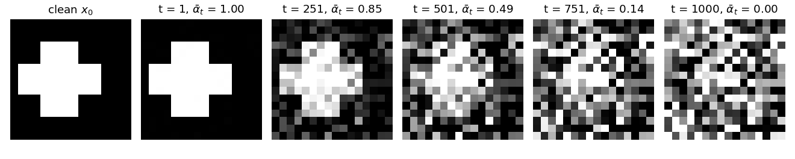
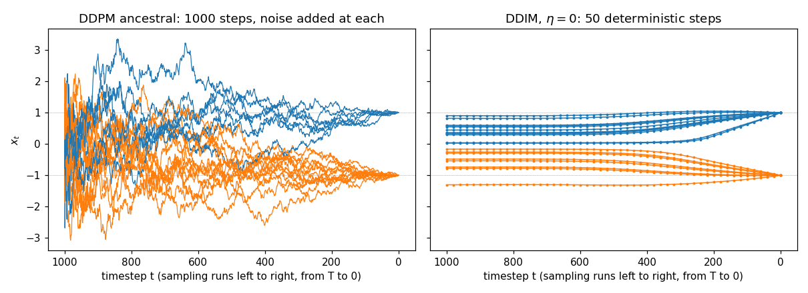
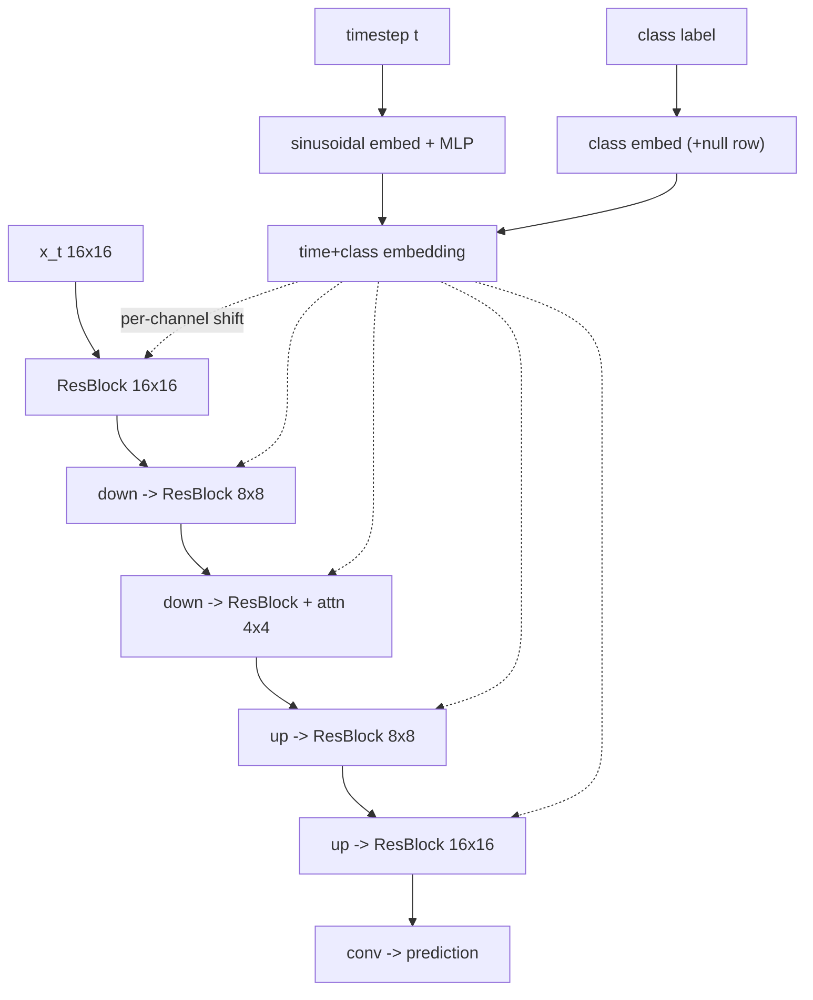

# A5 - Diffusion (DDPM / DDIM)

Denoising diffusion is a way to train a generative model, a model that produces new samples (for
example new images) that resemble a training set without copying it. A fixed forward process adds
Gaussian noise to an image over many steps until nothing of the image is left. A network learns to
undo one step of that noising at a time. To generate an image, start from pure noise and run the
learned reverse steps back to a clean image.

These notes cover the forward process and its noise schedules, the closed-form expression that
noises an image to any level in one step, the three prediction targets a network can be trained on
($\varepsilon$, $x_0$, $v$) and the algebra relating them, the score connection that links noise
prediction to score matching, Min-SNR loss weighting, the DDPM and DDIM samplers (with the
probability-flow ODE), and classifier-free guidance.

Build a denoising diffusion model from scratch on a tiny set of 16x16 shape images. Implement the
diffusion math (the schedule, the closed-form noising, the parameterization conversions, the loss,
both samplers, the guidance combine) and two diffusion-specific pieces of the denoiser network; the
rest of the U-Net is provided. Everything trains on a 12GB GPU, and the unit tests run on CPU in
under a minute.

Required reading before starting:
- Ho, Jain, Abbeel 2020, "Denoising Diffusion Probabilistic Models",
  [arXiv:2006.11239](https://arxiv.org/abs/2006.11239).
- Song, Meng, Ermon 2020, "Denoising Diffusion Implicit Models",
  [arXiv:2010.02502](https://arxiv.org/abs/2010.02502).
- Ho & Salimans 2022, "Classifier-Free Diffusion Guidance",
  [arXiv:2207.12598](https://arxiv.org/abs/2207.12598).

## Lecture notes

### What diffusion is for

#### The task

The model in this assignment trains on 16x16 grayscale pictures of three shapes, a filled disk, an
axis-aligned square, and a plus sign, each drawn at a random position and size. Every pixel is
either $-1$ (background) or $+1$ (shape). Each picture comes with a class label saying which shape
it shows. The model should produce new pictures of the same kind, for example a disk at a position
and size that no training picture has, and it should be able to produce a picture of a requested
class ("draw a square").

A 16x16 picture is a list of 256 numbers, so it is a point in $\mathbb{R}^{256}$, and the training
set is a cloud of points in that space, drawn from an unknown distribution $p_{\text{data}}(x)$. The
model's job is to produce new points from (an approximation of) that distribution. The same task at
full scale is text-to-image generation, where a 256x256 color image is 196608 numbers and the
condition is a text prompt instead of a class label.

#### Why the obvious approaches are hard

Two different things can be asked of a generative model. The first is sampling: produce a new $x$
that could plausibly have come from $p_{\text{data}}$. The second is density evaluation: given an
$x$, return the number $p_\theta(x)$, the model's probability density at that point.

Density evaluation is what maximum-likelihood training needs, since fitting $\theta$ by maximizing
$\sum_i \log p_\theta(x_i)$ over the training images requires the density at each of them. It is
also the hard part. A density must integrate to one over the whole space. For a general function of
a 256-dimensional (or 196608-dimensional) input, that normalizing integral cannot be computed, so a
network that outputs an arbitrary positive number is not a density and cannot be trained by
likelihood.

Sampling directly is hard for a different reason. A computer can easily sample Gaussian noise, so a
natural plan is to learn a function from a noise vector to a picture. Training such a function by
regression needs input-output pairs, and none exist: nothing says which noise vector should produce
which picture.

#### The idea: learn to remove noise

The reverse direction is easy. Take a training picture and add Gaussian noise to it. The noisy
picture is the input, and the clean picture (or the noise that was added) is the regression target.
This gives an unlimited supply of training pairs, at any amount of noise, from the training set
alone. A network trained on these pairs is a denoiser: shown a noisy picture and told how much noise
it contains, it estimates the clean picture.

The figure shows one training picture with increasing amounts of noise added. At the right end the
picture is indistinguishable from pure Gaussian noise.



Generation runs this sequence from right to left. Start from pure noise, which is easy to sample.
Ask the denoiser what clean picture is consistent with it, move the current picture a small step in
that direction, and repeat with less noise each time. The static fades and a shape appears.

The steps have to be small, for a reason that comes up repeatedly in these notes. Shown pure noise,
the denoiser cannot know which picture the noise came from, and the best it can do in squared error
is the average of all pictures that are plausible, a gray blur. A single jump to that answer would
produce a blur. A small step toward it removes a little noise, after which the picture carries a
little more information, the set of plausible pictures shrinks, and the next estimate is sharper.

#### Why it mattered

Each earlier family of generative models has a specific drawback: adversarial networks train
through an unstable two-network game, normalizing flows restrict the network to invertible layers,
and autoregressive models need one network evaluation per pixel (the section on earlier models
describes them). Denoising diffusion probabilistic models (DDPM, Ho, Jain, Abbeel 2020) train with a plain mean-squared error
on the added noise, which is stable, and the network is an ordinary feed-forward network with no
invertibility or ordering constraint. On unconditional CIFAR-10, a standard benchmark of 32x32
color photographs in ten classes, DDPM reached FID 3.17 (the Frechet inception distance, a
sample-quality score defined in the next section; lower is better), competitive
with the generative adversarial networks of the time, from a regression loss, and diffusion has
been the basis of image and video generation since. The cost is at sampling time: the original
sampler evaluates the network about 1000 times per image, and much of the sampling part of these
notes is about reducing that.

### Our $\pm 1$ example (one pixel of the shape pictures)

The pictures live in 256 dimensions, where nothing can be drawn or computed by hand. To see the
mechanism, we shrink the problem to a single pixel. A pixel of the shape pictures is either $-1$ or
$+1$, so we take one pixel's clean value $x_0$ as the entire "picture", and give each value
probability $1/2$. (In the training pictures about a quarter of all pixels are shape pixels, and the
fraction depends on the pixel's position.) We call this our $\pm 1$ example.

Noising a pixel means scaling its value down and adding Gaussian noise: the noisy value is
$x_t = a\,x_0 + b\,\varepsilon$ with $\varepsilon \sim \mathcal{N}(0, 1)$, where $a$ and $b$ are
numbers between 0 and 1 set by the amount of noise and satisfying $a^2 + b^2 = 1$ (the forward
process section derives this form). Taking both clean values together, the noisy pixel is an equal
mixture of two Gaussians with standard deviation $b$, centered at $+a$ and $-a$. With little noise
these are two narrow bumps near $\pm 1$; as the noise grows they widen, move inward, and merge into
a single standard Gaussian.

The ideal denoiser for our $\pm 1$ example has a closed form. Given a noisy value $x$, Bayes' rule
gives the posterior probability that the clean value was $+1$ from the ratio of the two Gaussian
densities at $x$, which works out to $P(x_0 = +1 \mid x_t = x) = \sigma(2ax/b^2)$, with $\sigma$ the
sigmoid. The posterior mean of the clean value is then
$\mathbb{E}[x_0 \mid x_t = x] = 2\sigma(2ax/b^2) - 1 = \tanh(ax/b^2)$. With little noise
($a^2 = 0.8$, so $a \approx 0.894$, and $b^2 = 0.2$) and a noisy value $x = 0.5$, this gives
$\tanh(2.24) \approx 0.977$: the denoiser is nearly sure the pixel is $+1$. With much more noise
($a^2 = 0.2$, $b^2 = 0.8$) the same noisy value gives $\tanh(0.280) \approx 0.272$, a hedge between
the two values. The right panel shows this denoiser at five noise levels: a nearly hard sign
function when the noise is small, and an almost flat line when it is large.

![Our plus-minus-1 example: the density of the noisy pixel (left) and the ideal denoiser E[x_0 given x_t] (right) at five noise levels](assets/pm1_denoiser.png)

Our $\pm 1$ example keeps the parts of the full problem that these notes are about: the fixed
noising, a denoiser that returns an average whenever the noisy value is ambiguous, and a sampler
that has to commit to $-1$ or $+1$ gradually. It drops what makes images hard, which is the
dependence between pixels (the pixels of a disk must be $+1$ together, in a round region). In 256
dimensions the network has to learn that structure from the training pictures; the image model in
this assignment shows that part. In exchange, every quantity in our $\pm 1$ example has a closed
form that can be checked by hand.

### Overview of the rest of the notes

The sections below make the idea above precise. Most steps apply a familiar idea from estimation or
dynamics to a new problem.

1. Generative models before diffusion, and how sample quality is measured. This section also
   defines the score, the gradient of the log-density, which diffusion turns out to learn.
2. The forward process. Noising is a linear Gaussian Markov chain, the same kind of process model as
   in a Kalman filter, and its many steps collapse into one closed-form step.
3. The reverse step. Given the clean image, one reverse step has a Gaussian posterior whose mean is
   a precision-weighted average, the same form as a scalar Kalman update. The network supplies the
   missing clean image.
4. The training objective. Maximum likelihood, through a lower bound and two facts about Gaussians,
   reduces to a mean-squared error on the added noise. Least squares returns the conditional mean,
   so the trained network estimates the posterior mean of the noise, and Tweedie's formula shows
   that this is the score up to a scale factor.
5. Prediction targets and loss weighting. Predicting the noise, the clean image, or a rotated
   combination of the two is algebraically the same but numerically different, and the choice
   changes how much each noise level counts in the loss.
6. Sampling. The DDPM sampler runs the reverse chain step by step. In continuous time the same
   chain becomes a differential equation, and DDIM integrates its deterministic version with far
   fewer steps.
7. Classifier-free guidance. Bayes' rule in score form turns class-conditional generation into a
   weighted difference of two network outputs.
8. The network. A U-Net with a timestep embedding borrowed from the transformer's positional
   encoding.

Our $\pm 1$ example is used throughout to make each formula concrete. Six exercises, placed after
the sections they test, are meant to be worked by hand (a calculator helps). Each has a worked
answer that can be expanded.

A note on notation. In these notes $x_0$ is the clean image and the timestep $t$ counts up toward
noise, so $x_T$ is pure noise. This is the diffusion literature's convention. Flow matching, the
next assignment, uses the opposite one ($t = 0$ is noise, $t = 1$ is data); both are standard in
their own literature.

### Generative models before diffusion

#### Measuring sample quality

A model that only samples has no likelihood to report, so sample quality is measured by comparing
two sets of images statistically. The standard number is the Frechet inception distance (FID,
Heusel et al. 2017). Push a large set of generated images and a large set of real images through a
fixed pretrained image classifier (Inception-v3), keep one intermediate feature vector per image,
and fit a Gaussian to each of the two feature clouds, giving means $\mu_r, \mu_g$ and covariances
$\Sigma_r, \Sigma_g$. FID is the Frechet distance between those two Gaussians, which for Gaussians
is the 2-Wasserstein distance and has a closed form:

$$\mathrm{FID} = \lVert \mu_r - \mu_g \rVert^2 + \operatorname{tr}\!\big(\Sigma_r + \Sigma_g - 2(\Sigma_r\Sigma_g)^{1/2}\big).$$

Lower is better, and zero means the two feature Gaussians coincide. FID compares only the first two
moments of a learned feature distribution, so it is blind to anything those moments miss, and its
value depends on the particular classifier and on how many samples were used. These notes quote it
because the papers report it; it is a proxy for image quality.

#### Four families

Generative adversarial networks (GANs, Goodfellow et al. 2014) train two networks against each
other. A generator maps a noise vector to an image; a discriminator tries to tell generated images
from real ones; the generator is trained to make the discriminator fail. There is no density
anywhere in this, only sampling, and the images come out sharp because nothing in the objective
rewards hedging between plausible outputs. Two failure modes come with the setup. The solution
sought is an equilibrium of a two-player game rather than the minimum of a single scalar loss, so
gradient descent on both players can orbit a solution instead of settling into it. And in mode
collapse, the generator finds a narrow set of outputs the current discriminator scores as real and
emits variations of only those, dropping entire regions of $p_{\text{data}}$, while the loss looks
fine.

Normalizing flows build the model as an invertible map $f_\theta$ from a simple base distribution
(an isotropic Gaussian $p_z$) onto the data. The change-of-variables formula then gives the density
exactly:

$$\log p_\theta(x) = \log p_z\big(f_\theta^{-1}(x)\big) + \log\big|\det J_{f_\theta^{-1}}(x)\big|,$$

where $J$ is the Jacobian of the inverse map, and $|\det J|$ is the factor by which the map scales a
small volume. Sampling is a forward pass from a Gaussian draw and the likelihood is exact. The price
is architectural: every layer must be invertible, must preserve dimension, and must have a Jacobian
determinant that can be computed cheaply, which excludes most of the layers that work well in
ordinary networks.

Autoregressive models factor the density with the chain rule of probability over pixels in a fixed
order, $p(x) = \prod_i p(x_i \mid x_{<i})$, and model each conditional with a network. The
likelihood is exact and the architecture is unconstrained apart from the masking that enforces the
ordering. Sampling costs one network evaluation per pixel, in sequence, and the ordering itself is
an arbitrary choice imposed on a 2D signal that has no natural one.

Score-based models drop the density and keep only its gradient. The **score** of a distribution is

$$s(x) = \nabla_x \log p(x),$$

a vector field over the input space pointing in the direction of steepest increase in log-density.
The normalizing constant disappears under the gradient, since
$\nabla_x \log\big(\tilde p(x)/Z\big) = \nabla_x \log \tilde p(x)$ for any constant $Z$, so a
network can output a score without ever computing the intractable integral. Given a score, samples
come from Langevin dynamics, which is gradient ascent on $\log p$ with a calibrated amount of noise
added at each step:

$$x \leftarrow x + \tfrac{\epsilon}{2}\, s(x) + \sqrt{\epsilon}\, z, \qquad z\sim\mathcal{N}(0,I).$$

Without the noise term the iteration climbs to a mode and stops. With noise of exactly that scale,
the iteration's stationary distribution is $p$ itself as $\epsilon \to 0$, so it visits each region
in proportion to its density instead of collapsing onto the peak. Song & Ermon 2019
([arXiv:1907.05600](https://arxiv.org/abs/1907.05600)) made this work on images by estimating the
score at several noise levels, since a score learned from data alone is meaningless in the large
regions where no training point ever lands. Getting the noise levels, the step sizes, and the
transitions between them to work together was the difficult part. Diffusion, below, ends up
learning the same scores at many noise levels, starting from maximum likelihood instead.

### The forward process

The forward process is a fixed (not learned) Markov chain: a sequence of random variables in which
the distribution of the next one depends on the current one alone and not on the earlier history.
Each step shrinks the signal slightly and adds a little Gaussian noise, for $t = 1 \dots T$:

$$q(x_t \mid x_{t-1}) = \mathcal{N}\big(x_t;\ \sqrt{1-\beta_t}\,x_{t-1},\ \beta_t I\big),$$

where $\beta_t$ is a small variance that grows with $t$. Write $\alpha_t = 1 - \beta_t$ for the
per-step signal factor and $\bar\alpha_t = \prod_{s=1}^{t}\alpha_s$ for its cumulative product. In
state-estimation terms this is a linear Gaussian process model, $x_t = \sqrt{\alpha_t}\,x_{t-1}$
plus process noise of variance $\beta_t$, with a decay factor below one. The scale factor
$\sqrt{1-\beta_t}$ is chosen so that a signal with unit variance keeps unit variance: the shrunk
signal contributes $1 - \beta_t$ and the noise contributes $\beta_t$.

#### The closed form

The chain has a closed form that jumps from the clean image $x_0$ to any noise level in one step:

$$q(x_t \mid x_0) = \mathcal{N}\big(x_t;\ \sqrt{\bar\alpha_t}\,x_0,\ (1-\bar\alpha_t)I\big),
\qquad x_t = \sqrt{\bar\alpha_t}\,x_0 + \sqrt{1-\bar\alpha_t}\,\varepsilon,\ \ \varepsilon \sim \mathcal{N}(0,I).$$

The derivation is one line of variance bookkeeping. Write one step in sampled form,
$x_t = \sqrt{\alpha_t}\,x_{t-1} + \sqrt{\beta_t}\,\varepsilon_t$ with $\varepsilon_t$ standard
normal, and substitute the same expression for $x_{t-1}$:

$$x_t = \sqrt{\alpha_t \alpha_{t-1}}\,x_{t-2} + \sqrt{\alpha_t \beta_{t-1}}\,\varepsilon_{t-1} + \sqrt{\beta_t}\,\varepsilon_t.$$

The last two terms are independent zero-mean Gaussians, so their sum is one Gaussian whose variance
is the sum of theirs:

$$\alpha_t\beta_{t-1} + \beta_t = \alpha_t(1-\alpha_{t-1}) + (1-\alpha_t) = 1 - \alpha_t\alpha_{t-1}.$$

The signal coefficient squared and the noise variance again add to one, so the two-step chain has
the same form as the one-step chain with $\alpha_t\alpha_{t-1}$ in place of $\alpha_t$. Repeating
the substitution down to $x_0$ replaces the product with $\bar\alpha_t$, and the variance with
$1-\bar\alpha_t$.

Training depends on this closed form. A training pair at timestep $t$ costs one draw of
$\varepsilon$ and one evaluation of the formula, with no need to simulate the chain step by step.
The $a$ and $b$ of our $\pm 1$ example are $a = \sqrt{\bar\alpha_t}$ and $b = \sqrt{1-\bar\alpha_t}$.

#### The signal-to-noise ratio

$\bar\alpha_t$ runs from $\approx 1$ (almost clean) at small $t$ to $\approx 0$ (pure noise) at
$t = T$. For an $x_0$ scaled to roughly unit variance per pixel, $\bar\alpha_t$ is the signal power
and $1-\bar\alpha_t$ the noise power in $x_t$, so their ratio is a signal-to-noise ratio in the
ordinary sense:

$$\mathrm{SNR}_t = \frac{\bar\alpha_t}{1-\bar\alpha_t}.$$

It runs from very large at $t \to 0$ to near zero at $t = T$. The training loss, the prediction
targets, and the samplers below all change behavior along this axis.

#### Noise schedules

The **noise schedule** is the sequence $\{\bar\alpha_t\}$. Two choices matter:

- Linear (Ho et al. 2020): $\beta_t$ ramps linearly from $10^{-4}$ to $2\times10^{-2}$ over
  $T=1000$ steps. It is simple, but it destroys signal too fast at low resolution. These constants
  are tied to $T=1000$ and do not transfer to a much smaller $T$, where the chain barely noises.
- Cosine (Nichol & Dhariwal 2021, "Improved Denoising Diffusion Probabilistic Models",
  [arXiv:2102.09672](https://arxiv.org/abs/2102.09672)):

$$\bar\alpha_t = \frac{f(t)}{f(0)}, \qquad f(t) = \cos^2\!\left(\frac{t/T + s}{1+s}\cdot\frac{\pi}{2}\right),$$

  with a small offset $s = 0.008$ that keeps $\beta_t$ from getting too small near $t=0$, and
  $\beta_t = 1 - \bar\alpha_t/\bar\alpha_{t-1}$ clipped to $\le 0.999$. The cosine schedule decays
  signal more slowly in the middle and is the standard choice at 32x32 and below. Because it is
  defined directly on $\bar\alpha$ through $t/T$, it is self-normalizing in $T$:
  $\bar\alpha_T \approx 0$ at any $T$.

The $\cos^2$ has a reason. The section on prediction targets shows that $\sqrt{\bar\alpha_t}$ and
$\sqrt{1-\bar\alpha_t}$ are the cosine and sine of an angle, and this schedule sweeps that angle at
a nearly constant rate in $t$.

> **Exercise 1 (the cosine schedule at mid-chain).** For the cosine schedule with $s = 0.008$,
> compute $\bar\alpha_t$ at $t = T/2$, then $a = \sqrt{\bar\alpha_t}$, $b = \sqrt{1-\bar\alpha_t}$,
> and $\mathrm{SNR}_t$. In our $\pm 1$ example, a shape pixel ($x_0 = +1$) receives the noise draw
> $\varepsilon = -1$. What is $x_t$, and what does that say about how much one noise draw can hide
> at this level?

<details>
<summary>Answer</summary>

$f(T/2) = \cos^2\big(\frac{0.508}{1.008}\cdot\frac{\pi}{2}\big) = \cos^2(0.7916) \approx 0.49377$
and $f(0) = \cos^2\big(\frac{0.008}{1.008}\cdot\frac{\pi}{2}\big) \approx 0.99984$, so
$\bar\alpha_{T/2} \approx 0.4938$. Then $a \approx 0.7027$, $b \approx 0.7114$, and
$\mathrm{SNR} \approx 0.4938/0.5062 \approx 0.976$: signal and noise have almost equal power
halfway through the cosine schedule. The angle with $\cos\phi = a$ is about $45.4^\circ$, just past
the halfway point of the sweep from $0^\circ$ to $90^\circ$.

The noisy pixel is $x_t = 0.7027 - 0.7114 \approx -0.009$. A single noise draw of one standard
deviation has moved a shape pixel to slightly below zero, on the background side. Shown only this
value, no denoiser can tell that the pixel was $+1$. In a full picture a denoiser can, because the
neighbors of a shape pixel are mostly shape pixels too, and their noise draws are independent.

</details>

### The reverse process

Generation runs the chain backward: start from pure noise $x_T \sim \mathcal{N}(0,I)$, draw
$x_{T-1}$, then $x_{T-2}$, down to $x_0$. Doing that needs $q(x_{t-1} \mid x_t)$, the true reverse
of one forward step, and that distribution is not available. Getting it from Bayes' rule requires
$q(x_{t-1})$, the marginal distribution of the noised data at level $t-1$, which is an integral over
the entire data distribution.

The reverse step becomes tractable once the clean image is known. Condition on $x_0$ and apply
Bayes' rule to the two pieces the forward process does give:

$$q(x_{t-1}\mid x_t, x_0) \;\propto\; q(x_t \mid x_{t-1})\, q(x_{t-1}\mid x_0).$$

Both factors are Gaussian densities, so as a function of $x_{t-1}$ the product has an exponent that
is a quadratic. Any distribution whose log-density is quadratic is Gaussian, and completing the
square gives its mean and variance:

$$\tilde\mu_t(x_t, x_0) = \frac{\sqrt{\bar\alpha_{t-1}}\,\beta_t}{1-\bar\alpha_t}\,x_0
       + \frac{\sqrt{\alpha_t}\,(1-\bar\alpha_{t-1})}{1-\bar\alpha_t}\,x_t,
\qquad \tilde\beta_t = \frac{1-\bar\alpha_{t-1}}{1-\bar\alpha_t}\,\beta_t.$$

The mean has the form of a scalar Kalman update. Two sources of information about $x_{t-1}$ are
combined. The prior comes from $x_0$: the closed form says $x_{t-1}$ is centered at
$\sqrt{\bar\alpha_{t-1}}\,x_0$ with variance $1-\bar\alpha_{t-1}$. The measurement comes from $x_t$:
one forward step says $x_{t-1}$ is near $x_t/\sqrt{\alpha_t}$ with variance $\beta_t/\alpha_t$. The
posterior mean weights the two by their precisions (inverse variances), and the posterior variance
$\tilde\beta_t$ is smaller than either input variance.

This posterior is exactly what a sampler needs, except that it is conditioned on the clean image,
the very thing generation is trying to produce. The learning problem is to supply an estimate
$\hat x_0$ in place of the unavailable $x_0$ in that formula, and a network trained on the forward
process supplies that estimate.

> **Exercise 2 (one reverse step as a Kalman update).** Take $\bar\alpha_{t-1} = 0.6$ and
> $\bar\alpha_t = 0.5$, a clean pixel $x_0 = +1$, and a noisy value $x_t = 0.2$. Compute
> $\alpha_t$, $\beta_t$, $\tilde\mu_t$, and $\tilde\beta_t$ from the formulas above. Then compute
> the same mean and variance as a precision-weighted combination of the prior and the measurement
> described in the text, and check that they agree.

<details>
<summary>Answer</summary>

$\alpha_t = 0.5/0.6 = 5/6$ and $\beta_t = 1/6$. The coefficient on $x_0$ is
$\sqrt{0.6}\cdot(1/6)/0.5 \approx 0.2582$ and the coefficient on $x_t$ is
$\sqrt{5/6}\cdot 0.4/0.5 \approx 0.7303$, so $\tilde\mu_t \approx 0.2582 + 0.7303 \cdot 0.2
\approx 0.4043$. The variance is $\tilde\beta_t = (0.4/0.5)\cdot(1/6) \approx 0.1333$.

As a Kalman update: the prior has mean $\sqrt{0.6} \approx 0.7746$ and variance $0.4$; the
measurement is $x_t/\sqrt{\alpha_t} = 0.2/0.9129 \approx 0.2191$ with variance
$\beta_t/\alpha_t = 0.2$. The precisions are $2.5$ and $5$, summing to $7.5$, so the posterior
variance is $1/7.5 \approx 0.1333$ and the mean is $(2.5 \cdot 0.7746 + 5 \cdot 0.2191)/7.5
\approx 0.4043$. Both agree. The Kalman gain on the measurement is $0.4/(0.4 + 0.2) = 2/3$: one
forward step adds less uncertainty ($0.2$ after rescaling) than the clean image leaves about
$x_{t-1}$ at this depth in the chain ($0.4$), so the noisy observation gets the larger weight.

</details>

### The training objective

Ho et al. do not train the network on the posterior mean directly. They start from maximum
likelihood, and the objective reduces to a mean-squared error on the noise. The reduction uses two
facts about probability, built up first.

#### KL divergence and the evidence lower bound

The Kullback-Leibler divergence between two distributions is the expected log-ratio,

$$D_{\mathrm{KL}}(q \,\Vert\, p) = \mathbb{E}_{x \sim q}\!\left[\log \frac{q(x)}{p(x)}\right] \ge 0,$$

zero exactly when $q = p$. It measures how badly $p$ fits samples that actually come from $q$. It
is not symmetric and not a metric. The property used here is that for two Gaussians with the same
fixed covariance $\sigma^2 I$, the log-ratio's random parts cancel and the divergence reduces to a
scaled squared distance between the means:

$$D_{\mathrm{KL}}\big(\mathcal{N}(\mu_q, \sigma^2 I)\,\Vert\,\mathcal{N}(\mu_p, \sigma^2 I)\big)
= \frac{1}{2\sigma^2}\lVert \mu_q - \mu_p \rVert^2.$$

This identity turns a probabilistic objective into a regression loss.

The second fact is the evidence lower bound. Maximum likelihood wants $\log p_\theta(x_0)$, but the
model defines a joint distribution over the whole chain $x_{0:T}$, and the quantity of interest is
the marginal $p_\theta(x_0) = \int p_\theta(x_{0:T}) \, dx_{1:T}$, an intractable integral over
every possible noising path. Multiply and divide by the forward process $q(x_{1:T}\mid x_0)$, which
is known, and the integral becomes an expectation:

$$\log p_\theta(x_0) = \log \mathbb{E}_{q}\!\left[\frac{p_\theta(x_{0:T})}{q(x_{1:T}\mid x_0)}\right]
\;\ge\; \mathbb{E}_{q}\!\left[\log \frac{p_\theta(x_{0:T})}{q(x_{1:T}\mid x_0)}\right].$$

The inequality is Jensen's, applied to the concave logarithm: the log of an average is at least the
average of the logs. The right-hand side can be estimated by sampling noising paths, and it
lower-bounds the log-likelihood, which this literature calls the evidence; hence evidence lower
bound, or ELBO. The gap between the two sides is $D_{\mathrm{KL}}(q(x_{1:T}\mid x_0) \,\Vert\,
p_\theta(x_{1:T}\mid x_0))$, so the bound is tight when the forward process matches the model's own
posterior over paths.

#### From the bound to a squared error on the noise

Regroup the ELBO term by term along the chain. Because both $q$ and $p_\theta$ factor over
consecutive timesteps, the bound rearranges into a sum of per-step KL divergences plus two endpoint
terms:

$$-\log p_\theta(x_0) \le \sum_{t>1} D_{\mathrm{KL}}\big(q(x_{t-1}\mid x_t, x_0)\,\Vert\,p_\theta(x_{t-1}\mid x_t)\big) + \text{(endpoints)}.$$

Every term in that sum compares the Gaussian posterior derived in the previous section against the
model's reverse step. Ho et al. give the model's reverse step a fixed, untrained variance, which
makes each pair two Gaussians with matching covariance, and the Gaussian-KL identity turns each
term into a squared difference of means. So the model only has to predict $\tilde\mu_t$.

Rather than predicting the mean directly, substitute. Solving the closed-form noising for the clean
image gives $x_0 = (x_t - \sqrt{1-\bar\alpha_t}\,\varepsilon)/\sqrt{\bar\alpha_t}$, and putting that
into $\tilde\mu_t$ rewrites the posterior mean in terms of $x_t$ and $\varepsilon$ alone. The
squared difference of means then becomes a squared difference of noises times a scalar that depends
on $t$ through the schedule. Ho et al. drop that scalar, which leaves

$$\mathcal{L} = \mathbb{E}_{x_0,\,t,\,\varepsilon}\Big[\,\big\lVert\varepsilon - \varepsilon_\theta(x_t, t)\big\rVert^2\,\Big],$$

with $t$ drawn uniformly and $\varepsilon$ standard normal. A network $\varepsilon_\theta$ takes the
noisy image and the timestep and predicts the noise that was added. Dropping the scalar means the
objective is no longer the ELBO, and Ho et al. report that it gives better samples than keeping it.
The dropped scalar comes back as a design choice under loss weighting below.

#### Tweedie's formula and the score connection

Nothing in the derivation so far mentioned scores, yet the trained network turns out to estimate
one. Two steps show it. First, least squares returns the conditional mean: the minimizer of a
squared-error objective is the conditional mean of the target given the input (the minimum
mean-squared-error estimate), so a network trained to convergence on
$\lVert\varepsilon - \varepsilon_\theta(x_t,t)\rVert^2$ approaches $\mathbb{E}[\varepsilon\mid x_t]$.
Second, Tweedie's formula, derived next, says that this conditional mean is the score of the noisy
data distribution up to a fixed factor.

At noise level $t$ the noisy data distribution is a Gaussian blur of the data distribution,

$$p_t(x_t) = \int p_{\text{data}}(x_0)\, \mathcal{N}(x_t;\, a x_0,\, b^2 I)\, dx_0,
\qquad a = \sqrt{\bar\alpha_t},\ b = \sqrt{1-\bar\alpha_t}.$$

Differentiate under the integral. The only $x_t$ dependence is in the Gaussian, whose gradient is
itself times $(a x_0 - x_t)/b^2$:

$$\nabla_{x_t} p_t(x_t) = \int p_{\text{data}}(x_0)\, \mathcal{N}(x_t;\, a x_0,\, b^2 I)\, \frac{a x_0 - x_t}{b^2}\, dx_0.$$

Divide both sides by $p_t(x_t)$. The left side becomes the score. On the right,
$p_{\text{data}}(x_0)\,\mathcal{N}(x_t; a x_0, b^2 I)/p_t(x_t)$ is the posterior over clean images
given $x_t$ (Bayes' rule), so the integral becomes a posterior expectation:

$$\nabla_{x_t}\log p_t(x_t) = \frac{a\,\mathbb{E}[x_0 \mid x_t] - x_t}{b^2}.$$

This is Tweedie's formula: the score of a Gaussian-blurred distribution is the posterior mean of the
clean signal, rescaled and offset. Rearranged for the posterior mean it reads
$\mathbb{E}[x_0\mid x_t] = \big(x_t + (1-\bar\alpha_t)\,s(x_t,t)\big)/\sqrt{\bar\alpha_t}$: the best
denoised estimate is one gradient step up the log-density of the noisy data, then a rescaling.

Now bring in the forward process, $x_t = a x_0 + b \varepsilon$, which gives
$\mathbb{E}[x_0\mid x_t] = (x_t - b\,\mathbb{E}[\varepsilon \mid x_t])/a$. Substituting that into
the line above cancels $x_t$ and leaves

$$s(x_t, t) = -\frac{\mathbb{E}[\varepsilon \mid x_t]}{\sqrt{1-\bar\alpha_t}}.$$

So the noise-prediction network, which approaches $\mathbb{E}[\varepsilon\mid x_t]$, approaches the
score up to the fixed factor $-1/\sqrt{1-\bar\alpha_t}$. DDPM's noise-prediction loss is denoising
score matching (Vincent 2011, "A Connection Between Score Matching and Denoising Autoencoders"),
arrived at from maximum likelihood rather than from Langevin sampling. This identity lets the
continuous-time formulation (Song et al. 2021,
[arXiv:2011.13456](https://arxiv.org/abs/2011.13456)) treat the DDPM network as a score estimator.

In our $\pm 1$ example, at $\bar\alpha_t = 0.8$ and $x_t = 0.5$, the posterior mean computed earlier
is $0.977$, so Tweedie's formula gives the score $(0.894 \cdot 0.977 - 0.5)/0.2 \approx 1.87$. It is
positive: the density of the noisy pixel rises toward the bump centered at $a \approx 0.894$.

> **Exercise 3 (Tweedie's formula in our $\pm 1$ example).** At $\bar\alpha_t = 0.5$ and
> $x_t = 0.3$, compute the posterior mean $\mathbb{E}[x_0 \mid x_t]$, the posterior mean of the
> noise $\mathbb{E}[\varepsilon \mid x_t]$, and the score two ways: from the noise with
> $s = -\mathbb{E}[\varepsilon\mid x_t]/b$, and from the posterior mean with Tweedie's formula.
> The pixel is more likely $+1$ than $-1$; why is the score negative?

<details>
<summary>Answer</summary>

$a = b = \sqrt{0.5} \approx 0.7071$, so $ax/b^2 = 0.7071 \cdot 0.3/0.5 \approx 0.4243$ and
$\mathbb{E}[x_0\mid x_t] = \tanh(0.4243) \approx 0.4005$ (the posterior probability of $+1$ is
$\sigma(0.8485) \approx 0.700$). From $x_t = a x_0 + b\varepsilon$, the posterior mean of the noise
is $\mathbb{E}[\varepsilon\mid x_t] = (x_t - a\,\mathbb{E}[x_0\mid x_t])/b = (0.3 - 0.2832)/0.7071
\approx 0.0237$.

From the noise: $s = -0.0237/0.7071 \approx -0.0336$. From Tweedie:
$s = (0.7071 \cdot 0.4005 - 0.3)/0.5 \approx -0.0336$. They agree.

The score describes the density of the noisy pixel at this level, not where the clean value is. At
$\bar\alpha_t = 0.5$ the density is an equal mixture of Gaussians at $\pm 0.707$ with standard
deviation $0.707$; the bumps are only two standard deviations apart and merge into one flat-topped
peak at $0$ (the $\bar\alpha = 0.5$ curve in the left panel of the figure). The density therefore
falls slightly from $0$ to $0.3$, and its gradient points back toward $0$. The posterior mean
answers a different question, which clean value the pixel most likely had, and Tweedie's formula
converts between the two.

</details>

### Three prediction targets

Given the noisy $x_t$, a network can predict any of three algebraically equivalent quantities. Keep
the shorthand $a = \sqrt{\bar\alpha_t}$ and $b = \sqrt{1-\bar\alpha_t}$, and note that
$a^2 + b^2 = 1$ by construction of the schedule.

That identity organizes this section. A pair of numbers whose squares sum to one is a cosine and a
sine, so define the angle $\phi_t$ by $a = \cos\phi_t$, $b = \sin\phi_t$. It runs from $0$ at $t=0$
(all signal) to $\pi/2$ at $t=T$ (all noise). The forward process and the $v$ target together are
then a rotation by $\phi_t$ acting on the pair $(x_0, \varepsilon)$, coordinate by coordinate:

$$\begin{bmatrix} x_t \\ v \end{bmatrix}
= \begin{bmatrix} \cos\phi_t & \sin\phi_t \\ -\sin\phi_t & \cos\phi_t \end{bmatrix}
\begin{bmatrix} x_0 \\ \varepsilon \end{bmatrix},
\qquad v = a\,\varepsilon - b\,x_0.$$

The top row is the closed-form noising. The bottom row defines $v$ (Salimans & Ho 2022,
"Progressive Distillation for Fast Sampling of Diffusion Models",
[arXiv:2202.00512](https://arxiv.org/abs/2202.00512)) as the component orthogonal to $x_t$ in that
same rotated frame. The cosine schedule reads cleanly in this frame: it sets $\bar\alpha_t$ to
$\cos^2$ of a quantity linear in $t/T$, so up to the offset $s$ and the normalization by $f(0)$, it
advances $\phi_t$ at a constant angular rate.

Given any one of the three predictions and $x_t$, the other two follow:

| Prediction | Definition | Recovering $x_0$ and $\varepsilon$ |
|--------|------------|-----------------------------------------------|
| $\varepsilon$-prediction | the added noise | $x_0 = (x_t - b\,\varepsilon)/a$ |
| $x_0$-prediction | the clean image | $\varepsilon = (x_t - a\,x_0)/b$ |
| $v$-prediction | $v = a\,\varepsilon - b\,x_0$ | $x_0 = a\,x_t - b\,v,\qquad \varepsilon = b\,x_t + a\,v$ |

A sampler written in terms of $(\hat x_0, \hat\varepsilon)$ therefore works with a network trained
on any of the three targets.

#### Numerical conditioning of the three inversions

Algebraic equivalence is not numerical equivalence. A network's output carries error, and each row
of the table is a linear map that turns that error into an error in $x_0$ and $\varepsilon$. The
three targets differ in the amplification factor of that map, the ratio of output error to input
error. In linear-algebra terms that factor is the numerical conditioning of the inversion, and here it can be
read straight off the coefficients.

If the network predicts $\varepsilon$, recovering the clean image divides by
$a = \sqrt{\bar\alpha_t}$. At high noise levels $a \to 0$, so a small error in $\hat\varepsilon$
turns into an arbitrarily large error in $\hat x_0$: at $\bar\alpha_t = 0.01$ the factor is $10$. If
the network predicts $x_0$, recovering the noise divides by $b = \sqrt{1-\bar\alpha_t}$, which goes
to zero at the clean end, so the same blowup happens at small $t$ instead (a factor of $10$ at
$\bar\alpha_t = 0.99$). Each of the two obvious targets is badly conditioned at one end of the
schedule.

The $v$ target has neither problem. Its recovery is the inverse rotation, and a rotation matrix is
orthogonal, so it preserves lengths exactly: an error of size $\delta$ in $\hat v$ produces errors
of $b\,\delta$ in $\hat x_0$ and $a\,\delta$ in $\hat\varepsilon$, whose squares sum to $\delta^2$,
at every $t$, with no dependence on the schedule. The amplification is exactly $1$ everywhere.

Salimans & Ho introduced $v$ for progressive distillation, where a student model takes very large
steps and therefore has to be accurate at both extremes of the schedule at once. Stable Diffusion
2's 768-pixel model is trained with the $v$ target.

#### Loss weighting across noise levels

Training draws $t$ uniformly and takes an unweighted mean-squared error in whichever space the
network predicts. That is a weighting decision even when it looks like the absence of one, because
the same error means different amounts in different spaces.

Measure everything in $x_0$ space, where an error has a fixed meaning: how wrong the recovered image
is. Reusing the recovery formulas above, an error $\Delta\varepsilon$ in a noise prediction becomes
an $x_0$ error of $(b/a)\,\Delta\varepsilon$, and an error $\Delta v$ in a $v$ prediction becomes an
$x_0$ error of $b\,\Delta v$. In terms of the signal-to-noise ratio, using
$b^2/a^2 = 1/\mathrm{SNR}_t$ and $b^2 = 1/(\mathrm{SNR}_t+1)$:

$$\lVert\Delta x_0\rVert^2 = \frac{1}{\mathrm{SNR}_t}\lVert\Delta\varepsilon\rVert^2,
\qquad \lVert\Delta x_0\rVert^2 = \frac{1}{\mathrm{SNR}_t + 1}\lVert\Delta v\rVert^2,$$

and an $x_0$ prediction needs no conversion at all. So a flat MSE on $\varepsilon$ is really an
$x_0$ objective weighted by $\mathrm{SNR}_t$, which is unbounded as $t \to 0$: the low-noise steps,
where the task is nearly trivial, dominate the gradient. A flat MSE on $x_0$ is the opposite
extreme.

Min-SNR weighting (Hang et al. 2023, "Efficient Diffusion Training via Min-SNR Weighting
Strategy", [arXiv:2303.09556](https://arxiv.org/abs/2303.09556)) fixes the target: put weight
$\min(\mathrm{SNR}_t, \gamma)$ on the $x_0$-space error, with $\gamma$ typically 5. Below the cap
the weighting is the ordinary SNR weighting; above it the weight is frozen, so the easy low-noise
steps stop crowding out the rest. Hang et al. report 3.4x faster convergence than previous
loss-weighting strategies.

Expressing that one target in each of the three prediction spaces means dividing out the factor
each space already carries, which gives three different formulas for the same weighting:

$$w_t = \frac{\min(\mathrm{SNR}_t, \gamma)}{\mathrm{SNR}_t}\ (\varepsilon),\qquad
w_t = \min(\mathrm{SNR}_t, \gamma)\ (x_0),\qquad
w_t = \frac{\min(\mathrm{SNR}_t, \gamma)}{\mathrm{SNR}_t + 1}\ (v).$$

Applying the $\varepsilon$-form to a $v$-prediction loss multiplies the intended weight by
$(\mathrm{SNR}_t+1)/\mathrm{SNR}_t$. That factor is close to 1 at low noise and grows without bound
as $\mathrm{SNR}_t \to 0$, so the mistake over-weights the high-noise steps.

> **Exercise 4 (Min-SNR weights at two noise levels).** With $\gamma = 5$, compute the three
> Min-SNR weights at $\mathrm{SNR}_t = 0.25$ and at $\mathrm{SNR}_t = 20$. What $\bar\alpha_t$
> does each correspond to? By what factor does the $\varepsilon$-form weight, wrongly applied to a
> $v$ loss, over-weight each of the two?

<details>
<summary>Answer</summary>

$\bar\alpha_t = \mathrm{SNR}/(1 + \mathrm{SNR})$, so $\mathrm{SNR} = 0.25$ is $\bar\alpha_t = 0.2$
(mostly noise) and $\mathrm{SNR} = 20$ is $\bar\alpha_t \approx 0.952$ (mostly signal).

At $\mathrm{SNR} = 0.25$ the cap is inactive, $\min(0.25, 5) = 0.25$: $w_\varepsilon = 1$,
$w_{x_0} = 0.25$, $w_v = 0.25/1.25 = 0.2$. At $\mathrm{SNR} = 20$ the cap is active,
$\min(20, 5) = 5$: $w_\varepsilon = 0.25$, $w_{x_0} = 5$, $w_v = 5/21 \approx 0.238$.

The over-weighting factor is $(\mathrm{SNR}+1)/\mathrm{SNR}$: $5$ at $\mathrm{SNR} = 0.25$ and
$1.05$ at $\mathrm{SNR} = 20$. Using the $\varepsilon$-form on a $v$ loss leaves the low-noise step
almost unchanged and puts five times the intended weight on the high-noise step.

</details>

### Sampling

#### The DDPM ancestral sampler

Ancestral sampling means drawing the variables of a joint distribution one at a time in the order
its factorization dictates, each conditioned on the ones already drawn. Here the factorization is
the reverse chain, so the sampler starts at $x_T \sim \mathcal{N}(0,I)$ and steps down to $x_0$, at
each step running the network, converting its output to $\hat x_0$, and substituting that estimate
into the posterior mean from the reverse-process section:

$$\mu_t = \frac{\sqrt{\bar\alpha_{t-1}}\,\beta_t}{1-\bar\alpha_t}\,\hat x_0
       + \frac{\sqrt{\alpha_t}\,(1-\bar\alpha_{t-1})}{1-\bar\alpha_t}\,x_t.$$

Gaussian noise scaled by the posterior standard deviation is added at every step except the last,
where the previous level is the clean image itself ($\bar\alpha_0 = 1$) and the mean is the answer.
The true posterior variance is $\tilde\beta_t = \frac{1-\bar\alpha_{t-1}}{1-\bar\alpha_t}\,\beta_t$;
Ho et al. report that the simpler fixed choice $\beta_t$ gives comparable quality. This sampler
visits every level, so it costs about $T \approx 1000$ network evaluations per image, which is the
reason to look for something cheaper.

#### Continuous time, the reverse SDE, and the probability-flow ODE

Sending $T \to \infty$ with $\beta_t$ shrinking to match turns the chain into a stochastic
differential equation (SDE), and the discrete chain becomes its Euler-Maruyama discretization (the
stochastic version of forward Euler). An SDE is an ODE with a noise term,

$$dx = f(x,t)\,dt + g(t)\,dw,$$

where $f$ is the drift (the deterministic part of the motion), $g$ the diffusion coefficient, and
$dw$ an increment of Brownian motion, which supplies independent Gaussian noise of variance $dt$.
For the forward process $f$ is a slight pull toward the origin and $g$ injects the noise, which is
the per-step "shrink and add noise" written continuously.

Sampling depends on the marginal $p_t$: the distribution of $x_t$ on its own, with the starting
image and the particular path taken both integrated out. Two facts about it, brought into diffusion
by Song et al. 2021, make continuous time useful.

The first is that the process can be run backward. Anderson (1982) showed that a diffusion process
has a reverse-time counterpart, which for the SDE above is

$$dx = \big[f(x,t) - g(t)^2\,\nabla_x \log p_t(x)\big]dt + g(t)\,d\bar w,$$

integrated from $t=T$ to $t=0$. The only unknown in it is the score, and the training section showed
that the trained network supplies exactly that. Discretizing this reverse SDE recovers the
ancestral sampler.

The second is that the noise is optional. Among all processes sharing the same marginals $p_t$
there is a deterministic one, the probability-flow ODE:

$$\frac{dx}{dt} = f(x,t) - \tfrac{1}{2}g(t)^2\,\nabla_x\log p_t(x).$$

It differs from the reverse SDE only in the factor of $\tfrac12$ on the score term and in having no
noise at all. Halving that coefficient compensates exactly for the removed noise: the density
transported by the ODE evolves the same way in $t$ as the density transported by the SDE, even
though no individual trajectory of one matches any trajectory of the other. Sampling from $p_0$
therefore does not require injecting noise along the way; it only requires starting from a draw of
$p_T$ and integrating a deterministic vector field. Sampling becomes numerical integration, where
the step count is a question of solver accuracy rather than a fixed property of the chain.

#### DDIM

DDIM (Song, Meng, Ermon 2020) reaches the same place from the discrete side. It constructs a family
of non-Markovian forward processes, meaning each step is allowed to depend on $x_0$ as well as on
the immediately preceding state, and picks the family so that every marginal $q(x_t\mid x_0)$ is
identical to DDPM's. Since the training objective only ever saw those marginals, a network trained
as a DDPM model is already a valid model for every member of the family, with no retraining. The
reverse step of the family is

$$x_{t-1} = \sqrt{\bar\alpha_{t-1}}\,\hat x_0 + \sqrt{1-\bar\alpha_{t-1}-\sigma_t^2}\,\hat\varepsilon + \sigma_t z,
\qquad \sigma_t = \eta\sqrt{\tfrac{1-\bar\alpha_{t-1}}{1-\bar\alpha_t}}\sqrt{1-\tfrac{\bar\alpha_t}{\bar\alpha_{t-1}}}.$$

Read with $\sigma_t = 0$, the update says: estimate the clean image and the noise from $x_t$, then
rebuild the noisy image at the next level from those two estimates with the closed-form noising.
The free parameter $\eta$ selects the member of the family. At $\eta = 1$ the injected variance
equals $\tilde\beta_t$ and the update reproduces the DDPM ancestral trajectory step for step on the
full grid. At $\eta = 0$ the step is deterministic and is a first-order integrator for the
probability-flow ODE.

Step skipping follows from the form of the update rather than from anything about $\eta$. The
right-hand side refers to the schedule only through the pair $(\bar\alpha_t, \bar\alpha_{t-1})$,
and nothing requires those two levels to be adjacent, because the family was built to leave every
marginal untouched. Any decreasing subsequence of levels is therefore a valid sampler, and the
network is still evaluated at noise levels it was trained on. Cutting a 1000-level chain down to a
few tens of levels gives the 10x to 50x wall-clock speedup Song et al. report, with modest quality
loss. A separate consequence of $\eta = 0$ is that the map from $x_T$ to $x_0$ becomes a
deterministic function, so $x_T$ behaves as a latent code for the generated image, and
interpolating between two such codes produces a smooth sweep between the two images.

The figure shows both samplers on our $\pm 1$ example, with the exact denoiser $\tanh(ax/b^2)$ in
place of a network and the cosine schedule at $T = 1000$. DDPM takes all 1000 steps, and each
trajectory wanders under the injected noise before settling at $-1$ or $+1$. DDIM with $\eta = 0$
takes every 20th level, 50 steps. Its trajectories are smooth and never cross, as trajectories of
one ODE cannot, so the sign of the starting noise decides the destination: every positive $x_T$
ends at $+1$ and every negative one at $-1$. They stay nearly flat until about $t = 500$. The
reason is that for data drawn from a unit-variance Gaussian the probability-flow velocity is
exactly zero: the ideal denoiser is then $\hat x_0 = a\,x$, and a DDIM step only multiplies $x$ by
$\cos$ of the angle step, which is close to 1. Our $\pm 1$ pixel also has mean 0 and variance 1 at
every $t$, so its trajectories move only where its posterior departs from the Gaussian one, which
happens late in sampling, when the two bumps of the noisy density separate.



Both samplers benefit from clamping the predicted $\hat x_0$ to $[-1, 1]$ at each step, since the
clean-image estimate is unreliable at high $t$ and an out-of-range estimate can push the trajectory
somewhere the network has never seen. After clamping, $\hat\varepsilon$ is recomputed from the
clamped $\hat x_0$, so that the pair still satisfies the forward-process relation with the current
$x_t$.

> **Exercise 5 (one DDIM step by hand).** In our $\pm 1$ example, take one deterministic DDIM step
> ($\eta = 0$) with the exact denoiser from $\bar\alpha_t = 0.1$ at $x_t = 0.5$ directly to
> $\bar\alpha_{t-1} = 0.5$, skipping all levels in between. Compute $\hat x_0$, $\hat\varepsilon$,
> and the new $x_{t-1}$. Why is $\hat x_0$ so far from $+1$, and why is that not a problem?

<details>
<summary>Answer</summary>

$a = \sqrt{0.1} \approx 0.3162$ and $b = \sqrt{0.9} \approx 0.9487$, so
$ax/b^2 = 0.1581/0.9 \approx 0.1757$ and $\hat x_0 = \tanh(0.1757) \approx 0.1739$. The noise
estimate is $\hat\varepsilon = (x_t - a\hat x_0)/b = (0.5 - 0.0550)/0.9487 \approx 0.4691$. The step
gives $x_{t-1} = \sqrt{0.5}\cdot 0.1739 + \sqrt{0.5}\cdot 0.4691 \approx 0.1230 + 0.3317 \approx
0.4547$.

At $\bar\alpha_t = 0.1$ the noisy value $0.5$ is consistent with either clean value, so the best
estimate in squared error is a hedge, $0.17$: the gray blur of the motivation section, in one
dimension. DDIM does not output it. It uses the hedge only to place the point at the next level,
where the signal is stronger. At $\bar\alpha = 0.5$ the exact denoiser at $x = 0.4547$ already gives
$\tanh(0.643) \approx 0.567$, and the estimate keeps sharpening toward $+1$ on later steps.

</details>

### Classifier-free guidance

Conditional generation wants $p(x \mid c)$ for a class or a text prompt $c$, and in score form
Bayes' rule splits it into two pieces:

$$\nabla_x \log p(x\mid c) = \nabla_x \log p(x) + \nabla_x \log p(c\mid x).$$

The term $\nabla_x \log p(c)$ is absent because $p(c)$ does not depend on $x$. The first term is
the unconditional score the diffusion model already learns. The second is the gradient of a
classifier's log-probability with respect to its input. Classifier guidance (Dhariwal & Nichol
2021, "Diffusion Models Beat GANs on Image Synthesis",
[arXiv:2105.05233](https://arxiv.org/abs/2105.05233)) did exactly this, training a separate
classifier on noisy images and adding $w$ times its input gradient to the score. Scaling by $w > 1$
over-counts the class evidence and pushes samples toward images the classifier is confident about,
which improves fidelity metrics at the cost of variety.

Classifier-free guidance (Ho & Salimans 2022) gets the same effect without the classifier. Train
one network on both conditional and unconditional inputs by randomly replacing the label with a
null token during training, with probability $\approx 0.1$. Rearranging the Bayes split gives the
classifier gradient as a difference of two scores the single network can produce,
$\nabla_x \log p(c\mid x) = \nabla_x\log p(x\mid c) - \nabla_x\log p(x)$, so guidance becomes an
extrapolation between two forward passes, one with the label and one with the null token. In
$\varepsilon$ terms, since the score is $-\hat\varepsilon/\sqrt{1-\bar\alpha_t}$ and the constant
cancels:

$$\hat\varepsilon = \hat\varepsilon_{\text{uncond}} + w\,\big(\hat\varepsilon_{\text{cond}} - \hat\varepsilon_{\text{uncond}}\big).$$

Here $w = 1$ recovers the plain conditional prediction and $w = 0$ the unconditional one. The
Diffusers library calls this knob `guidance_scale`, the same $w$, with `guidance_scale = 1` the
plain conditional. Guidance is applied in $\varepsilon$ space regardless of which target the
network predicts: both passes are converted to $\hat\varepsilon$, combined, and $\hat x_0$ is
recomputed from the combined value.

Substituting the difference back into the score sum shows what the guided vector field points at:
it is the score of $p(x)\,p(c\mid x)^w$, which is proportional in $x$ to $p(x\mid c)^w\,p(x)^{1-w}$.
Raising the class term to a power above 1 sharpens the distribution toward whatever the model's
implicit classifier finds unambiguous, and mass moves off the lower-probability parts of the class.
Ho & Salimans measure this directly as a trade between FID and Inception score (a second
sample-quality number, higher when the Inception classifier labels each generated image confidently
and the labels are spread evenly over the classes), and large $w$
eventually produces saturated, over-contrasted artifacts.

> **Exercise 6 (guidance in our class-conditional $\pm 1$ example).** Give our $\pm 1$ example a
> class label: for the class $c$, the pixel is $+1$ with probability $0.8$, while over all classes
> it is $+1$ with probability $0.5$. Apply the guided distribution
> $p(x_0\mid c)^w\,p(x_0)^{1-w}$, renormalized, to the two clean values. What probability does it
> give to $+1$ at $w = 0$, $1$, $3$, and $7.5$?

<details>
<summary>Answer</summary>

The factor $p(x_0)^{1-w} = 0.5^{1-w}$ is the same for both values and cancels on renormalizing, so
the guided odds of $+1$ against $-1$ are $(0.8/0.2)^w = 4^w$. At $w = 0$ the odds are $1$, giving
$0.5$, the unconditional distribution. At $w = 1$ they are $4$, giving $0.8$, the conditional
distribution. At $w = 3$ they are $64$, giving $64/65 \approx 0.985$. At $w = 7.5$ they are
$4^{7.5} = 32768$, giving $\approx 0.99997$.

Guidance with $w > 1$ exaggerates the class distribution. A pixel that is
background in a fifth of the class's pictures becomes background in about one in 65 at $w = 3$.
Across all pixels of a picture this removes variety: positions and sizes that are less typical for
the class become rare. (The exercise applies the formula to the clean values; in a sampler the same
reweighting acts on the noisy distribution at every level.)

</details>

### The network

The denoiser has to map a noisy image plus a timestep plus a class label to an output of the same
size as the image. The architecture is a U-Net (Ronneberger, Fischer, Brox 2015,
[arXiv:1505.04597](https://arxiv.org/abs/1505.04597)): a convolutional encoder that halves
resolution while widening channels, a bottleneck, and a decoder that upsamples back, with skip
connections carrying each encoder feature map across to the decoder stage of matching resolution.
The skips matter here because the output is the same size as the input and shares most of its
content with it: fine spatial detail crosses on the skip while the deep path handles what needs
wider context.

This one runs 16x16 to 8x8 to a 4x4 bottleneck and back. Its pieces:

Residual blocks (He et al. 2016) compute $h + F(h)$ rather than $F(h)$, so the block starts as the
identity plus a small correction and gradients reach early layers through the addition without
passing through every intervening weight. Each block here normalizes, activates, and convolves
twice, then adds the input through the skip.

Group normalization (Wu & He 2018, [arXiv:1803.08494](https://arxiv.org/abs/1803.08494)) normalizes
each sample's activations over a group of channels and the spatial extent. Unlike batch
normalization it computes no statistics across the batch dimension, so a sample's output does not
depend on what else is in the batch. Each sample in a diffusion batch carries its own randomly drawn
timestep and therefore its own noise level, so batch statistics would be an average over unrelated
noise levels.

One self-attention layer sits at the 4x4 bottleneck: the same self-attention as in the transformer,
with the 16 spatial positions as the token sequence, giving every position direct access to every
other. It is affordable there and nowhere else, since attention cost grows with the square of the
token count.

The timestep enters through a sinusoidal embedding. The raw timestep is a single integer, and
feeding one scalar into a network gives it almost nothing to work with, so $t$ is expanded into a
vector of sines and cosines at geometrically spaced frequencies, $\omega_k = 10000^{-2k/d}$ for
$k = 0 \dots d/2 - 1$:

$$\text{emb}(t) = \big(\cos(\omega_0 t),\, \dots,\, \cos(\omega_{d/2-1} t),\, \sin(\omega_0 t),\, \dots,\, \sin(\omega_{d/2-1} t)\big).$$

This is the same sin/cos construction as the transformer's positional encoding, indexed by the
diffusion timestep instead of a sequence position. The fastest component has a period of about
$2\pi$ steps, so it separates neighboring timesteps; the slowest has a period of order $10^4$
steps, so it tracks coarse position along the schedule. The map has no parameters and works for any
$T$. A two-layer MLP follows it, and a learned class embedding is added, with one extra table row
holding the null token used for guidance.

The combined time-and-class vector is projected per block and added to the block's feature map as a
per-channel shift, broadcast over height and width. Conditioning a network by producing per-channel
scales and shifts from a side input is FiLM (Perez et al. 2018,
[arXiv:1709.07871](https://arxiv.org/abs/1709.07871)); the version applied to the normalized
activations of a GroupNorm layer, with both a scale and a shift, is AdaGN (Dhariwal & Nichol 2021).
The block in this assignment uses the shift only, added after the first convolution, which is the
form in the original DDPM U-Net. The diffusion transformer's adaLN-Zero, seen later in the course,
is the scale-and-shift version on a LayerNorm with the modulation initialized to zero.



## The assignment

Fill these holes, in order. Each is one `NotImplementedError` with a matching test. The docstring in
each file gives the signature, shapes, and constraints.

| # | Function | File | Concept from the notes |
|---|---|---|---|
| 1 | [`cosine_alpha_bar()`](schedule.py) | `schedule.py` | the cosine noise schedule |
| 2 | [`q_sample()`](diffusion.py) | `diffusion.py` | the closed-form forward process $q(x_t \mid x_0)$ |
| 3 | [`v_target()`](diffusion.py) | `diffusion.py` | the $v$ target $a\,\varepsilon - b\,x_0$ |
| 4 | [`to_x0_eps()`](diffusion.py) | `diffusion.py` | the three-targets table |
| 5 | [`score_from_eps()`](diffusion.py) | `diffusion.py` | Tweedie's formula, score from noise |
| 6 | [`diffusion_loss()`](diffusion.py) | `diffusion.py` | the training objective with Min-SNR weighting |
| 7 | [`classifier_free_guidance()`](sampling.py) | `sampling.py` | the guidance combine |
| 8 | [`ddpm_sample()`](sampling.py) | `sampling.py` | the DDPM ancestral sampler |
| 9 | [`ddim_sample()`](sampling.py) | `sampling.py` | the DDIM sampler |
| 10 | [`timestep_embedding()`](unet.py) | `unet.py` | the sinusoidal timestep embedding |
| 11 | [`ResBlock.forward()`](unet.py) | `unet.py` | the per-channel shift (time injection) |

Notes on specific holes:
- Index convention. The math runs $t$ from $1$ to $T$ and treats $x_0$ as the clean image, so
  $\bar\alpha_0 = 1$ by definition. The code stores schedules in 0-based arrays of length $T$, so
  `alphas_bar[i]` holds $\bar\alpha_{i+1}$: `alphas_bar[0]` is one forward step away from clean and
  `alphas_bar[T-1]` is $\approx 0$, pure noise. The level $\bar\alpha_0 = 1$ has no array slot, and
  both samplers substitute the literal $1$ wherever the previous level is needed at the first
  index. This is the meaning of the `alphas_bar[-1] := 1` remark in the module docstrings.
- `to_x0_eps` implements the three-targets table, and the samplers call it so that a single sampler
  body works with any of the three. It raises `ValueError` on an unknown kind. The assignment
  defaults to `kind="v"` throughout, for the reason in the notes' section on numerical
  conditioning: recovering $x_0$ and $\varepsilon$ from $v$ amplifies errors by exactly 1 at every
  noise level.
- `diffusion_loss` replaces each label by the null index `num_classes` with probability
  `cfg_drop_prob` (the label dropout of classifier-free guidance). When `min_snr_gamma` is set, it
  picks the Min-SNR formula from the active parameterization rather than hard-coding one, and
  applies the weight per sample before the batch mean.
- The provided `_predict` in `sampling.py` runs the network, does the two guidance passes when
  `guidance != 1`, combines them in $\varepsilon$ space with `classifier_free_guidance`, and
  recomputes $\hat x_0$ from the combined value. With `clip_x0=True` it clamps $\hat x_0$ to
  $[-1, 1]$ and recomputes $\hat\varepsilon$ from the clamped value. Both samplers get
  $(\hat x_0, \hat\varepsilon)$ from it.
- `ddpm_sample` exposes the two variance choices through its `variance` argument: `"beta_tilde"`
  (the default, $\tilde\beta_t$) and `"beta"` ($\beta_t$).
- `ddim_sample` takes the list of timesteps to visit, in decreasing order. `viz.py` passes every
  fourth level of a $T=200$ schedule, so 50 network evaluations per image.
- `timestep_embedding` puts the cosines first, then the sines, and pads one zero column if `dim` is
  odd.
- In `ResBlock.forward`, the provided `self.temb_proj` linear layer maps the time-and-class vector
  to the block's channel count. The class embedding table has one extra row at index `num_classes`
  for the null token. Passing `labels=None` to the U-Net skips the class embedding entirely, which
  is a third path distinct from passing the null index.

### Running and validating

Activate the environment (`conda activate nanovision`), then:

```
make test     A=a05_diffusion   # run the tests against the top-level files (the ones with holes)
make verify   A=a05_diffusion   # run the same tests against the reference solution/
make viz      A=a05_diffusion   # render the figures from the reference solution
make viz-mine A=a05_diffusion   # render the figures from your own code (once the holes are filled)
```

`make test` is the command to run while working. It runs the test suite in
`assignments/a05_diffusion/tests/` against the top-level files. The tests fail while the holes raise
`NotImplementedError` and pass as the holes are filled in correctly. `make verify` runs the same
suite against the reference answer key in `solution/`: it sets `NANOVISION_IMPL=solution`, which
makes the tests import the reference implementation instead of the top-level files. It passes from
the start, which confirms the tests and environment work. The goal is to make `make test` pass as
`make verify` does.

The tests check:
- `test_schedule.py`: schedule endpoints and monotonicity for both schedules, and the cosine
  schedule against a reference computation.
- `test_q_sample_moments.py`: the `q_sample` moments by Monte Carlo, comparing the empirical mean
  and variance of 20000 noised samples against $\sqrt{\bar\alpha_t}\,x_0$ and $1-\bar\alpha_t$, with
  tolerances sized to the sampling error.
- `test_parameterization.py`: all three parameterizations recover $(x_0, \varepsilon)$, and the
  score from the noise matches $-\varepsilon/\sqrt{1-\bar\alpha_t}$.
- `test_gradcheck.py`: a float64 `torch.autograd.gradcheck` of the differentiable pieces. It
  compares the analytic gradients autograd produces against finite-difference gradients of the
  same function, and so catches a formula that is right in the forward direction but wrong in its
  derivative.
- `test_sampler_oracle.py`: both samplers reconstruct $x_0$ exactly, with no training, when the
  network is replaced by a construction oracle, a stand-in that returns the $\varepsilon$, $x_0$,
  or $v$ exactly consistent with the current $x_t$ for a known $x_0$. This isolates sampler bugs
  from model quality.
- `test_ddim_ddpm_consistency.py`: DDIM at $\eta=1$ on the full grid matches the $\tilde\beta_t$
  DDPM trajectory, given the same noise.
- `test_cfg.py`: the guidance combine at $w = 0$, $1$, and $3$, and the label dropout.
- `test_overfit.py`: a short overfit of the $v$ loss on a fixed batch of 4 images.
- `test_shapes.py`: output shapes of the schedule, `q_sample`, the U-Net (with and without labels),
  and both samplers.
- `test_forbidden_imports.py`: no prebuilt diffusion library is imported.

`make viz` renders from the reference solution, so it works on a fresh checkout before any holes are
filled and shows the target figures. `make viz-mine` runs the same script against the top-level
code, to check by eye whether a finished implementation behaves (does the sampler produce shapes?);
it needs the holes filled, since it trains a model with them. Both write four PNG files to `out/`
instead of opening a window, using matplotlib's headless Agg backend, so they work over SSH, in WSL,
and in CI with no display. Add `SHOW=1` (for example `make viz-mine A=a05_diffusion SHOW=1`) to also
open the figures in windows when a display is available. The figures are:
- `schedules.png`: $\bar\alpha_t$ against $t$ for both schedules.
- `noising.png`: one image carried through the forward process.
- `conditioning.png`: the numerical-conditioning argument for $v$-prediction. Its two rising curves are
  $1/\sqrt{1-\bar\alpha_t}$ and $1/\sqrt{\bar\alpha_t}$, the gains of the two divisions, labeled by
  which quantity each division produces (the curve named "eps inversion" is the map that produces
  $\hat\varepsilon$, the one used when the network predicts $x_0$). Each blows up at one end of the
  schedule on a log axis; the $v$ line stays flat at 1.
- `samples.png`: a class-conditional grid, a DDPM row, then DDIM at guidance
  $w \in \{1.0, 3.0, 7.5\}$.

The figures in the notes are generated by `assets/make_figures.py`: the noising figure from a
training picture and one noise draw, and the two figures of our $\pm 1$ example from its
closed-form denoiser. None of them uses the assignment code.

What you should see when you run this. The overfit test brings the $v$ loss from its start (roughly
1) down below 0.1. In the viz, the trained samples are recognizable shapes, not crisp ones: the
training run is short (a few thousand steps) and uses the raw weights rather than an exponential
moving average (EMA) of them. Sampling from an EMA copy, a running average
$\theta_{\text{ema}} \leftarrow \rho\,\theta_{\text{ema}} + (1-\rho)\theta$ maintained alongside
training with $\rho$ near 1, is standard practice in diffusion and gives visibly cleaner samples
than the raw weights; this demo skips it. The guidance sweep shows the fidelity/diversity trade:
$w=1$ gives varied position and size, and higher $w$ sharpens toward the canonical shape and
removes that variation. These are toy results on 16x16 images. They confirm the mechanism runs end
to end; they say nothing about sample quality at scale, where FID is the measure and an EMA copy of
the weights, a larger network, and far more training steps are standard.

## Where this goes next

- Flow matching replaces the noising SDE with a directly parameterized velocity field along
  straight-line paths. Its velocity and the $v$ target here are the same kind of object, a linear
  combination of the clean sample and the noise whose coefficients are fixed by the time index, and
  the deterministic DDIM trajectory is an ODE path from noise to data of the kind flow matching
  parameterizes directly instead of deriving from a noising chain (Lipman et al. 2022, "Flow
  Matching for Generative Modeling", [arXiv:2210.02747](https://arxiv.org/abs/2210.02747)).
- Latent diffusion with a transformer keeps the schedule, the $v$ objective, classifier-free
  guidance, and DDIM unchanged, and swaps the U-Net for a diffusion transformer (DiT) with
  adaLN-Zero conditioning, the scale-and-shift generalization of the per-channel shift used here,
  operating in the latent space of an autoencoder (Peebles & Xie 2022, "Scalable Diffusion Models
  with Transformers", [arXiv:2212.09748](https://arxiv.org/abs/2212.09748); Rombach et al. 2022,
  latent diffusion, [arXiv:2112.10752](https://arxiv.org/abs/2112.10752)).
- The vision-language-action (VLA) model's action head applies the same denoising objective to
  robot action sequences: the action trajectory is the "image" and the denoiser is conditioned on
  vision and language (Chi et al. 2023, Diffusion Policy,
  [arXiv:2303.04137](https://arxiv.org/abs/2303.04137)).

Optional deeper reading:

- Karras et al. 2022, "Elucidating the Design Space of Diffusion-Based Generative Models" (EDM),
  [arXiv:2206.00364](https://arxiv.org/abs/2206.00364), rewrites schedules, samplers, and
  preconditioning as independent choices in one design space. Preconditioning there is the set of
  input and output scale factors wrapped around the network so that its input and its regression
  target both have unit scale at every noise level. It addresses the numerical-conditioning concern that
  motivates $v$-prediction above, by explicit scaling instead of by a choice of target.
- Song et al. 2021, the score-SDE view, for the continuous-time formulation that unifies DDPM,
  DDIM, and score matching.

## References

- Ho, Jain, Abbeel 2020, DDPM, [arXiv:2006.11239](https://arxiv.org/abs/2006.11239).
- Song, Meng, Ermon 2020, DDIM, [arXiv:2010.02502](https://arxiv.org/abs/2010.02502).
- Song et al. 2021, score SDE, [arXiv:2011.13456](https://arxiv.org/abs/2011.13456).
- Anderson 1982, "Reverse-time diffusion equation models", Stochastic Processes and their
  Applications 12(3).
- Nichol & Dhariwal 2021, improved DDPM (cosine schedule),
  [arXiv:2102.09672](https://arxiv.org/abs/2102.09672).
- Salimans & Ho 2022, $v$-prediction, [arXiv:2202.00512](https://arxiv.org/abs/2202.00512).
- Dhariwal & Nichol 2021, classifier guidance and AdaGN,
  [arXiv:2105.05233](https://arxiv.org/abs/2105.05233).
- Ho & Salimans 2022, classifier-free guidance,
  [arXiv:2207.12598](https://arxiv.org/abs/2207.12598).
- Hang et al. 2023, Min-SNR weighting, [arXiv:2303.09556](https://arxiv.org/abs/2303.09556).
- Karras et al. 2022, EDM design space, [arXiv:2206.00364](https://arxiv.org/abs/2206.00364).
- Song & Ermon 2019, score-based generative modeling,
  [arXiv:1907.05600](https://arxiv.org/abs/1907.05600).
- Vincent 2011, "A Connection Between Score Matching and Denoising Autoencoders".
- Goodfellow et al. 2014, generative adversarial networks,
  [arXiv:1406.2661](https://arxiv.org/abs/1406.2661).
- Heusel et al. 2017, FID, [arXiv:1706.08500](https://arxiv.org/abs/1706.08500).
- Ronneberger, Fischer, Brox 2015, U-Net, [arXiv:1505.04597](https://arxiv.org/abs/1505.04597).
- Wu & He 2018, group normalization, [arXiv:1803.08494](https://arxiv.org/abs/1803.08494).
- Perez et al. 2018, FiLM, [arXiv:1709.07871](https://arxiv.org/abs/1709.07871).
- Lipman et al. 2022, flow matching, [arXiv:2210.02747](https://arxiv.org/abs/2210.02747).
- Peebles & Xie 2022, DiT, [arXiv:2212.09748](https://arxiv.org/abs/2212.09748).
- Rombach et al. 2022, latent diffusion, [arXiv:2112.10752](https://arxiv.org/abs/2112.10752).
- Chi et al. 2023, Diffusion Policy, [arXiv:2303.04137](https://arxiv.org/abs/2303.04137).
