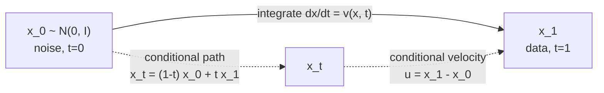

# A6 - Flow matching and rectified flow

Flow matching is a way to train a generative model. The model is a neural network $v_\theta(x, t)$
that outputs a velocity: for any point $x$ and time $t \in [0, 1]$, it says which direction and how
fast a particle at $x$ should move. To generate a sample, draw Gaussian noise and move it along
that velocity from $t = 0$ to $t = 1$, which means numerically solving an ordinary differential
equation (ODE). If the network is trained well, the point where the noise ends up is a sample from
the data distribution.

Diffusion models, covered in the previous assignment, also turn noise into data, but they learn to
reverse a noising process one small step at a time. Flow matching instead trains the velocity
directly, with a plain mean-squared-error loss against a target velocity that has a closed-form
expression. Nothing has to be simulated during training. When noise and data are joined by
straight lines, the learned velocity changes little along each path, so a few large ODE steps are
enough to generate a sample, where a diffusion sampler typically needs hundreds. Stable Diffusion 3
(SD3) and FLUX, the text-to-image systems released since mid-2024, are trained with this objective.

Build conditional flow matching from scratch on 2D toy data, where the velocity field and the
paths particles take can be plotted in full. The pieces are the straight-line path between noise
and data, the conditional flow matching loss, minibatch optimal-transport pairing of noise and
data, logit-normal sampling of training times, an Euler ODE sampler, a metric for how straight the
generated paths are, and the conversion from a flow-matching velocity to a diffusion score. An
image-scale demo reuses the diffusion U-Net with the loss swapped to flow matching. All graded
tests run on CPU in seconds.

Required reading before starting:
- Lipman et al. 2022, "Flow Matching for Generative Modeling",
  [arXiv:2210.02747](https://arxiv.org/abs/2210.02747).
- Liu, Gong & Liu 2022, "Flow Straight and Fast: Learning to Generate and Transfer Data with
  Rectified Flow", [arXiv:2209.03003](https://arxiv.org/abs/2209.03003).
- Tong et al. 2023, "Improving and Generalizing Flow-Based Generative Models with Minibatch
  Optimal Transport", [arXiv:2302.00482](https://arxiv.org/abs/2302.00482).

## Lecture notes

### Overview of the notes

The notes answer four questions in order. Most of the pieces are familiar ideas from estimation
and dynamics applied to a new problem, and the list says which.

1. What object is being learned? A velocity field that moves a cloud of noise samples onto the
   data distribution. This is a time-varying dynamical system $\dot{x} = v_t(x)$, the same object
   as the process model in a state-space filter, except that the goal is to move a whole
   distribution rather than one state. The first section defines velocity fields, flows, and
   probability paths, and the equation that links them.
2. How can it be trained? The ideal loss needs a velocity that nobody knows. The conditional flow
   matching (CFM) section shows that a simpler loss, built from one data point at a time, has the
   same minimizer. The argument is the standard result that least squares recovers the conditional
   mean (the minimum mean-squared-error estimator). The linear-path section picks the specific
   straight-line version used here.
3. Why does sampling sometimes need many steps, and how is that fixed? The learned field bends
   where paths from different data points cross. The sections on crossing, optimal transport,
   minibatch OT coupling, and reflow are all ways to reduce crossings. Minibatch OT reduces to the
   assignment problem, solved with the Hungarian algorithm, as in data association for
   multi-target tracking. The timestep section covers a separate training choice: how often each
   time $t$ is trained on.
4. How is the result used and measured? Sampling is forward Euler integration of the learned ODE.
   A straightness metric measures how far the trajectories are from straight lines. The last
   sections relate the learned velocity to the score that a diffusion model learns.

A few exercises are placed after the sections they test. They are meant to be done by hand (a
calculator helps for two of them), and each has a worked answer that can be expanded.

### Generation as transport

A generative model turns a sample from a simple distribution (here a standard Gaussian) into a
sample from the data distribution. Flow matching does this by moving the sample continuously over
time.

A one-dimensional example is used throughout the notes. The noise is $x_0 \sim \mathcal{N}(0, 1)$
on the real line, and the "data distribution" is two points, $-1$ and $+1$, each with probability
$1/2$. A sampler for this data must move every noise sample to $-1$ or to $+1$, and must send half
of them each way. Samples that start at negative values should go to $-1$ and samples that start at
positive values to $+1$, otherwise their paths would have to pass each other. Every definition below
can be checked against this picture. Three definitions are needed first.

**Velocity field and flow.** A time-dependent velocity field $v_t(x)$ assigns a vector in
$\mathbb{R}^d$ to every point $x \in \mathbb{R}^d$ and every time $t$. A particle that starts at
$x$ moves according to the ODE $dx/dt = v_t(x)$: at each instant its velocity is whatever the
field says at its current position. The curve the particle traces is called a trajectory (or
integral curve) of the field. The flow is the map that takes a starting point to the point its
trajectory has reached at time $t$.

**Probability path.** Instead of one particle, release many, with starting points drawn from a
density $p_0$, and let every particle follow the same field. At each time $t$ the particles form
some new density $p_t$. The family $\{p_t\}_{t \in [0,1]}$ is called a probability path. It starts
at $p_0$ and ends at $p_1$.

**Continuity equation.** The field and the path are not independent. Particles are not created or
destroyed as they move, so the density at a point can only change because particles flow in or
out. To state this, define the divergence of a vector field $w$ in $\mathbb{R}^d$ as
$\nabla \cdot w = \sum_{i=1}^d \partial w_i / \partial x_i$. It measures the net outflow per unit
volume at a point: positive where the field spreads out, negative where it converges. Applied to
the mass flux $p_t v_t$ (density times velocity), conservation of mass gives the continuity
equation:

$$\frac{\partial p_t(x)}{\partial t} + \nabla \cdot \big(p_t(x)\,v_t(x)\big) = 0.$$

In words, the density at $x$ decreases at exactly the rate at which the field carries mass out of a
small volume around $x$. This is the same equation used for fluids. When a field $v_t$ and a path
$p_t$ satisfy it together, the field is said to generate the path.

With these definitions, generative modeling is the following problem. Set $p_0$ to a standard
Gaussian and $p_1$ to the data distribution. Find a field that generates some path between them.
Then sampling is: draw $x_0 \sim \mathcal{N}(0, I)$ and solve the ODE from $t=0$ to $t=1$.

There is more than one such field. Adding any field $w$ with $\nabla \cdot (p_t w) = 0$ (a flow that
moves particles around without changing the density anywhere) leaves the continuity equation
satisfied. So the goal is to find one usable field, not a unique correct one.

### Why not train the flow by maximum likelihood

The standard way to fit a probabilistic model is to maximize the likelihood it assigns to the
training data. Continuous normalizing flows, the predecessor of flow matching, were trained this
way. That approach is slow, and the reason motivates flow matching.

A normalizing flow is a generative model built from an invertible map $f$ applied to samples from a
simple base density. Its density follows from the change-of-variables formula of multivariable
calculus. The Jacobian $J_f(x)$ is the matrix of partial derivatives of $f$ at $x$, and
$|\det J_f(x)|$ is the factor by which $f$ scales a small volume around $x$. Volume that grows
must have proportionally lower density, so

$$\log p(f(x)) = \log p(x) - \log|\det J_f(x)|.$$

Because $f$ is invertible and the log-determinant can be computed, the likelihood of any data point
can be evaluated exactly. The result is automatically a normalized density (it integrates to 1),
which is where the name "normalizing" comes from.

A continuous normalizing flow (CNF) replaces the single map $f$ with the flow of an ODE
$dx/dt = v_t(x)$. The flow is invertible because the ODE can be run backward in time. Chen et al.
(2018, "Neural Ordinary Differential Equations",
[arXiv:1806.07366](https://arxiv.org/abs/1806.07366)) showed that the log-determinant becomes an
integral of the divergence along the trajectory:

$$\frac{d}{dt}\log p_t(x_t) = -\nabla \cdot v_t(x_t).$$

This is the continuity equation rewritten from the point of view of a single moving particle.

The cost is high. Evaluating the log-likelihood of one data point means solving the ODE
numerically and accumulating the divergence at every solver step. Training means backpropagating
through that whole ODE solve at every optimizer step.

Flow matching (Lipman et al. 2022) removes the ODE solve from training. It does not maximize
likelihood. It regresses the network's output onto a target velocity that has a closed-form
expression, using a mean-squared-error loss. One training step is: sample a time, sample a data
point, sample a point on the path, evaluate the network once, and take a gradient step. No ODE
solver is involved.

### Notation and the time convention

In these notes $t=0$ is noise and $t=1$ is data. The noise sample is
$x_0 \sim \mathcal{N}(0, I)$, the data sample is $x_1$, and $x_t$ is a point on the path between
them.

Diffusion papers use the opposite convention: $x_0$ is the clean image and time runs forward into
noise. Both conventions are standard in their own literature, so the clash cannot be avoided. Keep
the direction in mind when the two are compared in the score-velocity section below.

Three velocities appear, and they are different objects:
- $u_t(x \mid x_1)$, the conditional velocity: the velocity along the path toward one particular
  data point $x_1$.
- $u_t(x)$, the marginal velocity: the field that generates the full path from the Gaussian to the
  data distribution. This is the field the model needs.
- $v_\theta(x, t)$, the network's output, which is trained to approximate $u_t(x)$.

### The conditional flow matching objective

The model should learn the marginal field $u_t$. The ideal loss is

$$\mathcal{L}_{\text{FM}}(\theta) = \mathbb{E}_{t,\,x_t}\Big[\,\big\|v_\theta(x_t, t) - u_t(x_t)\big\|^2\,\Big],$$

but it cannot be computed, because there is no formula for $u_t$. The marginal field transports the
entire data distribution, and knowing it would mean the generative problem is already solved.

What can be written down is a path toward a single data point. Choose a conditional probability
path $p_t(x \mid x_1)$ that equals the Gaussian prior at $t=0$ and concentrates on the single point
$x_1$ at $t=1$, together with a conditional velocity $u_t(x \mid x_1)$ that generates it. For the
straight-line path used in this assignment (next section), both have one-line formulas. The
conditional flow matching (CFM) loss regresses the network onto the conditional velocity:

$$\mathcal{L}_{\text{CFM}}(\theta) = \mathbb{E}_{t,\,x_1,\,x_t}\Big[\,\big\|v_\theta(x_t, t) - u_t(x_t \mid x_1)\big\|^2\,\Big].$$

Every quantity in this loss can be sampled: draw $t$, draw a data point $x_1$, draw $x_t$ from the
conditional path, and compute the target. The central result of flow matching is that minimizing
$\mathcal{L}_{\text{CFM}}$ gives the same network as minimizing $\mathcal{L}_{\text{FM}}$. The
proof has two steps, given in the next two subsections.

#### Step 1: least-squares regression returns the conditional mean

This is a general fact about squared-error regression. Take a target $y$, an input $z$, and any
predictor $f$. Add and subtract the conditional mean $\mathbb{E}[y \mid z]$ inside the squared
error and expand:

$$\mathbb{E}\big\|y - f(z)\big\|^2
= \mathbb{E}\big\|y - \mathbb{E}[y \mid z]\big\|^2 + \mathbb{E}\big\|\mathbb{E}[y \mid z] - f(z)\big\|^2.$$

The expansion also produces a cross term,
$2\,\mathbb{E}\big[(y - \mathbb{E}[y \mid z])^\top (\mathbb{E}[y \mid z] - f(z))\big]$, which is
zero. To see this, condition on $z$: the second factor is then fixed, and the first factor has
conditional mean zero.

The first term on the right does not depend on $f$. So minimizing over $f$ only minimizes the second
term, and the minimizer is $f(z) = \mathbb{E}[y \mid z]$. It also follows that two squared-error
losses whose targets have the same conditional mean differ only by a constant, so they have the
same minimizer and the same gradients.

This is the familiar result from least-squares estimation: fitting noisy measurements recovers the
noise-free conditional mean, and the noise leaves an error floor that no estimator can go below.

Now apply it with input $z = (x_t, t)$ and target $y = u_t(x_t \mid x_1)$. The target is still
random after $x_t$ and $t$ are fixed, because many different noise-data pairs $(x_0, x_1)$ pass
through the same point $x_t$ at the same time, each with its own velocity. The minimizer is
therefore the average of those velocities:

$$v_\theta(x, t) = \mathbb{E}\big[\,u_t(x_t \mid x_1) \;\big|\; x_t = x\,\big],$$

and $\mathcal{L}_{\text{CFM}}$ differs from $\mathcal{L}_{\text{FM}}$ by a constant that does not
depend on $\theta$, so the two losses have identical gradients.

#### Step 2: the averaged velocity generates the marginal path

Step 1 showed the network learns the conditional average of the velocities. It remains to show that
this average is the marginal field $u_t$, the one that generates the path from noise to data.

The marginal density is a mixture of the conditional densities, one per data point:
$p_t(x) = \int p_t(x \mid x_1)\,p(x_1)\,dx_1$. Differentiate in $t$ under the integral and use the
continuity equation for each conditional path:

$$\frac{\partial p_t(x)}{\partial t}
= -\int \nabla \cdot \big(p_t(x \mid x_1)\,u_t(x \mid x_1)\big)\,p(x_1)\,dx_1
= -\nabla \cdot \left( p_t(x) \int u_t(x \mid x_1)\,\frac{p_t(x \mid x_1)\,p(x_1)}{p_t(x)}\,dx_1 \right).$$

The divergence can be moved outside the integral because it differentiates with respect to $x$,
while the integral is over $x_1$. The second form multiplies and divides by $p_t(x)$. The weight
$p_t(x \mid x_1)p(x_1)/p_t(x)$ is, by Bayes' rule, the posterior probability of data point $x_1$
given that the path is at $x$ at time $t$. So the expression inside the parentheses is $p_t(x)$
times a posterior-weighted average of conditional velocities. Define the marginal field as that
average:

$$u_t(x) = \mathbb{E}\big[\,u_t(x_t \mid x_1) \;\big|\; x_t = x\,\big].$$

The displayed equation then reads $\partial p_t / \partial t = -\nabla \cdot (p_t u_t)$, which is
the continuity equation for the marginal path. So $u_t$ generates the marginal path, and it is the
same conditional average that the regression in Step 1 converges to. This is Theorem 1 of Lipman et
al. (2022).

One consequence matters for the rest of the notes. Where conditional paths toward different data
points pass through the same point at the same time, the learned velocity there is the average of
their velocities. Averaging velocities that point in different directions gives a field whose
trajectories curve, even though every individual conditional path is a straight line.

> **Exercise 1 (marginal velocity by hand).** Use the running example: $x_0 \sim \mathcal{N}(0, 1)$,
> data $x_1 \in \{-1, +1\}$ with equal probability, and the straight-line conditional path of the
> next section, for which $x_t \mid x_1 \sim \mathcal{N}(t x_1, (1-t)^2)$ and the conditional
> velocity written in terms of $x_t$ is $u_t(x_t \mid x_1) = (x_1 - x_t)/(1-t)$. Compute the
> posterior $P(x_1 = +1 \mid x_t = x)$, then the marginal velocity $u_t(x)$ as a closed-form
> function of $x$ and $t$. Evaluate it at $t = 0.5$, $x = 0.25$.

<details>
<summary>Answer</summary>

The two Gaussian likelihoods have the same variance, so their ratio is
$\exp\big(\frac{(x + t)^2 - (x - t)^2}{2(1-t)^2}\big) = \exp\big(\frac{2tx}{(1-t)^2}\big)$, and
$P(x_1 = +1 \mid x) = \sigma\big(2tx/(1-t)^2\big)$ with $\sigma$ the sigmoid. The posterior mean is
$\mathbb{E}[x_1 \mid x] = 2\sigma(a) - 1 = \tanh(a/2) = \tanh\big(tx/(1-t)^2\big)$. The conditional
velocity is linear in $x_1$, so

$$u_t(x) = \frac{\tanh\big(tx/(1-t)^2\big) - x}{1-t}.$$

At $t = 0.5$, $x = 0.25$: $tx/(1-t)^2 = 0.125/0.25 = 0.5$, $\tanh(0.5) \approx 0.462$, and
$u \approx (0.462 - 0.25)/0.5 \approx 0.424$. The point is slightly right of center, so it is more
likely headed to $+1$, and the velocity points right but with much less than the speed a
particle needs to reach $+1$ from there, because the left-going paths through the same point pull
the average down.

</details>

### The linear path

Rectified flow (Liu et al. 2022) uses the straight line between the noise sample and the data
sample as the conditional path:

$$x_t = (1-t)\,x_0 + t\,x_1, \qquad u_t(x_t \mid x_1) = \frac{dx_t}{dt} = x_1 - x_0.$$

The conditional velocity does not depend on $t$. It is the displacement $x_1 - x_0$, held constant
for the whole trip. The CFM loss becomes a regression of the network output onto that
displacement.

Two properties of this path are used later.

First, the conditional path is Gaussian at every time. Once $x_1$ is fixed, the only randomness
left is $x_0$, which is a standard Gaussian, and $x_t$ is a linear function of it:

$$x_t \mid x_1 \sim \mathcal{N}\big(t\,x_1,\ (1-t)^2 I\big).$$

The mean moves linearly from the origin to $x_1$, and the standard deviation shrinks linearly from
1 to 0.

Second, the loss has no explicit weight over $t$. How much training effort each time $t$ gets
depends only on the distribution $t$ is sampled from. That is why the choice of timestep
distribution, covered below, matters.



### Where the marginal field bends

The averaging in Step 2 has a concrete effect on sampling. A one-dimensional example with two
points shows it.

Take two noise samples $x_0 \in \{-1, +1\}$ and two data points $x_1 \in \{-1, +1\}$, and pair them
crosswise: $-1 \mapsto +1$ and $+1 \mapsto -1$. The two conditional paths are $x_t = 2t - 1$ and
$x_t = 1 - 2t$, with constant velocities $+2$ and $-2$. They meet at the origin at $t = 0.5$. At
that point and time, both paths are present, so the learned velocity is the average of $+2$ and
$-2$, which is zero.

Now follow a trajectory of the learned field. It leaves $x = -1$ at speed $+2$ and reaches the
origin, where the field is $0$. Its velocity has changed along the way, so the trajectory is not a
straight line traversed at constant speed. (The straightness metric later in the notes measures
exactly this change.) In this symmetric example the trajectory stalls at the crossing. With real
data the crossings are not symmetric, and the trajectory bends instead of stopping. In both cases
an ODE solver needs small steps near the crossing to follow the trajectory accurately.

Now pair the same four points the other way: $-1 \mapsto -1$ and $+1 \mapsto +1$. The paths do not
cross, both velocities are zero, and the learned field equals the conditional fields with no
averaging anywhere.

The two pairings also differ in total squared distance traveled: $2^2 + 2^2 = 8$ for the crossed
pairing and $0$ for the uncrossed one. The pairing with the smaller total squared distance is the
one without the crossing. This holds in general, and it motivates the next two sections.

The default way to form pairs, called independent coupling, draws $x_0$ independently of the $x_1$
it is paired with. It produces crossings all the time. The next two sections are about choosing the
pairing deliberately.

### The optimal transport problem

Optimal transport (OT) asks how to move one distribution onto another at the least total cost.
The inputs are a source distribution, a target distribution, and a cost $c(x, y)$ for moving one
unit of mass from $x$ to $y$. The output is a joint distribution over pairs $(x, y)$, called a
coupling or transport plan, whose marginals are the source and the target and whose expected cost
is as small as possible. Here the cost is the squared distance $c(x, y) = \lVert x - y \rVert^2$,
which is the standard choice.

For two finite sets of $B$ points each, with weight $1/B$ on every point, the plan is a $B \times B$
matrix $P$. Entry $P_{ij} \ge 0$ is the mass sent from source point $i$ to target point $j$. The
marginal constraints say every row and every column of $P$ sums to $1/B$. Equivalently, $BP$ is
doubly stochastic: its entries are non-negative and all its row and column sums equal 1. The
problem is

$$\min_P \ \sum_{i,j} P_{ij}\,C_{ij}, \qquad C_{ij} = \lVert x_0^{(i)} - x_1^{(j)} \rVert^2.$$

The objective is linear in $P$, and the constraints (non-negativity plus fixed row and column sums)
define a convex polytope, a bounded region with flat faces in the space of matrices. Minimizing a
linear function over such a region is a linear program.

Two facts reduce this to a simpler problem. First, a linear function on a bounded convex polytope
reaches its minimum at a vertex (a corner) of the polytope. Second, the Birkhoff-von Neumann
theorem says the vertices of the set of doubly stochastic matrices are exactly the permutation
matrices, the matrices with a single 1 in each row and column. So there is always an optimal plan
that is a permutation: each source point sends all its mass to exactly one target point. With equal
weights on every point, optimal transport between two point sets is a matching problem.

Checking every permutation would take $B!$ evaluations. The matching problem, called the assignment
problem, has exact polynomial-time algorithms. The Hungarian algorithm (Kuhn 1955, Naval Research
Logistics Quarterly) solves it in $O(B^3)$ time and returns the exact optimal matching. It works by
repeatedly adjusting an offset for each row and each column of the cost matrix until there are
enough zero-cost entries to form a complete matching. SciPy provides an exact solver for the same
problem.

> **Exercise 2 (assignment problem by hand).** In one dimension, let the noise samples be
> $x_0 = (0, 1, 3)$ and the data samples be $x_1 = (2, 0.5, 3.5)$, currently paired in that order.
> Write the $3 \times 3$ cost matrix $C_{ij} = (x_0^{(i)} - x_1^{(j)})^2$, enumerate all six
> permutations, and find the optimal one. What do you notice about the optimal pairing in 1D?

<details>
<summary>Answer</summary>

Costs of the six pairings (the data values assigned to $x_0 = 0, 1, 3$ in order):
$(2, 0.5, 3.5) \to 4.5$, $(2, 3.5, 0.5) \to 16.5$, $(0.5, 2, 3.5) \to 1.5$,
$(0.5, 3.5, 2) \to 7.5$, $(3.5, 2, 0.5) \to 19.5$, $(3.5, 0.5, 2) \to 13.5$. The optimum is
$(0.5, 2, 3.5)$ with cost $1.5$, down from $4.5$ for the original pairing. It pairs the sorted noise
with the sorted data. In 1D with squared-distance cost the optimal plan is always the monotone
(sorted) matching, so the straight paths between pairs never cross, which is the property the
previous section asked for.

</details>

### Minibatch optimal-transport coupling

Optimal transport between the full Gaussian and the full data distribution cannot be computed. OT
within one training batch can, cheaply. OT-CFM (Tong et al. 2023) does this. Draw $B$ noise samples
and $B$ data samples independently. Build the $B \times B$ matrix of squared distances between
them, solve the assignment problem, and reorder the data samples so each is paired with its matched
noise sample. Then train on those pairs exactly as before. The path, the target velocity, and the
loss do not change. Only the pairing of $x_0$ with $x_1$ changes.

By the two-point argument above, optimally matched pairs cross much less than random pairs. Fewer
crossings means less averaging, so the learned field is straighter, and the ODE can be solved
accurately in fewer Euler steps. This straightening happens in the first and only training run.
Reflow, described later, gets a similar effect with a second training run.

There are two caveats. The OT plan within a batch is not the OT plan between the full
distributions, and this mismatch does not go away as training continues. Tong et al. analyze the
resulting bias and show it shrinks as the batch size grows. Also, building the cost matrix costs
$O(B^2)$ and solving the assignment costs $O(B^3)$. At $B = 256$ in two dimensions this is
negligible, but it becomes significant for images.

Two different things in the flow-matching literature are both called "optimal transport", and they
are easy to confuse. Lipman et al. call the straight-line conditional path the "optimal transport"
path, because for a fixed $x_1$ the straight line is the optimal transport map between the Gaussian
at $t=0$ and the point mass at $t=1$. That is a property of each conditional path and holds no
matter how pairs are formed. Minibatch OT coupling, the subject of this section, is about which
$x_0$ is paired with which $x_1$. A model can use the linear path with independent coupling, and
most do.

SD3 and FLUX are in that group: they use the linear path with independent coupling, not minibatch
OT. What they adopt from this line of work is the straight-line path in place of a diffusion noise
schedule (Esser et al. 2024 for SD3).

### Logit-normal timestep sampling

The linear-path loss has no weight over $t$, so the distribution that $t$ is sampled from during
training sets how much effort each time receives. Uniform sampling on $[0, 1]$ treats all times
equally. SD3 instead samples times near the middle more often.

The reason is that the learned field is easy at both ends of the path and hard in the middle.
Assume independent coupling and data with zero mean, and look at the target the regression
converges to at the two endpoints.
- At $t=0$, the path point is $x_t = x_0$. Since $x_1$ was drawn independently of $x_0$, the target
  is $\mathbb{E}[x_1 - x_0 \mid x_0] = \mathbb{E}[x_1] - x_0 = -x_0$.
- At $t=1$, the path point is $x_t = x_1$, and the target is
  $\mathbb{E}[x_1 - x_0 \mid x_1] = x_1$.

Both endpoint targets are linear functions of $x_t$, which any network learns almost immediately.
The hard part, deciding which region of the data a given noise sample should move toward, happens
at intermediate times. (Under OT coupling the endpoint targets are no longer linear, because $x_1$
then depends on $x_0$. The middle times still carry most of the difficulty.)

The logit-normal distribution concentrates samples in the middle. The logit function
$\text{logit}(t) = \log\frac{t}{1-t}$ maps $(0, 1)$ onto the whole real line, and its inverse is
the sigmoid $\sigma$. To sample $t$, draw a normal variable and pass it through the sigmoid:

$$t = \sigma(\mu + s\,z), \qquad z \sim \mathcal{N}(0, 1).$$

Then $\text{logit}(t) \sim \mathcal{N}(\mu, s^2)$, which gives the distribution its name.

Because $\sigma$ is strictly increasing, it maps quantiles of the normal to quantiles of $t$, so
probabilities for $t$ can be computed from the normal. The median of $t$ is $\sigma(\mu)$, which is
$0.5$ when $\mu = 0$. To compute how much probability falls in the middle half $[0.25, 0.75]$, use
$\text{logit}(0.75) = \log 3 \approx 1.0986$ and $\text{logit}(0.25) = -\log 3$. With $\mu = 0$
and $s = 1$, and writing $\Phi$ for the standard normal cumulative distribution function,

$$\Pr\big[0.25 < t < 0.75\big] = \Pr\big[|z| < 1.0986\big] = 2\Phi(1.0986) - 1 \approx 0.73.$$

Under uniform sampling the same probability is exactly $0.50$.

SD3 (Esser et al. 2024, "Scaling Rectified Flow Transformers for High-Resolution Image Synthesis",
[arXiv:2403.03206](https://arxiv.org/abs/2403.03206)) compared several timestep distributions at
scale and found this one performed best of those tested.

> **Exercise 3 (tail mass of the logit-normal).** With $\mu = 0$ and $s = 1$, compute
> $\Pr[t < 0.1]$ under the logit-normal distribution, and compare it with uniform sampling. Use
> $\Phi(-2.2) \approx 0.014$.

<details>
<summary>Answer</summary>

$\text{logit}(0.1) = \log(0.1/0.9) = -\log 9 \approx -2.197$, so
$\Pr[t < 0.1] = \Phi(-2.197) \approx 0.014$. Uniform sampling gives $0.1$, about seven times
more. Training with logit-normal times spends very little effort near the noise end, where the
target is the easy linear field $-x_0$.

</details>

### Sampling with forward Euler

Sampling solves $dx/dt = v_\theta(x, t)$ from $t=0$ to $t=1$. The simplest solver is forward Euler
on a uniform grid of $N$ steps. At each step, evaluate the velocity at the current point and time,
and move in a straight line along it for a time $\Delta t$:

$$x \leftarrow x + v_\theta(x, t)\,\Delta t, \qquad \Delta t = 1/N, \qquad t = k\,\Delta t.$$

Euler's error comes from the velocity changing during the step. Expand the true trajectory as a
Taylor series around the current time. Euler keeps the first-order term $\dot{x}\,\Delta t$ and
drops everything after it, and the largest dropped term is $\tfrac12 \ddot{x}\,\Delta t^2$, which
depends on the acceleration along the trajectory. If the velocity along a trajectory is constant,
the acceleration and every higher derivative are zero, so Euler reaches the exact endpoint with any
number of steps, including a single step. This is an exact statement, not a limit as
$\Delta t \to 0$.

So the number of sampling steps needed depends on how much the learned velocity changes along its
own trajectories. If trajectories are straight lines traveled at constant speed, two or three
steps are enough. If trajectories curve, the solver needs enough steps to follow the curve.
Straightening the field (the purpose of the crossing analysis and OT coupling above) therefore
reduces the number of steps directly. A diffusion sampler may need hundreds of network evaluations
for a given quality, while a well-straightened flow can reach it in a few.

### Measuring straightness

Straightness can be measured as a number, not only judged from a plot. Liu et al. (2022) define it
as the average squared difference between the velocity along a trajectory and the net displacement
from start to end (the chord). Write $\hat{x}_1$ for the endpoint the sampler actually reaches from
$x_0$:

$$S = \mathbb{E}_{t}\Big[\,\big\|(\hat{x}_1 - x_0) - v_\theta(x_t, t)\big\|^2\,\Big].$$

In practice $S$ is computed along an Euler trajectory, averaging over the $N$ grid times, summing
over coordinates, and averaging over a batch of starting points.

The discrete version has a simple interpretation. With Euler steps of $\Delta t = 1/N$,

$$\hat{x}_1 - x_0 = \Delta t \sum_{k=0}^{N-1} v_k = \frac{1}{N}\sum_k v_k = \bar{v},$$

so the chord equals the mean of the velocities visited along the trajectory. Substituting,

$$S = \frac{1}{N}\sum_{k=0}^{N-1} \big\|\bar{v} - v_k\big\|^2,$$

which is the variance of the velocity along the trajectory. It is zero exactly when every $v_k$ is
the same, meaning the trajectory is a straight line traveled at constant speed. It increases with
any change in either the direction or the speed.

> **Exercise 4 (Euler error and straightness on a field that speeds up).** Take the 1D field
> $v(x, t) = 2t$, which ignores $x$, and start at $x_0 = 0$. The exact solution is $x(t) = t^2$, so
> the true endpoint is $x(1) = 1$. Run forward Euler by hand with $N = 2$ and $N = 4$ steps. For each,
> give the endpoint and the straightness $S$ from the variance formula above.

<details>
<summary>Answer</summary>

Euler evaluates the field at $t = k/N$, so $v_k = 2k/N$. With $N = 2$: $v = (0, 1)$, endpoint
$0 + 0 \cdot 0.5 + 1 \cdot 0.5 = 0.5$, mean velocity $\bar v = 0.5$, and
$S = \tfrac12\big(0.5^2 + 0.5^2\big) = 0.25$. With $N = 4$: $v = (0, 0.5, 1, 1.5)$, endpoint $0.75$,
$\bar v = 0.75$, and $S = \tfrac14(0.5625 + 0.0625 + 0.0625 + 0.5625) = 0.3125$. In general the
endpoint is $(N-1)/N$, so the error shrinks like $1/N$. The trajectory is a straight line in 1D, yet
$S > 0$, because the speed changes. The metric penalizes changes in speed as well as in direction,
and both make Euler inexact.

</details>

### Reflow

Reflow (Liu et al. 2022) straightens a flow after it has been trained. Start many trajectories from
$x_0 \sim \mathcal{N}(0, I)$, solve the learned ODE to get their endpoints $\hat{x}_1$, and then
train a new model from scratch with the CFM loss on the pairs $(x_0, \hat{x}_1)$, instead of on
independently drawn pairs. The new model is called the 2-rectified flow. Repeating the procedure
gives the 3-rectified flow, and so on.

Reflow works for the same reason OT coupling does: it improves the pairing. The ODE is
deterministic, so each $x_0$ has exactly one endpoint, and the new pairing is the one produced by
the first model's own trajectories rather than an independent draw. Liu et al. prove that the new
pairing has a transport cost no higher than the pairing it came from, for every convex cost
function at once. Lower transport cost means the straight lines between pairs cross less, so the
second model's field has less averaging and is straighter.

Reflow needs no new data, because the endpoints are the first model's own samples. The drawback is
that the second model learns to reproduce the first model's output distribution, including the
first model's errors. One reflow step is usually enough (Lee, Lin & Fanti 2024,
[arXiv:2405.20320](https://arxiv.org/abs/2405.20320)). Reflow is covered here because it is the
clearest first method for straightening a flow. Newer methods do better; see "Later developments"
at the end of the notes.

### The score-velocity relation

Flow matching and diffusion look like different frameworks. For Gaussian paths they are the same
model written in different variables. This section derives the formula that converts a
flow-matching velocity into a diffusion score.

The score of a density is the gradient of its logarithm, $\nabla_x \log p_t(x)$. It points in the
direction in which the density increases fastest. A diffusion model learns the score, whether it is
written as noise prediction or in another form. The score is a vector field defined at every point
and time, like the velocity, so it is reasonable to ask how the two are related.

Start with the conditional case, where everything is Gaussian. From the linear-path section,
$x_t \mid x_1 \sim \mathcal{N}(t x_1, (1-t)^2 I)$. The log-density of a Gaussian with mean $\mu$
and variance $\sigma^2$ is $-\lVert x - \mu \rVert^2 / (2\sigma^2)$ plus a constant, so its
gradient is $-(x - \mu)/\sigma^2$. Here:

$$\nabla_{x_t}\log p_t(x_t \mid x_1) = -\frac{x_t - t\,x_1}{(1-t)^2}.$$

Next, rewrite this in terms of the velocity instead of $x_1$. The conditional velocity is
$u = x_1 - x_0$. Solving the path equation for $x_0$ gives $x_0 = (x_t - t x_1)/(1-t)$, so
$u = (x_1 - x_t)/(1-t)$, and therefore $x_1 = x_t + (1-t)u$. Substitute this into the numerator:

$$x_t - t\,x_1 = x_t - t\,x_t - t(1-t)\,u = (1-t)\big(x_t - t\,u\big).$$

One factor of $(1-t)$ cancels with the denominator:

$$\nabla_{x_t}\log p_t(x_t \mid x_1) = \frac{t\,u - x_t}{1-t}.$$

The same relation holds for the marginal score and the marginal velocity. The argument is the
conditional-average argument from Step 2. Differentiate
$p_t(x) = \int p_t(x \mid x_1) p(x_1)\,dx_1$ with respect to $x$ and divide by $p_t(x)$:

$$\nabla_x \log p_t(x) = \int \big[\nabla_x \log p_t(x \mid x_1)\big]\,\frac{p_t(x \mid x_1)p(x_1)}{p_t(x)}\,dx_1
= \mathbb{E}\big[\nabla_x \log p_t(x_t \mid x_1) \mid x_t = x\big].$$

The marginal score is the posterior-weighted average of the conditional scores, with the same
weights that made the marginal velocity the average of the conditional velocities. The map
$u \mapsto (tu - x_t)/(1-t)$ is affine in $u$ when $x_t$ and $t$ are fixed, and the expectation of
an affine function is the affine function of the expectation. So averaging both sides gives the
same formula with the marginal velocity in place of the conditional one. Since the trained network
approximates the marginal velocity, the score can be computed from the network's output:

$$\text{score}(x_t, t) = \frac{t\,v - x_t}{1-t}.$$

The denominator $(1-t)$ is zero at $t=1$. There the conditional path has shrunk to a single point
$x_1$, the density is not a smooth function, and its gradient does not exist. The relation is
therefore used only for $t < 1$.

> **Exercise 5 (score from velocity, checked two ways).** In the running example at $t = 0.5$,
> $x = 0.25$, Exercise 1 gave $u \approx 0.424$ and $\mathbb{E}[x_1 \mid x] \approx 0.462$. Compute
> the score from the velocity with the formula above. Then compute it directly as the posterior
> average of the conditional scores $-(x - t x_1)/(1-t)^2$, and check that the two agree. Why is the
> score negative even though the point is more likely headed to $+1$?

<details>
<summary>Answer</summary>

From the velocity: $(t u - x)/(1-t) = (0.5 \cdot 0.424 - 0.25)/0.5 \approx -0.076$. Directly: the
conditional score is linear in $x_1$, so its posterior average is
$-(x - t\,\mathbb{E}[x_1 \mid x])/(1-t)^2 = -(0.25 - 0.5 \cdot 0.462)/0.25 \approx -0.076$. The two
agree.

The score describes the density at $t = 0.5$, not the destination. At that time the density is an
equal mixture of $\mathcal{N}(-0.5, 0.25)$ and $\mathcal{N}(+0.5, 0.25)$. The two means are only two
standard deviations apart, so the components overlap into a single peak at $0$, and the density
decreases from $x = 0$ to $x = 0.25$. Its gradient there points back toward $0$. The velocity, in
contrast, points toward the likely destination $+1$. The two fields answer different questions,
and the formula converts between them.

</details>

### What flow matching and diffusion share and where they differ

Both frameworks build a Gaussian path between data and noise of the form
$x_t = a_t\,x_{\text{data}} + b_t\,x_{\text{noise}}$, with scalar schedules $a_t$ and $b_t$.

Diffusion with the standard variance-preserving schedule uses $a_t^2 + b_t^2 = 1$. For data with
unit variance, this keeps the variance of $x_t$ at 1 for every $t$, hence the name, so the network
sees inputs of the same scale at every noise level. The cosine schedule is one choice of $a_t, b_t$
that satisfies this. The linear path uses $a_t = t$ and $b_t = 1-t$, and $t^2 + (1-t)^2$ is not 1.
It drops to $0.5$ at $t = 0.5$. So the linear path is not variance-preserving.

This difference is only a rescaling. Dividing any point on the linear path by
$\sqrt{t^2 + (1-t)^2}$ moves it onto a variance-preserving path. The two paths pass through the
same signal-to-noise ratios $a^2/b^2$, just at different times. If times are matched by
signal-to-noise ratio, the two paths describe the same family of distributions up to a scalar
factor at each time.

The prediction targets match in the same way. Diffusion's $v$-prediction target is
$a\,\varepsilon - b\,x_{\text{data}}$ (Salimans & Ho 2022,
[arXiv:2202.00512](https://arxiv.org/abs/2202.00512)), a fixed linear combination of the clean
sample and the noise. Flow matching's target $x_1 - x_0$ is a different fixed linear combination
of the same two quantities. Either target can be computed from the other by an invertible linear
map, so the two mean-squared-error losses differ by a factor that depends only on time. Two losses
that differ by a time-dependent factor have the same minimizer and differ only in how much weight
each noise level gets during training. The timestep distribution controls the same thing.

Three real differences remain.

1. The effective weighting across noise levels is different, because of that time-dependent factor.
   Flow matching with logit-normal timesteps and diffusion with a cosine schedule optimize the same
   family of objectives but are not the same training run.
2. OT coupling has no counterpart in diffusion. Diffusion's forward process adds independent
   Gaussian noise to each data point by construction, so noise and data are always paired
   independently and there is nothing to reorder.
3. Flow matching does not require one endpoint to be noise. Any two distributions that can be
   sampled will work, because the path is built by interpolating between a sample from each, not
   by running a noising process. This lets rectified flow map one data distribution directly onto
   another, which is the "and Transfer Data" in the paper's title. A noising process cannot
   express this. The stochastic-interpolants framework (Albergo, Boffi & Vanden-Eijnden 2023,
   [arXiv:2303.08797](https://arxiv.org/abs/2303.08797)) develops this general view and recovers
   both diffusion and flow matching as special cases.

### Later developments

As of 2025, newer methods outperform reflow for few-step generation. MeanFlow (Geng et al. 2025,
[arXiv:2505.13447](https://arxiv.org/abs/2505.13447)) trains the network to predict the average
velocity over a time interval instead of the velocity at one instant. One network evaluation then
covers a whole interval, which allows one-step generation from a single training run without a
reflow stage. Rectified Diffusion (ICLR 2025) argues that reflow helps because it improves the
pairing of noise and data, not because the trajectories become straight as such. Consistency flow
matching (Yang et al. 2024, [arXiv:2407.02398](https://arxiv.org/abs/2407.02398)) adds a constraint
that velocity predictions at different times along the same trajectory agree.

## The assignment

Fill these holes, in order. Each is one `NotImplementedError` with a matching test. The docstring
in each file gives the signature, shapes, and constraints.

| # | Function | File | Concept from the notes |
|---|---|---|---|
| 1 | [`linear_path()`](path.py) | `path.py` | the linear path $x_t = (1-t)x_0 + t x_1$ |
| 2 | [`linear_velocity()`](path.py) | `path.py` | the conditional velocity $x_1 - x_0$ |
| 3 | [`sample_timesteps()`](timesteps.py) | `timesteps.py` | uniform and logit-normal timestep sampling |
| 4 | [`cfm_loss()`](flow.py) | `flow.py` | the conditional flow matching loss |
| 5 | [`score_from_velocity()`](flow.py) | `flow.py` | the score-velocity relation |
| 6 | [`ot_coupling()`](coupling.py) | `coupling.py` | minibatch OT coupling via the assignment problem |
| 7 | [`euler_sample()`](sampling.py) | `sampling.py` | forward Euler sampling |
| 8 | [`straightness()`](sampling.py) | `sampling.py` | the straightness metric $S$ |

Notes on specific holes:
- `ot_coupling` may call `scipy.optimize.linear_sum_assignment`, which solves the assignment
  problem exactly. It returns row and column indices of the matched pairs. The rows come back in
  sorted order, so the column indices are the permutation to apply to $x_1$.
- `straightness` runs `euler_sample` with `return_traj=True`, takes the chord from the first and
  last points of the trajectory, and averages the squared difference from it over the $N$ grid
  points.
- `score_from_velocity` uses the flow-matching time convention ($t=0$ noise, $t=1$ data).
- `reflow.py`, which generates the $(x_0, \hat{x}_1)$ pairs for reflow, is provided.

### Running and validating

Activate the environment (`conda activate nanovision`), then:

```
make test     A=a06_0_flow_matching   # run the tests against the top-level files (the ones with holes)
make verify   A=a06_0_flow_matching   # run the same tests against the reference solution/
make viz      A=a06_0_flow_matching   # render the figures from the reference solution
make viz-mine A=a06_0_flow_matching   # render the figures from your own code (once the holes are filled)
```

`make test` is the command to run while working. It runs the test suite in
`assignments/a06_0_flow_matching/tests/` against the top-level files. The tests fail while the holes
raise `NotImplementedError` and pass as the holes are filled in correctly. `make verify` runs the
same suite against the reference answer key in `solution/`: it sets `NANOVISION_IMPL=solution`,
which makes the tests import the reference implementation instead of the top-level files. It passes
from the start, which confirms the tests and environment work. The goal is to make `make test` pass
as `make verify` does.

The tests check:
- `test_path.py`: the path endpoints and midpoint, and that the velocity equals the displacement.
- `test_timesteps.py`: uniform draws lie in $(0, 1)$ with mean 0.5; logit-normal draws have median
  0.5 and more than 65% of 40000 draws in $[0.25, 0.75]$ (the expected fraction is about 73%); an
  unknown distribution name raises `ValueError`.
- `test_euler_oracle.py`: with a field that always returns the constant $x_1 - x_0$, Euler reaches
  $x_1$ to within $10^{-6}$ at 1, 4, and 50 steps, with no training. This is the "Euler is exact
  for a constant velocity" result from the notes.
- `test_score_velocity.py`: the score computed from the velocity matches the conditional score.
  Times are drawn from $[0.05, 0.90]$ to stay away from the singularity at $t=1$.
- `test_ot_coupling.py`: `test_swap_case` is a 2D version of the crossed two-point example from
  "Where the marginal field bends": the input pairing crosses, and OT must swap it. The second test
  checks that the output is a valid permutation whose cost is no higher than the original pairing's.
- `test_straightness.py`: a constant field gives $S < 10^{-10}$; a rotation field, whose velocity is
  perpendicular to the position so trajectories curl, gives $S > 0.1$.
- `test_gradcheck.py`: `torch.autograd.gradcheck` on the differentiable pieces. It compares the
  analytic backward pass against finite differences of the forward pass, which needs float64 to be
  accurate.
- `test_overfit.py`: a short training run of the CFM loss on a fixed batch.
- `test_forbidden_imports.py`: no prebuilt flow-matching library is imported.

`make viz` renders from the reference solution, so it works on a fresh checkout before any holes
are filled and shows the target figures. `make viz-mine` runs the same script against the top-level
code, to check a finished implementation by eye. Both write PNG files to `out/` instead of opening a
window, using matplotlib's headless Agg backend, so they work over SSH, in WSL, and in CI with no
display. Add `SHOW=1` (for example `make viz-mine A=a06_0_flow_matching SHOW=1`) to also open the
figures in windows when a display is available. The figures are:
- `trajectories.png`: learned trajectories under independent coupling, OT coupling, and 2-rectified
  reflow.
- `straightness.png`: the straightness metric for those three.
- `few_step.png`: Euler samples at 1, 2, 4, 10, and 100 steps.
- `timesteps.png`: histograms of uniform and logit-normal timesteps.
- `image_cfm.png`: the image-scale demo, which reuses the diffusion U-Net with the CFM loss.

What you should see when you run this. The overfit test reduces the CFM loss by about three orders
of magnitude from its untrained value (about 900x, from 17.2 to 0.019 in the provided CPU run). It
stops improving there because some distinct pairs land at nearly the same $(x_t, t)$ with different
target velocities, and a finite MLP cannot match both. For that reason the test checks a relative
drop and a loose absolute bound rather than an exact number. The constant-velocity oracle
reconstructs $x_1$ to within $10^{-6}$ even with one Euler step. In the figures, OT coupling and one
reflow step give visibly straighter trajectories and a lower straightness number than independent
coupling, and the OT model produces recognizable samples with 2 to 4 Euler steps. These are 2D toy
results. They confirm the mechanism works end to end and say nothing about sample quality on
images, where the velocity field is a large network and quality is measured with Frechet inception
distance (FID), the distance between generated and real images when both are modeled as Gaussians
in the feature space of a pretrained network.

## Where this goes next

- The latent diffusion transformer assignment keeps this CFM loss and logit-normal timestep
  sampling and replaces the velocity MLP with a diffusion transformer (DiT). This is the SD3 and
  FLUX recipe (Peebles & Xie 2023, [arXiv:2212.09748](https://arxiv.org/abs/2212.09748)). The loss
  does not depend on the architecture: the same loss trains a U-Net or a DiT.
- The vision-language-action (VLA) model later in the course uses a flow-matching action head. The
  robot's action trajectory plays the role of the data, a flow maps Gaussian noise to actions, and
  about 10 Euler steps at inference are fast enough for 50 Hz control (pi0, Physical Intelligence
  2024). It uses the same CFM loss and Euler sampler built here.

## References

- Lipman et al. 2022, Flow Matching, [arXiv:2210.02747](https://arxiv.org/abs/2210.02747).
- Liu, Gong & Liu 2022, Rectified Flow, [arXiv:2209.03003](https://arxiv.org/abs/2209.03003).
- Tong et al. 2023, OT-CFM, [arXiv:2302.00482](https://arxiv.org/abs/2302.00482).
- Esser et al. 2024, SD3 (logit-normal timesteps),
  [arXiv:2403.03206](https://arxiv.org/abs/2403.03206).
- Lee, Lin & Fanti 2024, one reflow step,
  [arXiv:2405.20320](https://arxiv.org/abs/2405.20320).
- Albergo, Boffi & Vanden-Eijnden 2023, Stochastic Interpolants,
  [arXiv:2303.08797](https://arxiv.org/abs/2303.08797).
- Geng et al. 2025, MeanFlow, [arXiv:2505.13447](https://arxiv.org/abs/2505.13447).
- Yang et al. 2024, Consistency Flow Matching,
  [arXiv:2407.02398](https://arxiv.org/abs/2407.02398).
- Chen et al. 2018, Neural ODEs, [arXiv:1806.07366](https://arxiv.org/abs/1806.07366).
- Salimans & Ho 2022, Progressive Distillation ($v$-prediction),
  [arXiv:2202.00512](https://arxiv.org/abs/2202.00512).
- Peebles & Xie 2023, DiT, [arXiv:2212.09748](https://arxiv.org/abs/2212.09748).
- Kuhn 1955, "The Hungarian method for the assignment problem", Naval Research Logistics
  Quarterly.
