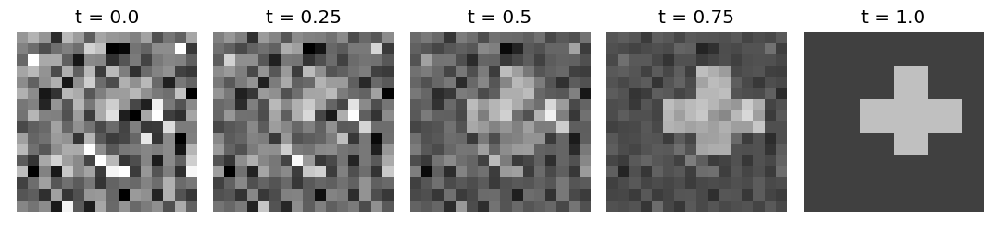
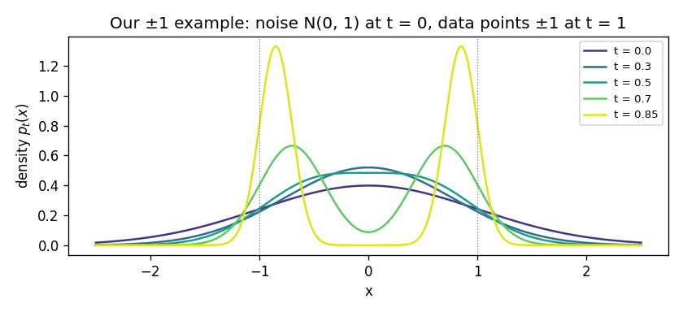
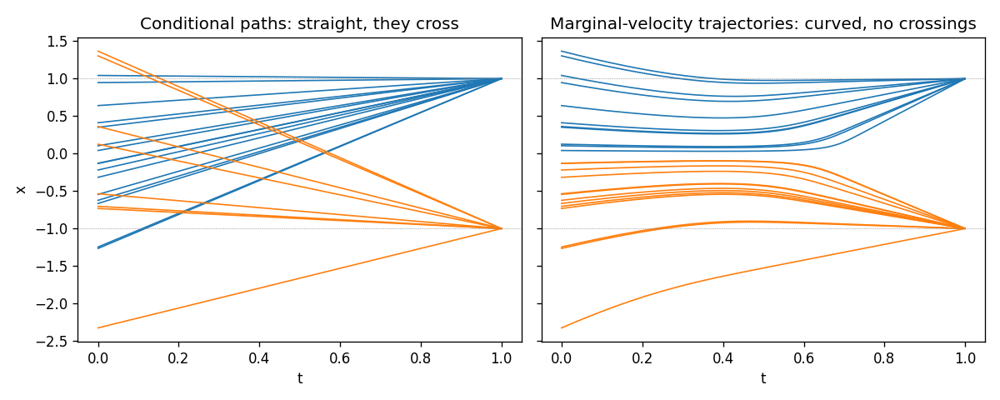

# A6 - Flow matching and rectified flow

Flow matching is a way to train a generative model, a model that produces new samples (for example
new images) that resemble a training set without copying it. The model is a neural network
$v_\theta(x, t)$ that outputs a velocity: for any point $x$ and time $t \in [0, 1]$, it says in
which direction and how fast a point at $x$ should move. To generate a sample, draw Gaussian noise
and move it along that velocity from $t = 0$ to $t = 1$, which means numerically solving an
ordinary differential equation (ODE). If the network is trained well, the point where the noise
ends up is a sample from the data distribution.

Diffusion models, covered in the previous assignment, also turn noise into data, but they learn to
reverse a noising process one small step at a time. Flow matching trains the velocity directly,
with a plain mean-squared-error loss against a target velocity that has a closed-form expression,
and nothing has to be simulated during training. When the paths the model follows from noise to
data are close to straight lines traveled at constant speed, a few large ODE steps are enough to
generate a sample, where a diffusion sampler typically needs tens to hundreds. Stable Diffusion 3
(SD3) and FLUX, two text-to-image systems released in 2024, are trained with this objective.

Build conditional flow matching from scratch on 2D toy data, where the velocity field and the
paths can be plotted in full. The pieces are the straight-line path between noise and data, the
conditional flow matching loss, minibatch (the examples in one training step) optimal-transport
coupling (choosing which noise sample
goes with which data sample so that paths cross less), logit-normal sampling of training times (a
distribution that favors the middle of the path), an Euler ODE sampler, a metric for how straight
the generated paths are, and the conversion from a flow-matching velocity to the score (the
gradient of the log-density) that a diffusion model learns. An image-scale demo reuses the
diffusion U-Net with the loss swapped to flow matching. All graded tests run on CPU in seconds.

Required reading before starting:
- Lipman et al. 2022, "Flow Matching for Generative Modeling",
  [arXiv:2210.02747](https://arxiv.org/abs/2210.02747).
- Liu, Gong & Liu 2022, "Flow Straight and Fast: Learning to Generate and Transfer Data with
  Rectified Flow", [arXiv:2209.03003](https://arxiv.org/abs/2209.03003).
- Tong et al. 2023, "Improving and Generalizing Flow-Based Generative Models with Minibatch
  Optimal Transport", [arXiv:2302.00482](https://arxiv.org/abs/2302.00482).

## Lecture notes

### What flow matching is for

#### The task

The image demo at the end of this assignment trains on 16x16 grayscale pictures of three shapes, a
filled disk, a square, and a plus sign, drawn at random positions and sizes. Every pixel is either
$-1$ (background) or $+1$ (shape). A generative model for this dataset should produce new pictures
of the same kind, for example a disk at a position and size that no training picture has, rather
than copies of the training pictures.

A 16x16 picture is a list of 256 numbers, so it is a point in $\mathbb{R}^{256}$, and the training
set is a cloud of points in that space. The model's job is to produce new points from the same
cloud. The same task at larger scale is text-to-image generation (a 1024x1024 color image is about
3 million numbers), video generation, and, later in this course, generating the next second of a
robot's motor commands.

#### Why start from noise

Nobody can write down a formula for "the set of pictures of disks, squares, and plus signs" and
sample from it. What a computer can sample easily is Gaussian noise: 256 independent standard
normal numbers. So the plan is to learn a function that turns a noise vector into a picture.
Drawing new noise and applying the function gives a new picture, and different noise gives a
different picture.

#### Why that function is hard to learn directly

Training a network by regression needs input-output pairs. Here the outputs (pictures) exist, but
the inputs do not: nothing says which noise vector should produce which picture. Generative
adversarial networks (GANs) avoid the need for pairs by training a second network to judge whether
outputs look real, but that two-network game is unstable to train.

#### The idea, choosing the pairs and learning small steps

Flow matching supplies the missing pairs itself. Pair each training picture with a noise vector
drawn at random, independently of the picture. A rule for which noise sample goes with which data
sample is called a coupling, and this random one is called independent coupling.

For each pair, draw the straight line between the noise vector and the picture in
$\mathbb{R}^{256}$. A point on that line is called an interpolant and written $x_t$: at $t = 0$ it
is pure noise, at $t = 0.5$ it is half noise and half picture (the shape faintly visible through
static), and at $t = 1$ it is the clean picture. The figure shows five interpolants along one
line, from a noise image to a training picture of a plus sign.



Show the network an interpolant and its time $t$, and train it to output the direction of the
line, picture minus noise: for each pixel, which way and how far it has to change to arrive at the
picture. That is an ordinary regression problem with a known target. To generate a new picture,
start from fresh noise and repeatedly take a small step in the direction the network predicts. The
static fades and a shape appears.

#### Why random pairs still work

Under independent coupling the pairing carries no information. A given interpolant could lie on
the line toward a disk at the top left or on the line toward a square at the bottom right, so the
network cannot know which picture its line was heading to. Trained with squared error, it outputs
the average of the directions toward all the pictures that are plausible given the interpolant.

The central result of flow matching, proved below, is that following this averaged direction
(called the marginal velocity) carries the noise distribution exactly onto the data distribution. Early in generation many
pictures are plausible, and the average points toward a vague mixture of them. As a shape
emerges, fewer pictures remain plausible, the average sharpens, and the steps head toward one
specific picture.

#### Fewer sampling steps than diffusion

Diffusion models also generate by turning noise into data in many small steps, and they produce
excellent images, but sampling takes tens to hundreds of network evaluations per image. Flow
matching keeps the same overall recipe with a simpler training target, and when the motion from
noise to picture is close to a straight line traveled at constant speed, a handful of steps are
enough. The number of steps is the main cost of generating a sample, which is why SD3 and FLUX for images and pi0 (a robot control policy from Physical Intelligence) for robot
actions are trained with flow matching. Much of these notes is about why the motion is not exactly
straight and what can be done about it.

### Our $\pm 1$ example (one pixel of the shape pictures)

The pictures above live in 256 dimensions, where nothing can be drawn or computed by hand. To see
the mechanism, we shrink the problem to a single pixel. A pixel of the shape pictures is either
$-1$ or $+1$, so we take one pixel's value as the entire "picture". The noise is then one standard
Gaussian number, $\mathcal{N}(0, 1)$, and the data is the two values $-1$ and $+1$. For simplicity
we give each probability $1/2$. (In the training pictures about a quarter of all pixels are shape
pixels, and the fraction depends on the pixel's position.) A generative model for this data must
turn every noise number into either $-1$ or $+1$, half each way. We call this our $\pm 1$ example.

Our $\pm 1$ example keeps the parts of the full problem that these notes are about: the
independent coupling of noise with data, the averaging of directions where lines toward different
data points meet, and the number of steps the sampler needs. It drops what makes images hard,
which is the dependence between pixels (the pixels of a disk must be $+1$ together, in a round
region). In 256 dimensions the network has to learn that structure; the 2D toy data in this
assignment and the image demo show that part. In exchange, every quantity in our $\pm 1$ example
has a closed form that can be checked by hand.

Two words used throughout the notes can be seen here first. A quantity is **conditional** when it
refers to one fixed data point $x_1$, and **marginal** when it is averaged over all data points. In
our $\pm 1$ example, take all the noise samples paired with $x_1 = +1$ and move each along its
straight line. At time $t$ they form a single Gaussian bump centered at $t$ with standard deviation
$1 - t$: that is the conditional distribution of the interpolant given $x_1 = +1$, called the
conditional probability path. Do the same for
$x_1 = -1$ and pool both groups. The pooled distribution is an equal mixture of two bumps,
centered at $-t$ and $+t$: that is the marginal distribution of the interpolant.

The figure shows the marginal distribution at several times. At $t = 0$ it is the standard
Gaussian. As $t$ grows the single bump flattens, splits into two, and the two bumps narrow and move
outward until, at $t = 1$, all the probability sits on the dotted lines at $\pm 1$.



### Overview of the rest of the notes

The sections below make the idea above precise. They follow one line of argument, and most of its
steps are ideas from estimation and dynamics applied to a new problem.

1. What is learned. A velocity field $v_t(x)$ defines an ODE $\dot{x} = v_t(x)$, a time-varying
   dynamical system like the process model of a state-space filter. The goal is a field that
   carries a whole cloud of Gaussian samples onto the data distribution.
2. How it is trained. The right field is unknown, but each pair of a noise sample and a data
   point has a straight line with an obvious velocity, the conditional velocity. Flow matching
   regresses the network onto conditional velocities. Least squares returns the conditional mean
   (the minimum mean-squared-error estimate), so the network learns their average at each point,
   the marginal velocity, and the marginal velocity turns out to move the noise onto the data.
3. What goes wrong. Where lines for different pairs cross, the average mixes velocities that point
   in different directions, so the paths the model follows curve even though every pair's line is
   straight.
4. What it costs. Sampling integrates the ODE with Euler steps. Euler is exact on straight
   constant-speed paths and needs many small steps on curved ones. A straightness metric measures
   the difference.
5. How to fix it. Choose the coupling so that fewer lines cross. Within a training minibatch this
   is the assignment problem, solved exactly by the Hungarian algorithm, as in data association for
   multi-target tracking. Reflow improves the coupling a second way, by retraining on the model's
   own noise-to-sample pairs.
6. Two further pieces. How training times $t$ are sampled, and how the marginal velocity converts
   to the score that a diffusion model learns, which shows how the two frameworks relate.

Our $\pm 1$ example is used throughout to make each formula concrete. Five exercises, placed after
the sections they test, are meant to be worked by hand (a calculator helps for a few). Each has a
worked answer that can be expanded.

### Velocity fields, flows, and probability paths

The word "path" is used in several senses in this literature, so the notes keep the terms apart.
A **conditional path** is the straight line from one noise sample to its paired data point. A
**trajectory** is the curve a point traces when it follows a velocity field, as the sampler does.
A **probability path** is a sequence of distributions over time, defined below. The **conditional
probability path** is the distribution of the interpolant over all noise samples paired with one
data point $x_1$ (the single bump in our $\pm 1$ example), and the marginal probability path is
the same over all data points (the two-bump mixture).

A time-dependent **velocity field** $v_t(x)$ assigns a vector in $\mathbb{R}^d$ to every point
$x \in \mathbb{R}^d$ and every time $t$. A point that starts at $x$ moves according to the ODE
$dx/dt = v_t(x)$: at each instant its velocity is whatever the field says at its current position.
The curve it traces is its trajectory (in the mathematics literature, an integral curve of the
field). The **flow** of the field is the map that takes each starting point to the point its
trajectory has reached at time $t$.

Two trajectories of the same field never cross, because at a crossing point the field would have to
give two different velocities at the same place and time. In one dimension this means the flow
preserves order. In our $\pm 1$ example, any field that does the job must send every noise sample
below some threshold to $-1$ and every sample above it to $+1$, and by symmetry the threshold is
$0$.

Now release many points at once, with starting points drawn from a density $p_0$, and let every
point follow the same field. At each time $t$ the points form a new density $p_t$. The family
$\{p_t\}_{t \in [0,1]}$ is a **probability path** from $p_0$ to $p_1$. The figure in the previous
section shows the probability path of our $\pm 1$ example.

The field and the probability path are linked. Points are not created or destroyed as they move, so
the density at a location changes only because points flow in or out. To write this down, define
the **divergence** of a vector field $w$ in $\mathbb{R}^d$ as
$\nabla \cdot w = \sum_{i=1}^d \partial w_i / \partial x_i$. It is the net outflow per unit volume
at a point: positive where the field spreads out, negative where it converges. Conservation of
probability mass, applied to the flux $p_t v_t$ (density times velocity), gives the **continuity
equation**, the same equation used for fluids:

$$\frac{\partial p_t(x)}{\partial t} + \nabla \cdot \big(p_t(x)\,v_t(x)\big) = 0.$$

The density at $x$ decreases at exactly the rate at which the field carries probability out of a
small volume around $x$. When a field $v_t$ and a probability path $p_t$ satisfy this equation
together, the field is said to **generate** the path.

In these terms, generative modeling is the following problem. Set $p_0$ to a standard Gaussian and
$p_1$ to the data distribution, and find a field that generates some probability path between them.
Sampling is then: draw $x_0 \sim \mathcal{N}(0, I)$ and solve the ODE from $t=0$ to $t=1$. This is
also what "transport" means in this literature: moving one distribution onto another.

The field is not unique. Adding any field $w$ with $\nabla \cdot (p_t w) = 0$ (one that moves
points around without changing the density anywhere) leaves the continuity equation satisfied. Any
field that generates a probability path from the Gaussian to the data is enough for sampling.

### Why not train the field by maximum likelihood

The standard way to fit a probabilistic model is to maximize the likelihood it assigns to the
training data. Continuous normalizing flows (defined below), the predecessor of flow matching, were trained that
way, and they were slow to train. Flow matching was designed to remove the step that made them
slow.

A **normalizing flow** is a generative model built from an invertible map $f$ applied to samples
from a simple base density. Its density comes from the change-of-variables formula. The Jacobian
$J_f(x)$ is the matrix of partial derivatives of $f$ at $x$, and $|\det J_f(x)|$ is the factor by
which $f$ scales a small volume around $x$. The same probability mass spread over a larger volume
has lower density. Writing $p$ on the right for the base density and on the left for the density of
the transformed sample,

$$\log p(f(x)) = \log p(x) - \log|\det J_f(x)|.$$

Since $f$ is invertible and the log-determinant can be computed, the likelihood of any data point
can be evaluated exactly, and the result is automatically a normalized density (it integrates to
1), which is where the name comes from.

A **continuous normalizing flow** (CNF) replaces $f$ with the flow of an ODE $dx/dt = v_t(x)$,
which is invertible because the ODE can be run backward in time. Chen et al. (2018, "Neural
Ordinary Differential Equations", [arXiv:1806.07366](https://arxiv.org/abs/1806.07366)) showed
that the log-determinant becomes an integral of the divergence along the trajectory:

$$\frac{d}{dt}\log p_t(x_t) = -\nabla \cdot v_t(x_t).$$

This is the continuity equation written from the point of view of one moving point. Evaluating the
log-likelihood of a single data point therefore means solving the ODE numerically and accumulating
the divergence at every solver step, and training means backpropagating through that whole solve
at every optimizer step.

Flow matching (Lipman et al. 2022) does not maximize likelihood. It regresses the network's output
onto a target velocity that has a closed-form expression, with a mean-squared-error loss. One
training step is: sample a time, sample a data point, sample an interpolant, evaluate the network
once, and take a gradient step. No ODE solver is involved.

### Notation summary

This section collects the symbols already introduced and used from here on. In these notes $t=0$ is noise and $t=1$ is data. Diffusion papers, and the diffusion assignment,
use the opposite convention: $x_0$ is the clean image and time runs forward into noise. Both
conventions are standard in their own literature, so the clash cannot be avoided. It matters in the
score-velocity section near the end.

The symbols used from here on:
- $x_0 \sim \mathcal{N}(0, I)$, a noise sample, and $x_1$, a data point.
- $t \in [0, 1]$, the time, also called the timestep (the diffusion literature's word for it).
- $x_t$, the interpolant: the point at time $t$ on the conditional path from $x_0$ to $x_1$.
- $u_t(x \mid x_1)$, the **conditional velocity**: the velocity along the conditional path toward
  the data point $x_1$.
- $u_t(x)$, the **marginal velocity**: the velocity field that generates the marginal probability
  path from the Gaussian to the data distribution. This is the field the model needs.
- $v_\theta(x, t)$, the network's output, trained to approximate $u_t(x)$.

### The conditional flow matching objective

This section shows that regressing the network onto the conditional velocity, which is easy to
compute, gives the same network as regressing it onto the marginal velocity, which is unknown.

The ideal loss is

$$\mathcal{L}_{\text{FM}}(\theta) = \mathbb{E}_{t,\,x_t}\Big[\,\big\|v_\theta(x_t, t) - u_t(x_t)\big\|^2\,\Big],$$

where $t$ is drawn from a timestep distribution on $[0, 1]$ (uniform, or the one discussed later)
and $x_t$ from the marginal density $p_t$. There is no formula for $u_t$: it moves the whole data
distribution, and knowing it would mean the generative problem is already solved.

A conditional path, on the other hand, is easy to write down. Choose a conditional probability path
$p_t(x \mid x_1)$ that equals the Gaussian at $t=0$ and concentrates on the single point $x_1$ at
$t=1$, together with a conditional velocity $u_t(x \mid x_1)$ that generates it. For the linear
path in the next section both have one-line formulas. The **conditional flow matching** (CFM) loss
regresses the network onto the conditional velocity:

$$\mathcal{L}_{\text{CFM}}(\theta) = \mathbb{E}_{t,\,x_1,\,x_t}\Big[\,\big\|v_\theta(x_t, t) - u_t(x_t \mid x_1)\big\|^2\,\Big].$$

Every quantity in it can be sampled: draw $t$, draw a data point $x_1$, draw $x_t$ from the
conditional probability path, and compute the target. The claim is that minimizing $\mathcal{L}_{\text{CFM}}$
gives the same network as minimizing $\mathcal{L}_{\text{FM}}$. The proof has two steps.

#### Step 1, least-squares regression returns the conditional mean

This is the general fact behind least-squares estimation. Take a target $y$, an input $z$, and any
predictor $f$. Add and subtract the conditional mean $\mathbb{E}[y \mid z]$ inside the squared
error and expand:

$$\mathbb{E}\big\|y - f(z)\big\|^2
= \mathbb{E}\big\|y - \mathbb{E}[y \mid z]\big\|^2 + \mathbb{E}\big\|\mathbb{E}[y \mid z] - f(z)\big\|^2.$$

The expansion also produces the cross term
$2\,\mathbb{E}\big[(y - \mathbb{E}[y \mid z])^\top (\mathbb{E}[y \mid z] - f(z))\big]$, which is
zero: conditioned on $z$, the second factor is fixed and the first has mean zero.

The first term on the right does not depend on $f$, so the minimizer is
$f(z) = \mathbb{E}[y \mid z]$. The first term is the error floor that the noise in $y$ leaves and no
predictor can remove. It also follows that two squared-error losses whose targets have the same
conditional mean differ by a constant, and so have the same minimizer and the same gradients.

Apply this with input $z = (x_t, t)$ and target $y = u_t(x_t \mid x_1)$. The target is still random
once $x_t$ and $t$ are fixed, because many noise-data pairs $(x_0, x_1)$ have conditional paths
through the same point at the same time, each with its own velocity. The minimizer of
$\mathcal{L}_{\text{CFM}}$ is the average of their velocities:

$$v_\theta(x, t) = \mathbb{E}\big[\,u_t(x_t \mid x_1) \;\big|\; x_t = x\,\big].$$

Flow matching defines the marginal velocity $u_t(x)$ to be exactly this average. With that
definition the two losses have targets with the same conditional mean, so by the fact above they
differ by a constant that does not depend on $\theta$ and have identical gradients. The definition
is only useful if this average actually moves the noise onto the data, and Step 2 shows that it
does.

#### Step 2, the average of the conditional velocities generates the marginal path

The marginal density is a mixture of the conditional densities, one per data point:
$p_t(x) = \int p_t(x \mid x_1)\,p(x_1)\,dx_1$. Differentiate in $t$ under the integral and use the
continuity equation for each conditional probability path:

$$\frac{\partial p_t(x)}{\partial t}
= -\int \nabla \cdot \big(p_t(x \mid x_1)\,u_t(x \mid x_1)\big)\,p(x_1)\,dx_1
= -\nabla \cdot \left( p_t(x) \int u_t(x \mid x_1)\,\frac{p_t(x \mid x_1)\,p(x_1)}{p_t(x)}\,dx_1 \right).$$

The divergence moves outside the integral because it differentiates in $x$ and the integral is
over $x_1$. The second form multiplies and divides by $p_t(x)$. By Bayes' rule, the weight
$p_t(x \mid x_1)p(x_1)/p_t(x)$ is the posterior probability of data point $x_1$ given that the
interpolant is at $x$ at time $t$, so the integral is the posterior average of the conditional
velocities, which is the marginal velocity as defined in Step 1:

$$u_t(x) = \mathbb{E}\big[\,u_t(x_t \mid x_1) \;\big|\; x_t = x\,\big].$$

The equation now reads $\partial p_t / \partial t = -\nabla \cdot (p_t u_t)$, the continuity
equation for the marginal probability path. So the posterior average of the conditional velocities
generates the marginal path. Of the many fields that generate that path, this is the one flow
matching uses in $\mathcal{L}_{\text{FM}}$, and it is exactly what the regression in Step 1
converges to. Together the two steps show that $\mathcal{L}_{\text{CFM}}$ and
$\mathcal{L}_{\text{FM}}$ have identical gradients. This is Theorem 1 of Lipman et al. (2022).

### The linear path

**Rectified flow** (Liu et al. 2022) is flow matching with the straight line between the noise
sample and the data point as the conditional path, plus the reflow procedure described later. The
straight-line conditional path, called the linear path, is

$$x_t = (1-t)\,x_0 + t\,x_1, \qquad u_t(x_t \mid x_1) = \frac{dx_t}{dt} = x_1 - x_0.$$

The conditional velocity is the displacement $x_1 - x_0$, the same at every $t$, and the CFM loss
becomes a regression of the network output onto that displacement.

In our $\pm 1$ example, take $x_0 = 0.3$ paired with $x_1 = +1$. At $t = 0.5$ the interpolant is
$x_t = 0.5 \cdot 0.3 + 0.5 \cdot 1 = 0.65$ and the target velocity is $1 - 0.3 = 0.7$.

Once $x_1$ is fixed, the only randomness left is $x_0$, a standard Gaussian, and $x_t$ is linear in
it, so the conditional probability path is Gaussian at every time:

$$x_t \mid x_1 \sim \mathcal{N}\big(t\,x_1,\ (1-t)^2 I\big).$$

Its mean moves linearly from the origin to $x_1$, and its standard deviation shrinks linearly from
1 to 0. (These are the single bumps described in our $\pm 1$ example.) Since
$x_0 = (x_t - t x_1)/(1-t)$, the conditional velocity can also be written in terms of the current
point, $u_t(x_t \mid x_1) = (x_1 - x_t)/(1-t)$: the velocity that reaches $x_1$ exactly in the
remaining time $1-t$.

Step 1 can now be checked with numbers. The interpolant $x_t = 0.65$ at $t = 0.5$ is also on a
conditional path toward $x_1 = -1$, the one starting at $x_0 = (0.65 + 0.5)/0.5 = 2.3$, with
velocity $-1 - 2.3 = -3.3$. The posterior says how likely each is. Both conditional densities at
$x = 0.65$ are Gaussians with standard deviation $0.5$, centered at $+0.5$ and $-0.5$. Their ratio
is $\exp\big(\frac{(0.65 + 0.5)^2 - (0.65 - 0.5)^2}{2 \cdot 0.25}\big) = e^{2.6} \approx 13.5$, and
with equal prior probabilities on the two data points,
$P(x_1 = +1 \mid x_t = 0.65) = 13.5/14.5 \approx 0.931$. The marginal velocity there is the
average, $0.931 \cdot 0.7 + 0.069 \cdot (-3.3) \approx 0.42$, well below the $0.7$ that the pair
toward $+1$ alone would ask for.

> **Exercise 1 (the marginal velocity in closed form).** In our $\pm 1$ example, compute the
> posterior $P(x_1 = +1 \mid x_t = x)$ for general $x$ and $t$, then the marginal velocity $u_t(x)$
> as a closed-form function of $x$ and $t$. Evaluate it at $t = 0.5$, $x = 0.25$.

<details>
<summary>Answer</summary>

The two conditional densities are Gaussians with the same standard deviation $1-t$ and means
$\pm t$. Their ratio is
$\exp\big(\frac{(x + t)^2 - (x - t)^2}{2(1-t)^2}\big) = \exp\big(\frac{2tx}{(1-t)^2}\big)$, so
$P(x_1 = +1 \mid x) = \sigma(\alpha)$ with $\alpha = 2tx/(1-t)^2$, where $\sigma$ is the sigmoid.
The posterior mean of $x_1$ is $2\sigma(\alpha) - 1 = \tanh(\alpha/2) = \tanh\big(tx/(1-t)^2\big)$. The conditional velocity
$(x_1 - x)/(1-t)$ is linear in $x_1$, so its posterior average is

$$u_t(x) = \frac{\tanh\big(tx/(1-t)^2\big) - x}{1-t}.$$

At $t = 0.5$, $x = 0.25$: $tx/(1-t)^2 = 0.125/0.25 = 0.5$, $\tanh(0.5) \approx 0.462$, and
$u \approx (0.462 - 0.25)/0.5 \approx 0.424$. A point there needs a velocity of $1.5$ to reach $+1$
in the remaining time, but the conditional paths toward $-1$ that pass through the same point pull
the average down. (The same formula at $x = 0.65$ gives $0.4234$, the $0.42$ computed above. That
it is close to the value at $x = 0.25$, $0.4242$, is a coincidence of these two points.)

</details>

### Why the trajectories curve

The network learns the marginal velocity, the posterior average of the conditional velocities of
all the pairs whose conditional paths pass through a point. Wherever pairs headed in different
directions pass through the same point, the average differs from each of them. A point following
the marginal velocity changes direction or speed as the mix of pairs around it changes, so its
trajectory curves, even though every conditional path is a straight line.

The figure shows this for our $\pm 1$ example. On the left are conditional paths for random
noise-data pairs, colored by destination; many cross. On the right are trajectories of the exact
marginal velocity from Exercise 1, started from the same noise values. They do not cross, which no
two trajectories of one field can, and they bend. Those that start far from $0$ first drift toward
the middle, where the posterior is uncertain, and all of them turn toward their destination as the
posterior becomes sure.



A cut-down version of our $\pm 1$ example shows the effect in its most extreme form. We call it our
crossed-pairs case. Keep the two data points, but replace the Gaussian noise with just two noise
samples, $x_0 = -1$ and $x_0 = +1$, and pair them crosswise: $-1 \mapsto +1$ and $+1 \mapsto -1$.
The conditional paths are $x_t = 2t - 1$ and $x_t = 1 - 2t$, with velocities $+2$ and $-2$, and
they meet at the origin at $t = 0.5$. At that point the marginal velocity is the average of $+2$ and
$-2$, which is zero.

Follow the trajectory that starts at $x = -1$. It leaves moving right at speed $2$, but it cannot
pass through the origin to reach $+1$, because the trajectory starting at $+1$ would have to pass
it going the other way, and trajectories of one field never cross. Instead it slows as it
approaches the crossing and turns back, ending at $-1$, where it started. (This is what happens
when the two point masses are smoothed slightly into narrow Gaussians, so that the field is defined
everywhere.) The marginal velocity has undone the crossed pairing on its own, at the cost of a
trajectory whose velocity reverses.

Now pair the same points the other way, $-1 \mapsto -1$ and $+1 \mapsto +1$. Nothing crosses, both
velocities are zero, and the marginal velocity equals the conditional velocities, with no averaging.
The total squared distance traveled is $2^2 + 2^2 = 8$ for the crossed coupling and $0$ for the
uncrossed one. The coupling with less total squared distance is the one without the crossing, which
is the observation behind the optimal-transport fix below.

Independent coupling, the default, pairs noise and data at random and so produces crossings
everywhere.

### Euler sampling and the cost of curvature

Sampling solves $dx/dt = v_\theta(x, t)$ from $t=0$ to $t=1$. The simplest solver is forward Euler
on a uniform grid of $N$ steps: evaluate the velocity at the current point and time, and move in a
straight line along it for time $\Delta t$.

$$x \leftarrow x + v_\theta(x, t)\,\Delta t, \qquad \Delta t = 1/N, \qquad t = k\,\Delta t.$$

Euler's error comes from the velocity changing during a step. Expanding the true trajectory in a
Taylor series about the current time, Euler keeps $\dot{x}\,\Delta t$ and drops the rest, of which
the largest term is $\tfrac12 \ddot{x}\,\Delta t^2$, set by the acceleration along the trajectory.
If the velocity along a trajectory is constant, the acceleration and every higher derivative are
zero, and Euler lands exactly on the endpoint with any number of steps, including one. This holds
exactly for any step size.

So the number of sampling steps needed depends on how much the velocity changes along the
trajectories. A trajectory that is a straight line traveled at constant speed needs a single step.
The curved trajectories in the figure above need enough steps to follow the bend. Making the
trajectories straighter therefore reduces the number of network evaluations at sampling time,
which is the advantage over diffusion described at the start of the notes.

### Measuring straightness

Liu et al. (2022) define the **straightness** of a model as the average squared difference between
the velocity along a trajectory and the net displacement from start to end (the chord). Write
$\hat{x}_1$ for the endpoint the sampler reaches from $x_0$:

$$S = \mathbb{E}_{t}\Big[\,\big\|(\hat{x}_1 - x_0) - v_\theta(x_t, t)\big\|^2\,\Big].$$

Here $x_t$ is the point the sampler has reached at time $t$ along its trajectory, not an
interpolant on a conditional path. In practice $S$ is computed along an Euler trajectory: average
over the $N$ grid times, sum over coordinates, and average over a batch of starting points.

The discrete version has a simple meaning. With Euler steps of $\Delta t = 1/N$, the endpoint minus
the start is the sum of the steps:

$$\hat{x}_1 - x_0 = \Delta t \sum_{k=0}^{N-1} v_k = \frac{1}{N}\sum_k v_k = \bar{v},$$

so the chord is the mean of the velocities visited. Substituting,

$$S = \frac{1}{N}\sum_{k=0}^{N-1} \big\|\bar{v} - v_k\big\|^2,$$

the variance of the velocity along the trajectory. It is zero exactly when every $v_k$ is the same,
that is, when the trajectory is a straight line traveled at constant speed, and it grows with any
change in direction or speed.

> **Exercise 2 (Euler error and straightness when the speed changes).** Take the 1D field
> $v(x, t) = 2t$, which ignores $x$, and start at $x_0 = 0$. The exact solution is $x(t) = t^2$, so
> the true endpoint is $1$. Run forward Euler by hand with $N = 2$ and $N = 4$ steps. For each, give
> the endpoint and the straightness $S$.

<details>
<summary>Answer</summary>

Euler evaluates the field at $t = k/N$, so $v_k = 2k/N$. With $N = 2$: $v = (0, 1)$, the endpoint
is $0 \cdot 0.5 + 1 \cdot 0.5 = 0.5$, $\bar v = 0.5$, and $S = \tfrac12(0.5^2 + 0.5^2) = 0.25$.
With $N = 4$: $v = (0, 0.5, 1, 1.5)$, the endpoint is $0.75$, $\bar v = 0.75$, and
$S = \tfrac14(0.5625 + 0.0625 + 0.0625 + 0.5625) = 0.3125$. In general the endpoint is $(N-1)/N$,
so the error shrinks like $1/N$. The point moves in the same direction the whole time, yet $S > 0$,
because its speed changes. Changes in speed make Euler inexact just as changes in direction do, and
the metric counts both.

</details>

### Choosing the coupling with optimal transport

Our crossed-pairs case showed that the coupling with the least total squared distance avoided the
crossing. Optimal transport makes that idea general.

**Optimal transport** (OT) asks how to move one distribution onto another at the least total cost.
The inputs are a source distribution, a target distribution, and a cost $c(x, y)$ of moving one
unit of probability mass from $x$ to $y$; the standard cost, used here, is the squared distance
$c(x, y) = \lVert x - y \rVert^2$. The output is a coupling, in this context also called a
transport plan: a joint distribution over pairs $(x, y)$ whose marginals are the source and the
target and whose expected cost is as small as possible.

For two sets of $B$ points each, with weight $1/B$ on every point, the plan is a $B \times B$
matrix $P$ whose entry $P_{ij} \ge 0$ is the mass sent from source point $i$ to target point $j$.
Every row and every column must sum to $1/B$. Equivalently, $BP$ is doubly stochastic: non-negative
with all row and column sums equal to 1. The problem is

$$\min_P \ \sum_{i,j} P_{ij}\,C_{ij}, \qquad C_{ij} = \lVert x_0^{(i)} - x_1^{(j)} \rVert^2.$$

The objective is linear in $P$, and the constraints define a convex polytope, a bounded region in
matrix space with flat faces. This is a linear program, and two facts reduce it to something
simpler. A linear function on a bounded convex polytope reaches its minimum at a vertex (a corner).
The Birkhoff-von Neumann theorem says the vertices of the set of doubly stochastic matrices are
exactly the permutation matrices, which have a single 1 in each row and column. So some optimal
plan is a permutation: each source point sends all of its mass to one target point. With equal
weights, optimal transport between two point sets is a matching problem.

Trying every permutation would take $B!$ evaluations. This matching problem is the **assignment
problem**, and it has exact polynomial-time algorithms. The Hungarian algorithm (Kuhn 1955, Naval
Research Logistics Quarterly) returns the exact optimum; later refinements of it run in $O(B^3)$
time. It works by
repeatedly adjusting an offset for each row and each column of the cost matrix until there are
enough zero-cost entries to form a complete matching. SciPy has an exact solver for it.

> **Exercise 3 (an assignment problem by hand).** In one dimension, let the noise samples be
> $x_0 = (0, 1, 3)$ and the data points $x_1 = (2, 0.5, 3.5)$, currently paired in that order. Write
> the $3 \times 3$ cost matrix, evaluate all six couplings, and find the optimal one. What pattern
> does the optimal coupling follow?

<details>
<summary>Answer</summary>

The cost matrix, with rows $x_0 = 0, 1, 3$ and columns $x_1 = 2, 0.5, 3.5$, is
$C = \begin{pmatrix} 4 & 0.25 & 12.25 \\ 1 & 0.25 & 6.25 \\ 1 & 6.25 & 0.25 \end{pmatrix}$. The six
couplings, listed as the data values assigned to $x_0 = 0, 1, 3$: $(2, 0.5, 3.5) \to 4.5$,
$(2, 3.5, 0.5) \to 16.5$, $(0.5, 2, 3.5) \to 1.5$, $(0.5, 3.5, 2) \to 7.5$,
$(3.5, 2, 0.5) \to 19.5$, $(3.5, 0.5, 2) \to 13.5$. The optimum is $(0.5, 2, 3.5)$ with cost
$1.5$, down from $4.5$. It pairs the sorted noise with the sorted data. In 1D with squared-distance
cost the optimal coupling is always the sorted one, so the conditional paths never cross. In our
$\pm 1$ example, if a batch contains $n$ copies of $-1$, OT coupling sends the $n$ smallest noise
samples to $-1$ and the rest to $+1$. For a large batch with about equal numbers of each, the split
falls close to $0$, which is the split the curved trajectories in the figure produce.

</details>

### Minibatch optimal-transport coupling

A **minibatch** is the set of training examples used in one gradient step. OT between the full
Gaussian and the full data distribution cannot be computed, but OT within one minibatch is cheap.
OT-CFM (Tong et al. 2023) does this. Draw $B$ noise samples and $B$ data points independently,
build the $B \times B$ matrix of squared distances, solve the assignment problem, and reorder the
data points so each is paired with its matched noise sample. Then train on those pairs exactly as
before. The conditional path, the target, and the loss are unchanged; only which $x_0$ goes with
which $x_1$ changes.

Optimally matched pairs cross much less than randomly matched ones, so there is less averaging, the
trajectories are straighter, and fewer Euler steps are needed. The straightening happens in the
first and only training run.

There are two caveats. The OT plan within a minibatch is not the OT plan between the full
distributions, and the mismatch does not go away as training continues; Tong et al. analyze this
bias and show it shrinks as the minibatch grows. And building the cost matrix costs $O(B^2)$ and
solving the assignment costs $O(B^3)$, which is negligible at $B = 256$ in two dimensions and
significant for images.

### Two meanings of "optimal transport"

Two different things in this literature are called "optimal transport". Lipman et al. call the
linear path the "optimal transport" conditional path, because for a fixed $x_1$ the straight-line
map is the optimal transport map between the two endpoint conditional distributions: the standard
Gaussian at $t=0$ and, at $t=1$, a narrow Gaussian around $x_1$ (Lipman et al. use a small width
$\sigma_{\min}$ rather than an exact point). That is a property of each conditional path and holds
whatever the coupling. Minibatch OT coupling is about which $x_0$ is paired with which $x_1$. A
model can use the linear path with independent coupling, and most do. SD3 and FLUX are among them:
they use the linear path in place of a diffusion noise schedule (Esser et al. 2024 for SD3), with
independent coupling, not minibatch OT.

### Reflow

**Reflow** (Liu et al. 2022) improves the coupling after a model has been trained. Start many
trajectories from $x_0 \sim \mathcal{N}(0, I)$, solve the learned ODE to get their endpoints
$\hat{x}_1$, and train a new model from scratch with the CFM loss on the pairs $(x_0, \hat{x}_1)$
instead of on independently drawn pairs. The new model is the 2-rectified flow; repeating the
procedure gives the 3-rectified flow, and so on.

The ODE is deterministic, so each $x_0$ has exactly one endpoint, and the new coupling is the one
the first model's trajectories produced. Liu et al. prove that this coupling has a transport cost no
higher than the coupling it came from, for every convex cost function at once, and that repeated
reflow drives the straightness $S$ toward zero. The second model's conditional paths are lines
between points the first model's non-crossing trajectories connected, so they cross less than
independent pairs, and the second model has less to average.

In one dimension the improvement is complete. Trajectories of one field preserve order, so in our
$\pm 1$ example reflow pairs each negative noise sample with $-1$ and each positive one with $+1$.
The conditional paths between those pairs never cross, and the second model's marginal velocity
has nothing left to average.

Reflow needs no new data, because the endpoints are the first model's own samples. The drawback is
that the second model learns to reproduce the first model's output distribution, errors included.
One reflow step is usually enough (Lee, Lin & Fanti 2024,
[arXiv:2405.20320](https://arxiv.org/abs/2405.20320)). Reflow is covered here as the clearest
first method for straightening trajectories; newer methods do better (see "Later developments").

### Logit-normal timestep sampling

The linear-path loss has no weight over $t$, so the distribution $t$ is sampled from during
training decides how much effort each time receives. Uniform sampling on $[0, 1]$ treats all times
equally. SD3 samples times near the middle more often.

The reason is that the regression target is simple at both ends. Assume independent coupling and
data with zero mean, as in our $\pm 1$ example.
- At $t=0$, the interpolant is $x_t = x_0$. Since $x_1$ was drawn independently of $x_0$, the target
  is $\mathbb{E}[x_1 - x_0 \mid x_0] = \mathbb{E}[x_1] - x_0 = -x_0$.
- At $t=1$, the interpolant is $x_t = x_1$, and the target is
  $\mathbb{E}[x_1 - x_0 \mid x_1] = x_1$.

Both endpoint targets are linear in $x_t$, which any network learns almost immediately. The
decision of which part of the data a noise sample heads toward is made at intermediate times; in
our $\pm 1$ example, that is where the trajectories in the figure bend. (Under OT coupling the
endpoint targets are no longer linear, because $x_1$ then depends on $x_0$, but the middle times
still carry most of the difficulty.)

The **logit-normal** distribution puts more probability in the middle. The logit function
$\text{logit}(t) = \log\frac{t}{1-t}$ maps $(0, 1)$ onto the real line, and its inverse is the
sigmoid $\sigma$. To sample $t$, draw a normal variable and pass it through the sigmoid:

$$t = \sigma(\mu + s\,z), \qquad z \sim \mathcal{N}(0, 1).$$

Then $\text{logit}(t) \sim \mathcal{N}(\mu, s^2)$, which gives the distribution its name. Since
$\sigma$ is increasing, it maps quantiles of the normal to quantiles of $t$, so probabilities for
$t$ can be computed from the normal. The median of $t$ is $\sigma(\mu)$, which is $0.5$ when
$\mu = 0$. For the middle half $[0.25, 0.75]$, use $\text{logit}(0.75) = \log 3 \approx 1.0986$
and $\text{logit}(0.25) = -\log 3$. With $\mu = 0$, $s = 1$, and $\Phi$ the standard normal
cumulative distribution function,

$$\Pr\big[0.25 < t < 0.75\big] = \Pr\big[|z| < 1.0986\big] = 2\Phi(1.0986) - 1 \approx 0.73,$$

against exactly $0.50$ under uniform sampling.

SD3 (Esser et al. 2024, "Scaling Rectified Flow Transformers for High-Resolution Image Synthesis",
[arXiv:2403.03206](https://arxiv.org/abs/2403.03206)) compared several timestep distributions at
scale and found this one performed best of those tested.

> **Exercise 4 (the tails of the logit-normal).** With $\mu = 0$ and $s = 1$, compute
> $\Pr[t < 0.1]$ under the logit-normal distribution and compare it with uniform sampling. Use
> $\Phi(-2.2) \approx 0.014$.

<details>
<summary>Answer</summary>

$\text{logit}(0.1) = \log(0.1/0.9) = -\log 9 \approx -2.197$, so
$\Pr[t < 0.1] = \Phi(-2.197) \approx 0.014$. Uniform sampling gives $0.1$, about seven times more.
Logit-normal training spends very little effort near the noise end, where the target is the easy
linear field $-x_0$.

</details>

### The score-velocity relation

Flow matching and diffusion look like different frameworks, but for Gaussian paths they learn
equivalent quantities. This section derives the formula that converts a flow-matching velocity
into a diffusion score.

The **score** of a density is the gradient of its logarithm, $\nabla_x \log p_t(x)$. It points in
the direction in which the density increases fastest, and like the velocity it is a vector field
over points and times. It is what a diffusion model learns. A noise-prediction network learns it in
rescaled form: in the diffusion assignment's notation a noised sample is
$x_t = a_t\,x_{\text{data}} + b_t\,\varepsilon$ with $\varepsilon \sim \mathcal{N}(0, I)$, its
conditional score is $-\varepsilon/b_t$, and so predicting the noise is predicting the score up to
a factor of $-b_t$.

The result of this section: on the linear path, the score at a point is an affine function of the
velocity at that point, with coefficients that depend only on $x_t$ and $t$.

Start with one conditional probability path, where everything is Gaussian. From the linear-path section,
$x_t \mid x_1 \sim \mathcal{N}(t x_1, (1-t)^2 I)$. The log-density of a Gaussian is minus the
squared distance to the mean divided by twice the variance, plus a constant, so its gradient is
$-(x - \text{mean})/\text{variance}$:

$$\nabla_{x_t}\log p_t(x_t \mid x_1) = -\frac{x_t - t\,x_1}{(1-t)^2}.$$

Next, write this in terms of the velocity instead of $x_1$. From the linear-path section,
$u = (x_1 - x_t)/(1-t)$, so $x_1 = x_t + (1-t)u$. Substitute into the numerator:

$$x_t - t\,x_1 = x_t - t\,x_t - t(1-t)\,u = (1-t)\big(x_t - t\,u\big).$$

One factor of $(1-t)$ cancels with the denominator:

$$\nabla_{x_t}\log p_t(x_t \mid x_1) = \frac{t\,u - x_t}{1-t}.$$

The same relation holds between the marginal score and the marginal velocity, by the argument of
Step 2. Differentiate $p_t(x) = \int p_t(x \mid x_1) p(x_1)\,dx_1$ in $x$ and divide by $p_t(x)$:

$$\nabla_x \log p_t(x) = \int \big[\nabla_x \log p_t(x \mid x_1)\big]\,\frac{p_t(x \mid x_1)p(x_1)}{p_t(x)}\,dx_1
= \mathbb{E}\big[\nabla_x \log p_t(x_t \mid x_1) \mid x_t = x\big].$$

The marginal score is the posterior average of the conditional scores, with the same weights that
made the marginal velocity the posterior average of the conditional velocities. The map
$u \mapsto (tu - x_t)/(1-t)$ is affine in $u$ for fixed $x_t$ and $t$, and the average of an affine
function is the affine function of the average. So the formula holds with the marginal velocity in
place of the conditional one, and since the network approximates the marginal velocity, the score
can be computed from its output:

$$\text{score}(x_t, t) = \frac{t\,v - x_t}{1-t}.$$

The denominator is zero at $t=1$, where each conditional probability path has shrunk to the single point $x_1$
and the density has no gradient. The relation is used only for $t < 1$.

> **Exercise 5 (score and velocity at the same point).** In our $\pm 1$ example at $t = 0.5$,
> $x = 0.25$, Exercise 1 gave $u \approx 0.424$ and posterior mean
> $\mathbb{E}[x_1 \mid x] \approx 0.462$. Compute the score from the velocity with the formula
> above. Then compute it directly as the posterior average of the conditional scores
> $-(x - t x_1)/(1-t)^2$, and check that they agree. The velocity points toward $+1$; which way does
> the score point, and why?

<details>
<summary>Answer</summary>

From the velocity: $(t u - x)/(1-t) = (0.5 \cdot 0.424 - 0.25)/0.5 \approx -0.076$. Directly: the
conditional score is linear in $x_1$, so its posterior average is
$-(x - t\,\mathbb{E}[x_1 \mid x])/(1-t)^2 = -(0.25 - 0.5 \cdot 0.462)/0.25 \approx -0.076$. They
agree.

The score is negative: it points toward $0$, away from the destination $+1$. The score describes
the marginal density at $t = 0.5$, not where points are going. At that time the density is an equal
mixture of Gaussians with means $\pm 0.5$ and standard deviation $0.5$. The means are only two
standard deviations apart, so the bumps merge into a single flat-topped peak at $0$ (the $t = 0.5$
curve in the marginal-density figure), and the density falls from $x = 0$ to $x = 0.25$. The
velocity answers a different question, where the point is headed, and the formula converts one
into the other.

</details>

### How flow matching and diffusion relate

Both frameworks build a Gaussian path between data and noise of the form
$x_t = a_t\,x_{\text{data}} + b_t\,x_{\text{noise}}$, with scalar schedules $a_t$ and $b_t$.

Diffusion with the standard **variance-preserving** schedule, as in the diffusion assignment, uses
$a_t^2 + b_t^2 = 1$. For data with
unit variance this keeps the variance of $x_t$ at 1 for every $t$, hence the name, so the network
sees inputs of the same scale at every noise level (the amount of noise in $x_t$, set by $t$). The cosine schedule is one such choice. The
linear path uses $a_t = t$ and $b_t = 1-t$, and $t^2 + (1-t)^2$ is not 1: it drops to $0.5$ at
$t = 0.5$. So the linear path is not variance-preserving.

The difference is a rescaling. Dividing a point on the linear path by $\sqrt{t^2 + (1-t)^2}$ puts
it on a variance-preserving path with the same signal-to-noise ratio $a_t^2/b_t^2$ at every $t$.
Any two such paths, for example the rescaled linear path and the cosine schedule, then differ only
in which $t$ reaches a given signal-to-noise ratio. Matching times by signal-to-noise ratio, they
describe the same family of distributions up to a scalar at each time.

The prediction targets correspond in the same way. Diffusion models can be trained to predict the
noise, the clean sample, or a combination of the two called $v$-prediction (Salimans & Ho 2022,
[arXiv:2202.00512](https://arxiv.org/abs/2202.00512); this $v$ is unrelated to the network
$v_\theta$ here). The $v$-prediction target is $a\,\varepsilon - b\,x_{\text{data}}$, a fixed
linear combination of the clean sample and the noise. Flow matching's target $x_1 - x_0$ is another
fixed linear combination of the same two. Since $x_t$ is also a known linear combination of them,
either target can be computed from the other and $x_t$, as (time-dependent scale) $\times$ (other
target) $+$ (time-dependent multiple of $x_t$). The $x_t$ term is known to the network, so it
cancels in the prediction error, and the errors differ by the time-dependent scale $c(t)$. The two
mean-squared-error losses therefore differ by a weight $c(t)^2$ at each time. Two losses that
differ by a time-dependent weight have the same minimizer and differ in how much each noise level
counts during training, which is also what the timestep distribution controls.

Three differences remain.
1. The effective weighting across noise levels differs, because of that time-dependent factor.
   Flow matching with logit-normal timesteps and diffusion with a cosine schedule optimize the same
   family of objectives but are not the same training run.
2. Coupling is built into flow matching but not into standard diffusion. Diffusion's forward
   process adds independent Gaussian noise to each data point, so its coupling is independent by
   construction. Immiscible Diffusion (Li et al. 2024,
   [arXiv:2406.12303](https://arxiv.org/abs/2406.12303)) later added minibatch noise assignment to
   diffusion training, borrowing the same idea.
3. Flow matching does not need one endpoint to be noise. Any two distributions that can be sampled
   will do, because the conditional path interpolates between a sample from each rather than
   running a noising process. This lets rectified flow map one data distribution directly onto
   another, the "Transfer Data" in the paper's title, which a noising process cannot express. The
   stochastic-interpolants framework (Albergo, Boffi & Vanden-Eijnden 2023,
   [arXiv:2303.08797](https://arxiv.org/abs/2303.08797)) develops this general view and recovers
   both diffusion and flow matching as special cases.

### Later developments

Methods published in 2024 and 2025 outperform reflow for few-step generation. MeanFlow (Geng et al. 2025,
[arXiv:2505.13447](https://arxiv.org/abs/2505.13447)) trains the network to predict the average
velocity over a time interval instead of the velocity at one instant, so one network evaluation
covers a whole interval; this allows one-step generation from a single training run without a
reflow stage. Rectified Diffusion (Wang et al. 2024, ICLR 2025,
[arXiv:2410.07303](https://arxiv.org/abs/2410.07303)) argues that reflow helps because it improves
the coupling of noise and data, not because the trajectories become straight as such. Consistency
flow matching (Yang et al. 2024, [arXiv:2407.02398](https://arxiv.org/abs/2407.02398)) adds a
constraint that velocity predictions at different times along the same trajectory agree.

## The assignment

Fill these holes, in order. Each is one `NotImplementedError` with a matching test. The docstring
in each file gives the signature, shapes, and constraints.

| # | Function | File | Concept from the notes |
|---|---|---|---|
| 1 | [`linear_path()`](path.py) | `path.py` | the linear path $x_t = (1-t)x_0 + t x_1$ |
| 2 | [`linear_velocity()`](path.py) | `path.py` | the conditional velocity $x_1 - x_0$ |
| 3 | [`sample_timesteps()`](timesteps.py) | `timesteps.py` | uniform and logit-normal timestep sampling |
| 4 | [`cfm_loss()`](flow.py) | `flow.py` | the conditional flow matching loss |
| 5 | [`score_from_velocity()`](flow.py) | `flow.py` | the score-velocity relation |
| 6 | [`ot_coupling()`](coupling.py) | `coupling.py` | minibatch OT coupling via the assignment problem |
| 7 | [`euler_sample()`](sampling.py) | `sampling.py` | forward Euler sampling |
| 8 | [`straightness()`](sampling.py) | `sampling.py` | the straightness metric $S$ |

Notes on specific holes:
- `ot_coupling` may call `scipy.optimize.linear_sum_assignment`, which solves the assignment
  problem exactly. It returns the row and column indices of the matched pairs. The rows come back
  in sorted order, so the column indices are the permutation to apply to $x_1$.
- `straightness` runs `euler_sample` with `return_traj=True`, takes the chord from the first and
  last points of the trajectory, and averages the squared difference from it over the $N$ grid
  points.
- `score_from_velocity` uses the flow-matching time convention ($t=0$ noise, $t=1$ data).
- `reflow.py`, which generates the $(x_0, \hat{x}_1)$ pairs for reflow, is provided.

### Running and validating

Activate the environment (`conda activate nanovision`), then:

```
make test     A=a06_0_flow_matching   # run the tests against the top-level files (the ones with holes)
make verify   A=a06_0_flow_matching   # run the same tests against the reference solution/
make viz      A=a06_0_flow_matching   # render the figures from the reference solution
make viz-mine A=a06_0_flow_matching   # render the figures from your own code (once the holes are filled)
```

`make test` is the command to run while working. It runs the test suite in
`assignments/a06_0_flow_matching/tests/` against the top-level files. The tests fail while the holes
raise `NotImplementedError` and pass as the holes are filled in correctly. `make verify` runs the
same suite against the reference answer key in `solution/`: it sets `NANOVISION_IMPL=solution`,
which makes the tests import the reference implementation instead of the top-level files. It passes
from the start, which confirms the tests and environment work. The goal is to make `make test` pass
as `make verify` does.

The tests check:
- `test_path.py`: the linear path at $t = 0$, $0.5$, and $1$, and that the velocity equals the
  displacement.
- `test_timesteps.py`: uniform draws lie in $(0, 1)$ with mean 0.5; logit-normal draws have median
  0.5 and more than 65% of 40000 draws in $[0.25, 0.75]$ (the expected fraction is about 73%); an
  unknown distribution name raises `ValueError`.
- `test_euler_oracle.py`: with a field that always returns the constant $x_1 - x_0$, Euler reaches
  $x_1$ to within $10^{-6}$ at 1, 4, and 50 steps, with no training. This is the "Euler is exact
  for constant velocity" result from the notes.
- `test_score_velocity.py`: the score computed from the velocity matches the conditional score.
  Times are drawn from $[0.05, 0.90]$ to stay away from the singularity at $t=1$.
- `test_ot_coupling.py`: `test_swap_case` is a 2D version of our crossed-pairs case: the input
  coupling crosses, and OT must swap it. The second test checks that the output is a valid
  permutation whose cost is no higher than the original coupling's.
- `test_straightness.py`: a constant field gives $S < 10^{-10}$; a rotation field, whose velocity
  is perpendicular to the position so trajectories curl, gives $S > 0.1$.
- `test_gradcheck.py`: `torch.autograd.gradcheck` on the differentiable pieces. It compares the
  analytic backward pass against finite differences of the forward pass, which needs float64 to be
  accurate.
- `test_overfit.py`: a short training run of the CFM loss on a fixed batch.
- `test_shapes.py`: output shapes of the path, timesteps, loss, model, sampler (including the
  `return_traj=True` trajectory), and coupling.
- `test_forbidden_imports.py`: no prebuilt flow-matching library is imported.

`make viz` renders from the reference solution, so it works on a fresh checkout before any holes
are filled and shows the target figures. `make viz-mine` runs the same script against the top-level
code, to check a finished implementation by eye. Both write PNG files to `out/` instead of opening a
window, using matplotlib's headless Agg backend, so they work over SSH, in WSL, and in CI with no
display. Add `SHOW=1` (for example `make viz-mine A=a06_0_flow_matching SHOW=1`) to also open the
figures in windows when a display is available. The figures are:
- `trajectories.png`: learned trajectories under independent coupling, OT coupling, and 2-rectified
  reflow.
- `straightness.png`: the straightness metric for those three.
- `few_step.png`: Euler samples at 1, 2, 4, 10, and 100 steps.
- `timesteps.png`: histograms of uniform and logit-normal timesteps.
- `image_cfm.png`: the image-scale demo, which reuses the diffusion U-Net with the CFM loss.

The figures in the notes are generated by `assets/make_pm1_figures.py`: the interpolants figure from
a training picture and random noise, and the two figures of our $\pm 1$ example from the
closed-form density and marginal velocity of Exercise 1. None of them uses the assignment code.

What you should see when you run this. The overfit test reduces the CFM loss by about three orders
of magnitude from its untrained value (about 900x, from 17.2 to 0.019 in the provided CPU run). It
stops improving there because some distinct pairs land at nearly the same $(x_t, t)$ with different
target velocities, and a finite MLP cannot match both. For that reason the test checks a relative
drop and a loose absolute bound rather than an exact number. The constant-velocity Euler test
reconstructs $x_1$ to within $10^{-6}$ even with one Euler step. In the figures, OT coupling and one
reflow step give visibly straighter trajectories and a lower straightness number than independent
coupling, and the OT model produces recognizable samples with 2 to 4 Euler steps. These are 2D toy
results. They confirm the mechanism works end to end and say nothing about sample quality on
images, where the velocity field is a large network and quality is measured with Frechet inception
distance (FID), the distance between generated and real images when both are modeled as Gaussians
in the feature space of a pretrained network.

## Where this goes next

- The latent diffusion transformer assignment keeps this CFM loss and logit-normal timestep
  sampling and replaces the velocity MLP with a diffusion transformer (DiT). This is the SD3 and
  FLUX recipe (Peebles & Xie 2023, [arXiv:2212.09748](https://arxiv.org/abs/2212.09748)). The loss
  does not depend on the architecture: the same loss trains a U-Net or a DiT.
- The vision-language-action (VLA) model later in the course uses a flow-matching action head. The
  robot's action trajectory plays the role of the data, a flow maps Gaussian noise to actions, and
  about 10 Euler steps at inference are fast enough for 50 Hz control (pi0, Physical Intelligence
  2024). It uses the same CFM loss and Euler sampler built here.

## References

- Lipman et al. 2022, Flow Matching, [arXiv:2210.02747](https://arxiv.org/abs/2210.02747).
- Liu, Gong & Liu 2022, Rectified Flow, [arXiv:2209.03003](https://arxiv.org/abs/2209.03003).
- Tong et al. 2023, OT-CFM, [arXiv:2302.00482](https://arxiv.org/abs/2302.00482).
- Esser et al. 2024, SD3 (logit-normal timesteps),
  [arXiv:2403.03206](https://arxiv.org/abs/2403.03206).
- Lee, Lin & Fanti 2024, one reflow step,
  [arXiv:2405.20320](https://arxiv.org/abs/2405.20320).
- Albergo, Boffi & Vanden-Eijnden 2023, Stochastic Interpolants,
  [arXiv:2303.08797](https://arxiv.org/abs/2303.08797).
- Geng et al. 2025, MeanFlow, [arXiv:2505.13447](https://arxiv.org/abs/2505.13447).
- Li et al. 2024, Immiscible Diffusion, [arXiv:2406.12303](https://arxiv.org/abs/2406.12303).
- Wang et al. 2024, Rectified Diffusion, [arXiv:2410.07303](https://arxiv.org/abs/2410.07303).
- Yang et al. 2024, Consistency Flow Matching,
  [arXiv:2407.02398](https://arxiv.org/abs/2407.02398).
- Chen et al. 2018, Neural ODEs, [arXiv:1806.07366](https://arxiv.org/abs/1806.07366).
- Salimans & Ho 2022, Progressive Distillation ($v$-prediction),
  [arXiv:2202.00512](https://arxiv.org/abs/2202.00512).
- Peebles & Xie 2023, DiT, [arXiv:2212.09748](https://arxiv.org/abs/2212.09748).
- Kuhn 1955, "The Hungarian method for the assignment problem", Naval Research Logistics
  Quarterly.
