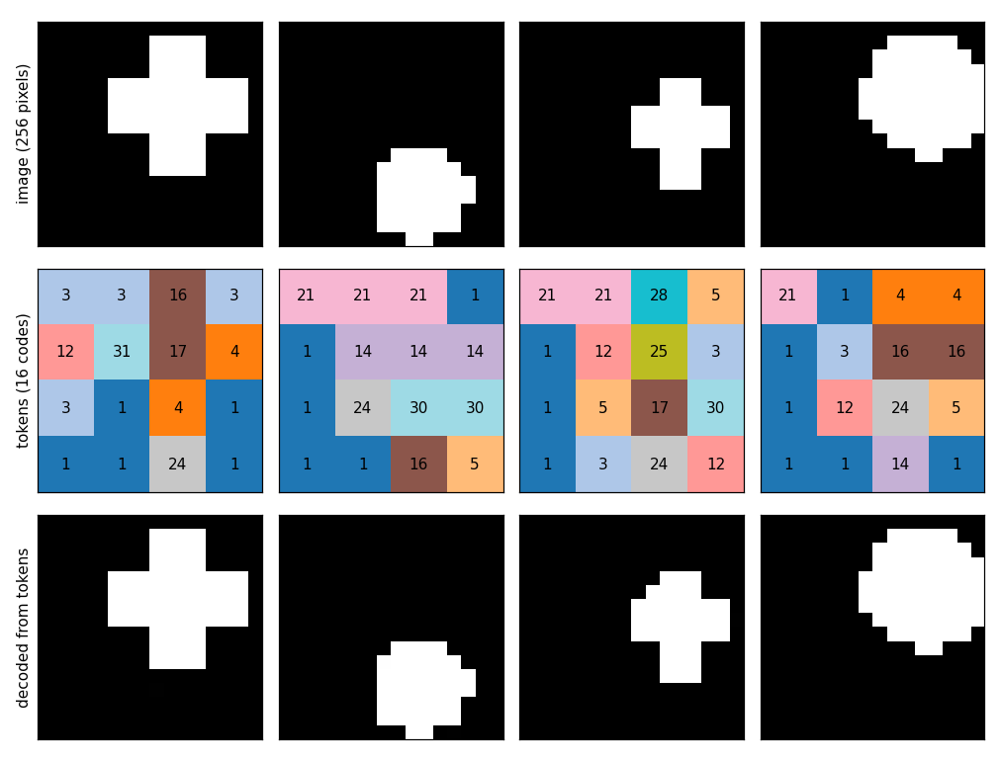
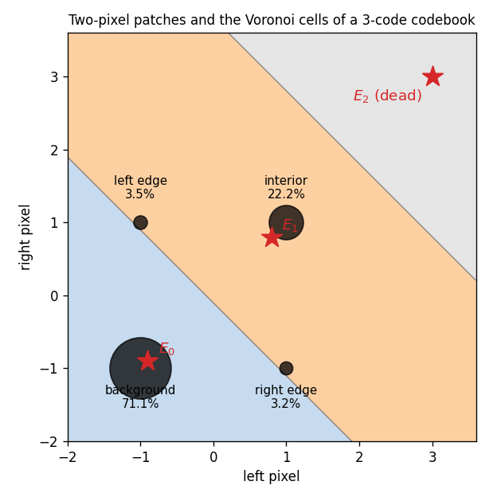
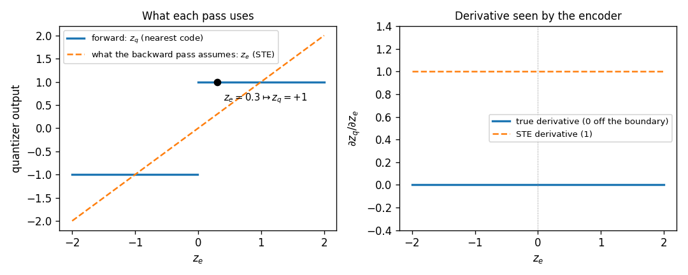

# A6.5 - VQ tokenizer

A VQ-VAE (vector-quantized variational autoencoder) turns an image into a short grid of discrete
tokens from a fixed vocabulary, so an autoregressive transformer can generate images the same way
it generates text. A convolutional encoder maps an image to a grid of continuous vectors, a learned
codebook snaps each vector to its nearest discrete code, and a decoder reconstructs the image. The
nearest-neighbor lookup is non-differentiable, so training passes the gradient around it with the
straight-through estimator. Once images are token grids, a small causal transformer models the
distribution over those grids, and sampling from it decodes to new images. This is the
discrete-token route to image generation, the contrast to the continuous latent that latent
diffusion uses.

Build a VQ-VAE on 16x16 shape images: a 4x4 latent grid, a 32-entry codebook, and an
autoregressive prior over the 16 flattened tokens. Implement the vector quantizer (the
nearest-code lookup, the straight-through estimator, and the codebook and commitment losses), the
total VQ-VAE loss, and autoregressive sampling from the prior. The encoder, decoder, the
transformer prior with its teacher-forced loss, and the toy data are provided. Everything runs on
CPU in seconds to under a minute.

Required reading before starting:
- van den Oord, Vinyals, Kavukcuoglu 2017, "Neural Discrete Representation Learning",
  [arXiv:1711.00937](https://arxiv.org/abs/1711.00937).
- Esser, Rombach, Ommer 2021, "Taming Transformers for High-Resolution Image Synthesis"
  (VQ-GAN), [arXiv:2012.09841](https://arxiv.org/abs/2012.09841).

## Lecture notes

### What a VQ tokenizer is for

#### The task

The data in this assignment is the same set of 16x16 grayscale pictures used for diffusion and
flow matching: a filled disk, a square, or a plus sign, drawn at a random position and size. Every
pixel is $-1$ (background) or $+1$ (shape). The goal is to generate new pictures of this kind, a
disk at a position and size no training picture has, and to do it with the machine that generates
text: an autoregressive transformer that writes a sequence one symbol at a time, each symbol
conditioned on the ones before it.

The same task at scale is image generation inside a language model. A model that writes text and
images in the same output stream needs images to be sequences of symbols, like words.

#### Why a transformer needs discrete tokens

A transformer language model works over a finite vocabulary of $V$ symbols. Every position in the
sequence holds exactly one symbol, and the model's output at a position is a categorical
distribution over the vocabulary: $V$ non-negative numbers summing to one, giving the probability
that the next symbol is each of the $V$ possibilities. Generation is a loop of drawing one symbol
from that distribution and feeding it back in. Two properties of a finite vocabulary make the loop
work. A distribution over it is a fixed-length vector the network can emit directly, and training
is then ordinary classification, where the target is a known index rather than a real-valued
vector.

#### Why pixels make poor tokens

An image has neither property as it comes. A 16x16 grayscale image is 256 real numbers drawn from
a continuous space, so there is no index to predict and no finite list to put a distribution over.
Quantizing each pixel on its own does produce a finite vocabulary (256 gray levels is already a
vocabulary), but the sequence is then as long as the image is large (256 positions here, and over
780,000 for a 512x512 RGB image), and each symbol carries one pixel's worth of meaning, so the
transformer spends its capacity on texture. The useful object is a short sequence over a small
vocabulary in which one symbol stands for a patch of image content.

#### The idea, a learned vocabulary of patches

A **tokenizer** is the map that produces such a sequence. A VQ-VAE (van den Oord et al. 2017)
learns three things together. An encoder turns the 16x16 picture into a 4x4 grid of vectors, each
describing roughly one 4x4 block of the picture. A **codebook** holds $K = 32$ learned vectors,
called **codes**. Each of the 16 encoder vectors is replaced by the nearest code, and only the
code's index, a number in $\{0, \dots, K-1\}$, is kept; that index is the **token**. A decoder
turns the grid of codes back into pixels. The figure shows four training pictures, the 4x4 token
grid a trained VQ-VAE assigns to each, and the picture the decoder rebuilds from those 16 numbers
alone. Background blocks share a few tokens (1, 21, and 3), and blocks containing parts of the
shape get other tokens.



Each picture is now 16 tokens of 5 bits each ($2^5 = 32$), and a transformer can learn the
distribution of those 16-token sequences exactly as it learns text. To generate, the transformer
writes 16 tokens and the decoder turns them into a picture.

Two problems have to be solved to train this. Replacing a vector by the nearest code is a jump,
with no useful derivative, so the encoder gets no gradient through it; the straight-through
estimator below works around that. And codes that are never the nearest one never get trained, so
the effective vocabulary can shrink to a few codes. This is codebook collapse, and it is measured
by a statistic of code usage defined later in the notes.

#### Where it is used

Discrete tokens are one route to image generation. Latent diffusion is another: it keeps a
continuous latent and runs a diffusion or flow-matching model inside it. Discrete tokens let one
transformer handle text and images with a single next-token objective, though they are not the
only way to put both in one transformer; other unified models keep continuous image latents and
train the image part with a diffusion loss. Chameleon tokenizes images into discrete codes, puts text tokens and image tokens in one sequence, and
trains a single transformer over the mixture, so the model reads and writes both modalities.
Janus uses discrete image tokens for the images it writes (with a separate continuous encoder for
the images it reads), and LlamaGen applies a Llama-style next-token transformer to VQ image tokens
for image generation of the kind built in this assignment.

### Our two-pixel patch example (pairs of neighboring pixels of the shape pictures)

The real codebook lives in 16 dimensions, where nothing can be drawn. To see the mechanism, we
shrink the block that one encoder vector describes from 4x4 pixels to two horizontally adjacent
pixels. A two-pixel patch is a vector in $\mathbb{R}^2$, and in the shape pictures it is one of
four kinds. Counting every horizontally adjacent pixel pair (overlapping pairs, so each pixel
belongs to two) in 2000 pictures from the training data generator gives these frequencies:

| patch | vector | frequency |
|---|---|---|
| background | $(-1, -1)$ | 71.1% |
| interior | $(+1, +1)$ | 22.2% |
| left edge | $(-1, +1)$ | 3.5% |
| right edge | $(+1, -1)$ | 3.2% |

A codebook for this example is a set of points in the plane, and quantizing a patch means picking
the nearest point. We use our three-code codebook $E_0 = (-0.9, -0.9)$, $E_1 = (0.8, 0.8)$,
$E_2 = (3, 3)$. The figure draws each patch kind with area proportional to its frequency, the
three codes as stars, and the region of the plane each code wins, the set of points closer to
it than to the other codes.



Our two-pixel patch example keeps the nearest-code lookup, the regions each code wins, the
fitting of codes as averages of the vectors they win, a code that wins nothing (here $E_2$), and
the way usage is measured. It drops the encoder: the vectors being quantized are raw pixels, so
nothing can move them toward the codes, which the real encoder does. Edges are rare (6.7% of
patches together) but are where the picture's information is, and with only two working codes
they are lumped in with the interior.

### Overview of the rest of the notes

1. Vector quantization. Nearest-neighbor quantization and the k-means problem of choosing the
   codes, the same Lloyd iteration used for clustering and for codebook design in speech coding.
2. Autoencoders and the bottleneck. Why an autoencoder needs a constraint in the middle, and how
   the VQ-VAE's quantization constraint differs from the VAE's Gaussian one.
3. The VQ-VAE. The encoder, codebook, and decoder used here.
4. The straight-through estimator. How the encoder gets a gradient through the nearest-code
   lookup, by treating the lookup as the identity in the backward pass.
5. The losses. Two extra terms train the codebook (a gradient version of Lloyd's averaging step)
   and keep the encoder near its codes.
6. Codebook health. Entropy and perplexity measure how many codes are in use; codebook collapse
   and its standard fixes.
7. Perceptual and adversarial losses, which production tokenizers add for sharp reconstructions.
8. The autoregressive prior. The chain rule of probability and a causal transformer, the same
   next-token model as a character-level language model, fitted to the token grids.

Five exercises, placed after the sections they test, are meant to be worked by hand. Each has a
worked answer that can be expanded.

### Vector quantization

Quantization is the analog-to-digital step. Replace a real value by the nearest entry of a finite
set, then store which entry it was, and a continuous quantity fits into a fixed number of bits.
Rounding a voltage to one of 256 levels is scalar quantization, which treats each number in
isolation.

Vector quantization does the same to a whole vector at once. Fix $K$ reference vectors
$E_0, \dots, E_{K-1}$ in $\mathbb{R}^D$ and call the collection a codebook. To quantize a vector
$z$, find the index of the nearest reference vector and keep the index alone:

$$k^\star(z) = \arg\min_k \lVert z - E_k \rVert^2, \qquad z \mapsto E_{k^\star(z)}.$$

The index costs $\log_2 K$ bits no matter how large $D$ is, which is where the compression comes
from. Handling the $D$ components jointly also lets the codebook exploit the fact that real data
occupies a small part of $\mathbb{R}^D$; scalar quantization of each component separately cannot
see those correlations. In our two-pixel patch example, only four of the possible pixel pairs ever
occur, and a codebook placed on those four would code each patch exactly.

The nearest-neighbor rule partitions $\mathbb{R}^D$ into $K$ regions, each the set of points
closer to one code than to any other. Those are Voronoi cells, the same construction used for
proximity queries and roadmap planning, with the codes as the sites; the shaded regions in the
figure above are the Voronoi cells of our three-code codebook. The quantizer is constant on the
interior of a cell and jumps across the boundaries, which leaves it with no usable derivative for
training.

Choosing a codebook to minimize the expected squared error
$\mathbb{E}\lVert z - E_{k^\star(z)}\rVert^2$ over some data is the k-means problem, and the
classical answer alternates two steps: assign every training vector to its nearest code, then
move each code to the mean of the vectors assigned to it. That is Lloyd's algorithm, applied to
codebook design for speech coding by Linde, Buzo, and Gray (1980). One property of it matters for
everything below: a code that nothing is assigned to has no vectors to average, so it never moves,
and if it starts somewhere the data never visits it stays there forever. $E_2$ in our three-code
codebook is such a **dead code**.

The VQ-VAE changes one thing. The vectors being quantized are not raw data but the output of an
encoder trained jointly with the codebook. The quantizer no longer has to cover the awkward
geometry of natural images, because the encoder can move its outputs to wherever the codes are,
and the commitment loss below asks it to.

> **Exercise 1 (nearest codes by hand).** For our three-code codebook, compute the squared
> distance from each of the four patch kinds to each code using the expanded form
> $\lVert z\rVert^2 - 2\,z\cdot E_k + \lVert E_k\rVert^2$, and assign each patch kind to a code.
> Using the frequencies in the table, what is the expected squared quantization error per patch, and which patch kinds contribute most of it?

<details>
<summary>Answer</summary>

Every patch has $\lVert z\rVert^2 = 2$. The code norms are $\lVert E_0\rVert^2 = 1.62$,
$\lVert E_1\rVert^2 = 1.28$, $\lVert E_2\rVert^2 = 18$. The dot products and distances are:

| patch | $z\cdot E_0,\ z\cdot E_1,\ z\cdot E_2$ | squared distances to $E_0, E_1, E_2$ | code |
|---|---|---|---|
| background $(-1,-1)$ | $1.8,\ -1.6,\ -6$ | $0.02,\ 6.48,\ 32$ | $E_0$ |
| left edge $(-1,+1)$ | $0,\ 0,\ 0$ | $3.62,\ 3.28,\ 20$ | $E_1$ |
| right edge $(+1,-1)$ | $0,\ 0,\ 0$ | $3.62,\ 3.28,\ 20$ | $E_1$ |
| interior $(+1,+1)$ | $-1.8,\ 1.6,\ 6$ | $7.22,\ 0.08,\ 8$ | $E_1$ |

The expected squared error is
$0.711 \cdot 0.02 + (0.035 + 0.032)\cdot 3.28 + 0.222 \cdot 0.08 \approx 0.0142 + 0.2198 + 0.0178
\approx 0.252$. The edges are 6.7% of patches and contribute about 87% of the error, because no
code is near them. $E_2$ wins nothing. The codebook spends $\log_2 3 \approx 1.58$ bits per index
but uses only two codes, so it carries at most 1 bit of information per patch.

</details>

### Autoencoders and the quantization bottleneck

An autoencoder is a pair of networks trained to make their composition the identity. An encoder
$f$ maps an image to some smaller representation, a decoder $g$ maps that back to an image, and
the objective is the reconstruction error $\lVert x - g(f(x))\rVert^2$ averaged over a dataset. By
itself that objective is trivial. If the representation is big enough to hold the input, the pair
can just copy. A constraint on the middle representation, called the bottleneck, forces the pair
to keep only what matters for reconstruction. Two such constraints are in use for generative models.

The variational autoencoder (Kingma and Welling 2013) uses a probabilistic bottleneck. Its encoder
emits the mean and variance of a Gaussian instead of a single point, the latent is a sample from
that Gaussian, and a Kullback-Leibler divergence term penalizes how far that Gaussian sits from a
standard normal. The KL divergence $\mathrm{KL}(q \,\Vert\, p) = \mathbb{E}_q[\log q - \log p]$ is
the extra description length paid for coding samples from $q$ with a code built for $p$, measured
in nats, the unit of information that comes from using $\ln$ in place of $\log_2$ (one nat is
$1/\ln 2 \approx 1.44$ bits); it is zero only when $q = p$. Adding noise and pulling toward a fixed
prior keeps the latent space continuous and roughly standardized, so nearby latents decode to
similar images. An autoencoder trained with this KL term is called a KL-VAE, and latent diffusion
runs its denoiser inside the latent of one.

The VQ-VAE uses quantization as the bottleneck instead. The latent is forced onto one of $K$
points, so each latent position carries at most $\log_2 K$ bits whatever the encoder does. Here
$K = 32$ and the grid is $4\times4$, so a whole image is 16 tokens of 5 bits each, 80 bits in
total, standing in for 256 real-valued pixels. The "variational" in the name has almost no effect
on the implementation: the posterior (the encoder's distribution over codes for a given image) is
taken to be deterministic, with all probability on the nearest code, and the prior over codes is
taken to be uniform while the tokenizer trains, which makes the KL term a constant $\log K$ with
zero gradient. van den Oord et al. make exactly that argument, and it is why the loss below has no
KL term in it.

Both bottlenecks hand a compressed latent to a second-stage generative model, and the choice of
bottleneck decides what that second stage can be. A discrete grid suits an autoregressive
transformer emitting a categorical distribution over codes. A continuous latent suits diffusion or
flow matching, which need to add and remove Gaussian noise in a space where that operation means
something. Latent diffusion (Rombach et al. 2021) reports autoencoders of both kinds, one
KL-regularized and one VQ-regularized; this assignment builds the discrete one and the
autoregressive second stage that goes with it.

### The VQ-VAE

The encoder takes a batch of images of shape $(B, 1, 16, 16)$ and produces a continuous grid
$z_e \in \mathbb{R}^{B\times D\times H'\times W'}$, here $4\times 4$ vectors of dimension $D = 16$.
It uses two stride-2 convolutions taking $16 \to 8 \to 4$ spatially, a ConvNeXt block (the
residual unit of the ConvNeXt architecture: a depthwise 7x7 convolution that mixes each channel
spatially, then a two-layer per-pixel MLP that mixes channels, added back to the block's input),
and a $1\times1$ convolution to $D$ channels. The codebook is an embedding table
$E \in \mathbb{R}^{K\times D}$, meaning a matrix of $K$ learnable rows that is read by row index.
Quantization replaces each of the $B \cdot H' \cdot W'$ encoder vectors by its nearest code:

$$k^\star(z) = \arg\min_k \lVert z - E_k \rVert^2 = \arg\min_k \big(\lVert z\rVert^2 - 2\,z\cdot E_k + \lVert E_k \rVert^2\big),$$

and $z_q = E_{k^\star}$, a grid of the same shape $(B, D, 4, 4)$, together with the indices, shape
$(B, 4, 4)$. In the expanded form the cross term is one matrix product between all the encoder
vectors and all the codes, so the distances for the whole grid come from a few matrix operations.
The $\lVert z\rVert^2$ term is constant across codes, so it does not affect the argmin; keeping it
makes each value a true non-negative squared distance. The decoder mirrors the encoder with transposed convolutions back to $(B, 1, 16, 16)$
and a final $\tanh$, because the toy images live in $[-1, 1]$.

### The straight-through estimator

Training runs on reverse-mode automatic differentiation: every operation in the forward pass
records a local derivative, and the backward pass multiplies those derivatives together from the
loss back to the parameters. An operation whose derivative is zero therefore erases everything
upstream of it.

The nearest-code lookup is such an operation. Inside a Voronoi cell, nudging $z$ does not change
which code is nearest, so $z_q$ does not move at all and $\partial z_q / \partial z_e$ is the zero
matrix. On a cell boundary the output jumps and the derivative does not exist. "Zero gradient
almost everywhere" names those two cases together. The boundaries form a set of zero volume, and
off that set the derivative exists and equals zero. Backpropagating exactly through quantization
would leave the encoder with no gradient at all, and an untrained encoder feeding a codebook
fitted to its untrained outputs reconstructs nothing.

The **straight-through estimator** (STE) routes the gradient around the argmin. It defines

$$z_q^{\text{ste}} = z_e + \operatorname{sg}\!\big(z_q - z_e\big),$$

where $\operatorname{sg}$ is the stop-gradient operator. It leaves the
forward value untouched and tells the backward pass to treat that value as a constant, sending no
gradient into whatever computed it. The forward value is $z_e + (z_q - z_e) = z_q$ exactly, so the
decoder still sees the hard quantized vector. The backward derivative is

$$\frac{\partial z_q^{\text{ste}}}{\partial z_e} = I + 0 = I,$$

because the detached term contributes nothing, so the decoder's gradient arrives at the encoder
unchanged, as if quantization were the identity. The backward pass uses a stand-in derivative
chosen to be useful, not the derivative of the function the forward pass applied.



Our one-pixel quantizer, drawn in the figure, shows what that substitution does. It is our
two-pixel patch example cut down to a single pixel: $D = 1$, with codes at $-1$ and $+1$ (the two
pixel values of the shape pictures), and an encoder output $z_e = 0.3$, which quantizes to $z_q = +1$. Suppose the decoder
wants a smaller input, $\partial \mathcal{L} / \partial z_q = +2$. The true derivative through the
rounding is zero, so an exact backward pass tells the encoder nothing and $z_e$ stays at $0.3$
forever. The estimator instead hands the encoder $\partial \mathcal{L} / \partial z_e = +2$, and
gradient descent moves $z_e$ down. Nothing visible happens for a while, since the code stays $+1$;
once $z_e$ crosses zero the assignment flips to $-1$ and the decoder gets the smaller input it was
asking for. The STE gradient is the gradient of a different model, one in which quantization is
replaced by the identity, so it gives the descent direction for that model. That direction is
accurate for the real quantized model when $z_q - z_e$ is small, and the commitment term below
keeps it small.

The estimator deliberately defines a gradient that finite differences would disagree with, so a
numerical gradient check is not a valid test of this code.

### The losses

The reconstruction loss trains the encoder and decoder through the STE. The codebook itself gets
nothing from that path, because the stop-gradient detaches $z_q$, so two extra terms are needed,
one to train the codes and one to hold the encoder near them:

$$\mathcal{L} = \underbrace{\lVert x - \hat x\rVert^2}_{\text{reconstruction}} + \underbrace{\lVert \operatorname{sg}[z_e] - z_q\rVert^2}_{\text{codebook}} + \beta\underbrace{\lVert z_e - \operatorname{sg}[z_q]\rVert^2}_{\text{commitment}}.$$

Here $\hat x$ is the decoder's reconstruction. The codebook and commitment terms are the same
squared difference with the stop-gradient on opposite sides, splitting one distance into two
independent jobs. In the **codebook term** the encoder output is frozen, so the gradient goes only
into the code and moves it toward the encoder vectors assigned to it: the mean step of Lloyd's
algorithm, done by gradient descent instead of in closed form. In the **commitment term** the code
is frozen, so the gradient goes only into the encoder and pulls its output toward the code it
picked, which stops the encoder from drifting its outputs away faster than the codes can follow.
The weight $\beta = 0.25$ is van den Oord et al.'s value. All three terms are means over their
elements, not sums, so $\beta$ multiplies a term already on the same per-element scale as the
others; the balance would change if one term were summed instead.

The encoder is trained by the reconstruction term through the STE and by the commitment term
directly, the decoder by the reconstruction term, and the codebook by the codebook term alone.

> **Exercise 2 (one training step through the quantizer).** Use our one-pixel quantizer from the
> previous section: codes at $-1$ and $+1$, encoder output $z_e = 0.3$, and a decoder that is the
> identity, so $\hat x = z_q$. The true pixel is background, $x = -1$, and $\beta = 0.25$. Compute
> (a) the true derivative of the reconstruction loss $(\hat x - x)^2$ with respect to $z_e$,
> (b) the derivative the STE passes to the encoder, (c) the derivative of the commitment term
> $\beta (z_e - \operatorname{sg}[z_q])^2$ with respect to $z_e$, and (d) $z_e$ and its code after
> one gradient-descent step with learning rate 0.1 on the sum.

<details>
<summary>Answer</summary>

(a) $\hat x = z_q = +1$ for every $z_e$ near $0.3$, so the reconstruction loss is $4$ and does not
change when $z_e$ moves; its true derivative is $0$.

(b) $\partial \mathcal{L}/\partial z_q = 2(z_q - x) = 2(1 - (-1)) = 4$, and the STE passes it to
$z_e$ unchanged: $4$.

(c) $2\beta(z_e - z_q) = 0.5 \cdot (0.3 - 1) = -0.35$.

(d) The total derivative is $4 - 0.35 = 3.65$, so $z_e \leftarrow 0.3 - 0.1 \cdot 3.65 = -0.065$.
That is below $0$, so the code flips to $-1$ and the reconstruction loss drops to $0$. The
commitment term pushed the other way: it pulls $z_e$ toward its current code $+1$, and without it
the step would have reached $-0.1$. With $\beta$ small the reconstruction gradient wins and the
encoder can still change its code; a large $\beta$ would hold encoder outputs in their current
cells.

</details>

> **Exercise 3 (the codebook term is Lloyd's mean step).** In our two-pixel patch example, treat
> the frequencies as the data and write the codebook term as a mean over the $D = 2$ elements,
> $\mathcal{L}_{\text{cb}} = \frac{1}{D}\sum_z p(z)\,\lVert \operatorname{sg}[z] - E_{k^\star(z)}\rVert^2$,
> with the assignments from Exercise 1. Show that its gradient with respect to $E_k$ is
> $\frac{2p_k}{D}(E_k - m_k)$, where $p_k$ is the total frequency of the patches assigned to code
> $k$ and $m_k$ is their frequency-weighted mean. Compute $m_1$ and the gradients for $E_0$,
> $E_1$, and $E_2$. What learning rate would move each used code exactly onto its mean in one
> step?

<details>
<summary>Answer</summary>

Only the patches assigned to $k$ involve $E_k$, so
$\partial \mathcal{L}_{\text{cb}}/\partial E_k = \frac{2}{D}\sum_{z \to k} p(z)(E_k - z) = \frac{2}{D}\big(p_k E_k - p_k m_k\big)$.

$E_0$ wins only the background: $p_0 = 0.711$, $m_0 = (-1, -1)$, gradient
$0.711\cdot(0.1, 0.1) = (0.0711, 0.0711)$.

$E_1$ wins the two edges and the interior: $p_1 = 0.035 + 0.032 + 0.222 = 0.289$ and
$m_1 = \big(0.222(1,1) + 0.035(-1,1) + 0.032(1,-1)\big)/0.289 = (0.219, 0.225)/0.289 \approx (0.758, 0.779)$.
The gradient is $0.289\cdot(0.8 - 0.758,\ 0.8 - 0.779) \approx (0.0122, 0.0062)$.

$E_2$ wins nothing, so its gradient is exactly zero and it never moves.

A step $E_k \leftarrow E_k - \eta\,\frac{2p_k}{D}(E_k - m_k)$ lands on $m_k$ when
$\eta = D/(2p_k) = 1/p_k$: $\eta \approx 1.41$ for $E_0$ and $3.46$ for $E_1$. At one shared
learning rate, codes that win many vectors move toward their means quickly and rarely used codes
move slowly, and an unused code does not move at all.

</details>

### Entropy and perplexity

Codebook health is a question about a distribution. Over a batch, let $p_k$ be the fraction of
encoder vectors assigned to code $k$. A single number summarizing how spread out that distribution
is comes from Shannon entropy,

$$H = -\sum_k p_k \log p_k,$$

in nats when the log is natural. Entropy is the average number of nats needed to name one draw
under an optimal code, and it is largest when the distribution is uniform. Exponentiating turns it
back into a count:

$$\text{perplexity} = \exp(H) = \exp\!\Big(-\sum_k p_k \log p_k\Big), \qquad p_k = \frac{\#\{\text{vectors assigned to code } k\}}{\#\text{vectors}},$$

the number of equally likely outcomes that would have the same entropy. It reads as an effective
vocabulary size. Three cases fix the scale. If all 32 codes are used equally, $H = \ln 32$ and the
perplexity is 32. If only 4 codes are used and used equally, $H = \ln 4$ and the perplexity is 4,
regardless of how many dead codes sit alongside them. If one code takes 97% of the assignments and
the other 31 split the remaining 3%, $H \approx 0.24$ nats and the perplexity is about 1.3, close to
the value of 1 that total collapse gives. Perplexity counts codes that are actually in use, not
codes that exist.

> **Exercise 4 (perplexity and a reseeded dead code).** (a) After one Lloyd step from Exercise 3,
> our three-code codebook is $E_0 = (-1, -1)$, $E_1 \approx (0.758, 0.779)$, $E_2 = (3, 3)$.
> Check that the assignments do not change and compute the perplexity of the code usage. (b) Now
> move the dead code to a right-edge patch, $E_2 = (1, -1)$. Reassign the four patch kinds and
> compute the new perplexity and the new expected squared error per patch.

<details>
<summary>Answer</summary>

(a) Squared distances to $E_0, E_1, E_2$: background $0,\ 6.25,\ 32$; left edge $4,\ 3.14,\ 20$;
right edge $4,\ 3.22,\ 20$; interior $8,\ 0.11,\ 8$. The assignments are as before, so the usage is
$(0.711, 0.289, 0)$, and the expected squared error is
$0.711\cdot 0 + 0.035\cdot 3.14 + 0.032 \cdot 3.22 + 0.222\cdot 0.108 \approx 0.237$, down from
$0.252$ before the Lloyd step. $H = -(0.711\ln 0.711 + 0.289 \ln 0.289) \approx 0.601$ nats and the
perplexity is $e^{0.601} \approx 1.82$: fewer than two effective codes, since the usage is
uneven.

(b) With $E_2 = (1, -1)$ the squared distances from the right edge become $4,\ 3.22,\ 0$, so it
moves to $E_2$. The left edge is at distance $8$ from $E_2$ and stays with $E_1$; the interior is
at $4$ from $E_2$ and stays with $E_1$. The usage is $(0.711,\ 0.257,\ 0.032)$, $H \approx 0.702$,
and the perplexity is about $2.02$. The expected squared error falls from about $0.237$ to about
$0.134$, because the right edge is now coded exactly. A code that the data never reached starts
contributing once it is placed where the data is, which is what dead-code reinitialization below
does.

</details>

### Codebook collapse

The common VQ failure is **codebook collapse**: a few codes capture nearly every assignment and
the rest go dead, shrinking the effective vocabulary to a fraction of $K$. The mechanism is the
dead-code property of Lloyd's algorithm carried over to the gradient version, as Exercise 3 showed.
The codebook term moves a code only through the encoder vectors assigned to it, so a code that is
never the nearest one receives exactly zero gradient and never moves. Nothing in the objective
pulls an unused code back toward the data; it stays wherever initialization left it and stays
unused. The commitment term compounds this, since it pulls encoder outputs toward the codes
already in use and so empties the region around the dead ones further.

Collapse is not visible in the reconstruction loss at first, since a handful of codes can
reconstruct a small batch adequately, but it caps what the tokenizer can represent and starves the
second-stage transformer of vocabulary. Perplexity is the diagnostic to monitor alongside the
reconstruction error.

### Keeping the codebook alive

Production tokenizers use three fixes.

The exponential-moving-average (EMA) codebook update replaces the codebook term entirely. Instead
of letting the optimizer move the codes, keep two running statistics per code, a count $N_k$ and a
vector sum $m_k$ of the encoder vectors assigned to it, updated each batch as
$N_k \leftarrow \gamma N_k + (1-\gamma) n_k$ and $m_k \leftarrow \gamma m_k + (1-\gamma) s_k$ from
that batch's count $n_k$ and sum $s_k$, then set $E_k = m_k / N_k$. That is Lloyd's mean step run
online with a decay $\gamma$, and it puts the code at the running average of its assigned vectors
immediately rather than taking a small step toward it. Codes track the encoder faster, and the
update is not affected by the optimizer's learning rate or momentum. van den Oord et al. describe
it in the appendix of the VQ-VAE paper.

Dead-code reinitialization attacks the problem directly. Count assignments per code, and any code
whose count has been zero for a while gets re-seeded to a random encoder vector from the current
batch. It is now sitting in a populated region and will win assignments again, as $E_2$ did in
Exercise 4.

L2-normalized cosine-distance codes remove a degree of freedom the training would otherwise have
to manage. Normalize both the encoder output and the codes to unit length before the lookup. For
unit vectors $\lVert u - v\rVert^2 = 2 - 2\,u \cdot v$, so the smallest squared distance is the
largest cosine similarity and the two rules pick the same code, with magnitude out of it. The
practical benefit is that codes and encoder outputs cannot drift apart in scale, which is one of
the ways codes go dead. ViT-VQGAN (Yu et al. 2021) pairs this with a deliberately low-dimensional
code, and LlamaGen follows the same recipe.

### Perceptual and adversarial losses

Pixel MSE has a specific failure on natural images. The minimizer of a squared error is the
conditional mean, so when several plausible textures fit the same latent, the reconstruction is
their average, which is a blur. The toy here is near-binary shapes on a flat background, where the
conditional mean is close to the right answer, so plain pixel MSE is fine. On photographs it is
not.

VQ-GAN (Esser et al. 2021) adds two terms to fix that. A perceptual loss compares the
reconstruction to the original not pixel by pixel but through the activations of a fixed,
pretrained image network, penalizing the distance between feature maps; the standard form is LPIPS
(Zhang et al. 2018). Because those features respond to edges and texture statistics rather than
exact pixel alignment, matching them rewards a sharp reconstruction with slightly shifted detail
over a smooth average.

The other term is adversarial. A second network, the discriminator, is trained to tell real images
from reconstructions, and the autoencoder is trained partly to make the discriminator fail
(Goodfellow et al. 2014). Whatever cue the discriminator finds becomes a gradient telling the
decoder to remove it, and blur is an easy cue to find. VQ-GAN uses a patch discriminator: a fully
convolutional network that outputs a real-or-fake score for each of many overlapping patches
instead of one score for the whole image (Isola et al. 2017). Judging patches keeps the
discriminator focused on local texture, gives many training signals per image, and makes it
independent of image size.

### The autoregressive prior

The trained tokenizer gives half of a generative model. Its decoder defines $p(x \mid t)$, how an
image follows from a token grid $t$, and the full model is $p(x) = \sum_t p(t)\,p(x \mid t)$, which
needs a distribution $p(t)$ over token grids. $p(t)$ sits in the place a latent-variable model
calls the prior, hence the name **prior**, even though it is fitted after the tokenizer rather
than assumed in advance, on the token grids the trained encoder assigns to the training images.

Each image is a $4\times4$ grid of code indices. Flattened row-major, that is a length-$L = 16$
sequence over a $K$-code vocabulary. The chain rule of probability factors any joint distribution
over a sequence into conditionals,

$$p(t_0, \dots, t_{L-1}) = \prod_{i=0}^{L-1} p(t_i \mid t_0, \dots, t_{i-1}),$$

with no approximation and no independence assumption. Autoregressive means modeling each factor of
that product with one network, every token conditioned on the tokens before it. The factorization
is exact for any ordering of the tokens; raster order, left to right and top to bottom, is the
convention.

A causal transformer computes all $L$ conditionals in one pass. Its attention is masked so that
position $i$ can attend only to positions $j \le i$, implemented by adding a matrix with
$-\infty$ above the diagonal to the attention scores before the softmax, driving those weights to
zero. Each output position then depends only on the tokens at or before it, so a single forward
pass over the whole sequence yields all $L$ next-token distributions at once, with none of them
having seen its own answer. Attention by itself ignores order, so the model also needs position
information to know where in the raster scan each token sits.

Position 0 has no predecessor, so it needs an input. A learned beginning-of-sequence token, BOS,
supplies it: an extra index $K$ added to the vocabulary, giving $K+1$ embedding rows, while the
output head still predicts only the $K$ real codes. Training is teacher-forced next-token
cross-entropy. Teacher forcing means the model is conditioned on the ground-truth prefix at every
position rather than on the tokens it would have predicted itself, so the whole sequence trains in
one parallel pass. Input is $[\text{BOS}, t_0, \dots, t_{L-2}]$ and the targets are
$[t_0, \dots, t_{L-1}]$, the same next-token loss as a character-level language model. The loss at
a position is the negative log of the probability the model gave the correct code, averaged over
positions and measured in nats; a model that has learned nothing spreads its mass uniformly over
the $K$ codes and pays $\ln K$ per token ($\ln 32 \approx 3.47$ here).

Sampling reverses teacher forcing and feeds the model its own output. Start from $[\text{BOS}]$,
run the prior, take the last position's logits (the raw scores over the $K$ codes, before
normalization), turn them into a categorical distribution with a softmax, draw one index from it,
append that index, and repeat $L$ times. Drawing rather than taking the argmax makes repeated runs
produce different images. Reshaping the $L$ sampled indices to $4\times4$ and pushing them through
the codebook and decoder gives a new image. The loop re-runs the transformer over the whole prefix
at every step, recomputing attention for positions that have not changed; production samplers
cache the keys and values of earlier positions instead. At $L = 16$ the difference does not matter.

> **Exercise 5 (the lowest loss a memorizing prior can reach).** A prior is trained on four token
> grids with $L = 16$. Their first two tokens are $(3, 5)$, $(3, 6)$, $(7, 1)$, and $(9, 2)$, and
> given its first two tokens each grid's remaining 14 tokens are fixed. A model that fits these
> four grids perfectly predicts, at each position, the empirical distribution of the next token
> given the prefix. What is its average cross-entropy per token? Compare it with $\ln 4 / 16$.

<details>
<summary>Answer</summary>

Position 0 sees only BOS, and the first tokens are $3, 3, 7, 9$, so the best prediction is
$(1/2, 1/4, 1/4)$ and the expected loss is its entropy,
$-(0.5 \ln 0.5 + 2\cdot 0.25 \ln 0.25) \approx 1.040$ nats. At position 1, the two grids that
start with 3 continue with 5 or 6, each with probability $1/2$, costing $\ln 2$; the other two are
determined. Averaged over the four grids that is $0.5 \ln 2 \approx 0.347$. Every later position
is determined and costs $0$. The total per grid is $1.040 + 0.347 = 1.386 = \ln 4$, and per token
$\ln 4/16 \approx 0.0866$.

By the chain rule, the conditional entropies at the 16 positions add up to the entropy of the
whole grid, which is $\ln B$ when the model has memorized $B$ distinct, equally frequent grids. The
total does not depend on where the grids first differ, only on how many distinct grids there are.
Compare $\ln 32 \approx 3.47$ per token for an untrained model.

</details>

## The assignment

Fill these holes, in order. Each is one `NotImplementedError` with a matching test. The docstring
in each file gives the signature, shapes, and constraints.

| # | Function | File | Concept from the notes |
|---|---|---|---|
| 1 | [`VectorQuantizer.forward()`](quantize.py) | `quantize.py` | nearest-code lookup, the straight-through estimator, and the codebook and commitment terms |
| 2 | [`vq_vae_loss()`](vqvae.py) | `vqvae.py` | the total VQ-VAE loss, reconstruction plus the quantizer's vq loss |
| 3 | [`ar_sample()`](prior.py) | `prior.py` | autoregressive sampling from the prior |

Notes on specific holes:
- `VectorQuantizer.forward` takes $z_e$ of shape $(B, D, H, W)$ and returns
  `(z_q_ste, indices, vq_loss)` with shapes $(B, D, H, W)$, $(B, H, W)$, and a scalar. Here
  `vq_loss` is the codebook term plus `self.beta` times the commitment term. Flatten $z_e$ to
  $(B \cdot H \cdot W, D)$ and compute all distances with the expanded form as one matrix product
  against the codebook weight, not a Python loop. The stop-gradient $\operatorname{sg}$ is
  `.detach()` in PyTorch. Compute each loss term as `.pow(2).mean()`.
  Other code imports the quantizer through `nanovision.quantize`, which loads this file (or
  `solution/quantize.py` under `make verify`).
- `vq_vae_loss` adds the mean-squared reconstruction error to the `vq_loss` the quantizer
  returned.
- `ar_sample` starts every sequence at `prior.bos`, samples each next token with
  `torch.multinomial` using the `generator` it is given (so a fixed seed gives a fixed grid), drops
  the BOS column, and reshapes to $(n, H, W)$.
- The prior's causal mask comes from `build_causal_mask`, which returns the $-\infty$-above-the-
  diagonal matrix, and the prior has no positional embedding table of its own: position enters
  through rotary position embeddings (RoPE) inside the transformer blocks, which rotate each query
  and key vector by an angle proportional to its position so that attention scores depend on the
  relative position of two tokens.
- The test suite asserts a perplexity floor alongside the reconstruction error, to catch collapse.
- Provided: the encoder, decoder, and `VQVAE.decode_indices` in `vqvae.py`; `TokenPrior` and the
  teacher-forced loss `ar_nll` in `prior.py`; and `codebook_perplexity` in `quantize.py`.

### Running and validating

Activate the environment (`conda activate nanovision`), then:

```
make test     A=a06_5_vq_tokenizer   # run the tests against the top-level files (the ones with holes)
make verify   A=a06_5_vq_tokenizer   # run the same tests against the reference solution/
make viz      A=a06_5_vq_tokenizer   # render the figures from the reference solution
make viz-mine A=a06_5_vq_tokenizer   # render the figures from your own code (once the holes are filled)
```

`make test` is the command to run while working. It runs the test suite in
`assignments/a06_5_vq_tokenizer/tests/` against the top-level files. The tests fail while the holes
raise `NotImplementedError` and pass as the holes are filled in correctly. `make verify` runs the
same suite against the reference answer key in `solution/`: it sets `NANOVISION_IMPL=solution`,
which makes the tests import the reference implementation instead of the top-level files. It passes
from the start, which confirms the tests and environment work. The goal is to make `make test` pass
as `make verify` does.

The tests check:
- `test_quantize.py`: the indices match a brute-force nearest neighbor (`torch.cdist`), the
  straight-through value equals the hard codebook lookup, and the vq loss equals the codebook term
  plus $0.25\times$ the commitment term.
- `test_straight_through.py`: the straight-through gradient directly. After backpropagating the sum
  of $z_q^{\text{ste}}$, $z_e$.grad is all ones, the identity gradient the STE defines; and the
  forward value is the hard lookup. There is no `gradcheck` test here.
  `torch.autograd.gradcheck` verifies an analytic gradient by re-evaluating the forward pass at
  perturbed inputs and comparing against the finite difference, and the STE makes the autograd
  gradient differ from the finite difference on purpose, so that check would fail by design.
- `test_recon_overfit.py`: 1500 Adam steps on one batch of 8 shape images must reach
  reconstruction MSE below 0.05 and codebook perplexity above 3, which rules out collapse.
- `test_prior_overfit.py`: 1000 steps of the prior on 8 random token grids must start near
  $\ln K$ and end below 0.2 and below a tenth of the starting loss.
- `test_ar_sample.py`: sampled grids have shape $(n, 4, 4)$, contain only real codes (no BOS), and
  are identical for the same generator seed.
- `test_shapes.py`: output shapes of the VQ-VAE, the quantizer, and the prior.
- `test_forbidden_imports.py`: no prebuilt VQ library is imported.

`make viz` renders from the reference solution, so it works on a fresh checkout before any holes
are filled and shows the target figures. `make viz-mine` runs the same script against the
top-level code, to check a finished implementation by eye. Both write PNG files to `out/` instead
of opening a window, using matplotlib's headless Agg backend, so they work over SSH, in WSL, and in
CI with no display. Add `SHOW=1` (for example `make viz-mine A=a06_5_vq_tokenizer SHOW=1`) to also
open the figures in windows when a display is available. The figures are:
- `recon.png`: originals next to their VQ-VAE reconstructions.
- `codebook.png`: the code-usage histogram and the perplexity.
- `samples.png`: images decoded from token grids sampled by the prior.

The figures in the notes are generated by `assets/make_figures.py`. The token-grid figure trains
the reference VQ-VAE with the settings `viz.py` uses; the two-pixel patch figure and the
straight-through figure are computed directly and do not use the assignment code.

What you should see when you run this. The VQ-VAE overfit in the test suite drives the
reconstruction MSE below 0.05 on its 8-image batch (about 0.004 in our CPU run) and keeps
perplexity above 3 (about 12 in that run, with 19 of the 32 codes in use), so the codebook does not
collapse to a handful of codes; `make viz` trains on 16 images for longer and prints a perplexity
that depends on the device: about 12 of the 32 on CPU and about 18 on a CUDA GPU in our runs. The prior overfit drives the next-token cross-entropy down from about its
untrained $\ln K \approx 3.47$ nats (3.70 in our run) toward a floor of $\ln(B)/L \approx 0.13$,
which it reaches (0.1300 against $\ln 8/16 = 0.12997$). The floor is not 0 because the
grids are indistinguishable until the first position where they differ, and the model pays a
cross-entropy cost at each such position. By the chain rule (Exercise 5), these costs add up to the
entropy of the set of grids: with $B$ distinct grids memorized, the best the model can do is give
each probability $1/B$, a total of $\ln B$ per grid, which is averaged over the $L$ positions. In
the test, two of the 8 random grids share their first token (14), so 7 distinct first tokens give
a position-0 cost of about 1.906 nats, and the remaining $0.173 = (2/8)\ln 2$ is paid at position 1
where those two grids split; the total is $\ln 8 \approx 2.079$. The decoded prior samples are
recognizable shapes. These are toy artifacts on 16x16 images that confirm the mechanism runs end
to end; they say nothing about tokenizer quality at scale, where a perceptual loss and a
discriminator, a much larger codebook, and EMA codebook updates are standard.

## Where this goes next

- Unified multimodal models tokenize images this way and model text and image tokens with one
  autoregressive transformer. Chameleon (Chameleon Team 2024,
  [arXiv:2405.09818](https://arxiv.org/abs/2405.09818)) puts text and image tokens in one
  sequence; Janus (Wu et al. 2024, [arXiv:2410.13848](https://arxiv.org/abs/2410.13848)) writes
  images as discrete tokens and reads them through a separate continuous encoder.
- LlamaGen (Sun et al. 2024, [arXiv:2406.06525](https://arxiv.org/abs/2406.06525)) is an
  image generator rather than a multimodal model: a Llama-style transformer over VQ tokens, the
  same two stages as this assignment at scale.
- The latent diffusion transformer assignment takes the other route: a continuous KL-regularized
  latent instead of a discrete codebook, with flow-matching diffusion in that latent space rather
  than an autoregressive prior. That is the discrete-versus-continuous and
  autoregressive-versus-diffusion split.

## References

- van den Oord, Vinyals, Kavukcuoglu 2017, VQ-VAE,
  [arXiv:1711.00937](https://arxiv.org/abs/1711.00937).
- Esser, Rombach, Ommer 2021, VQ-GAN, [arXiv:2012.09841](https://arxiv.org/abs/2012.09841).
- Kingma and Welling 2013, "Auto-Encoding Variational Bayes",
  [arXiv:1312.6114](https://arxiv.org/abs/1312.6114).
- Rombach et al. 2021, latent diffusion,
  [arXiv:2112.10752](https://arxiv.org/abs/2112.10752).
- Linde, Buzo, Gray 1980, "An Algorithm for Vector Quantizer Design", IEEE Transactions on
  Communications.
- Goodfellow et al. 2014, generative adversarial networks.
- Isola et al. 2017, pix2pix, the patch discriminator.
- Zhang et al. 2018, LPIPS, the perceptual metric.
- Yu et al. 2021, ViT-VQGAN.
- Chameleon Team 2024, Chameleon, [arXiv:2405.09818](https://arxiv.org/abs/2405.09818).
- Wu et al. 2024, Janus, "Decoupling Visual Encoding for Unified Multimodal Understanding and
  Generation", [arXiv:2410.13848](https://arxiv.org/abs/2410.13848).
- Sun et al. 2024, LlamaGen, [arXiv:2406.06525](https://arxiv.org/abs/2406.06525).
