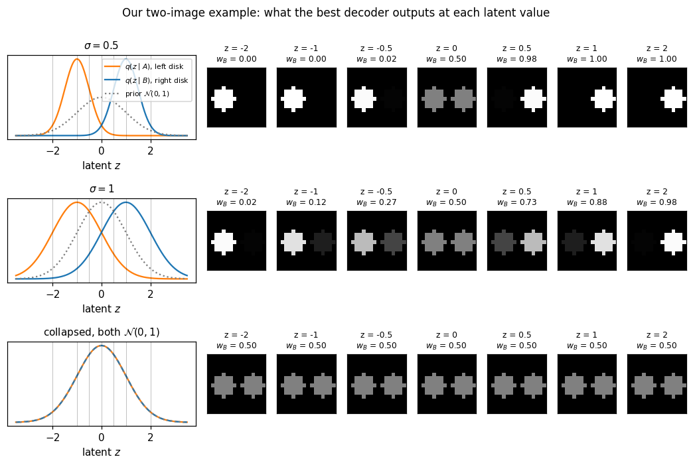
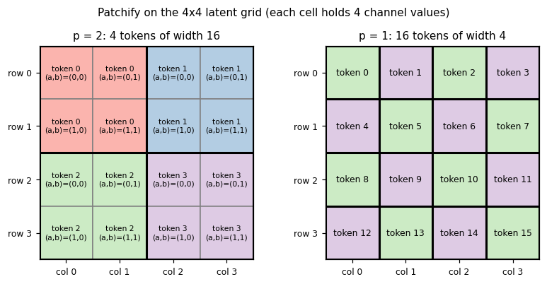
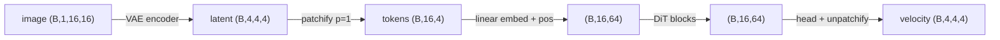
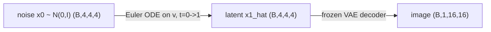
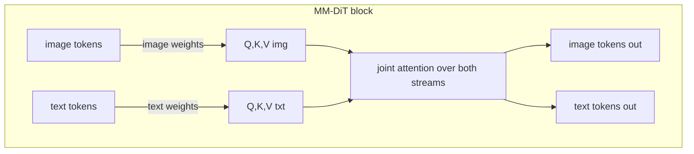

# A7 - Latent diffusion and a tiny DiT

Every diffusion and flow-matching image generator since 2022 (Stable Diffusion, SD3, FLUX) is
built in two stages. First, an autoencoder compresses each image into a small grid of real
numbers, called the latent. Second, a generative model learns to produce new latents, and the
autoencoder's decoder, frozen by then, turns a generated latent back into an image. The
generative model never sees a pixel.

This assignment builds both stages at toy scale. The autoencoder is a KL-regularized variational
autoencoder (VAE) that takes a 16x16 image down to a 4x4x4 latent. The generative model is a
diffusion transformer (DiT) that predicts a flow-matching velocity in that latent space,
conditioned on the flow time and a class label. The flow-matching objective is the one from the
flow-matching assignment, unchanged: the same straight-line interpolant, the same velocity target
$u = x_1 - x_0$, the same Euler ODE sampler. What changes is where the model operates (on a
latent, not on pixels), what network it uses (a transformer, not the diffusion U-Net), and how
the time and class reach the network (adaptive LayerNorm, explained below).

The holes are the VAE's reparameterization, KL divergence, and loss, and the DiT's adaLN-Zero
block plus the patchify and unpatchify reshapes that turn a latent grid into tokens and back.
Everything runs on CPU in seconds.

Required reading before starting:
- Rombach et al. 2021, "High-Resolution Image Synthesis with Latent Diffusion Models",
  [arXiv:2112.10752](https://arxiv.org/abs/2112.10752).
- Peebles and Xie 2022, "Scalable Diffusion Models with Transformers" (DiT),
  [arXiv:2212.09748](https://arxiv.org/abs/2212.09748).

## Lecture notes

### What latent diffusion is for

#### The task

The data in this assignment is the same set of shape pictures the diffusion and flow-matching
image demos used: 16x16 grayscale images of a filled disk (class 0), a square (class 1), or a
plus sign (class 2), drawn at a random position and size, with every pixel either $-1$
(background) or $+1$ (shape). The task is class-conditional generation: given a class label,
produce a new picture of that shape, for example a disk at a position and size that no training
picture has.

The flow-matching assignment already solved this in pixel space. Its image demo treated each
picture as a point in $\mathbb{R}^{256}$, paired it with Gaussian noise, and trained the
diffusion U-Net to predict the velocity from noise to picture. That works at 16x16. The question
this assignment answers is what to change so that the same recipe works at the sizes real
systems generate.

#### Why generating pixels directly is expensive

A 512x512 color image has $512 \cdot 512 = 262{,}144$ pixel positions and $786{,}432$ numbers.
A diffusion or flow sampler evaluates the network tens to hundreds of times per image, and
training evaluates it on millions of images. Every evaluation processes every position. For a
transformer, whose self-attention compares every position with every other, the attention
matrix over $262{,}144$ positions has about $6.9 \times 10^{10}$ entries per head and per layer.

A pixel-space diffusion model spends most of its capacity modeling detail that the human eye treats as texture: the exact
high-frequency content of a 512x512 image carries little of the semantic structure but dominates
the pixel count.

#### The idea, compress first and generate in the compressed space

Latent Diffusion Models (Rombach et al. 2021) split the problem in two. An autoencoder is trained
once to compress images into a lower-resolution latent that keeps the structure a decoder needs to
redraw the image. Then the generative model is trained only on those latents. Stable Diffusion
compresses a 512x512x3 image into a 64x64x4 latent: $4{,}096$ positions instead of
$262{,}144$, so an attention matrix over all positions has $4{,}096^2 \approx 1.7 \times 10^7$
entries, $4{,}096$ times fewer. To generate, the sampler produces a latent and the decoder turns
it into an image, once, at the end.

In this assignment the same split takes the 16x16 shape pictures to a 4x4x4 latent. A request for
"a disk" becomes: draw Gaussian noise of shape 4x4x4, integrate the learned velocity with the
disk label for 50 Euler steps, and decode the result into a 16x16 picture.

#### What the two stages need from each other

The split creates two requirements that the rest of the notes are about.

The latent has to be a good target for the generative model. The flow sampler starts at Gaussian
noise and ends wherever the learned velocity takes it, which will usually not be exactly a latent
the encoder produced during training. The decoder therefore has to give a sensible image
throughout the region where the sampler can land, not only at the training latents, and the
latents should have roughly the scale of the Gaussian noise they are interpolated with. A plain
autoencoder guarantees neither; the variational autoencoder is the fix.

The generative model has to be cheap and scalable on the latent grid, and has to be told the
class and the time at every step. The DiT is a transformer over the latent grid, with the class
and time entering through adaptive LayerNorm. The DiT paper showed that its sample quality
improves predictably as the model is made larger, which is why SD3 and FLUX use it.

### Overview of the rest of the notes

Each part builds on an idea that is already familiar.

1. Autoencoders and the downsample factor. Compression by a learned encoder and decoder; the
   count of positions drops by the square of the per-axis factor, like decimating a 2D signal.
2. Why a plain autoencoder is not enough, and our two-image example. A small case, with one
   latent number per image, that shows what a decoder learns between training latents. Its
   answer is the least-squares fact from flow matching: squared-error training returns the
   conditional mean.
3. The variational autoencoder, the KL divergence, and the reparameterization trick. The encoder
   outputs a Gaussian instead of a point; the KL divergence is the closed-form penalty that pulls
   that Gaussian toward $\mathcal{N}(0, I)$; the reparameterization trick is a change of
   variables that makes sampling differentiable.
4. The VAE loss. Both terms come from a lower bound on the log-likelihood, and the weight $\beta$
   is an assumed decoder noise level, like the measurement-noise variance in a weighted least
   squares problem.
5. The diffusion transformer. Patchify turns the latent grid into a sequence of tokens (a
   reshape); the transformer is the one from the transformer assignment; adaLN-Zero feeds in the
   time and class by regressing the LayerNorm's scale and shift, and starts every block as the
   identity map.
6. Training and sampling. The flow-matching loss and Euler sampler, moved into latent space.

Five exercises, placed after the sections they test, are meant to be worked by hand. Each has a
worked answer that can be expanded.

### Autoencoders and the downsample factor

An autoencoder is a pair of networks trained together: an encoder that maps an image to a small
latent and a decoder that maps the latent back to an image, with a loss that asks the round trip
to reproduce the input. (The latent is also called the code.) Nothing about it is generative on
its own. It is a learned compressor, and latent diffusion runs the generative model on the
latents it produces.

The saving comes from the per-axis downsample factor $f$. With two spatial axes, the number of
spatial positions (the token or pixel grid the denoiser iterates over at every step) drops by
$f^2$. For the toy here $f = 4$, so the grid goes from $16\times16 = 256$ positions to
$4\times4 = 16$ positions, $4^2 = 16$ times fewer. Production VAEs use $f = 8$, giving $8^2 = 64$
times fewer positions. The factor is $f^2$, not $f$, because it counts a 2D grid.

This is fewer spatial positions, not a smaller tensor overall. The latent trades spatial
resolution for channels: the toy image is $16\times16\times1 = 256$ elements and the latent is
$4\times4\times4 = 64$ elements, a 4x reduction in element count, not 16x. The reduction that
matters for diffusion is the position count: attention and convolution cost scale with the
number of positions the model processes per denoising step, and diffusion runs that step tens to
hundreds of times.

Splitting training into two stages also separates two different objectives. The autoencoder is
trained once with a reconstruction loss and a light regularizer; it never sees the diffusion
process. The generative model then only has to learn the structure of the compressed
distribution, on a grid small enough that a transformer over every position is affordable.

### Why a plain autoencoder is not enough

A plain autoencoder with encoder $e$ and decoder $d$ is trained on $\lVert x - d(e(x))\rVert^2$
and nothing else. That loss says where each training image's latent should be relative to its own
reconstruction, and says nothing about where latents should be relative to each other. Two
problems follow, and both hurt the diffusion stage rather than the autoencoder itself.

The first is coverage. The decoder is only ever evaluated at the finitely many latents the
encoder produced during training. The set of those latents can be any shape at all: a thin curved
sheet, several disconnected blobs, a cloud with holes in it. A diffusion sampler does not draw
from that set. It starts at Gaussian noise and integrates an ODE to some point in the latent
space, and that point will generally not be a training latent. If the decoder was never asked
about the neighborhood the sampler lands in, its output there is undefined in practice and comes
out as noise or as a blend of unrelated images.

The second is scale. The flow-matching path used later is $x_t = (1-t)x_0 + t x_1$ with
$x_0 \sim \mathcal{N}(0, I)$ and $x_1$ the latent. If the latent's components have standard
deviation far from 1, one endpoint dominates the interpolation over nearly the whole path: at
standard deviation 50 the noise contributes essentially nothing except in the first few percent
of $t$ (the two terms have equal size at $t = 1/51 \approx 0.02$), and the velocity target
$u = x_1 - x_0$ is dominated by $x_1$. Training then says little about the low-$t$ end of the
path, which is exactly where sampling starts. Production latent-diffusion systems handle this by
multiplying the VAE latent by a fixed scalar, chosen once so the latent has roughly unit
variance, before any diffusion happens.

### Our two-image example (one latent number per image)

To see what a decoder learns between training latents, we shrink the problem to two training
pictures and a one-number latent. Picture $A$ is a disk on the left of the frame and picture $B$
is the same disk on the right, both drawn by the rule that generates the shape data. We call this
our two-image example. It stands for one of the 64 latent numbers of the real VAE, restricted to
two of its training images. It keeps the encoder that outputs a Gaussian per image, the sampling
during training, the squared-error decoder, and the pull toward $\mathcal{N}(0, 1)$. It drops the
other 63 latent numbers, the many training images, and the limits of a real decoder network: we
assume a decoder flexible enough to output the best possible image at every latent value.

The encoder of a variational autoencoder (defined fully in the next section) does not map an
image to a point. It maps it to a Gaussian, and training decodes random samples from that
Gaussian. In our two-image example, say $A$ encodes to $\mathcal{N}(-1, \sigma^2)$ and $B$ to
$\mathcal{N}(+1, \sigma^2)$. During training the decoder sees latents near $-1$ labeled "draw
$A$" and latents near $+1$ labeled "draw $B$", and near $0$ it sees some of each.

What does a squared-error decoder output at a latent value $z$? This is the least-squares fact
from flow matching: a regression trained with squared error returns the conditional mean of its
target given its input. Here the input is $z$ and the target is the image, so the best decoder
outputs the posterior average of the two images,

$$\hat{x}(z) = w_A(z)\,x_A + w_B(z)\,x_B, \qquad w_B(z) = \frac{q(z \mid B)}{q(z \mid A) + q(z \mid B)} = \frac{1}{1 + e^{-2z/\sigma^2}},$$

with $w_A = 1 - w_B$. (The sigmoid form comes from the ratio of two Gaussians with equal width:
the quadratic terms cancel and leave $\exp(2z/\sigma^2)$, the same calculation as the posterior
in the flow-matching $\pm 1$ example.)

The figure shows the two encoder Gaussians and the decoded image at seven latent values, for two
widths and for the collapsed case where both images encode to $\mathcal{N}(0, 1)$.



Three things are visible.

1. Between the two training latents the decoder is defined, because training sampled latents
   there. At $\sigma = 0.5$ it switches from $A$ to $B$ over a narrow band around $0$; at
   $\sigma = 1$ the band is wide and most latent values decode to a blend of the two disks, a
   blurry picture. A wider Gaussian covers more of the space between latents and costs
   sharpness.
2. The pull toward $\mathcal{N}(0, 1)$ (the dotted curve) puts the encoder Gaussians at a known
   place and scale. A flow sampler started from $\mathcal{N}(0, 1)$ noise then ends in a
   region that the decoder was trained on.
3. If the pull wins completely, both images encode to $\mathcal{N}(0, 1)$, the latent says nothing
   about which image it came from, and the decoder outputs the average of the two images
   everywhere. This is posterior collapse, discussed with the loss below.

A plain autoencoder corresponds to $\sigma = 0$: the decoder is trained only at the two points
$z = -1$ and $z = +1$, and nothing at all constrains its output at $z = 0.3$.

> **Exercise 1 (the decoder between two training latents).** In our two-image example, a pixel
> is shape ($+1$) in picture $B$ and background ($-1$) in picture $A$. Compute the best
> decoder's value for that pixel at $z = 0.25$, once for $\sigma = 0.5$ and once for
> $\sigma = 1$. Then compute the probability that a training sample drawn from picture $A$'s
> Gaussian lands at $z > 0$, for both widths.

<details>
<summary>Answer</summary>

The pixel decodes to $w_B \cdot (+1) + (1 - w_B)(-1) = 2w_B - 1$.

At $\sigma = 0.5$: $2z/\sigma^2 = 0.5/0.25 = 2$, so $w_B = 1/(1 + e^{-2}) \approx 0.881$ and the
pixel is $\approx 0.762$, nearly the clean $B$ value. At $\sigma = 1$: $2z/\sigma^2 = 0.5$,
$w_B \approx 0.622$, and the pixel is $\approx 0.245$, close to the midpoint gray.

A sample from $\mathcal{N}(-1, \sigma^2)$ exceeds $0$ when the standard normal $\varepsilon$
exceeds $1/\sigma$. For $\sigma = 0.5$ that is $\Phi(-2) \approx 0.023$; for $\sigma = 1$ it is
$\Phi(-1) \approx 0.159$. With the wider Gaussian, about one in six training samples of $A$ lands
on $B$'s side of the origin, so the decoder gets far more training signal between the two
latents, and in exchange its output there is a blend. The narrow Gaussian gives sharper images
and less coverage.

</details>

### From autoencoder to variational autoencoder

The variational autoencoder (Kingma and Welling 2013) addresses both problems by changing what
the encoder outputs. Instead of a point, it outputs a distribution over latents: a diagonal
Gaussian with mean $\mu(x)$ and variance $\sigma^2(x)$, one per latent position and channel.
Training draws a sample from that Gaussian and decodes the sample, so each image is decoded from
a small ball rather than from a single point, which forces the decoder to be smooth over that
ball. A second loss term then pulls every one of those Gaussians toward a common
$\mathcal{N}(0, I)$, which puts all the balls in the same place at the same scale. The balls
overlap, the space between training latents gets covered, and the scale stops being arbitrary.
Our two-image example shows both effects in one dimension.

### The Kullback-Leibler divergence

The pull toward $\mathcal{N}(0, I)$ is a Kullback-Leibler (KL) divergence. For two distributions
$q$ and $p$ over the same variable it is the expected log-ratio,

$$\mathrm{KL}(q \,\Vert\, p) = \mathbb{E}_{z \sim q}\!\left[\log \frac{q(z)}{p(z)}\right] \ge 0,$$

zero exactly when $q = p$. Read it as a coding cost: if a code for compressing samples is built
assuming the samples come from $p$, and they actually come from $q$, the KL is the number of
extra nats (natural-log units of information) per sample that the mismatch costs. It is not
symmetric, so it is not a distance, and the argument order matters. Here $q$ is the encoder's
Gaussian for one image and $p$ is the fixed unit Gaussian.

Both are Gaussians, so the expectation can be done in closed form. Take one dimension, with
$q = \mathcal{N}(\mu, \sigma^2)$ and $p = \mathcal{N}(0, 1)$. The log-ratio of the two
densities is

$$\log\frac{q(z)}{p(z)} = -\tfrac12\log\sigma^2 - \frac{(z-\mu)^2}{2\sigma^2} + \frac{z^2}{2}.$$

Under $z \sim q$ the two remaining expectations are standard: $\mathbb{E}[(z-\mu)^2] = \sigma^2$
by definition of the variance, and $\mathbb{E}[z^2] = \mu^2 + \sigma^2$. Substituting,

$$\mathrm{KL}\big(\mathcal{N}(\mu, \sigma^2)\,\Vert\,\mathcal{N}(0, 1)\big)
= -\tfrac12\log\sigma^2 - \tfrac12 + \frac{\mu^2 + \sigma^2}{2}
= \tfrac12\left(\sigma^2 + \mu^2 - 1 - \log\sigma^2\right).$$

A diagonal Gaussian factorizes over dimensions and the log-ratio is then a sum, so the
multi-dimensional divergence is the sum of the per-dimension ones:

$$\mathrm{KL}\big(\mathcal{N}(\mu, \sigma^2)\,\Vert\,\mathcal{N}(0, I)\big)
= \tfrac12 \sum_i \left(\sigma_i^2 + \mu_i^2 - 1 - \log\sigma_i^2\right),$$

summed over the $(C, H, W)$ latent dimensions and averaged over the batch.

The two halves of each term do different jobs. The $\mu_i^2$ term is a plain quadratic penalty
pulling each mean to the origin. The $\sigma_i^2 - 1 - \log\sigma_i^2$ term has derivative
$1 - 1/\sigma_i^2$ with respect to $\sigma_i^2$, zero at $\sigma_i^2 = 1$, positive above and
negative below, so it pushes each variance toward exactly 1 from either side. At $\mu = 0$ and
$\log\sigma^2 = 0$ every term vanishes and the divergence is zero: that is the collapsed case in
the figure above.

> **Exercise 2 (the KL in our two-image example).** In our two-image example with
> $\sigma = 0.5$, picture $B$ encodes to $\mathcal{N}(1, 0.25)$. Compute its KL divergence from
> $\mathcal{N}(0, 1)$, and compare it with the same image at $\sigma = 1$ and with the collapsed
> encoding $\mathcal{N}(0, 1)$. The encoder in the code outputs $\log\sigma^2$ rather than
> $\sigma^2$; compute the derivative of the KL with respect to $\mu$ and with respect to
> $\log\sigma^2$ at $\mathcal{N}(1, 0.25)$, and say which way a gradient step moves each.

<details>
<summary>Answer</summary>

With $\mu = 1$, $\sigma^2 = 0.25$, $\log\sigma^2 = \log 0.25 \approx -1.386$:
$\tfrac12(0.25 + 1 - 1 + 1.386) \approx 0.818$ nats. At $\sigma = 1$:
$\tfrac12(1 + 1 - 1 - 0) = 0.5$. Collapsed: $\tfrac12(1 + 0 - 1 - 0) = 0$. The KL is smallest
for the encodings that carry the least information about which picture was encoded.

Write $\ell = \log\sigma^2$, so $\sigma^2 = e^\ell$ and the per-dimension KL is
$\tfrac12(e^\ell + \mu^2 - 1 - \ell)$. Then $\partial \mathrm{KL}/\partial\mu = \mu = 1$ and
$\partial \mathrm{KL}/\partial \ell = \tfrac12(e^\ell - 1) = \tfrac12(0.25 - 1) = -0.375$. Gradient
descent subtracts the gradient, so the KL alone moves $\mu$ toward $0$ and increases
$\log\sigma^2$ toward $0$: it widens the Gaussian and slides it toward the origin, the direction
of the collapsed case. The reconstruction term pushes the other way, and $\beta$ (below) sets the
balance.

</details>

### The reparameterization trick

The encoder outputs $\mu$ and $\log\sigma^2$; training needs a gradient of the loss with respect
to both, and the loss is an expectation over $z \sim \mathcal{N}(\mu, \sigma^2)$. Drawing $z$ by
handing $\mu$ and $\sigma$ to a random number generator produces a number with no arithmetic path
back to $\mu$: autograd records operations, and "sample from a Gaussian with these parameters" is
not one it can differentiate through. The parameters appear in the distribution being averaged
over, not in the function being averaged.

A change of variables fixes it. Any $\mathcal{N}(\mu, \sigma^2)$ sample can be written as a
standard normal sample rescaled and shifted, so draw $\varepsilon \sim \mathcal{N}(0, I)$ first,
with no dependence on any parameter, and form

$$z = \mu + \sigma\,\varepsilon, \qquad \sigma = \exp\!\left(\tfrac12 \log\sigma^2\right).$$

Now $z$ is an ordinary differentiable expression in $\mu$ and $\sigma$ with $\varepsilon$ as a
fixed external input, and autograd passes the derivatives $\partial z/\partial\mu = 1$ and
$\partial z/\partial\sigma = \varepsilon$ back to the encoder.

Differentiable is not the same as correct, so here is a one-dimensional check that the estimator
also has the right expectation. Take $f(z) = z^2$ and $q = \mathcal{N}(\mu, \sigma^2)$. The true
objective is
$\mathbb{E}[z^2] = \mu^2 + \sigma^2$, so the true gradient is $\partial/\partial\mu = 2\mu$. The
reparameterized single-sample estimate is $z^2 = (\mu + \sigma\varepsilon)^2$, whose derivative
in $\mu$ is $2(\mu + \sigma\varepsilon)$. Averaging over $\varepsilon$ gives $2\mu$, the right
answer, with the spread coming only from $\varepsilon$. One draw per step is enough because
stochastic gradient descent only needs an unbiased estimate.

Predicting $\log\sigma^2$ rather than $\sigma^2$ keeps the variance positive for any real network
output, so nothing has to clamp or square, and the exponential is the only place positivity is
enforced.

> **Exercise 3 (the gradient with respect to $\sigma$).** Continue the check above for the
> derivative with respect to $\sigma$. What is the true $\partial \mathbb{E}[z^2]/\partial\sigma$,
> and what is the single-sample reparameterized estimate? Show the estimate is unbiased. Then
> take $\mu = 1$, $\sigma = 0.5$ and evaluate both single-sample estimates (for $\mu$ and for
> $\sigma$) at $\varepsilon = +1$ and at $\varepsilon = -1$.

<details>
<summary>Answer</summary>

The true gradient is $\partial(\mu^2 + \sigma^2)/\partial\sigma = 2\sigma$. The estimate is
$\partial(\mu + \sigma\varepsilon)^2/\partial\sigma = 2(\mu + \sigma\varepsilon)\varepsilon$. Its
expectation is $2\mu\,\mathbb{E}[\varepsilon] + 2\sigma\,\mathbb{E}[\varepsilon^2] = 0 + 2\sigma$,
so it is unbiased.

At $\mu = 1$, $\sigma = 0.5$: for $\varepsilon = +1$, $z = 1.5$, the $\mu$-estimate is
$2 \cdot 1.5 = 3$ and the $\sigma$-estimate is $2 \cdot 1.5 \cdot 1 = 3$. For $\varepsilon = -1$,
$z = 0.5$, the $\mu$-estimate is $1$ and the $\sigma$-estimate is $2 \cdot 0.5 \cdot (-1) = -1$.
The single-sample $\sigma$-estimates even disagree in sign, but the pair averages to $2$ for
$\mu$ (the true $2\mu$) and to $1$ for $\sigma$ (the true $2\sigma$). Each step's gradient is
noisy and right on average, which is all stochastic gradient descent needs.

</details>

### The VAE loss and the KL weight

The two loss terms are not an arbitrary pairing. They come from a lower bound on the data
log-likelihood. The generative model is a decoder $p_\theta(x \mid z)$ plus the fixed prior
$p(z) = \mathcal{N}(0, I)$, and maximum likelihood wants
$\log p_\theta(x) = \log \int p_\theta(x \mid z)\,p(z)\,dz$, an integral over every latent that
could have produced $x$, with no closed form. Multiply and divide inside the integral by the
encoder's distribution $q_\phi(z \mid x)$ to turn it into an expectation, then apply Jensen's
inequality to the concave logarithm (the log of an average is at least the average of the logs):

$$\log p_\theta(x) = \log \mathbb{E}_{z \sim q_\phi}\!\left[\frac{p_\theta(x \mid z)\,p(z)}{q_\phi(z \mid x)}\right]
\;\ge\; \mathbb{E}_{z \sim q_\phi}\big[\log p_\theta(x \mid z)\big] - \mathrm{KL}\big(q_\phi(z \mid x)\,\Vert\,p(z)\big).$$

The right-hand side is the evidence lower bound, or ELBO, and it splits exactly into the two
terms of the loss. If the decoder is a Gaussian with fixed variance $\sigma_{\text{dec}}^2$
centered on its output $\hat x$, then $-\log p_\theta(x \mid z)$ is
$\lVert x - \hat x\rVert^2 / (2\sigma_{\text{dec}}^2)$ plus a constant, and the second term is the
KL derived above. Minimizing the negative ELBO is minimizing reconstruction plus KL.

The implemented loss is

$$\mathcal{L} = \underbrace{\big\Vert x - \hat{x}\big\Vert^2}_{\text{recon, per-image sum}}
+ \beta \cdot \mathrm{KL},$$

with the reconstruction term summed over pixels per image and averaged over the batch, the same
reduction the flow-matching loss uses. Scaling the negative ELBO by $2\sigma_{\text{dec}}^2$ puts
it in exactly this form with $\beta = 2\sigma_{\text{dec}}^2$, so choosing $\beta$ is choosing how
precise the decoder is assumed to be. This is the same role the measurement-noise variance plays
in weighted least squares or a Kalman update: a small assumed noise makes the data term dominate
the prior. At $\beta = 10^{-4}$ the implied decoder standard deviation is
$\sqrt{\beta/2} \approx 0.007$ on images that live in $[-1, 1]$: the model is being told
reconstruction should be nearly exact, and the KL is a light nudge on top.

Treating $\beta$ as a free knob rather than as $2\sigma_{\text{dec}}^2$ is the $\beta$-VAE
(Higgins et al. 2017). That paper pushed $\beta$ above 1 to force each latent coordinate to carry
an independent factor of variation, at a cost in reconstruction quality. Latent diffusion pushes
it the other way, far below 1, because the VAE here is wanted as a compressor and not as a
generative model in its own right: the diffusion model, not the prior, will supply the
distribution over latents.

The failure at large $\beta$ is posterior collapse, the third row of the figure. If the KL
dominates, the cheapest solution is $\mu = 0$ and $\sigma = 1$ for every image, which drives the
KL to zero and makes the latent pure noise carrying no information about $x$; the decoder learns
to ignore it and outputs the dataset mean. Under this loss's sum reductions, recon is summed over
256 pixels and KL over 64 latent dimensions, so $\beta = 10^{-4}$ keeps reconstruction dominant
by a wide margin. At $\beta = 10^{-2}$ ($\beta$-VAE territory) the KL term would start to fight
reconstruction.

The latent that comes out is therefore only loosely standardized, not close to
$\mathcal{N}(0, I)$: at convergence on this toy the KL settles in the low hundreds of nats across
64 latent dimensions, nowhere near the near-zero value a $\beta$ of 1 would drive it to. That is
the intended trade. The reconstruction term keeps the spatial structure the decoder needs, and
even a weak KL term plus the sampled-rather-than-point encoding is enough to keep the latents in
a bounded region and to force the decoder to behave over a neighborhood of each one.

The encoder that produces $\mu$ and $\log\sigma^2$ is two stride-2 conv blocks taking
$16 \to 8 \to 4$ spatially and $1 \to 32 \to 64$ in channels, then a $1\times1$ conv to $2C = 8$
channels split into $\mu$ and $\log\sigma^2$, each shaped $(B, C, 4, 4)$ with $C = 4$. The
decoder mirrors it with nearest-neighbor upsampling and ends in a $\tanh$, so reconstructions
land in $[-1, 1]$.

### Continuous latent or discrete codebook

This is the continuous-latent route. The alternative, used by the VQ tokenizer assignment,
replaces the Gaussian with a vector quantizer (van den Oord et al. 2017): a learned dictionary of
$K$ vectors, with each latent position snapped to its nearest dictionary entry, so the latent
becomes a grid of integer indices instead of a grid of real vectors. Discrete indices suit an
autoregressive model that predicts the next index from a categorical distribution over $K$
outcomes. A continuous latent suits a diffusion or flow model, which needs to add and remove
Gaussian noise and to move continuously between points, neither of which is defined on a set of
integers. Latent diffusion takes the continuous route, so the VAE keeps a real-valued latent and
regularizes it with KL instead of quantizing it.

### The diffusion transformer

The denoiser in the original latent-diffusion work is a U-Net (Ronneberger, Fischer, Brox 2015),
the same architecture as the diffusion U-Net: a convolutional encoder that halves the resolution
several times, a decoder that upsamples back, and skip connections joining encoder and decoder at
matching resolutions so fine detail survives the bottleneck. Its inductive biases (the
assumptions built into the architecture) are locality and translation equivariance, inherited
from convolution, and a hard-coded resolution pyramid.

The DiT (Peebles and Xie 2022) drops all of that and uses a transformer instead. It cuts the
latent grid into patches, treats each patch as a token, runs a stack of identical transformer
blocks over the tokens at a single resolution, and projects back to a latent grid. There is no
pyramid and no locality prior; every position can reach every other position in one attention
layer. It is the same construction as ViT's patch embedding followed by the transformer encoder,
applied to a latent instead of an image, with an output head that produces one velocity per
latent value instead of a class score.

The argument for the swap is empirical and about scaling. The DiT paper measured sample quality
against the forward-pass cost of the denoiser, in Gflops (billions of floating-point operations
per forward pass), and found that quality improves smoothly and predictably as Gflops rise,
across model width, depth, and patch size. Quality there is FID, the Frechet Inception Distance
(Heusel et al. 2017): push a large set of generated images and a large set of real images through
a fixed pretrained Inception network, take the activations of one mid-level layer, fit a Gaussian
to each set with mean $\mu$ and covariance $\Sigma$, and report the Frechet distance between the
two Gaussians,

$$\mathrm{FID} = \lVert \mu_r - \mu_g \rVert^2 + \operatorname{tr}\!\big(\Sigma_r + \Sigma_g - 2(\Sigma_r\Sigma_g)^{1/2}\big),$$

lower being better and zero meaning the two feature Gaussians coincide. A single smooth
FID-versus-Gflops curve means the architecture can be scaled by a rule rather than by search,
which is why the systems that followed adopted it.

### Patchify and the token grid

Patchify turns the latent $(B, C, H, W)$ into $(B, N, p^2 C)$ tokens, where $p$ is the patch size
and $N = (H/p)(W/p)$ is the token count. It is a pure reshape and permute with no learned
projection; a separate linear layer then embeds each $p^2 C$-dimensional patch to the model width
$d$. Unpatchify is the exact inverse, and the round trip must reproduce the input bit for bit.

The ordering has to be fixed exactly, because unpatchify has to undo it. Patches are visited in
row-major order: patch row $i$, patch column $j$ becomes token $n = i\,(W/p) + j$, with $i$ and
$j$ counted from 0. Within a token the values are the $(C, p, p)$ block flattened in that order,
so component $c\,p^2 + a\,p + b$ of token $n$ holds $z[:, c,\, i p + a,\, j p + b]$. Here $a$ and
$b$ are the row and column offsets inside the patch.

Take the configured latent, $C = 4$ and $H = W = 4$, and read both settings off that rule. At
$p = 2$ there are $N = 4$ tokens of width $p^2 C = 16$; token 0 is the top-left $2\times2$ corner
of all four channels, token 1 the top-right, token 2 the bottom-left, token 3 the bottom-right.
At $p = 1$ there are $N = 16$ tokens of width $C = 4$, and token $n = 4i + j$ is simply the
4-vector of channel values at latent position $(i, j)$. The figure shows both.



The configured model uses $p = 1$, giving $N = 16$ tokens. At $p = 2$ each attention layer would
be mixing four tokens through a $4 \times 4$ attention matrix, and each token would already
contain a quarter of the entire latent, so almost all of the modeling would fall to the
per-token MLP rather than to attention. The code is written for general $p$ and both settings
must round-trip, but $p = 1$ is the configured value.

Attention has no notion of which token came from where; permuting the tokens permutes the output
identically. The position information that patchify's row-major order encoded in the token index
is therefore reinstated by adding a learned positional embedding, one $d$-vector per token slot,
to the embedded patches. The attention itself is bidirectional self-attention with no causal
mask, the same way the vision transformer encoder uses it: every token attends to every other
token. There is no notion of "future" tokens to hide here, unlike a language model, so the causal
mask is absent.



> **Exercise 4 (where a latent value goes).** For the configured latent ($C = 4$, $H = W = 4$),
> find the token index $n$ and the component index inside that token that hold the value
> $z[:, 2, 3, 1]$ (channel 2, row 3, column 1), first for $p = 2$ and then for $p = 1$.

<details>
<summary>Answer</summary>

For $p = 2$: row 3 is patch row $i = \lfloor 3/2 \rfloor = 1$ with in-patch offset $a = 1$, and
column 1 is patch column $j = 0$ with offset $b = 1$. The token is
$n = i\,(W/p) + j = 1 \cdot 2 + 0 = 2$, the bottom-left patch. The component is
$c\,p^2 + a\,p + b = 2 \cdot 4 + 1 \cdot 2 + 1 = 11$.

For $p = 1$: every patch is one position, so $a = b = 0$, $i = 3$, $j = 1$, the token is
$n = 3 \cdot 4 + 1 = 13$, and the component is $c = 2$. Unpatchify has to send component 11 of
token 2 (or component 2 of token 13) back to exactly this place, which is why the order is fixed
in writing rather than left to whatever the reshape happens to do.

</details>

### Building the conditioning vector

The denoiser has to be told two things at every step: the flow time $t$ (in the diffusion
literature, the timestep) and the class label $y$. Both are scalars, and both have to become a
single vector $c$ of width $d$ that the conditioning machinery can consume.

The class label is the easy one. It is one of `num_classes` symbols with no ordering, so it gets
a lookup table: an embedding matrix with one learned $d$-vector per class, indexed by $y$.

The timestep is harder because it is a continuous number and a network fed a single scalar has
almost nothing to work with. The standard fix is a sinusoidal embedding: expand $t$ into a vector
of cosines and sines at geometrically spaced frequencies
$\omega_k = 10000^{-k/(d_t/2)}$ for $k = 0, \dots, d_t/2 - 1$,

$$\mathrm{emb}(t) = \big(\cos(\omega_0 t),\, \dots,\, \cos(\omega_{d_t/2-1} t),\,
\sin(\omega_0 t),\, \dots,\, \sin(\omega_{d_t/2-1} t)\big),$$

which uses the same frequencies as the transformer's sinusoidal positional encoding, indexed by
diffusion time instead of sequence position. The layout differs: the transformer interleaves
sine and cosine (sine in the even coordinates, cosine in the odd ones), while this embedding
puts all the cosines first and then all the sines. A layer that follows can learn either
ordering equally well, so the difference does not matter, but code copied from one does not
reproduce the other. It has no parameters. Its usual purpose is to make
both coarse and fine differences in $t$ visible at once, which matters when $t$ ranges over
thousands of integer diffusion steps. Here $t$ is the continuous flow time in $[0, 1]$, so even
the fastest component, $\omega_0 = 1$, sweeps only about one radian across the whole range; the
embedding is a smooth nonlinear lift of a scalar into $d_t = 64$ coordinates rather than a
multi-scale code, and the two-layer MLP that follows it does most of the work.

The two are added, not concatenated:

$$c = \mathrm{MLP}\big(\mathrm{emb}(t)\big) + \mathrm{embed}(y),$$

giving one $(B, d)$ vector per example. That single vector is shared by every token and every
block; the per-block adaptive LayerNorm below turns it into different behavior in different
blocks.

### adaLN-Zero conditioning

There are three common ways to get $c$ into a transformer, and the DiT paper compared them at
equal Gflops.

In-context conditioning appends $c$ to the token sequence as one or more extra tokens and lets
ordinary self-attention mix it in. It is the cheapest to implement and adds tokens to every
attention computation.

Cross-attention adds a second attention sub-layer per block in which the queries come from the
image tokens and the keys and values come from the conditioning. It handles conditioning of any
length, but it adds parameters and compute in every block.

Adaptive normalization keeps $c$ out of the attention entirely. It uses $c$ only to set the affine
parameters of the block's normalization layers. LayerNorm normalizes each token vector across its
$d$ features to zero mean and unit variance, then applies a learned per-feature scale and shift;
those two learned vectors are the only way a LayerNorm can change its output beyond
normalizing. In adaptive LayerNorm (adaLN), they are computed from $c$ instead, by what we call
the block's adaLN modulation layer: a SiLU nonlinearity followed by one linear layer. The same
block then computes a different function depending on $t$ and $y$. Conditioning a network by
generating per-feature scales and shifts from a side input is FiLM (Perez et al. 2018,
[arXiv:1709.07871](https://arxiv.org/abs/1709.07871)); adaptive LayerNorm is FiLM applied to a
LayerNorm's affine.

The DiT found the third option best for class conditioning, in the variant it calls adaLN-Zero.
Each block's adaLN modulation layer produces six $d$-vectors from $c$: a shift, scale, and gate for the
attention sub-layer, and the same three for the MLP sub-layer. In the equations below the
subscript msa marks the multi-head self-attention sub-layer and mlp marks the feed-forward one.
The shift and scale modulate the normalized activations,

$$\mathrm{modulate}(x, \text{shift}, \text{scale}) = x \cdot (1 + \text{scale}) + \text{shift},$$

written as $1 + \text{scale}$ so that a zero output from the adaLN modulation layer means "leave the
normalized activation alone" rather than "multiply it by zero". The gate multiplies the entire
residual branch (the attention or MLP output that is added back onto the block's input $x$):

$$x \leftarrow x + \text{gate}_{\text{msa}} \cdot \mathrm{attn}\big(\mathrm{modulate}(\mathrm{LN}(x), \text{shift}_{\text{msa}}, \text{scale}_{\text{msa}})\big),$$
$$x \leftarrow x + \text{gate}_{\text{mlp}} \cdot \mathrm{mlp}\big(\mathrm{modulate}(\mathrm{LN}(x), \text{shift}_{\text{mlp}}, \text{scale}_{\text{mlp}})\big).$$

The LayerNorms here have no learned scale and shift of their own, because the affine now comes
from $c$. The shift, scale, and gate are one vector per example, shaped $(B, d)$, and the same
values apply to all $N$ tokens of that example.

### Why the gates start at zero

The "Zero" is the initialization. The linear layer inside each block's adaLN modulation layer starts
at zero weight and zero bias, so at initialization every gate is zero, both residual branches
contribute nothing, and the block computes $x \mapsto x$ exactly, for any $c$.

The consequence is a statement about derivatives. A stack of $L$ blocks that are each exactly the
identity has Jacobian exactly $I$ with respect to its input, so a gradient arriving at the output
reaches the input of every block at full size, neither amplified nor attenuated by the other
$L-1$ blocks. Compare a randomly initialized residual stack: each block adds a branch of some
random magnitude, those magnitudes compound through the depth, and the first steps of training go
into undoing that accumulated randomness rather than into fitting the target. Zero-initializing
whatever scales a residual branch is a known stabilizer beyond transformers; the same idea appears
as zeroing the last normalization layer's scale in each ResNet block (Goyal et al. 2017).

The DiT extends this to the output. A final adaptive LayerNorm sits after the last block, and the
output head's weight and bias are zero too, so the whole network predicts exactly zero at
initialization. That has a directly checkable consequence for the flow-matching loss: predicting
zero makes the initial loss exactly $\lVert x_1 - x_0 \rVert^2$, the squared norm of the target.
For independent standard-normal endpoints each of the 64 latent coordinates contributes a squared
difference with expectation 2, putting the initial loss near 128 on average; the overfit test's
seeded batch of 8 starts at 144.1, which is its target's squared norm to every digit. Training
begins from a quantity that can be predicted in advance rather than from the error of a random
field.

The adaLN-Zero result is narrow. It beat cross-attention and
in-context conditioning in the DiT paper's class-conditional ablation, where the conditioning is a
single class embedding. It is not a general verdict against cross-attention. PixArt-$\alpha$ (Chen
et al. 2023, [arXiv:2310.00426](https://arxiv.org/abs/2310.00426)) uses cross-attention precisely
because adaLN does not extend to long text-token sequences: a single conditioning vector fits
adaLN's per-block affine, but hundreds of text tokens do not compress into one shift-and-scale
pair without throwing away most of the prompt.

> **Exercise 5 (which parameters learn first).** Take a freshly initialized DiT with adaLN-Zero
> and the zero-initialized output head, and compute one gradient of the flow-matching loss. Which
> parameters receive a nonzero gradient? After one optimizer step changes those parameters,
> which ones receive a nonzero gradient on the second step, and which still do not?

<details>
<summary>Answer</summary>

Step one. The output is $\text{head}(h) = W h + b$, with $h$ the modulated final tokens. The
head's weight and bias get the gradients $\partial L/\partial W = (\partial L/\partial
\text{out})\,h^\top$ and $\partial L/\partial b = \partial L/\partial \text{out}$, both nonzero
because the target is nonzero. Every other parameter sits before the head, and the gradient
reaching $h$ is $W^\top\,\partial L/\partial \text{out} = 0$ because $W = 0$. So only the output
head's weight and bias get a gradient; everything else, including all attention and MLP
weights, gets exactly zero.

Step two. The head weight is now nonzero, so gradient reaches the tokens. The final adaLN layer
gets gradient. The residual stream carries it back through every block unchanged (each block is
still the identity), so the patch embedding and positional embedding get gradient. Each block's
adaLN modulation layer gets gradient through its gates, since
$\partial(\text{gate} \cdot \text{branch})/\partial\,\text{gate} = \text{branch} \ne 0$. The
attention and MLP weights inside the blocks still get zero, because their outputs are multiplied
by a gate that is still zero. The time MLP and class embedding also still get zero, because $c$
enters only through linear layers whose weights were zero during step two's forward pass. They
start learning on step three, once the gates and conditioning weights have moved off zero. The
network starts learning at the output and the gradient reaches deeper parameters one step at a
time, which is the controlled start the zero initialization is for.

</details>

### The forward process, in latent space

The training objective is the linear-interpolant conditional flow matching from the flow-matching
assignment, moved into latent space and given a class label. A flow model learns a velocity field
$v_\theta(x, t)$ whose ODE $dx/dt = v_\theta$ carries the noise distribution at $t = 0$ to the
data distribution at $t = 1$. Conditional flow matching (Lipman et al. 2022) makes that trainable
by regressing $v_\theta$ on the velocity of a single straight path between one noise sample and
one data sample, which is available in closed form; the gradient of that per-pair objective equals
the gradient of the intractable objective defined on the marginal field.

The convention is identical to the flow-matching assignment and must not be flipped:

$$t = 0 \text{ is noise } x_0 \sim \mathcal{N}(0, I), \qquad t = 1 \text{ is data } x_1 \text{ (the VAE latent)}.$$

Two notation clashes meet here. In the VAE sections $x$ was an image and $z$ its latent; in this
section $x_1$ is the latent, and $x_t$ is a point between noise and latent, never an image. And
the diffusion assignment used $x_0$ for clean data, the opposite of this convention.

The path is the straight line $x_t = (1-t)\,x_0 + t\,x_1$, and the conditional velocity target is
the constant displacement $u = x_1 - x_0$. The DiT predicts a velocity $v_\theta(x_t, t, y)$, and
the loss is the squared error between the prediction and $u$, summed over the latent dimensions
and averaged over the batch:

$$\mathcal{L}_{\text{CFM}} = \big\Vert v_\theta(x_t, t, y) - (x_1 - x_0)\big\Vert^2.$$

The training loop draws $t$ uniformly from $[0.05, 0.95]$ rather than the full $[0, 1]$, keeping
the endpoints out of the training distribution.

Flow matching rather than DDPM is a deliberate choice. DDPM (Ho, Jain, Abbeel 2020) defines a
fixed Markov chain that adds Gaussian noise on a variance schedule, derives the exact Gaussian
posterior $q(x_{t-1} \mid x_t, x_0)$ over the previous state, and trains the network to match that
posterior's mean, which after a change of variables becomes a squared error on the added noise;
sampling then steps that posterior backward with schedule-dependent coefficients at every step.
Everything in that construction depends on the noise schedule, and the schedule has to be carried
through the loss, the sampler, and any reweighting of the per-step terms. The linear
interpolant has no schedule: one line for the path, one line for the target, one line for the
Euler step. Rectified flow (Liu, Gong and Liu 2022) is the name for this
straight-line-coupling instance of flow matching, and SD3 (Esser et al. 2024,
[arXiv:2403.03206](https://arxiv.org/abs/2403.03206)), FLUX, and SiT (Ma et al. 2024,
[arXiv:2401.08740](https://arxiv.org/abs/2401.08740)) all train DiTs this way.

### Sampling end to end

Sampling integrates the velocity ODE in latent space with forward Euler. Start from
$x_0 \sim \mathcal{N}(0, I)$ at $t = 0$, take $n$ steps of size $\Delta t = 1/n$
($n = 50$ in the config), and at step $k$ apply
$x \leftarrow x + v_\theta(x, t_k, y)\,\Delta t$ with $t_k = k\,\Delta t$. The result at $t = 1$
is a latent, and the VAE decoder turns it into an image. Conditioning on a chosen class label $y$
throughout produces a sample of that class.

The decoder is frozen at this point: the VAE was trained first, and during DiT training and
sampling its weights are not updated and no gradient flows into it. The DiT's training targets
are the latents produced once by the trained encoder, and this toy uses the encoder mean $\mu$
rather than a fresh reparameterized sample as the target. In terms of our two-image example, the
flow model learns to land on $\mu = -1$ or $\mu = +1$, and the decoder was also trained on
latents within about $\sigma$ of each $\mu$, so a sample that ends slightly off $\mu$ still
decodes to the right picture. That margin is small in the real VAE. With $\beta = 10^{-4}$ the
encoder's $\sigma$ is far below the spread of the latents (in a run of `viz.py`, the mean
encoder standard deviation is about 0.08 against a latent standard deviation of about 1.3), so
the decoder is trained only on a small neighborhood of each training latent, not on the whole region
between them, and the sampler has to land close to a training latent to produce a clean
image.



## The assignment

Fill these holes, in order. Each is one `NotImplementedError` with a matching test. The docstring
in each file gives the signature, shapes, and constraints.

| # | Function | File | Concept from the notes |
|---|---|---|---|
| 1 | [`reparameterize()`](vae.py) | `vae.py` | the reparameterization trick $z = \mu + \sigma\varepsilon$ |
| 2 | [`kl_divergence()`](vae.py) | `vae.py` | the closed-form Gaussian KL, summed over latent dims, averaged over the batch |
| 3 | [`vae_loss()`](vae.py) | `vae.py` | reconstruction plus $\beta$ times KL |
| 4 | [`modulate()`](dit.py) | `dit.py` | the adaLN affine $x(1 + \text{scale}) + \text{shift}$ |
| 5 | [`patchify()`](dit.py) | `dit.py` | the row-major token order |
| 6 | [`unpatchify()`](dit.py) | `dit.py` | its exact inverse |
| 7 | [`DiTBlock.forward()`](dit.py) | `dit.py` | the two gated, modulated residual updates of adaLN-Zero |

Notes on specific holes:
- `reparameterize` takes $\log\sigma^2$ (`logvar`), so $\sigma$ is `exp(0.5 * logvar)`. Draw
  $\varepsilon$ with the same shape as `mu`.
- `vae_loss` returns the three scalars `(total, recon, kl)`, so the tests and `viz.py` can see the
  split.
- `modulate` receives $x$ shaped $(B, N, d)$ and shift and scale shaped $(B, d)$. Unsqueeze the
  shift and scale to $(B, 1, d)$ so they broadcast over the $N$ token axis; without that
  unsqueeze the $(B, d)$ tensor does not broadcast against the $(B, N, d)$ activations.
- `patchify` and `unpatchify` are `reshape` and `permute` only. The tests compare the round trip
  with zero tolerance.
- `DiTBlock.forward` splits `self.adaLN_modulation(c)` into six chunks along the last axis, in
  the order shift, scale, gate for attention, then shift, scale, gate for the MLP (the order the
  reference solution uses). The gates also need an unsqueeze to $(B, 1, d)$. The LayerNorms
  `norm1` and `norm2` are constructed with `elementwise_affine=False` because the affine comes
  from $c$.
- The block's attention is the `MultiHeadAttention` from the transformer assignment, loaded
  through `nanovision.attention`. `make test` for this assignment uses your own implementation of
  it, so the DiT tests need that assignment's attention holes filled.
- `timestep_embedding`, the `DiT` module, the `Encoder`, `Decoder`, and `KLVAE` modules, and
  `flow.py` (`cfm_loss` and `euler_sample`) are provided.

### Running and validating

Activate the environment (`conda activate nanovision`), then:

```
make test     A=a07_latent_dit   # run the tests against the top-level files (the ones with holes)
make verify   A=a07_latent_dit   # run the same tests against the reference solution/
make viz      A=a07_latent_dit   # render the figure from the reference solution
make viz-mine A=a07_latent_dit   # render the figure from your own code (once the holes are filled)
```

`make test` is the command to run while working. It runs the test suite in
`assignments/a07_latent_dit/tests/` against the top-level files. The tests fail while the holes
raise `NotImplementedError` and pass as the holes are filled in correctly. `make verify` runs the
same suite against the reference answer key in `solution/`: it sets `NANOVISION_IMPL=solution`,
which makes the tests import the reference implementation instead of the top-level files. It
passes from the start, which confirms the tests and environment work. The goal is to make
`make test` pass as `make verify` does.

The tests check:
- `test_shapes.py`: the encoder, decoder, `reparameterize`, `KLVAE`, and DiT output shapes.
- `test_patchify_roundtrip.py`: the patchify round trip at $p \in \{1, 2\}$, with zero tolerance,
  and the token count $(H/p)(W/p)$.
- `test_kl.py`: the closed-form KL value for a constant $\mu = 0.5$, $\sigma^2 = 2$, and the
  $\mu=0, \log\sigma^2=0 \Rightarrow \mathrm{KL}=0$ case.
- `test_gradcheck.py`: a float64 `gradcheck` of `kl_divergence` and of a single
  `DiTBlock.forward`.
- `test_adaln_identity.py`: the adaLN-Zero identity (a fresh block returns its input and the full
  DiT predicts all zeros at init).
- `test_vae_overfit.py`: a VAE overfit on 8 images; the final reconstruction must be below 5.
- `test_dit_overfit.py`: a DiT overfit on a fixed deterministic target; the final loss must be
  below 0.05 and below 1% of the first step's loss.
- `test_forbidden_imports.py`: no prebuilt VAE, DiT, or transformer is imported.

`gradcheck` is PyTorch's finite-difference check on the backward pass: it perturbs each input
element by a small $\pm h$, measures how the output actually moves, and compares that numerical
Jacobian against the analytic one autograd produces. It runs in float64 because the difference of
two nearly equal float32 numbers divided by a small $h$ loses most of its significant digits. The
`DiTBlock` check first perturbs the zero-init adaLN linear off zero, since a gradcheck through an
exact identity map would pass without testing anything. `reparameterize` is not gradchecked: it
draws a fresh $\varepsilon$ per call, so the finite-difference reference forward would use a
different $\varepsilon$ than the analytic pass and the check would compare two different
functions; it is covered by the shape and overfit tests instead.

`make viz` renders from the reference solution, so it works on a fresh checkout before any holes
are filled and shows the target figure. `make viz-mine` runs the same script against the
top-level code, to check a finished implementation by eye. Both write a PNG to `out/` instead of
opening a window, using matplotlib's headless Agg backend, so they work over SSH, in WSL, and in
CI with no display. Add `SHOW=1` (for example `make viz-mine A=a07_latent_dit SHOW=1`) to also
open the figure in a window when a display is available. The figure `latent_dit.png` has five
rows: four original images, their VAE reconstructions, and then one row per class with four DiT
samples of that class decoded through the frozen VAE. The DiT trains for 12000 steps, so
`make viz` takes several minutes (about 11 minutes on a shared laptop GPU).

The figures in the notes are generated by `assets/make_figures.py`: the two-image example from
the closed-form best decoder, and the patchify layout from the token-order rule. Neither uses the
assignment code.

What you should see when you run this. The VAE overfit starts with a per-image-sum reconstruction
near 250. That number is not arbitrary: the toy images are binary, $-1$ for background and $+1$
for the shape, so with an untrained decoder outputting near zero the squared error is close to
the pixel count, $16 \times 16 = 256$. Most of the drop happens in the first two hundred steps,
after which it flattens and finishes the 800-step test run under 0.01, with reconstructions that
match the originals. The KL stays large (a couple of hundred nats) at $\beta = 10^{-4}$ by
design, since the loss barely penalizes it. The DiT overfit starts at about 144, exactly the
squared norm of its fixed target for the reason given in the notes, on a fixed target (fixed
$x_0$, $t$, $y$, and target latents). In the CPU run the loss first goes below $10^{-3}$ at step
179 and reaches a minimum of $7.7 \times 10^{-7}$ at step 351. After that it does not settle:
Adam keeps taking steps of roughly the learning rate's size even when the gradient is tiny, and
the loss spikes repeatedly (to as much as 0.69) before coming back down. The value the test
checks, at step 1999, is 0.0085, which is $5.9 \times 10^{-5}$ of the starting value and passes
both thresholds (below 0.05 and below 1% of the first value). The target must stay fixed across steps:
resampling $x_0$ each step would put an irreducible variance floor under the loss, and a
threshold phrased as a fraction of the first step's value would then be measuring that floor
rather than convergence.

In `latent_dit.png` most decoded DiT samples are clean shapes of the requested class, but not
all. Counting a sample as clear when its thresholded mask overlaps some exactly drawn shape of
the requested class with intersection-over-union of at least 0.85, and matches that class
better than the other two, two GPU runs with 16 samples per class gave 13/16 and 15/16 clear
disks, 16/16 and 16/16 clear squares, and 16/16 and 10/16 clear plus signs. The failures are
small round blobs (a plus at the smallest size is only a few pixels wider than a disk) and
merged or ragged shapes; the result varies from run to run because CUDA training is not
bit-exact. The DiT is trained on only 64 images, and most samples are close copies of a
training image (in the second run, 88% of samples had intersection-over-union above 0.95 with
some training image), so this demo shows conditional generation working through the latent,
not generalization to new positions and sizes.
These are toy artifacts on 16x16 images that confirm the two-stage pipeline runs end to end; they
say nothing about sample quality at scale, where the VAE uses $f = 8$, the DiT is far larger, and
FID is the measure.

## Where this goes next

SD3 and FLUX are flow-matching DiTs operating in a KL-VAE latent space, which is exactly the
two-stage pipeline built here. FLUX has no paper; see the model card and code at
[github.com/black-forest-labs/flux](https://github.com/black-forest-labs/flux). The two pieces
they add and this assignment does not are the text encoder and the MM-DiT double-stream block.

The text encoder is a frozen pretrained language model, or the text tower of a contrastive
image-text model such as CLIP, that turns a prompt into a sequence of conditioning tokens. A
prompt carries far more than one class embedding's worth of information, so the conditioning
cannot stay a single adaLN vector; squeezing a whole token sequence into one shift-and-scale pair
per block would discard nearly all of it.

MM-DiT's double-stream block handles that sequence. Image tokens and text tokens run through
separate weight matrices, each stream keeping its own projections and MLP, and the two meet only
inside attention, where queries, keys, and values from both streams are concatenated and attended
jointly:



REPA (Yu et al. 2024, [arXiv:2410.06940](https://arxiv.org/abs/2410.06940)) speeds up DiT
training with an extra loss term. During training, an intermediate DiT activation is pushed to align with the
features a frozen DINOv2 encoder produces for the same image; DINOv2 is a vision transformer
trained without labels on a self-supervised objective, so its features are a ready-made
description of image content. Adding that alignment term makes the DiT converge far faster (the
paper reports more than an order-of-magnitude speedup on its ImageNet DiT/SiT setup). A DiT
trained only on the denoising loss learns such visual representations slowly on its own, and
borrowing a pretrained encoder's features as an alignment target shortcuts that.

Video DiTs (Sora and the open-weights line that followed) extend this to spacetime: the VAE
compresses in time as well as space, and patchify gains a temporal axis so a patch is a small
spacetime tubelet, a patch spanning a few frames as well as a small spatial region, rather than a
2D square. That is the bridge to the video-generation reading.

## References

- Kingma and Welling 2013, Auto-Encoding Variational Bayes,
  [arXiv:1312.6114](https://arxiv.org/abs/1312.6114). The VAE: the ELBO, the reparameterization
  trick, and the Gaussian KL term.
- Higgins et al. 2017, $\beta$-VAE, ICLR 2017. Reweighting the KL term as a free parameter.
- van den Oord, Vinyals, Kavukcuoglu 2017, VQ-VAE,
  [arXiv:1711.00937](https://arxiv.org/abs/1711.00937). The discrete-codebook alternative to a
  continuous latent.
- Ronneberger, Fischer, Brox 2015, U-Net,
  [arXiv:1505.04597](https://arxiv.org/abs/1505.04597). The convolutional encoder-decoder the DiT
  replaces.
- Heusel et al. 2017, FID, [arXiv:1706.08500](https://arxiv.org/abs/1706.08500). The
  Inception-feature Frechet distance used as the sample-quality axis.
- Perez et al. 2018, FiLM, [arXiv:1709.07871](https://arxiv.org/abs/1709.07871). Conditioning by
  generating per-feature scales and shifts from a side input.
- Goyal et al. 2017, "Accurate, Large Minibatch SGD". Zero-initializing the scale on each
  residual branch so a deep stack starts as the identity.
- Ho, Jain, Abbeel 2020, DDPM, [arXiv:2006.11239](https://arxiv.org/abs/2006.11239). The
  noise-schedule-based alternative to the linear interpolant.
- Lipman et al. 2022, Flow Matching, [arXiv:2210.02747](https://arxiv.org/abs/2210.02747). The
  conditional objective whose gradient matches the intractable marginal one.
- Liu, Gong and Liu 2022, Rectified Flow,
  [arXiv:2209.03003](https://arxiv.org/abs/2209.03003). The straight-line coupling between noise
  and data.
- Rombach et al. 2021, Latent Diffusion Models,
  [arXiv:2112.10752](https://arxiv.org/abs/2112.10752). The two-stage autoencoder plus latent
  diffusion design behind Stable Diffusion.
- Peebles and Xie 2022, DiT, [arXiv:2212.09748](https://arxiv.org/abs/2212.09748). The
  transformer denoiser, adaLN-Zero, and the FID-vs-Gflops scaling.
- Esser et al. 2024, SD3, [arXiv:2403.03206](https://arxiv.org/abs/2403.03206). The
  flow-matching DiT with the MM-DiT double stream.
- Ma et al. 2024, SiT, [arXiv:2401.08740](https://arxiv.org/abs/2401.08740). The same DiT
  backbone trained with interpolant/flow objectives.
- Chen et al. 2023, PixArt-$\alpha$, [arXiv:2310.00426](https://arxiv.org/abs/2310.00426).
  Cross-attention conditioning for long text-token sequences.
- Yu et al. 2024, REPA, [arXiv:2410.06940](https://arxiv.org/abs/2410.06940). Aligning DiT
  activations with DINOv2 features for faster training.
- FLUX, Black Forest Labs,
  [github.com/black-forest-labs/flux](https://github.com/black-forest-labs/flux). Open-weights
  flow-matching DiT in a KL-VAE latent space (no paper).
