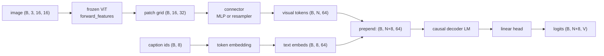
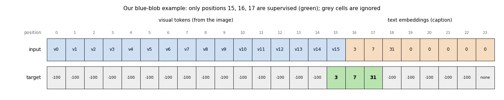

# A8 - Vision-language model (LLaVA-style)

A vision-language model (VLM) is a language model that can read an image. Given a photo and a
question such as "what color is the ball?", it writes the answer as text. The design studied here,
LLaVA, connects a frozen image encoder to a language model. The vision transformer (ViT) produces
one feature vector per image patch; a small trained network, the connector, maps those vectors into
the language model's embedding space; the resulting visual tokens are placed in front of the text
embeddings of the caption; and a decoder-only language model runs over the combined sequence and
predicts the caption one token at a time. The image conditions every text prediction because the
visual tokens sit in the model's context, where attention can read them.

Build the LLaVA-style bridge on a toy of 16x16 images paired with three-token captions. Implement
the MLP projector, a single-layer Perceiver-style resampler as the contrasting connector, the
prepend operation, and the masked next-token loss. The frozen ViT, the token embedding, the
decoder-only language model, the output head, the two-stage freeze logic, greedy generation, and the
AnyRes shape exercise are provided. Everything runs on CPU in seconds.

Required reading before starting:
- Liu et al. 2023, "Visual Instruction Tuning" (LLaVA),
  [arXiv:2304.08485](https://arxiv.org/abs/2304.08485).
- Liu et al. 2023, "Improved Baselines with Visual Instruction Tuning" (LLaVA-1.5),
  [arXiv:2310.03744](https://arxiv.org/abs/2310.03744). The 2-layer MLP projector and its ablation.

## Lecture notes

### What a VLM is for

#### The task

At full scale the task is visual question answering (VQA): the model receives an image and a
natural-language question about it, and has to produce the answer as text. Image captioning, where
the model describes the image with no question, is the same task with an empty question. Both
appear inside larger systems: a chat assistant that reads screenshots, a robot that is told "pick
up the red cup" and has to find it in its camera image.

This assignment uses a captioning toy small enough to train on a CPU. Each image is 16x16 pixels
with three color channels and shows one Gaussian blob on a black background. Its caption is three
tokens followed by padding: a class token that names the blob's kind (its color and its width), an
attribute token that names which corner it sits in, and an end-of-sequence (EOS) token. The figure
shows all 16 combinations of four classes and four corners, each titled with the first three tokens
of its caption.

![All 16 images of the toy captioning data, a red, green, blue, or wide red blob in one of four corners, each titled with its caption tokens [class, attribute, EOS]](assets/toy_task.png)

A model solves the toy if, shown an image it has trained on, it writes the right caption, for
example $[3, 7, 31]$ for the blue blob in the bottom-left corner. The model can only do that by
reading the image: nothing in the text says which blob is in the picture.

#### Why the obvious approaches fail

A language model's input is a sequence of token ids from a fixed vocabulary, and an image has no
token ids. Three direct ways around that each lose something.

One is to train a single model on images and text from scratch. That discards two things that
already exist and were expensive to make: an image encoder trained on a very large image
collection, and a language model trained on a far larger text corpus. Retraining both jointly
needs data on a similar scale.

Another is to turn the image into words first, for example by running a separate captioner and
pasting its output into the language model's prompt. The language model then sees only what the
captioner chose to say, and a question the caption does not answer ("is the cup to the left of the
plate?") cannot be answered.

A third is to summarize the image as one vector, such as the pooled embedding of a contrastive
image-text model, and hand that to the language model. One vector for the whole image keeps what
the image is about and discards most of where things are.

#### The idea

LLaVA keeps a pretrained image encoder and a pretrained language model, both frozen at first, and
trains only a small connector between them. The encoder turns the image into a grid of patch
features, one vector per patch. The connector maps each patch feature to a vector of the size the
language model's embedding table produces. Those vectors, the visual tokens, are placed before the
text in the language model's input, and the language model reads them as it reads any other
context. Nothing inside the transformer changes. The image patches become ordinary positions in
the context window, so the text can attend to any patch, and spatial detail is kept.

In the toy, the blue blob's image becomes 16 visual tokens, one per 4x4-pixel patch. The caption
$[3, 7, 31]$ follows them, and the model is trained to predict the 3 from the visual tokens alone,
then the 7, then the 31.

#### Why it matters

The connector is small, so the stage that trains only the connector is cheap, and the whole
recipe is modest by the standards of the models it reuses: LLaVA-1.5's final 13B-parameter
checkpoint finished full training, including the stage that also trains the language model, on
1.2M publicly available examples in about one day on a single node of eight A100 GPUs (Liu et al.
2023, LLaVA-1.5). The same encoder-connector-decoder design, with variations in the
connector, is used by the Qwen-VL and InternVL model lines discussed below, and the
vision-language-action capstone of this course reuses it to drive a robot.

### Our blue-blob example (one toy image and its caption)

The notes come back to one image from the toy data: the blue blob in the bottom-left corner,
caption $[3, 7, 31, 0, 0, 0, 0, 0]$. We call it our blue-blob example. It is the second image of the
four-image batch that the assignment trains on. Its class token is 3 (blue, the third of the four blob widths), its
attribute token is 7 (bottom-left), 31 is EOS, and the five zeros are padding.

Our blue-blob example stands for one (image, question, answer) training example of a real VLM. It
keeps the parts these notes are about: the image becoming a fixed number of visual tokens, those
tokens placed before the text, and a loss that scores only the answer. It drops the question (the
toy caption has no question prefix), the language prior of a pretrained language model (the toy
language model starts from random weights), and high resolution (the toy image is 16 patches; a
real one is hundreds to thousands).

### Overview of the rest of the notes

1. What the decoder reads. The token embedding is a lookup that multiplies a one-hot vector by a
   $V \times d$ matrix, and the decoder sees only the resulting $d$-vector. Any other source of
   $d$-vectors can be spliced in. The condition is that the new vectors look like the ones the
   decoder was trained on, the same way a new sensor's measurements have to be put into the
   coordinates and units an existing filter expects.
2. The visual-token interface. How the patch features become visual tokens (the MLP projector) and
   where they go (before the text).
3. Connector families. One token per patch, a fixed number of tokens through learned-query
   cross-attention, or no separate encoder at all. The learned-query version is a kernel-weighted
   average of the patch features, with weights computed from the content.
4. Where the visual tokens enter and how positions are communicated. In the sequence or in the
   depth of the network; one-dimensional rotary positions or separate row and column positions.
5. Captions, teacher forcing, and the loss shift. Training a decoder is training a one-step-ahead
   predictor on true past outputs, as in system identification; the loss must score only the
   caption.
6. The two-stage freeze curriculum, the grounding probe that checks the image is actually used, and
   AnyRes tiling for higher-resolution images.

Our blue-blob example makes the shapes and the loss concrete. Five exercises, placed after the
sections they test, are meant to be worked by hand. Each has a worked answer that can be expanded.

### What the decoder reads

Prepending an image to a text sequence is a legal operation because of how the decoder consumes
its input.

The character language model built earlier in the course has a fixed pipeline: token ids, an
embedding table, a stack of causal transformer blocks, a linear head, logits over the vocabulary.
The embedding table is an ordinary $V \times d$ matrix, where $V$ is the vocabulary size and $d$ the
model dimension, together with a lookup rule: token id $t$ selects row $t$. That lookup is the only
place in the whole model where a token id appears. Everything downstream is arithmetic on
$d$-dimensional real vectors. Attention forms queries, keys, and values as linear maps of those
vectors; the feed-forward network mixes their channels; the head maps the final vectors back to $V$
logits.

The decoder's real input is therefore a sequence of $d$-vectors, a tensor of shape $(B, S, d)$,
rather than a sequence of ids. The embedding table is one supplier of such vectors. Any other
supplier of $d$-vectors can be spliced into the same sequence, and the decoder's forward pass cannot
tell the difference: no shape changes, no code changes, no new parameters inside the decoder. A VLM
uses exactly this. The image path has to end in a tensor of shape $(B, N, d)$; once it does, the
image is more context and nothing else.

Two conditions come attached. The first is simple: the dimension has to be $d$ exactly. The second
is the substance of the assignment. The decoder's weights were fitted to the statistics of
embedding-table rows: vectors of a particular typical size whose variation lies in particular
directions. Vectors whose variation lies in directions the table never populates are attenuated
toward nothing by downstream weights that were never trained to respond to those directions.

Size matters in a less direct way. In a decoder that fed its input straight into attention, input
vectors ten times larger would make both the queries and the keys ten times larger, the attention
logits would grow a hundredfold, and the softmax would saturate into a near-one-hot distribution. The decoder here, like the LLaMA-family language
models LLaVA builds on, is pre-norm: each block applies RMSNorm, which divides a vector by its
root-mean-square value, before attention and before the feed-forward network, and adds the result
back to the unnormalized vector. The overall scale of an input vector therefore never reaches the
first attention layer. It does decide how much each block can change that position. The update a
block adds is computed from the normalized vector, so it is the same whether the token is scaled
up or not; a visual token scaled up tenfold is therefore changed ten times less relative to its own
size than the unscaled token would be, and passes through the network nearly as it entered. A token
scaled down is changed relatively more, and the blocks' updates dominate it.

Aligning visual features with the word embedding space, in the LLaVA papers' phrase, means that the
connector must learn a map whose outputs sit at a scale and in directions the frozen decoder already
reads. Alignment here concerns the distribution of the vectors, their size and the directions they
vary in; it says nothing about meaning.

### The visual-token interface



The frozen ViT runs its feature path, which stops before the pooling and the classification head
and returns the per-patch grid. Frozen means its parameters are excluded from training: no gradient
is computed for them and the optimizer never updates them, so the encoder is a fixed feature
extractor. For a 16x16 image at patch size 4, the grid is 4x4, so 16 patches, each a 32-dimensional
patch feature, giving $(B, 16, 32)$. The ViT's CLS token at index 0 and any register tokens
(extra learned tokens some ViTs append to hold global information that does not belong to one
patch) are dropped, since the language model wants one vector per image region rather than a
pooled summary (this configuration uses no register tokens, so only the ViT's CLS token is actually
discarded). These patch
features live in the ViT's feature space, not the language model's embedding space, and the
language model has never seen them.

The connector maps each patch feature from the ViT's 32 dimensions to the language model's 64, so a
visual token and a text embedding are interchangeable as far as the transformer is concerned.
LLaVA's original connector, which the paper calls a projector, was a single linear layer; LLaVA-1.5
replaced it with a 2-layer MLP, $\text{Linear} \to \text{GELU} \to \text{Linear}$, and a controlled
ablation in that paper showed the MLP improves the alignment over the single linear layer. These
notes call this connector the MLP projector.

Without the nonlinearity in the middle there is no second layer. Two linear maps composed are a
single linear map, $W_2(W_1 x + b_1) + b_2 = (W_2 W_1) x + (W_2 b_1 + b_2)$, so a
$\text{Linear} \to \text{Linear}$ projector would be the original LLaVA linear projector with a more
expensive parameterization and no extra expressiveness. GELU is $x\,\Phi(x)$, where $\Phi$ is the
standard normal cumulative distribution function: a smooth version of ReLU that passes large
positive inputs through, suppresses large negative ones, and has a nonzero gradient everywhere in
between. It is the activation the ViT already uses in its own feed-forward blocks.

The MLP projector is applied per patch and does not mix patches, so it produces exactly one visual
token per patch. The prepend operation then concatenates the visual tokens before the text
embeddings along the sequence axis, visual first. The combined sequence is
$[\text{visual}_0, \dots, \text{visual}_{N-1}, \text{text}_0, \dots, \text{text}_{L-1}]$, and a
single causal mask of length $N+L$ runs over all of it. The text positions can attend back to every
visual position, so each predicted caption token sees the whole image. In our blue-blob example,
the 16 visual tokens and 8 caption positions give a length-24 sequence of 64-dimensional vectors,
$(B, 24, 64)$, of which only the last 8 rows came from the embedding table.

The interface has three degrees of freedom: how many tokens enter, where they are injected, and how
positions are communicated. The rest of the lecture notes vary these one at a time.

> **Exercise 1 (why the GELU is there).** Take a one-dimensional projector with $W_1 = 2$,
> $b_1 = -1$, $W_2 = 3$, $b_2 = 0.5$. Without the GELU, write the single linear map it equals and
> evaluate it at $x = 0, 0.5, 1$. With the GELU between the layers, evaluate
> $3\,\text{GELU}(2x - 1) + 0.5$ at the same points, using $\Phi(1) \approx 0.8413$. Is the output
> at $x = 0.5$ the average of the outputs at $0$ and $1$ in each case?

<details>
<summary>Answer</summary>

Without the GELU the map is $3(2x - 1) + 0.5 = 6x - 2.5$, giving $-2.5$, $0.5$, $3.5$. The middle
value is the average of the outer two, as it must be for any affine map.

With the GELU, $2x - 1$ takes the values $-1$, $0$, $1$. $\text{GELU}(1) = 1 \cdot \Phi(1) \approx
0.8413$, $\text{GELU}(0) = 0$, and $\text{GELU}(-1) = -\Phi(-1) = -(1 - 0.8413) \approx -0.1587$.
The outputs are $3(-0.1587) + 0.5 \approx 0.024$, $0.5$, and $3(0.8413) + 0.5 \approx 3.024$. The
average of the outer two is $1.524$, not $0.5$: the map bends. Negative pre-activations are
squashed toward zero and positive ones pass, so the projector can treat different regions of the
patch-feature space differently, which no single matrix can.

</details>

### Connector families

The MLP projector is one of three families of connector, the module that turns patch features into
tokens the language model reads. They differ in how the patch count maps to the token count, which
sets the context cost of an image.

#### One token per patch

The MLP-projector family keeps one token per patch, or per merged group of patches, and lets all of
them enter the context. LLaVA and LLaVA-1.5 are the canonical examples; Qwen2.5-VL (Bai et al. 2025,
[arXiv:2502.13923](https://arxiv.org/abs/2502.13923)) uses an MLP patch-merger that concatenates a
small block of neighboring patches before the projection, which cuts the token count by the block
size while staying in this family. The token count scales with image resolution, so a
higher-resolution image costs more context. The MLP projector of this assignment belongs to this
family.

#### Learned queries and cross-attention as pooling

The resampler family compresses a variable number of patches to a fixed number of output tokens.
The mechanism is cross-attention with learned queries, derived below from attention itself.

Attention takes three matrices, queries, keys, and values. It scores every query row against every
key row, softmaxes each query's scores across the keys, and returns the score-weighted sum of the
value rows. In self-attention all three are linear maps of one sequence. In cross-attention the
queries come from one sequence and the keys and values from another, the configuration a translation
decoder uses to read the encoder's output. The shapes say something useful: queries are $(S_q, d)$,
keys and values are $(S_k, d)$, and the output is $(S_q, d)$. The output length follows the query
count and does not depend on the key count. Attention can therefore change the length of a
sequence, and cross-attention makes the two lengths independent.

A resampler uses that by making the queries free parameters. Instead of computing them from a
sequence, it stores a $(Q, d)$ tensor of weights, identical for every image, trained by
backpropagation like any other parameter. For one learned query $q$ and patch values $v_j$ with
keys $k_j$ (the queries, keys, and values each pass through their own linear map first, as in any
attention layer),

$$\text{out}(q) = \sum_{j=0}^{N-1} \frac{\exp(q \cdot k_j / \sqrt{d_h})}{\sum_{j'} \exp(q \cdot k_{j'} / \sqrt{d_h})}\, v_j,$$

with $d_h$ the per-head dimension the dot products are scaled by. That is a weighted average of the
$N$ patch vectors, with weights that depend on the image content, which is pooling. It is the same
form as kernel regression (a Nadaraya-Watson estimator) with an exponential kernel on the dot
product. The ViT's mean pooling is the same sum with every weight fixed at $1/N$; a learned query
replaces the fixed $1/N$ with a content-dependent distribution, and $Q$ different queries pool the
same patches $Q$ different ways. The output is $Q$ tokens for any $N$.

The resampler built here is a single-layer miniature of this family:

$$\text{out} = \text{LayerNorm}\big(\text{queries} + \text{Attn}(\text{queries},\ kv=\text{feats}_{\text{proj}})\big).$$

One cross-attention, one residual, one norm. A linear layer first maps the ViT's 32-dimensional
patch features to the language model's 64 dimensions, written $\text{feats}_{\text{proj}}$, so the
queries and the patch features live in the same space. The queries are initialized from a
truncated normal with standard deviation 0.02 and the residual adds them back, so each output token
starts near its own query vector and the attention output moves it from there.

The cross-attention here carries no position information of its own, so it is invariant to
permutations of the patch axis: shuffling the patch features leaves the output unchanged. Patch
location still reaches the output, because the ViT added a learned absolute positional embedding to
its patch tokens before its encoder ran, so position is already part of the features being pooled.

A real Perceiver Resampler or Q-Former stacks several blocks, and each block adds query
self-attention, letting the queries see each other so they can specialize instead of all converging
on the same pooled summary, plus a feed-forward network. BLIP-2's Q-Former (Li et al. 2023,
[arXiv:2301.12597](https://arxiv.org/abs/2301.12597)) is such a stack, pretrained against
image-text objectives before being used as the connector; Flamingo's Perceiver Resampler
(Alayrac et al. 2022, [arXiv:2204.14198](https://arxiv.org/abs/2204.14198)) is the other canonical
example, and the original Qwen-VL (Bai et al. 2023,
[arXiv:2308.12966](https://arxiv.org/abs/2308.12966)) used a single-layer cross-attention adapter.
The miniature here keeps only the cross-attention pooling, which is the part that sets the output
length.

The fixed token budget makes the context cost independent of image resolution, at the price of
discarding detail when the image has more patches than the budget can carry. Note the version
split: Qwen-VL (2023) is resampler-family, while Qwen2.5-VL (2025) is MLP-patch-merger-family. The
resampler still prepends its $Q$ tokens the same way the MLP projector prepends its patch tokens.

> **Exercise 2 (one learned query pooling three patches).** Take one head with $d_h = 2$, a
> query $q = (1, 1)$, three patches with keys $k_1 = (2, 0)$, $k_2 = (0, 0)$, $k_3 = (-2, 0)$ and
> values $v_1 = (1, 0)$, $v_2 = (0, 1)$, $v_3 = (1, 1)$. Compute the attention weights and the
> output, and compare with mean pooling. Then reorder the patches as $(3, 1, 2)$ and say what
> changes.

<details>
<summary>Answer</summary>

The scores are $q \cdot k_j / \sqrt 2 = (2, 0, -2)/\sqrt 2 \approx (1.414, 0, -1.414)$. Their
exponentials are $4.113$, $1$, $0.243$, which sum to $5.356$, so the weights are
$(0.768, 0.187, 0.045)$. The output is
$0.768\,(1, 0) + 0.187\,(0, 1) + 0.045\,(1, 1) \approx (0.813, 0.232)$. Mean pooling gives
$(2/3, 2/3) \approx (0.667, 0.667)$.

Most of the weight goes to patch 1, whose key points the same way as the query; a different
image with different keys would get different weights from the same query. Reordering the patches
reorders the scores, the weights, and the values together, so the weighted sum is the same
$(0.813, 0.232)$. The pooling ignores order, which is why the position has to be inside the patch
features already. Adding a fourth patch would add one more term to the sum and still give one
output vector.

</details>

#### Early fusion

The third family drops the separate pretrained encoder. Fuyu applies one linear map to raw image
patches inside the decoder itself, with no separately trained vision backbone in front of it.
Chameleon (Team 2024, [arXiv:2405.09818](https://arxiv.org/abs/2405.09818)) goes further and turns
the image into discrete tokens with a vector-quantized image tokenizer, the encoder-codebook-decoder
scheme built earlier in the course, so an image becomes a string of codebook indices that extend the
text vocabulary and a single transformer is trained over the merged token stream. Llama 4 is also
early-fusion, though with continuous tokens from a MetaCLIP-based encoder joined to the text stream
from the first layer rather than quantized ones.

Neither design has a connector bridging two separately pretrained representation spaces, because
there is only one model being trained. This assignment does not implement early fusion. It is the
reference point for what the encoder-plus-connector design gains (a frozen, separately trained
vision backbone that never has to be retrained) and what it costs (two representation spaces the
connector has to reconcile).

### Where the visual tokens enter

Prepending is one of two injection points. LLaVA prepends the visual tokens into the context and
changes nothing else about the language model, which is the approach here.

Flamingo instead leaves the text sequence alone and inserts new cross-attention layers between the
language model's existing layers. Each inserted layer attends from the text hidden states to the
resampled visual tokens and adds the result back:

$$x \leftarrow x + \tanh(\gamma)\,\text{CrossAttn}(x,\ kv = \text{visual}),$$

with $\gamma$ a learned scalar initialized to zero. Since $\tanh(0) = 0$, the inserted layer is the
identity map at initialization, so the pretrained language model produces exactly the outputs it
produced before the layers were inserted, and training starts from an undamaged model; as $\gamma$
moves away from zero the visual pathway opens gradually. The two injection points differ in where
the image goes: LLaVA puts visual tokens in the sequence, Flamingo puts a cross-attention pathway in
the depth of the network.

The resampler variant here does not change the injection point. It changes how many visual tokens
there are and how they are pooled (from $N$ patches to $Q$ queries), then prepends the $Q$ tokens
exactly as the MLP projector prepends its patch tokens. A resampler is a different thing from
Flamingo's gated cross-attention injection, even though both use cross-attention somewhere; the
resampler's cross-attention is in the connector that builds the tokens, not in the language model
that consumes them.

### How positions are communicated

The decoder-only language model here uses rotary position embedding (RoPE), the scheme built with
the transformer earlier in the course. RoPE takes each pair of channels of a query or key vector as
a point in a plane and rotates it by an angle proportional to the token's index, with a different
rotation rate per channel pair. Rotating both $q_i$ and $k_j$ this way makes their dot product a
function of the offset $i - j$ alone. Position is never added to the token vector; it is applied
inside attention, to the queries and keys only.

For a VLM this has a small but concrete consequence: the visual tokens need no position information
of their own, and none is added. They get indices $0, \dots, N-1$ and the text follows at
$N, \dots, N+L-1$, purely from their order in the combined sequence. Generation starts from an empty
text side and prepends the same visual tokens, so the visual tokens occupy the same indices at
training and at inference and the rotations applied to them agree.

What a 1D index costs depends on whether the grid shape is fixed. With this toy's constant 4x4
row-major grid, patch index $i$ determines row $\lfloor i/4 \rfloor$ and column $i \bmod 4$
exactly, so a 1D index loses no spatial information and the model can learn the layout from the
index alone. The recovery fails once the grid shape varies per image, as it does in
native-resolution VLMs that feed each image at its own aspect ratio: index 37 sits in a different
row depending on how wide that particular image's patch grid was, so the same index means different
geometry from sample to sample.

Qwen2-VL and Qwen2.5-VL handle that with multimodal RoPE (M-RoPE), which splits the rotary channel
pairs into three groups and drives each group with a different index: a temporal index, a row index,
and a column index. Text tokens set all three to the sequence position, which reduces to ordinary
RoPE; an image patch sets the temporal index to a constant and the other two to its actual row and
column, so the grid geometry reaches attention regardless of how the patches were flattened. Some
other systems instead add explicit patch-position IDs. Plain sequence-order positions carry the 2D
layout only under a fixed grid, which is the situation here.

> **Exercise 3 (what a 1D offset means on a grid).** Patches are flattened row-major, so in a grid
> of width $W$ index $i$ sits at row $\lfloor i/W \rfloor$, column $i \bmod W$. Find the row and
> column of patches 5 and 9 when $W = 4$ (this toy) and when $W = 6$ (a wider image). RoPE sees
> only the offset $9 - 5 = 4$ between them. What spatial relation does that offset stand for in
> each case?

<details>
<summary>Answer</summary>

With $W = 4$: patch 5 is at $(1, 1)$ and patch 9 at $(2, 1)$, so offset 4 means "directly below,
one row down". With $W = 6$: patch 5 is at $(0, 5)$ and patch 9 at $(1, 3)$, one row down and two
columns to the left. The same offset, and therefore the same rotation, describes two different
spatial relations. With a fixed grid the model can learn what each offset means; with a varying
grid it cannot, and M-RoPE gives attention the row and column directly.

</details>

### Captions, teacher forcing, and the loss shift

The training task is image captioning: predict the caption tokens from the image. Captioning is a
stand-in for VQA. A VQA prompt would place a fixed question prefix before the answer tokens, but the
mechanism of conditioning text on prepended visual tokens is identical, and captioning avoids
inventing a question vocabulary.

The caption format is the one used for the contrastive image-text model earlier in the course, from
the same toy generator: token id 0 is the padding token, used to fill every caption out to a fixed
length $L = 8$ so a batch is one rectangular tensor; ids 1 through 4 are class tokens; ids 5
through 8 are attribute tokens; and the largest id, $31$, is the end-of-sequence (EOS) token, the
marker that closes a caption. A caption is $[\text{class}, \text{attribute}, \text{EOS}, \text{pad},
\dots]$, for instance $[2, 7, 31, 0, 0, 0, 0, 0]$, or $[3, 7, 31, 0, 0, 0, 0, 0]$ for our blue-blob
example. Padding is a shape convenience with no content, so it must not be supervised.

Training a causal decoder scores every position of a sequence in one forward pass: position $i$
attends to positions $\le i$ and predicts token $i+1$, and the causal mask keeps the $L$ predictions
from seeing their own answers. This requires feeding the whole ground-truth sequence as input, so
the prefix the model conditions on at position $i$ is the true tokens $0 \dots i$, never the model's
own earlier predictions. That is teacher forcing: a teacher hands the model a correct prefix at
every step. It gives parallelism, since one forward pass scores all $L$ positions, and stability,
since an early mistake cannot corrupt the rest of the sequence during training. In
system-identification terms it is fitting a one-step-ahead predictor on measured past outputs
rather than on the model's own simulated outputs. It also leaves a mismatch, called exposure bias:
at inference no teacher exists, the model consumes its own outputs, and it has never been trained
on the slightly wrong prefixes it will then see.

Inference here is greedy decoding: at each step take the argmax over the vocabulary logits at the
last position, append that token to the text side, and run again. No sampling and no beam search, so
the output is deterministic given the image.

The loss is next-token cross-entropy supervised only on the text positions. Over the combined
sequence $[\text{visual}_0, \dots, \text{visual}_{N-1}, \text{text}_0, \dots, \text{text}_{L-1}]$,
the supervised targets are the text tokens. The last visual position (index $N-1$) predicts
$\text{text}_0$, the first caption token; $\text{text}_k$ predicts $\text{text}_{k+1}$; pad targets
are ignored. There is no beginning-of-sequence token, the dummy first token some language models
prepend to give the first real token something to be predicted from, and no separator between the
image and the text. The last visual position plays that role instead, and generation also starts
from an empty text side, so training and inference use the same shift.

The label tensor is built to length $N+L$ in three steps. Fill the whole $(B, N+L)$ tensor with the
ignore index $-100$, a sentinel value the cross-entropy drops from the average rather than scoring.
Write the true caption tokens into the text slice. Re-mask the pads within that slice, so padding is
not supervised. Then shift and reduce:

$$\mathcal{L} = \text{cross-entropy}\big(\text{logits}[:, :-1],\ \text{labels}[:, 1:],\ \text{ignore-index} = -100\big).$$

Dropping the last logit column and the first label column is the shift: it lines up the prediction
made at position $i$ with the token at position $i+1$. The visual positions stay at $-100$
throughout, so changing a visual-span logit does not change the loss. Re-masking the pads has to be
done within the text slice and not by indexing the full label tensor with a length-$L$ mask,
because the label tensor has length $N+L$ and the boolean mask would not line up.

The figure lays out our blue-blob example. The top row is what enters each of the 24 positions:
16 visual tokens, then the embeddings of the caption tokens. The bottom row is the target each
position is trained to predict after the shift. Only three positions have a target.



> **Exercise 4 (the label row by hand).** For our blue-blob example ($N = 16$, caption
> $[3, 7, 31, 0, 0, 0, 0, 0]$), list the positions of the combined sequence whose prediction is
> scored, and the target of each. How many terms enter the average for a batch of four such
> captions? How many would enter per caption if the pads were not re-masked, and what would the
> model learn from the extra ones? Where do the scored positions move with the resampler and
> $Q = 8$?

<details>
<summary>Answer</summary>

The labels are $-100$ at positions 0 to 15, then $3, 7, 31$ at positions 16, 17, 18, then $-100$
at 19 to 23. After the shift, position $i$ is scored against label $i + 1$, so position 15 (the
last visual token) predicts 3, position 16 (input 3) predicts 7, and position 17 (input 7)
predicts 31. Three terms per caption, twelve for a batch of four, and the loss is their mean.

Without re-masking, positions 18 to 22 would also be scored, each against the pad id 0: eight terms
per caption, five of them pads. The model would spend most of its loss learning that pad follows
EOS and pad follows pad, which it can do without looking at the image, and the average would make
the image-dependent terms look smaller than they are.

With $Q = 8$ visual tokens the text starts at position 8, so positions 7, 8, 9 are scored, with the
same targets 3, 7, 31. The first caption token is still predicted from the last visual position.

</details>

### The two-stage freeze curriculum

LLaVA trains in two stages. Stage 1 freezes the language model and trains only the connector, to
put the visual features at a scale and in directions the frozen language model can read. Stage 2
unfreezes the language model and trains it together with the connector on instruction data.

Instruction tuning is supervised fine-tuning on pairs of an instruction and the response it should
produce, which turns a model that continues text into one that answers what it was asked. Visual
instruction tuning is the same thing with an image in the prompt, and LLaVA's contribution was
building that data at scale by handing a language-only model the captions and object boxes of
existing images and asking it to write question-answer pairs about them.

Freezing works through a per-parameter flag that decides whether a gradient is computed for that
tensor. Parameters with the flag off get no gradient and are left out of the optimizer, so they
hold their values exactly; this is block-coordinate optimization, in which some blocks of variables
are held fixed while the rest are optimized.

One real-LLaVA detail differs at course scale. Real LLaVA freezes the language model's token
embedding and output head along with the rest of the language model in stage 1, and moves only the
connector. That works because a pretrained embedding table is a fixed target: its rows already sit
in an arrangement where related words are near each other, so "map visual features into the
embedding space" names a definite destination. Here the language model is randomly initialized, as
the course has no large text corpus to pretrain it on, so the embedding rows are random draws from a
normal distribution and carry no arrangement at all. A connector trained to hit that target would be
fitting noise. Letting the embedding and the head train in stage 1 lets the vocabulary acquire an
arrangement at the same time the connector learns to map into it; the decoder stays frozen, so
stage 1 here is a random decoder being driven by a connector and a head that learn together. The
lesson is the visual-token interface and the freeze-curriculum mechanics, not the use of a language
prior the course does not have.

### Grounding

A model is grounded when its text actually depends on the image. The grounding question is whether
the visual path carries the caption, or whether the language model has learned to emit plausible
captions while ignoring the image. The probe is an ablation: compare the caption loss with the true
visual tokens against the loss with the visual tokens set to zero. A model that ignored the image
would do equally well both ways; a grounded model does much worse when the visual tokens are
removed. It is the same test as unplugging one sensor from a fusion filter and checking whether the
estimate degrades.

The probe has a gap to close. In an autoregressive caption, a later token can be predicted from an
earlier text token rather than from the image: if every image whose class token is 2 also has
attribute token 7, then the attribute is readable off the class alone and zeroing the image costs
nothing at that position. The evaluation batch therefore has to contain at least two rows that
share a class but differ in attribute, so the attribute position needs the image to disambiguate.
Our blue-blob example and the top-right blue blob, captions $[3, 7, 31]$ and $[3, 6, 31]$, are such
a pair. The first caption token has no such escape at all, because it is predicted from the last
visual position with no text to its left, so its full-versus-ablated gap measures grounding with
no text shortcut available.

> **Exercise 5 (the best a model can do without the image).** Our four-image batch has captions
> $[4, 5, 31]$, $[3, 7, 31]$, $[3, 6, 31]$, $[2, 7, 31]$ (pads omitted). A model that never looks at
> the image can still learn how often each token occurs. What is the lowest mean caption loss
> (natural-log cross-entropy over the twelve scored terms) such a model can reach on this batch,
> position by position? How does that compare with a uniform guess over the four classes?

<details>
<summary>Answer</summary>

For the class position the best image-blind prediction is the batch frequency: token 3 with
probability $1/2$, tokens 4 and 2 with $1/4$ each. The losses are $\ln 4 \approx 1.386$ for the two
rows with tokens 4 and 2 and $\ln 2 \approx 0.693$ for the two rows with token 3, mean $1.040$.
That is lower than the $\ln 4 \approx 1.386$ of a uniform guess, because class 3 is twice as common
in this batch.

For the attribute position the model sees the true class token (teacher forcing). After class 4 or
class 2 the attribute is certain (loss 0); after class 3 it is 7 or 6 with probability $1/2$ each,
loss $\ln 2$ for those two rows. Mean $0.347$. EOS always follows the attribute, loss 0.

Over the twelve terms the floor is $(4 \times 1.040 + 4 \times 0.347 + 0)/12 \approx 0.462$. An
image-blind model can get the loss this low, so a probe result has to be read against it: a loss
far above it after the visual tokens are zeroed means the trained model depends on the image, and a
loss near it would mean the model mostly ignores the image. The probe zeroes the tokens of a model
trained with the image, so its ablated loss can exceed this floor (the zero vectors are inputs the
model never saw), and the per-position numbers say which tokens depend on the image.

</details>

### AnyRes tiling

A fixed-resolution ViT processes one image size. To read a higher-resolution image, LLaVA-NeXT's
AnyRes splits it into a grid of sub-crops, encodes each crop through the same ViT, and concatenates
the per-crop patch grids, plus a low-resolution overview of the whole image so the model sees both
global layout and local detail. The token count is $\text{grid}^2 \times \text{patches-per-crop}$,
plus the overview's patches-per-crop when an overview is included. For the LLaVA-NeXT 336px example
at patch 14, one crop is $(336/14)^2 = 576$ tokens, a 2x2 grid is 4 crops (2304 tokens), and the
336px overview adds another 576 tokens for a total of 2880. The overview is a full image at 576
tokens, not a single token.

The cost of AnyRes is that the visual token count grows with the crop count, and attention cost
grows with the square of the sequence length, so token compression became a research direction of
its own. The two methods below reduce the token count by rearranging patches rather than dropping
them.

Pixel shuffle rearranges a patch grid instead of discarding any of it. Given an $H \times W$ grid of
$C$-dimensional patch features, take each $2 \times 2$ block of neighboring patches and stack its
four feature vectors into one $4C$-dimensional vector, producing an $(H/2) \times (W/2)$ grid. The
token count drops by four and nothing is thrown away at the rearrangement itself; the connector that
follows takes $4C$ inputs instead of $C$ and decides what to keep. The operation is borrowed from
sub-pixel convolution in image super-resolution (Shi et al. 2016), where the same reshape runs in
the opposite direction to turn channels into resolution. The InternVL line uses it to cut visual
tokens (Chen et al. 2024, [arXiv:2404.16821](https://arxiv.org/abs/2404.16821)). With pixel
shuffle, the 2880 tokens of the 2x2 AnyRes example become 720.

Qwen2.5-VL's patch-merger is the same idea reached from the other side: concatenate the feature
vectors of a neighboring block of patches along the channel axis and run the merged vector through
the projection MLP, so one output token covers a block of patches. Both trade spatial token
resolution for channel width and rely on the connector to compress what the extra channels carry.

### Where this leads

The vision-language-action capstone is a VLM policy. The action the robot takes is encoded as a
token, appended to the sequence, and predicted autoregressively exactly like a caption token. The
visual-token interface built here (frozen encoder into connector into prepended tokens into a causal
decoder) is reused without change; only the output vocabulary changes from words to actions.

Real VLMs follow two trends the course does not. The first is the backbone. SigLIP (Zhai et al.
2023, [arXiv:2303.15343](https://arxiv.org/abs/2303.15343)) replaced CLIP as the default vision
encoder in many 2024-era VLMs. The change is in the loss: the contrastive objective built earlier in
the course softmaxes each image's similarities over all texts in the batch, so every score is
normalized against every other pair and the batch has to be gathered in one place. SigLIP scores
each image-text pair on its own with a binary logistic loss, positive for matched pairs and negative
for the rest, which removes the batch-wide normalization and makes very large batches cheaper to
run.

The second is that from 2024 onward many systems unfreeze the ViT and train it with the language
model rather than keeping it frozen; Cambrian-1 (Tong et al. 2024,
[arXiv:2406.16860](https://arxiv.org/abs/2406.16860)) studies how the vision side affects the
result. This assignment keeps the ViT frozen, the simpler LLaVA recipe.

## The assignment

Fill these holes, in order. Each is one `NotImplementedError` with a matching test; the docstring
in each file gives the signature, shapes, and constraints.

| # | Function | File | Concept from the notes |
|---|---|---|---|
| 1 | [`MLPProjector.forward()`](projector.py) | `projector.py` | the MLP projector, $\text{Linear} \to \text{GELU} \to \text{Linear}$ per patch |
| 2 | [`PerceiverResampler.forward()`](resampler.py) | `resampler.py` | the single-layer resampler, learned queries pooling the patch features |
| 3 | [`prepend_visual()`](vlm.py) | `vlm.py` | the prepend operation, visual tokens before text embeddings |
| 4 | [`vlm_loss()`](vlm.py) | `vlm.py` | the label tensor, the shift, and the text-only loss |

Notes on specific holes and the provided code:
- The ViT is the one built in the ViT assignment, constructed with fresh random weights and frozen
  with `requires_grad_(False)`; nothing loads pretrained weights. `ViT.forward_features` returns the
  per-patch grid $(B, 16, 32)$ with the class token already removed (`n_registers = 0`). Random
  frozen features are enough for the toy, whose classes and corners differ in color, width, and
  position.
- The resampler is a single layer so that the gradient check in the tests has a single
  unambiguous target.
- `PerceiverResampler` already builds `self.queries` (shape $(1, Q, d)$), `self.in_proj`,
  `self.attn` (the course's `MultiHeadAttention`, which takes the keys and values through its
  `kv=` argument), and `self.norm`. Expand the queries to the batch before the attention.
- `vlm_loss` uses `F.cross_entropy` with `ignore_index=-100`. Write the pads back to $-100$ through
  the text slice, `labels[:, N:N+L][token_ids == 0] = -100`, not by indexing the length-$(N+L)$
  tensor with the length-$L$ mask.
- `VLM.set_stage` implements the two-stage curriculum by setting `requires_grad` on the ViT, the
  connector, the embedding, the head, the final norm, and the decoder. Stage 1 trains the
  connector, the token embedding, the output head, and the final norm with the ViT and the decoder
  frozen; stage 2 also unfreezes the decoder; the ViT stays frozen throughout. Unlike real LLaVA,
  the embedding and head train in stage 1, for the reason given in the notes. `VLM.generate` is the greedy
  decoder; it starts from an empty text side, as the loss shift assumes.
- `anyres.py` (`anyres_token_count`, `tile_image`) is provided and tested.

### Running and validating

Activate the environment (`conda activate nanovision`), then:

```
make test     A=a08_vlm   # run the tests against the top-level files (the ones with holes)
make verify   A=a08_vlm   # run the same tests against the reference solution/
make viz      A=a08_vlm   # render the figures from the reference solution
make viz-mine A=a08_vlm   # render the figures from your own code (once the holes are filled)
```

`make test` is the command to run while working. It runs the suite in
`assignments/a08_vlm/tests/` against the top-level files and goes from red (the holes raise
`NotImplementedError`) to green as they are filled. `make verify` runs the identical suite against
the reference in `solution/` by setting `NANOVISION_IMPL=solution`, so it is green from the start and
shows the target. The goal is to bring `make test` to the same green as `make verify`.

The tests check:
- `test_shapes.py`: output shapes of the projector, the resampler, and the full forward pass
  ($N = 16$, logits $(B, 24, 32)$).
- `test_gradcheck.py`: a float64 gradient check of both connectors (`torch.autograd.gradcheck`,
  which compares the analytic backward pass against finite differences of the forward pass and
  needs double precision for that comparison to mean anything).
- `test_resampler_token_count.py`: the resampler returns $Q$ tokens for both 16 and 9 input patches.
- `test_prepend.py`: the visual tokens come first; `vlm_loss` matches a hand-computed cross-entropy
  over the text targets alone, and is unchanged when the visual-span logits are perturbed (the
  visual positions are never supervised).
- `test_anyres.py`: the AnyRes token count (2880 and 2304 for the 336px case) and the crop order of
  `tile_image`.
- `test_stages.py`: the two-stage `requires_grad` toggling, and that a stage-1 optimizer step moves
  the projector and not the decoder.
- `test_overfit_caption.py`: a short caption overfit (300 steps) reaches a loss below 0.05, and
  greedy generation reproduces each caption's class, attribute, and EOS tokens exactly.
- `test_grounding_ablation.py`: the grounding ablation. It pins a batch with at least two rows that
  share a class but differ in attribute, trains 300 steps, and requires the zeroed-visual loss to be
  more than ten times the full loss, both overall and at the class position.
- `test_forbidden_imports.py`: no `transformers`, `timm`, or bare `vit`/`transformer`/`attention`
  module is imported.

`make viz` renders from the reference solution, so it works on a fresh checkout before any holes are
filled. `make viz-mine` runs the same script against the top-level code, which needs the holes filled
(it trains a model with them). Both write PNGs to `out/` using matplotlib's headless Agg backend, so
they work over SSH, in WSL, and in CI with no display, and the figures open inline in VSCode. Add
`SHOW=1` (for example `make viz-mine A=a08_vlm SHOW=1`) to also open interactive windows when a
display is available. The figures are `captions.png` (generated captions beside their images) and
`grounding_ablation.png` (the caption loss with and without the visual tokens, and with the
projector re-initialized to random weights).

The figures in the notes are generated by `assets/make_figures.py` from the toy data generator
alone; neither uses the assignment code.

What you should see when you run this. The toy caption for an image is
$[\text{class}, \text{attribute}, \text{EOS}, \text{pad}, \dots]$, where the class token is set by
the blob's color channel and width (classes 1 and 4 are both red and differ only in width, because
four classes share three channels) and the attribute token by the blob's position, all functions of
the image (`nanovision.data.toy.image_text_batch`). A model that ignored the visual tokens could not
predict either, so the grounding ablation is a valid probe. On the toy MLP connector at 300 steps
(seed 0, stage 2 only) the caption loss reaches about $7\times10^{-4}$, slightly below the
single-layer resampler's $1.1\times10^{-3}$, the same direction as the LLaVA-1.5 finding that the
MLP projector is a strong baseline. The gap is small and the ordering does not hold on every seed. The two stages are reported separately (seed 0, 300 steps each): stage 1 reaches a caption
loss around 0.002 and stage 2 about $1\times10^{-5}$. Stage 1 already fits well here because the
trainable embedding and head give the random decoder enough capacity on four examples; do not read
the stage-1 number as evidence that projector-only training produces good captions in general. In the grounding
test (seed 0, 300 steps of stage 2 only), the full-model caption loss is about $7\times10^{-4}$
and the visual-tokens-zeroed loss about $1.8$, a ratio near 2500. The `grounding_ablation.png`
figure from `make viz` trains stage 1 then stage 2 and shows a full loss near 0, a zeroed loss of
about 1.29, and, with the projector re-initialized to random weights, a similar jump to about 1.91.
The test pins a batch where at least two rows share a class but differ
in attribute, so the attribute needs the image; per position, the class-position loss jumps from
about $0.0009$ to about $3.0$ and the attribute-position loss from about $0.0007$ to about $2.4$
when the visual tokens are zeroed. The class-position gap is the grounding signal that holds
regardless of the seed. These are toy artifacts; they confirm the interface conditions text on the
image, and say nothing about caption quality at scale.

## Further reading

Where this goes next:

- Bai et al. 2025, "Qwen2.5-VL Technical Report",
  [arXiv:2502.13923](https://arxiv.org/abs/2502.13923). The MLP patch-merger connector and M-RoPE.
- Tong et al. 2024, "Cambrian-1: A Fully Open, Vision-Centric Exploration of Multimodal LLMs",
  [arXiv:2406.16860](https://arxiv.org/abs/2406.16860). Unfreezing the vision side.

Optional deeper reading:

- Alayrac et al. 2022, "Flamingo: a Visual Language Model for Few-Shot Learning",
  [arXiv:2204.14198](https://arxiv.org/abs/2204.14198). The Perceiver Resampler and gated
  cross-attention injection.
- Li et al. 2023, "BLIP-2: Bootstrapping Language-Image Pre-training with Frozen Image Encoders and
  Large Language Models", [arXiv:2301.12597](https://arxiv.org/abs/2301.12597). The Q-Former.
- Chen et al. 2024, "How Far Are We to GPT-4V? Closing the Gap to Commercial Multimodal Models with
  Open-Source Suites" (InternVL 1.5), [arXiv:2404.16821](https://arxiv.org/abs/2404.16821).
  Pixel-shuffle token compression and dynamic high resolution.

Full reference list:

- Liu et al. 2023, LLaVA, [arXiv:2304.08485](https://arxiv.org/abs/2304.08485).
- Liu et al. 2023, LLaVA-1.5, [arXiv:2310.03744](https://arxiv.org/abs/2310.03744).
- Alayrac et al. 2022, Flamingo, [arXiv:2204.14198](https://arxiv.org/abs/2204.14198).
- Li et al. 2023, BLIP-2, [arXiv:2301.12597](https://arxiv.org/abs/2301.12597).
- Bai et al. 2023, Qwen-VL, [arXiv:2308.12966](https://arxiv.org/abs/2308.12966).
- Wang et al. 2024, Qwen2-VL, [arXiv:2409.12191](https://arxiv.org/abs/2409.12191). M-RoPE.
- Bai et al. 2025, Qwen2.5-VL, [arXiv:2502.13923](https://arxiv.org/abs/2502.13923).
- Team 2024, Chameleon, [arXiv:2405.09818](https://arxiv.org/abs/2405.09818).
- Chen et al. 2023, InternVL, [arXiv:2312.14238](https://arxiv.org/abs/2312.14238).
- Chen et al. 2024, InternVL 1.5, [arXiv:2404.16821](https://arxiv.org/abs/2404.16821).
- Zhai et al. 2023, SigLIP, [arXiv:2303.15343](https://arxiv.org/abs/2303.15343).
- Tong et al. 2024, Cambrian-1, [arXiv:2406.16860](https://arxiv.org/abs/2406.16860).
- Shi et al. 2016, "Real-Time Single Image and Video Super-Resolution Using an Efficient Sub-Pixel
  Convolutional Neural Network". The pixel-shuffle rearrangement.
