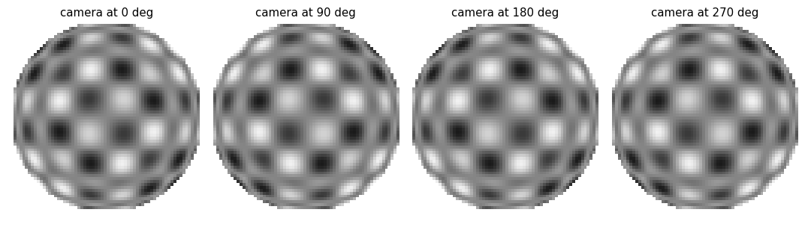
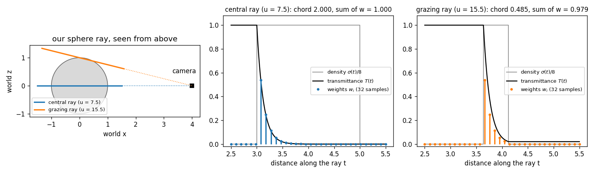
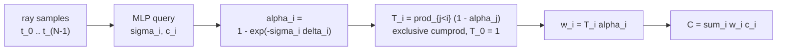
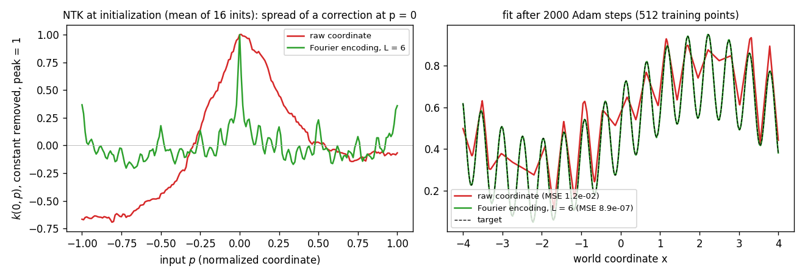
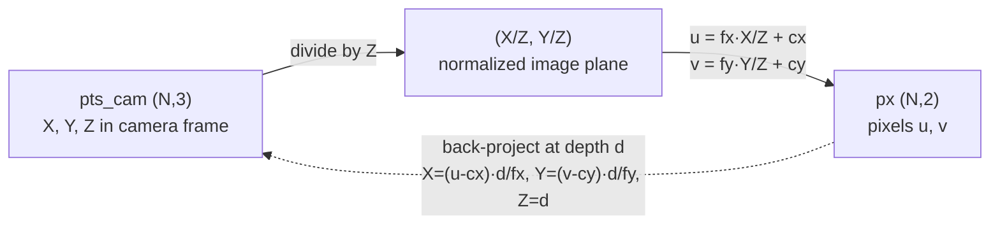

# A9 - NeRF and the volume rendering integral

A neural radiance field (NeRF) stores a 3D scene in the weights of a multilayer perceptron (MLP),
a plain stack of fully connected layers. The MLP maps a 3D point and a viewing direction to a
volume density (how strongly that point absorbs light) and an emitted color. To render a pixel,
march the pixel's ray through the field, query the MLP at samples along the ray, and composite the
per-sample colors, weighting each sample by how much of its light reaches the camera. Every step of
this renderer is differentiable, so the only supervision needed is the photometric error, the
difference between rendered and observed pixel colors.

This assignment builds the core of that renderer on a small synthetic scene. The pieces are the
Fourier positional encoding of the MLP's inputs, the discretized volume renderer that turns
per-sample densities and colors into a pixel color, ray generation from camera intrinsics and
extrinsics, and the pinhole and rigid-transform primitives that ray generation needs. The
radiance-field MLP and the toy scene are provided. The scene is a sphere whose surface albedo (its
own reflectance, before any lighting is applied) carries a fine stripe pattern, imaged from a ring
of cameras. The graded tests use a small 16x16 capture so they run on CPU without a GPU (most
finish in seconds, though the float64 gradient check is slower, a few minutes), and the
spectral-bias visualization uses a denser, higher-resolution capture so the encoding effect is
legible. The ground-truth pixels come from a closed-form integral, not from the renderer being
built here.

NeRF is the vehicle for the volume rendering integral, not a method to deploy at the end of the
course. It is built for the integral, its discretization, and front-to-back alpha compositing. The
same compositing reappears in 3D Gaussian splatting, in occupancy fields (which store a per-point
probability that space is filled), and in neural signed-distance-function rendering, and the
ray-marched renderer carries over to those settings almost unchanged.

Required reading before starting:
- Mildenhall et al. 2020, "NeRF: Representing Scenes as Neural Radiance Fields for View
  Synthesis", [arXiv:2003.08934](https://arxiv.org/abs/2003.08934).
- Tancik et al. 2020, "Fourier Features Let Networks Learn High Frequency Functions in Low
  Dimensional Domains", [arXiv:2006.10739](https://arxiv.org/abs/2006.10739).
- Tagliasacchi and Mildenhall 2022, "Volume Rendering Digest (for NeRF)",
  [arXiv:2209.02417](https://arxiv.org/abs/2209.02417).

## Lecture notes

### What NeRF is for

#### The task

Novel-view synthesis is the task of rendering a scene from camera poses that were never captured,
given a set of images that were, together with the pose and intrinsics of each camera. The toy
scene in this assignment is the smallest instance. A sphere of radius 1 with a striped surface sits
at the origin, and cameras on a horizontal ring of radius 4 look at it. The input is a handful of
16x16 images and their camera poses. The output asked for is the 16x16 image a camera at another
position on the ring would see, without ever having that image. The figure shows four views of the
sphere, rendered at a higher resolution than the graded tests use.



The NeRF paper's synthetic benchmark is the same task at scale: eight scenes (a Lego bulldozer is
one of them), each with about 100 training images at 800x800, and the test is to render held-out
views of each. For a robot
the same task appears as building a model of a room from a walk-through video and rendering what a
camera would see from somewhere the robot has not been.

#### Why reconstruct-then-render falls short

Before NeRF, novel-view synthesis went through explicit geometry: estimate a mesh or a point cloud
from the images, texture it, then re-render it from the new pose. That pipeline loses thin
structures, semi-transparent surfaces, and view-dependent shading, and its output quality is
capped by the quality of the reconstructed mesh. The photometric error of the final render cannot
correct the mesh, because the reconstruction step happens before rendering and is not tuned
against the images it is supposed to reproduce.

#### The idea: a scene function rendered by a differentiable integral

Mildenhall et al. (2020) replaced the explicit model with a continuous function: an MLP $F_\theta$
that maps a 3D world position $\mathbf{x}$ and a viewing direction $\mathbf{d}$ to a volume density
$\sigma$ and an emitted color $\mathbf{c}$. There is no mesh and no point cloud. The scene is the
function, and the function is a few million weights.

Rendering a pixel from such a function is an integral along the pixel's ray: the color is a
weighted average of the colors along the ray, with weights set by the density. The integral is a
smooth function of the densities and colors, so the error between a rendered pixel and the
observed one can be backpropagated into the MLP's weights. Training is then: pick a batch of
pixels from the training images, render each by marching its ray through the current MLP, and take
a gradient step on the squared color error. For the toy sphere, after training, the MLP's density
is high inside the sphere and near zero outside, its color on the surface reproduces the stripes,
and rendering the held-out camera's rays gives the missing image.

Two design choices made it work. The first is the factorization. Density depends on position
alone, while color depends on both position and direction. Geometry then cannot change as the
camera moves, which keeps reconstructions consistent across views, but appearance still can, which
lets the model reproduce specular highlights: the mirror-like bright spots that slide across a
surface as the viewpoint moves, unlike diffuse color, which stays put.

The second is the input encoding. Coordinates pass through a bank of sinusoids before reaching the
MLP. Without it the renders come out blurry no matter how long training runs, for reasons that
take a section of their own below.

#### Why it matters

This assignment is about the renderer, not the MLP. The same front-to-back compositing sum
renders 3D Gaussian splatting, the current standard for real-time novel-view synthesis, and the
same ray-marched renderer, with the density computed differently, renders occupancy fields and
neural signed distance functions.

### Our sphere ray (one pixel of the toy scene)

The scene function and the integral are easiest to see on a single pixel of the toy scene, where
the density is known and every quantity has a closed form. The toy sphere has constant density
$\sigma = 8$ inside and $\sigma = 0$ outside, a surface color $c$ (a gray level from the stripes),
and a white background. One camera sits at world position $(4, 0, 0)$ looking at the origin.

A pixel's ray enters the sphere, crosses it along a chord (the segment of the ray inside the
sphere) of length $\ell$, and leaves. The toy gives the whole chord the color $c$ of the entry
point. Inside the sphere, light is absorbed at rate $\sigma = 8$ per unit length, so the fraction
of light from the background that survives the chord is $e^{-8\ell}$, and the pixel is

$$\text{pixel} = (1 - e^{-8\ell})\,c + e^{-8\ell} \cdot 1.$$

This closed form is how the ground-truth images are generated. We call the rays of this scene our
sphere rays, and use two of them throughout.
- The central ray passes through the sphere's center. Its chord has length 2, from distance $3$ to
  distance $5$ along the ray, and $e^{-16} \approx 1.1 \times 10^{-7}$, so the pixel is the surface
  color $c$: the sphere is opaque.
- The grazing ray passes $0.970$ from the center (it is the ray through the right edge of the
  16x16 image at mid-height, worked out in Exercise 6). Its chord has length $0.485$, $e^{-8 \cdot 0.485}
  \approx 0.021$, and the pixel is $0.979\,c + 0.021$: about 2% of the white background shows
  through.



The figure shows both rays. In the middle and right panels the gray step is the density (scaled
to 1), and the black curve is the transmittance, the fraction of light emitted at that depth that
reaches the camera, defined in the next section. It stays at 1 until the ray enters the sphere and
then decays exponentially. The colored stems are the compositing weights of the discretized
renderer, defined in the discretization section: the share of the pixel's color that each of 32
samples along the ray contributes.

Our sphere rays stand for every pixel of every training image: each is one ray, and NeRF's loss is
a sum of one such pixel error per ray. They keep what the renderer does (absorption along the ray,
compositing, the choice of sample depths) and drop what the MLP has to learn. In NeRF the density
and color along the ray are not known. They are the MLP's outputs, and training adjusts them until
every ray's rendered color matches its pixel.

### Overview of the rest of the notes

The sections below follow the pipeline from the integral to the rays. Most of the parts are ideas
from estimation, signal processing, or geometry applied to rendering.

1. The volume rendering integral. Density is a hazard rate, the probability per unit length that
   the ray stops, as in a survival analysis or a sensor's failure-time model. Transmittance is the
   survival function, and a pixel is the expected color at the depth where the ray stops.
2. Alpha compositing. A stack of semi-transparent layers, like a stack of optical filters, combines
   by a front-to-back product of what each layer lets through. This is the operation the integral
   reduces to.
3. Discretizing the integral. Holding the density constant over each segment between samples and
   integrating the exponential exactly is the zero-order-hold discretization used for linear
   systems, and it turns the ray into a stack of layers.
4. Spectral bias and the Fourier encoding. Gradient descent on a least-squares problem converges
   fastest along the eigen-directions with the largest eigenvalues. The neural tangent kernel
   makes this precise for a network, shows that the large eigenvalues of a plain coordinate MLP
   belong to smooth functions, and the Fourier encoding fixes it by changing the kernel, the way
   choosing a basis changes what a regression can fit.
5. Pinhole projection, rigid transforms, and ray generation. The pinhole model and SE(3) poses are
   standard multi-view geometry. Ray generation is back-projection of each pixel.
6. The radiance-field MLP and hierarchical sampling. The second is inverse-CDF sampling, the same
   operation as resampling in a particle filter, used to put samples where the weights are large.

Six exercises, placed after the sections they test, are meant to be worked by hand. Each has a
worked answer that can be expanded.

### The volume rendering integral

A ray is $\mathbf{r}(t) = \mathbf{o} + t\mathbf{d}$ from the camera center $\mathbf{o}$ along the
unit direction $\mathbf{d}$, so $t$ is the distance along the ray. Treat the scene as a cloud of
light-emitting, light-absorbing particles with density $\sigma(\mathbf{x}) \ge 0$ (probability per
unit length that the ray is absorbed) and emitted color $\mathbf{c}(\mathbf{x}, \mathbf{d})$. The
color of the ray between a near bound $t_n$ and a far bound $t_f$ is the emission-absorption
integral

$$C(\mathbf{r}) = \int_{t_n}^{t_f} T(t)\,\sigma(\mathbf{r}(t))\,\mathbf{c}(\mathbf{r}(t), \mathbf{d})\,dt,
\qquad T(t) = \exp\!\Big(-\int_{t_n}^{t} \sigma(\mathbf{r}(s))\,ds\Big).$$

$T(t)$ is the transmittance, the fraction of light emitted at depth $t$ that reaches the camera
without being absorbed on the way. It is Beer-Lambert's law, the exponential attenuation of light
through an absorbing medium. The integrand weights each point's emission $\sigma\mathbf{c}$ by how
much of it survives the trip back to the camera, so a near-opaque surface dominates and everything
behind it is suppressed.

The same formula has a probabilistic reading. Follow the ray outward from the camera and ask at
what depth it first hits a particle. The density $\sigma$ is the hazard rate of that event: given
that the ray has reached depth $t$ unblocked, the probability it stops in the next $dt$ is
$\sigma\,dt$. The transmittance $T(t)$ is then the survival function, the probability the ray gets
past depth $t$, and $T(t)\sigma(t)$ is the probability density of the stopping depth. The integral
is the expected color at the stopping depth. The density can integrate to less than 1 over
$[t_n, t_f]$: the missing mass $T(t_f)$ is the probability that the ray passes through everything,
and renderers add $T(t_f)$ times a background color for it.

In our sphere ray the density is $0$ before the entry depth $t_0$ and $8$ inside, so
$T(t) = e^{-8(t - t_0)}$ inside the sphere, the black curve in the figure. With constant color $c$
along the chord, the integral is $c \int_{t_0}^{t_0+\ell} 8 e^{-8(t - t_0)}\,dt
= (1 - e^{-8\ell})\,c$, and adding $T(t_f) = e^{-8\ell}$ times the white background gives the pixel
formula of the previous section.

For a general field this integral has no closed form, so it has to be estimated numerically.
Before discretizing it, it helps to look at the operation the discretization lands on, because that
operation is older than NeRF by about forty years and is the reason the result looks familiar to
anyone who has written a compositor.

### Alpha compositing

Image compositing is the problem of stacking partially transparent layers into one picture. Each
layer carries a color $\mathbf{c}$ and an opacity $\alpha \in [0, 1]$ per pixel, where $\alpha=1$
means the layer hides whatever is behind it and $\alpha=0$ means it is invisible. Porter and Duff
(1984) enumerated the ways two such layers can be combined and named the operators. The one that
matters here is "over": placing a foreground layer over a background color $B$ gives

$$\text{fg over bg} = \alpha\,\mathbf{c} + (1 - \alpha)\,B.$$

The layer contributes a fraction $\alpha$ of its own color and lets the remaining fraction
$1-\alpha$ of the background through. On its own the formula is a linear interpolation between the
layer's color and the background. It becomes useful when it is chained.

Take $N$ layers ordered from nearest to farthest, layer $0$ in front. Compositing them means
applying "over" repeatedly, each layer over the result of everything behind it:

$$C = \mathbf{c}_0 \text{ over } \big(\mathbf{c}_1 \text{ over } (\cdots \text{ over } B)\big).$$

Expand the nesting and collect the coefficient of each layer. Layer $0$ appears multiplied by
$\alpha_0$. Layer $1$ was scaled by $\alpha_1$ when it was composited, then by $(1-\alpha_0)$ when
layer $0$ went over the result. Layer $i$ picks up its own $\alpha_i$ and one factor of
$(1-\alpha_j)$ for every layer $j$ in front of it:

$$C = \sum_{i=0}^{N-1} T_i\,\alpha_i\,\mathbf{c}_i + T_N B, \qquad T_i = \prod_{j<i}(1-\alpha_j),
\qquad T_0 = 1.$$

$T_i$ is the fraction of light from layer $i$ that survives the layers in front of it, and the
empty product $T_0 = 1$ says nothing occludes the frontmost layer. The trailing $T_N B$ is the
background showing through everything.

Read probabilistically, $\alpha_i$ is the chance a photon is stopped at layer $i$ given that it
reached it, $T_i$ is the chance it got that far, and $T_i \alpha_i$ is the chance it is stopped
exactly there. These are the discrete versions of the hazard rate, the survival function, and the
stopping density of the previous section, which is why the same expression comes out of the
emission-absorption integral.

> **Exercise 1 (compositing three layers by hand).** Three gray layers, front to back, have
> opacities $\alpha = (0.2, 0.5, 0.8)$ and colors $c = (1.0, 0.0, 0.5)$, over a white background
> $B = 1$. Compute $T_0, \dots, T_3$, the weights $T_i\alpha_i$, their sum, and the composited
> color. Then swap the first two layers (so $\alpha = (0.5, 0.2, 0.8)$, $c = (0.0, 1.0, 0.5)$) and
> repeat. What changed and what did not?

<details>
<summary>Answer</summary>

First order: $T = (1, 0.8, 0.4, 0.08)$, since each $T_{i+1} = T_i(1-\alpha_i)$. The weights are
$T_i\alpha_i = (0.2, 0.4, 0.32)$, which sum to $0.92 = 1 - 0.8 \cdot 0.5 \cdot 0.2$. The color is
$0.2 \cdot 1 + 0.4 \cdot 0 + 0.32 \cdot 0.5 + 0.08 \cdot 1 = 0.44$.

Swapped order: $T = (1, 0.5, 0.4, 0.08)$, weights $(0.5, 0.1, 0.32)$, sum $0.92$, color
$0.5 \cdot 0 + 0.1 \cdot 1 + 0.32 \cdot 0.5 + 0.08 \cdot 1 = 0.34$.

The total opacity, and so the background term $T_3 = 0.08$, is the same in both orders, because it
is a product of the $(1-\alpha_i)$ and products commute. How that total is shared among the layers
depends on the order: the front layer takes its full $\alpha$, and each later layer gets only what
is left. "Over" is not commutative, and the renderer must process samples in depth order.

</details>

### Discretizing the integral

Sample the ray at $N$ depths $t_0 < t_1 < \dots < t_{N-1}$ with segment lengths
$\delta_i = t_{i+1} - t_i$ (the last one, $\delta_{N-1}$, has no next sample and is set to a large
constant, discussed under ray generation). Assume $\sigma$ and $\mathbf{c}$ are constant on each
segment. Over a segment of constant density $\sigma_i$ and length $\delta_i$, Beer-Lambert says the
transmittance falls by exactly $\exp(-\sigma_i \delta_i)$, so the probability the ray is absorbed
somewhere inside that segment is

$$\alpha_i = 1 - \exp(-\sigma_i \delta_i).$$

Nothing has been approximated in that line. $\alpha_i$ is the integral
$\int_{t_i}^{t_{i+1}} \sigma_i e^{-\sigma_i (s - t_i)}\,ds$ evaluated in closed form, not a
first-order expansion of it. The only approximation in the scheme is the piecewise-constant
assumption on $\sigma$ and $\mathbf{c}$. In control terms, the transmittance obeys the linear ODE
$dT/dt = -\sigma(t)\,T$, and holding $\sigma$ constant over each step and integrating exactly is
the zero-order-hold discretization, $T_{i+1} = e^{-\sigma_i\delta_i}\,T_i$. Forward Euler would
instead give $T_{i+1} = (1 - \sigma_i\delta_i)\,T_i$, which goes negative when
$\sigma_i\delta_i > 1$.

With one $\alpha_i$ per segment, the ray is now a stack of $N$ ordered semi-transparent layers, and
the compositing formula from the previous section applies verbatim:

$$\hat{C}(\mathbf{r}) = \sum_{i=0}^{N-1} w_i\,\mathbf{c}_i + T_N\,\mathbf{c}_{\text{bg}},
\qquad w_i = T_i\,\alpha_i, \qquad T_i = \prod_{j<i}(1-\alpha_j).$$

The background color $\mathbf{c}_{\text{bg}}$ is usually black, and white for synthetic scenes
rendered on white, such as the NeRF Blender scenes and our toy sphere. Estimating an integral as a
finite weighted sum of samples like this is quadrature, and $\{w_i\}$ are its weights: non-negative,
summing to at most 1, with the leftover mass $T_N = 1 - \sum_i w_i$ the probability the ray passed
through everything. In the figure of our sphere rays, the stems are these $w_i$ for 32 evenly
spaced samples. On the central ray the first sample inside the sphere takes about half the weight,
and the weights decay along the chord with the transmittance.

That last statement is an identity, not an observation. Since $T_{i+1} = T_i(1-\alpha_i)$, each
term satisfies $w_i = T_i \alpha_i = T_i - T_{i+1}$, so the sum collapses to its endpoints:

$$\sum_{i=0}^{N-1} w_i = T_0 - T_N = 1 - \prod_{i=0}^{N-1} (1 - \alpha_i).$$

The identity holds for every choice of $\alpha$, which makes it a sharp test of an implementation.
It breaks as soon as the cumulative product is inclusive rather than exclusive (so that $T_i$
includes layer $i$'s own $1-\alpha_i$), or $T$ is shifted by one sample, or $\alpha$ is formed from
the wrong $\delta$. All three of those bugs still produce a plausible-looking image, so checking
that renders look reasonable does not catch them, and checking the identity to machine precision
does.

The whole discretized renderer, from samples to pixel color:



For derivation details and edge cases, see the Volume Rendering Digest (Tagliasacchi and
Mildenhall 2022).

> **Exercise 2 (one segment of the grazing sphere ray).** Take a piece of our sphere ray with
> chord length $0.1$ and density $8$. (a) Compute its opacity $\alpha$ exactly. (b) Split the chord
> into two segments of length $0.05$, compute each segment's $\alpha$, composite them, and compare
> with (a). (c) What would the first-order approximation $\alpha \approx \sigma\delta$ give, and
> what does it give for a chord of length $0.2$? (d) The renderer actually sees this chord through
> evenly spaced samples $3/31 \approx 0.0968$ apart, with the density read at each sample and held
> over the following segment. Depending on where the samples fall, the chord contains one sample or
> two. What opacity does the renderer compute in each case?

<details>
<summary>Answer</summary>

(a) $\alpha = 1 - e^{-0.8} \approx 0.551$.

(b) Each half has $\alpha = 1 - e^{-0.4} \approx 0.330$. Composited, the pair passes
$(1-0.330)^2 = e^{-0.8}$ of the light, so the combined opacity is again $0.551$. Splitting a segment
of constant density changes nothing, because the exponential of a sum is the product of the
exponentials. This is the sense in which $\alpha_i = 1 - e^{-\sigma_i\delta_i}$ is exact.

(c) $\sigma\delta = 0.8$, too high by $0.25$. For a chord of $0.2$ it gives $1.6$, which is not a
probability.

(d) One sample inside: $1 - e^{-8 \cdot 0.0968} \approx 0.539$. Two samples inside:
$1 - e^{-2 \cdot 8 \cdot 0.0968} \approx 0.787$. The true value is $0.551$. The error here comes
from the piecewise-constant assumption (a step in density is snapped to the sample grid), not from
the formula for $\alpha$. In NeRF the density is not given but learned, so the network can adjust
the density it outputs at the samples to reproduce the observed pixel; the learned density then
matches the pixel colors rather than the physical density.

</details>

### Spectral bias and the Fourier encoding

#### Spectral bias

A plain coordinate MLP, fed $(\mathbf{x}, \mathbf{d})$ directly, renders the scene blurry at any
realistic training budget. The cause is spectral bias: gradient descent fits the low-frequency
content of a target function long before the high-frequency content. The difference is one of
rate. Given enough steps a small network does eventually fit a fast component, but at a fixed
budget it fits it far more slowly, and in a NeRF-scale problem the slowest components are not
reached in any practical budget. Here frequency means how fast the function
changes with its input: the stripes on our toy sphere repeat about every half unit of distance, a
high frequency compared with the sphere's size, while the sphere's overall shading changes slowly.

Rahaman et al. (2019) demonstrated this on the simplest possible target. Train a plain MLP to fit a
sum of sinusoids of increasing frequency, and watch the components come in one at a time, lowest
first. Long after the lowest frequencies have converged, the highest ones are still essentially
unfit. Nothing about the architecture forbids representing them: a network of that width can
express the target exactly. The optimization gets there in an order, and the order is by
frequency.

For NeRF this is fatal. Fine texture, sharp material boundaries, and thin geometry are all
high-frequency content in the coordinate-to-color function, so a coordinate MLP delivers a smooth,
plausible, blurry scene. On our toy sphere it renders the right silhouette and blurs the stripes
into a smooth gray.

#### The neural tangent kernel

The neural tangent kernel (NTK) is the tool that turns "low frequencies first" from an observation
into a rate that can be computed. This section is the theory behind the encoding; the encoding
itself works whether or not the theory is read.

Start from the gradient step. When gradient descent adjusts the weights to lower the error at an
input $p$, the prediction at every other input moves too, because they share weights. To first
order, the amount the prediction at $p'$ moves per unit of correction at $p$ is

$$k(p, p') = \nabla_\theta f(p) \cdot \nabla_\theta f(p'),$$

the dot product of the two gradients of the output with respect to all the weights. This is the
NTK. It is a similarity measure between inputs, defined by the network and its current weights,
and it says how much the network generalizes a correction from one point to another. Aligned
gradients mean fixing $p$ drags $p'$ along; orthogonal gradients mean the two points can be fitted
independently.

The kernel depends on the weights, so in general it drifts during training. Jacot et al. (2018)
showed that in the wide-network limit it does not: as width grows the weights move less and less
from their initialization, and $k$ converges to a fixed function determined by the architecture
alone. Freezing $k$ turns training into kernel regression, which fits the target as a weighted
sum $\sum_j a_j k(p, p_j)$ of the kernel evaluated at the training points $p_j$, with the
coefficients $a_j$ solving a linear system. This is the same estimator as the posterior mean of a
Gaussian process with covariance $k$. It is a linear problem, and its whole training trajectory is
available in closed form rather than only as a simulation.

Here is what the closed form says. A kernel acts on functions the way a symmetric matrix acts on
vectors, so it has eigenfunctions, functions it maps to a scaled copy of themselves, each with an
eigenvalue $\lambda$ giving the scale. Decompose both the target and the current error along these
eigenfunctions. Gradient descent then shrinks the error in each eigen-direction independently, and
the component with eigenvalue $\lambda$ decays like $e^{-\eta \lambda m}$ after $m$ steps at
learning rate $\eta$. This is the familiar behavior of gradient descent on a linear least-squares
problem, where the error along each eigenvector of the Hessian shrinks at a rate set by its
eigenvalue and a large condition number means slow convergence in the small-eigenvalue
directions. Time to fit a component therefore scales as $1/\lambda$. Components with large
eigenvalues arrive in a handful of steps; components with eigenvalues near zero take longer than
any training budget.

Nothing so far mentions frequency. Frequency enters through the shape of the kernel. For an MLP fed
raw coordinates, $k(p, p')$ stays large even when $p$ and $p'$ are far apart: a correction at one
point moves distant points almost as much as neighboring ones. A kernel that broad cannot express a
function that changes rapidly between nearby inputs, so its large eigenvalues sit on smooth,
slowly varying eigenfunctions and its near-zero eigenvalues sit on rapidly oscillating ones. Feed
the eigenvalue-to-rate result that shape and it says smooth components fit fast and oscillating
components fit slowly, the more slowly the faster they oscillate. That is spectral bias, derived rather than observed, and it
points at the fix: change the kernel.

> **Exercise 3 (fitting time from the eigenvalue).** In the frozen-kernel regime, the error along
> two eigenfunctions has eigenvalues $\lambda_1 = 10$ (a smooth one) and $\lambda_2 = 0.01$ (an
> oscillating one). With learning rate $\eta = 0.1$, how many gradient steps does each component
> need to shrink to 1% of its starting size?

<details>
<summary>Answer</summary>

The component decays as $e^{-\eta\lambda m}$, so reaching $0.01$ needs
$m = \ln 100 / (\eta\lambda)$. With $\ln 100 \approx 4.61$: the smooth component needs
$4.61 / (0.1 \cdot 10) \approx 4.6$, so 5 steps, and the oscillating one needs
$4.61 / (0.1 \cdot 0.01) \approx 4605$ steps. The learning rate cannot be raised to close the gap,
because the step size that is stable for the largest eigenvalue bounds it (for gradient descent on
a quadratic, $\eta\lambda_{\max} < 2$). A thousandfold spread of eigenvalues is a thousandfold spread
of fitting times. At a fixed training budget that is long enough for the smooth component, the
oscillating one is still mostly unfit, and as eigenvalues approach zero the required step count
grows past any practical budget.

</details>

#### The Fourier encoding

The encoding changes the kernel without touching the network. Map each input coordinate through a
bank of sinusoids first. For a scalar coordinate $p$,

$$\gamma(p) = \big(\sin(2^0 \pi p),\, \cos(2^0 \pi p),\, \dots,\, \sin(2^{L-1} \pi p),\, \cos(2^{L-1} \pi p)\big),$$

applied to each input coordinate separately, optionally with the raw coordinate concatenated. Each
$(\sin, \cos)$ pair at one frequency $2^k \pi$ is a band, so $L$ is the number of bands. The map
has no learnable parameters; it is a fixed change of input representation. The NeRF paper calls it
the positional encoding and Tancik et al. call it a Fourier feature mapping; these notes call it
the Fourier encoding.

Composing the sinusoid bank with the network's own kernel gives the kernel the network effectively
trains with, and Tancik et al. (2020) computed it. Two properties come out. It is stationary,
meaning $k(p, p')$ depends only on the separation $p - p'$ and not on where the pair sits in the
domain. And its width shrinks as the top frequency grows. Exercise 4 shows both properties on the
simplest network, one linear layer on top of the encoding.

Stationarity matters for two reasons. It means detail is learned equally well everywhere in the
scene rather than better near the origin. And because the eigenfunctions of a stationary kernel are
sinusoids with eigenvalues given by its Fourier transform, it makes "which frequencies get fitted
at a usable rate" a literal reading of the kernel's spectrum rather than an analogy. Width is then
the knob. A narrow kernel is the opposite of the broad raw-coordinate one: correcting the prediction
at $p$ moves only a small neighborhood around $p$, the rapidly oscillating eigenfunctions stop
having near-zero eigenvalues, and the network fits them at a usable rate. The top band $2^{L-1}$
sets the width, so $L$ sets the finest detail the network can represent.



The figure reproduces the effect in one dimension, on an MLP of the same depth and width as the
NeRF MLP in this assignment. On the left is the kernel $k(0, p)$ at initialization, averaged over 16
random initializations: the response at every $p$ to a correction at $p = 0$. Most of
each kernel is a constant: before anything is subtracted, $k(0, p)/k(0, 0)$ is at least $0.92$
everywhere on $[-1, 1]$ for both networks, so a correction anywhere moves every prediction by
nearly the same amount. The plot subtracts that constant part (the zero-frequency component) and
scales the remaining peak to 1, which shows how the rest of the correction is distributed. With
the raw coordinate the remainder is a broad, lopsided hump that falls to half its peak at
$p \approx -0.13$ on one side and $p \approx +0.23$ on the other, so a correction at one point
drags a large neighborhood along. With six bands it is a spike a few hundredths wide. The encoded
kernel rises again to about $0.37$ at $p = \pm 1$ because a separation of 1 puts every band except
the lowest back in phase ($\cos(2^k\pi) = 1$ for $k \ge 1$, the identity of Exercise 4a). On the
right, the two networks are trained with the same optimizer for the same number of steps on a
target with a slow and a fast sinusoid over $[-4, 4]$, with positions divided by 4 before
encoding as in the NeRF MLP. At this equal step count the raw-coordinate network follows the slow
part and only partly the fast one, which is Rahaman et al.'s observation; the encoded network fits
both, which is Tancik et al.'s. Trained for many more steps, the raw-coordinate network does
catch up on this small 1D target; the gap is in how fast each network gets there.

Tancik et al. derive this for any fixed set of frequencies, NeRF's deterministic $2^k$ schedule
included, and their experiments then show that drawing frequencies from a Gaussian, with the scale
as the single tuned parameter, generally works better than the fixed powers of two. NeRF uses the
deterministic schedule.

> **Exercise 4 (the kernel of a linear model on Fourier features).** Take the model
> $f(p) = \mathbf{w}^\top \gamma(p)$, a single linear layer on top of the encoding, with no raw
> coordinate. (a) Show that its NTK is $k(p, p') = \sum_{k=0}^{L-1} \cos\big(2^k\pi(p - p')\big)$.
> (b) For comparison, compute the NTK of the raw linear model $f(p) = w\,p + b$ at the pairs
> $(0, 0.25)$, $(0, 1)$, and $(0.75, 1)$. (c) For the Fourier model, compute $k(p, p')/k(p, p)$ at
> separations $0.125$ and $0.25$ for $L = 1$ and $L = 3$.

<details>
<summary>Answer</summary>

(a) The model is linear in $\mathbf{w}$, so $\nabla_{\mathbf{w}} f(p) = \gamma(p)$ and
$k(p, p') = \gamma(p) \cdot \gamma(p') = \sum_k \big[\sin(a_k p)\sin(a_k p') + \cos(a_k p)\cos(a_k p')\big]$
with $a_k = 2^k\pi$. Each bracket is $\cos\big(a_k(p - p')\big)$ by the angle-difference identity.
The kernel depends only on $p - p'$: it is stationary.

(b) The gradient with respect to $(w, b)$ is $(p, 1)$, so $k(p, p') = p\,p' + 1$. That gives $1$
for $(0, 0.25)$, $1$ for $(0, 1)$, and $1.75$ for $(0.75, 1)$. Two pairs with the same separation
$0.25$ get different values, so the kernel depends on position. And a correction at $0$ moves the
prediction at $1$ exactly as much as the prediction at $0.25$: the kernel does not fall off with
distance at all.

(c) $k(p, p) = L$. For $L = 1$: $\cos(\pi/8) \approx 0.924$ and $\cos(\pi/4) \approx 0.707$. For
$L = 3$: $\big(\cos(\pi/8) + \cos(\pi/4) + \cos(\pi/2)\big)/3 \approx 0.544$ and
$\big(\cos(\pi/4) + \cos(\pi/2) + \cos(\pi)\big)/3 \approx -0.098$. Adding bands narrows the
kernel: with three bands a correction at $p$ barely moves the prediction $0.25$ away, so nearby
points can be fitted to different values.

</details>

#### Normalizing the inputs

The frequency schedule assumes inputs of order 1, which is why positions are normalized before
encoding. The top band $\sin(2^{L-1}\pi p)$ has period $2^{2-L}$ in whatever units $p$ carries, and
the lowest band $\sin(\pi p)$ has period $2$. With $p$ in $[-1, 1)$, the lowest band's
$(\sin, \cos)$ pair goes once around the circle across the domain, so no two points in the domain
get the same encoding (only the endpoints $p = -1$ and $p = +1$ coincide), and the top band sets the kernel width that $L$ was chosen for. Run the raw
world coordinates of a scene several units across into the encoder and both properties break.
Multiplying $p$ by a factor of $4$ is the same as multiplying every band frequency by $4$, so the
kernel becomes narrower than intended: Tancik et al. show that a kernel too narrow for the sample
density fits the training samples and produces high-frequency noise between them, the same failure
as aliasing in signal processing, where sampling a signal more coarsely than its frequency content
allows makes the reconstruction between the samples wrong. And the lowest band repeats inside the
scene, so points $2$ units apart have identical encodings in every band.

The original NeRF normalizes coordinates to lie in $[-1, 1]$ before encoding and feeds unit-length
directions. It uses $L = 10$ for positions and $L = 4$ for directions on a metric-scale scene; a
low-resolution toy needs fewer position bands.

> **Exercise 5 (band periods on the toy sphere).** Positions in the toy scene are divided by a
> conservative scene bound of $4$ before encoding (the actual sample points of the 16x16 capture
> have every coordinate within $\pm 1.8$), and the position encoding has $L = 6$ bands. (a) In world units, what are the periods of the lowest and the top
> band? (b) The stripes on the sphere are a product of factors like $\sin(12x)$. What is their
> period, and is it finer or coarser than the top band? (c) Without the division by $4$, what is
> the lowest band's period in world units, and which pairs of points become indistinguishable to the
> sinusoids?

<details>
<summary>Answer</summary>

(a) In normalized units the periods are $2$ for the lowest band and $2^{2-6} = 1/16$ for the top
band. One normalized unit is $4$ world units, so the periods are $8$ and $0.25$ world units. The
lowest band goes once around its circle over $[-4, 4)$, the range the scene bound allows, so it
is far from repeating anywhere inside the sample region of about $\pm 1.8$.

(b) $\sin(12x)$ has period $2\pi/12 \approx 0.524$ world units, about twice the top band's period.
The finest band in the encoding is finer than the stripes, so the stripe frequency lies inside the
range the encoded network can fit at a usable rate.

(c) The lowest band then has period $2$ world units, and every band's period ($2/2^k$) divides
$2$. Any two points whose coordinates differ by a multiple of $2$ (for example $x = -1$ and $x = 1$,
opposite sides of the sphere) have identical values in all twelve sinusoids of that coordinate;
only the raw coordinate, if it is concatenated, still tells them apart.

</details>

The stripes on the toy sphere exist for this lesson. With the encoding the network resolves the
high-frequency surface texture; without it the same network blurs the stripes into a smooth gray
wash. A smooth sphere has no high-frequency content for the encoding to recover, so the same
comparison on a plain solid sphere would show nothing (or, with too few views, just the extra
capacity overfitting). Hence the striped albedo in the toy scene.

### Pinhole projection

NeRF is the first 3D assignment, so it builds the base camera-geometry primitives the rest of the
course reuses: the pinhole model and the four rigid-transform operations. The later 3D assignments
(Gaussian splatting, the geometry foundation models) and the whole autonomous-driving module use
them rather than re-deriving them.

A camera-frame point $(X, Y, Z)$ with $Z > 0$ projects to a pixel by

$$u = f_x \frac{X}{Z} + c_x, \qquad v = f_y \frac{Y}{Z} + c_y,$$

where $f_x, f_y$ are the focal lengths in pixels and $(c_x, c_y)$ is the principal point, the pixel
where the optical axis meets the image. These four numbers form the intrinsic matrix $K$. A point
at known depth $d$ back-projects by

$$X = (u - c_x)\frac{d}{f_x}, \qquad Y = (v - c_y)\frac{d}{f_y}, \qquad Z = d.$$

The forward pass is a divide by depth followed by the intrinsic scale and offset:



The dashed edge recovers the camera-frame point only because the depth $d$ is supplied
separately. A single pixel alone fixes a ray, not a point. Ray generation below is this
back-projection at unit depth, rotated into the world frame; the camera-geometry assignment later
chains the same projection with extrinsics to lift image features into a bird's-eye view.

The course uses the OpenCV camera convention throughout: $+x$ right, $+y$ down, $+z$ forward into
the scene. The intrinsic $K$ above assumes an ideal pinhole camera with no lens-distortion terms.

### Rigid transforms and SE(3)

$SE(3)$ is the special Euclidean group in three dimensions: the set of rigid transforms, each a
rotation followed by a translation, with no scaling, shear, or reflection. Rigid means distances
between transformed points are preserved and handedness is preserved along with them, the latter
because the rotation satisfies $\det R = +1$, so a right-handed camera frame stays right-handed.
This is why the group is the right object for describing where a camera or a sensor sits: a pose
changes what coordinates a point has, never the shape of what the points describe.

A transform is stored as the 4x4 matrix

$$T = \begin{bmatrix} R & \mathbf{t} \\ \mathbf{0}^\top & 1 \end{bmatrix}$$

acting on points written in homogeneous coordinates $(x, y, z, 1)$, so that composing two
transforms is multiplying two matrices. Naming matters as much as the algebra here: a transform
$T_{b \leftarrow a}$ takes points expressed in frame $a$ and returns them in frame $b$. Reading the
subscripts left to right in a product tells whether it typechecks, since
$T_{c \leftarrow b} T_{b \leftarrow a} = T_{c \leftarrow a}$ but the reverse order is meaningless.

Four operations cover everything the course needs.

- Assembly builds $T$ from a 3x3 rotation $R$ and a translation 3-vector $\mathbf{t}$.
- Application maps a batch of points through $R\,\mathbf{p} + \mathbf{t}$.
- Inversion uses the structure instead of a general matrix inverse: the inverse of $T$ is
  $[R^\top \mid -R^\top \mathbf{t}]$ in the same layout, which is exact and costs a transpose and a
  matrix-vector product. A general 4x4 inverse would be both slower and less accurate.
- Composition multiplies a sequence of transforms. Matrix products apply right to left, so $ABC$
  applied to a point applies $C$ first, then $B$, then $A$.

NeRF uses only the camera-to-world matrix $c2w$ (in the notation above,
$T_{\text{world} \leftarrow \text{cam}}$) directly, applied to ray directions and origins, so the
full toolkit is more than NeRF strictly needs. It is built here because the camera-geometry module
needs all four to chain the lidar-to-camera and ego-to-camera transforms, and they belong with the
pinhole model as one set of geometry primitives.

### Ray generation

Generating rays applies the pinhole back-projection above. A pixel $(u, v)$ back-projects to a
camera-frame direction. With intrinsic matrix $K$ (focal lengths $f_x, f_y$, principal point
$c_x, c_y$),

$$\mathbf{d}_c = \big((u - c_x)/f_x,\; (v - c_y)/f_y,\; 1\big).$$

The camera-to-world matrix $c2w$ rotates that into the world frame,
$\mathbf{d}_w = R_{c2w}\,\mathbf{d}_c$, and the ray origin is the camera center, the translation
column of $c2w$. The direction is then normalized to unit length.

Normalizing $\mathbf{d}_w$ makes the ray parameter $t$ a Euclidean distance along the ray, so the
near and far bounds are distances rather than camera-frame $Z$ values, and the segment lengths
$\delta_i$ need no $\lVert\mathbf{d}\rVert$ correction. The same unit direction is the $\mathbf{d}$
fed to the MLP's color branch, so it must be the normalized one.

Depth samples are stratified: split the $[\text{near}, \text{far}]$ interval into $N$ uniform bins
and draw one sample per bin, jittered inside the bin during training, so training sees a continuous
range of depths instead of a fixed grid. The final segment length has no next sample to subtract
from, and is set to a large constant so the last sample absorbs whatever transmittance remains.
That is the original NeRF convention and it makes the far end of every ray opaque, so no light leaks
in from beyond the far bound.

A note on convention. The original NeRF uses the OpenGL camera convention, where the camera looks
down $-z$, because its Blender synthetic scenes ship with OpenGL $c2w$ matrices. This course uses
the OpenCV convention throughout (camera looks down $+z$), so the ray directions and the toy-scene
poses both follow $+z$ forward. Getting this wrong silently flips the scene front to back.

> **Exercise 6 (from a pixel to our grazing sphere ray).** The toy camera at world position
> $(4, 0, 0)$ looks at the origin. Its camera axes in world coordinates are right $= (0, 0, 1)$,
> down $= (0, 1, 0)$, forward $= (-1, 0, 0)$, so the columns of $R_{c2w}$ are those three vectors.
> The 16x16 capture has $f_x = f_y = 32$ and $c_x = c_y = 7.5$. (a) Invert $c2w$ with the
> structured formula and find the sphere's center (the world origin) in camera coordinates. Which
> pixel does it project to? (b) Compute the unit world direction of the ray through
> $(u, v) = (15.5, 7.5)$, the right edge of the image at mid-height. (c) How far does that ray
> pass from the sphere's center, how long is its chord through the unit sphere, and what opacity
> does density $8$ give it?

<details>
<summary>Answer</summary>

(a) $R_{c2w} = \begin{pmatrix} 0 & 0 & -1 \\ 0 & 1 & 0 \\ 1 & 0 & 0 \end{pmatrix}$ and
$\mathbf{t} = (4, 0, 0)$. The inverse has rotation $R^\top$ and translation
$-R^\top\mathbf{t} = -(0, 0, -4) = (0, 0, 4)$. The world origin maps to $(0, 0, 4)$: four units
straight ahead of the camera. It projects to $(u, v) = (32 \cdot 0/4 + 7.5,\ 32 \cdot 0/4 + 7.5) =
(7.5, 7.5)$, the image center.

(b) $\mathbf{d}_c = (8/32, 0, 1) = (0.25, 0, 1)$. Rotated:
$\mathbf{d}_w = 0.25 \cdot \text{right} + 1 \cdot \text{forward} = (-1, 0, 0.25)$, with norm
$\sqrt{1.0625} \approx 1.031$, so the unit direction is $(-0.970, 0, 0.243)$.

(c) The distance from the origin to the ray is $\lVert \mathbf{o} \times \mathbf{d}_w \rVert$ with
$\mathbf{o} = (4, 0, 0)$, which is $4 \cdot 0.243 = 0.970$. The chord through a unit sphere at that
distance is $2\sqrt{1 - 0.970^2} \approx 0.485$, and the opacity is
$1 - e^{-8 \cdot 0.485} \approx 0.979$. This is our grazing sphere ray. At this focal length the
sphere's silhouette has a radius of about $8.26$ pixels, a little more than half the image width,
so the sphere fills the frame except near the corners.

</details>

### The radiance-field MLP

The NeRF factorization is density from position alone, color from position and direction. The
encoded position runs through a trunk of fully connected layers with one skip connection that
re-injects the encoded position at the middle layer, so the deeper layers still have direct access
to the raw geometry. The trunk's final features go two ways. A linear head plus a nonnegative
activation gives the density $\sigma$, and the same features concatenated with the encoded
direction give the color through a small head plus a sigmoid, so RGB lands in $[0, 1]$.

The original NeRF used ReLU as the density activation. Softplus, $\log(1 + e^x)$, is a smooth
version of ReLU and a common alternative. Both keep $\sigma \ge 0$, which the renderer requires,
but softplus has a nonzero gradient everywhere, so a density output whose pre-activation starts
negative can still recover. ReLU zeroes the gradient there, and a region of empty space whose
density pre-activation is pushed negative early can never be revived.

### Hierarchical sampling

Uniform samples along a ray waste most of their queries on empty space. The original NeRF handles
this by sampling each ray twice. A coarse pass with uniform stratified samples produces the weights
$w_i$, which form a piecewise-constant distribution along the ray, concentrated wherever the
density is high. A fine pass then draws extra samples from that distribution.

Drawing from it is inverse-CDF sampling, and the recipe is short: normalize the weights to sum to
one, take their running sum along the ray to get the cumulative distribution function, draw uniform
numbers in $[0, 1]$, and for each one read off the depth at which the running sum crosses it.
Because the running sum climbs steeply where the weights are large, most draws land there. The
result is samples distributed in proportion to $w$, so compute concentrates near surfaces. On our
central sphere ray, the first three samples inside the sphere carry 90% of the weight (the
figure), so a fine pass would place most of its samples just behind the surface.

A solid object renders well enough with a few dozen uniform samples per ray that the fine pass is
not needed at low resolution. Modern NeRFs mostly drop the separate coarse network in favor of a
proposal MLP: a small, cheap network trained to predict where along each ray the weights will be
large, so the full radiance MLP is queried only at those depths. mip-NeRF 360 (Barron et al. 2022)
and Nerfacto, the default method in the Nerfstudio library, both work this way.

### Later developments

The NeRF line continued along two axes. One is speed. Instant-NGP (Müller et al. 2022,
[arXiv:2201.05989](https://arxiv.org/abs/2201.05989)) replaces the Fourier encoding with a learned
multiresolution hash grid: feature vectors stored at the corners of grids at several resolutions,
looked up through hash tables of fixed size and trained jointly with a tiny MLP. Hash collisions
are tolerated because the MLP learns to disambiguate the few points that collide, and the fixed
table size keeps memory bounded at high resolution. That cuts training from hours to seconds.

The other axis is quality, and the problem there is aliasing. A pixel is not a point; it covers a
small cone of the scene, and a cone that is thin in a close-up view is wide in a distant one.
Point-sampling one ray through the pixel center ignores that, so the render shimmers as the camera
moves between scales. mip-NeRF (Barron et al. 2021,
[arXiv:2103.13415](https://arxiv.org/abs/2103.13415)) casts a cone per pixel instead of a ray and
integrates the positional encoding over each cone frustum, which averages away the frequencies the
pixel cannot resolve. The name comes from mipmaps, the prefiltered image pyramids graphics has used
for the same problem since the 1980s. Zip-NeRF (Barron et al. 2023,
[arXiv:2304.06706](https://arxiv.org/abs/2304.06706)) combines that anti-aliasing with the
hash-grid speed.

A separate line drops per-scene optimization entirely: feed-forward methods (DUSt3R/MASt3R,
pixelSplat) predict geometry or splats from a few images in one pass. 3D Gaussian splatting
(Kerbl et al. 2023, [arXiv:2308.04079](https://arxiv.org/abs/2308.04079)) reports rendering at 135
frames per second, against 0.071 for Mip-NeRF 360 at equal quality (about 1900x faster) and 9.2
for Instant-NGP at lower quality (about 15x), because NeRF spends dozens to a couple hundred MLP
queries per pixel marching a ray.

## The assignment

Fill these holes, in order. Each is one `NotImplementedError` with a matching test; the docstring
in each file gives the signature, shapes, and constraints.

| # | Function | File | Concept from the notes |
|---|---|---|---|
| 1 | [`project_points()`](geometry.py) | `geometry.py` | pinhole projection |
| 2 | [`unproject()`](geometry.py) | `geometry.py` | back-projection at a known depth |
| 3 | [`make_transform()`](geometry.py) | `geometry.py` | SE(3) assembly |
| 4 | [`apply_transform()`](geometry.py) | `geometry.py` | SE(3) application $R\mathbf{p} + \mathbf{t}$ |
| 5 | [`invert_transform()`](geometry.py) | `geometry.py` | structured inverse $[R^\top \mid -R^\top\mathbf{t}]$ |
| 6 | [`compose_transforms()`](geometry.py) | `geometry.py` | composition, applied right to left |
| 7 | [`PositionalEncoding.forward()`](encoding.py) | `encoding.py` | the Fourier encoding $\gamma(p)$ |
| 8 | [`volume_render()`](render.py) | `render.py` | the discretized renderer $\hat{C} = \sum_i T_i\alpha_i\mathbf{c}_i + T_N\mathbf{c}_{\text{bg}}$ |
| 9 | [`stratified_sample_rays()`](rays.py) | `rays.py` | ray generation and stratified depth samples |
| 10 | [`sample_along_rays()`](rays.py) | `rays.py` | sample points $\mathbf{o} + t\mathbf{d}$ |
| 11 | [`deltas_from_z()`](rays.py) | `rays.py` | segment lengths $\delta_i$ with a large final one |

Notes on specific holes:
- The geometry functions are re-exported through the `nanovision.geometry` shim, and the renderer
  and ray functions through `nanovision.volume`; later assignments import them from there. The
  geometry functions must let leading batch dimensions pass through (`(..., 3)` in, `(..., 2)` or
  `(..., 3)` out), because a later assignment calls them on `(B, H, W, 3)` arrays.
- `volume_render` receives densities that are already non-negative (the MLP applies the
  activation) and must not re-activate them. $T$ is the exclusive cumulative product, with no
  epsilon inside it, since the tests check the telescoping identity exactly. With
  `white_background=True` the leftover transmittance $T_N$ is composited onto white, which the toy
  scene uses.
- `stratified_sample_rays` uses `unproject` at unit depth, rotates by $c2w$, and normalizes. The
  array of sampled distances is called `z_vals`, following the original NeRF, even though with unit
  directions the values are distances along the ray.
- `deltas_from_z` sets the final segment length to `1e10`.
- Only the stratified pass is implemented; there is no hierarchical fine pass, since a few dozen
  uniform samples per ray are enough for the toy sphere at this resolution.
- The MLP in `model.py` is provided. It uses softplus for the density, divides sample positions by
  `scene_bound` (4 in `config.py`) before encoding, and uses `pos_L = 6` position bands and
  `dir_L = 4` direction bands.

### Running and validating

Activate the environment (`conda activate nanovision`), then:

```
make test     A=a09_nerf   # run the tests against your top-level files (red until the holes are filled)
make verify   A=a09_nerf   # run the same tests against the reference solution/ (green from the start)
make viz      A=a09_nerf   # render the figures from the reference solution
make viz-mine A=a09_nerf   # render the figures from your own code (once the holes are filled)
```

`make test` is the command to run while working. It runs the suite in `tests/` against the
top-level files (the ones with the holes) and goes from red (the holes raise `NotImplementedError`)
to green as they are filled in. `make verify` runs the identical suite against the reference in
`solution/`: it sets `NANOVISION_IMPL=solution`, so the tests import the reference implementation
instead of the top-level files. `make verify` is green from the start, so it shows the target and
confirms the tests and the environment work before anything changes. The goal is to bring
`make test` to the same green as `make verify`.

The tests check:
- `test_projection.py` and `test_se3.py`: a reference projection value, the principal point for an
  on-axis point, the project-unproject round trip, the transform blocks, application against a
  reference, inversion, associativity of composition, and float64 gradchecks.
- `test_encoding.py`: the output shape with and without the raw input, each band's sin and cos
  against the closed form, and a float64 gradcheck (`torch.autograd.gradcheck`, which compares the
  analytic backward pass against finite differences of the forward pass and needs double precision
  for the comparison to mean anything).
- `test_volume_render.py`: the renderer's exact properties. An opaque sample returns its color,
  all-zero density gives the background and zero weights, weights are non-negative and sum to at
  most 1, the first weight equals $\alpha_0$ exactly, a large density saturates the weight to 1, and
  the telescoping identity $\sum_i w_i = 1 - \prod_i(1-\alpha_i)$ holds exactly. A float64 gradcheck
  of `volume_render` follows.
- `test_rays.py`: the center pixel's ray is $+z$ for an identity $c2w$, the corner ray's tangent,
  unit directions, sorted depths in range, sample points of the right shape lying on the ray, and
  the large final delta.
- `test_mlp.py`: the provided MLP's forward pass (density $\ge 0$, RGB in $[0,1]$).
- `test_overfit_ray.py`: an end-to-end overfit of 256 toy rays against the closed-form ground
  truth.
- `test_spectral_bias.py`: on a small textured capture, the encoded MLP fits the stripes with less
  than half the error of the raw-coordinate MLP, and the raw-coordinate error stays above
  $5\times10^{-3}$.
- `test_forbidden_imports.py`: a static scan blocking prebuilt NeRF libraries. It passes with the
  holes in place.

`make viz` renders from the reference solution, so it works on a fresh checkout before any holes
are filled and shows the target figure. `make viz-mine` runs the same script against the top-level
code, which is the way to check by eye whether a finished implementation behaves (does the sphere
come out sharp?); it needs the holes filled, since it trains a model with them. Both write
`heldout_and_ablation.png` to `out/` rather than opening a window: the plots use matplotlib's
headless Agg backend, so the commands behave the same over SSH, in WSL, and in CI with no display,
and the figure is a reproducible artifact to open directly or view inline in VSCode. The figure
shows the closed-form ground truth of a held-out view next to two short training runs, one with the
Fourier encoding and one on raw coordinates ($L = 0$). Add `SHOW=1` (for example
`make viz-mine A=a09_nerf SHOW=1`) to also open the figure in an interactive window when a display
is available.

The figures in the notes are generated by `assets/make_figures.py`: the toy views and our sphere
rays from the closed-form scene, and the spectral-bias figure from a separate 1D MLP. None of them
uses the assignment code.

What you should see when you run this. The overfit test drives the ray-batch mean squared error
from its start (around 0.1) down well under $5\times10^{-3}$. The ground truth is the
emission-absorption integral evaluated in closed form along the chord, the segment of the ray that
lies inside the sphere, rather than the output of `volume_render`, so a passing run shows the
discretized quadrature converging to the analytic Beer-Lambert integral and not to its own
renderer. In the viz, the encoded model resolves the striped surface sharply, around 27 dB
held-out PSNR in the provided run, while the raw-coordinate model blurs the stripes into a smooth
wash, around 17 dB. PSNR is peak signal-to-noise ratio, $-10\log_{10}(\mathrm{MSE})$ for pixel
values in $[0, 1]$, so higher is better and each 10 dB is a tenfold drop in mean squared error. The
roughly 10 dB gap is spectral bias made visible, and the encoded result is the one matching the
literature (Tancik et al. 2020; the NeRF paper). These are toy artifacts on a small synthetic scene.
They confirm the mechanism runs end to end and reproduce the qualitative effect; they say nothing
about quality at scale, where the full NeRF result (the Blender Lego scene at 800x800, 100k to 300k
training steps, 32.5 dB PSNR) wants a GPU and a day or two.

## Where this goes next

- 3D Gaussian splatting reuses the compositing equation from the alpha compositing section
  unchanged, $\hat{C} = \sum_i T_i \alpha_i \mathbf{c}_i$, but sources its parts differently: the
  $\alpha$ comes from a projected 2D Gaussian times a learned opacity rather than from
  $1 - \exp(-\sigma\delta)$, and the ordering comes from depth-sorting the Gaussians rather than
  from marching $t$ along a ray. Gaussian splatting does no per-sample Beer-Lambert; only the
  front-to-back "over" chain is shared.
- Occupancy and neural-SDF rendering is the closer carry-over: keep the ray-marched renderer
  exactly, and swap the density. NeuS (Wang et al. 2021,
  [arXiv:2106.10689](https://arxiv.org/abs/2106.10689)) derives $\sigma$ from a signed distance
  function, a field whose value at a point is the distance to the nearest surface (negative
  inside), so its zero level set is a clean surface, while rendering through the same
  $T_i \alpha_i$ quadrature.
- The pinhole and SE(3) primitives built here are imported by the Gaussian splatting assignment,
  the geometry foundation models assignment, and the autonomous-driving module.

## References

- Mildenhall et al. 2020, NeRF, [arXiv:2003.08934](https://arxiv.org/abs/2003.08934).
- Tancik et al. 2020, Fourier features, [arXiv:2006.10739](https://arxiv.org/abs/2006.10739).
- Tagliasacchi and Mildenhall 2022, Volume Rendering Digest,
  [arXiv:2209.02417](https://arxiv.org/abs/2209.02417).
- Porter and Duff 1984, "Compositing Digital Images", SIGGRAPH,
  [doi:10.1145/800031.808606](https://doi.org/10.1145/800031.808606).
- Rahaman et al. 2019, On the spectral bias of neural networks,
  [arXiv:1806.08734](https://arxiv.org/abs/1806.08734).
- Jacot et al. 2018, Neural tangent kernel,
  [arXiv:1806.07572](https://arxiv.org/abs/1806.07572).
- Barron et al. 2021, Mip-NeRF, [arXiv:2103.13415](https://arxiv.org/abs/2103.13415).
- Barron et al. 2022, Mip-NeRF 360, [arXiv:2111.12077](https://arxiv.org/abs/2111.12077).
- Müller et al. 2022, Instant-NGP, [arXiv:2201.05989](https://arxiv.org/abs/2201.05989).
- Wang et al. 2021, NeuS, [arXiv:2106.10689](https://arxiv.org/abs/2106.10689).
- Barron et al. 2023, Zip-NeRF, [arXiv:2304.06706](https://arxiv.org/abs/2304.06706).
- Kerbl et al. 2023, 3D Gaussian splatting,
  [arXiv:2308.04079](https://arxiv.org/abs/2308.04079).
