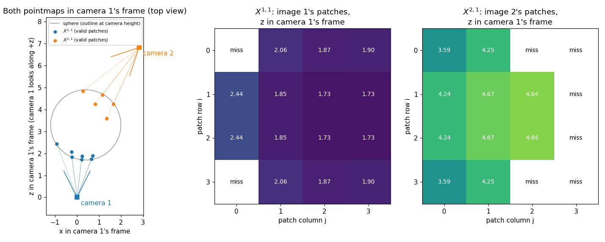
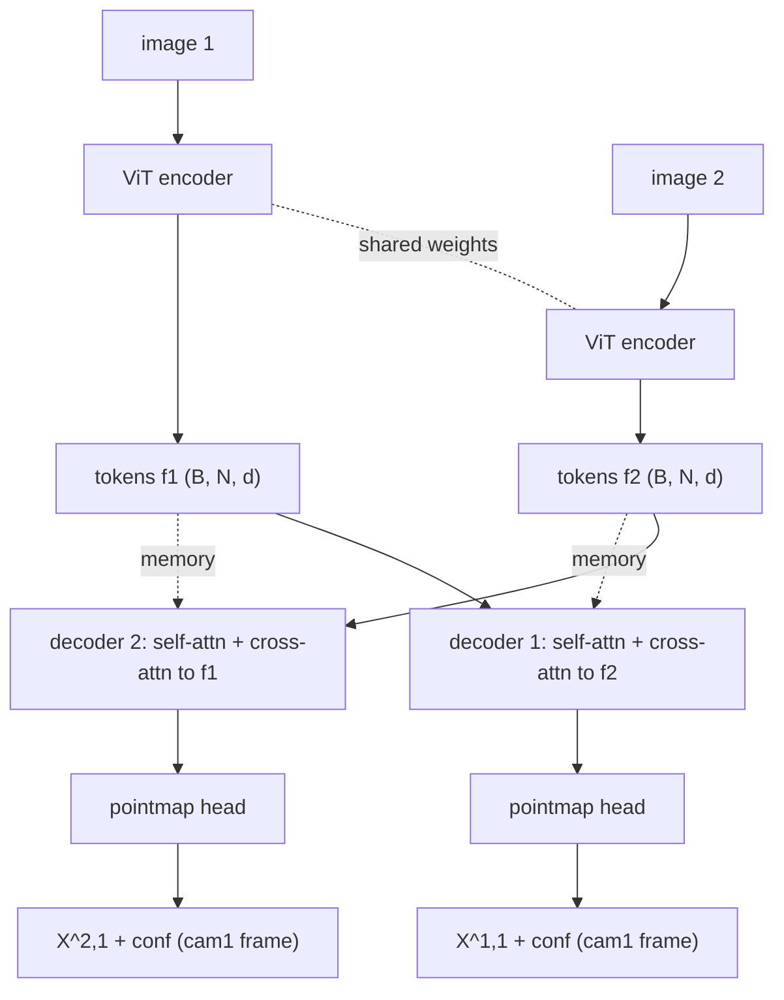
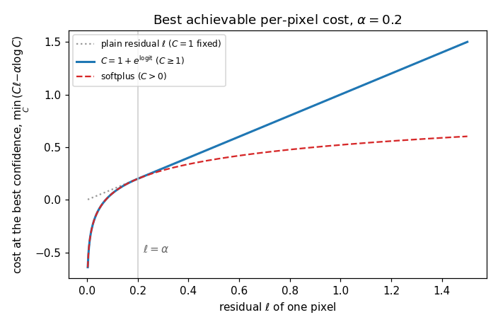

# A10.5 - geometry foundation models (DUSt3R-style pointmap regression)

Two images of a scene feed into one network, and it returns, for every pixel, the 3D coordinate
of the surface that pixel sees. Both sets of 3D points come out in the same coordinate frame (the
first camera's), so depth, relative pose, and correspondence are read off the output afterward.
No intrinsics, no poses, and no feature matching go in. This is DUSt3R (Shuzhe Wang et al., CVPR
2024), which replaced a multi-stage geometry pipeline with a single forward pass.

This assignment builds the regression mechanism on a tiny toy scene, a sphere photographed by
cameras at known positions on a ring: a Siamese ViT
encoder (one encoder applied to both images with the same weights), two transformer decoders
that cross-attend to each other's tokens, a head that regresses per-pixel 3D points plus a
confidence, and the confidence-weighted, scale-normalized loss. The encoder and the
cross-attending decoders are provided; the head, the loss, and the depth and pointmap geometry
utilities are the holes.

Required reading before starting:
- Wang et al. 2024, "DUSt3R: Geometric 3D Vision Made Easy",
  [arXiv:2312.14132](https://arxiv.org/abs/2312.14132).
- Weinzaepfel et al. 2022, "CroCo: Self-Supervised Pre-training for 3D Vision Tasks by Cross-View
  Completion", [arXiv:2210.10716](https://arxiv.org/abs/2210.10716): the cross-view pretext task
  DUSt3R's encoder is pretrained on.

## Lecture notes

### What DUSt3R is for

#### The task

Take two photos of a kitchen counter with a phone, one step apart. Nothing else is known: not the
focal length of the phone, not where the phone was for either shot, not which pixel in one photo
shows the same spot as which pixel in the other. From these two photos alone, the goal is the 3D
shape of what they show: the distance to every visible surface (depth), how the camera moved
between the shots (relative pose), and which pixels in the two photos see the same surface point
(correspondence).

The same problem appears with a robot or a car that carries several cameras whose calibration has
drifted, and with any pile of photos from the internet that should be turned into a 3D model.
Later in the course the reconstruction problem comes back in multi-camera driving perception and
in SLAM.

#### Why the obvious approach is fragile

The established answer is structure-from-motion (SfM), a chain of separate estimation steps:
find distinctive points in each image, match them across images, estimate the camera motion from
the matches, triangulate 3D points, and refine everything at the end. Each step uses the previous
step's answer as fixed input. On two photos of a white wall, or two photos taken from very
different angles, the matching step finds few correct matches, and every later step inherits the
failure. The section on the classic pipeline below goes through the chain in detail.

#### The idea

DUSt3R skips the chain. A network looks at both images together and outputs, for each pixel of
image 1, the 3D point that pixel sees, and, for each pixel of image 2, the 3D point that pixel
sees, with both sets of points written in camera 1's coordinate frame. A per-pixel map of 3D
points is called a pointmap. Because image 2's points must be written in camera 1's frame, the
network cannot produce a correct output without working out, internally, how camera 2 sits
relative to camera 1. Depth, pose, and correspondence are then read off the two pointmaps with a
few lines of closed-form geometry.

Training is plain supervised regression: scenes with known 3D geometry provide ground-truth
pointmaps, and the network is trained to reproduce them. Two things make that regression well
posed, and they are most of what this assignment builds. Images cannot reveal the absolute size
of a scene, so the loss compares prediction and ground truth only after dividing out one overall
scale. And some pixels (sky, glass, a surface seen by only one camera) have no reliable answer, so
the network also outputs a per-pixel confidence that lets it weight those pixels down, at a price.

#### Why it matters

A network trained on many scenes has seen many walls, floors, and chairs, so where matching would
fail it can fall back on what such surfaces usually look like in 3D. DUSt3R works on image pairs
where SfM fails outright, needs no calibration, and produces dense geometry in one forward pass.
Its successors, MASt3R and VGGT (discussed at the end), extend the same idea to precise matching
and to many views at once.

### Our sphere pair (two views of a sphere, 16 points per view)

Real DUSt3R works on photos of real scenes up to 512 pixels on the longer side, which cannot be
followed by hand. These notes use a toy version of the same task, which we call our sphere pair,
built from the scene the assignment trains on.

A sphere of radius $1.6$ sits at world position $(0.7, 0, 0.4)$, slightly off the world origin.
Eight cameras stand on a horizontal ring of radius $4$ around the origin, each looking at the
origin. Our sphere pair is two of them: camera 1 is ring camera 0 and camera 2 is ring camera 3,
$135$ degrees around the ring, so the two cameras look at the sphere from very different sides.
Each camera takes a 16x16 image with focal length $f = 16$ pixels and principal point (the pixel
where the optical axis meets the image) $(7.5, 7.5)$, the center of the grid. The image is cut
into a 4x4 grid of 4x4-pixel patches, and the toy predicts one 3D point per patch: the point where
the ray through the patch center first hits the sphere. A patch whose center ray misses the
sphere has no 3D point and is marked invalid. The images are renders of the same sphere, colored
smoothly by position on its surface, so a patch is valid exactly when the image shows the sphere
at the patch center.

The figure shows the ground truth for our sphere pair. On the left, seen from above in camera 1's
coordinate frame: camera 1 at the origin looking along $+z$, camera 2 about $7.4$ units away on
the far side of the sphere, and the 3D points of both images' patches. Camera 1's points lie on
the near side of the sphere and camera 2's on the far side, yet both sets are written in camera
1's coordinates. On the right are the two pointmaps as 4x4 grids, showing the $z$ coordinate (in
camera 1's frame) of each patch's point. Image 1 has 14 valid patches and image 2 has 10.



Our sphere pair keeps the parts of the real problem these notes are about: two images in, two
pointmaps out, both in camera 1's frame, so the network has to place camera 2's points using the
relative pose; the loss that removes the overall scale; the per-pixel confidence; and invalid
pixels (here, rays that miss the sphere; in real scenes, sky). The training set is eight such
pairs taken from different camera pairs on the ring, so the relative pose changes from pair to
pair. The toy drops what makes the real problem hard: per-pixel resolution, textured real
scenes, occlusion, and the large-scale pretraining that gives DUSt3R its prior. Every number in
it can be checked by hand, which the exercises below do.

### Overview of the rest of the notes

The sections below follow one line of argument, and most of its steps reuse geometry from
classical multi-view vision.

1. The classic pipeline. What SfM does, stage by stage (epipolar geometry, RANSAC,
   triangulation, bundle adjustment), and where it breaks. This is the baseline DUSt3R removes.
2. The pointmap. A depth map written as 3D points, which is pinhole back-projection. DUSt3R's
   change is to put both images' pointmaps in one camera's frame.
3. Reading the output. Depth is one coordinate of the pointmap; relative pose is a rigid
   alignment of two point sets (the Procrustes problem, the same closed form ICP uses);
   correspondence is a nearest-neighbor lookup in 3D.
4. The scale ambiguity. Images fix geometry only up to one overall factor, the same ambiguity as
   the unknown baseline length in monocular visual odometry.
5. The network. A shared ViT encoder, two decoders that exchange information through
   cross-attention, and a head that outputs points and confidence, with an encoder pretrained on
   a cross-view version of masked-image modeling.
6. The loss. Regression after dividing out one shared scale, weighted by a learned confidence.
   The confidence term has the form of a regression that predicts its own per-sample noise level
   (heteroscedastic regression), with a floor that keeps every pixel's plain residual in the cost.
7. More than two views. Global alignment, which is bundle adjustment done in 3D instead of in
   pixels, followed by later work.

Our sphere pair is used to make the formulas concrete. Five exercises, placed after the sections
they test, are meant to be worked by hand (a calculator helps). Each has a worked answer that can
be expanded.

### The classic pipeline, stage by stage

Structure-from-motion (SfM) recovers camera poses and a 3D point cloud from a set of images. It
is a chain of separate estimation problems, and DUSt3R is a reaction to the shape of that chain,
so each stage is named below along with the problem it solves. COLMAP is the open-source
implementation most people mean when they say "run SfM".

Keypoints and descriptors come first. A detector picks image locations that can be found again
from a different viewpoint, typically corners or blob centers, and a descriptor summarizes the
pixel neighborhood around each one as a vector built to change as little as possible under
rotation, scale change, and lighting change. SIFT is the classic detector-descriptor pair.

Matching pairs the descriptors of two images by nearest neighbor in descriptor space. The output
is a list of claimed correspondences: pixel $u_1$ in image 1 and pixel $u_2$ in image 2 are said
to see the same surface point. A sizeable fraction of the list is wrong.

Two-view geometry turns those correspondences into a relative pose. Write the normalized ray of a
pixel as $x = K^{-1} \tilde u$, where $\tilde u$ is the pixel in homogeneous coordinates and $K$
is the intrinsic matrix. If camera 2 differs from camera 1 by rotation $R$ and translation $t$,
then for a true correspondence the two rays and the baseline between the camera centers lie in
one plane. Writing that coplanarity in coordinates gives one scalar equation per correspondence,

$$x_2^\top E\, x_1 = 0, \qquad E = [t]_\times R,$$

where $[t]_\times$ is the skew-symmetric matrix with $[t]_\times a = t \times a$. The $3 \times 3$
matrix $E$ is the essential matrix, and it encodes the whole relative geometry of the pair. The
equation is linear in the nine entries of $E$, so eight correspondences determine it up to scale,
and an SVD-based factorization then reads $R$ and the direction of $t$ back out. The length of $t$
is not recoverable from images: scaling the scene and the baseline by the same factor reproduces
the same two images exactly.

RANSAC (random sample consensus) makes that estimate survive the wrong matches. Plain least
squares has no defense against them, because one gross outlier with a large squared residual can
drag the fit arbitrarily far. RANSAC instead draws a minimal random subset of correspondences
(eight, for the equation above), fits $E$ to that subset alone, and counts how many of all the
correspondences agree with the resulting geometry to within a pixel-scale threshold. It repeats
with fresh subsets and keeps the model with the largest agreeing set, then refits on that set. A
subset that happens to contain no wrong matches yields a model that many other correct matches
agree with; a subset containing a wrong match yields a model that few agree with.

Triangulation follows. With $R$ and $t$ fixed, each correspondence gives two rays expressed in one
frame, and the 3D point is the least-squares closest point to both.

Bundle adjustment refines everything at the end. Everything above was estimated stage by stage,
each stage committing to the previous stage's answer, so the errors accumulate. Bundle adjustment
re-optimizes all of it at once: with the camera poses $(R_i, t_i)$ and the 3D points $X_j$ as
unknowns, it minimizes the total reprojection error

$$\sum_{i,j} \big\lVert u_{ij} - \pi\big(K_i (R_i X_j + t_i)\big) \big\rVert^2,$$

where $u_{ij}$ is where feature $j$ was detected in image $i$ and $\pi$ is the perspective divide.
This is a large nonlinear least-squares problem solved by Gauss-Newton or Levenberg-Marquardt. Its
Jacobian is sparse, since one observation touches exactly one camera and one point, and solvers
exploit that structure. Bundle adjustment is where most of the final accuracy comes from, and it
needs a starting point close enough to converge, which the earlier stages supply.

The multi-view geometry estimators later in the course build the essential matrix, RANSAC, and
PnP (camera pose from known 3D points, defined in the section on reading the pointmaps)
directly; the sketch here is enough to see what DUSt3R removes.

The pipeline is accurate when it works, but each stage can fail and the failure propagates.
Keypoint matching breaks on low-texture surfaces (blank walls, sky, repetitive patterns), on wide
baselines where the same point looks too different between two far-apart cameras, and on small
image sets, where two views give few correspondences and a fragile two-view geometry. When
matching returns too few or wrong correspondences, pose estimation and triangulation have no
correct input to work from, and bundle adjustment has nothing to refine.

DUSt3R removes the matching stage. It regresses geometry directly from raw pixels with a network
trained on many scenes, so the prior learned across that training data fills in where
correspondence search would have failed. The intrinsics and poses that the classic pipeline needs
as input (or estimates early and commits to) are not inputs at all; they are computed from the
network's output afterward.

### The pointmap representation

A pointmap is a per-pixel map of 3D coordinates. For an image of shape $H \times W$, the pointmap
$X$ has shape $H \times W \times 3$: entry $X_{ij}$ is the 3D point, in some camera frame, of the
surface seen at pixel $(i, j)$. It is the geometric content of a depth map written in 3D instead
of as a scalar per pixel.

The pixel convention used throughout: $(i, j)$ is row $i$, column $j$, and the image coordinate
of that pixel's center is $(u, v) = (j, i)$, with the principal point
$(c_x, c_y) = ((W-1)/2, (H-1)/2)$ landing at the center of the grid. For a 16x16 image that is
$(7.5, 7.5)$, as in our sphere pair. Getting the row/column order or the half-pixel offset wrong
shifts the whole pointmap, and a depth map converted to a pointmap and back no longer matches.

Given intrinsics $K$ (focal lengths $f_x, f_y$ and principal point $(c_x, c_y)$), a depth map
$D$ and a pointmap carry the same information. Back-projection sends a pixel to the 3D point at
depth $d$ along its ray,

$$X = \frac{(u - c_x)\,d}{f_x}, \qquad Y = \frac{(v - c_y)\,d}{f_y}, \qquad Z = d,$$

which is the pinhole projection $u = f_x X/Z + c_x$ solved for $X$ at known $Z$. The inverse
direction, pointmap to depth, reads the third coordinate back off, since $Z = d$ exactly.

DUSt3R's change is which frame the two pointmaps live in. For an image pair, it outputs

$$X^{1,1} \in \mathbb{R}^{H \times W \times 3}, \qquad X^{2,1} \in \mathbb{R}^{H \times W \times 3}.$$

The superscript reads "which image's pixels, then which camera frame." $X^{1,1}$ is image 1's
pixels as 3D points in camera 1's frame. $X^{2,1}$ is image 2's pixels as 3D points, also in
camera 1's frame. So the network takes image 2's pixels and places them in image 1's coordinate
system. To do that it has to implicitly recover the relative pose between the two cameras, because
expressing image 2's geometry in image 1's frame requires knowing how the two cameras sit relative
to each other. In our sphere pair, the right-hand grid of the figure is $X^{2,1}$: its $z$ values
of $3.6$ to $4.8$ are distances along camera 1's viewing direction, not camera 2's.

The network never outputs an explicit pose or correspondence. It regresses the two pointmaps, and
pose, depth, and matches are read off afterward. The next section gives the operations that read
them off.

> **Exercise 1 (back-projecting one patch of our sphere pair).** In image 1 of our sphere pair
> ($16 \times 16$ pixels, $f_x = f_y = 16$, $c_x = c_y = 7.5$), the patch in row 0, column 3 of the
> 4x4 patch grid covers pixel rows 0 to 3 and columns 12 to 15. Give the $(u, v)$ coordinate of its
> center pixel. Its depth is $1.903$. Compute its 3D point in camera 1's frame, then project the
> point back with the pinhole equation and check that it lands on the same pixel.

<details>
<summary>Answer</summary>

The center of pixels 12 to 15 is $13.5$, and the center of pixels 0 to 3 is $1.5$. With
$u$ = column and $v$ = row, the patch center is $(u, v) = (13.5, 1.5)$.

Back-projection gives $X = (13.5 - 7.5) \cdot 1.903 / 16 = 6 \cdot 1.903/16 \approx 0.714$,
$Y = (1.5 - 7.5) \cdot 1.903/16 \approx -0.714$, and $Z = 1.903$. The point is up and to the right
of the optical axis, as expected for the top-right patch in a camera whose $y$ axis points down.

Projecting back: $u = 16 \cdot 0.714/1.903 + 7.5 = 6 + 7.5 = 13.5$ and
$v = 16 \cdot (-0.714)/1.903 + 7.5 = -6 + 7.5 = 1.5$. Swapping $u$ and $v$ (writing $u = 1.5$,
$v = 13.5$) would instead place the point at the bottom left, $(-0.714, 0.714, 1.903)$, which is
the point of a different patch: the row/column mistake the convention above guards against.

</details>

### Reading depth, pose, and correspondence off the pointmaps

Depth of image 1 is the $z$ channel of $X^{1,1}$, directly. Depth of image 2 needs $X^{2,2}$,
which is the same network run with the two images swapped, or a transform of $X^{2,1}$ back into
camera 2's frame once the relative pose is known.

Relative pose comes from having the same points written in two frames. $X^{2,1}$ holds image 2's
surface points in camera 1's frame and $X^{2,2}$ holds the same points in camera 2's frame, so the
relative pose is the rigid transform carrying one set onto the other. With $a_i$ the points in
camera 1's frame and $b_i$ the corresponding points in camera 2's frame, the problem is

$$\min_{R \in SO(3),\, t} \sum_i \lVert R a_i + t - b_i \rVert^2 ,$$

which is the orthogonal Procrustes problem (also called Kabsch alignment), and it has a closed
form. Subtract the centroids $\bar a$ and $\bar b$ to get centered points $\tilde a_i$ and
$\tilde b_i$, form the $3 \times 3$ cross-covariance $H = \sum_i \tilde a_i \tilde b_i^\top$, take
its SVD $H = U \Sigma V^\top$, and set

$$R = V \operatorname{diag}(1, 1, \det(V U^\top))\, U^\top, \qquad t = \bar b - R \bar a .$$

The determinant term flips the sign of the last column when the raw product would be a reflection,
which keeps $R$ in $SO(3)$. The same closed form reappears inside the ICP assignment later, where
it is applied repeatedly to nearest-neighbor pairs.

> **Exercise 2 (Procrustes on four points in a plane).** Let
> $a_1 = (1, 0, 0)$, $a_2 = (-1, 0, 0)$, $a_3 = (0, 2, 0)$, $a_4 = (0, -2, 0)$, and let
> $b_i = R a_i + t$ with $R$ the rotation by $90$ degrees about $z$,
> $R = \begin{pmatrix} 0 & -1 & 0 \\ 1 & 0 & 0 \\ 0 & 0 & 1 \end{pmatrix}$, and $t = (1, 0, 0)$.
> Compute the $b_i$, the centroids, and $H$. Show that $H = U \Sigma V^\top$ with $U = I$,
> $\Sigma = \operatorname{diag}(2, 8, 0)$, $V = R$, and also with $V' = R\,\operatorname{diag}(1, 1, -1)$
> in place of $V$. Apply the formula above to both factorizations. What does the determinant term
> do in the second case?

<details>
<summary>Answer</summary>

$b_1 = (1, 1, 0)$, $b_2 = (1, -1, 0)$, $b_3 = (-1, 0, 0)$, $b_4 = (3, 0, 0)$. The centroids are
$\bar a = 0$ and $\bar b = (1, 0, 0)$, so $\tilde a_i = a_i$ and $\tilde b_i = R a_i$. Then
$H = \sum_i a_i (R a_i)^\top = \big(\sum_i a_i a_i^\top\big) R^\top = \operatorname{diag}(2, 8, 0)\, R^\top
= \begin{pmatrix} 0 & 2 & 0 \\ -8 & 0 & 0 \\ 0 & 0 & 0 \end{pmatrix}$.

That product is already $U \Sigma V^\top$ with $U = I$, $\Sigma = \operatorname{diag}(2, 8, 0)$,
$V = R$. (A library returns the singular values sorted, $8, 2, 0$, with the columns permuted to
match; the formula gives the same $R$.) With $V = R$: $\det(V U^\top) = \det R = 1$, and the
formula returns $R$, with $t = \bar b - R \bar a = (1, 0, 0)$.

The third singular value is $0$ because all the points lie in the plane $z = 0$, so the third
column of $V$ multiplies zero in $U \Sigma V^\top$ and its sign is arbitrary. $V' = R\,\operatorname{diag}(1, 1, -1)$
is an equally valid factorization. Without the correction, $V' U^\top$ has determinant $-1$: it is
the mirror $z \to -z$ followed by the rotation, a reflection that fits the planar points just as
well. With the correction, $\det(V' U^\top) = -1$, and
$V' \operatorname{diag}(1, 1, -1) U^\top = R \operatorname{diag}(1,1,-1)\operatorname{diag}(1,1,-1) = R$. The
determinant term picks the proper rotation whenever the data cannot tell a rotation from a
reflection.

</details>

Procrustes weights every point equally, so a handful of badly predicted points pulls the answer;
the DUSt3R paper says Procrustes alignment is "sensitive to noise and outliers" and prefers RANSAC
wrapped around PnP. PnP is the perspective-$n$-point problem: given $n$ 3D points and the pixels
where a calibrated camera observes them, find that camera's pose by minimizing reprojection error.
PnP needs camera 2's intrinsics, and those are not an input either. DUSt3R first estimates the
focal length from a pointmap itself: with the principal point assumed at the image center, each
pixel and its 3D point must satisfy the pinhole equations $u - c_x = f X/Z$ and
$v - c_y = f Y/Z$, and a confidence-weighted robust fit over all pixels (the paper uses the Weiszfeld algorithm, an iterative solver for a sum of unsquared
residuals) gives $f$. For camera 2 it runs the network on the swapped pair to get $X^{2,2}$ and
fits that. With $f$ known, the other ingredients are already in hand. $X^{2,1}$ gives, for each
pixel of image 2, a 3D point in camera 1's frame, and the pixel it came from is that point's
observation in camera 2. So PnP returns camera 2's pose in camera 1's frame with no correspondence
search and no triangulation anywhere in the chain.

Correspondence between the two images is nearest-neighbor search in 3D. Pixels whose pointmap
entries are close in camera 1's frame see the same surface point, so matching is a lookup in the
output rather than a descriptor comparison.

The same ingredients give a self-check on the geometry. Take $X^{2,1}$, move it into camera 2 with
the relative pose $T_{1 \to 2}$ (the $4 \times 4$ rigid transform that takes a point in camera 1's
coordinates to the same point in camera 2's coordinates), and project with $K$. Each point should
land back on the pixel of image 2 it came from, since that is where camera 2 saw the surface. Any
error in the predicted 3D point, or in the pose implied by it, shows up as a pixel offset, the
reprojection error.

> **Exercise 3 (the reprojection self-check on our sphere pair).** In our sphere pair, the
> ground-truth $X^{2,1}$ entry for the patch in row 1, column 1 of image 2 is
> $(1.151, -0.339, 4.672)$, and the relative pose is
> $$T_{1 \to 2} = \begin{pmatrix} -0.7071 & 0 & 0.7071 & -2.8284 \\ 0 & 1 & 0 & 0 \\ -0.7071 & 0 & -0.7071 & 6.8284 \\ 0 & 0 & 0 & 1 \end{pmatrix}.$$
> Move the point into camera 2's frame, project it with $f = 16$ and $c_x = c_y = 7.5$, and compare
> with the center of that patch.

<details>
<summary>Answer</summary>

In camera 2's frame: $x = -0.7071 \cdot 1.151 + 0.7071 \cdot 4.672 - 2.8284 \approx -0.339$,
$y = -0.339$, $z = -0.7071 \cdot 1.151 - 0.7071 \cdot 4.672 + 6.8284 \approx 2.711$.

Projecting: $u = 16 \cdot (-0.339)/2.711 + 7.5 \approx -2.00 + 7.5 = 5.50$ and
$v = 16 \cdot (-0.339)/2.711 + 7.5 \approx 5.50$. The center of the patch in row 1, column 1 is
pixel $(5.5, 5.5)$, since pixels 4 to 7 have center $5.5$. The reprojection error is zero up to the
rounding of the inputs (about $0.001$ pixels).

The point is $4.672$ units in front of camera 1 but only $2.711$ in front of camera 2: it is on the
side of the sphere that faces camera 2. A network predicting $X^{2,1}$ has to output the first set
of coordinates from image 2's pixels, which is only possible if it has worked out the transform
above.

</details>

### The scale ambiguity

The pinhole equation $u = f_x X / Z + c_x$ is unchanged if $X$ and $Z$ are both multiplied by the
same positive factor $s$. Scale the entire scene by $s$ and scale the baseline between the two
cameras by the same $s$, and both images come out pixel-for-pixel identical. Images alone
therefore cannot determine $s$, and a two-view prediction is correct at best up to one global
positive factor. This is the same ambiguity as the unknown length of $t$ in the essential matrix,
and as the unknown scale of monocular visual odometry.

The ambiguity is a single factor, not one per view. The same $s$ multiplies view 1's geometry,
view 2's geometry, and the translation between the cameras, because all three live in the one
coordinate frame the network outputs. A per-view ambiguity would let each view's points be
rescaled independently; the real ambiguity does not, and this decides how the loss has to be
normalized: a comparison of prediction against ground truth must divide out that single factor,
and it must divide both views by the same one.

### Cross-attention, and what it carries here

In self-attention over a set of tokens, every token produces a query, a key, and a value, and the
output for one token is $\operatorname{softmax}(QK^\top / \sqrt{d})V$: a weighted average of the
values of the tokens in that same set, with weights set by query-key agreement. Cross-attention
keeps the queries but takes the keys and values from a second set of tokens, called the memory.
The output for a token is then a weighted average over the memory tokens.

Cross-attention is the only path by which one view's geometry reaches the other view's prediction.
A patch of image 2 forms a query; the patches of image 1 supply keys and values; the attention
weights concentrate on whichever image-1 patches look like the same piece of surface. Once a patch
of image 2 has read where its surface appears in image 1, it has information about how the two
cameras sit relative to each other, which is what it needs to write its own 3D point in camera 1's
frame.

An ablation (removing one part of a model and measuring the change) tests this directly: replace
the memory with zeros, so that each decoder sees only its own view, retrain, and compare the error.

### The architecture



A single ViT encoder runs on both images with shared weights, turning each into a grid of patch
tokens of shape $(B, N, d)$, with $B$ the number of image pairs in the batch, $N$ the number of
patches, and $d$ the token dimension. One set of weights applied to two inputs is the Siamese
arrangement, and it means the encoder learns one image representation rather than a separate one
per slot.

Two decoders, one per view, turn the tokens into the prediction. The view-1 decoder runs
self-attention over image 1's tokens and cross-attention to image 2's tokens as memory; the
view-2 decoder mirrors it. The two decoders do not share weights, because their jobs differ: one
predicts in its own camera's frame, the other predicts in the partner's frame.

The decoders are non-causal: bidirectional self-attention over the patch grid, then a
cross-attention sub-layer over the other view's memory, then the feed-forward. A causal mask would
be wrong here. Causal masking exists for sequences with a left-to-right order (language,
autoregressive generation) where a token may attend only to earlier tokens. Patch tokens have no
such order; patch 0 must see the whole grid.

Each decoder's output tokens go through a pointmap head: an MLP mapping each token to four
numbers, three for the 3D point and one for a confidence logit, reshaped back to the patch grid. A
logit here is just the unconstrained real number the last linear layer emits, before a monotone
map turns it into a positive confidence; the map is the subject of the loss section below.

Predicting one point per patch keeps the toy small: our sphere pair has a 4x4 patch grid, so each
pointmap has 16 entries. Real DUSt3R predicts one point per pixel through a DPT head (Ranftl et
al. 2021). DPT takes the token sets from several transformer layers, reshapes each into an
image-shaped feature map at the coarse patch resolution, and then fuses and upsamples them through
convolutional blocks until the output grid matches the input image. The patch-resolution output
here is a deliberate simplification of that, not a different mechanism.

### Cross-view completion pretraining

DUSt3R does not start its encoder from random weights. It starts from CroCo (Weinzaepfel et al.
2022), and CroCo is a pretext task: a training objective whose targets come from the input data
itself rather than from labels, run only so that the representation it produces can be kept and
the task's own output thrown away. The masked autoencoder is the familiar instance, hiding most of
an image's patches and reconstructing them from the few that remain.

CroCo changes what the network is allowed to use for that reconstruction. It masks patches of one
image and reconstructs them, but it also supplies a second, unmasked image of the same scene from
a different viewpoint, reachable through cross-attention. Recovering a hidden patch from that
second view means finding where the same surface appears there and accounting for the viewpoint
change between the two cameras. That is the same cross-view reasoning the pointmap decoders need,
which is why DUSt3R starts from CroCo weights rather than from scratch.

### The confidence-weighted, scale-normalized loss

The loss is a plain regression of predicted 3D points onto ground-truth 3D points with two
additions: scale normalization, which removes the scale ambiguity, and a learned confidence,
which lets the network weight down pixels it cannot fit.

#### Scale normalization

Both the prediction and the ground truth are divided by their own scale factor before the residual
is taken, so a consistent overall-scale difference costs nothing. The scale is the average
distance of the valid points from the origin (DUSt3R Eq. 3):

$$z = \frac{1}{|\mathcal{D}^1| + |\mathcal{D}^2|} \sum_{v \in \{1, 2\}} \sum_{i \in \mathcal{D}^v} \lVert X^v_i \rVert,$$

where $\mathcal{D}^v$ is the set of valid pixels in pointmap $v$, $i$ indexes those pixels after
the grid is flattened, and $\lVert X^v_i \rVert$ is the Euclidean norm of the 3D point at pixel
$i$. Since both pointmaps are in camera 1's frame, the origin is camera 1's center. In our sphere
pair a pixel is valid when its patch-center ray hits the sphere, so the average runs over
$14 + 10 = 24$ points.

The sum runs over both pointmaps with one shared $z$. A separate scale per map would rescale image
1 and image 2 independently, and that destroys the relative scale between the two cameras, which
is the information the shared camera-1-frame representation carries. The two views must be
scaled together so their relative geometry survives. The scale is therefore one scalar per image
pair, computed over the union of both maps' valid points.

Writing $\hat X$ for the prediction and $\bar X$ for the ground truth, with $z$ the joint scale of
the two predicted maps and $\bar z$ the joint scale of the two ground-truth maps, the per-pixel
residual is the Euclidean distance between the scaled points,

$$\ell_i^v = \left\lVert \frac{\hat X_i^v}{z} - \frac{\bar X_i^v}{\bar z} \right\rVert.$$

> **Exercise 4 (joint versus per-map scale).** Take one valid pixel per view. The ground truth is
> $\bar X^1 = (0, 0, 2)$ and $\bar X^2 = (0, 0, 4)$: camera 2's pixel sees a point twice as far
> from camera 1. Prediction A is $(0, 0, 6)$ and $(0, 0, 12)$. Prediction B is $(0, 0, 2)$ and
> $(0, 0, 2)$, which puts image 2's point at the wrong distance. For each, compute $z$, $\bar z$,
> and the two residuals with the joint scale. Then repeat with a separate scale per map (each map
> divided by its own average norm).

<details>
<summary>Answer</summary>

The ground-truth joint scale is $\bar z = (2 + 4)/2 = 3$, so the normalized ground truth is
$(0, 0, 2/3)$ and $(0, 0, 4/3)$.

Prediction A: $z = (6 + 12)/2 = 9$, normalized $(0, 0, 2/3)$ and $(0, 0, 4/3)$. Both residuals are
$0$. A is the ground truth scaled by $3$, which images cannot distinguish from the ground truth,
and the loss correctly charges nothing.

Prediction B: $z = (2 + 2)/2 = 2$, normalized $(0, 0, 1)$ and $(0, 0, 1)$. The residuals are
$|1 - 2/3| = 1/3$ and $|1 - 4/3| = 1/3$. B is wrong about where image 2's point lies relative to
camera 1, and the joint scale exposes it.

With a scale per map, every map here holds one point, and dividing it by its own norm gives
$(0, 0, 1)$ in all four cases. Both predictions get zero residuals, so B's error, the relative
placement of the two views, is invisible to the loss. With more points per map the per-map
version still forgives any independent rescaling of one view, which is exactly the error B makes.

</details>

#### The confidence term

The confidence term lets the network say "I cannot predict this pixel." The loss weights each
residual by that pixel's confidence $C_i^v$ and subtracts a log term:

$$\mathcal{L} = \frac{1}{|\mathcal{D}^1| + |\mathcal{D}^2|} \sum_{v \in \{1, 2\}} \sum_{i \in \mathcal{D}^v} \left( C_i^v\, \ell_i^v - \alpha \log C_i^v \right).$$

DUSt3R Eq. 4 writes the same expression as a plain sum. Dividing by the number of valid pixels
keeps the value from growing with image size or batch size and rescales the gradient by a
constant. $\alpha$ is a hyperparameter; the paper gives no value for it, and the training commands
released with the DUSt3R code use $\alpha = 0.2$, the value used here.

The form is the same as the negative log-likelihood of a regression model that predicts its own
noise level per sample (heteroscedastic regression): a large $C$ multiplies the residual, a small
$C$ pays the $-\alpha \log C$ penalty, so the network cannot set every confidence to its minimum
for free.

Confidence is $C = 1 + \exp(\text{logit})$, the DUSt3R parameterization (paper text after Eq. 4),
so $C > 1$ always, approaching 1 as the logit goes to $-\infty$ and unbounded above. The head
applies the map; the loss reads $C$.

The floor at 1 changes the answer, as minimizing the per-pixel cost at a fixed residual shows.
Write $g(C) = C\ell - \alpha \log C$. Then $g'(C) = \ell - \alpha/C$ and
$g''(C) = \alpha/C^2 > 0$, so $g$ is convex with its unconstrained minimum at $C = \alpha/\ell$.
Under the constraint $C \ge 1$ the minimizer is

$$C^\star = \max\left(1, \frac{\alpha}{\ell}\right).$$

Two regimes follow. When the residual is smaller than $\alpha$, the optimum is interior at
$C^\star = \alpha/\ell > 1$ and the cost is $\alpha\big(1 + \log(\ell/\alpha)\big)$, so a
well-fitted pixel is rewarded for raising its confidence. When the residual is $\alpha$ or larger,
the constraint binds, $C^\star = 1$, and the cost is exactly $\ell$: the pixel pays its plain
regression residual in full. Confidence can therefore earn extra credit on pixels the network
already fits, but it cannot reduce the cost of pixels it cannot fit below their residual.

Compare softplus, $C = \log(1 + e^{\text{logit}})$, which ranges over $(0, \infty)$ and so removes
the floor. With softplus the minimizer is $C^\star = \alpha/\ell$ at every residual, and the cost
is $\alpha\big(1 + \log(\ell/\alpha)\big)$ for every residual too. That grows like $\log \ell$
instead of like $\ell$: a pixel with residual $5$ costs $0.84$ instead of $5$ (Exercise 5), and
each further unit of residual adds only $\alpha/\ell$ to its cost. The network gains little by
fixing such a pixel and can learn to declare hard regions hopeless instead of fitting them.
Keeping $C \ge 1$ keeps the plain regression term as a lower bound on every pixel's cost.

The figure plots the best achievable cost of one pixel against its residual, for both choices.
Below $\ell = \alpha = 0.2$ the two curves coincide. Above it the floored confidence follows the
plain residual, while the softplus cost flattens.



The confidence is learned from the data rather than supplied: the network lowers $C$ toward 1 on
pixels it cannot fit (sky, occluded regions, reflective surfaces with no stable 3D point) and
raises it where it is sure.

> **Exercise 5 (the best confidence for three residuals).** With $\alpha = 0.2$, find $C^\star$ and
> the per-pixel cost for residuals $\ell = 0.05$, $0.5$, and $5$, first with $C \ge 1$ and then
> with softplus. For $\ell = 0.05$, what logit does the head need to output? For $\ell = 5$, how
> fast does the optimal cost grow with $\ell$ in each case (the derivative of the cost with
> respect to $\ell$ at the optimal $C$)?

<details>
<summary>Answer</summary>

$\ell = 0.05$: $\alpha/\ell = 4 > 1$, so $C^\star = 4$ in both cases, and the cost is
$0.05 \cdot 4 - 0.2 \log 4 = 0.2 - 0.277 = -0.077$. The cost is negative: a well-fitted pixel
lowers the loss below zero by being confident. The head needs $1 + e^{\text{logit}} = 4$, so
$\text{logit} = \log 3 \approx 1.099$.

$\ell = 0.5$: with $C \ge 1$, $\alpha/\ell = 0.4 < 1$, so $C^\star = 1$ and the cost is $0.5$. With
softplus, $C^\star = 0.4$ and the cost is $0.2\,(1 + \log 2.5) \approx 0.383$.

$\ell = 5$: with $C \ge 1$, $C^\star = 1$ and the cost is $5$. With softplus, $C^\star = 0.04$ and
the cost is $0.2\,(1 + \log 25) \approx 0.844$.

At the optimal $C$, the derivative of the cost with respect to $\ell$ is $C^\star$ itself (the
envelope theorem: the $C$-derivative is zero there, or $C$ sits at the bound). With the floor it
is $1$, so the pixel pushes on the network as hard as in plain regression. With softplus it is
$0.04$, so a pixel that is far off sends back $25$ times less gradient than plain regression
would, and the network has little reason to fix it.

</details>

### Why the cross-view path has to carry information

A single sphere centered at the world origin, viewed from a symmetric camera ring, is degenerate
for the cross-view lesson: the two views are near-identical, so placing view 2 in view 1's frame
needs almost nothing from view 1 and the cross-attention sits idle. Off-centering the sphere and
widening the baseline between the two views makes each view see a different portion of the
surface. Training on several view pairs at once, so the relative pose varies across the batch,
forces the cross-attention to carry information: with a single fixed pair the network could bake
one relative pose into its weights and ignore the other view; with the pose changing pair to pair
it cannot, and it has to read the partner tokens to place view 2 correctly.

In real DUSt3R the cross-view attention is the only path by which the second view's geometry
enters the first camera's frame, so removing it would leave the network unable to produce a
shared-frame pointmap pair at all. The confidence term is aimed at the pixels a regression-only
loss handles worst: the DUSt3R paper motivates it with "ill-defined 3D points, e.g. in the sky or
on translucent objects", and with image regions that are harder to predict than others.

### Global alignment for more than two views

DUSt3R as described handles one image pair. For a collection of images it runs the network on many
pairs and then aligns all the pairwise pointmaps into one global reconstruction.

The variables are one global pointmap $\chi^n$ per image $n$, plus a rigid transform $P_e$ and a
scale $\sigma_e$ for each pair $e$ in the set of pairs $\mathcal{E}$ that were run through the
network. The objective asks each pair's predicted pointmaps, after being scaled and rigidly moved,
to agree with the global pointmaps of the images involved (DUSt3R Eq. 5):

$$\chi^\star = \arg\min_{\chi, P, \sigma} \sum_{e \in \mathcal{E}} \sum_{v \in e} \sum_i C_i^{v,e} \left\lVert \chi_i^v - \sigma_e P_e X_i^{v,e} \right\rVert .$$

The per-pixel confidences the network already predicted reappear here as the weights, so pixels
the network was unsure about pull less. A constraint $\prod_e \sigma_e = 1$ prevents the solution
from collapsing to zero, which would otherwise be the trivial minimum.

This is bundle adjustment moved into point space. Bundle adjustment refines poses and 3D points to
minimize where projected points land versus where features were detected, in pixels. The global
alignment refines per-pair poses and scales, and per-image pointmaps, to minimize disagreement
in 3D. The network has already done the hard part, producing locally consistent geometry without
correspondences, so the global step is a small optimization rather than the fragile
keypoint-driven one COLMAP runs. Its terms are confidence-weighted unsquared distances, not
squared residuals, so it is not a least-squares problem; the paper minimizes it with standard
gradient descent, which typically converges in a few hundred steps, in seconds on a GPU.

### Later developments

MASt3R (Leroy et al. 2024, [arXiv:2406.09756](https://arxiv.org/abs/2406.09756)) adds a dense
feature-matching head to DUSt3R: alongside the pointmaps it predicts local features whose
nearest-neighbor matches give pixel-accurate correspondences, which sharpens the geometry and
supports localization. MASt3R-SfM extends it to full unconstrained image collections.

Monocular depth networks solve the one-image case, and they are described by what invariance their
output carries. A scale-invariant (or relative) depth prediction $\hat d$ matches the true depth
only after one unknown positive factor is fitted, $d \approx s\,\hat d$. An affine-invariant
prediction needs two unknowns, a scale and a shift, $d \approx s\,\hat d + \beta$. In both cases the
loss fits those unknowns per image before measuring the residual, so the network is never asked to
produce absolute distance and never learns to.

Depth Anything V2 (Yang et al. 2024, [arXiv:2406.09414](https://arxiv.org/abs/2406.09414)) trains
a single-image depth predictor on large mixed data and predicts relative depth. Marigold (Ke et
al. 2024, [arXiv:2312.02145](https://arxiv.org/abs/2312.02145)) repurposes a pretrained
image-diffusion model as a depth estimator by fine-tuning it to denoise a depth map conditioned on
the image, producing affine-invariant depth. Two views do not remove the global scale ambiguity
either, as the scale-ambiguity section showed. They do fix the geometry of one camera relative to
the other: both pointmaps come out in one frame under one shared scale, so the translation between
the cameras is determined in the same units as the scene, which a single image cannot supply.

VGGT (Wang et al. 2025, [arXiv:2503.11651](https://arxiv.org/abs/2503.11651)) extends the
feed-forward idea to many views at once: one transformer takes a set of images and predicts camera
intrinsics and extrinsics, depth maps, and point tracks together in a single pass, without the
pairwise-then-align structure. A point track is the list of pixel positions, one per image, at
which a single scene point appears across the set, which is the same quantity the classic pipeline
built by matching descriptors. It is the multi-view generalization of the pointmap-regression idea
built here.

In robotics and autonomous driving these models give pose-free reconstruction from a camera rig:
feed the surround images and get consistent 3D geometry without a calibrated SfM run, the same
shared-frame output applied to a vehicle's cameras instead of a stereo pair.

## The assignment

Fill these holes, in order. Each is one `NotImplementedError` with a matching test. The docstring
in each file gives the signature, shapes, and constraints.

| # | Function | File | Concept from the notes |
|---|---|---|---|
| 1 | [`depth_to_pointmap()`](geometry_fm.py) | `geometry_fm.py` | back-projection of a depth map to a pointmap |
| 2 | [`pointmap_to_depth()`](geometry_fm.py) | `geometry_fm.py` | reading depth off a pointmap ($Z = d$) |
| 3 | [`reproject_pointmap()`](geometry_fm.py) | `geometry_fm.py` | the reprojection self-check: $T_{1 \to 2}$, then projection with $K$ |
| 4 | [`PointmapHead.forward()`](head.py) | `head.py` | the pointmap head and $C = 1 + \exp(\text{logit})$ |
| 5 | [`normalize_scale()`](loss.py) | `loss.py` | the joint scale $z$ (DUSt3R Eq. 3) |
| 6 | [`pointmap_loss()`](loss.py) | `loss.py` | the confidence-weighted, scale-normalized loss |

Notes on specific holes:
- `depth_to_pointmap` builds the pixel grid with `u` = column index and `v` = row index
  (`torch.meshgrid(..., indexing="ij")` returns the row grid first) and passes it to `unproject`
  from `nanovision.geometry`, which applies the back-projection formula. The principal point is
  inside `K`.
- `reproject_pointmap` composes `apply_transform` (with `T_1to2`) and `project_points`, both from
  `nanovision.geometry`.
- `geometry_fm.py` is shared with other assignments and is re-exported through
  `nanovision.geometry`; import from there, never `geometry_fm` by its bare name (a test checks).
- `PointmapHead.forward` runs `self.mlp`, splits the last dimension into 3 point coordinates and 1
  logit, reshapes the $N$ tokens row-major to the `(grid, grid)` patch grid, and maps the logit to
  $C = 1 + \exp(\text{logit})$. Do not substitute softplus.
- `normalize_scale` takes both pointmaps stacked as `(B, 2, h, w, 3)` with a `(B, 2, h, w)` valid
  mask and returns one scale per pair, shape `(B,)`.
- `pointmap_loss` normalizes the two predicted maps by one joint $z$ and the two ground-truth maps
  by one joint $\bar z$, and divides the summed per-pixel cost by the number of valid pixels across
  both views. $\alpha = 0.2$ comes from `config.py`.
- Provided: `model.py` (`GeometryFM`, the encoder, decoders, and heads), `toy_scene.py` (the
  closed-form ground-truth pointmaps of our sphere pair and the other ring pairs), `config.py`, and
  `viz.py`. `GeometryFM.forward` takes a `use_cross` flag; `use_cross=False` replaces the
  cross-attention memory with zeros, which is the cross-attention ablation from the notes.

### Running and validating

Activate the environment (`conda activate nanovision`), then:

```
make test     A=a10_5_geometry_fm   # run the tests against the top-level files (the ones with holes)
make verify   A=a10_5_geometry_fm   # run the same tests against the reference solution/
make viz      A=a10_5_geometry_fm   # render the figures from the reference solution
make viz-mine A=a10_5_geometry_fm   # render the figures from your own code (once the holes are filled)
```

`make test` is the command to run while working. It runs the suite in
`assignments/a10_5_geometry_fm/tests/` against the top-level files. The tests fail while the holes
raise `NotImplementedError` and pass as the holes are filled in correctly. `make verify` runs the
same suite against the reference answer key in `solution/`: it sets `NANOVISION_IMPL=solution`,
which makes the tests import the reference implementation instead of the top-level files. It
passes from the start, which confirms the tests and environment work. The goal is to make
`make test` pass as `make verify` does.

The tests check:
- `test_geometry_utils.py`: the depth round-trip (exact, to $10^{-10}$); the pixel convention
  (the point built for pixel $(i, j) = (3, 7)$ projects back to $(u, v) = (7, 3)$); reprojection
  consistency on the toy ground truth (view-2 points reprojected into image 2 land on their patch
  centers to under $10^{-3}$ px, the check of Exercise 3 on every valid patch); and float64
  gradchecks of `depth_to_pointmap` and `reproject_pointmap`. A gradcheck perturbs each input
  entry by a small amount, forms the finite-difference estimate of every partial derivative, and
  compares it against the analytic gradient autograd produces; float64 is used because the finite
  differences are too noisy in float32 to tell a real disagreement from rounding.
- `test_head.py`: the head's output shapes, that the confidence is at least 1 everywhere, and that
  it exceeds 1 (it is not clamped at 1).
- `test_loss.py`: a float64 gradcheck; joint-scale invariance (scaling both predicted maps by
  $3.7$, or both ground-truth maps by $2.1$, leaves the loss unchanged); the shared-scale guard
  (rescaling only view 2's prediction by $2.5$ changes the loss, which it could not do if the
  scale were per-map); that `normalize_scale` equals the mean norm of all valid points of both
  maps; and the interior confidence optimum $C = \alpha/\ell$, checked at a residual $\ell = 0.1$
  below $\alpha = 0.2$ so that the $C \ge 1$ constraint does not bind (the swept optimum must lie
  within $0.3$ of $2$).
- `test_overfit_stereo.py`: an overfit of the model on 8 toy stereo pairs, with and without
  cross-attention (described below).
- `test_forbidden_imports.py`: a static scan that fails if the code imports the real `dust3r`,
  `mast3r`, or `croco` packages, or reaches `geometry_fm` by its bare name instead of through
  `nanovision.geometry`. It passes with the holes in place.

`make viz` renders from the reference solution, so it works on a fresh checkout before any holes
are filled and shows the target figures. `make viz-mine` runs the same script against the
top-level code; it needs the holes filled, since it trains a model with them. Both write PNG files
to `out/` instead of opening a window, using matplotlib's headless Agg backend, so they work over
SSH, in WSL, and in CI with no display. The viz trains on the GPU when one is present. Add `SHOW=1`
(for example `make viz-mine A=a10_5_geometry_fm SHOW=1`) to also open the figures in windows when a
display is available. The figures are:
- `pointmaps.png`: predicted and ground-truth pointmaps for the first pair as 3D scatter plots,
  colored by confidence.
- `reprojection.png`: the cross-view reprojection-consistency error map for view 2.
- `cross_ablation.png`: the error floor with and without cross-attention.

The figures in the notes are generated by `assets/make_figures.py`: the sphere-pair figure from
the toy's ground truth (`toy_scene.stereo_pointmap_gt` with the default config), and the
confidence-cost figure from the closed-form optimum $C^\star = \max(1, \alpha/\ell)$. Neither uses
a trained model.

What you should see when you run this. The overfit test trains for 2500 Adam steps on 8 tiny pairs,
once with and once without cross-attention; with `OMP_NUM_THREADS=2` it took 247 to 280 s on a
shared 22-core machine. The viz uses the 1500 steps in `config.py`. In the 2500-step test run,
with cross-attention on, the normalized pointmap error (the mean of $\ell$ over valid pixels)
falls to around 0.007 (0.005 to 0.008 over seeds 0 to 2); with the cross-attention memory zeroed
it rises to around 0.034, roughly 5x worse (4.2x to 6.6x), and the gap holds across seeds. At the
viz's 1500 steps the cross-on error is around 0.008 to 0.011 and the gap is about 3x to 5x. The
test asserts the cross-on error stays under 0.05 and the cross-off error is at least 1.5x larger,
both with margin. The cross-attention ablation thus measures the effect rather than asserting it.
The single-pair cross-view reprojection-pixel error is numerically unstable (points
near the reprojected image plane blow up the pixel coordinate), so the viz shows it as an error map
but the overfit test does not assert it; reprojection consistency is checked exactly on the ground
truth instead. These are toy artifacts on one smooth sphere with 16 patches and no pretraining. If
on some configuration the cross-attention or the confidence term looked like it contributed little,
that would be an artifact of the toy's simplicity, not a statement about DUSt3R.

## References

- Wang et al. 2024, DUSt3R, [arXiv:2312.14132](https://arxiv.org/abs/2312.14132).
- Weinzaepfel et al. 2022, CroCo, [arXiv:2210.10716](https://arxiv.org/abs/2210.10716).
- Ranftl et al. 2021, "Vision Transformers for Dense Prediction" (the DPT head),
  [arXiv:2103.13413](https://arxiv.org/abs/2103.13413).
- Leroy et al. 2024, MASt3R, [arXiv:2406.09756](https://arxiv.org/abs/2406.09756).
- Yang et al. 2024, Depth Anything V2, [arXiv:2406.09414](https://arxiv.org/abs/2406.09414).
- Ke et al. 2024, Marigold, [arXiv:2312.02145](https://arxiv.org/abs/2312.02145).
- Wang et al. 2025, VGGT, [arXiv:2503.11651](https://arxiv.org/abs/2503.11651).
