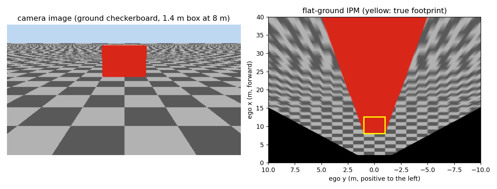
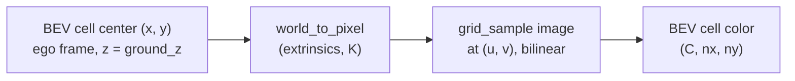
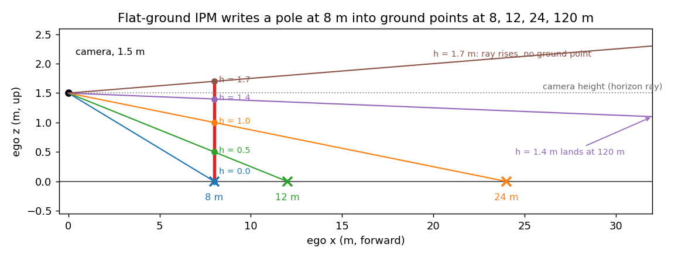

# A11.5a - camera geometry and the BEV transform

A self-driving car plans its motion in a single metric top-down map of its surroundings, while its
cameras see perspective images. Around 2020, camera perception for autonomous driving shifted from
per-image, per-camera detection to a shared bird's-eye-view (BEV) representation built from a
surround-view camera rig: a fixed metric grid in the vehicle frame, with one cell per patch of
ground around the car, into which image content is projected. That BEV grid is then the common
input to everything downstream. Multiple cameras fuse in it, consecutive timesteps fuse in it
(ego-motion, the motion of the car itself, shifts the previous grid into the current vehicle frame), and detection, segmentation,
occupancy, and motion prediction all read from it and write to it.

Getting image content into the right cell is a geometry problem before it is a learning problem.
This assignment builds that geometry on top of the base camera primitives from the NeRF
assignment: a multi-camera rig that decides which camera sees a given 3-D point and where, and the
flat-ground inverse-perspective-mapping (IPM) baseline that warps images into the BEV grid. The
pinhole model, its inverse, and the four SE(3) transform primitives are built in the NeRF
assignment and imported here through the `nanovision.geometry` shim. Most of the real content is
coordinate-frame plumbing (the nested sensor, ego (vehicle body), and global frames of nuScenes, the
lidar-camera temporal offset, and the quaternion order) rather than the pinhole model itself. The
reference solution and all tests run on synthetic cameras, so no dataset is needed.

Required reading before starting:
- Caesar et al. 2020, "nuScenes: A Multimodal Dataset for Autonomous Driving",
  [arXiv:1903.11027](https://arxiv.org/abs/1903.11027) (coordinate frames, sensor suite,
  and the four-step projection chain).
- nuScenes devkit schema reference,
  [schema_nuscenes.md](https://github.com/nutonomy/nuscenes-devkit/blob/master/docs/schema_nuscenes.md)
  (the `calibrated_sensor` and `ego_pose` fields), worth reading once before touching any JSON.

## Lecture notes

### What the BEV transform is for

#### The task

The nuScenes car carries six cameras on a ring around its roof, each seeing roughly a sixth of the
surroundings, plus a spinning lidar on top. A standard BEV setup is a $200 \times 200$ grid of
$0.5$ m cells covering $[-50, 50]$ m forward and sideways around the car. The task is to fill
every cell from the six images: for the cell 12 m ahead and 3 m to the left, say what the cameras
show there (road, lane paint, the side of a car). In this assignment a cell holds a color; in the
learned methods later in the module it holds a feature vector. Either way, a planner reads the grid
and never sees the images, so content written into the wrong cell is lost to every later stage.

#### Why stitching per-camera results fails

The older approach ran a detector on each image separately and then tried to merge the results.
Each camera's detections live in that camera's image, with its own depth ambiguity (a pixel says
in which direction something is, not how far), its own occlusions, and an awkward seam where one
camera's view ends and the next begins. Monocular 3-D detectors of this kind (FCOS3D is one) do
work, and merging their boxes across cameras is a usable baseline. The weakness is that each camera
estimates depth alone and the merge happens on finished boxes, so depth errors and duplicate or
split objects at the seams have to be fixed after the image evidence is gone, and there is no single
dense map in which cameras, timesteps, and tasks share information.

#### Starting from the cell and asking which pixel sees it

The BEV approach runs the geometry the other way. A cell is a known place in the vehicle's frame,
for example the point $(12.25, 3.25)$ m on the ground. Chain the rigid transforms that carry that
point into each camera's frame, project it with the camera's pinhole model, and read the image at
the resulting pixel. Every cell gets a color from whichever camera sees it, the six cameras fill
one grid with no seam to stitch, and the metric meaning of a cell never depends on which camera
filled it.

One quantity is missing. A cell gives the point's two ground coordinates, but to project it the
chain needs a full 3-D point, so it also needs a height. The simplest choice is to assume that
everything sits on a flat ground plane at height zero. That choice is inverse perspective mapping
(IPM). It is exact for road paint and wrong for anything with height, and the later methods in this
module exist to replace it.

#### Why it matters

Every method in the rest of the autonomous-driving module (Lift-Splat-Shoot, BEVFormer, occupancy,
prediction and planning, sensor fusion) reuses the frames, transforms, grid, and sampling built
here. A wrong transform does not announce itself downstream; a camera extrinsic with a swapped axis or a
pose taken at the wrong timestamp puts features in cells shifted from where the labels are, and the
network still trains, to a lower detection or segmentation score, with no error message pointing at
the geometry. Getting the chain right once, and checking it
visually on real data, catches a whole class of sign and axis-swap bugs before they can spread.

### Our road camera and our four-camera rig (two small examples)

The real rig has six cameras with measured calibrations. The notes use two cut-down versions of it,
both taken from this assignment's tests.

Our road camera stands for the car's front camera. It is a single camera 1.5 m above the ego
origin, looking straight ahead along the car's forward axis and pitched 15 degrees down, with a
focal length of 300 pixels and a $400 \times 224$ image, the size the nuScenes loader in this
course downsamples camera images to. It is the example for projection and for IPM. Our four-camera
rig stands for the ring of six cameras. It has four cameras at the ego origin facing forward, left,
backward, and right, with no pitch, a focal length of 400 pixels, and the same image size. It is
the example for deciding which camera sees a point.

The figure shows the effect this assignment is about, in our road camera. On the left is a
ray-traced camera image of a ground checkerboard with 1 m squares and a box standing on it, the
size of a car (4.5 m long, 2 m wide, 1.4 m tall, front face 8 m ahead). On the right is the
flat-ground IPM of that image: each BEV cell is projected into the camera at height zero and
colored from the pixel it lands on. This figure's BEV grid is $x \in [0, 40)$ m,
$y \in [-10, 10)$ m at 0.1 m, finer and narrower than the test grid used in the worked example
later. The checkerboard comes out as undistorted 1 m squares. The jagged pattern at long range is
partly aliasing in the source render, which traces one ray per pixel, and partly the low pixel
resolution there. The black region below about 2 m is ground the camera cannot see: it projects
below the bottom image row, and reads outside the image return zero. The box does not come out as
the yellow rectangle of its footprint: it becomes a red streak that starts at the footprint's near
edge and runs away from the camera off the top of the grid. The streak also widens, because IPM
scales a point's lateral offset by the same factor as its forward distance. The rest of the notes build each
step of this warp and then explain the streak with one ray-plane intersection.



The two examples keep the frame conventions, the transform chain, the pinhole projection, the
BEV grid, the bilinear read, and the flat-ground assumption exactly as on the real car. They drop
measured calibration (real extrinsics carry small rotations and offsets, not clean
90-degree turns), lens effects, and the time offsets between sensors, which the notes treat
separately with made-up poses.

### Overview of the rest of the notes

The sections below follow the path of one BEV cell into an image, then explain where the
flat-ground version of that path goes wrong. Almost every step is a familiar idea.

1. Coordinate frames. nuScenes has sensor, ego, and global frames, and the camera frame relabels
   the ego axes. This is ordinary rigid-body bookkeeping with $4 \times 4$ homogeneous transforms.
2. How nuScenes stores calibration and poses, and why the sensors of one keyframe were not
   captured at the same instant.
3. The pinhole model and the SE(3) toolkit from the NeRF assignment, and why everything stays in
   PyTorch.
4. The four-step lidar-to-camera chain, which passes through the global frame because two sensors
   saw the scene from two different vehicle poses. This is the same reasoning as transforming a
   measurement taken at one time into a filter's state at another.
5. The ego-centric BEV grid: cell indexing and what a cell holds.
6. Reading an image at a fractional pixel with bilinear interpolation, and why the derivative of
   that read matters for the learned methods.
7. Flat-ground IPM, which is a plane-induced homography, and the exact formula for how far it
   displaces anything above the ground.
8. How each later method in the module replaces one piece of this pipeline.

Five exercises, placed after the sections they test, are meant to be worked by hand. Each has a
worked answer that can be expanded.

### Coordinate frames and conventions

nuScenes defines three nested frames. Each sensor has its own frame: lidar points live in the
lidar frame, and the scene in each camera's OpenCV frame, +x right, +y down, +z forward into the
scene. The ego frame is the vehicle body, right-handed with x forward, y left, z up, origin at
the rear-axle midpoint. The global frame is a fixed ENU map frame, where ENU is East-North-Up, a
world frame with axes pointing east, north, and up; all 3-D annotations live in it, and it is the
only frame that does not move with the car. In these notes "frame" always means a coordinate
frame; a moment in time is called an instant or a timestep.

The ego frame and the camera frames differ in axis convention, a common source of sign bugs. The ego
frame has +x forward, +y left, +z up. The OpenCV camera frame has +x right, +y down, +z forward
into the scene:

```
        ego frame                       OpenCV camera frame
        (vehicle body)                  (per camera)

            z up                              z forward
            |                                /
            |                               /
            |______ x forward              o --------- x right
           /                               |
          /                                |
         y left                            y down
```

Both are right-handed, so the change between them is a rotation with no reflection, but every
axis is relabeled and two change sign. For a forward-facing camera, camera x is ego $-y$,
camera y is ego $-z$, and camera z is ego $x$.

SE(3), the group of 3-D rigid motions, is represented here by $4 \times 4$ homogeneous matrices
applied on the left, $p' = T\,p$, with $p$ a point extended by a fourth coordinate equal to 1. A
transform written $T_{b \leftarrow a}$ reads "a-to-b": it takes a point in frame $a$ and returns it
in frame $b$. The code spells the same thing `T_b_a`, since an arrow is not a legal identifier.
Reading the subscripts of a product left to right shows whether it typechecks:
$T_{c \leftarrow b}\,T_{b \leftarrow a} = T_{c \leftarrow a}$, and the reverse order is
meaningless. The camera extrinsic $E = T_{\text{cam} \leftarrow \text{ego}}$ is the
ego-to-camera transform; it carries both the translation from the rear axle to the lens and the
axis relabeling between the two frames above. Its inverse
$E^{-1} = T_{\text{ego} \leftarrow \text{cam}}$ goes the other way.

For a camera at the ego origin facing forward, the relabeling above is the whole extrinsic. Its
rotation has rows that are the camera's axes written in ego coordinates: right is ego $(0, -1, 0)$,
down is ego $(0, 0, -1)$, forward is ego $(1, 0, 0)$. Applied to a point, each row takes the dot
product with that axis, which is exactly "camera x is ego $-y$" and so on. This is how the tests
and our two examples build every extrinsic: write the camera's right, down, and forward directions
in the ego frame and stack them as rows. A camera-frame point $(X, Y, Z)$ with $Z > 0$ then lands
at pixel $u = f_x X/Z + c_x$, $v = f_y Y/Z + c_y$, the pinhole model described two sections
below.

> **Exercise 1 (one point into our four-camera rig).** Our four-camera rig has $f_x = f_y = 400$
> and principal point $(c_x, c_y) = (200, 112)$ in every camera, all at the ego origin. (a) A
> point sits at ego $(10, 2, -1.5)$: 10 m ahead, 2 m to the left, 1.5 m below the cameras. Find
> its coordinates in the front camera's frame and its pixel. (b) The left camera faces ego $+y$.
> Write its right, down, and forward axes in ego coordinates, then find which of the four cameras
> sees the ego point $(3, 10, 0)$ and at which pixel.

<details>
<summary>Answer</summary>

(a) Camera x is ego $-y = -2$, camera y is ego $-z = 1.5$, camera z is ego $x = 10$. The pixel is
$u = 400 \cdot (-2)/10 + 200 = 120$, $v = 400 \cdot 1.5/10 + 112 = 172$: left of center, because
the point is to the car's left, and below center, because it is below the camera.

(b) Facing $+y$ (to the car's left), the camera's forward axis is ego $(0, 1, 0)$ and its down axis
is ego $(0, 0, -1)$. Its right is down $\times$ forward $= (1, 0, 0)$: someone facing left out of
the car has the car's front on their right. Stacking the rows, the point $(3, 10, 0)$ has camera
coordinates $(3, 0, 10)$, depth 10 m, so the left camera sees it at
$u = 400 \cdot 3/10 + 200 = 320$, $v = 112$. In the front camera the same point has depth 3 m but
lateral offset $-10$ m, so $u = 400 \cdot (-10)/3 + 200 \approx -1133$, far outside the 400-pixel
image. The back and right cameras give it negative depth, so it is behind them. Exactly one camera
sees it.

</details>

### How nuScenes stores a keyframe

The sensors on the car free-run at their own rates. The roof lidar spins at 20 Hz, so one full
360-degree rotation, called a sweep, takes 50 ms. The six cameras expose at 12 Hz. Annotations
are provided at 2 Hz, and a keyframe (the schema calls it a `sample`) is the bundle of the nearest
reading from every sensor at one of those 2 Hz instants. That bundle is not simultaneous: it
groups readings that happened close together, not at the same time.

The offset inside a bundle is not random. nuScenes triggers each camera's exposure at the moment
the spinning lidar crosses the middle of that camera's field of view, which keeps the two views
of any given direction as close in time as the hardware allows. The consequence is that the six
cameras of one keyframe fire at six different instants spread across the lidar's 50 ms sweep, so
each camera carries its own timestamp and its own vehicle pose.

Each individual sensor reading is a `sample_data` record: a file on disk, a timestamp, and two
references. The `calibrated_sensor` record says where the sensor sits on the car, as a
sensor-to-ego rigid transform (translation in meters plus a rotation quaternion) and, for
cameras, the $3 \times 3$ intrinsic $K$. The `ego_pose` record says where the car was when that
reading was taken, as an ego-to-global rigid transform plus a timestamp. So extrinsics are per
sensor and fixed for the whole scene, while the ego pose is per reading and different for every
sensor in the bundle. Both quaternions are scalar-first $(w, x, y, z)$; passing the components in
the wrong order gives a rotation that looks plausible and is wrong. The cleanest path is to build
the $4 \times 4$ matrix from each quaternion immediately and chain matrices, never working in
quaternion algebra.

For a camera, the record stores camera-to-ego, so the extrinsic $E$ (ego-to-camera) is the inverse
of the `calibrated_sensor` transform. This is one more place where the direction of a transform has
to be read off the record rather than assumed.

The core nuScenes images are stored undistorted, so the stored intrinsic $K$ is an exact pinhole
matrix with no radial or tangential terms. (The nuImages spin-off keeps distortion; the core
dataset does not.) No undistortion step is needed.

### The pinhole model and the SE(3) toolkit

The pinhole projection $u = f_x X/Z + c_x$, $v = f_y Y/Z + c_y$, its depth-back-projection
inverse, and the four SE(3) primitives (build a $4 \times 4$ transform from $R, t$; apply
$R\,p + t$ to a batch of points; invert via the structured $[[R^\top, -R^\top t], [0, 1]]$;
compose left to right) are built in the NeRF assignment. The chains below compose those SE(3)
transforms and finish with the pinhole projection; the only place to get the projection wrong is
the sign or order when chaining it with the extrinsics.

All of it is written in PyTorch on float tensors rather than in NumPy or OpenCV, and autograd is
the reason. The later assignments in this module put exactly these operations inside a network's
forward pass: a BEV cell is projected into a camera and the image features are read at the
projected pixel, with the training loss defined on the BEV output. The gradient then has to
travel back through the sampling and the projection to reach the features. A geometry pipeline
that leaves the tensor world at any point cuts that path. OpenCV's projection and warping
functions work on NumPy arrays outside autograd, and a differentiable computer-vision library such
as kornia would do this assignment's work for it, so neither is used.

### The four-step lidar-to-camera chain

Projecting a lidar point into a camera image at a keyframe means crossing the timestamp gap
described above. Name the four transforms the records give:

- $S$, the lidar-to-ego extrinsic from the lidar's `calibrated_sensor`.
- $P_l$, the ego-to-global pose from the `ego_pose` attached to the lidar reading.
- $P_c$, the ego-to-global pose from the `ego_pose` attached to that camera's image.
- $E$, the ego-to-camera extrinsic, the inverse of the camera's `calibrated_sensor` transform.

$P_l$ and $P_c$ are poses of the same vehicle at two different instants, so they differ by the
motion in between. The global frame is the only frame both instants share, which is why the
chain has to pass through it to switch ego poses. A tracking filter does the same thing when a
measurement taken in the sensor frame at one time has to be compared with a state predicted at
another: both are first expressed in a frame that does not move.

$$\text{lidar sensor} \;\to\; \text{ego @ lidar time} \;\to\; \text{global} \;\to\; \text{ego @ cam time} \;\to\; \text{camera},$$

which as a matrix product is $T = E\,P_c^{-1}\,P_l\,S$, read right to left. Apply $T$ to the
lidar points, then apply $K$ and divide by $z$, keeping the points with $z > 0$ that land in
bounds.


What we call the naive chain reuses the lidar-time ego pose for the camera step, giving
$T = E\,P_l^{-1}\,P_l\,S = E\,S$, which collapses the two ego nodes into one and drops the
global round-trip entirely. The two agree exactly when the vehicle is stationary, since then
$P_c = P_l$. On a moving vehicle the error is the ego motion between the two timestamps,
transformed into the camera frame: at 30 m/s a 50 ms offset is 1.5 m of translation, enough to
slide projected points visibly off moving objects and off anything near the edge of the field of
view.

> **Exercise 2 (the naive chain at highway speed).** Take the lidar at the ego origin ($S = I$)
> and the front camera of our four-camera rig as the camera. At lidar time the car's pose is
> $P_l$: rotation by 90 degrees about $z$ (the car points along global north, $+y$) and
> translation $(100, 50, 0)$. At camera time it has moved 1.5 m forward: same rotation,
> translation $(100, 51.5, 0)$. A static lidar point is at ego-at-lidar-time $(10, 2, 0)$. Follow
> it through the four steps to its pixel, then through the naive chain. How many pixels apart are
> the two?

<details>
<summary>Answer</summary>

The rotation is $R = \begin{pmatrix} 0 & -1 & 0 \\ 1 & 0 & 0 \\ 0 & 0 & 1 \end{pmatrix}$, so
$R\,(10, 2, 0) = (-2, 10, 0)$, and the global point is $(98, 60, 0)$. Into the ego frame at camera
time: subtract the translation, $(98, 60, 0) - (100, 51.5, 0) = (-2, 8.5, 0)$, and apply
$R^\top$, giving $(8.5, 2, 0)$. The car drove 1.5 m toward the point, so it is 8.5 m ahead instead
of 10. The front camera turns this into camera coordinates $(-2, 0, 8.5)$ and pixel
$u = 400 \cdot (-2)/8.5 + 200 \approx 105.9$, $v = 112$.

The naive chain skips the global round-trip and projects ego $(10, 2, 0)$, camera $(-2, 0, 10)$, to
$u = 120$. The two pixels are about 14 pixels apart on a 400-pixel-wide image. The error is a
change of depth, and depth error shifts a point toward or away from the image center in proportion
to its offset from the center, so points near the edge of the field of view move the most.

</details>

### The ego-centric BEV grid

The BEV grid is defined in the ego frame, centered on the vehicle, with x forward and y left. A
standard choice is $[-50, 50]$ m on both axes at 0.5 m resolution, a 200x200 grid. Cell $(i, j)$
has ego-frame center $x_i = x_{\min} + (i + \tfrac{1}{2})\,r$ and
$y_j = y_{\min} + (j + \tfrac{1}{2})\,r$ for resolution $r$, with $i$ running along x and $j$
along y, both zero-based. The half-cell offset means a cell's coordinate is its center, not its
corner, which is the coordinate a camera ray should be tested against. Going the other way, a
point at ego $(x, y)$ lies in cell $i = \lfloor (x - x_{\min})/r \rfloor$,
$j = \lfloor (y - y_{\min})/r \rfloor$.

A cell holds whatever the method writes into it. In this assignment it holds an RGB color
sampled from a camera image, so the output is a $(C, n_x, n_y)$ tensor with $C = 3$. In the
learned methods later in the module it holds a vector of $C$ channel activations produced by a
convolutional or attention encoder, a BEV feature map, with the same indexing and the same
metric meaning per cell. Every method in the module keeps this definition unchanged, so they all
share the geometry built here.

The grid is rebuilt in the current ego frame at every timestep, so it slides and rotates with the
car. Fusing information across time therefore means resampling the previous timestep's grid
through the ego motion before combining it, which is the temporal step the attention-based method
later in the module performs.

> **Exercise 3 (cells and ego motion).** In the default grid ($[-50, 50]$ m, $r = 0.5$ m), (a)
> which cell contains the ego point $(12.3, -3.7)$, and what is that cell's center? (b) The car
> drives 1.5 m straight ahead. Which cell holds the same static point now? (c) Instead, the car
> turns 90 degrees to the left in place. Which cell holds the point now?

<details>
<summary>Answer</summary>

(a) $i = \lfloor 62.3/0.5 \rfloor = 124$, $j = \lfloor 46.3/0.5 \rfloor = 92$, with center
$(-50 + 124.5 \cdot 0.5,\ -50 + 92.5 \cdot 0.5) = (12.25, -3.75)$.

(b) In the new ego frame the point is 1.5 m closer, at $(10.8, -3.7)$, so it is in cell
$(121, 92)$: three cells back along $x$, since 1.5 m is three cells.

(c) The new ego frame is the old one rotated by 90 degrees, so the point's new coordinates are
$R^\top p$ with $R$ the 90-degree rotation: $(-3.7, -12.3)$. The point that was ahead and slightly
to the right is now behind and to the right, in cell $(92, 75)$. A static object moves across the
grid whenever the car moves, which is why fusing two timesteps needs the resampling described
above rather than adding the two grids cell by cell.

</details>

### Sampling an image at a fractional pixel

Projecting a 3-D point into a camera gives a real-valued pixel coordinate $(u, v)$, essentially
never an integer, so reading the image there requires interpolation. Bilinear interpolation
takes the four integer pixels surrounding $(u, v)$ and weights them by the fractional position.
With $u_0 = \lfloor u \rfloor$, $a = u - u_0$, $v_0 = \lfloor v \rfloor$, $b = v - v_0$, and
$I_{u,v}$ the pixel in column $u$ and row $v$,

$$I(u, v) = (1-a)(1-b)\,I_{u_0,v_0} + a(1-b)\,I_{u_0+1,v_0} + (1-a)b\,I_{u_0,v_0+1} + ab\,I_{u_0+1,v_0+1}.$$

Each weight is the area of the rectangle diagonally opposite that corner, and the four weights
sum to 1.

Nearest-neighbor sampling would be cheaper and is unusable in this setting. Its output is
piecewise constant in $(u, v)$: the value does not change at all until the sample point crosses a
pixel boundary, at which point it jumps. Its derivative with respect to the sampling location is
therefore zero almost everywhere and undefined on the boundaries, so a loss computed on the
sampled values carries no information about where to move the sample. Bilinear interpolation is
piecewise linear instead, with a non-zero derivative both with respect to the image values and
with respect to $(u, v)$, so gradients flow back into the features being sampled and, if a
method wants it, into the camera parameters that produced the coordinate.

PyTorch spells this operation `torch.nn.functional.grid_sample`, and three of its conventions
matter here. The sampling grid is given in normalized coordinates running from $-1$ at one edge
of the image to $+1$ at the other, so pixel coordinates have to be rescaled before the call;
with `align_corners=True` the values $-1$ and $+1$ sit exactly on the centers of the first and
last pixels, so the rescaling divides by $W - 1$ and $H - 1$ rather than by $W$ and $H$. The
last dimension of the grid is ordered $(x, y)$, that is $(u, v)$, which is the opposite of the
row-major $(v, u)$ order used to index the tensor. And the grid has the shape of the desired
output, so handing it an $(n_x, n_y, 2)$ array of pixel coordinates returns a $(C, n_x, n_y)$
image directly, one sample per BEV cell. `padding_mode="zeros"` makes reads that fall outside
the image return zero, which is how cells no camera sees end up empty.

> **Exercise 4 (one bilinear read and its gradient).** A $3 \times 3$ image has rows
> $v = 0, 1, 2$ equal to $(0, 10, 20)$, $(30, 40, 50)$, $(60, 70, 80)$ (columns $u = 0, 1, 2$).
> Read it at $(u, v) = (1.25, 0.5)$: give the four weights, the value, and the derivatives
> $\partial I/\partial u$ and $\partial I/\partial v$. What normalized coordinates would
> `grid_sample` with `align_corners=True` need for this pixel?

<details>
<summary>Answer</summary>

$u_0 = 1$, $a = 0.25$, $v_0 = 0$, $b = 0.5$. The weights on $I_{1,0} = 10$, $I_{2,0} = 20$,
$I_{1,1} = 40$, $I_{2,1} = 50$ are $0.375$, $0.125$, $0.375$, $0.125$, which sum to 1. The value is
$3.75 + 2.5 + 15 + 6.25 = 27.5$.

Differentiating the formula in $a$: $\partial I/\partial u = (1-b)(20 - 10) + b(50 - 40) = 10$,
the horizontal step between neighbors. In $b$:
$\partial I/\partial v = (1-a)(40 - 10) + a(50 - 20) = 30$. A nearest-neighbor read at the same
point returns one pixel's value and has derivative zero in both directions.

The normalized coordinates are $g_x = 2 \cdot 1.25/(3 - 1) - 1 = 0.25$ and
$g_y = 2 \cdot 0.5/(3-1) - 1 = -0.5$, passed in the order $(g_x, g_y)$. Calling `grid_sample` with
them returns 27.5, and autograd gives the same derivatives 10 and 30.

</details>

### Flat-ground IPM and why it breaks

Inverse perspective mapping warps a camera image into a top-down image under one assumption:
every pixel shows a point on the flat $z = 0$ ground plane. Setting $z = 0$ deletes the third
column of the $3 \times 4$ projection $K\,[R \mid t]$, leaving a $3 \times 3$ matrix that maps
ground coordinates to pixels. That matrix is invertible unless the optical center lies in the
plane itself, in which case the camera sees the plane edge-on as a single line. So under the
assumption the image and the ground are related by a homography, an invertible projective map
between two planes, and the warp is exact for road markings and ground texture.

Per cell the data flow is a ground point, a projection, and a sample:



In our road camera, take the BEV cell centered at ego $(8.25, 2.25)$ on a grid with
$x \in [0, 40)$ m, $y \in [-20, 20)$ m and 0.5 m cells. Relative to the optical center at
$(0, 0, 1.5)$ the ground point is at $(8.25, 2.25, -1.5)$. The camera's right axis is ego
$(0, -1, 0)$, its forward axis is ego $(\cos 15^\circ, 0, -\sin 15^\circ)$, and its down axis is
ego $(-\sin 15^\circ, 0, -\cos 15^\circ)$. Taking dot products gives camera coordinates
$(-2.25, -0.686, 8.357)$, and the pinhole model gives the pixel
$u = 300 \cdot (-2.25)/8.357 + 200 \approx 119.2$, $v = 300 \cdot (-0.686)/8.357 + 112 \approx 87.4$.
IPM colors that cell with the bilinear read of the image at $(119.2, 87.4)$, and repeats the same
three steps for every other cell.

Anything above the ground is placed wrongly, and the size of the error follows from one
ray-plane intersection. Put the optical center at height $h_c$ and let a scene point sit at
height $h$ with horizontal offset $d$ from the point on the ground directly below the camera.
The ray from the center through the point is $z(t) = h_c + t\,(h - h_c)$ with horizontal offset
$t\,d$; it meets $z = 0$ at $t = h_c / (h_c - h)$, so IPM writes that point into the ground
location at offset

$$d' = d \cdot \frac{h_c}{h_c - h}.$$

The displacement is a radial scaling about the camera's ground position by a factor that depends
only on the two heights. Focal length, pitch, and image resolution do not appear: they change
which pixel the point lands in, and the pixel and the ground cell move together. Three regimes
come out of that factor. For $h \ll h_c$ the factor is roughly $1 + h/h_c$, a small outward
push that still grows in absolute terms with distance, since it multiplies $d$. As $h$
approaches $h_c$ the factor diverges, because a point at exactly the camera's height projects
onto the horizon line and its ray never descends to the ground. Above $h_c$ the ray points
upward and never meets the plane at all: that content appears above the horizon in the image and
is written into no ground cell.

The figure shows this in our road camera, which sits 1.5 m above the ground, for a pole standing
8 m ahead. The points of the pole at heights 0, 0.5, 1.0, and 1.4 m land on the ground at 8, 12,
24, and 120 m, and the ray through its top at 1.7 m rises and never reaches the ground.



A vertical object is therefore stretched away from the camera: its base lands in the correct
cell, and every height above the base lands progressively farther out, so the object becomes a
streak running outward from its true footprint. That is the red streak in the first figure, where
the box's front face starts at the footprint and its 1.4 m top edge would land at 120 m, far past
the 40 m grid. The formula gives concrete numbers for our road camera: a feature 0.5 m up at 8 m
is painted at 12 m, one 1.0 m up at 20 m is painted at 60 m, and a pedestrian's head at 1.7 m is
above the camera and lands nowhere on the plane at all.

> **Exercise 5 (where a car's outline lands).** In our road camera ($h_c = 1.5$ m), the rear face
> of a car is 10 m ahead. Where does IPM put the points of that face at heights 0.5 m, 1.0 m, and
> 1.4 m? At what height is a point painted at twice its true distance? Our road camera is pitched
> 15 degrees down with $f = 300$ and $c_y = 112$: in which image row does the horizon lie, and
> which ground point shares a pixel with the 1.4 m point?

<details>
<summary>Answer</summary>

The factor $h_c/(h_c - h)$ is $1.5$, $3$, and $15$, so the three points land at 15 m, 30 m, and
150 m. The face, 1.4 m tall, becomes a streak 140 m long. A point is painted at twice its distance
when $h_c/(h_c - h) = 2$, that is at $h = h_c/2 = 0.75$ m, whatever its distance.

The horizon is the image of rays parallel to the ground, which point 15 degrees above the optical
axis, so it lies $300 \tan 15^\circ \approx 80.4$ rows above the principal point, at
$v \approx 31.6$. The 1.4 m point at 10 m projects to row $v \approx 34.8$, just below the
horizon, and the ground point straight ahead at 150 m projects to the same pixel. Rows above
$v \approx 31.6$ (the sky, the top of a truck, a pedestrian's head) have no ground point at all.

</details>

Recovering height from a single view needs either real depth, the depth-distribution approach of
Lift-Splat-Shoot (A11.5b), or explicit 3-D queries, the attention approach of BEVFormer
(A11.5c). IPM is the baseline whose failure those methods are built to fix.

### Where this goes in the module

The geometry built here is the shared dependency for the rest of the autonomous-driving module,
and each later method replaces one piece of the IPM pipeline while keeping the rest.

Lift-Splat-Shoot keeps the camera rig and the BEV grid and throws away the flat-ground
assumption. Instead of assuming one height per pixel it predicts, for every pixel, a categorical
distribution over a fixed set of discrete depth bins, places a scaled copy of that pixel's
feature vector at every bin weighted by the bin's probability, and sums whatever lands in each
BEV cell. Nothing in that is an argmax, so the whole transform is differentiable and the depth
distribution is trained from the BEV task loss with no depth labels.

BEVFormer keeps the exact geometry and makes the reading learned. Each BEV cell becomes a query
token, its 3-D location is projected into every camera with the back half of the chain built
here, and the cell reads camera features at the projected pixels by the bilinear sampling
described above. The mechanism is cross-attention, the attention operation of the transformer encoder
(each query vector is compared with key vectors to weight a sum of value vectors) in which the
queries come from one set of tokens (the BEV cells) and the keys and values from another (the image feature maps), and
a cell that several cameras see combines what it reads from each of them.

Occupancy prediction extends the BEV grid with a z axis, turning cells into voxels that each
carry an occupancy probability and a semantic class, and projects voxel centers through the same
chain at non-zero z. Motion prediction and planning consume the BEV feature map as an image-like
tensor and depend on the grid being ego-centric with a fixed range and resolution, so that a
displacement in cells is a displacement in meters.

If the lidar overlay on real data is visually correct, the extrinsic chain is correct, and the
sign and axis-swap bugs described above are caught before they can reach any of these methods.

## The assignment

Fill these holes, in order. Each is one `NotImplementedError` with a matching test. The docstring
in each function gives the signature, shapes, and constraints.

| # | Function | File | Concept from the notes |
|---|---|---|---|
| 1 | [`CameraRig.world_to_cam()`](geometry.py) | `geometry.py` | the extrinsic $E = T_{\text{cam} \leftarrow \text{ego}}$ applied to points |
| 2 | [`CameraRig.cam_to_world()`](geometry.py) | `geometry.py` | the inverse extrinsic $E^{-1}$ |
| 3 | [`CameraRig.world_to_pixel()`](geometry.py) | `geometry.py` | extrinsic, pinhole projection, and the $z > 0$ and in-bounds test |
| 4 | [`ipm_to_bev()`](geometry.py) | `geometry.py` | flat-ground IPM: ground point, projection, bilinear read |

`project_points`, `unproject`, and the four SE(3) primitives are imported at the top of the file
from `nanovision.geometry` (built in the NeRF assignment); do not reimplement them here.

The `BEVGrid` dataclass and the `nanovision.data.nuscenes_mini` loader (the devkit plumbing,
image downsampling, and calibration parsing) are provided.

Notes on specific holes:
- The rig stores each camera's extrinsic as `T_cam_world`, world-to-camera; for a vehicle,
  "world" is the ego frame, so this is $E$.
- `world_to_pixel` returns the pixels of all points plus a validity mask: in front of the camera
  ($z > 0$) and, when the camera's image size is known, $0 \le u < w$ and $0 \le v < h$.
- `ipm_to_bev` pins the sampling conventions in its docstring: pixels map to `grid_sample`'s
  $[-1, 1]$ extent with the `align_corners=True` map $g_x = 2u/(W-1) - 1$,
  $g_y = 2v/(H-1) - 1$; sampling is bilinear with zero padding; and where cameras overlap, the last
  camera in the rig wins. Cells no camera sees stay zero.

### Running and validating

Activate the environment (`conda activate nanovision`), then:

```
make test     A=a11_5a_camera_geometry_bev   # run the tests against the top-level files (the holes)
make verify   A=a11_5a_camera_geometry_bev   # run the same tests against the reference solution/
make viz      A=a11_5a_camera_geometry_bev   # render the figures from the reference solution
make viz-mine A=a11_5a_camera_geometry_bev   # render the figures from your own code (holes filled)
```

`make test` runs the suite in `assignments/a11_5a_camera_geometry_bev/tests/` against the
top-level `geometry.py` (the file with the holes), red until the holes are filled and green once
they are correct. `make verify` runs the identical suite against the reference `solution/` by
setting `NANOVISION_IMPL=solution`, so it is green from the start and shows the target. The goal
is to bring `make test` to the same green as `make verify`.

The suite has five groups, all on synthetic cameras with no dataset:
- `test_rig.py` uses our four-camera rig (`tests/synthetic.py`). A point 10 m ahead is visible
  only in the front camera and lands on its principal point; a cube 8 m ahead has all eight
  corners in the front camera and none in the back; and `cam_to_world` inverts `world_to_cam`.
- `test_ipm.py` uses our road camera. It projects a chosen cell center to a pixel, paints a single
  bright pixel there, warps back, and requires the peak of the BEV image to be that cell. A second
  test places a feature 1.7 m above the ground and requires the ground point that shares its pixel
  to be more than 2 m past its footprint. That feature is above the 1.5 m camera, so by the displacement
  formula above its ray never reaches the plane, and the test's forward scan for a matching ground point
  saturates at the far end of its range.
- `test_temporal_offset.py` compares the timestamp-correct chain against the naive one, and checks
  that the two agree when the vehicle does not move.
- `test_nuscenes_loader.py` reports as skipped unless the dataset is present, which is expected.
- `test_forbidden_imports.py` greps the top-level `geometry.py`, the reference
  `solution/geometry.py`, and the `nanovision.geometry` shim for OpenCV's `projectPoints`,
  `solvePnP`, `warpPerspective`, and `findHomography`, and for any import of kornia.

`make viz` renders from the reference solution, so it works on a fresh checkout; `make viz-mine`
runs the same script against your own code. Both write PNGs to `out/`. With no dataset, `viz.py`
falls back to a synthetic cube projected into a six-camera rig laid out roughly like nuScenes
(`synthetic_cube_projection.png`) and a ground checkerboard warped into the BEV grid by IPM
(`synthetic_ipm_bev.png`).

The figures in these notes are generated by `assets/make_ipm_figures.py`, which ray-traces the
checkerboard-and-box image in numpy and warps it with the reference `ipm_to_bev`.

What you should see when you run this. Everything is CPU only and runs in seconds; there is no
training loop or loss curve. The temporal-offset test reproduces the 1.5 m gap exactly on
synthetic poses (identity sensor extrinsics, a pure +x ego shift of 1.5 m), and the same poses
with no ego motion make the naive and correct chains agree. The synthetic `make viz` figures
render on a fresh checkout. These are synthetic-camera artifacts; they confirm the geometry is
self-consistent and the IPM breakage is visible, and say nothing about accuracy on real sensor
noise or calibration error.

To render the real 6-camera lidar overlay and stitched BEV (optional, only for the real-data
figures), create a nuScenes account and accept the license at
https://www.nuscenes.org/nuscenes#download, download and extract the `v1.0-mini` split (~4 GB),
install the AV dependencies (`pip install nuscenes-devkit pyquaternion shapely`, the `av` extra
in `pyproject.toml`), and set `NUSCENES_DATAROOT` to the directory containing the `v1.0-mini`
folder. With those set, `viz.py` renders the naive-versus-correct lidar overlay
(`nuscenes_lidar_overlay.png`) and the stitched BEV (`nuscenes_bev.png`).

## Further reading

- Caesar et al. 2020, nuScenes, [arXiv:1903.11027](https://arxiv.org/abs/1903.11027).
- nuScenes devkit schema,
  [schema_nuscenes.md](https://github.com/nutonomy/nuscenes-devkit/blob/master/docs/schema_nuscenes.md).
- Mallot, Bülthoff, Little, and Bohrer 1991, "Inverse perspective mapping simplifies optical flow
  computation and obstacle detection", Biological Cybernetics, the original flat-ground warp and
  the observation that anything violating the ground assumption stands out in it.
- Philion and Fidler 2020, "Lift, Splat, Shoot",
  [arXiv:2008.05711](https://arxiv.org/abs/2008.05711), the camera-rig and ego-centric BEV grid
  abstraction every later method reuses (A11.5b).
- Li et al. 2022, "BEVFormer", [arXiv:2203.17270](https://arxiv.org/abs/2203.17270), 3-D BEV
  reference points projected to 2-D image coordinates, the back half of the projection chain
  (A11.5c).
- Harley et al. 2023, "Simple-BEV", [arXiv:2206.07959](https://arxiv.org/abs/2206.07959), a clean
  description of the 200x200x8 ego-centric voxel grid and the bilinear-sampling lift.
