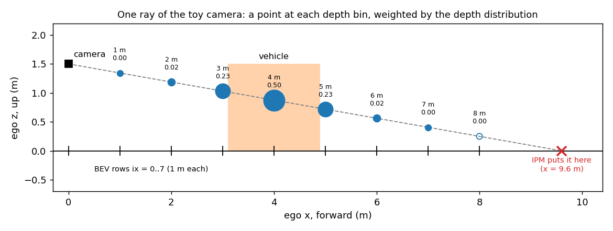
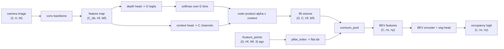
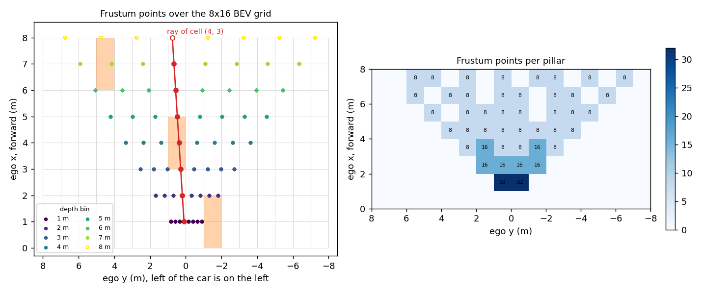

# A11.5b - Lift-Splat-Shoot

A self-driving car plans its motion in a top-down map of its surroundings, while its cameras see
perspective images. The camera-to-BEV view transform converts a ring of camera images into one
ego-centric bird's-eye-view (BEV) feature grid, a top-down grid of feature vectors with one cell
per patch of ground around the car. Lift-Splat-Shoot (LSS) does it by predicting, for every pixel,
a probability distribution over the pixel's depth, pushing the pixel's feature out into 3-D at
every candidate depth in proportion to that probability, and summing the results into BEV cells.
Every step is differentiable, so the depth predictor is trained by the loss of the BEV task
itself, with no depth label anywhere in the pipeline.

Build that view transform: the per-pixel depth-and-context lift (context is a learned feature
vector per pixel), the frustum (the 3-D position of every pixel at every candidate depth) that
places each lifted feature in the ego frame, the sort-and-cumsum pooling that splats the frustum
into BEV pillars (BEV cells, each the vertical column of space above one patch of ground), the
assembled model, and the BEVDepth depth-supervision loss. The depth lift and the sort-and-cumsum
pooling built here are shared infrastructure, reused unchanged by the occupancy-prediction
assignment. All graded tests run on CPU.

Required reading before starting:
- Philion and Fidler 2020, "Lift, Splat, Shoot: Encoding Images from Arbitrary Camera Rigs by
  Implicitly Unprojecting to 3D", [arXiv:2008.05711](https://arxiv.org/abs/2008.05711) (the
  outer-product lift in section 3.1, the cumsum splat in section 3.2).
- Li et al. 2023, "BEVDepth: Acquisition of Reliable Depth for Multi-view 3D Object Detection",
  [arXiv:2206.10092](https://arxiv.org/abs/2206.10092) (the explicit lidar depth supervision).

## Lecture notes

### What the view transform is for

#### The task

A self-driving stack plans in a top-down map of the world around the car: where the road goes,
where other vehicles are, what is drivable. In the LSS paper that map is a $200 \times 200$ grid of
$0.5$ m cells covering 50 m in every direction around the car, and the input is six cameras on a
ring around the roof (the nuScenes rig), each image resized to $128 \times 352$ pixels. Each image
is a 2-D perspective projection that has thrown away depth. The view transform gets from the six
images to the grid, and everything downstream (detection, occupancy, motion prediction, planning)
reads only the grid it produces. Content placed in the wrong BEV cell here cannot be recovered by
any later stage, because the later stages never see the image.

The toy in this assignment keeps one camera of that rig: a forward camera mounted 1.5 m above the
ego origin, a $32 \times 32$ image, and an $8 \times 16$ BEV grid of 1 m cells (8 m forward, 8 m to
each side). The scene contains three "vehicles" drawn as orange blobs in the image, and the target
is a 0/1 occupancy grid marking the cells each vehicle covers.

#### Why flat-ground mapping fails

The geometry-only baseline is inverse perspective mapping (IPM), the flat-ground homography from
the camera-geometry assignment: assume every pixel lies on the ground plane at $z = 0$, project
each BEV cell to a pixel, and sample the image there. That is exact for the road surface and lane
markings, and wrong for anything with height. A point 1.5 m above the ground and a ground point
farther along the same ray project to the same pixel, so IPM paints a car's roof into a BEV cell
well past the car's true footprint, and every tall object smears outward along the viewing ray.
In the toy, the pixel that sees the middle of a vehicle 4 m ahead (0.875 m above the ground) is
placed by IPM at 9.6 m, outside the grid (the cross in the figure further below). One image plus
one ground-plane assumption cannot tell these cases apart, so the transform needs depth.

Before Lift-Splat-Shoot the options were a separate lidar, or a monocular depth network that
predicts one depth per pixel and back-projects a point cloud. A single distance per pixel cannot
express uncertainty: at the edge of a car, where a pixel could be on the car at 10 m or on the
building behind it at 30 m, a depth network trained with a squared-error loss outputs a value in
between and places the feature in empty space. The bigger problem is with training rather than with
accuracy, as the next part shows.

> **Exercise 1 (how far IPM smears a vehicle).** A camera sits at height $h = 1.5$ m. A point on a
> vehicle is 5 m ahead of the camera at height $z = 1.0$ m. Where on the ground does IPM place
> it? Derive the general formula for a point at forward distance $x$ and height $z < h$, and say
> what happens to a point at the camera's own height.

<details>
<summary>Answer</summary>

IPM follows the ray from the camera through the point until it reaches $z = 0$. The ray drops
$h - z$ meters over $x$ meters forward, so it drops the full $h$ after $x\,h/(h - z)$ meters. For
$x = 5$, $z = 1.0$ this is $5 \cdot 1.5 / 0.5 = 15$ m, three times the true distance. The error
grows as $z$ approaches $h$: the toy's vehicle point at $x = 4$, $z = 0.875$ lands at
$4 \cdot 1.5/0.625 = 9.6$ m. A point at the camera's height lies on a horizontal ray that never
meets the ground, so IPM has no place to put it (it maps to the horizon). Only points on the
ground, $z = 0$, come out right.

</details>

#### Why one depth per pixel cannot be trained

Follow the pipeline that one depth per pixel implies. The network outputs a depth $\hat{z}$ at a
pixel; geometry turns (pixel, $\hat{z}$) into an ego point; that point falls in the BEV cell
$ix = \lfloor (x - x_{\min})/\text{res}\rfloor$, where the ego forward coordinate $x$ moves with
$\hat{z}$; the pixel's feature is added to that cell; a loss $L$ is computed on the resulting grid.
Training by gradient descent needs $\partial L / \partial \hat{z}$.

That derivative carries no information. The cell index is a floor of a function of $\hat{z}$, a
staircase. Nudge $\hat{z}$ a little and either the point stays in the same cell, so $L$ does not
change at all, or it jumps to the next cell and $L$ changes discontinuously. The derivative is
exactly $0$ almost everywhere and undefined at the jumps, so gradient descent learns nothing about
which direction to move the depth. Choosing a bin with an argmax over $D$ scores has the same
problem: the selected index is a step function of the scores, flat between the steps. Any hard
choice of where to put a feature cuts the gradient path back to whatever made the choice.

#### The idea: put the feature at every depth at once

Lift-Splat-Shoot removes the choice. For each pixel a part of the network called the depth head
predicts a categorical distribution over a fixed set of $D$ discrete depth bins, that is $D$
non-negative numbers $\alpha_0, \dots, \alpha_{D-1}$ summing to one, one per candidate distance.
Instead of putting the whole feature at one depth, it puts a fraction $\alpha_d$ of the feature at
every bin $d$ at once. Which BEV cell bin $d$ lands in is fixed geometry, computed once from the
camera calibration and never a function of any network weight. The only network-dependent quantity
that decides placement is the weight $\alpha_d$, and the grid contents are linear in it. The
derivative of a grid cell with respect to $\alpha_d$ is the pixel's feature vector, a finite number
that varies smoothly, and the chain rule runs from the BEV loss back to the depth head.

The figure shows this for one pixel of the toy camera. The dashed line is the pixel's viewing ray.
The dots are the eight candidate positions, one per depth bin at 1, 2, ..., 8 m, and the size of
each dot is the share of the pixel's feature placed there under an example depth distribution that
peaks at 4 m. Each of the first seven dots sits above a different BEV row, so moving probability
between bins moves the feature between cells smoothly. The 8 m dot (hollow) falls exactly on the
far edge of the toy grid and is dropped, as the top-view figure below shows. The cross is where IPM
would put the same pixel.



The paper calls this "implicit" depth: there is no depth label anywhere. The depth head is trained
anyway, because the distribution is produced by a softmax (exponentiate $D$ scores and divide by
their sum, defined in the backbone section below), and that normalization couples the bins, so
raising the probability of a bin whose BEV cell needs this feature necessarily lowers the
probability of the bins that do not. The exact gradient is written out after the lift below.

#### Why it matters

Multi-camera BEV perception became one trainable module instead of a depth network followed by a
separate, untrainable projection step. Much of the camera-only BEV detector line since builds
directly on this transform: BEVDet attaches a 3-D detection head to it, BEVDepth adds depth
supervision, and BEVPoolv2 makes its pooling fast enough to deploy.

### The backbone and the two heads

The lift sits behind a backbone and two prediction heads, and the rest of these notes use those
names.

The backbone is a small convolutional network mapping the $3 \times H \times W$ image to a feature
map of shape $C_{bb} \times H_f \times W_f$, where $H_f = H/s$ for a total stride $s$ (here
$32 \times 32$ down to $8 \times 8$ at $s = 4$). One cell of that feature map summarizes an
$s \times s$ patch of the image. The view transform operates at this resolution, so "per-pixel
depth" below always means per feature cell, and the pixel a cell stands for is the center of its
patch.

A head is a $1 \times 1$ convolution: a single linear map from the $C_{bb}$ channels at one cell to
the output channels at that same cell, applied with shared weights at every cell and mixing nothing
between cells. Two heads read the same backbone feature map. The depth head emits $D$ numbers per
cell, the context head emits $C$ numbers per cell. They see identical inputs; only the training
signal distinguishes them.

The depth head's $D$ outputs are logits $\ell_0, \dots, \ell_{D-1}$, unnormalized scores with no
range constraint, turned into a distribution by a softmax along the bin axis,

$$\alpha_d = \frac{e^{\ell_d}}{\sum_{k=0}^{D-1} e^{\ell_k}},$$

which gives $\alpha_d \ge 0$ and $\sum_d \alpha_d = 1$. Reading $\alpha_d$ as "the probability that
what this cell sees sits at distance $\text{bins}[d]$" is the intended interpretation, and nothing
imposes it except the loss.

The context head's $C$ outputs are the feature actually carried into the BEV grid. The paper calls
it the context vector, and it has no prescribed meaning; it becomes whatever the BEV loss finds
useful, some mix of vehicle-ness, free space, and road paint. Depth decides where a feature goes,
context decides what goes there.

The bin centers are fixed numbers, not learned parameters: $[1, 2, \dots, 8]$ m in this toy, and
in the LSS paper the depth range $[4, 45)$ m at 1 m spacing, which gives $D = 41$ bin values
$4, 5, \dots, 44$ m. Changing the bins changes the
geometry of the whole transform.

After the splat, the pooled BEV grid passes through the BEV encoder, a small convolutional network
that operates on the grid as an image (so it mixes neighboring cells), and a final $1 \times 1$
convolution, the segmentation head, that outputs one occupancy logit per BEV cell.

The whole pipeline, with the shapes used in the assignment (the frustum, pillar index, and pooling
steps are explained in their own sections below):



### Our one-ray example (one pixel of the toy camera that sees a vehicle)

The full transform handles $8 \times 8$ feature cells, 8 depth bins, and 16 feature channels. To
see the mechanism by hand we shrink it to one feature cell and a few bins. We call this our
one-ray example.

The cell is the one at feature row 4, column 3 of the toy scene. Its pixel center is $(u, v) = (14,
18)$, just left of and below the image center, and it sees the vehicle that stands about 4 m ahead
(the vehicle in the side-view figure). Its ray passes over BEV rows $ix = 1, \dots, 7$ in BEV
column $iy = 8$, one row per depth bin, and the vehicle occupies rows 3 and 4 of that column.

We keep only the three bins at 3, 4, and 5 m, which land in rows 3, 4, and 5. We replace the
16-channel context vector by one number $c = 1$ (think of it as "vehicle here"), drop the BEV
encoder, and use the squared-error loss $L = \tfrac12 \sum_p (\text{BEV}[p] - y_p)^2$ over the
three pillars (a pillar is a BEV cell, named for the vertical column of space above it) with target
$y = (0, 1, 0)$: the vehicle's feature belongs in row 4. (The real target marks rows 3 and 4; one
row keeps the arithmetic small.)

With a hard depth, the feature lands in row $\lfloor \hat{z} \rfloor$. At $\hat{z} = 3.4$ it lands
in row 3, $\text{BEV} = (1, 0, 0)$ and $L = 1$; at $\hat{z} = 3.41$ nothing changes; at
$\hat{z} = 4.0$ it jumps to row 4 and $L = 0$. Between jumps the gradient is zero.

With a depth distribution and all three logits equal to zero,
$\alpha = (\tfrac13, \tfrac13, \tfrac13)$, so $\text{BEV} = (\tfrac13, \tfrac13, \tfrac13)$ and
$L = \tfrac13$. The gradient with respect to each pillar is
$\text{BEV} - y = (\tfrac13, -\tfrac23, \tfrac13)$, and since pillar $d$ holds $\alpha_d c$ with
$c = 1$, this is also $g = \partial L/\partial \alpha$. The softmax Jacobian is
$\partial \alpha_k / \partial \ell_j = \alpha_k(\delta_{kj} - \alpha_j)$, so the gradient with
respect to the logits is $\alpha_k\big(g_k - \sum_j \alpha_j g_j\big)$, which here is
$(\tfrac19, -\tfrac29, \tfrac19)$. Gradient descent raises the 4 m logit and lowers the other two.
No depth label was used: the signal came from the BEV target alone.

The real toy has the same structure at full size. The top view below shows every frustum point of
the toy camera over the BEV grid (a frustum point is the ego-frame position of one feature cell at
one depth bin; there are 64 cells times 8 bins), with our one-ray example in red and the vehicles'
ground-truth cells shaded. Points at depth $d$ sit at $x = d$, on the near edge of row $d$.



Three things in the figure come up again below. The eight feature rows of the image map to the
same $(x, y)$ at a given depth and differ only in height, so each dot in the left panel is a stack
of eight points, and pooling over the vertical column discards that height. Near the camera the
rays are close together, so a near pillar receives more points (up to 32) than a far one (8). And
the 8 m points fall exactly on the far edge of the grid, $x = 8$, which lies outside it (hollow
dots).

Our one-ray example keeps what this assignment is about: the soft placement along a ray, the fixed
geometry that maps each bin to a pillar, and the gradient that reaches the depth logits through
the pooled grid. It drops the convolutional networks before and after the transform, the many
cells whose rays share pillars, and the multiple context channels.

### Overview of the rest of the notes

The sections below build the rest of the transform in pipeline order. Most steps are familiar ideas
in a new arrangement.

1. The lift. An outer product spreads the context over the depth bins, weighted by the
   distribution, exactly as in our one-ray example. Its gradient is a chain rule through a sum.
2. The frustum. The pinhole back-projection and the camera-to-ego transform from the
   camera-geometry assignment place every (depth bin, cell) pair in the ego frame.
3. The splat. Every lifted feature is summed into its BEV pillar. Written as a matrix this is a
   constant sparse linear map, the same kind of object as a measurement matrix in a linear
   estimator, so its gradient is its transpose. A sort and a cumulative sum compute it without
   atomic adds.
4. Supervised depth. BEVDepth adds a cross-entropy loss (the negative log of the probability the
   distribution gives the correct bin) on lidar-derived depth bins, a classifier trained against
   labels where they exist.
5. Where it leads. The pull-in alternative (BEVFormer, which samples image features for each BEV
   cell instead), occupancy, continuous depth, and temporal fusion.

Five exercises, placed after the sections they test, are meant to be worked by hand.

### The lift

The lift is the outer product over (depth bin, context channel) at each feature cell:

$$\text{volume}[b, d, c, i, j] = \alpha[b, d, i, j]\;\cdot\;\text{context}[b, c, i, j],$$

with shape $(B, D, C, H_f, W_f)$, where $b$ indexes images in the batch and $(i, j)$ the feature
cell. We call the result the lift volume (the paper describes it as a frustum-shaped point cloud
of context features). Per cell it is the rank-one matrix
$\alpha\,\text{context}^{\top} \in \mathbb{R}^{D \times C}$: one copy of the context vector per
depth bin, each scaled by that bin's probability. A cell whose distribution concentrates on bin
$d^{*}$ sends almost all of its context to $d^{*}$ and near-zero elsewhere; a flat distribution
spreads the same context over every depth. This is the only place depth enters the network, and
the product is linear in each argument separately, so gradients reach both heads.

Here is the gradient that trains depth without a depth label. Write $p(d, i, j)$ for the BEV pillar
that feature cell $(i, j)$ at bin $d$ falls into, a constant fixed by calibration. The pooled grid
is the sum of every contribution that lands in a pillar (the batch index is dropped),

$$\text{BEV}[c, p] = \sum_{(d,i,j)\,:\,p(d,i,j) = p} \alpha[d, i, j]\;\text{context}[c, i, j],$$

so differentiating a loss $L$ defined on that grid gives

$$\frac{\partial L}{\partial \alpha[d, i, j]} = \sum_{c} \text{context}[c, i, j]\;
\frac{\partial L}{\partial \text{BEV}[c,\; p(d, i, j)]}.$$

Read it as an inner product between this cell's context vector and the loss gradient at the one
pillar that bin $d$ points to. If adding this context there lowers the loss, bin $d$'s probability
is pushed up; if it raises the loss, down. Each of the $D$ bins collects its own verdict from its
own pillar, and the softmax turns the $D$ verdicts into a redistribution of probability mass among
the bins. Nothing in that expression is a depth measurement. In our one-ray example the context is
the single number $c = 1$, so the verdict of each bin is just the loss gradient at its pillar,
$(\tfrac13, -\tfrac23, \tfrac13)$.

> **Exercise 2 (the gradient from a wrong depth guess).** In our one-ray example (bins at 3, 4,
> 5 m, context $c = 1$, target $y = (0, 1, 0)$, loss $L = \tfrac12\sum_p(\text{BEV}[p] - y_p)^2$),
> the depth head currently favors 3 m: logits $\ell = (\ln 2, 0, 0)$. Compute $\alpha$, the grid,
> $L$, and $\partial L/\partial \ell$. Which logits go up and which go down under gradient
> descent?

<details>
<summary>Answer</summary>

$e^{\ell} = (2, 1, 1)$, so $\alpha = (0.5, 0.25, 0.25)$, which with $c = 1$ is also the grid.
$L = \tfrac12(0.25 + 0.5625 + 0.0625) = 0.4375$. The per-bin verdicts are
$g = \text{BEV} - y = (0.5, -0.75, 0.25)$. Their $\alpha$-weighted mean is
$0.25 - 0.1875 + 0.0625 = 0.125$, so

$$\frac{\partial L}{\partial \ell} = \alpha \odot (g - 0.125) = (0.1875,\ -0.21875,\ 0.03125).$$

Gradient descent raises the 4 m logit and lowers the 3 m logit the most, since that bin holds the
most misplaced mass. The 5 m logit goes down only slightly: its pillar also holds misplaced mass,
but its verdict $0.25$ is only a little above the weighted mean. With a hard depth of 3.4 m the
same situation would give $\partial L / \partial \hat{z} = 0$.

</details>

### The frustum

For each depth bin $d$ and feature cell, back-project the cell's pixel center to a camera-frame
point with the pinhole inverse,

$$X = \frac{(u - c_x)\,d}{f_x},\qquad Y = \frac{(v - c_y)\,d}{f_y},\qquad Z = d,$$

where $(u, v)$ is the pixel, $f_x, f_y$ the focal lengths and $(c_x, c_y)$ the principal point
from the intrinsic matrix $K$. The camera frame follows the OpenCV convention ($x$ right, $y$ down,
$z$ forward along the optical axis), and the depth $d$ is the camera-frame $Z$, not the distance
along the ray. Then map the point to the ego frame ($x$ forward, $y$ left, $z$ up). The extrinsic
is $E = T_{\text{cam} \leftarrow \text{ego}}$, the transform that takes ego coordinates to camera
coordinates, so ego points come from $E^{-1} = T_{\text{ego} \leftarrow \text{cam}}$.

Sweeping this over all cells and all $D$ bins gives a frustum: the truncated pyramid of space a
rectangular image sees between the nearest and farthest bin, sampled on a $D \times H_f \times W_f$
lattice. The top-view figure above is the toy's frustum seen from above.

The frustum depends only on $K$, $E$, and the bin centers, none of which change during training, so
production implementations compute it once at startup and cache it.

The depth range must cover the BEV forward extent. For a forward camera the OpenCV camera $z$ axis
points along ego $+x$, so the camera-frame depth equals the ego forward distance, and a frustum
reaches only as far forward as the largest depth bin. A vehicle past that distance is unreachable
by every frustum point, so the BEV grid forward extent has to match the depth range.

> **Exercise 3 (one frustum point by hand).** The toy camera has $f_x = f_y = 16$,
> $c_x = c_y = 15.5$, and sits at ego $(0, 0, 1.5)$ looking along ego $+x$, so a camera point
> $(X, Y, Z)$ is the ego point $(Z,\ -X,\ 1.5 - Y)$. Compute the ego point of our one-ray example's
> cell (pixel $(14, 18)$) at the 4 m bin, then its BEV pillar in the $8 \times 16$ grid with
> $x_{\min} = 0$, $y_{\min} = -8$, 1 m cells, and flat index $ix \cdot n_y + iy$. Where does the
> 8 m bin of the same cell go?

<details>
<summary>Answer</summary>

$X = (14 - 15.5) \cdot 4/16 = -0.375$, $Y = (18 - 15.5) \cdot 4/16 = 0.625$, $Z = 4$. The ego point
is $(4,\ 0.375,\ 0.875)$: 4 m ahead, 0.375 m to the left (the pixel is left of center), 0.875 m
above the ground (the pixel is below center, so the ray points down). Then $ix = \lfloor 4/1
\rfloor = 4$, $iy = \lfloor (0.375 + 8)/1 \rfloor = 8$, and the flat index is $4 \cdot 16 + 8 =
72$. That is one of the vehicle's two ground-truth cells, rows 3 and 4 of column 8. The 8 m bin
gives $x = 8$, and $ix = 8$ is outside the rows $0, \dots, 7$, so that point is dropped.

</details>

### The splat

The splat collapses the frustum cloud onto the BEV plane by summing every point that falls in the
same grid cell. The name pillar comes from PointPillars (Lang et al. 2019,
[arXiv:1812.05784](https://arxiv.org/abs/1812.05784)): a BEV cell with no height subdivision is the
vertical column of space standing on that patch of ground, and pooling over the column is the same
as discarding $z$. A point at ego $(x, y)$ falls in cell
$ix = \lfloor (x - x_{\min})/\text{res}\rfloor$ along forward $x$ and
$iy = \lfloor (y - y_{\min})/\text{res}\rfloor$ along lateral $y$; the flat index is
$ix\cdot n_y + iy$, row-major with $x$ as the slow axis. Points outside the grid take index $-1$
and are dropped. The grid is half-open, $[x_{\min}, x_{\max}) \times [y_{\min}, y_{\max})$, so a
point exactly on the far edge is outside.

The pool is a sum, not a max or a mean. Sum keeps the pool linear in the features, which both the
gradient argument below and the running-sum implementation require.

A direct implementation adds each point into its pillar with a scatter-add. LSS instead sorts the
points by their pillar index and uses a cumulative sum (cumsum, the running total along an axis):
cumsum the sorted features along the point axis, and the sum over a pillar is the cumsum at the
last row of that pillar's run of equal indices minus the cumsum at the previous run's last row.
Keeping the last row of each equal-index run and differencing successive run-ends gives every
pillar's sum in one pass.

Concretely, the run boundary is where the sorted index changes. With sorted indices
$[0, 0, 2, 2, 2]$ and per-point scalar features $[a, b, c, e, g]$ (skipping $d$, which names a
depth bin everywhere else), the running sum is
$[a, a{+}b, a{+}b{+}c, a{+}b{+}c{+}e, a{+}b{+}c{+}e{+}g]$. The last row of run $0$ is position $1$
and the last row of run $2$ is position $4$ (the rows where the next index differs, with the final
row always a run-end). Reading the cumsum at those two rows gives $[a{+}b,\; a{+}b{+}c{+}e{+}g]$,
and differencing successive entries (treat the first kept entry as a difference against zero, i.e.
prepend a zero row) gives pillar sums $[a{+}b,\; c{+}e{+}g]$ for pillars $0$ and $2$. Pillar $1$ is
empty and never appears, so the result is indexed by the distinct present pillars, then scattered
into the dense grid.

> **Exercise 4 (sort, cumsum, difference).** Six points have pillar indices $[3, -1, 0, 3, 0, 5]$
> and scalar features $[1, 2, 3, 4, 5, 6]$. Pool them with the sort-and-cumsum procedure (stable
> sort, so equal indices keep their order), writing down every intermediate array. Check the result
> against direct summation.

<details>
<summary>Answer</summary>

Drop the point with index $-1$: indices $[3, 0, 3, 0, 5]$, features $[1, 3, 4, 5, 6]$. Stable sort
by index: indices $[0, 0, 3, 3, 5]$, features $[3, 5, 1, 4, 6]$. Cumsum: $[3, 8, 9, 13, 19]$. Run
ends are where the next index differs, plus the last row: positions $1, 3, 4$, with cumsum values
$[8, 13, 19]$. Successive differences against a leading zero: $[8, 5, 6]$ for pillars $0, 3, 5$.
Direct summation agrees: pillar 0 is $3 + 5 = 8$, pillar 3 is $1 + 4 = 5$, pillar 5 is $6$, and
pillars 1, 2, 4 are empty.

</details>

### Why a sort and an integer index are still differentiable

The pool contains a sort and integer bin indices, and neither of those looks like something a
gradient can pass through. Writing the pool as a matrix settles it. Stack the $N$ point features as
the rows of $X \in \mathbb{R}^{N \times C}$ and let $A \in \{0,1\}^{N \times P}$ have $A_{np} = 1$
exactly when point $n$ falls in pillar $p$, with a row of zeros for a dropped point. Pillar pooling
is then

$$Y = A^{\top} X.$$

The indices come from camera calibration, not from network weights, so $A$ is a constant. The pool
is a fixed linear map of the features, like a measurement matrix in a linear estimator, and its
Jacobian does not depend on $X$ at all. The backward pass is the adjoint,

$$\frac{\partial L}{\partial X} = A\,\frac{\partial L}{\partial Y},$$

which says each point receives the gradient of the one pillar it landed in, and each dropped point
receives zero. In Exercise 4, if the loss gradient at pillars $0, \dots, 5$ were
$(10, 20, 30, 40, 50, 60)$, the six points would receive $(40, 0, 10, 40, 10, 60)$. The sort, the
cumsum, and the difference of run-ends factor that same $A^{\top}$ into three constant matrices: a
permutation, a lower-triangular matrix of ones, and a difference matrix. Autograd knows the
backward of each, so the pool needs no custom kernel and no scatter-add, and a float64 gradient
check of it matches finite differences to machine precision.

Compared with a literal scatter-add, the factorization removes the per-point atomic add: a
read-modify-write to the same memory address issued by many GPU threads at once, which serializes
whenever many points share a pillar and sums in a nondeterministic order. Philion and Fidler go
further and derive the analytic gradient of the whole sort-cumsum-difference module rather than
letting autograd record its three steps, and report roughly a 2x training speedup from that.
BEVPoolv2 later replaced the entire sequence with one fused CUDA kernel.

### Implicit depth versus supervised depth

BEVDet (Huang et al. 2021, [arXiv:2112.11790](https://arxiv.org/abs/2112.11790)) takes the LSS view
transform and attaches a 3-D object-detection head, showing the BEV grid works for detection as
well as segmentation. BEVDepth then measured the depth that LSS learns implicitly against lidar and
found it often wrong even when detection looked fine. Segmentation only needs to know roughly where
the drivable surface and the obstacles are, so a smeared depth distribution still paints roughly
the right region; a 3-D bounding box needs the object at the right metric distance, and a wrong
depth bin translates the whole box.

BEVDepth's fix is to supervise the depth distribution directly with lidar. Each lidar return is
transformed into the camera frame with the same $E$ and $K$ the view transform already uses; its
camera-frame $z$ is then the true depth of whatever the corresponding pixel sees. Downsampled to
feature resolution, that depth becomes a target bin, the nearest bin center,

$$\text{label} = \arg\min_k \big|z_{\text{cam}} - \text{bins}[k]\big|,$$

kept only where $z_{\text{cam}}$ falls inside the bin range, since a return nearer than $d_{\min}$
or past $d_{\max}$ has no bin to name. Lidar is sparse relative to the image, so most feature cells
get no return at all and the loss is masked to the labeled cells and averaged over those.

The loss at a labeled cell is the cross-entropy of the predicted distribution against that bin,
$-\log \alpha_{\text{label}}$: zero when all the mass sits on the right bin, growing without bound
as that bin's probability approaches zero. Its derivative with respect to the $D$ depth logits is
$\alpha - e_{\text{label}}$, where $e_{\text{label}}$ is the one-hot vector, $1$ at the labeled bin
and $0$ elsewhere. One gradient step therefore raises the labeled bin's logit and lowers every
other bin's in proportion to the probability it currently holds. Compared with the implicit
gradient of the lift section, this signal does not pass through the BEV grid or depend on the
context vector: it names the right bin directly.

> **Exercise 5 (one step of depth supervision).** With the toy's bins $[1, \dots, 8]$ m, a lidar
> return at a labeled cell has camera-frame depth $z_{\text{cam}} = 4.3$ m, and the depth logits
> there are all zero. Find the label, the loss, and its gradient with respect to the logits. Take
> one gradient-descent step of size 1 on the logits and compute the new probability of the labeled
> bin and the new loss.

<details>
<summary>Answer</summary>

The nearest bin center to 4.3 m is 4 m, bin index 3 (counting from 0). With zero logits
$\alpha = 1/8$ for every bin, so the loss is $-\log(1/8) = \ln 8 \approx 2.079$. The gradient is
$\alpha - e_3 = (0.125, 0.125, 0.125, -0.875, 0.125, 0.125, 0.125, 0.125)$. After the step the
logits are $-0.125$ everywhere except $0.875$ at bin 3. Adding $0.125$ to all of them leaves the
softmax unchanged and gives logits $0$ and $1$, so the new probability is
$e/(e + 7) \approx 0.280$ and the new loss is $-\ln 0.280 \approx 1.274$. Every one of the eight
logits moved, even though only one bin was named, because the softmax couples them.

</details>

BEVDepth's ablation attributes most of its accuracy gain over BEVDet to this one loss, and explicit
depth supervision is now standard in production camera detectors. BEVPoolv2 (Huang and Huang 2022,
[arXiv:2211.17111](https://arxiv.org/abs/2211.17111)) is a deployment optimization rather than a new
idea: it precomputes the frustum-to-pillar index, which is constant given calibration, and fuses
the pooling into one CUDA kernel, reported around 15x faster than the previous fastest LSS pooling.

### Push-out versus pull-in

What we call push-out and pull-in (often called forward and backward projection) is the main
contrast among view transforms. LSS pushes image features out into 3-D along a depth distribution,
then pools. BEVFormer (Li et al. 2022, [arXiv:2203.17270](https://arxiv.org/abs/2203.17270)), the
next assignment, pulls features in: it starts from BEV grid queries, projects each query to
reference points in the images, and gathers features there with attention. Both end at a BEV
feature grid; they differ in which direction the geometry runs, and therefore in what has to be
differentiable. Push-out needs a soft depth because the network chooses the depth; pull-in needs a
differentiable image sampler because the network chooses the sampling location.

### Where this goes next

Occupancy prediction reuses the exact depth-lift and frustum code with one change: drop the BEV
collapse and keep the full 3-D voxel grid, passing a 3-D voxel index to the pooling instead of a
2-D pillar index. GaussianLSS (Lu et al. 2025,
[arXiv:2504.01957](https://arxiv.org/abs/2504.01957)) changes the depth representation: instead of
$D$ bin probabilities per pixel it predicts a continuous Gaussian, a mean depth and a spread, so the
pixel carries an explicit depth uncertainty rather than the shape of a histogram, and the cost
stops scaling with the bin count.

One more idea the toy cannot show. BEVDet4D (Huang and Huang 2022,
[arXiv:2203.17054](https://arxiv.org/abs/2203.17054)) warps the previous frame's BEV feature map
into the current ego frame, resampling it through the ego motion between the two timestamps, and
concatenates it with the current one. A static object then sits in the same cell of both maps while
a moving one is displaced by its own motion, so the pair carries the velocity information a single
frame cannot.

## The assignment

Fill these holes, in order. Each is one `NotImplementedError` with a matching test. The docstring
in each function gives the signature, shapes, and constraints.

| # | Function | File | Concept from the notes |
|---|---|---|---|
| 1 | [`DepthLift.forward()`](lift_splat.py) | `lift_splat.py` | the depth head and the context head |
| 2 | [`DepthLift.lift()`](lift_splat.py) | `lift_splat.py` | the softmax and the outer-product lift |
| 3 | [`frustum_points()`](lift_splat.py) | `lift_splat.py` | the frustum: back-projection and $E^{-1}$ |
| 4 | [`pillar_index()`](lift_splat.py) | `lift_splat.py` | the flat pillar index, $-1$ outside the grid |
| 5 | [`cumsum_pool()`](lift_splat.py) | `lift_splat.py` | the sort-and-cumsum splat |
| 6 | [`LiftSplatShoot.forward()`](lift_splat.py) | `lift_splat.py` | the assembled pipeline |
| 7 | [`bevdepth_depth_loss()`](lift_splat.py) | `lift_splat.py` | BEVDepth's masked depth cross-entropy |

Everything is in `lift_splat.py`; the shared library re-exports these through
`nanovision.lift_splat`. The `LSSConfig` in `config.py`, the backbone, BEV encoder, and seg-head
modules, the precomputed pixel-center grid, and the `bev_toy_scene` generator in
`nanovision/data/toy.py` are provided.

Notes on the toy's fixed config and on specific holes:
- Depth bin centers are `arange(d_min, d_max, d_step)`, exclusive of `d_max`, so $d_{\min}=1$,
  $d_{\max}=9$, $d_{\text{step}}=1$ gives $D=8$ centers $[1, \dots, 8]$. Writing
  `arange(1, 10, 1)` would give $D=9$ and break every shape. The bins are pinned in `config.py`
  because changing them changes the geometry of the whole transform.
- The BEV grid is $x \in [0, 8)$, $y \in [-8, 8)$ at 1.0 m, an $8\times16$ grid, chosen to match the
  depth reach. With integer bins and the half-open grid, bin $d$ lands in row $ix = d$: rows 1 to 7
  receive one depth bin each, the 8 m bin falls exactly on $x = 8$ and is dropped (64 of the 512
  frustum points), and row 0 receives no lifted features. The BEV encoder's $3 \times 3$
  convolutions still let the model mark row-0 cells.
- A feature cell at $(i, j)$ corresponds to image pixel $((j+0.5)s, (i+0.5)s)$ for backbone stride
  $s$; `config.pixel_xy()` precomputes that mapping, leaving only the geometry to implement.
- `frustum_points` reuses the `unproject`, `invert_transform`, and `apply_transform` primitives
  from the camera-geometry assignment (`nanovision.geometry`), one call each. The extrinsic is
  spelled `T_cam_ego` in the code.
- The flat pillar index $ix\cdot n_y + iy$ and the reshape $(n_x n_y, C)\to(C, n_x, n_y)$ are used
  everywhere, so the ground truth and the seg head are both $(n_x, n_y)$.
- `cumsum_pool` may not call `scatter_add` or `index_add`; the test uses a scatter-add only as an
  oracle. Writing the per-run sums into the dense output with `index_copy` is allowed, since each
  pillar appears once.
- `LiftSplatShoot.forward` processes one scene at a time: loop over the batch, and sum the pooled
  BEV contributions across cameras before the BEV encoder.

### Running and validating

Activate the environment (`conda activate nanovision`), then:

```
make test     A=a11_5b_lift_splat_shoot   # run the tests against the top-level files (the holes)
make verify   A=a11_5b_lift_splat_shoot   # run the same tests against the reference solution/
make viz      A=a11_5b_lift_splat_shoot   # render the figures from the reference solution
make viz-mine A=a11_5b_lift_splat_shoot   # render the figures from your own code (holes filled)
```

`make test` runs the suite in `assignments/a11_5b_lift_splat_shoot/tests/` against the top-level
`lift_splat.py`, red until the holes are filled and green once correct. `make verify` runs the
identical suite against the reference `solution/` by setting `NANOVISION_IMPL=solution`, so it is
green from the start and shows the target.

The tests check:
- `test_depth_lift.py`: shapes; that a one-hot depth distribution (all the probability mass on a
  single bin) makes the lift volume equal the context at the selected bin and near-zero elsewhere;
  and a gradcheck of the outer product in float64. A gradcheck runs `torch.autograd.gradcheck`,
  which compares the analytic backward pass against finite differences of the forward pass; it
  needs double precision because in float32 the finite-difference step is swamped by rounding.
- `test_frustum.py`: for a camera at the ego origin, the center pixel at depth $d$ maps to ego
  $(d, 0, 0)$, a pixel right of center maps to ego $-y$, and the ego points project back to the
  original pixel centers.
- `test_splat.py`: same-pillar summation, dropping out-of-bounds points, equality against a
  scatter-add oracle, a float64 gradcheck, and the pillar-index cell math.
- `test_depth_supervision.py`: an all-false mask gives exactly zero loss; a single labeled cell
  pushes the target bin's logit up and every other bin's down (the sign pattern of
  $\alpha - e_{\text{label}}$); and the depth head can be overfitted to the toy labels (final loss
  below 0.05, argmax accuracy above 0.95).
- `test_bev_seg.py`: overfits the full model on one scene (final loss below 0.05, BEV IoU above
  0.6).
- `test_forbidden_imports.py`: a static scan of the top-level `lift_splat.py`,
  `solution/lift_splat.py`, and the `nanovision/lift_splat.py` re-export shim for `scatter_add`,
  `index_add`, OpenCV and Kornia projection shortcuts, and external BEV pooling kernels; it passes
  in both modes.

Overfitting here means deliberately driving the loss on one fixed example to near zero. That says
nothing about generalization; it is a check that every gradient path in the assembled pipeline is
connected and that the geometry routes features to the cells the loss wants.

`make viz` trains two copies of the full model from the same initialization on the same scene,
1500 Adam steps each: one on the BEV loss alone (vanilla LSS, implicit depth), and one on the BEV
loss plus `bevdepth_depth_loss` on the scene's depth-bin labels at the three vehicle feature cells
(BEVDepth). It prints each model's final losses, its BEV IoU, and the probability it puts on the
label bin at each vehicle cell, and writes two figures to `out/`:
- `depth_distribution.png`: the predicted depth distribution at each labeled vehicle cell, one row
  per model, with the label bin marked.
- `bev_occupancy.png`: the ground-truth BEV occupancy next to the predicted occupancy of each model.

The figures in these notes are generated by `assets/make_ray_figures.py`, which writes out the
pinhole geometry in numpy and does not use the assignment code.

What you should see when you run this. Everything except the two overfit tests finishes in well
under a second. The overfit tests run 1500 steps (BEV segmentation) and 800 steps (depth) at Adam
learning rate $10^{-2}$ on CPU; on an idle machine with two threads they took about 5 s and 1 s,
and `make viz` about 14 s. Both settle far inside their step budget: the BEV binary cross-entropy
drops from about 0.77 at initialization to under $10^{-4}$ within roughly the first hundred steps,
with BEV IoU reaching 1.0 by the same point, and the depth cross-entropy falls below $10^{-6}$
within about fifty steps. Binary cross-entropy is the per-cell version of the cross-entropy above,
applied to the sigmoid of each cell's occupancy logit against a $0/1$ target; IoU is the
intersection over union of the cells predicted occupied (logit above zero) with the cells occupied
in the ground truth. A curve that plateaus above roughly 0.05 loss means the geometry is wired
wrong (a sign flip in $E^{-1}$, or $ix\cdot n_y + iy$ swapped to $iy\cdot n_x + ix$), not an
optimization problem.

The two `make viz` models reproduce BEVDepth's finding at toy scale. Both segment the scene
perfectly (BEV IoU 1.0), but their depth differs. Trained on the BEV loss alone, the depth
distributions at the three vehicle cells are smeared and nearly identical to each other: the cells
labeled 7 m, 4 m, and 2 m put 0.25, 0.009, and 0.16 of their mass on the label bin, and all three
put their largest share (about 0.25) on 7 m. The context vector and the BEV encoder's convolutions
give the network other ways to reach the occupancy target, so the BEV loss alone does not force
the depth to be right. With the depth-supervision loss added, each of the three cells puts more
than 0.999 of its mass on its label bin, and the BEV loss still reaches the same IoU. These numbers
are from one CPU run of the reference solution; a GPU run gave 0.27, 0.013, and 0.14 for the
BEV-only model and the same concentration for the supervised one.

The toy shows the mechanism, not the scale. With one camera and one fixed scene the network can
memorize one depth distribution per pixel, and it never has to resolve a real depth ambiguity.
BEVDepth's evidence that supervision is needed for accurate 3-D detection comes from lidar
measurements on nuScenes.

The toy is also too small to show the costs that motivate the cumsum trick and BEVPoolv2. The
frustum tensor has shape $[N_{\text{cam}}, D, H_f, W_f, C]$. In the LSS configuration ($D=41$,
$128 \times 352$ images at stride 16, so $H_f \times W_f = 8 \times 22$, and $C = 64$ in the
official code) it holds about 2.8 million float32 values, 11 MB per sample before gradients, with
6 cameras at evaluation; the official training script samples 5 of the 6 cameras, about 9.2 MB. It
grows linearly with camera count, image area, bin count, and channels. The toy's one camera,
$D=8$, $8\times8$ feature grid, and 16 channels give 8192 values, so neither the cumsum trick's
roughly 2x training speedup nor BEVPoolv2's roughly 15x pooling speedup is visible here.

## Further reading

- Philion and Fidler 2020, "Lift, Splat, Shoot",
  [arXiv:2008.05711](https://arxiv.org/abs/2008.05711). Pipeline figure on
  [ar5iv](https://ar5iv.org/abs/2008.05711).
- Li et al. 2023, BEVDepth, [arXiv:2206.10092](https://arxiv.org/abs/2206.10092), explicit lidar
  depth supervision, the main practical accuracy driver.
- Huang et al. 2021, BEVDet, [arXiv:2112.11790](https://arxiv.org/abs/2112.11790), the LSS view
  transform applied to 3-D detection.
- Lang et al. 2019, PointPillars, [arXiv:1812.05784](https://arxiv.org/abs/1812.05784), the pillar
  representation the splat pools into.
- Huang and Huang 2022, BEVPoolv2, [arXiv:2211.17111](https://arxiv.org/abs/2211.17111), the
  frustum-to-pillar pooling fused into one CUDA kernel for deployment.
- Huang and Huang 2022, BEVDet4D, [arXiv:2203.17054](https://arxiv.org/abs/2203.17054), temporal
  BEV fusion for velocity.
- Li et al. 2022, BEVFormer, [arXiv:2203.17270](https://arxiv.org/abs/2203.17270), the pull-in
  counterpart, BEV queries attending to projected image reference points.
- Lu et al. 2025, GaussianLSS, [arXiv:2504.01957](https://arxiv.org/abs/2504.01957), continuous
  Gaussian depth instead of discrete bins.
