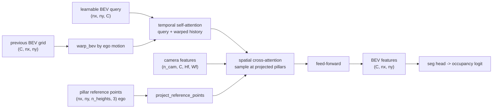

# A11.5c - BEVFormer-style attention

A self-driving car plans in a top-down map of its surroundings, while its cameras see perspective
images. The camera-to-BEV view transform converts a ring of camera images into one ego-centric
bird's-eye-view (BEV) feature grid, a top-down grid of feature vectors with one cell per patch of
ground around the car. Lift-Splat-Shoot, the previous assignment, does it by predicting a depth
distribution for every pixel and pushing the pixel's feature out into 3-D. BEVFormer runs the
geometry the other way. Each BEV cell knows its own 3-D location, projects a vertical pillar of
reference points back into every camera, and bilinear-samples the features it needs at the
projected pixels. A temporal step then warps the previous BEV grid by the ego motion and fuses it,
so the grid accumulates state across frames.

Build that transform: the reference pillars, their projection to image sampling coordinates, the
spatial cross-attention that pulls camera features into BEV cells (both a simplified bilinear path
and the deformable-offset path), the ego-motion warp, the temporal self-attention, and the
assembled encoder with a segmentation head. The dense BEV feature grid the encoder produces is the
shared intermediate that occupancy prediction (A11.5d) and map/motion prediction (A11.5e) consume
unchanged.

Required reading before starting:
- Li et al. 2022, "BEVFormer: Learning Bird's-Eye-View Representation from Multi-Camera Images via
  Spatiotemporal Transformers", [arXiv:2203.17270](https://arxiv.org/abs/2203.17270).
- Zhu et al. 2021, "Deformable DETR: Deformable Transformers for End-to-End Object Detection",
  [arXiv:2010.04159](https://arxiv.org/abs/2010.04159) (the deformable attention the spatial
  cross-attention specializes).

## Lecture notes

### What BEVFormer is for

#### The task

The task is the one Lift-Splat-Shoot solved. A driving stack reads six surround cameras (the
nuScenes rig) and has to fill a top-down grid around the car; a production BEVFormer uses a
$200 \times 200$ grid. Everything downstream (detection, map segmentation, occupancy, motion
prediction, planning) reads only that grid. The toy in this assignment keeps four cameras facing
front, left, back, and right, each a $32 \times 32$ image taken from 1.5 m above the ego origin,
and a $16 \times 16$ grid of 1 m cells centered on the car (8 m in every direction). The scene
contains a few "vehicles", drawn as orange blobs in whichever cameras see them, and the target is a
0/1 occupancy grid marking each vehicle's cell.

#### What goes wrong with pushing features out along depth

Lift-Splat-Shoot is a forward-projection transform: it predicts a depth distribution per pixel and pushes each image feature out into
3-D, then sums the features that land in each BEV cell. The depth is a latent variable, so a wrong
depth puts the feature in the wrong cell, and the frustum point cloud is memory-heavy: one point
per (pixel, depth bin) per camera.

#### The idea of pulling each cell's features from the pixels that see it

BEVFormer inverts the direction, which the literature calls backward projection. Instead of pushing pixels out to where depth says they go, it starts from the BEV
grid and pulls: each BEV cell knows its own 3-D location, so it projects that location into the
cameras and reads the features at the projected pixels. No per-pixel depth is predicted. The
projection is exact geometry (the camera intrinsics and extrinsics and the projection chain from
the camera-geometry assignment), and a cell that several cameras see averages their reads. This
pull sidesteps the depth-estimation step that forward projection depends on.

The camera-geometry assignment already pulled once, with inverse perspective mapping (IPM): each
cell projected one ground point at height zero and read the image there, which smeared every tall
object along the viewing ray. A single 3-D point per BEV cell is not enough, because a cell at
ground level and the same cell at roof height project to different pixels and the camera might
only see one of them. BEVFormer samples a vertical pillar of reference points per cell (the paper
uses 4 heights from -5 m to 3 m in ego z) and averages the in-frame samples. A reference point is
one 3-D anchor location a BEV cell reads features at; a pillar is the stack of reference points at
the same $(x, y)$ over the height range. A camera is a hit view for a cell if at least one of the
cell's pillar points projects inside that camera's image.

Two learned parts sit on top of that fixed geometry. Each cell carries a learned vector, its BEV
query, which decides what to do with what it reads; in the full method the query also predicts
small offsets around each projected point, so a cell can read a little to the side of where
calibration says (deformable attention, below). And because the grid is a fixed set of cells in
the ego frame, last frame's grid can be shifted by the car's own motion and read again, which
recovers things the current images miss, such as a vehicle hidden behind another one.

#### Why it matters

Backward projection removes the depth prediction and its memory cost, makes the BEV grid a
persistent state that can be carried across frames, and produces a dense grid that map,
occupancy, and planning heads consume directly. The next two assignments in this module build on
that grid.

### Our vehicle pillar (one BEV cell of the toy reading the left camera)

To see the mechanism with numbers we follow one cell of the toy scene. BEV cells are indexed
$(i, j)$ with $i$ along ego $x$ (forward) and $j$ along ego $y$ (left); cell $(i, j)$ covers
$x \in [-8 + i, -7 + i)$ and $y \in [-8 + j, -7 + j)$. We call the pillar over cell $(7, 11)$,
centered at ego $(x, y) = (-0.5, 3.5)$, our vehicle pillar: one of the toy's vehicles sits in that
cell, at $(-0.05, 3.76)$, about 3.8 m to the left of the car, so the left camera sees it.

Its four reference points sit at heights $z = -5, -2.33, 0.33, 3$ m. The left camera looks along
ego $+y$, so an ego point $(x, y, z)$ is the camera point $(X, Y, Z) = (x,\ 1.5 - z,\ y)$, and the
pinhole model with focal length 16 pixels and principal point $(15.5, 15.5)$ places it at
$u = 15.5 + 16X/Z$, $v = 15.5 + 16Y/Z$. All four points have $u = 13.2$. Their rows are
$v = 45.2, 33.0, 20.8, 8.6$, and only the last two are inside the 32-row image. The figure shows
the side view and the image (the vehicle's box in the side view is for orientation; the toy draws
vehicles only as blobs).


The point at $z = 0.33$ m lands next to the vehicle's blob, so the cell reads vehicle evidence
there; the point at $z = 3$ m reads background above it. The pillar's job is to make the cell see
an object standing anywhere in its column, whatever the object's height; a single ground point at
$z = 0$ (IPM) sees only what lies on the ground. The pillar does not resolve where along a viewing
ray the object is. Cell $(7, 15)$, 4 m farther out along the same direction, has its $z = 0.33$ m
point at $(u, v) = (14.4, 18.0)$, even closer to the blob center at $(15.3, 18.7)$, so it reads
the same vehicle evidence. With one camera, telling such cells apart is left to the learned layers
(and, on a real rig, to overlapping cameras and to time). In this toy the learned per-cell BEV
queries are fit to a single scene, which is how the overfit test below reaches IoU 1.0.

The next figure repeats the count for every cell of the grid: how many of the four heights land
inside the camera that sees the cell. Near the car the low reference points fall below the bottom
edge of the image, so many cells keep only some of their heights, and the four cells around the
ego origin are seen by no camera. In this toy each of the other cells is seen by exactly one
camera, because the four 90-degree fields of view meet along the diagonals (dotted).


Our vehicle pillar keeps the parts of the real problem this assignment covers: a cell that computes where to read from
calibration, a pillar whose heights are partly out of frame, and a bilinear read at a fractional
pixel. It drops the overlap between cameras (a nuScenes cell near a camera boundary is seen by two
cameras), the learned offsets, and time.

### Overview of the rest of the notes

The sections below build the transform in pipeline order. Most of the parts are familiar ideas in
a new arrangement.

1. Machinery. Image feature maps from a convolutional backbone; attention as a soft,
   differentiable table lookup; the learned queries of DETR (a transformer object detector that
   turns a fixed set of learned query vectors into boxes), which become the BEV queries.
2. Reference pillars and their projection. The pinhole projection chain from the camera-geometry
   assignment, applied to every pillar point, followed by the bilinear read with `grid_sample`,
   the same sampler that assignment used for IPM.
3. Deformable attention. Attention that, instead of comparing a query against every key, reads a
   few bilinear samples at learned offsets around a reference point.
4. Spatial cross-attention. A masked mean over in-frame heights and hit views, with or without
   learned offsets.
5. Time. The ego-motion warp is backward image warping, the output-to-source resampling also used
   to undistort an image. Fusing the warped history with the current reads resembles the predict
   and update steps of a Bayes filter: the warp moves the old estimate by the known motion, and the
   temporal self-attention decides per cell how much to trust it against the new measurement.
6. The encoder, the segmentation head, and the loss, then where BEVFormer sits among related
   methods.

Five exercises, placed after the sections they test, are meant to be worked by hand (a calculator
helps).

### Image feature maps

Nothing in the transform touches raw pixels. Each camera image passes through a convolutional
backbone first, a stack of convolution layers that shrinks the $3 \times H \times W$ image to a
$C \times H_f \times W_f$ feature map. Each layer with stride $s_\ell$ subsamples its input by
$s_\ell$ in both spatial axes, and the product of the layer strides is the total stride $s$, so
$H_f = H / s$ and $W_f = W / s$. The toy backbone is two stride-2 convolutions, $s = 4$: a
$3 \times 32 \times 32$ image becomes a $32 \times 8 \times 8$ feature map with $C = 32$ channels.
Each channel is one learned filter's response, so a feature vector is $C$ numbers describing what
the filters found at that location. The grid lines in the image panel of the vehicle-pillar figure
are the $8 \times 8$ feature cells.

A feature vector at map position $(i, j)$ describes an image neighborhood rather than one pixel:
it was computed from a receptive field of input pixels around that location, at least $s$ pixels
wide and wider once the convolution kernels are counted. Sampling a feature map at a projected
point returns a summary of what the camera saw around that point, and a BEV cell needs that
summary rather than a single pixel.

Two words about backbones recur below. A backbone is trained when its weights receive gradient
along with everything else, and frozen when its weights are held fixed and only the layers after
it are trained. The toy trains its backbone from scratch because there is nothing to pretrain on;
a driving stack starts from a backbone pretrained on a large labeled image dataset.

### Attention as a differentiable read

Attention takes a query vector $q \in \mathbb{R}^d$ and a set of $n$ items, item $i$ carrying a key
$k_i \in \mathbb{R}^d$ and a value $v_i$, and returns a weighted average of the values:

$$\text{attn}(q; K, V) = \sum_{i=1}^{n} w_i\, v_i, \qquad
w_i = \frac{\exp(q \cdot k_i / \sqrt{d})}{\sum_{j=1}^{n} \exp(q \cdot k_j / \sqrt{d})}.$$

The weights come from a softmax of the query-key dot products: exponentiate each score, then divide
by the sum. They are non-negative and sum to 1, so the output is an expectation of the values under
a distribution over the items, and that distribution concentrates on the items whose keys point in
the same direction as the query. The $\sqrt{d}$ divisor keeps the dot products from growing with
the dimension, which would push the softmax toward a hard selection and flatten its gradient.

Attention replaces a hard selection. Reading the single best-matching item would be an argmax, a
table lookup with no derivative in the query. Softmax is the smooth version, so moving the query
moves all the weights a little and gradient descent can change what gets read. Every read in this
pipeline is differentiable in that sense, so the loss measured on the BEV output can train what
each cell reads and where it reads from.

Queries, keys, and values are not the raw vectors; each is a learned linear projection of its
source. Whether the attention is called self- or cross-attention depends only on where the keys and
values come from. Self-attention projects them from the same set the queries came from, so items
read each other. Cross-attention projects them from a different set, so one set of queries reads a
second collection of things: BEV cells reading camera features is cross-attention.

Multi-head attention splits the $d$ channels into $h$ groups of $d/h$, runs the whole computation
independently within each group, and concatenates the $h$ outputs before a final linear projection.
Independent groups can settle on different similarity criteria, so one head can track one kind of
correspondence while another tracks a different one, instead of a single softmax having to serve
every purpose at once. The temporal and deformable attention here use the multi-head attention
from the transformer assignment, not a prebuilt `nn.MultiheadAttention`.

### Queries as slots

In the attention above the query is given. In a detector there is no query to give, so DETR (Carion
et al. 2020, [arXiv:2005.12872](https://arxiv.org/abs/2005.12872)) invents them. It allocates a
fixed number of vectors, say 100, stores them as free parameters trained by gradient descent, and
starts every image from the same 100 vectors. Each vector is a slot. A stack of layers has the
slots cross-attend into the image features, so each slot fills up with evidence about some part of
the image, and a small head decodes each finished slot into one box and class. Nothing tells slot
7 to find pedestrians; the slots differentiate during training because the loss matches predictions
to ground-truth objects and each slot only improves by specializing.

Two properties of that design carry over. First, a query is a persistent piece of state that starts
identical for every input and becomes input-specific through the reads it performs. Second, layers
update queries in place with a residual add, $\text{query} \leftarrow \text{query} + \text{update}$,
rather than replacing them. The residual add keeps the accumulated state, makes an untrained layer
close to a no-op instead of destroying the query, and gives the gradient a path back through the
stack that does not pass through every layer's weights.

BEVFormer allocates one query per BEV cell, the BEV query. The queries live in an $(n_x, n_y, C)$
parameter tensor initialized from a small-variance normal and trained like any weight, so what they
hold after training is whatever prior about the grid is worth carrying into every scene. Because a
BEV cell has a known 3-D position and the cameras have known calibration, the query does not have
to search the image for its evidence the way a DETR slot does. Geometry says exactly which pixels
correspond to that cell, so the read locations are computed rather than matched.

The residual add carries over unchanged. A cell no camera sees keeps its query untouched instead
of receiving a zeroed feature.

### Reference pillars

Each BEV cell center $(x, y)$ becomes a vertical pillar of $n_{\text{ref}}$ points at heights $z$
spaced uniformly in $[z_{\min}, z_{\max}]$, endpoints included, giving ego-frame points of shape
$(n_x, n_y, n_{\text{ref}}, 3)$. With $n_{\text{ref}} = 4$ over $[-5, 3]$ m the spacing is
$8/3$ m, which gives the heights $-5, -2.33, 0.33, 3$ of our vehicle pillar. These points are fixed
by the grid and the height range, so the encoder precomputes them once.

### Projection to grid_sample coordinates

Every ego point projects into each camera with the rig's `world_to_pixel` (the same projection
chain as the camera-geometry assignment; the extrinsic $E = T_{\text{cam} \leftarrow \text{ego}}$
maps ego coordinates into camera coordinates), which returns the pixel $(u, v)$ and a mask of
points in front of the camera and inside the image bounds. The pixel is fractional, so the next
step is a bilinear read.

#### Bilinear sampling

A feature map is only defined at integer positions, so the value at a fractional pixel has to be
interpolated. Bilinear interpolation is the usual answer from image resampling, written out in the
camera-geometry assignment's section on sampling an image at a fractional pixel: take the four
samples surrounding $(u, v)$ and weight each by the product of the fractional distances to the
opposite corner. For learning, the property that matters is the derivative. The interpolated value
is differentiable in the map values, which lets the gradient reach the backbone, and it is also
differentiable in $u$ and $v$, with $\partial / \partial u$ a difference between the neighbors on
either side, interpolated along the other axis. A sampling location can therefore be trained: the
gradient says which way to move the sample to lower the loss. Jaderberg et al. (2015) introduced
this as the sampling layer of spatial transformer networks, and it is the mechanism under the
learned offsets in the deformable attention section.

#### The grid_sample convention used here

PyTorch's `F.grid_sample` does this in normalized coordinates. It takes a grid of $(g_x, g_y)$
pairs in $[-1, 1]$, where the last dim is ordered $x$ first and $x$ runs along the width axis, and
returns the map sampled at those locations, with `padding_mode="zeros"` returning 0 outside the
range. With `align_corners=False`, $[-1, 1]$ covers the map as $W$ equal cells and an integer pixel
index $u$ sits at the center of its cell:

$$g_x = \frac{2(u + 0.5)}{W} - 1.$$

Check the ends: $u = 0$ gives $-1 + 1/W$ and $u = W - 1$ gives $1 - 1/W$, so $\pm 1$ falls on the
outer boundary of the border pixels, half a pixel past their centers. The other convention,
`align_corners=True`, instead maps $u = 0$ to exactly $-1$ and $u = W - 1$ to exactly $+1$; mixing
the two shifts every sample by half a pixel. The camera-geometry assignment used
`align_corners=True` for IPM. Everything here uses `align_corners=False`, in both `grid_sample` and
`affine_grid`, because it is the convention under which the next property holds exactly.

The normalized coordinate is independent of resolution: the same $g_x$ addresses the same physical
place in the image whether it is applied to the $32 \times 32$ image or the $8 \times 8$ feature
map computed from it. Under `align_corners=False` a feature cell of a stride-$s$ map covers exactly
$s$ image pixels, and the outer edges of the map and of the image both sit at $\pm 1$. So the
pixels become `grid_sample` coordinates with the `align_corners=False` map

$$g_x = \frac{2(u + 0.5)}{W} - 1, \qquad g_y = \frac{2(v + 0.5)}{H} - 1,$$

and the last dim is ordered $(g_x, g_y) = (\text{width}, \text{height})$ because `grid_sample`
reads the last grid dim as x=width first.

Normalize by the full image size $(W, H)$, not by the downsampled feature-map size
$W_f = W/\text{stride}$. `grid_sample` maps the same $[-1, 1]$ extent across a feature map of any
resolution, so it handles the stride itself. Normalizing by $W_f$ instead scales every sample's
position by the stride factor while the hit-mask (computed in full-image pixels) still looks
correct, so the model silently reads the wrong features and no error is raised.

> **Exercise 1 (a full pillar and a partial one).** The front camera of the toy sits at ego
> $(0, 0, 1.5)$ looking along ego $+x$, so an ego point $(x, y, z)$ is the camera point
> $(X, Y, Z) = (-y,\ 1.5 - z,\ x)$, and $u = 15.5 + 16X/Z$, $v = 15.5 + 16Y/Z$ in a $32 \times 32$
> image. Project the pillar over cell $(14, 8)$, centered at $(6.5, 0.5)$, at the heights
> $-5, -2.33, 0.33, 3$ m. Which heights are in frame? The pillar over cell $(11, 8)$, centered at
> $(3.5, 0.5)$, keeps only two heights in frame, like our vehicle pillar. How far ahead must a cell
> center be for its lowest reference point to be in frame?

<details>
<summary>Answer</summary>

$X = -0.5$ and $Z = 6.5$ for all four points, so $u = 15.5 - 8/6.5 = 14.27$. The rows are
$v = 15.5 + 16(1.5 - z)/6.5$: for $z = -5$, $15.5 + 16 = 31.5$; for $z = -2.33$, $24.94$; for
$z = 0.33$, $18.37$; for $z = 3$, $11.81$. All four satisfy $0 \le v < 32$, so the pillar is full.

The cell at $(3.5, 0.5)$ is the front-camera twin of our vehicle pillar (same distance, same
lateral offset), with $v = 45.2, 33.0, 20.8, 8.6$, so its two lower points fall below the image.
The lowest point is in frame when $16 \cdot 6.5/Z < 16.5$, that is $Z > 6.30$ m. Cell centers sit
at half-meter offsets, so the first full ring is the one centered 6.5 m out, the outer band of the
coverage figure. Closer cells lose their low points because the camera looks horizontally and its
field of view reaches only 16.5 pixels below the center row.

</details>

> **Exercise 2 (from pixel to feature cell, and the normalization bug).** The $z = 0.33$ m point of
> our vehicle pillar lands at $(u, v) = (13.21, 20.83)$ in the $32 \times 32$ left image. Compute
> $(g_x, g_y)$. Which fractional position $(j, i)$ (column, row) of the $8 \times 8$ feature map
> does `grid_sample` with `align_corners=False` read? What would it read if $g_x$ had been
> normalized by $W_f = 8$ instead of $W = 32$?

<details>
<summary>Answer</summary>

$g_x = 2(13.21 + 0.5)/32 - 1 = -0.143$ and $g_y = 2(20.83 + 0.5)/32 - 1 = 0.333$. On a map of
width 8, `grid_sample` inverts the same formula with $W = 8$: $j = (g_x + 1)/2 \cdot 8 - 0.5 =
2.93$ and $i = (g_y + 1)/2 \cdot 8 - 0.5 = 4.83$. In general $j = (u + 0.5)/4 - 0.5$, which puts
feature cell $j$'s center at image pixel $4j + 1.5$. Feature column 3 is centered at pixel 13.5,
and the sample sits just left of it, as in the figure.

Normalized by 8, $g_x = 2(13.71)/8 - 1 = 2.43$, outside $[-1, 1]$, and `grid_sample` returns the
zero padding. In general the wrong normalization reads feature column $u$ instead of
$(u + 0.5)/4 - 0.5$, so only pixels in the leftmost quarter of the image land on the map at all,
and those read a feature four times too far right. The mask from `world_to_pixel` is computed in
image pixels and still says the point is in frame, so nothing flags the error.

</details>

### Deformable attention

Cross-attention as written above scores the query against every item. For a query set of size $Q$
and a feature map of $P$ positions that is $QP$ dot products, and both numbers are large here: a
production BEVFormer runs a $200 \times 200$ BEV grid, so $Q = 40000$ queries, against six camera
feature maps. Deformable DETR's change is to stop scoring. Instead of comparing the query to keys,
a linear layer reads the query and directly emits $M$ two-dimensional offsets
$\Delta p_1, \dots, \Delta p_M$ from a reference point $p$, and a second linear layer emits $M$
scores that a softmax turns into weights $a_1, \dots, a_M$. The output is

$$\sum_{m=1}^{M} a_m\, V(p + \Delta p_m),$$

where $V(\cdot)$ is the value map bilinearly sampled at a continuous location. No key is ever
formed and no query-key dot product is computed; the attention weights are a function of the query
alone. The cost is $M$ samples per query per head with $M$ around 4, independent of the feature map
size, and the weights still sum to 1, so it is still a weighted average of values. What makes the
offsets trainable is bilinear sampling being differentiable in the sampling location: the loss
gradient reaches $\Delta p_m$ through $V$ and moves each sample toward more useful content.

The reference point $p$ is where the attention is centered, so the choice of $p$ decides what the
learned offsets are a correction to. Deformable DETR's decoder predicts it from the object query
with another linear layer, so even the anchor is learned. BEVFormer does not have to: the BEV
cell's 3-D pillar point projected into a camera is already the right image location for that cell,
so geometry supplies $p$ and the learned offsets only refine it by a small amount around a location
that calibration already got right. The other half of the specialization is which cameras a query
attends to at all, decided by the projection's in-frame mask rather than by learning.

> **Exercise 3 (the gradient that moves a sample).** Take one channel of the left camera's value
> map with $V = 0.2$ at (column 2, row 4), $0.6$ at (3, 4), $0.4$ at (2, 5), and $1.0$ at (3, 5),
> and read it at the point of Exercise 2, $(j, i) = (2.93, 4.83)$. Compute the value and its
> derivatives with respect to $g_x$ and $g_y$. If the loss wants this read to be larger, which way
> does gradient descent move a learned offset $\Delta p$? Finally, with $M = 4$ points, all offsets
> zero and weights $a = (0.1, 0.2, 0.3, 0.4)$, what does the deformable sum return?

<details>
<summary>Answer</summary>

The fractional parts are $a = 0.929$ along the column and $b = 0.833$ along the row. The value is
$(1-a)(1-b)\,0.2 + a(1-b)\,0.6 + (1-a)b\,0.4 + ab\,1.0 = 0.893$. Along the column,
$\partial V/\partial j = (1-b)(0.6 - 0.2) + b(1.0 - 0.4) = 0.567$; along the row,
$\partial V/\partial i = (1-a)(0.4 - 0.2) + a(1.0 - 0.6) = 0.386$. A step of 1 in $g$ is a step of
$W_f/2 = 4$ feature cells, so $\partial V/\partial g_x = 2.27$ and $\partial V/\partial g_y = 1.54$,
the values autograd returns through `grid_sample`.

If the loss decreases as $V$ grows, $\partial L/\partial V < 0$. The offset adds directly to $g$,
so its gradient is $\partial L/\partial V$ times $(2.27, 1.54)$, negative in both components.
Gradient descent steps against the gradient, so $\Delta p$ moves toward larger $g_x$ and $g_y$, to
the right and down in the image, toward the $1.0$ corner. With zero offsets every point reads
$V(p) = 0.893$, and $\sum_m a_m V(p) = V(p) \sum_m a_m = 0.893$: the deformable read collapses to
the plain bilinear read because the weights sum to 1.

</details>

### Spatial cross-attention

The spatial cross-attention is the backward-projection view transform. In our simplified path (no learned
offsets) it `grid_sample`s each camera's feature map at the projected reference coords, giving
$(n_{\text{cam}}, C, n_x, n_y, n_{\text{ref}})$ samples, then reduces them.

Read the word attention carefully here. This path computes no scores at all. The weights are fixed
by the in-frame mask: a uniform average over the valid heights within a camera, then a uniform
average over the cameras that see the cell. It is cross-attention in the structural sense, one set
of queries reading values from a different set, with the attention pattern handed to calibration
instead of being learned. The learned version is the deformable path below, and it keeps the same
two averages on top.

The reduction is the part to get right: average over the heights that are in-frame, not over all
$n_{\text{ref}}$ heights. A pillar that projects in-frame at only 1 of 4 heights must not be
divided by 4, or it reads a quarter of the true feature. So the per-camera mean divides by the
count of valid heights:

$$\text{per-cam}_{c} = \frac{\sum_{h} \text{sampled}_{c,h}\, m_{c,h}}{\max\!\big(\sum_h m_{c,h},\ 1\big)},
\qquad m_{c,h} = \text{valid}_{c,h},$$

then the cross-camera mean divides by the number of hit views (the paper's $|V_{\text{hit}}|$
semantics, a camera counts if at least one of its pillar heights is in-frame):

$$\text{out} = \frac{\sum_c \text{per-cam}_c\, \mathbb{1}[\text{hit}_c]}{\max\!\big(\sum_c
\mathbb{1}[\text{hit}_c],\ 1\big)}.$$

Partial pillars are the common case, not an edge case. In the toy's default rig, of the 252
(camera, cell) pairs that see anything at all, 112 have all four heights in-frame and 140 have
fewer (the coverage figure), so dividing by $n_{\text{ref}}$ would scale most of the grid's
features down.

A cell no camera sees keeps its input query unchanged, rather than getting a zeroed feature. The
$\max(\cdot, 1)$ in both denominators only keeps such cells from dividing zero by zero.

> **Exercise 4 (the two averages).** On a real rig, a cell near a camera boundary projects its
> four pillar heights into three cameras. Camera A sees heights 3 and 4 with sampled values $0.8$
> and $0.4$ (one channel). Camera B sees only height 4, with value $0.2$. Camera C sees none.
> Compute the per-camera means and the output, and the output if each camera's sum were divided by
> $n_{\text{ref}} = 4$. How does the correct output compare with a plain mean of all three valid
> samples?

<details>
<summary>Answer</summary>

Camera A: $(0.8 + 0.4)/2 = 0.6$. Camera B: $0.2/1 = 0.2$. Camera C is not a hit view and drops
out. The output is $(0.6 + 0.2)/2 = 0.4$. Dividing by 4 would give camera A $0.3$ and camera B
$0.05$, and an output of $0.175$, less than half the correct value, for no reason except the
cell's position relative to the cameras.

A plain mean of the three valid samples gives $(0.8 + 0.4 + 0.2)/3 = 0.467$. The two-stage mean
gives each hit camera equal weight however many of its heights are in frame, so camera B's single
sample counts as much as camera A's two. That is the paper's form: an average over hit views of a
per-view read.

</details>

#### The deformable path

The deformable path predicts $n_{\text{points}}$ learned sampling offsets per head around each
reference point, plus a softmax weight per point, samples at the shifted locations, and
weight-sums them before the same height/hit-view reduction. The reference-point projection stays
as the anchor; the offsets are a learned delta. The value and output projections are shared with
the simplified path, so a zero-initialized offset head makes the deformable forward equal to the
simplified one up to float rounding: zero offsets put every sample on the reference point and the softmax weights
sum to 1 (the last part of Exercise 3). That equality is a useful test because it holds
only if the offsets enter as a delta in the same normalized coordinate system the reference points
live in.

### Resampling and the ego-motion warp

The car moves between frames, so last frame's BEV grid is expressed in last frame's ego frame. The
warp resamples the previous frame's BEV grid so a static world point stays at the same ego BEV
cell after the ego moves. Resampling is done backward, the standard choice in image warping:
iterate over output cells and pull from the source, because iterating over source cells and
pushing forward scatters into non-integer targets and leaves holes. So the map that has to be
supplied is output-to-source, the inverse of the motion.

`F.affine_grid` takes that map as a $2 \times 3$ matrix $\theta$ acting on normalized output
coordinates and returning normalized source coordinates,

$$\begin{pmatrix} x_s \\ y_s \end{pmatrix} =
\begin{pmatrix} \theta_{00} & \theta_{01} \\ \theta_{10} & \theta_{11} \end{pmatrix}
\begin{pmatrix} x_o \\ y_o \end{pmatrix} +
\begin{pmatrix} \theta_{02} \\ \theta_{12} \end{pmatrix},$$

and returns the full grid of source coordinates for `grid_sample` to read. Both coordinate pairs
follow the `grid_sample` convention, $x$ along the width axis and $y$ along the height axis, which
pins the row assignment below.

The BEV tensor is $(C, H{=}n_x{=}\text{forward}, W{=}n_y{=}\text{lateral})$, so row 1 of $\theta$
drives the forward axis and row 0 the lateral axis. The grid is centered, with half-extents
$L_x = n_x \cdot \text{res} / 2$ forward and $L_y = n_y \cdot \text{res} / 2$ lateral, so the
normalized coordinate of a cell is its ego coordinate divided by the half-extent of that axis and
one cell of forward index is $2/n_x$ of normalized distance. Now take a forward ego translation of
$k_x = \text{forward}_{\text{m}} / \text{res}$ cells. A static world point that sat at forward
index $i$ in the previous frame sits at $i - k_x$ in the current frame, so the output cell
$i - k_x$ must read source index $i$, a source-minus-output difference of $+k_x$ cells, or
$+2 k_x / n_x$ normalized:

$$\theta[1, 2] = +\frac{2 k_x}{n_x}, \qquad \theta[0, 2] = +\frac{2 k_y}{n_y}.$$

The translation is positive. A negative $-2k_x/n_x$ sends the point to $i + k_x$, the double-inverse bug,
because `affine_grid` already works output-to-source. The same derivation gives the $2 \times 2$
block. Writing the output-to-source relation for a yaw $\psi$ as
$p_{\text{prev}} = R(\psi)\,p_{\text{cur}} + t$ and re-expressing it in the (lateral, forward) axis
order that $\theta$ uses swaps the two components, which flips the sign of the off-diagonal entries
relative to the usual form, giving $\theta_{2\times2} = \big[[\cos\psi, \sin\psi], [-\sin\psi,
\cos\psi]\big]$. The block acts on normalized coordinates, so it is a rotation in meters only when
the two half-extents are equal, $L_x = L_y$, as on the toy's square grid. Zero ego motion is the
identity. The tests here cover translation only, since the toy's ego motion has no yaw, so the
rotation block is checked by that derivation rather than numerically.

> **Exercise 5 (the warp by hand).** On the toy's $16 \times 16$ grid at 1 m, the car moves 2 m
> forward between frames. Compute $\theta[1, 2]$. With `align_corners=False`, row $i$ has
> normalized coordinate $y_o = 2(i + 0.5)/16 - 1$. Which source row does output row 3 read? Repeat
> for a 1.5 m move, and say what the warped grid looks like.

<details>
<summary>Answer</summary>

$k_x = 2$, so $\theta[1, 2] = 2 \cdot 2/16 = 0.25$. Output row 3 has $y_o = 7/16 - 1 = -0.5625$
and reads $y_s = -0.3125$, which is row $(y_s + 1) \cdot 8 - 0.5 = 5$. A static object that was in
row 5 is now in row 3, two rows closer, as it should be after driving 2 m toward it.

For 1.5 m, $\theta[1, 2] = 0.1875$ and output row 3 reads row 4.5, so `grid_sample` returns the
average of rows 4 and 5. A single hot cell becomes two half-strength cells: a warp by a
non-integer number of cells blurs the history. Reading the history at learned offsets, as
BEVFormer's own temporal attention does, lets a cell compensate for such misalignment.

</details>

### Temporal self-attention

Temporal self-attention attends each BEV cell's query against the two-element set {current query,
warped history at that cell}, with a residual add. The paper calls it self-attention because
the keys are the BEV grid itself, now and one frame earlier. With only two items the
softmax reduces to a per-cell blend weight between now and history, and it is content-dependent:
the same cell can lean on the history where the current cameras show nothing and ignore it where
they show something better. In Bayes-filter terms the warp is the predict step and this blend
weight plays the role of a gain, except that the network computes it from content rather than from
covariances. On the first frame the warped history is absent and this falls back to
self-attention on the query alone.

BEVFormer's own temporal self-attention is a deformable attention, so a cell can read the history at
learned offsets around itself and absorb small misalignments in the warp. The version here reads the
history only at the cell's own location, which is exact for the toy because its ego motion is known
without error.

### Assembling the encoder

A learnable BEV query embedding is the starting state, the $(n_x, n_y, C)$ parameter tensor from
the queries section. Each encoder layer runs temporal self-attention against the warped history,
then spatial cross-attention pulling from the camera features, then a feed-forward: a two-layer MLP
with a GELU nonlinearity (a smooth variant of the ReLU) in between, applied to each BEV cell's $C$-vector separately and with a
residual add. Attention moves information between locations, the feed-forward mixes channels within
a location, and the layers alternate the two. Stacking the layers and reading the final query as a
dense BEV grid $(C, n_x, n_y)$, plus a 1x1 convolution segmentation head, produces the occupancy
logit.



### The segmentation head and the loss

A 1x1 convolution over a $(C, n_x, n_y)$ grid is one linear map $\mathbb{R}^C \to
\mathbb{R}^{n_{\text{classes}}}$ applied independently at every cell with the same weights, so it is
a per-cell classifier reading only that cell's feature vector. With one output channel it emits a
single number $z$ per cell, the logit. The occupancy probability is the logistic function
$\sigma(z) = 1 / (1 + e^{-z})$, so $z > 0$ means the cell is more likely occupied than free and
$z = 0$ is the decision boundary.

Training minimizes the binary cross-entropy of the label $y \in \{0, 1\}$ under that Bernoulli
model, which is its negative log likelihood:

$$\mathcal{L} = -\frac{1}{N} \sum_{\text{cells}} \Big[ y \log \sigma(z)
+ (1 - y) \log\big(1 - \sigma(z)\big) \Big].$$

A confident correct prediction contributes almost 0 and a confident wrong one diverges, so the loss
keeps grading how sure the model is rather than only its thresholded decision. The reported IoU is
a set-overlap metric: threshold at $z > 0$, then divide the number of cells predicted and
labeled occupied by the number predicted or labeled occupied. It ignores confidence entirely, so a
model can sit at IoU 1.0 with a nonzero loss.

The optimizer is Adam, which rescales each parameter's gradient by a running estimate of its own
recent magnitude, so parameters with small gradients still move. That matters here because the same
loss trains a convolution backbone, attention projections, and the BEV query embedding at once, and
their natural gradient scales differ by orders of magnitude.

### Where it sat in 2021-2022

The predecessor was DETR3D (Wang et al. 2021,
[arXiv:2110.06922](https://arxiv.org/abs/2110.06922)): DETR's slots, moved into 3-D. Each query
carries a predicted 3-D reference point, that point is projected into every camera, the features at
the projected pixels are sampled and added back into the query, and the next layer repeats with the
refined point. There is no grid at all, so DETR3D detects objects but produces no map-like
representation, and each query reads exactly one point per camera.

PETR (Liu et al. 2022, [arXiv:2203.05625](https://arxiv.org/abs/2203.05625)) reaches the same goal
without projecting anything, and the contrast isolates what the projection is for. Attention treats
its inputs as an unordered set, so image features carry no information about where in the image or
the world they came from unless something adds it. That something is a position embedding, a
vector derived from a location and added to the feature at that location, which makes the dot
product between a query and a key depend on position as well as content. PETR builds a 3-D one: for
each feature-map position it uses the known intrinsics and extrinsics to compute the 3-D ray of
points that project there, encodes that set of 3-D coordinates with a small MLP, and adds the
result to the image feature. Object queries then run ordinary global cross-attention over those
position-aware features. The 3-D geometry is still doing the work, but it is baked into the keys
once instead of being applied per query as an explicit projection.

BEVFormer's contribution over DETR3D is the dense BEV grid and two attention mechanisms over it.
The spatial cross-attention reads camera features at the projected pillar reference points, the
deformable attention above with the reference point fixed by geometry. The temporal self-attention
warps the previous frame's BEV grid into the current ego frame and attends the current query
against it, so the grid accumulates state across frames.

### BEVFormer's place in 2026

BEVFormer is the first widely used backward-projection BEV encoder, not current state of the art. The dense BEV grid
persists where a dense output is needed, map segmentation and occupancy. Camera-only 3-D object
detection is usually ranked on nuScenes (Caesar et al. 2020), a driving dataset recorded with a
six-camera surround rig plus lidar and radar; camera-only means the lidar is used to make the 3-D
box labels but not available to the model at test time. On that benchmark, sparse-query methods
that drop the dense grid now lead. They keep a few hundred instance queries instead of $n_x n_y$
cell queries, so the cost tracks the number of objects rather than the area of the grid, and
nothing is spent on the empty majority of the map.

Sparse4D v2 (Lin et al. 2023, [arXiv:2305.14018](https://arxiv.org/abs/2305.14018)) carries a
recurrent set of sparse instance features across frames instead of warping a grid: the instance
queries from frame $t-1$, with their 3-D anchors moved by the ego motion, become the starting
queries at frame $t$, so history lives in a few hundred vectors rather than a grid-sized tensor.
PETRv2 (Liu et al. 2022, [arXiv:2206.01256](https://arxiv.org/abs/2206.01256)) extends PETR's 3-D
position embeddings with temporal alignment, transforming the previous frame's 3-D positions into
the current ego frame before encoding them, so the same global attention spans both frames. The
dense grid trades compute for a representation that map and occupancy heads can consume directly,
so it is the right prerequisite for those even though detection moved on.

BEVFormer v2 (Yang et al. 2023, [arXiv:2211.10439](https://arxiv.org/abs/2211.10439)) adds
perspective supervision, an auxiliary 2-D detection head attached to the image backbone and trained
on 2-D boxes in the image plane, alongside the usual BEV head. The paper reports that without it,
modern image backbones transfer poorly to BEV, and attributes that to the shape of the training
signal reaching the backbone. Through the BEV head alone, the backbone's only gradient arrives
after projection, sampling, and averaging over pillars and cameras, heavily mixed and indirect;
the auxiliary head gives it a loss in its own output space instead. So a frozen or weakly adapted
2-D backbone that produces poor BEV results is evidence about that supervision path, not about the
attention code.

The warp assumes the ego motion is known exactly. On a real car it comes from ego localization,
whose errors grow over a long history, so a history carried over many frames drifts out of
alignment with the current grid; the toy cannot show this (see the end of the assignment
section).

## The assignment

Fill these holes, in order. Each is one `NotImplementedError` with a matching test. The docstring
in each function gives the signature, shapes, and constraints.

| # | Function | File | Concept from the notes |
|---|---|---|---|
| 1 | [`bev_reference_points()`](bevformer.py) | `bevformer.py` | reference pillars |
| 2 | [`project_reference_points()`](bevformer.py) | `bevformer.py` | projection to `grid_sample` coordinates and the in-frame mask |
| 3 | [`SpatialCrossAttention.forward()`](bevformer.py) | `bevformer.py` | spatial cross-attention, simplified and deformable paths |
| 4 | [`warp_bev()`](bevformer.py) | `bevformer.py` | the ego-motion warp, $\theta$ for `affine_grid` |
| 5 | [`TemporalSelfAttention.forward()`](bevformer.py) | `bevformer.py` | temporal self-attention over {query, warped history} |
| 6 | [`BEVFormerEncoder.forward()`](bevformer.py) | `bevformer.py` | the assembled encoder |
| 7 | [`BEVFormerSeg.forward()`](bevformer.py) | `bevformer.py` | the segmentation head |

Everything is in `bevformer.py`; the shared library re-exports these through `nanovision.bevformer`.
The `BEVFormerConfig`, the module `__init__`s, the shared `_reduce_over_heights_and_views` helper
(the two averages of the spatial cross-attention section), and the `bev_multicam_scene` generator
in `nanovision/data/toy.py` are provided.

Notes on specific holes:
- `bev_reference_points` spaces the heights with inclusive endpoints (`linspace`) over the cell
  centers from `BEVGrid.cell_centers`.
- `project_reference_points` calls `rig.world_to_pixel` once per camera and normalizes by the full
  image size passed as `image_hw`, never by the feature-map size.
- `SpatialCrossAttention.forward` applies the value projection, samples with `grid_sample`
  (`padding_mode="zeros"`, `align_corners=False`), reduces with `_reduce_over_heights_and_views`,
  applies the output projection, and residual-adds to the query, leaving no-hit cells unchanged. In
  the deformable path the offsets are added to the reference coordinates in normalized units and
  shared across cameras and heights.
- `warp_bev` builds $\theta$ for `affine_grid(..., align_corners=False)` and samples with
  `grid_sample`. `ego_delta` is (forward m, lateral m, yaw rad).

### Running and validating

Activate the environment (`conda activate nanovision`), then:

```
make test     A=a11_5c_bevformer   # run the tests against the top-level files (the holes)
make verify   A=a11_5c_bevformer   # run the same tests against the reference solution/
make viz      A=a11_5c_bevformer   # render the figures from the reference solution
make viz-mine A=a11_5c_bevformer   # render the figures from your own code (holes filled)
```

`make test` runs the suite in `assignments/a11_5c_bevformer/tests/` against the top-level
`bevformer.py`, red until the holes are filled and green once correct. `make verify` runs the
identical suite against the reference `solution/` by setting `NANOVISION_IMPL=solution`, so it is
green from the start and shows the target.

The tests check:
- `test_reference_points.py`: the pillar shape and heights; that a point on the front camera's
  optical axis lands at its principal point ($g = (0, 0)$) and is not in frame for the back camera;
  and the full-image-size normalization round-trip against `world_to_pixel` (the garbage-features
  guard).
- `test_spatial_cross_attention.py`: the output shape; that a single-view cell reading constant
  feature maps returns exactly the hit camera's constant; that a cell with an all-false mask keeps
  its query; and a float64 gradcheck with respect to the features (`torch.autograd.gradcheck`
  compares the analytic backward pass with finite differences of the forward pass).
- `test_deformable.py`: a zero-initialized offset head makes the deformable path equal to the
  simplified one up to float rounding (the measured difference is 2.4e-7, within the 1e-5 tolerance), and the offset
  head receives gradient.
- `test_temporal.py`: pins the warp numerically: a hot cell at forward index 5 warped by a +2 m
  forward motion lands at index 3, a +3 m lateral motion moves its column from 8 to 5, and zero ego
  motion is the identity (within 5e-7). It also runs the temporal-necessity test described below.
- `test_bev_seg.py`: overfits the simplified `BEVFormerSeg` on one frame.
- `test_forbidden_imports.py`: no `nn.MultiheadAttention`, `scaled_dot_product_attention`,
  `nn.Transformer`, or OpenCV and Kornia projection shortcuts; `grid_sample` and `affine_grid` are
  allowed.

`make viz` writes two figures to `out/`: `reference_points.png`, the projected reference points of
a few occupied cells overlaid on each camera image, which is the set of pixels each BEV cell will
read, fixed by calibration before any training happens; and `bev_occupancy.png`, the predicted
versus ground-truth BEV occupancy after a 1500-step overfit. The figures in these notes are
generated by `assets/make_pillar_figures.py`, which writes the pinhole projection out in numpy and
does not use the assignment code.

What you should see when you run this. The toy is a 4-camera ring at 32x32 imaging a few vehicles
as colored blobs on a centered 16x16 BEV grid. Every seen cell of this rig is seen by exactly one
camera, so the cross-camera average never combines two cameras here; it matters on a real rig with
overlapping fields of view. `test_bev_seg` reaches BCE 0.0 and BEV IoU 1.0 within 1500 Adam steps
at lr $10^{-2}$, about 18 s on an unloaded CPU, which confirms the geometry, projection, sampling,
reduction, and head compose into a differentiable pipeline that routes each vehicle's image blob to
the correct BEV cell.

The temporal-necessity test makes history necessary. One vehicle moves out of sight: it is drawn
in frame $t{-}1$ but not in the current frame's images, and its current-frame cell is removed from
the training loss. Without that removal a model with no history could still learn the cell's label
through its per-cell BEV query, since the test trains and scores on the same scene. With it, the
only source of information about the hidden vehicle is the warped history. Two copies of the model
train for 800 Adam steps, one with temporal self-attention over the warped frame-$(t{-}1)$ grid and
one without history, and the test reads the predicted occupancy probability at the hidden cell.
Measured on the reference solution (2 CPU threads):

| seed | temporal: occupancy prob at the hidden cell | no history: occupancy prob at the hidden cell |
|------|------|------|
| 0 | 1.000 | $2 \times 10^{-8}$ |
| 1 | 1.000 | below $10^{-30}$ |
| 2 | 1.000 | $7 \times 10^{-6}$ |
| 3 | 1.000 | $2 \times 10^{-10}$ |
| 4 | 1.000 | below $10^{-30}$ |

The model with history calls the hidden cell occupied on every seed and the model without history
calls it free on every seed. The test runs seeds 0 to 2 and requires, on each, a probability above
0.9 with history and below 0.1 without.

These are toy artifacts on a 16x16 grid with 4 cameras and one fixed scene. They show the mechanism
composes and that the warped history carries occluded content; they are not evidence about behavior
at scale. The IoU of 1.0 is an overfit on one scene, not a generalization result, and the
long-range temporal drift named above cannot appear here because the toy's ego motion is exact and
its sequences are two frames.

## Further reading

- Li et al. 2022, BEVFormer, [arXiv:2203.17270](https://arxiv.org/abs/2203.17270).
- Zhu et al. 2021, Deformable DETR, [arXiv:2010.04159](https://arxiv.org/abs/2010.04159).
- Carion et al. 2020, DETR, [arXiv:2005.12872](https://arxiv.org/abs/2005.12872).
- Jaderberg et al. 2015, Spatial Transformer Networks (the differentiable bilinear sampling layer).
- Wang et al. 2021, DETR3D, [arXiv:2110.06922](https://arxiv.org/abs/2110.06922).
- Liu et al. 2022, PETR, [arXiv:2203.05625](https://arxiv.org/abs/2203.05625).
- Liu et al. 2022, PETRv2, [arXiv:2206.01256](https://arxiv.org/abs/2206.01256).
- Yang et al. 2023, BEVFormer v2, [arXiv:2211.10439](https://arxiv.org/abs/2211.10439).
- Lin et al. 2023, Sparse4D v2, [arXiv:2305.14018](https://arxiv.org/abs/2305.14018).
- Caesar et al. 2020, nuScenes.
