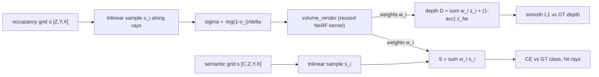

# A11.5d - 3D occupancy prediction

A self-driving car has to know which parts of the space around it are filled, including by
things no detector was trained to name. Semantic 3-D occupancy prediction answers that with a voxel
grid around the car in which every cell carries an occupancy probability (how likely the cell is
filled) and a class (car, pedestrian, road, or free). The difficult part is training it. No sensor
measures a dense 3-D grid of labels, so the labels are expensive to build, and a grid in which
about 95% of the cells are empty pushes a classifier toward predicting "free" everywhere.

This assignment builds an occupancy predictor and the two ways of training it that matter. With
3-D labels, it is a per-voxel classifier trained with a cross-entropy loss that is reweighted
against the free-class imbalance and scored with mean intersection-over-union. Without 3-D labels,
it is trained the way RenderOcc and OccNeRF train it: cast camera rays into the grid, composite the
occupancy along each ray into a rendered depth and a rendered class with the same front-to-back
alpha compositing that NeRF uses, and compare those with a 2-D depth map and a 2-D segmentation
map. The NeRF renderer runs unchanged. NeRF uses it to turn a known field into pixels; here the
pixels are known and the grid is fitted to them.

Build the predictor and its rendering supervision: the channel-to-height lift that turns a
bird's-eye-view (BEV) feature map into a voxel feature volume, the per-voxel classifier, the
inverse-frequency class weighting and weighted cross-entropy that counter the free-class
imbalance, the occupied-class mean-intersection-over-union metric, and the differentiable renderer
that turns the occupancy grid into per-ray depth and semantics. All graded tests run on CPU.

Required reading before starting:
- Pan et al. 2024, "RenderOcc: Vision-Centric 3D Occupancy Prediction with 2D Rendering
  Supervision", [arXiv:2309.09502](https://arxiv.org/abs/2309.09502).
- Tian et al. 2023, "Occ3D: A Large-Scale 3D Occupancy Prediction Benchmark for Autonomous
  Driving", [arXiv:2304.14365](https://arxiv.org/abs/2304.14365).

## Lecture notes

### What occupancy prediction is for

#### The task

A self-driving stack needs to know which 3-D regions are occupied and by what, including
categories a 3-D object detector never enumerates: construction debris, an overturned cart, an
animal, the irregular overhang of a truck bed. A bounding-box detector answers "where are the
known object types"; occupancy answers "which volumes of space are filled", the question a planner
needs in order to avoid collisions. The output is a voxel grid around the car where each cell
carries an occupancy state and, in the semantic variant, a class.

The standard benchmark, Occ3D, fixes the task as a 200x200x16-voxel grid with 18 classes over the
nuScenes and Waymo driving datasets: 640,000 voxels per frame. On Occ3D-nuScenes each voxel is
labeled free or with one of 17 occupied classes; Occ3D-Waymo uses its own class set. The input is the ring of cameras on the car (six in nuScenes). The model's job
is to fill in the whole grid from one set of images.

Two lines of work converged on this formulation. The first is semantic scene completion, the task
of taking a partial observation of a scene and filling in both the geometry that was not observed
and a class label for every filled cell. MonoScene (Cao and de Charette 2021,
[arXiv:2112.00726](https://arxiv.org/abs/2112.00726)) showed a single image could be lifted to a
dense semantic voxel volume by projecting 2-D features along their lines of sight and completing
the unseen geometry with a 3-D network. The second is multi-camera surround perception. SurroundOcc
(Wei et al. 2023, [arXiv:2303.09551](https://arxiv.org/abs/2303.09551)) extended the completion
idea to a full camera rig and spelled out how dense occupancy labels are produced. The Occ3D
benchmark standardized the task, and occupancy became a named subfield.

#### Where the 3-D labels come from

No sensor measures occupancy. A lidar returns points on the surfaces its beams reached, so one
sweep gives a sparse shell of the visible side of every object and says nothing about the interior,
the far side, or anything in shadow. Turning that into a dense labeled voxel grid takes an offline
pipeline, roughly the one SurroundOcc and Occ3D describe. The lidar sweeps of a whole sequence are
aggregated into one point cloud using the ego poses, with moving objects accumulated in their own
object frames so that a driving car does not smear into a wall. The point-wise semantic labels come
along, and each voxel takes the majority class of the points that land inside it. A surface
reconstruction closes the holes that aggregation leaves. Finally the pipeline reasons about
visibility and marks the voxels no sensor ever saw as unknown, so that a loss can skip them instead
of training on a guess.

Every step costs something. The rig needs a lidar, the sequence has to be processed as a whole
rather than frame by frame, and the labels inherit any error in the ego poses and the object boxes.
The result is a derived dataset released separately from the raw sensor data, not something a
camera-only capture comes with.

#### The idea, supervising the grid through a renderer

RenderOcc (Pan et al. 2024) and OccNeRF (Zhang et al. 2023,
[arXiv:2312.09243](https://arxiv.org/abs/2312.09243)) drop the 3-D labels and supervise the voxel
grid with 2-D maps only: a depth map per camera, from a projected lidar sweep or a depth network,
and a per-pixel class map from a 2-D segmentation network. Both are per-frame quantities that need
no aggregation and no visibility reasoning.

To compare a 3-D grid with a 2-D map, the grid has to be turned into an image. For one pixel, cast
the camera ray through it, walk along the ray through the grid, and ask at what distance the ray
is stopped and by what class. The NeRF assignment already has a procedure for this: volume
rendering composites a quantity along a ray, front to back, weighting each sample by the
probability that the ray is stopped there. Compositing distance gives a rendered depth;
compositing class scores gives a rendered class. Every step is differentiable, so the error
between rendered and measured depth sends a gradient back into every voxel the ray passed through.
OccNeRF pushes the same idea further and supervises geometry from photometric consistency between
neighboring frames, so the depth labels go away too.

In estimation terms the renderer is a measurement model, the voxel grid is the state, and the
depth and class maps are the measurements. Training fits the state to the measurements by
gradient descent through the measurement model, rather than by Gauss-Newton on an explicit
Jacobian. The loss is not least squares: it is a Huber loss on depth plus a cross-entropy on
class, both described below.

#### Why it matters

A 3-D label for every voxel of every frame is the most expensive label in the driving stack. A
depth map and a 2-D segmentation map are cheap by comparison and exist for every frame of every
camera. A method that trains the 3-D grid from 2-D maps can use far more data than one that needs
the offline 3-D pipeline, and the renderer that makes this possible is one already built for NeRF.

### Our hit ray (one camera pixel of the toy scene that sees a box)

The toy scene in this assignment is a small version of the real task. The grid is $Z=8$ layers
high and $Y = X = 32$ cells across, about 8,000 voxels, covering 8 m by 8 m on the ground and
3 m in height (cells of 0.25 m by 0.25 m by 0.375 m). Two solid axis-aligned boxes sit in it, one
of class 1 (36 voxels) and one of class 2 (126 voxels), so about 2% of the grid is occupied and
the rest is free; class 3 exists in the label set but not in this scene. Three cameras on a ring
6 m from the center look inward, each producing a $12 \times 12$ grid of rays, 432 rays in all, of
which 42 hit a box. Each ray's ground truth, the distance to the first box it hits and that box's
class, comes from intersecting the ray with the boxes in closed form. A ray that hits nothing is
labeled with the far-plane distance $z_{\text{far}} = 15$ m and no class.

We pick one of those 42 rays and call it our hit ray. It stands for one pixel of one camera in the
real rig, with its lidar depth and its 2-D segmentation label: a single measurement of the grid.
The left panel of the figure shows it from above. It enters the class-2 box 9.52 m from its
camera.


The right panel shows what happens along our hit ray after the whole grid has been trained on the
432 rays' depths and classes and nothing else. The ground-truth occupancy along the ray is a hard
step: 0 before the box, 1 inside it. The trained occupancy is a soft ramp that never passes about
0.5, and at the box face itself it is only about 0.2. The compositing weight in front of the face
balances the weight behind it, so the rendered depth lands on the true 9.52 m. (That exact match is
partly selected: the figure script picks our hit ray among rays whose depth error is at or below
the scene mean of about 0.23 m.) The rendering loss fixed the depth at which the ray stops without
fixing the shape of the surface. The section on what depth supervision does
not determine explains why.

Our hit ray keeps what this assignment is about: a ray through a voxel grid, occupancy read off
the grid at sample points, the compositing that turns occupancy into a depth, and the loss that
compares that depth with a measurement. It drops what makes the real problem hard: the image
network that would predict the grid from pictures (here the grid values are free parameters), the
six-camera rig, and the 18 classes. Exercise 5 reduces it further, to four samples along a ray,
so the compositing can be done by hand.

### Overview of the rest of the notes

The sections below follow the pipeline in the order the assignment builds it. Most steps are
familiar ideas in a new place.

1. Lifting BEV features to voxels. The view transforms of
   [Lift-Splat-Shoot](../a11_5b_lift_splat_shoot/README.md) and
   [BEVFormer](../a11_5c_bevformer/README.md) produce a top-down feature map with the height axis
   collapsed. A per-cell linear map brings the height axis back.
2. The per-voxel classifier. A two-layer MLP applied to every voxel's feature vector, the same as
   a per-pixel segmentation head with one more spatial axis.
3. The class imbalance. Cross-entropy trains the network to output the posterior, and Bayes' rule
   shows why a 95% prior on "free" makes the posterior's argmax useless. Weighting the loss by
   inverse class frequency replaces the prior with a uniform one.
4. The metric. Intersection-over-union per class counts false positives and false negatives
   together, so it cannot be raised by trading one for the other.
5. Rendering supervision. The NeRF compositing, with occupancy converted to density, gives a
   rendered depth and class. Trilinear interpolation, the 3-D version of the bilinear image
   sampling from the [camera-geometry assignment](../a11_5a_camera_geometry_bev/README.md), reads
   the grid between voxel centers. A depth loss fixes the mean of the stopping distribution and
   the total probability of stopping, but not its shape, which is why the field in the figure is
   soft.

Five exercises, placed after the sections they test, are meant to be worked by hand. Each has a
worked answer that can be expanded.

### Lifting BEV features to voxels

The voxel features start from a bird's-eye-view (BEV) feature map, the ego-centric top-down grid
built either by Lift-Splat-Shoot's depth-distribution splatting or by BEVFormer's attention, in
which each BEV cell pulls features from the image points it projects to. It is a $[B, C, Y, X]$
tensor: one $C$-dimensional feature vector per ground-plane cell, with the height axis already
collapsed. Occupancy needs that axis back.

A 1x1 convolution restores it. A 1x1 convolution is a linear map applied independently at every
spatial location, with one weight matrix shared across all locations: it mixes channels and never
touches neighbors, so it is a per-cell matrix multiply. Here the map is
$\text{Conv2d}(C, C n_z, 1)$, so a BEV cell holding the feature vector $f \in \mathbb{R}^{C}$
produces $Wf + b \in \mathbb{R}^{C n_z}$, and reshaping $[B, C n_z, Y, X]$ to
$[B, C, n_z, Y, X]$ reads those $C n_z$ numbers as one $C$-vector per height layer. FlashOcc (Yu
et al. 2023, [arXiv:2311.12058](https://arxiv.org/abs/2311.12058)) calls this reshape
channel-to-height and applies it to the final class logits rather than to features; these notes
use the name channel-to-height lift for the feature version built here.

A BEV cell limits what the convolution can learn. A single cell holds no evidence about the height
its content sits at, since that information was destroyed when the height axis collapsed. The layer
learns a prior over height instead: which channel patterns usually belong near the ground and which
belong overhead, applied identically at every cell. That beats repeating one vector at every
height, because the $n_z$ slices can differ, but it is not a height distribution and nothing
normalizes it.

Keeping height in the first place is the alternative. TPVFormer (Huang et al. 2023,
[arXiv:2302.07817](https://arxiv.org/abs/2302.07817)) uses a tri-perspective view: the BEV plane
plus two planes perpendicular to it, one facing front and one facing side. A 3-D point queries all
three and sums what it reads, so the two vertical planes carry the height structure a single BEV
plane cannot represent, at three planes' worth of memory instead of a full voxel grid's.

> **Exercise 1 (what the channel-to-height lift can and cannot do).** Take $C = 1$ and $n_z = 3$,
> so the 1x1 convolution has weight $W = (2, 0, -1)^\top$ and bias $b = (0, 1, 0.5)^\top$.
> (a) Compute the voxel column produced by a BEV cell with feature $f = 1$ and by one with
> $f = -1$. (b) Two BEV cells both hold $f = 1$; one is the ground under a bridge (occupied only at
> the top layer), the other is a low wall (occupied only at the bottom layer). What does the lift
> give each? (c) How many parameters does the lift have in the toy configuration, $C = 16$,
> $n_z = 8$?

<details>
<summary>Answer</summary>

(a) The column is $Wf + b$. For $f = 1$: $(2, 1, -0.5)$. For $f = -1$: $(-2, 1, 1.5)$. Different
features give different height profiles, so the layer can put different content at different
heights.

(b) Both get $(2, 1, -0.5)$. The lift is a function of the cell's feature alone, so two cells with
the same feature get the same column whatever their true vertical structure. Telling the bridge
from the wall has to happen upstream (the BEV feature must already encode it) or downstream (a
3-D network that looks at neighboring voxels), or the height axis must be kept, as TPVFormer does.

(c) The weight matrix is $C n_z \times C = 128 \times 16 = 2048$ numbers plus $128$ biases, 2176
parameters.

</details>

### The per-voxel classifier

The voxel feature volume $[B, C, Z, Y, X]$ (channels first, $Z$ the height axis) goes through two
1x1x1 3-D convolutions with a ReLU between them. Read as a per-voxel operation, that is a
two-layer MLP applied independently to every voxel's feature vector, with the weights shared over
all $Z Y X$ voxels. The ReLU, $\max(0, x)$ applied elementwise, keeps it two layers rather than
one: the composition of two linear maps is another linear map, so without a nonlinearity between
them the pair would collapse into a single $n_{\text{classes}} \times C$ matrix and the first
convolution would add nothing.

The output is $[B, n_{\text{classes}}, Z, Y, X]$: one score per class per voxel. Those scores are
logits, meaning unnormalized log-probabilities. Softmax,

$$\text{softmax}(s)_c = \frac{e^{s_c}}{\sum_{c'} e^{s_{c'}}},$$

turns a logit vector into a probability distribution over classes, and it is monotone, so the
predicted label is the argmax of the logits with or without it. Class 0 is free (unoccupied);
classes 1 and up are occupied categories.

### Class imbalance and our free-class collapse

Free voxels dominate. In a real Occ3D grid roughly 90-95% of voxels are free, and the rarest
occupied classes are far rarer than the free class, each a small fraction of a percent of the grid. An unweighted
cross-entropy trained on that grid tends to predict free everywhere, scoring 95% voxel accuracy
while detecting nothing. We call this our free-class collapse. Bayes' rule explains why it happens,
and the same argument gives the fix and its cost.

Cross-entropy is the classification loss used throughout the course: softmax the logits into a
distribution $q(\cdot \mid x)$ and charge $-\log q(c \mid x)$ for the true class $c$. Averaged over
enough data, it is minimized when the network reproduces the true conditional distribution,
$q(c \mid x) = p(c \mid x)$. That property makes it the right loss, and it is also the source of
the collapse. Bayes' rule splits the posterior into a likelihood and a prior,

$$p(c \mid x) \;\propto\; p(x \mid c)\, p(c),$$

and the prior $p(c)$ here is the class frequency in the grid: around $0.95$ for free against
perhaps $10^{-4}$ for a rare occupied class. Unless the features $x$ at a voxel are informative
enough to beat a factor of $10^4$, the posterior is largest at free for every voxel in the scene,
and the argmax that turns the posterior into a label reads free everywhere. The network is
reporting the correct posterior, and the correct posterior has a useless argmax.

Weighting the per-voxel loss by a factor $w_c$ that depends on the target class changes which
distribution the loss is minimized by. Minimizing $\sum_c p(c \mid x)\, w_c \, (-\log q(c \mid x))$
over distributions $q$ (a one-line Lagrange-multiplier problem) gives

$$q^\star(c \mid x) \;=\; \frac{w_c\, p(c \mid x)}{\sum_{c'} w_{c'}\, p(c' \mid x)}.$$

Choose $w_c = 1/p(c)$ and the prior cancels: $q^\star(c \mid x) \propto p(x \mid c)$, the
class-conditional likelihood. The trained argmax becomes the maximum-likelihood class instead of
the maximum-a-posteriori class: the decision is made as if the prior were uniform. Inverse-frequency weighting is that substitution, with the class counts standing in
for $p(c)$.

Reading it that way also names the price. A maximum-likelihood decision ignores that free voxels
really are most of the grid, so it over-predicts the rare classes. In detection terms, recall of a
class (the fraction of its true voxels that the prediction finds) goes up and precision (the
fraction of the voxels predicted as that class that are correct) goes down. Weighting does not add
information; it moves the decision threshold along that trade.

> **Exercise 2 (the collapse on one scalar feature).** Each voxel has one scalar feature $x$. Free
> voxels have $x \sim \mathcal{N}(0, 1)$ and occupied voxels $x \sim \mathcal{N}(3, 1)$, and 2% of
> voxels are occupied, as in the toy scene. (a) Compute the posterior $P(\text{occ} \mid x)$ at
> $x = 3$, the most typical occupied value, and at $x = 2.5$. (b) Find the threshold above which
> the maximum-a-posteriori rule says "occupied", and the recall it achieves. (c) With
> inverse-frequency weighting the rule becomes maximum likelihood. Give its threshold, recall, and
> precision. Use $\Phi(0.203) \approx 0.580$, $\Phi(1.5) \approx 0.933$,
> $1 - \Phi(2.797) \approx 0.0026$, and $1 - \Phi(1.5) \approx 0.0668$, where $\Phi$ is the
> standard normal cumulative distribution function.

<details>
<summary>Answer</summary>

(a) The likelihood ratio is
$p(x \mid \text{occ})/p(x \mid \text{free}) = \exp\big((x^2 - (x-3)^2)/2\big) = \exp(3x - 4.5)$.
At $x = 3$ it is $e^{4.5} \approx 90.0$. Multiplying by the prior odds $0.02/0.98 \approx 0.0204$
gives posterior odds $1.84$, so $P(\text{occ} \mid x = 3) \approx 0.648$. At $x = 2.5$ the ratio
is $e^{3} \approx 20.1$, the odds are $0.41$, and $P(\text{occ}) \approx 0.291$: the argmax says
free, though $x = 2.5$ is half a standard deviation from the occupied mean.

(b) Occupied wins when $3x - 4.5 > \ln 49$, so $x > 1.5 + \ln(49)/3 \approx 2.797$. Recall is
$P(x > 2.797 \mid \text{occ}) = \Phi(3 - 2.797) = \Phi(0.203) \approx 0.580$: 42% of the occupied
voxels are labeled free. At a prior of $10^{-4}$ the threshold moves to about 4.57 and recall falls
to about 6%, which is the collapse.

(c) Maximum likelihood ignores the prior, so the threshold is the midpoint $x = 1.5$. Recall is
$\Phi(1.5) \approx 0.933$. Per unit of voxels, true positives are $0.02 \cdot 0.933 = 0.0187$ and
false positives $0.98 \cdot 0.0668 = 0.0655$, so precision is
$0.0187/(0.0187 + 0.0655) \approx 0.22$, down from about 0.82 under the posterior rule. Weighting
found more of the occupied voxels at the cost of many more false alarms.

</details>

The class-weighted loss is reduced to one number as a weighted mean,

$$\mathcal{L} = \frac{\sum_v w_{t_v}\, \ell_v}{\sum_v w_{t_v}},$$

where $\ell_v$ is the per-voxel cross-entropy and $w_{t_v}$ is the weight of voxel $v$'s target
class. The weights are $w_c = 1/(\text{count}_c + \varepsilon)$, where the small constant
$\varepsilon$ keeps a class absent from the batch at a finite weight instead of dividing by zero,
and the weight vector is then rescaled so that the weights average to 1 (equivalently, sum to
$n_{\text{classes}}$). The rescaling changes neither the ordering of the weights nor the minimizer,
because a common factor on every $w_c$ cancels between the numerator and the denominator of
$\mathcal{L}$ exactly. It only keeps the loss value on the same scale as the unweighted loss, so a
learning rate tuned for one transfers to the other. The plain $\sum_v w_{t_v}\ell_v / N$
reduction, with $N$ the number of voxels, differs from $\mathcal{L}$ by a factor
$\sum_v w_{t_v} / N$ and does not have this property.

> **Exercise 3 (inverse-frequency weights and the weighted mean).** A batch has 900 free voxels,
> 80 of class 1, and 20 of class 2. (a) Compute the inverse-frequency weights with
> $\varepsilon = 1$, normalized to mean 1. (b) Five of the voxels have per-voxel cross-entropies:
> three free voxels at $0.1$ each, one class-1 voxel at $2.0$, and one class-2 voxel at $3.0$.
> Compute the weighted-mean loss $\mathcal{L}$ over these five and compare it with the unweighted
> mean. (c) What happens to $\mathcal{L}$ if every weight is multiplied by 10?

<details>
<summary>Answer</summary>

(a) The raw weights are $1/901$, $1/81$, $1/21$, that is $0.00111$, $0.01235$, $0.04762$, with sum
$0.06108$. Multiplying by $3/0.06108$ gives $w \approx (0.0545, 0.606, 2.339)$, which averages to 1.
Class 2 is 45 times rarer than free and gets a weight 43 times larger (not exactly 45, because of
$\varepsilon$).

(b) The numerator is
$3 \cdot 0.0545 \cdot 0.1 + 0.606 \cdot 2.0 + 2.339 \cdot 3.0 = 0.0164 + 1.213 + 7.017 = 8.246$ and
the denominator $3 \cdot 0.0545 + 0.606 + 2.339 = 3.109$. So $\mathcal{L} \approx 2.65$, against an
unweighted mean of $(0.3 + 2.0 + 3.0)/5 = 1.06$. The weighted loss is dominated by the two
occupied voxels, so the gradient now goes mostly to the rare classes.

(c) Nothing. Numerator and denominator both grow by 10. The $\sum_v w_{t_v}\ell_v/N$ reduction
would grow by 10.

</details>

Inverse-frequency weighting is the simplest mitigation, and two stronger ones are standard.

Focal loss (Lin et al. 2017, [arXiv:1708.02002](https://arxiv.org/abs/1708.02002)) attacks the same
imbalance without counting classes. Multiply each voxel's cross-entropy by $(1 - p_t)^\gamma$, where
$p_t$ is the probability the model currently assigns to that voxel's true class and $\gamma > 0$
sets the strength. With $\gamma = 2$, a voxel already predicted at $p_t = 0.99$ contributes
$10^{-4}$ of its unfocused loss while one at $p_t = 0.1$ keeps $0.81$ of it. The easy voxels are
the confident ones, and in an imbalanced grid they are overwhelmingly the free ones, so the
gradient shifts to the hard voxels near object boundaries without any class counts.

The Lovasz-softmax loss (Berman et al. 2018) goes after the metric directly. IoU, defined in the
next section, counts voxels, so as a function of the logits it is piecewise constant: nudging a
logit changes nothing until a voxel's argmax flips, and then the metric jumps. Its gradient is zero
wherever it exists, which makes it unusable as a loss. A surrogate is a differentiable stand-in
chosen so that lowering it lowers the metric. The Lovasz-softmax loss builds one by treating the
IoU loss as a function of the *set* of misclassified voxels, which is a submodular set function
(one with diminishing returns: adding a voxel to a larger set raises it by no more than adding it
to a smaller one), and taking its Lovasz extension: the piecewise-linear interpolation of that set
function from the corners of the unit cube to its interior, which is convex precisely because the
set function is submodular. Feeding it the continuous per-voxel softmax errors instead of hard 0/1
memberships gives a loss with usable gradients that still agrees with the IoU loss on hard
predictions.

### Measuring occupancy

The dense metric is mean intersection-over-union over the occupied classes. For class $c$,

$$\text{IoU}_c = \frac{|\{\text{pred} = c\} \cap \{\text{target} = c\}|}{|\{\text{pred} = c\} \cup \{\text{target} = c\}|} = \frac{\text{TP}}{\text{TP} + \text{FP} + \text{FN}}.$$

TP, FP, and FN count the true positives, false positives, and false negatives of class $c$. Both
false positives and false negatives are in the denominator, so IoU cannot be improved by trading
one for the other, which is why it is reported instead of precision or recall alone. The trade the
weighting argument above described, more detections at lower precision, moves TP and FP together
and can leave IoU flat or worse: in Exercise 2, the posterior rule has IoU
$0.0116/(0.0116 + 0.0026 + 0.0084) \approx 0.52$ and the weighted rule about $0.22$. The mean is
taken over occupied classes only, since including the free class would let the 95%-correct free
prediction carry the average. A class absent from both prediction and target has an empty union
and is excluded from the mean rather than scored 0, the standard mIoU convention.

Voxel-level mIoU has a flaw the field later corrected. It penalizes the exact depth at which an
occupied surface sits along a ray, and it does so twice: a surface predicted one voxel too near
makes those voxels false positives and the true voxels false negatives, so a one-voxel-thick
surface scores zero IoU even though the rendered depth is off by one voxel width and a planner
would not care. The size of that penalty depends on the voxel size, so the same geometric error
costs more on a finer grid.

The fully sparse occupancy predictor SparseOcc (Liu et al. 2023,
[arXiv:2312.17118](https://arxiv.org/abs/2312.17118)) introduced RayIoU to fix this by changing what
is counted. Cast a set of query rays through both the prediction and the ground truth, walk each
ray to its first occupied voxel, and record the class and the distance of that first hit. A ray is
a true positive when the two classes agree and the two distances agree within a distance tolerance;
otherwise it is a false positive for the predicted class and a false negative for the true one, and
IoU is computed over rays instead of voxels. The tolerance is in meters, so the score no longer
moves when the grid resolution changes, and a surface placed slightly too deep is scored as
slightly wrong instead of completely wrong. Occupied-class mIoU is the simpler dense metric built
here; RayIoU is the ray-based metric SparseOcc proposes in its place.

> **Exercise 4 (one voxel of depth error under voxel IoU).** Follow one column of voxels along a
> camera ray, numbered by distance. A car occupies voxels 4 and 5 (two voxels, the minimum box height
> in the toy scene; boxes are at least three voxels across), and the prediction puts the car at voxels 3 and 4: the surface is
> one voxel too near. (a) What is the car's IoU on this column? (b) What if the car were one voxel
> thick (voxel 4 only) and predicted at voxel 3? (c) How would RayIoU score this ray if the
> tolerance is larger than one voxel width?

<details>
<summary>Answer</summary>

(a) Intersection $\{4\}$, union $\{3, 4, 5\}$, so IoU $= 1/3$: one TP, one FP (voxel 3), one FN
(voxel 5).

(b) Intersection empty, union $\{3, 4\}$, IoU $= 0$, the same score as predicting no car at all.

(c) The first hit is the car class in both prediction and ground truth, and the first-hit distances
differ by one voxel width, which is within the tolerance. The ray is a true positive, and the
error does not lower the score.

</details>

### Rendering supervision

The renderer is the reason 2-D maps can train a 3-D field. It is the volume renderer from the
[NeRF assignment](../a09_nerf/README.md), unchanged. Three quantities
carry over unchanged, by name. The segment opacity $\alpha_i = 1 - e^{-\sigma_i \delta_i}$ is the
probability that a segment of length $\delta_i$ with density $\sigma_i$ stops the ray. The
transmittance $T_i = \prod_{j<i}(1 - \alpha_j)$, an exclusive product, is the fraction of light that
reaches sample $i$ without being absorbed earlier. The compositing weight $w_i = T_i \alpha_i$ is the
probability that the ray is stopped exactly in segment $i$. Any per-sample quantity $q_i$
composites to $\sum_i w_i q_i$. That sum is the Porter-Duff "over" operator, which lays a layer
carrying value $q$ at opacity $\alpha$ over a background $B$ as $\alpha q + (1 - \alpha) B$, chained
front to back across the $N$ samples of a ray. The NeRF notes derive that chain, so it is not
repeated here.

Four things change compared with NeRF, one per subsection below. The two subsections after them
cover how the grid is read between voxel centers and what the depth loss leaves undetermined.

#### The field is an explicit voxel grid

The field is a grid of stored numbers, not an MLP. Evaluating it at a sample point is an
interpolation of stored numbers rather than a network forward pass, so each sample's gradient goes
to the eight voxels around it and nowhere else. The subsection on sampling the grid below says how
that interpolation works.

#### The field stores an occupancy probability, not a density

The segment opacity $\alpha_i = 1 - e^{-\sigma_i \delta_i}$ is the probability that the segment
stops the ray, which is close to what "this segment is occupied" means: a solid voxel absorbs the
ray ($\alpha \to 1$), empty space passes it ($\alpha \to 0$). RenderOcc-style renderers therefore
set $\alpha_i = o_i$, the occupancy read at sample $i$. A sampled occupancy $o \in [0, 1)$ converts
to the density that reproduces it over a segment of length $\delta$ by inverting that equation,

$$\sigma = -\frac{\log(1 - o)}{\delta}, \qquad \text{so} \qquad 1 - e^{-\sigma \delta} = o.$$

The round trip is exact for every $\delta$, because the same $\delta$ that made $\sigma$ is the one
the renderer uses to make $\alpha$ again. That matters at the last sample, where the NeRF ray code
sets $\delta_{N-1}$ to a huge constant so that a NeRF's final sample absorbs the remaining
transmittance: here the huge $\delta$ divides into $\sigma$ and multiplies back out, leaving
$\alpha_{N-1} = o$ and no forced opacity at the far end. Storing occupancy rather than density is
worth the conversion because $o$ is bounded in $[0, 1]$, so a sigmoid parameterizes it directly,
and because the consumer of an occupancy grid wants $o$, while $\sigma$ is an unbounded rate whose
meaning depends on the segment length.

Occupancy and density are not interchangeable, though. Because $\alpha = o$ holds per sample, a
voxel's stopping probability depends on how many samples fall inside it: a voxel with $o = 0.5$
crossed by 1, 2, or 4 samples stops the ray with probability $0.5$, $0.75$, or $0.94$. The density
the grid implies is $-\log(1 - o)/\delta$, which changes with the sample spacing, so a grid trained
at one spacing renders differently at another.

#### The composited quantities are depth and a class vector, not color

Rendered depth is

$$D = \sum_i w_i z_i + \Big(1 - \sum_i w_i\Big)\, z_{\text{far}},$$

the expected distance at which the ray terminates, where $z_i$ is the distance of sample $i$ from
the camera. The leftover probability $1 - \sum_i w_i = \prod_i (1 - \alpha_i)$ (the ray passing
through everything) is assigned to the far plane $z_{\text{far}}$. That leftover term sends a miss
ray to $z_{\text{far}}$, matching the ground truth, where a ray that hits nothing is labeled
$z_{\text{far}}$. The sum $\sum_i w_i$ itself is the accumulated opacity, the probability that the
ray is stopped somewhere.

Rendered semantics are $S = \sum_i w_i s_i$, where $s_i$ is the interpolated per-class logit
vector at sample $i$. Because the blend happens in logit space, softmaxing the result gives the
normalized weighted *geometric* mean of the per-sample class distributions
$p_i = \text{softmax}(s_i)$,

$$\text{softmax}\Big(\sum_i w_i s_i\Big)_c \;\propto\; \prod_i p_i(c)^{w_i},$$

since the per-sample normalizers do not depend on $c$. Depth blends arithmetically and semantics
blend geometrically; the second is more decisive, in that a sample confident that a class is wrong
can veto it for the whole ray.

#### The supervision is depth and class, not photometric error

The depth term is a smooth L1 (Huber) loss: quadratic for errors below 1 m and linear above. A
field initialized at occupancy $0.5$ everywhere, the value a zero logit grid gives, stops every ray
within a few samples of entering the grid (each sample halves the transmittance), so at step zero
the miss rays are wrong by most of the depth range. The linear regime bounds what those rays
contribute to the gradient instead of letting them dominate the batch. The semantic term is
cross-entropy on the rendered class vector, applied only to rays that hit something, since a ray
that leaves the scene has no first-hit class to supervise.

The whole path from grid to losses:



#### Sampling the grid between voxel centers

A sample at distance $z_i$ along a ray lands wherever it lands, essentially never on a voxel
center, so the field has to be read between centers. Trilinear interpolation does it with the eight
voxel centers surrounding the point, the 3-D version of bilinear sampling at a fractional pixel:
convert the point to fractional voxel indices, take the fractional parts $(u, v, w) \in [0,1)^3$,
and blend the eight corners with the products of the per-axis linear weights, $(1-u)$ or $u$
against $(1-v)$ or $v$ against $(1-w)$ or $w$. The eight products sum to 1, so the result is a
weighted average, and it is linear in each axis separately.

Voxel center $i$ along an axis of $S$ cells covering $[a, b]$ sits at
$a + (i + 0.5)(b - a)/S$. A point outside the grid reads 0: the stretch of a ray outside the grid
is empty, contributes $\alpha = 0$, and is perfectly transparent. A ray that misses the volume
entirely accumulates no opacity at all, and the leftover term in the depth formula sends it to
$z_{\text{far}}$.

Nearest-voxel lookup would be simpler and would train much worse. Each sample would read exactly
one voxel, so the only voxels a ray could ever change are the ones its sample points land inside; a
voxel just off to the side, or between two consecutive samples, would never receive a gradient and
would sit at its initialization. The dependence on position would also be a step function: two
sample points a hair apart on either side of a voxel face read entirely different values, and
moving a surface by a fraction of a voxel would be invisible to the loss. Trilinear interpolation
gives every sample a share of eight voxels in proportion to proximity, so the rendered depth varies
continuously with the field, every voxel near a ray gets a share of the gradient, and the field can
slide a surface toward the right place instead of only switching fixed voxels on and off.

#### What depth supervision does not determine

Rendered depth is a mean: one number per ray, computed from a weight profile with $N$ degrees of
freedom. The depth loss therefore leaves almost all of those degrees of freedom free. A sharp spike
of weight at the correct distance and a broad low smear centered on the correct distance give the
same rendered depth and the same loss. Starting from a near-uniform initialization, which is
already a smear, gradient descent has no reason to condense one. The soft ramp along our hit ray in
the figure is that smear: a profile with the right mean and the wrong shape.

The accumulated ray opacity,

$$\sum_i w_i \;=\; 1 - \prod_i (1 - \alpha_i),$$

is the quantity the depth loss does pin down, because the leftover term in $D$ sends any
unaccumulated probability to $z_{\text{far}}$. A ray that hits a box needs its opacity near 1 to
render a near depth, and a miss ray needs it near 0. Many soft samples compound into a nearly
opaque ray, so a high accumulated opacity does not require any single voxel to be confidently
occupied. The gap between the accumulated opacity and the per-voxel occupancy is the slack a
depth-only loss leaves.

> **Exercise 5 (two profiles with the same depth).** A ray has four samples at
> $z = 4, 5, 6, 7$ m with $\delta = 1$ m for the first three and a huge $\delta$ for the last, and
> $z_{\text{far}} = 10$ m. (a) What density $\sigma$ does an occupancy of $0.5$ convert to on a
> 1 m segment? What $\alpha$ does the last sample get from an occupancy of $0.5$? (b) Render the
> sharp profile $o = (0, 0, 1, 0)$ and the smeared profile $o = (0, 0.5, 0, 1)$: give the weights,
> the depth, and the accumulated opacity of each. (c) Normalize each weight profile and compute its
> entropy $-\sum_i \hat w_i \log \hat w_i$. (d) Render $o = (0, 0.5, 0.5, 0)$ and explain the depth.

<details>
<summary>Answer</summary>

(a) $\sigma = -\log(0.5)/1 = \ln 2 \approx 0.693$ per meter. For the last sample
$\sigma = \ln 2/\delta$ is tiny, but $\alpha = 1 - e^{-\sigma\delta} = 1 - e^{-\ln 2} = 0.5$
exactly, because the same $\delta$ is used both ways.

(b) Sharp: $T = (1, 1, 1, 0)$, $w = (0, 0, 1, 0)$, accumulated opacity 1, $D = 6$ m. Smeared:
$T = (1, 1, 0.5, 0.5)$, $w = (0, 0.5, 0, 0.5)$, accumulated opacity 1,
$D = 0.5 \cdot 5 + 0.5 \cdot 7 = 6$ m. Same depth, same accumulated opacity, so a depth loss cannot
prefer one over the other.

(c) The sharp profile has entropy 0. The smeared one has $\hat w = (0, 0.5, 0, 0.5)$ and entropy
$\ln 2 \approx 0.693$. An entropy regularizer, described next, separates them where the depth loss
cannot.

(d) $T = (1, 1, 0.5, 0.25)$, $w = (0, 0.5, 0.25, 0)$, accumulated opacity $0.75$, and
$D = 0.5 \cdot 5 + 0.25 \cdot 6 + 0.25 \cdot 10 = 6.5$ m. A quarter of the probability passes
through all four samples and is assigned to the far plane, which pulls the depth out. A ray that
has to render a near surface is therefore pushed toward an accumulated opacity of 1.

</details>

Two families of regularizer address that slack. An entropy regularizer works on the weights of each ray:
normalize $\{w_i\}$ into a distribution $\hat w_i$ and add its Shannon entropy
$-\sum_i \hat w_i \log \hat w_i$ to the loss. Entropy is maximal for a flat profile and zero when
all the mass sits on one sample, so minimizing it forces each ray to commit to a single depth
without prescribing which one. mip-NeRF 360's distortion loss (Barron et al. 2022,
[arXiv:2111.12077](https://arxiv.org/abs/2111.12077)) has the same intent in a different form,
penalizing weight mass that is spread far apart along the ray. A total-variation regularizer works
on the field instead of the rays: add $\sum |o_v - o_{v'}|$ over neighboring voxel pairs. An
$\ell_1$ penalty on differences prefers a few large jumps to many small ones, where a squared
penalty would prefer the reverse, so its minimizer is piecewise constant, a solid object with a
sharp boundary rather than a haze. It is the same total-variation prior used for edge-preserving
image denoising.

More viewpoints help for the same structural reason: a voxel crossed by rays from two different
directions has to satisfy two depth constraints at once, and a smear that reproduces one direction's
depth is generally wrong for the other's.

### Where this goes

SparseOcc points to where the field has moved: sparse occupancy. It and its successors discard the more than 90% of
voxels that are empty and run convolution and attention only on the occupied set. A sparse 3-D
convolution stores the active sites as a list of coordinates plus features and computes outputs
only where the kernel actually reaches an active site, so cost scales with the number of occupied
voxels rather than with $Z Y X$; that is how a full-resolution grid fits in memory and runs in real
time. The dense voxel grid plus NeRF-density renderer here is the mechanism the sparse methods
optimize away.

Two further directions. GaussianOcc (Gan et al. 2024,
[arXiv:2408.11447](https://arxiv.org/abs/2408.11447)) replaces the volume renderer with 3-D
Gaussian splatting from the voxel grid, removing the per-ray sampling cost the same way splatting
removed it from NeRF; it reports rendering 5 times faster. And 4-D occupancy world models such as
Drive-OccWorld (Yang et al. 2024, [arXiv:2408.14197](https://arxiv.org/abs/2408.14197)) predict
future occupancy volumes conditioned on controls such as a planned ego trajectory, turning the
static grid into a forecasting target that a planner can query directly.

## The assignment

Fill these holes, in order. Each is one `NotImplementedError` with a matching test; the docstring
in each function gives the signature, shapes, and constraints.

| # | Function | File | Concept from the notes |
|---|---|---|---|
| 1 | [`bev_to_voxel()`](occupancy.py) | `occupancy.py` | the channel-to-height lift |
| 2 | [`OccupancyHead.forward()`](occupancy.py) | `occupancy.py` | the per-voxel classifier |
| 3 | [`inverse_frequency_weights()`](occupancy.py) | `occupancy.py` | inverse-frequency weights, mean 1 |
| 4 | [`weighted_ce_loss()`](occupancy.py) | `occupancy.py` | the weighted-mean cross-entropy $\mathcal{L}$ |
| 5 | [`occupancy_iou()`](occupancy.py) | `occupancy.py` | occupied-class mIoU, empty unions excluded |
| 6 | [`render_occupancy_rays()`](occupancy.py) | `occupancy.py` | rendering supervision: sampling, density conversion, depth and semantics |

Everything is in `occupancy.py`, which is local to this assignment. `config.py` (the `OccConfig`
with the grid, bounds, and ray budget) and the `occupancy_toy_scene` generator in
`nanovision/data/toy.py` are provided. The input BEV map for `bev_to_voxel` is a given tensor
here; producing it is the job of the Lift-Splat-Shoot and BEVFormer view transforms.

Notes on specific holes:
- `bev_to_voxel`: the code and docstring call the channel-to-height lift "pillar extrusion"; the
  two names mean the same operation. Apply the
  provided `Conv2d(C, C * n_z, 1)` and reshape; the channel axis splits as $(C, n_z)$, in that
  order.
- `OccupancyHead.forward`: the two `Conv3d` layers and the ReLU are already constructed in
  `__init__`.
- `inverse_frequency_weights`: $w_c = 1/(\text{count}_c + \varepsilon)$ with the default
  $\varepsilon = 1$, then rescale to mean 1. `torch.bincount` with `minlength=n_classes` gives the
  counts, including zeros for absent classes.
- `weighted_ce_loss` must equal `F.cross_entropy(logits, target, weight=weights)` exactly, which
  uses the weighted-mean reduction $\mathcal{L}$ from the notes (the test compares the two). Write
  it from `log_softmax` and `gather` rather than calling `F.cross_entropy`.
- `render_occupancy_rays` reuses the NeRF assignment's code through `nanovision.volume`:
  `sample_along_rays` for the sample points, `deltas_from_z` for the segment lengths (its last
  $\delta$ is $10^{10}$), and `volume_render` for the weights (its second return value). Pass a
  zeros tensor as the color argument, since semantics are composited separately. Do not write the
  transmittance product yourself; `test_forbidden_imports` rejects `cumprod` and `cumsum` in this
  file. Clamp $1 - o$ to at least $10^{-6}$ before the log, which caps $\sigma$ and makes $o = 1$
  representable.

The trilinear interpolation is `F.grid_sample`, which has conventions worth pinning down before
they cost an afternoon:
- The axis order is reversed between the volume and the coordinates. The grid is fed as
  $[N, C, Z, Y, X]$, which `grid_sample` reads as its $[N, C, D, H, W]$, so its depth axis $D$ is
  the voxel $Z$, its height $H$ is $Y$, its width $W$ is $X$. But the coordinate tensor's last
  dimension is ordered $(g_x, g_y, g_z)$ against the $(W, H, D)$ axes, the reverse. Each sample
  point's metric coordinate is normalized to $[-1, 1]$ over its own axis bounds and stacked in that
  order:

  $$g_x = 2\frac{p_x - x_0}{x_1 - x_0} - 1,\quad g_y = 2\frac{p_y - y_0}{y_1 - y_0} - 1,\quad g_z = 2\frac{p_z - z_0}{z_1 - z_0} - 1.$$

  A wrong stack order silently transposes the field. With $Z = 8$ and $Y = X = 32$ a
  $(g_z, g_y, g_x)$ stack still broadcasts to a valid-but-garbage sample, so the depth loss simply
  fails to converge, and it fails in a way that looks like a tuning problem.
- `align_corners=False` matches the voxel-center convention. With it, `grid_sample` maps a
  normalized coordinate $g$ on an axis of $S$ cells to the fractional index $(g+1)S/2 - 0.5$. Push
  the metric center of voxel $i$, which sits at $a + (i + 0.5)(b - a)/S$, through the normalization
  above and it comes out at $g = 2(i + 0.5)/S - 1$, which maps back to index $i$ exactly: centers
  land on centers. With `align_corners=True` the mapping is $g \mapsto (g+1)(S-1)/2$, so $g = -1$
  is the center of the first cell rather than the outer face of the grid, and the same
  normalization would be off by nothing at the middle of the axis and by nearly half a voxel at
  each end. On $Z = 8$ that is a large fraction of the grid's height.
- `padding_mode="zeros"` returns 0 for any point outside $[-1, 1]$, the empty-outside-the-grid
  behavior the notes describe.
- `grid_sample` calls trilinear interpolation `mode="bilinear"` on a 5-D input. The mode name is not
  updated for the extra dimension.
- The coordinate argument must be 5-D, $[1, R, N, 1, 3]$ for $R$ rays of $N$ samples, and the
  output comes back as $[1, C, R, N, 1]$.

### Running and validating

Activate the environment (`conda activate nanovision`), then:

```
make test     A=a11_5d_occupancy   # run the tests against the top-level files (the holes)
make verify   A=a11_5d_occupancy   # run the same tests against the reference solution/
make viz      A=a11_5d_occupancy   # render the figures from the reference solution
make viz-mine A=a11_5d_occupancy   # render the figures from your own code (holes filled)
```

`make test` runs the suite in `assignments/a11_5d_occupancy/tests/` against the top-level
`occupancy.py`, red until the holes are filled and green once correct. `make verify` runs the
identical suite against the reference `solution/` by setting `NANOVISION_IMPL=solution`, so it is
green from the start and shows the target. Run the tests in this order:
`test_bev_to_voxel`, `test_occupancy_head`, `test_loss`, `test_render_supervision`,
`test_forbidden_imports`.

The tests check:
- `test_bev_to_voxel.py`: the output shape and a float64 gradcheck (a comparison of the analytic
  backward pass against finite differences).
- `test_occupancy_head.py`: shape, gradcheck, and an overfit in which the head and a learnable
  feature volume (standing in for the upstream encoder) are fit to the toy scene's voxel labels with
  the weighted loss, reaching occupied-class IoU above 0.85.
- `test_loss.py`: the weight ordering and mean-1 normalization; that `weighted_ce_loss` matches
  `F.cross_entropy(weight=...)`; a gradcheck; mIoU on a hand-counted example with and without the
  free class; the empty-union exclusion; and our free-class collapse, described below.
- `test_render_supervision.py`: the sample-budget floor, output shapes, a gradcheck of the depth
  with respect to the occupancy grid, and the overfit of the rendering path described below.
- `test_forbidden_imports.py`: a static scan of `occupancy.py` and `solution/occupancy.py` for OpenCV
  and Kornia projection shortcuts, the sparse-convolution libraries MinkowskiEngine and spconv (the
  dense grid is the exercise), and `cumprod`/`cumsum` (the transmittance product must come from
  `volume_render`); it also checks that the solution calls `volume_render`.

The ground truth the rendering tests compare against is not produced by any renderer. The toy scene
places axis-aligned solid boxes in the grid and computes each ray's first-hit depth and class by
the ray-box slab intersection in closed form, so a passing run shows the alpha-compositing
quadrature converging to the hard box geometry rather than agreeing with itself. The sample budget
follows from the depth tolerance: rendered depth is resolved to about the sample spacing
$(z_{\text{far}} - z_{\text{near}})/N$, so with $z_{\text{near}} = 1$ m, $z_{\text{far}} = 15$ m, and
$N = 96$ samples the spacing is about 0.146 m, half the 0.3 m test threshold.

`make viz` trains the occupancy and semantic grids by rendering supervision for 600 Adam steps and
writes two figures to `out/`:
- `occupancy_slices.png`: three $Z$ layers of the predicted occupancy above the same layers of the
  ground truth.
- `rendered_depth.png`: rendered depth against the analytic depth for the hit rays.

The figure in these notes is generated by `assets/make_ray_figure.py`, which trains the grids the
way `test_render_supervision` does (500 steps) with the reference solution and plots our hit ray.

What you should see when you run this. The grid is deliberately tiny: $Z=8$, $Y=32$, $X=32$,
$n_{\text{classes}}=4$ (free plus 3 occupied), about 8,000 voxels.

`test_loss` measures our free-class collapse: a single linear `Conv3d(C, n_classes, 1)` classifier
(no deep head, so it cannot memorize the labels) is trained from a shared init, once unweighted and
once with inverse-frequency weighting, on a weak noisy class hint, and scored by occupied-class
recall rather than IoU. This is the precision-for-recall trade the weighting argument predicts,
made visible: the weighted run over-predicts the rare classes, which inflates the IoU union and can
leave its IoU below the unweighted run's even though the rare classes are now detected at all, so
recall is the measurement that isolates the point. The measured unweighted recall is about 0.19 and
weighted recall about 0.76, a gap of about 0.57 (the test requires more than 0.3); precision moves
the other way, from about 0.48 unweighted to about 0.06 weighted.

`test_render_supervision` overfits the rendering path to a mean depth error around 0.23 m (under
the 0.3 m threshold) with per-ray semantic accuracy 1.0 on hit rays. At step zero, with occupancy
0.5 everywhere, the miss rays render about 13 m short of $z_{\text{far}}$, the case the Huber loss's
linear regime is there for.

The occupancy comes out as a soft shell rather than a hard surface, as the notes predict from a
depth loss that only constrains the mean of the weight profile. Along a ray that hits a box, about
fifteen of the ninety-six samples carry non-negligible occupancy (above 0.01), with a median around
0.28 and a per-ray peak averaging about 0.7, and the grid ends up with about 5% of its voxels above
occupancy 0.5 against 2% truly occupied. The accumulated ray opacity is the clean signal, around
0.97 on rays that hit a box and around 0.02 on rays that miss, because a dozen soft samples compound
into a nearly opaque ray. Part of that compounding comes from the sample spacing: at 0.146 m per
sample and cells of 0.25 m to 0.375 m, a ray reads each voxel about twice, and with $\alpha = o$ per
sample each read stops the ray again. The test checks the accumulated opacity rather than any single voxel's
occupancy, and it does not check the box interiors: no ray reaches them, so nothing constrains
them.

These are toy artifacts on an 8,000-voxel grid; a real Occ3D grid is 200x200x16, 640,000 voxels
over 18 classes, shipped with visibility masks alongside the labels. The dense grid here isolates
the mechanism and says nothing about production accuracy, which uses a sparse layout, a denser
sample budget, multi-view consistency, and one of the sharpening regularizers described above.

## Further reading

- Cao and de Charette 2021, MonoScene, [arXiv:2112.00726](https://arxiv.org/abs/2112.00726), the
  single-image lift to a dense semantic voxel volume.
- Huang et al. 2023, TPVFormer, [arXiv:2302.07817](https://arxiv.org/abs/2302.07817), the BEV plane
  plus two perpendicular planes to recover height.
- Wei et al. 2023, SurroundOcc, [arXiv:2303.09551](https://arxiv.org/abs/2303.09551), multi-camera
  surround occupancy and how dense labels are derived from fused lidar.
- Tian et al. 2023, Occ3D, [arXiv:2304.14365](https://arxiv.org/abs/2304.14365), the standardized
  voxel-occupancy benchmark.
- Pan et al. 2024, RenderOcc, [arXiv:2309.09502](https://arxiv.org/abs/2309.09502), 2-D rendering
  supervision of a 3-D voxel field.
- Zhang et al. 2023, OccNeRF, [arXiv:2312.09243](https://arxiv.org/abs/2312.09243), NeRF-style
  rendering supervision without lidar labels.
- Yu et al. 2023, FlashOcc, [arXiv:2311.12058](https://arxiv.org/abs/2311.12058), the
  channel-to-height reshape from BEV to voxels.
- Gan et al. 2024, GaussianOcc, [arXiv:2408.11447](https://arxiv.org/abs/2408.11447), Gaussian
  splatting in place of volume rendering for self-supervised occupancy.
- Yang et al. 2024, Drive-OccWorld, [arXiv:2408.14197](https://arxiv.org/abs/2408.14197), 4-D
  occupancy forecasting and planning with a world model.
- Liu et al. 2023, SparseOcc, [arXiv:2312.17118](https://arxiv.org/abs/2312.17118), fully sparse
  occupancy and the RayIoU metric.
- Lin et al. 2017, Focal loss, [arXiv:1708.02002](https://arxiv.org/abs/1708.02002), the
  confidence-based down-weighting of easy examples.
- Berman et al. 2018, The Lovasz-Softmax loss, the convex surrogate for the IoU objective.
- Barron et al. 2022, Mip-NeRF 360, [arXiv:2111.12077](https://arxiv.org/abs/2111.12077), the
  distortion loss that penalizes spread-out compositing weights.
