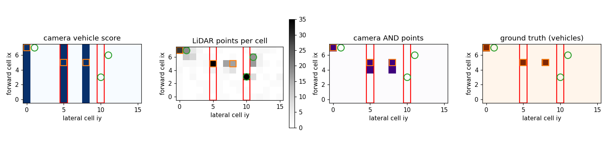
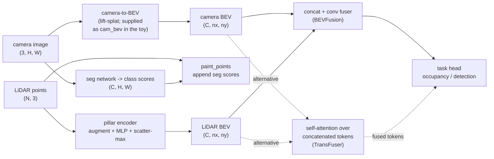

# A11.5f - Multi-modal sensor fusion (LiDAR + camera)

A self-driving car usually carries both cameras and a LiDAR. A camera image says what things are
(this blob of pixels is a car) but not how far away they are. A LiDAR point cloud says exactly
where surfaces are, to a few centimeters, but not what they are. Sensor fusion combines the two so
the perception output has both the class and the metric position of every object. The design
question that separates the main fusion methods is where in the pipeline the two sensors meet: at
the raw points, at bird's-eye-view (BEV) feature maps (BEV is the ego-centric top-down grid the
driving stack plans in), or inside an attention layer.

Build the three meeting points and one alternative. PointPainting decorates each LiDAR point with
the image class scores at the pixel it projects to. Our PointPillars-lite LiDAR encoder (a cut-down PointPillars) turns the
point cloud into a BEV feature map with a per-point network and a per-cell max. The BEVFusion core
concatenates the camera and LiDAR BEV maps channel by channel on one grid and mixes them with a
small convolution. The TransFuser attention block runs one self-attention layer over the camera and
LiDAR feature vectors laid end to end, as a contrast to the fixed concatenation. All four land on
the ego-centric BEV grid from the camera-geometry assignment, and the projection reuses its pinhole
and SE(3) primitives. The camera BEV feature map, which a real stack produces with the
Lift-Splat-Shoot view transform, is supplied ready-made by the toy scene, so the four holes are the
fusion mechanisms and nothing else. All graded tests run on CPU.

Required reading before starting:
- Vora, Lang, Helou, Beijbom 2020, "PointPainting: Sequential Fusion for 3D Object Detection",
  [arXiv:1911.10150](https://arxiv.org/abs/1911.10150) (point-level fusion).
- Lang et al. 2019, "PointPillars: Fast Encoders for Object Detection from Point Clouds",
  [arXiv:1812.05784](https://arxiv.org/abs/1812.05784) (the LiDAR BEV branch).
- Liu et al. 2022, "BEVFusion: Multi-Task Multi-Sensor Fusion with Unified Bird's-Eye View
  Representation", [arXiv:2205.13542](https://arxiv.org/abs/2205.13542) (the feature-level fuser
  built here).
- Prakash, Chitta, Geiger 2021, "Multi-Modal Fusion Transformer for End-to-End Autonomous Driving",
  [arXiv:2104.09224](https://arxiv.org/abs/2104.09224) (the attention fuser).

## Lecture notes

### What sensor fusion is for

#### The task

The driving stack needs a map of where the vehicles around the car are. In this assignment the map
is the BEV grid used throughout the driving-perception assignments: one forward camera, an
$8 \times 16$ grid of 1 m cells covering $x \in [0, 8]$ m forward and $y \in [-8, 8]$ m lateral,
and a target that marks each cell holding a vehicle with 1 and every other cell with 0. A real
stack does the same on a grid of about $200 \times 200$ cells around the car, with six cameras and
a full LiDAR sweep, and predicts boxes and drivable area as well as vehicle cells.

Each toy scene holds three vehicles and three clutter objects. A clutter object stands for anything
that is not a vehicle but returns LiDAR points like one: a bush, a mailbox, a concrete barrier, a
parked trailer. The camera image shows vehicles in orange and clutter in blue, and the LiDAR
returns 40 points from each object.

#### Why one sensor is not enough

A camera image is dense and semantic. Every pixel has a color, and a semantic segmentation network (a network
that predicts a class at every pixel) reads a class off it, so the image says what an object is. The image does not carry metric depth: a single
pixel is a ray, and the distance along it cannot be read from one frame. In BEV terms the camera
knows which lateral column of the grid holds a vehicle and not which cell along that column. The
Lift-Splat-Shoot assignment spends a whole view transform on estimating that depth.

A LiDAR point cloud is the opposite. Each return is a metric 3-D point accurate to a few
centimeters, so the cloud says exactly where surfaces are. It does not carry class: a point is a
coordinate with at most a reflectance value, and a car surface and a wall surface return the same
kind of point. The cloud is also sparse. Range measurements thin out with distance, so a far object
is a handful of points. In BEV terms the LiDAR knows which cells are occupied and not which of them
are vehicles.

Each sensor's gap is the other sensor's strength, which is why fusion helps at all. The camera's
class fills the LiDAR's class gap, and the LiDAR's geometry fills the camera's depth gap.

#### The idea: bring both onto shared coordinates, then combine

The two sensors cannot be combined until their measurements refer to the same place. A pixel and a
LiDAR point describe the same surface only after the point has been projected into the image, or
after both have been placed in the same BEV cell. Every fusion method therefore has two parts: a
geometric step that puts camera evidence and LiDAR evidence on shared coordinates, and a learned
step that combines the evidence at each place. The methods differ in which coordinates they share
and how early in the pipeline they do it.

Fusing early means the LiDAR network sees image evidence while it is still forming its own
features, at the cost of inheriting every image error before anything downstream can weigh it.
Fusing late means each branch is trained and debugged on its own, but neither branch gets to use
the other's evidence while deciding what to encode. Three answers, in order of how early the two
sensors meet:

- Point level (early fusion). Decorate the raw LiDAR points with image information before any LiDAR
  network runs. The shared coordinates are image pixels. This is PointPainting.
- Feature level (mid fusion). Run a camera branch and a LiDAR branch separately, each to a BEV
  feature map, then combine the two maps cell by cell. The shared coordinates are BEV cells. This
  is BEVFusion.
- Attention level (mid fusion, learned correspondence). Same two branches, but combine their
  features with a transformer attention block that lets any camera location read from any LiDAR
  location. No shared coordinates are imposed; the attention weights decide which locations
  correspond. This is TransFuser.

#### Why it matters

The three methods are three answers in use for one design decision. PointPainting adds a few input
channels to an existing LiDAR detector and leaves the detector unchanged, and the paper reports
gains for several detectors this way. BEVFusion puts both sensors on one BEV grid that any task
head (the last few layers that turn a shared feature into one task's output) can read, so a single fused feature serves detection and map segmentation at once. TransFuser
carries the question into end-to-end driving, where one network maps sensors directly to a route.

### Our two-column example (one vehicle and one clutter object)

The full grid has 128 cells and six objects. To see the mechanism we take two lateral columns of
one toy scene, each 8 cells long in the forward direction. We call this our two-column example.

- Column A holds a vehicle at forward cell 5.
- Column B holds a clutter object at forward cell 3.

The camera sees an orange blob in the direction of column A and a blue blob in the direction of
column B. Since a pixel is a ray of unknown range, the camera evidence for "vehicle" covers all 8
cells of column A and none of column B. The LiDAR sees a cluster of points at A5 and an identical
cluster at B3, with nothing to tell the two apart. (In the scene below, 34 of the vehicle's 40
points land in A5, 4 in A4 and 2 in the neighboring column; 34 of the clutter object's 40 land in
B3 and 6 in the neighboring column.) The ground truth marks A5 alone.

Our two-column example keeps what the full problem is about: the camera's depth ambiguity, the
LiDAR's class ambiguity, and the fact that the answer is the cell where both kinds of evidence
agree. It drops the other four objects and the scattered ground points, and it treats each
object's points as lying in its own cell, setting aside the spill into neighboring cells that the
toy section below describes. It stands
for the real situation of a car and a same-sized roadside object at similar range.

The figure shows the full scene this example comes from, a held-out toy scene, with the two columns
outlined in red (lateral cells 5 and 10, so A5 is BEV cell $(5, 5)$ and B3 is $(3, 10)$). Vehicles are marked with orange squares and clutter with
green circles. From left to right: the camera's vehicle score, smeared over whole forward columns;
the number of LiDAR points per cell, dark at all six objects; the cells where the camera's vehicle
score and an object point coincide; and the ground truth.



The score used throughout is intersection over union (IoU): the number of cells that are occupied
in both the prediction and the ground truth, divided by the number of cells occupied in either.
In our two-column example, a camera-only rule that marks every cell with vehicle evidence predicts
8 cells and hits 1, so its IoU is $1/8 = 0.125$. A LiDAR-only rule that marks every cell with
points predicts 2 cells and hits 1, IoU $1/2 = 0.5$. A rule that marks the cells where both agree
predicts A5 alone, IoU 1. The rest of the notes are about how a network computes "where both
agree": by painting points, by concatenating BEV maps, or by attention.

The overlap panel of the figure already shows the complication the example sets aside. The 4
points of the column-5 vehicle that land in A4 are enough to make "camera AND points" mark A4 as
well as A5, and the vehicle in column 8, whose points are spread over four cells (only 14 of 40 in
its own cell), produces the same doubling there.

### Overview of the rest of the notes

1. Class scores from an image. What a segmentation network outputs at each pixel (a softmax score
   vector), and why fusion keeps the scores rather than the winning label.
2. PointPainting. The pinhole projection from the camera-geometry assignment, used to attach those
   scores to LiDAR points.
3. Encoding an unordered point set. Sum, mean, and max pooling, and which of them ignores the order
   and the number of points, the symmetric-function argument behind PointNet.
4. The LiDAR branch. PointPillars turns the cloud into a BEV feature map with a per-point network
   and a per-cell max, a scatter reduction like the pooling step of Lift-Splat-Shoot.
5. BEVFusion. Concatenate two BEV maps on one grid and learn their conjunction with a convolution.
6. Attention fusion. The transformer's self-attention, run over the camera and LiDAR tokens laid
   end to end, and what its softmax does that a fixed concatenation cannot.
7. The toy and what each sensor alone can score on it.

Our two-column example is used to make each step concrete. Five exercises, placed after the
sections they test, are meant to be worked by hand. Each has a worked answer that can be expanded.

### Class scores from an image

Both PointPainting and the camera side of the fuser start from a semantic segmentation network: a
network that predicts a class at every pixel, so its output for an $H \times W$ image is a
$(C, H, W)$ tensor for $C$ classes rather than one label for the whole picture. Nothing in this
assignment builds or trains one, and the toy generates its scores directly, so the architecture
does not matter here. The form of the output does.

The network emits $C$ unbounded real numbers per pixel, the logits $z_1, \dots, z_C$, and a softmax
turns them into a score vector

$$s_c = \frac{e^{z_c / T}}{\sum_{k=1}^{C} e^{z_k / T}} .$$

Every $s_c$ is positive and the $C$ of them sum to 1, so the vector is a probability distribution
over classes at that pixel. The temperature $T$ divides all the logits together and controls how
peaked that distribution is: $T = 1$ is the plain softmax, $T > 1$ pulls it toward uniform, and
$T \to 0$ drives it to a one-hot vector on the largest logit. A confident vehicle pixel gives
something like $(0.02, 0.98)$, an ambiguous boundary pixel something like $(0.5, 0.5)$, and the gap
between those two cases is the information a hard label would discard.

The toy uses $C = 2$, index 0 background and index 1 vehicle. Its scores are an imperfect signal
rather than a copy of the answer: the toy blurs the vehicle mask with a 3x3 average, adds Gaussian
noise to both logits, and runs the softmax at $T = 1.5$. A painted point therefore carries evidence
with a margin, not a clean label.

### Point-level fusion with PointPainting

PointPainting is the earliest meeting point. Run the image segmentation network to get the
per-pixel score vectors above, project each LiDAR point into the image, and append the score vector
at that pixel to the point. A point that was $[x, y, z]$ (or $[x, y, z, r]$ with reflectance $r$)
becomes $[x, y, z, s_1, \dots, s_C]$. The decorated cloud then feeds any LiDAR detector unchanged:
the detector's input grows by $C$ channels and nothing else about it changes.

The projection is the ego-to-camera-to-image chain from the camera-geometry assignment. Transform
the ego-frame point into the camera frame with the extrinsic $T_{\text{cam} \leftarrow \text{ego}}$,
then apply the pinhole intrinsics to get a pixel $(u, v)$, rounded to the nearest integer for the
lookup. A point behind the camera (camera-frame $z \le 0$) or landing outside
$[0, W) \times [0, H)$ gets the all-zero vector rather than a wrapped-around or clamped pixel.

All-zero is not the same as background. Any vector the softmax produces sums to 1, so an all-zero
vector cannot come from the segmenter at all, and a network downstream can read it as "this point
was never seen by a camera" instead of "this point was seen and found to be background". The
distinction matters as soon as the rig has blind spots, which every real rig does.

In our two-column example, the points in cell A5 project onto the orange blob and are painted
with a high vehicle score; the points in cell B3 project onto the blue blob and are painted with
a vehicle score near 0. After painting, the LiDAR points themselves carry the class, and a LiDAR
detector can separate the two objects. The figure shows this on the full scene: the toy camera
image, and the LiDAR points that land in it colored by the vehicle score they are painted with.
The image shows two clear orange blobs; the third vehicle, at the far right edge, is mostly
covered by a blue clutter blob drawn over it. Points on the vehicle blobs carry vehicle scores
anywhere from about 0.1 to 0.8, depending on where on the blob they land (the blur, logit noise,
and temperature keep every score well short of 1). Points on the blue blobs and the ground mostly
carry scores near 0, except at the right edge, where the clutter blob overlaps the hidden vehicle
in the image and some clutter and ground points are painted with scores up to about 0.57. That
is the method's known weakness in miniature: a point inherits whatever the pixel it lands on says,
including a wrong class where two objects overlap in the image.


Appending the soft score vector rather than the hard argmax label is the method's first design
choice. Argmax throws away the margin, collapsing $(0.51, 0.49)$ and $(0.02, 0.98)$ to the same
label, so the detector has no way to discount a point the segmenter was unsure about. Argmax is
also piecewise constant in the logits, so its derivative is zero wherever it is defined: an
end-to-end variant that backpropagates the detector's loss into the segmentation network would get
no gradient through a hard label, while the soft vector passes one straight back.

The second design choice is that the pipeline is sequential. The segmentation network runs, then
the detector runs on its output, with no joint training required. That makes it simple to attach to
an existing detector, and it caps the fusion at the quality of the 2-D segmentation, since a point
painted with a wrong class is decorated with wrong evidence and the detector has no independent
image access to overrule it.

In a real multi-camera rig a point is painted by the one camera whose field of view it falls into,
so the rig picks a camera per point. This toy is single-camera, so every in-front, in-image point is
painted from the same image and the rest get zeros.

> **Exercise 1 (painting three points by hand).** The toy camera has focal length $f = 16$ pixels,
> principal point $(c_x, c_y) = (15.5, 15.5)$, a $32 \times 32$ image, and sits 1.5 m above the
> ego origin looking down ego $+x$. Its extrinsic maps an ego point $(x, y, z)$ to the camera point
> $(-y,\ 1.5 - z,\ x)$ (OpenCV axes: right, down, forward). For the ego points $(5, 1, 0.5)$,
> $(2, 3, 0.5)$, and $(-2, 0, 0.5)$, compute the pixel each projects to, say which are painted and
> which get the all-zero vector, and give the BEV cell $(i, j)$ of each with
> $i = \lfloor x \rfloor$, $j = \lfloor y + 8 \rfloor$.

<details>
<summary>Answer</summary>

The pinhole projection is $u = f\,X/Z + c_x$, $v = f\,Y/Z + c_y$ for camera point $(X, Y, Z)$.

- $(5, 1, 0.5)$ goes to camera $(-1, 1, 5)$, so $u = 16 \cdot (-0.2) + 15.5 = 12.3$ and
  $v = 16 \cdot 0.2 + 15.5 = 18.7$, which round to pixel $(12, 19)$. It is in front and inside the
  image, so it is painted with the score vector at row 19, column 12. Its BEV cell is $(5, 9)$.
- $(2, 3, 0.5)$ goes to camera $(-3, 1, 2)$, so $u = 16 \cdot (-1.5) + 15.5 = -8.5$. It is in front
  of the camera but left of the image, so it gets the all-zero vector. Its BEV cell is $(2, 11)$,
  inside the grid: the LiDAR sees this point and the camera does not. With $f$ equal to half the
  image width the horizontal field of view is 90 degrees, so the camera covers only points with
  $|y| < x$, and this point at $y = 3$, $x = 2$ is outside it.
- $(-2, 0, 0.5)$ goes to camera $(0, 1, -2)$, which has $Z \le 0$, so it is behind the camera and
  gets the all-zero vector. The formula alone would give $(15.5, 7.5)$, a pixel inside the image,
  so the image-bounds test by itself would accept this point; the depth test is required as well
  (the two masks are combined with AND, so their order does not matter). It is also outside the BEV
  grid, which starts at $x = 0$.

The second point is the case the all-zero convention exists for: a LiDAR detector downstream sees
$(0, 0)$ and can tell "no camera looked here" apart from "the camera saw background", which would be
close to $(1, 0)$.

</details>

### Encoding an unordered point set

The LiDAR branch has to turn a variable-size, unordered set of points into one fixed-size feature
per BEV cell, and the unordered input is the constraint that shapes the architecture. A point cloud
has no canonical row order: the same physical surface arrives as a different permutation of the
same $N$ rows on the next sweep, so a function whose value changes when the rows are shuffled is
reading an artifact of the scanner's firing sequence. The encoder must be permutation invariant,

$$f(p_1, \dots, p_N) = f(p_{\pi(1)}, \dots, p_{\pi(N)}) \quad \text{for every permutation } \pi .$$

One construction gives that for free. Apply the same map $h$ to each point independently, then
reduce the results with an operation that does not care about order:

$$f(\{p_i\}) = \rho\Big(\textstyle\bigoplus_{i=1}^{N} h(p_i)\Big),$$

where $\bigoplus$ is a symmetric reduction such as a sum, a mean, or a coordinate-wise max, and
$\rho$ is whatever comes afterward. Permuting the inputs permutes the arguments of $\bigoplus$,
which by symmetry leaves the result alone, and $\rho$ never sees the order. PointNet (Qi et al.
2017, [arXiv:1612.00593](https://arxiv.org/abs/1612.00593)) is this construction with $h$ a
multi-layer perceptron and $\bigoplus$ a coordinate-wise max, and the pillar and voxel encoders in
the driving stack are variations on it.

A multi-layer perceptron (MLP) is a stack of affine maps with a pointwise nonlinearity between
them. The one here is $\text{Linear}(9 \to 32) \to \text{ReLU} \to \text{Linear}(32 \to C)$,
applied to one point's 9-vector at a time with the same weights for every point. "Per-point MLP"
means exactly that weight sharing: the map has no access to the other points, so nothing about the
ordering can leak into it, and a pillar with 3 points and a pillar with 300 run the same map.

The choice of $\bigoplus$ is not free, because the reductions differ in what they let through. A
sum grows with the number of points: duplicate every point in a cell and the pooled vector
doubles. A coordinate-wise max does not, and it is invariant to more than duplication: adding any
point whose features fall below the running maximum in every channel leaves the pooled vector
exactly unchanged. Whether that invariance is wanted depends on whether the point count is a real
signal or a shortcut, and the pillar encoder below is where the choice matters.

> **Exercise 2 (sum, mean, and max on one cell).** A cell holds three points whose per-point
> features are $(1, 0)$, $(0.5, 2)$, and $(3, 1)$. (a) Compute the sum, the mean, and the
> coordinate-wise max. (b) Duplicate every point and recompute. (c) Go back to the three points and
> add a fourth with features $(2, 0.5)$; recompute. (d) A different cell holds $(-1, -2)$ and
> $(-0.5, -3)$. What is its max? What would a max computed into an output buffer initialized to
> zero give, and which other kind of cell would it then look like?

<details>
<summary>Answer</summary>

(a) Sum $(4.5, 3)$, mean $(1.5, 1)$, max $(3, 2)$.

(b) Sum $(9, 6)$, doubled. Mean $(1.5, 1)$ and max $(3, 2)$, unchanged.

(c) Sum $(6.5, 3.5)$ and mean $(1.625, 0.875)$ both change. Max stays $(3, 2)$, because $2 < 3$ and
$0.5 < 2$: the new point is below the running maximum in both channels. Only the max ignores both
the number of points and any point that is dominated in every channel.

(d) The max is $(-0.5, -2)$. If the output buffer starts at zero and the zero takes part in the
max, the result is $\max(0, -0.5) = 0$ and $\max(0, -2) = 0$, so $(0, 0)$, which is exactly what an
empty cell holds. The cell's features are lost and it looks unoccupied. The per-point MLP ends in
a linear layer, so negative features are normal, and the reduction has to keep the initial zero
out of the max while still leaving empty cells at zero.

</details>

### The LiDAR branch and PointPillars

The LiDAR branch turns the raw cloud into a BEV feature map so it lands on the same grid the camera
branch uses. PointPillars does this without any 3-D convolution. It groups the points into pillars,
which are BEV grid cells extended infinitely in $z$, so every point falls in exactly one pillar by
its $(x, y)$ and the whole cloud is partitioned by a single floor-divide.

Each point is augmented from its raw coordinates to nine features
$[x, y, z, x_c, y_c, z_c, x_p, y_p, r]$. Here $(x_c, y_c, z_c)$ is the point minus the mean of all
points in its pillar, the offset from the pillar's point cluster center, and $(x_p, y_p)$ is the
offset from the point to the geometric center of its pillar cell, which for cell $(i, j)$ sits at
ego coordinates $x_{\min} + (i + \tfrac{1}{2})\,\text{res}$ and
$y_{\min} + (j + \tfrac{1}{2})\,\text{res}$ with zero-based $i, j$. The cluster offset tells the
network how the point sits relative to the local surface, and the cell offset tells it where the
point sits inside the cell, which the quantized pillar index has thrown away. The last feature $r$
is reflectance, the return intensity a real LiDAR reports; the toy has no intensity, so it is a
constant 1.0 and the slot is kept only so the layout matches the paper.

The per-point MLP maps the nine features to $C$ channels, and a per-pillar coordinate-wise max over
the points in each pillar gives one $C$-vector per pillar, scattered into the BEV grid. That is the
PointNet construction of the previous section with the set restricted to one pillar.

> **Exercise 3 (the nine pillar features).** On the toy grid ($x_{\min} = 0$, $y_{\min} = -8$,
> $\text{res} = 1$ m), a pillar holds the three points $(4.2, 0.3, 0.1)$, $(4.6, 0.5, 0.5)$, and
> $(4.4, 0.7, 0.6)$. Find the pillar's cell $(i, j)$ and its center, then write out the nine
> features of each point.

<details>
<summary>Answer</summary>

All three points have $\lfloor x \rfloor = 4$ and $\lfloor y + 8 \rfloor = 8$, so the cell is
$(4, 8)$ with center $(0 + 4.5,\ -8 + 8.5) = (4.5, 0.5)$. The point mean is $(4.4, 0.5, 0.4)$.

| point | $x, y, z$ | $x_c, y_c, z_c$ | $x_p, y_p$ | $r$ |
|---|---|---|---|---|
| 1 | $4.2, 0.3, 0.1$ | $-0.2, -0.2, -0.3$ | $-0.3, -0.2$ | 1 |
| 2 | $4.6, 0.5, 0.5$ | $0.2, 0, 0.1$ | $0.1, 0$ | 1 |
| 3 | $4.4, 0.7, 0.6$ | $0, 0.2, 0.2$ | $-0.1, 0.2$ | 1 |

The cluster offsets sum to zero over the pillar, by definition of the mean. The cell offsets do
not: their mean, $(-0.1, 0)$, says the points sit slightly behind the cell center. Position inside
the cell is information the cell index alone does not carry, and it survives the max as long as
some channel of the MLP responds to it.

</details>

PointPillars uses the coordinate-wise max, and this toy's construction shows what a sum would cost.
Point counts vary by more than an order of magnitude between cells: each vehicle or clutter object
drops 40 points around its location, while the ground sprinkle is 80 points spread over the whole
8x16 grid, under one point per cell on average. A sum-pooled feature therefore has a magnitude that
separates object cells from ground cells on its own, and a single linear layer reading that
magnitude gets occupancy right without the MLP ever having to describe any geometry. That shortcut
is a dead end for the actual task, because the toy gives vehicle and clutter objects the same point
count: magnitude says "something is here" and can never say which of the two it is. Max pooling
removes the shortcut rather than hoping the optimizer ignores it. The pooled vector is the
per-channel maximum, unchanged by how many points contributed, so the branch has to encode the
geometry it was given, and the vehicle-versus-clutter decision is left where only the camera can
make it.

The pool is a scatter reduction, the same shape of operation as the pillar pooling in the
Lift-Splat-Shoot view transform: given an $(M, C)$ array of values and an $(M,)$ array of bin
indices, reduce all the rows sharing a bin into one output row. A sum can be undone by subtraction,
which is what lets Lift-Splat-Shoot's sort-and-cumsum pooling compute it by sorting the points by
bin and differencing a running total. A running maximum cannot be undone that way, so the max needs
a different scatter operation, one that keeps the zero-initialized output out of the reduction
(Exercise 2(d)) so that a pillar whose features are all negative pools to its own maximum, while a
pillar with no points stays at zero. The cumsum pooling is still used in this branch, for the
per-pillar coordinate mean the cluster offset needs, which is a sum divided by a count.

### Feature-level fusion with BEVFusion

BEVFusion is the core built here. A BEV feature map is a $(C, n_x, n_y)$ tensor: one $C$-vector per
grid cell, holding whatever the branch that wrote it learned to say about that patch of ground. The
camera branch reaches one through the Lift-Splat-Shoot view transform, which predicts a per-pixel
depth distribution, pushes each pixel feature out into 3-D along it, and splats the result into BEV
pillars; the LiDAR branch reaches one through the pillar encoder above. Because the two land on the
same grid with the same cell size in the same ego frame, cell $(i, j)$ in one map and cell $(i, j)$
in the other describe the same square meter of road. The fuser needs nothing beyond that alignment,
and the whole module keeps one grid definition to guarantee it. In this assignment the camera map
is not computed at all: the toy scene hands over a 2-channel class-score BEV map with a built-in
depth smear, so the fuser is exercised on the inputs a real camera branch would give it without a
camera branch having to be trained first.

Fusion is then a channel concatenation followed by a small convolutional encoder. The concatenation
stacks the two vectors at each cell into one $(C_{\text{cam}} + C_{\text{lidar}})$-vector; nothing
is combined yet, the two sources are just laid side by side in one tensor. The convolution combines
them: each output channel is a learned linear function of every input channel over a 3x3
neighborhood, followed by a ReLU, so a unit can respond to a conjunction across the two sources.
"LiDAR says this cell is occupied and the camera says the class here is vehicle" is a positive
weight on both groups of channels and a bias set so that neither group alone clears the threshold.
The fuser built here is two such 3x3 layers and a 1x1 projection to the unified channel count.

> **Exercise 4 (a conjunction unit on our two-column example).** Reduce each sensor in our
> two-column example to one channel per cell: the camera vehicle score $s$ is 1 on all 8 cells of
> column A and 0 in column B, and the LiDAR occupancy $b$ is 1 at A5 and B3 and 0 elsewhere. A
> single fused unit computes $y = \text{ReLU}(s + b + \beta)$ and the cell is predicted occupied
> when $y > 0$. (a) For which biases $\beta$ does the unit fire at A5 and nowhere else? (b) What
> IoU does $\beta = -0.5$ give? (c) In the toy, an object's points often spill into a neighboring
> cell. If the vehicle's points cover A4 as well as A5, what IoU does the conjunction get?

<details>
<summary>Answer</summary>

(a) The cells have $s + b \in \{0, 1, 2\}$, and only A5 has $2$. The unit must fire at $2$ and not
at $1$: $2 + \beta > 0$ and $1 + \beta \le 0$, so $-2 < \beta \le -1$. For example $\beta = -1.5$
gives $y = 0.5$ at A5 and $0$ everywhere else, IoU 1.

(b) With $\beta = -0.5$ the unit fires wherever $s + b \ge 1$: all 8 cells of column A plus B3, 9
cells, 1 hit, IoU $1/9 \approx 0.111$, worse than the camera alone ($1/8$). A bias that lets
either sensor alone clear the threshold computes an OR, not an AND.

(c) The conjunction now fires at A4 and A5, 2 cells with 1 hit, IoU $0.5$. Per-cell agreement is
not enough when the LiDAR evidence is spread out; to pick the cell the object is centered in, the
network has to use the shape of the point cluster, for example the within-cell offsets of
Exercise 3 or the counts of neighboring cells seen through the 3x3 kernel.

</details>

The unified feature is task-agnostic. It feeds a detection head, a segmentation head, or a map head
without the fusion changing, where a head is the last few layers that turn a shared feature into
one task's output; here it is a 1x1 convolution mapping the fused channels to a single occupancy
logit per cell. Keeping the fusion below the heads lets one BEV backbone serve several tasks at
once.

The concatenation is not where the paper's difficulty was. The camera-to-BEV view transform was,
and specifically its pooling step, which was the latency bottleneck of the whole model. Every
camera pixel produces one point per depth bin, so the number of frustum points to reduce is the
feature-map size times the depth-bin count times the number of cameras, every frame. BEVFusion
precomputes the frustum-point-to-BEV-cell index mapping, which is fixed as long as the intrinsics
and extrinsics are, and reduces each BEV cell's interval of the sorted point list in one pass. That
made the pooling roughly 40x faster and made running a full camera branch alongside the LiDAR
branch practical. The concat-and-conv fuser is deliberately simple; the engineering effort went
into making the camera branch cheap enough to fuse at all.

The near-simultaneous Liang et al. 2022 paper, also titled "BEVFusion"
([arXiv:2205.13790](https://arxiv.org/abs/2205.13790)), reached a similar unified-BEV design
independently. The MIT version (Liu et al., [arXiv:2205.13542](https://arxiv.org/abs/2205.13542)) is
the one built here.

The diagram shows the whole pipeline: PointPainting at the points, the two BEV branches, and the
two ways of fusing them.



### Self-attention over two token sets

The alternative to a fixed concatenation is to let the network decide, per location, how much of
the other sensor to read. Attention does this, and the TransFuser fusion block is one ordinary
self-attention block applied to an unusual input: the two sensors' tokens laid end to end in a
single sequence. A token here is one feature vector for one spatial location of a feature map, in
the same way that ViT's patch embedding makes one token per image patch.

Recall the mechanism from the transformer encoder. A set of $S$ tokens, each a $d$-vector, is
projected three ways into queries $Q$, keys $K$, and values $V$, all $(S, d)$. Token $i$'s output is
a weighted average of all $S$ values, with weights from a softmax over the scaled dot products
between its query and every key:

$$\text{Attn}(Q, K, V) = \operatorname{softmax}\!\Big(\frac{Q K^\top}{\sqrt{d}}\Big) V .$$

Row $i$ of that softmax is a distribution over the $S$ tokens, saying how much token $i$ reads from
each one, and the $\sqrt{d}$ keeps the dot products from growing with the dimension and driving the
softmax to a one-hot.

Now feed it the concatenation. With $S_c$ camera tokens stacked on top of $S_l$ LiDAR tokens, each
of $Q$, $K$, $V$ splits into a camera half and a LiDAR half, and the score matrix has four blocks:

$$\tfrac{1}{\sqrt{d}}\begin{bmatrix}Q_c K_c^\top & Q_c K_l^\top \\ Q_l K_c^\top & Q_l K_l^\top\end{bmatrix}$$

The two off-diagonal blocks are the cross-modal terms, every camera token scoring every LiDAR token
and the reverse, so a single attention layer covers both directions at once. The two diagonal
blocks keep the within-modality mixing each stream would have done on its own.

The softmax runs across each full row, over the union of both key sets, and a two-stream
cross-attention design does not reproduce this. A camera token's weights on camera keys and on
LiDAR keys are normalized together, so they compete for one unit of attention mass: a camera token
that finds a strongly matching LiDAR key takes weight away from its camera neighbors, and one that
finds nothing useful across the modality boundary spends nearly all its weight within its own. How
much cross-modal reading happens is decided per token by the content. Cross-attention with camera
as query and LiDAR as key and value normalizes over LiDAR keys only, so every camera token spends
all of its attention on LiDAR whether or not anything there is relevant, and a second block is
needed for the other direction.

> **Exercise 5 (one softmax over both sensors).** A camera token has scaled scores $(2, 0)$ against
> two camera keys and $(1, -1)$ against two LiDAR keys. (a) Compute its four attention weights
> under self-attention over the concatenation, and the total weight on LiDAR. (b) Compute its two
> weights under cross-attention with LiDAR as keys. (c) Repeat both with LiDAR scores $(-3, -3)$,
> as for a camera token with no relevant LiDAR evidence.

<details>
<summary>Answer</summary>

(a) $e^2, e^0, e^1, e^{-1} = 7.389, 1, 2.718, 0.368$, sum $11.475$, so the weights are
$(0.644, 0.087, 0.237, 0.032)$. The LiDAR share is $0.269$.

(b) Over the LiDAR keys alone, $(e^1, e^{-1})/(e^1 + e^{-1}) = (0.881, 0.119)$, with all of the
weight on LiDAR by construction.

(c) Concatenated: $7.389, 1, 0.050, 0.050$, sum $8.489$, weights
$(0.870, 0.118, 0.006, 0.006)$. The LiDAR share drops to $0.012$, so the token keeps almost all of
its attention on camera tokens. Cross-attention gives $(0.5, 0.5)$: equal scores give a uniform
distribution, and the token reads the average of two irrelevant LiDAR values with full weight. The
joint softmax lets the content decide how much cross-sensor reading happens; the cross-attention
softmax always spends the whole budget on the other sensor.

</details>

Two more properties follow from how the block is configured here. It runs with no positional
encoding, so it is permutation equivariant: shuffle the input tokens and the output tokens come out
shuffled the same way, with nothing else changed. Nothing in the attention knows that one token
sits to the left of another, or that the first $S_c$ rows are the camera ones; the split point
matters only because the outputs are routed back to different streams. And the fusion is residual,
meaning the block's output for each half is added onto that half's input rather than replacing it.
Each stream keeps its own features and picks up a cross-modal correction on top, and a stream that
gains nothing from the other sensor can drive its correction to near zero and lose nothing.

### Attention fusion with TransFuser

TransFuser is the contrast to BEVFusion. It was built for end-to-end driving in CARLA, the
open-source driving simulator used as a closed-loop benchmark, where one network reads the sensors
and emits the route the car then follows. The image goes through a convolutional stem, and the
LiDAR is rasterized into a BEV pseudo-image: the points are histogrammed into BEV cells in two
height bins, one channel counting the points below a height threshold and one the points above,
which turns the cloud into a 2-channel image a convolutional stem can consume. At several
resolution stages of the two stems, the feature maps are flattened into tokens, one token per
spatial location carrying that location's channel vector, and the image tokens and LiDAR tokens
are concatenated into the single set the attention block of the previous section runs over. The
outputs are split back at the camera/LiDAR boundary, added onto their own streams, and the stems
continue at the next resolution.

This assignment isolates that block and drops the rest of the driving pipeline, in particular the
waypoint decoder: a small recurrent network that emits the route one waypoint at a time, each
prediction fed back in as the input for the next, which is what auto-regressive means. The build is
the concatenate-attend-split-residual step alone.

Building both fusers puts the two mixing patterns side by side. BEVFusion combines the two maps at
matching cells, so a fused cell sees the other sensor at its own location plus whatever the 3x3
convolution reaches around it; the pattern is fixed by the geometry and the kernel size, and it
only works because the branches were already brought onto a common grid. TransFuser learns an
all-to-all token mixing where any location in one sensor can pull from any location in the other,
which needs no common grid, at the cost of an $S \times S$ score matrix and no built-in notion of
which locations correspond to each other.

The PAMI extension ([arXiv:2205.15997](https://arxiv.org/abs/2205.15997)) carries the same fusion
block into a larger driving model.

### The toy and what it isolates

The toy scene is built so that neither sensor alone recovers vehicle occupancy, which forces a
fused head to use both. It is our two-column example three times over, on the full grid. One
forward camera looks down ego $+x$ over an 8x16 BEV grid, $x \in [0, 8]$ m forward and
$y \in [-8, 8]$ m lateral at 1 m cells, and each scene holds three vehicle objects and three
clutter objects.

The two kinds of object are matched on everything the LiDAR can see. They are drawn from the same
spatial distribution and share one point generator, so each contributes 40 points spread uniformly
over a 0.8 m by 0.8 m square around its center and over the same height range. Geometry and density
are identical, which means even a max pool that ignores raw count sees two objects that look the
same. They differ only in image color, one rendered in a color the segmenter reads as vehicle and
one in a color it reads as background. The center of an object is drawn anywhere in its cell, so
its square of points usually crosses a cell boundary: over the 20 scenes used for training and
evaluation, an object's points fall in one to four cells, with on average 66% of them in the cell
that holds its center. The ground truth marks only the center cell.

The camera feature is degraded the other way. The toy's camera BEV map places the vehicle score not
at the vehicle cell but over the entire forward column at the vehicle's lateral position, standing
in for the fact that a camera pixel back-projects to a BEV ray of unknown range. The camera says
which lateral column holds a vehicle and says nothing about how far down that column it sits.
Vehicle and clutter objects are placed in disjoint lateral columns, so the smeared vehicle score
never lands on a clutter cell and the two failure modes stay independent.

The ground truth is vehicle occupancy, three cells out of the grid's 128, so a head that predicts
nothing at all already gets about 98% of cells right. Accuracy is useless on a target that sparse,
which is why the score is IoU. Predicting nothing scores 0, predicting everything scores $3/128$,
and only a prediction that hits the occupied cells and few others scores high. The training loss
handles the same imbalance by weighting the positive class 30x in the binary cross-entropy.

Two reference scores follow from the construction alone, before training anything; they are the
full-grid versions of the scores in our two-column example. The vehicle score covers a full 8-cell
forward column at each vehicle's lateral position, so a camera head that fires wherever that score
appears predicts about 24 cells, hits 3, and lands near $3/24 = 0.125$ (when two vehicles share a
column the count drops to 16, which happens in 4 of the 20 scenes). Picking fewer cells per column
trades recall for precision with nothing in the input to say which cell in the column is the right
one. The LiDAR evidence marks the 6 object centers with nothing to separate the 3 vehicles from the
3 clutter objects, so a head that fires on every object's center cell predicts 6 cells, hits 3, and
lands near $3/6 = 0.5$. A head that fires on every cell any object point reaches does worse, about
0.2 on the held-out scenes, because of the spill. A fused head has both pieces, and nothing in the
construction stops it short of 1, though getting there means locating each center cell from the
shape of the spilled point cluster, as Exercise 4(c) showed.

This toy deliberately amplifies each sensor's failure mode so a small model on a handful of scenes
shows the effect cleanly. At real scale, diverse data softens both failures: a camera detector
recovers usable depth from context and object size, and a LiDAR detector separates many objects on
geometry alone. The gap between single-sensor and fused models is smaller and messier there. What
carries over is the reason fusion helps: camera semantics fill the LiDAR's class ambiguity and
LiDAR geometry fills the camera's depth holes, which is the literature's motivation for fusion and
what the toy is built to make visible.

### Connections

The BEV grid here is the ego-centric grid defined in the camera-geometry assignment, unchanged, so
the camera-only, LiDAR-only, and fused maps are all indexed the same way and cell $(i, j)$ means
the same square meter in each. From the Lift-Splat-Shoot view transform this branch reuses the flat
pillar index $i \cdot n_y + j$ and the sort-and-cumsum sum pool. The camera BEV map that
Lift-Splat-Shoot would produce is supplied by the toy scene rather than computed, with an
exaggerated forward smear standing in for the depth ambiguity, so the measurement isolates the
fusion mechanisms from the quality of the camera branch. BEVFormer's BEV queries, which pull from
projected image features instead of pushing features out along a predicted depth, are the
alternative way to fill that same camera map.

The point-painting projection uses the camera rig and the pinhole and SE(3) primitives, the same
projection chain both camera-to-BEV transforms use. The TransFuser block is the transformer
self-attention block taught earlier, run on a concatenated set of image and LiDAR tokens instead of
a single sequence, with its positional encoding turned off.

A fused BEV map is the kind of input the 3-D occupancy and the prediction-and-planning assignments
read. Forward, the LiDAR geometry the pillar branch relies on is the same geometry that point-cloud
registration works with: aligning two clouds by iterative closest point (ICP) in the classical-SLAM
module operates on the raw metric points this branch pools into pillars.

## The assignment

Fill these holes, in order. Each is one `NotImplementedError` with a matching test. The docstring
in each function gives the signature, shapes, and constraints.

| # | Function | File | Concept from the notes |
|---|---|---|---|
| 1 | [`paint_points()`](fusion.py) | `fusion.py` | PointPainting: project, drop, gather, append |
| 2 | [`LidarPillarEncoder.forward()`](fusion.py) | `fusion.py` | the nine pillar features, per-point MLP, per-pillar max |
| 3 | [`BEVFuser.forward()`](fusion.py) | `fusion.py` | BEVFusion's channel concatenation and conv fuser |
| 4 | [`TransFuserBlock.forward()`](transfuser.py) | `transfuser.py` | self-attention over the concatenated tokens, split, residual add |

`fusion.py` and `transfuser.py` are assignment-local (imported by bare name). They reuse
`pillar_index` and `cumsum_pool` from the Lift-Splat-Shoot assignment via `nanovision.lift_splat`,
the pinhole and SE(3) primitives via `nanovision.geometry`, and the attention block via
`nanovision.transformer`. The `FusionConfig` in `config.py`, the `bev_fusion_scene` generator in
`nanovision/data/toy.py`, `compare.py` (the three-head comparison), and `viz.py` are provided.

Notes on specific holes:
- `paint_points`: project each ego point into the camera, drop behind-camera (camera-frame
  $z \le 0$) and out-of-image points, gather the $C$-dim seg score at the rounded pixel, and
  concatenate it as `[x, y, z, s_1..s_C]`. Dropped points get the all-zero score vector and keep
  their coordinates. Gathering at a clamped pixel for every point and then zeroing the dropped ones
  with a mask avoids indexing with out-of-range pixels.
- `LidarPillarEncoder.forward`: `pillar_index` returns $-1$ for points outside the grid; drop those
  first. Build the nine features `[x, y, z, xc, yc, zc, xp, yp, r]` with `r = 1.0`, using
  `cumsum_pool` for the per-pillar sum and count. Pool with a MAX, not a sum: `scatter_reduce` with
  `reduce="amax"` and `include_self=False` keeps the zero-initialized output out of the reduction
  (Exercise 2(d)), so empty pillars stay at zero. Return `(C, nx, ny)` using the flat index
  $i \cdot n_y + j$.
- `BEVFuser.forward`: accepts both `(C, nx, ny)` and `(B, C, nx, ny)` inputs and returns the same
  rank it was given.
- `TransFuserBlock.forward`: the provided `TransformerBlock` is built with `pos="none"`; concatenate
  along the sequence axis, run it once, split at $S_c$, and add each half onto its own input.

### Running and validating

Activate the environment (`conda activate nanovision`), then:

```
make test     A=a11_5f_sensor_fusion   # run the tests against the top-level files (the holes)
make verify   A=a11_5f_sensor_fusion   # run the same tests against the reference solution/
make viz      A=a11_5f_sensor_fusion   # render the figures from the reference solution
make viz-mine A=a11_5f_sensor_fusion   # render the figures from your own code (holes filled)
```

`make test` runs the suite in `assignments/a11_5f_sensor_fusion/tests/` against the top-level
`fusion.py` and `transfuser.py`, red until the holes are filled and green once correct.
`make verify` runs the identical suite against the reference `solution/` by setting
`NANOVISION_IMPL=solution`, so it is green from the start and shows the target.

The tests check:
- `test_shapes.py`: output shapes of all four mechanisms.
- `test_pointpainting.py`: the painting geometry against the geometry primitives directly. An
  in-frame point gets exactly the score at its projected pixel; a behind-camera point and an
  out-of-image point both get zeros and keep their coordinates.
- `test_gradcheck.py`: float64 gradchecks of `BEVFuser` and `TransFuserBlock`.
  `torch.autograd.gradcheck` compares the analytic backward pass against finite differences of the
  forward pass, and needs double precision for the comparison to mean anything.
- `test_overfit.py`: an end-to-end overfit of the fused pipeline on one scene (final binary
  cross-entropy below 0.05, IoU above 0.8). This is a composition and differentiability check, not
  evidence about fusion.
- `test_fusion_beats_single.py`: the held-out fusion-beats-single comparison from `compare.py`,
  with its margins floored well below the measured gap (fused above 0.4, at least 0.10 above
  camera-only and 0.05 above LiDAR-only).
- `test_forbidden_imports.py`: a static scan blocking perception libraries and external scatter
  kernels, so the pool is plain torch and the projection is the course geometry.
- `test_nuscenes_fusion.py`: exercises the two branches on real nuScenes data and skips cleanly
  when `NUSCENES_DATAROOT` is unset or the devkit is missing.

`make viz` runs from the reference solution, so it works on a fresh checkout before any hole is
filled. It writes `fusion_bev.png` and `fusion_iou.png` to `out/` rather than opening a window,
using matplotlib's headless Agg backend so it behaves the same over SSH, in WSL, and in CI with no
display. The first figure shows one held-out scene as ground truth next to the camera-only,
LiDAR-only, and fused predictions; the second is a bar chart of the three held-out mean IoUs.
`make viz-mine` runs the same script against your own code once the holes are filled, since it
trains the three heads. Add `SHOW=1` to also open the figures in a window when a display is
available.

The figures in these notes are generated by `assets/make_fusion_figures.py` from the held-out toy
scene that `viz.py` also shows (seed 200), with the projection written out in a few lines; they do
not use the assignment code.

What you should see when you run this. `compare.py` trains a camera-only head, a LiDAR-only head,
and a fused head on 12 toy scenes and evaluates them on 8 held-out scenes, each with 400
full-batch Adam steps at learning rate $10^{-2}$ on the weighted binary cross-entropy above. The
camera head is a three-layer conv net over the camera BEV map, the LiDAR head is the pillar encoder
plus a 1x1 convolution, and the fused head is the pillar encoder plus `BEVFuser` plus a 1x1
convolution. Measured across 8 parameter initializations:

| head | held-out IoU (seed 0) | across 8 inits |
|------|-----------------------|----------------|
| camera-only | 0.169 | 0.17 - 0.18 |
| LiDAR-only | 0.345 | 0.25 - 0.35 |
| fused | 0.500 | 0.49 - 0.72 |

The fused head beat both single-sensor heads on every one of the 8 initializations, by at least
+0.31 IoU over camera-only and at least +0.15 over LiDAR-only. Neither single-sensor head escapes
the reference score its evidence implies: the camera head sits just above the 0.125 of firing on
every cell in a vehicle column, having learned little more than that, and the LiDAR head sits below
the 0.5 of firing on every object center, since which objects it fires on has to generalize to
scenes it never saw. Both are what a head running out of evidence looks like. It extracts what its
input holds and then stops, because the missing piece is missing from the input and more training
cannot put it back. The camera head is limited by a depth ambiguity it cannot resolve and the LiDAR
head by a vehicle-versus-clutter confusion it cannot resolve; the fused head clears both, because
the camera's class score fills the LiDAR's class gap and the LiDAR's geometry fills the camera's
depth gap. In the `fusion_bev.png` panels, expect the camera panel to light up whole forward
columns, the LiDAR panel to fire on the clutter objects as well as the vehicles, and the fused
panel to keep the vehicle cells. These are toy numbers; what carries over to real data is the
reason fusion helps, not these IoU values.
