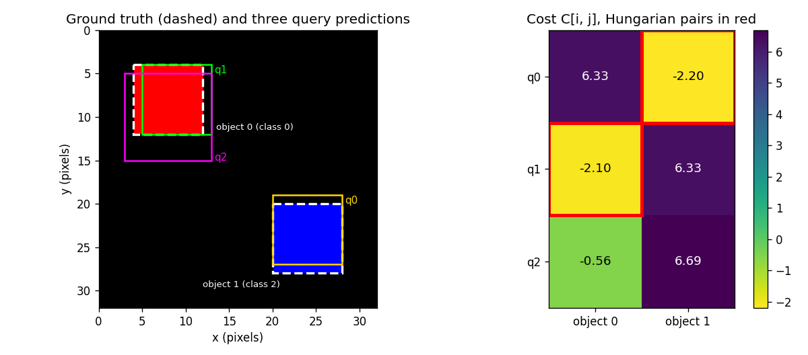
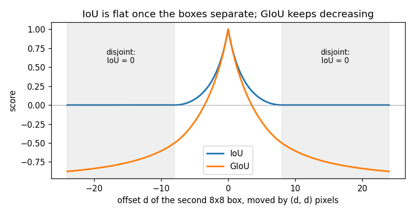
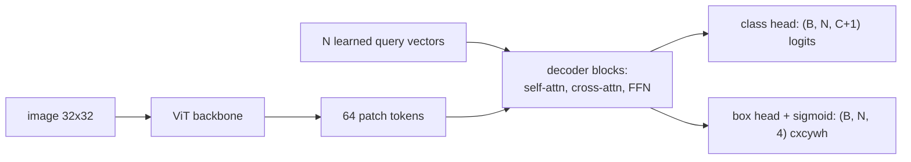
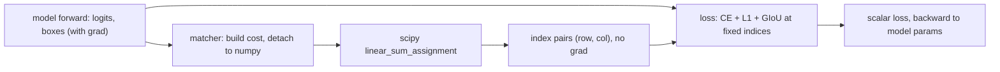
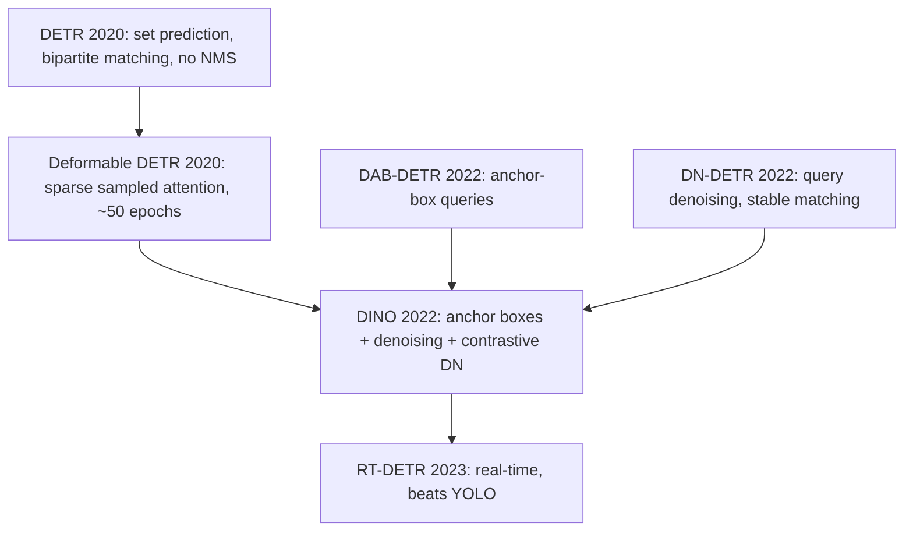

# A11 - detection and segmentation as set prediction

Object detection asks a model to output a set of objects: for each one, a class and a
bounding box. The set has no canonical order (the three cars in an image are not numbered),
and its size changes from image to image. For years detectors sidestepped both problems with
a fixed scaffold of anchors and a hand-built deduplication step. DETR (the detection
transformer) removed that scaffold by training directly against the set: predict a fixed
number of candidate objects, match them one-to-one to the ground-truth objects, and let the
matching loss do the work that anchors and non-maximum suppression used to do.

Build the matching mechanism and the set-prediction loss on a tiny toy of colored squares on a
black background. The pieces to implement are the box-format conversion, generalized IoU, the
Hungarian matching cost, and the loss. The ViT backbone, the query decoder, and the output
heads are provided, because the lesson is the matcher and the loss, not the plumbing.

Required reading before starting:
- Carion et al. 2020, "End-to-End Object Detection with Transformers" (DETR),
  [arXiv:2005.12872](https://arxiv.org/abs/2005.12872).
- Rezatofighi et al. 2019, "Generalized Intersection over Union",
  [arXiv:1902.09630](https://arxiv.org/abs/1902.09630).

## Lecture notes

### What set prediction is for

#### The task

The training images in this assignment are 32x32 pictures of solid colored squares on a black
background. Each picture holds one or two squares, each 4 to 8 pixels on a side, placed so that
they do not overlap. A square's color is its class: red is class 0, green class 1, blue class 2.
A detector for this data looks at a picture and answers with a list such as "a red square
covering pixels 4 to 12 horizontally and 4 to 12 vertically; a blue square covering pixels 20 to
28 in both directions". Each entry of the list is a class and a box.

The same task at full scale is detecting cars, pedestrians, and traffic lights in a camera frame
from a driving car, or the 80 everyday object categories of the COCO benchmark. The images are
larger and the lists longer (dozens of objects per image is common), but the output has the same
form: a list of (class, box) entries whose length depends on the image.

#### Why the obvious approach fails

A neural network has a fixed output layout. The obvious design is to give it, say, ten output
rows, each holding a class and a box, and to train row $k$ to predict the $k$-th object. That
needs an answer to the question "which object is the $k$-th one?", and the image does not supply
one. The two squares in a picture are not numbered.

Any numbering imposed from outside causes trouble. If objects are numbered by their order in the
annotation file, the numbering is arbitrary, and the network is punished for predicting the right
squares in the wrong rows, a mistake it has no way to avoid because nothing in the pixels says
which square the annotator listed first. If objects are sorted by their $x$ coordinate, two
squares at nearly the same $x$ swap order when one moves by a pixel, so row 0's target jumps from
one square to the other across a tiny change in the image, and the network has to learn that
discontinuity. And the number of objects changes from picture to picture, so some rows must be
told to predict nothing.

#### The idea, matching before the loss

DETR does not impose an order. It lets the network emit a fixed number of predictions, ten in this
assignment, and at every training step it decides which prediction should be compared with which
ground-truth object by solving a small assignment problem: pair each of the one or two squares
with a distinct prediction so that the total mismatch (wrong class, misplaced box) is as small as
possible. The loss is then computed on those pairs, and every prediction left without a partner is
trained to output a special no-object class. Whatever order the network happens to produce its
predictions in, the matching finds it, so the order no longer matters.

#### Why it matters

The detectors that came before DETR handled the ordering problem with anchors, a fixed grid of
thousands of reference boxes, and cleaned up the resulting duplicate detections with a hand-tuned
post-processing step called non-maximum suppression (both are described later). Matching removes
both. The one-to-one constraint means that only one prediction can be paired with each object, so
a second prediction on the same object is trained toward no-object, and duplicates are removed by
training instead of by post-processing. The same recipe, a fixed number of learned prediction
vectors (called object queries, defined in the DETR model section) plus one-to-one matching, now
underlies most current detectors (the DINO detector and RT-DETR), segmentation models
(Mask2Former), and open-vocabulary detectors (Grounding DINO). The DINO detector is a different
method from DINO self-distillation in the self-supervised learning assignment; the two only share
a name.

### Our two-square example (one toy picture, three predictions)

To see the mechanism with numbers small enough to check by hand, we use one picture in the style
of the training data, which we call our two-square example. It has a red square (class 0)
covering pixels 4 to 12 in both $x$ and $y$, and a blue square (class 2) covering pixels 20 to 28
in both. We call them object 0 and object 1. Instead of the ten predictions the real model makes,
we give our example three, written q0, q1, q2, each with a class probability vector over the three
colors plus no-object, and a box:

| prediction | box center, size (pixels) | $p$(red), $p$(green), $p$(blue), $p$(no-object) |
|---|---|---|
| q0 | center $(24, 23)$, $8 \times 8$ | 0.05, 0.05, 0.80, 0.10 |
| q1 | center $(9, 8)$, $8 \times 8$ | 0.70, 0.05, 0.05, 0.20 |
| q2 | center $(8, 10)$, $10 \times 10$ | 0.50, 0.05, 0.05, 0.40 |

q0 is a good prediction of the blue square, one pixel too high. q1 is a good prediction of the red
square, one pixel too far right. q2 is a weaker second prediction of the red square: too large,
shifted down, and less sure of its class. We call q2 our duplicate.



Our two-square example keeps what these notes are about: an unordered set of objects, more
predictions than objects, predictions emitted in an order unrelated to the objects, and one
duplicate prediction. It drops what makes real detection hard: overlapping and partly hidden
objects, dozens of objects per image, and classes that cannot be read off a single color.

Pairing by index would compare q0 with object 0 and q1 with object 1. Both pairs are far apart
(q0's box is on the blue square, object 0 is the red one), so the loss would be large even though
q0 and q1 are good predictions. Matching instead pairs q1 with object 0 and q0 with object 1, and
sends q2 to no-object. The right half of the figure shows the matching cost matrix this is computed
from; the sections below define each of its entries and the algorithm that picks the outlined
pairs.

### Overview of the rest of the notes

The notes build up the method in this order, and most parts reuse an idea that is familiar from
estimation or tracking.

1. Comparing boxes. Box formats, intersection over union (IoU), and generalized IoU (GIoU), which
   extends IoU so that it still ranks boxes that do not overlap. These are the geometric scores
   both the matching and the loss use.
2. Scoring a detector. Average precision, the benchmark number quoted for every detector.
3. The pre-DETR pipeline. Anchors, non-maximum suppression, and focal loss, the scaffolding DETR
   removes.
4. The DETR model. What the network outputs: a fixed number of (class, box) predictions from
   learned object queries.
5. Matching. The matching cost between a prediction and an object, and the Hungarian algorithm
   that finds the cheapest one-to-one pairing. This is the linear assignment problem, the same
   problem as data association in multi-target tracking.
6. The loss. Cross-entropy with a down-weighted no-object class, plus box terms on the matched
   pairs, and why this removes the need for non-maximum suppression.
7. What came after. The follow-up detectors that fixed DETR's slow training, and the same
   paradigm applied to segmentation, where each query predicts a mask instead of a box and the
   box terms of the cost and loss become mask terms such as the Dice coefficient, and to
   open-vocabulary detection.

Our two-square example is used throughout. Five exercises, placed after the sections they test,
are meant to be worked by hand. Each has a worked answer that can be expanded.

### Boxes and the two coordinate formats

An axis-aligned bounding box is four numbers, and detection code uses two different
conventions for those four numbers. The corner format, called xyxy, lists the top-left and
bottom-right corners $(x_0, y_0, x_1, y_1)$. The center format, called cxcywh, lists the
center and the extent $(c_x, c_y, w, h)$. The two are related by

$$(x_0, y_0, x_1, y_1) = \Big(c_x - \tfrac{w}{2},\ c_y - \tfrac{h}{2},\ c_x + \tfrac{w}{2},\ c_y + \tfrac{h}{2}\Big),$$

$$(c_x, c_y, w, h) = \Big(\tfrac{x_0 + x_1}{2},\ \tfrac{y_0 + y_1}{2},\ x_1 - x_0,\ y_1 - y_0\Big).$$

Both directions assume $w, h > 0$, which holds for real objects and for any box a network
emits through a sigmoid. All coordinates are divided by the image side, so every number
lives in $[0, 1]$ and a box means the same thing at 32x32 as at 800x1200. In our two-square
example, object 0 is $(4, 4, 12, 12)$ in pixel xyxy, $(8, 8, 8, 8)$ in pixel cxcywh, and
$(0.25, 0.25, 0.25, 0.25)$ after dividing by the image side of 32.

Each format suits a different job, which is why code converts between them constantly.
Areas and overlaps are computed from corners, since intersecting two boxes is a coordinatewise
min and max on the corners. Regression heads emit cxcywh, since a sigmoid on each of the four
outputs keeps the box inside the image automatically, and since an L1 error on cxcywh separates
"the box is in the wrong place" from "the box is the wrong size", while an L1 error on corners
mixes the two into all four numbers. In this assignment the toy dataset returns ground truth in
cxcywh, the model predicts cxcywh, and the overlap code converts to xyxy internally.

### Intersection over union

Two boxes have to be compared by a single number that is invariant to how big they are: a
5-pixel error on a 10-pixel object is a bad prediction, the same 5-pixel error on a 300-pixel
object is a good one. Intersection over union does that by dividing the shared area by the
total area covered:

$$\mathrm{IoU}(A, B) = \frac{|A \cap B|}{|A \cup B|}, \qquad |A \cup B| = |A| + |B| - |A \cap B|.$$

For axis-aligned boxes the intersection is a box itself, with corners
$\max(x_0^A, x_0^B), \max(y_0^A, y_0^B)$ and $\min(x_1^A, x_1^B), \min(y_1^A, y_1^B)$. When
the boxes are disjoint that "box" has negative width or negative height, and if both are
negative, multiplying them gives a positive area that is entirely fictional. So the width and
height are clamped at zero before multiplying:

$$|A \cap B| = \max\big(0,\ \min(x_1^A, x_1^B) - \max(x_0^A, x_0^B)\big) \cdot
              \max\big(0,\ \min(y_1^A, y_1^B) - \max(y_0^A, y_0^B)\big).$$

A worked case, in small raw units so the arithmetic is readable. Let $A$ be the xyxy box
$[0, 0, 2, 2]$ and $B$ the xyxy box $[1, 1, 3, 3]$. Each has area 4. Their intersection is
$[1, 1, 2, 2]$, area 1. The union is $4 + 4 - 1 = 7$. So $\mathrm{IoU} = 1/7 \approx 0.143$:
the boxes overlap in a corner, and IoU says so.

In our two-square example, q1 is object 0 shifted one pixel to the right. The intersection is
$7 \times 8 = 56$ pixels, the union $64 + 64 - 56 = 72$, and the IoU is
$56/72 = 7/9 \approx 0.78$.

IoU is scale-invariant, sits in $[0, 1]$, and equals 1 only for identical boxes. Its weakness
is the reason the generalized version below exists: it is exactly 0 for every disjoint pair,
whether the boxes are a pixel apart or on opposite sides of the image. In our two-square example,
q0 against object 0 and q1 against object 1 both have IoU 0, and so would any other box that
misses.

### Generalized IoU

The matching cost and the box loss described later both need an overlap score that keeps saying
something useful when the boxes miss each other entirely. Plain IoU does not: it is exactly 0 for
every disjoint pair, so a cost built on it is flat across all non-overlapping configurations and
has zero gradient there. Early in training every predicted box is somewhere random, so that flat
region is where the model actually lives, and it gets no signal about which direction the target
is in.

Generalized IoU (Rezatofighi et al. 2019) restores the signal by charging for the empty space
between the boxes. Let $E$ be the smallest axis-aligned box containing both $A$ and $B$ (its
corners are the coordinatewise min of the top-left corners and max of the bottom-right ones; the
paper calls this box $C$, renamed here because $C$ is already the class count). Subtract the
fraction of $E$ that neither box covers:

$$\mathrm{GIoU}(A, B) = \mathrm{IoU}(A, B) - \frac{|E \setminus (A \cup B)|}{|E|}
  = \mathrm{IoU} - \frac{|E| - |A \cup B|}{|E|}.$$

Take the same pair as before, $A = [0, 0, 2, 2]$ and $B = [1, 1, 3, 3]$ in xyxy. The enclosing
box is $E = [0, 0, 3, 3]$, area 9, against a union of 7, so the penalty is $2/9$ and
$\mathrm{GIoU} = 1/7 - 2/9 = -5/63 \approx -0.079$. Slide $B$ away until the boxes are disjoint
and the union settles at $4 + 4 = 8$ while $|E|$ keeps growing, so the penalty climbs toward 1
and GIoU falls toward $-1$. Slide it back until the boxes coincide, $|E| = |A \cup B|$, so
$\mathrm{GIoU} = \mathrm{IoU} = 1$. GIoU therefore lives in $(-1, 1]$, agrees with IoU when the
boxes overlap heavily, and keeps a nonzero derivative with respect to the box coordinates even
when they do not touch, which is why both the matching cost and the box loss use it instead of
IoU.

The figure slides one 8x8 box diagonally past another. IoU (blue) drops to zero as soon as the
boxes separate and stays there; GIoU (orange) keeps decreasing with distance, so it still says
which way to move.



In our two-square example, q1 against object 0 has an enclosing box equal to the union (the shift
is only horizontal and the boxes have the same height), so its GIoU equals its IoU, $7/9$. q0
against object 0 is disjoint, and its GIoU is about $-0.77$, which records that the boxes are far
apart rather than only that they do not overlap.

The intersection width and height must be clamped to be
non-negative before multiplying, as in the IoU section above, or two disjoint boxes produce a
positive fictional intersection and a wrong score. And a small $\varepsilon$ goes in both
denominators (the IoU union and $|E|$) so a zero-area degenerate box does not divide by zero.
The function is differentiable, so the same one is reused in the loss.

> **Exercise 1 (GIoU for boxes that miss).** In raw units, let $A = [0, 0, 2, 2]$ and
> $B = [2 + d, 0, 4 + d, 2]$ in xyxy, so $B$ sits a gap $d \ge 0$ to the right of $A$. Find
> $\mathrm{GIoU}(A, B)$ as a function of $d$, evaluate it at $d = 1$ and $d = 4$, and find its
> derivative with respect to $d$. What are IoU and its derivative over the same range?

<details>
<summary>Answer</summary>

The boxes are disjoint for every $d \ge 0$, so the intersection is 0, IoU is 0, and the union is
$4 + 4 = 8$. The enclosing box is $[0, 0, 4 + d, 2]$, area $2(4 + d)$. So

$$\mathrm{GIoU} = 0 - \frac{2(4 + d) - 8}{2(4 + d)} = -\frac{d}{4 + d}.$$

At $d = 1$ the enclosing box has area 10, and $\mathrm{GIoU} = -2/10 = -0.2$. At $d = 4$ it has
area 16, and $\mathrm{GIoU} = -8/16 = -0.5$. The derivative is $-4/(4 + d)^2$, which is $-0.16$
at $d = 1$ and $-0.0625$ at $d = 4$: always negative, so a loss $1 - \mathrm{GIoU}$ always pushes
the boxes together, more weakly the farther apart they are. IoU is 0 for every $d \ge 0$ and its
derivative is 0, so a loss built on IoU alone gives no signal at all here.

</details>

### Scoring a detector

A detector outputs boxes with confidence scores, and a scoring rule has to decide which of them
count as correct. The standard rule sorts all predicted boxes of one class by confidence,
highest first, and walks down the list. A prediction is a true positive if its IoU with an
unclaimed ground-truth box of the same class is at least a threshold, and that ground truth is
then marked claimed; otherwise the prediction is a false positive. Any ground-truth object that
no prediction claimed is a false negative. Sweeping down the ranked list gives a running
precision (fraction of accepted predictions that were correct) and recall (fraction of
ground-truth objects found), and plotting one against the other traces the precision-recall
curve. Average precision (AP) is the area under that curve, a single number that rewards finding
everything without flooding the output with guesses. Mean average precision (mAP) averages AP
over the classes.

In our two-square example at an IoU threshold of 0.5, q1 (IoU $7/9$ with object 0) is a true
positive. If q2 were also reported as a red square, it would find object 0 already claimed and
count as a false positive, which lowers precision. A detector is therefore penalized for
duplicates and has to avoid producing them.

The threshold matters, so benchmarks fix it. COCO, the standard detection benchmark (about
118,000 training images labeled with 80 everyday object categories), reports AP averaged over
ten IoU thresholds, from 0.50 to 0.95 in steps of 0.05, so a detector cannot score well by
producing loosely placed boxes. "AP on COCO" below always means that averaged number.

### The pre-DETR detection pipeline and its scaffolding

A detector has to turn a dense feature map into a variable-length list of objects. The feature
map is what a backbone produces: a convolutional network or a ViT reduces an $H \times W$ image
to a coarser grid, say $H/32 \times W/32$, where each cell holds a feature vector summarizing
the image content around that location. The grid is dense (every cell has a vector) and fixed
in size, while the answer is a list whose length varies per image.

Before DETR, the dominant bridge across that gap was anchors: tile the image with a fixed grid
of reference boxes at several scales and aspect ratios (thousands to hundreds of thousands of
them), and for each anchor predict whether it covers an object, which class, and a small offset
that refines the anchor into the final box. Anchors answer the ordering question from the start
of the notes by location: an anchor whose IoU with an object is above a threshold is responsible
for it. Faster R-CNN does this in two stages, a first network proposing regions and a second
classifying and refining each crop. RetinaNet and the YOLO versions 2 to 5 do it in one stage,
reading class and offset straight off every anchor. Anchors turn a variable-length output
into a fixed-size one, at the price of predicting mostly nothing: the overwhelming majority of
anchors cover background.

That price shows up as two problems the pipeline then has to clean up. First, many anchors near
a true object all fire, so the raw output holds several overlapping boxes per object, like q1 and
q2 in our two-square example. Non-maximum suppression (NMS) removes the duplicates: sort boxes by
confidence, keep the highest, delete every remaining box whose IoU with it exceeds a threshold,
repeat. NMS is a greedy, non-differentiable post-process with its own threshold to tune, and it
sits outside the network, so the model is never trained against the duplicates it produces.

Second, training needs a rule that says which anchor is responsible for which object. That rule
is also hand-built: assign each ground-truth box to the anchors whose IoU with it exceeds a
threshold, mark the rest as background, and then deal with the imbalance, because a hundred
thousand background anchors against a handful of positives means the background term drowns out
everything else. Two standard fixes exist. Hard-negative mining sorts the background anchors by
their loss and keeps only the worst-scoring ones, at some fixed ratio to the positives,
discarding the rest of the gradient. Focal loss (Lin et al. 2017) instead reweights every term
continuously: with $p_t$ the predicted probability of the correct answer for that anchor,

$$\mathrm{FL}(p_t) = -(1 - p_t)^{\gamma}\,\log p_t.$$

An easy background anchor has $p_t$ near 1, so $(1 - p_t)^\gamma$ is near zero and its
contribution nearly vanishes; a hard or misclassified anchor keeps almost its full
cross-entropy. The exponent $\gamma$ (2 in the paper) sets how sharply easy examples are
suppressed. Both fixes patch the same underlying issue: the anchor grid manufactures a huge
class imbalance that the loss then has to undo.

DETR's claim is that both pieces, the anchors and the NMS, are scaffolding that can be removed
by training the model to emit the set directly.

> **Exercise 2 (focal loss against a crowd of easy anchors).** An image produces 1000 easy
> background anchors, each with $p_t = 0.99$, and one misclassified object anchor with
> $p_t = 0.1$. Compute the total cross-entropy $-\log p_t$ of the easy anchors and of the hard one,
> then the same two totals under focal loss with $\gamma = 2$. Which term dominates in each case?

<details>
<summary>Answer</summary>

Cross-entropy: each easy anchor contributes $-\log 0.99 \approx 0.01005$, so the 1000 together
give about $10.05$. The hard anchor contributes $-\log 0.1 \approx 2.303$. The easy background
carries more than four times the loss of the one anchor that is actually wrong, and dominates the
gradient.

Focal loss: each easy anchor is multiplied by $(1 - 0.99)^2 = 10^{-4}$, giving about
$1.0 \times 10^{-6}$ each and $0.001$ for all 1000. The hard anchor is multiplied by
$(1 - 0.1)^2 = 0.81$, giving about $1.865$. Now the misclassified anchor carries nearly all of the
loss. The factor $(1 - p_t)^\gamma$ removes almost all of the easy terms' weight while leaving the
hard term within 20% of its cross-entropy.

</details>

### The DETR model in one pass

Before the matcher, it helps to know exactly what comes out of the network, because the matcher
consumes it.

The backbone turns the image into tokens. In this build a ViT does it, using ViT's patch embedding
and transformer encoder: at an image size of 32 with 4-pixel patches, the image splits into an
8x8 grid of patches, so the backbone returns 64 feature vectors, one per patch. The original DETR
used a ResNet backbone followed by a transformer encoder over the flattened feature map; the ViT
covers both jobs at once. These 64 vectors are the only thing the rest of the model ever sees of
the image.

The outputs come from object queries: $N$ learned embedding vectors ($N = 10$ here; the DETR paper
uses 100), stored as ordinary model parameters and identical for every image. Each object query
produces one (class, box) prediction; papers also call a query and its prediction a slot. A query
is not a position on a grid and not a proposal derived from the image. It is the same learned
vector for every image, and the image enters the query only through attention. Because the
queries start at different random values and are updated by gradient descent along with
everything else, they end up specializing: in the original DETR, different queries learn to
prefer different image regions and object sizes, which is the learned analogue of the anchor
grid. In our two-square example, q0, q1, q2 are the predictions of three such queries.

The decoder refines those $N$ vectors through a stack of transformer blocks (two in this build).
Each block runs self-attention among the queries, then cross-attention against the patch tokens,
then a feed-forward layer. The self-attention is bidirectional, with no causal mask, because the
output is a set with no order, and it is how the queries coordinate: a query can see what the
other queries are converging on and move off an object another query has already claimed. The
cross-attention is the only path from pixels to queries. It is the same attention operation as
self-attention with the inputs split: the attention queries (in the attention sense of the word)
come from the $N$ object-query vectors, and the keys and values come from the 64 patch tokens, so
each object query reads out a weighted average of image features with weights it computes itself.

Two heads read each refined query vector. A linear layer produces $C + 1$ logits (unnormalized
scores, one per class, that a softmax turns into class probabilities; the matching cost section
writes the softmax out), for the $C$ real classes plus one extra no-object class at index $C$. In this assignment $C = 3$, so the classes
are red, green, blue, and no-object at index 3, the four probabilities in the table of our
two-square example. A three-layer MLP produces 4 numbers through a sigmoid, giving a cxcywh box in
$[0, 1]$.



The model therefore always emits exactly $N$ (class, box) pairs, whatever the image contains.
The variable object count is handled entirely by letting most queries answer no-object.

### Set prediction needs a permutation-invariant loss

The model outputs $N$ predictions and the image contains $M \le N$ objects with no order, so,
as the opening section argued, pairing by index is not a usable target. DETR finds the best
assignment first and computes the loss against it. Pad the ground truth to size $N$ with a special no-object class $\varnothing$, so both sides
have $N$ elements, and search over permutations $\sigma$ of the predictions for the one that
minimizes a matching cost:

$$\hat{\sigma} = \arg\min_{\sigma}\ \sum_{i=1}^{N} \mathcal{C}_{\text{match}}\big(y_i,\ \hat{y}_{\sigma(i)}\big)$$

where $y_i$ is the $i$-th ground-truth object (real or $\varnothing$) and $\hat{y}_{\sigma(i)}$
is the prediction assigned to it. This is a bipartite matching between $N$ predictions and $N$
padded targets. Because $\varnothing$ targets contribute a constant to the cost regardless of
which prediction they land on, the search effectively assigns the $M$ real objects to $M$
distinct predictions and leaves the rest as no-object. In our two-square example, $N = 3$ and
$M = 2$: one $\varnothing$ target is added, and whichever prediction receives it is trained
toward no-object.

### The matching cost

The matching cost $\mathcal{C}[i, j]$ says how badly prediction $i$ would do as the prediction for
ground-truth object $j$. It has three terms, with the DETR weights $\lambda_{\text{cls}}=1$,
$\lambda_{L1}=5$, $\lambda_{\text{giou}}=2$:

$$\mathcal{C}[i, j] = \lambda_{\text{cls}}\,\big(-p_i[c_j]\big)
  + \lambda_{L1}\,\lVert b_i - b_j \rVert_1
  + \lambda_{\text{giou}}\,\big(-\mathrm{GIoU}(b_i, b_j)\big)$$

where $p_i = \mathrm{softmax}(\text{logits}_i)$ and $c_j$ is target $j$'s class. The softmax
turns the $C+1$ raw scores of prediction $i$ into a probability vector,
$p_i[c] = e^{z_c} / \sum_k e^{z_k}$, so $p_i[c_j]$ is the probability that prediction $i$ assigns
to target $j$'s class. The class term is its negative, so a query that already believes in the
right class is cheap. The L1 term is the sum of absolute differences of the four normalized
cxcywh coordinates. The GIoU term rewards box overlap and, unlike IoU, still ranks boxes that
miss.

Compute one entry of our two-square example, q1 against object 0. The class term is
$-p(\text{red}) = -0.70$. The boxes differ only in $c_x$, by one pixel, so the L1 term is
$5 \cdot 1/32 \approx 0.156$. The GIoU is $7/9$ from the previous sections, so the GIoU term is
$-2 \cdot 7/9 \approx -1.556$. The total is $\mathcal{C}[1, 0] \approx -2.10$. Doing the same for
every pair gives the matrix in the figure of our two-square example:

$$\mathcal{C} \approx \begin{bmatrix} 6.33 & -2.20 \\ -2.10 & 6.33 \\ -0.56 & 6.69 \end{bmatrix},$$

rows q0, q1, q2 and columns object 0, object 1. Negative entries are good pairs (the GIoU and
class terms dominate); the large positive entries are boxes on the wrong square, where the L1 term
is about 1 and the GIoU between $-0.7$ and $-0.8$. Our duplicate q2 is a plausible match for
object 0 ($-0.56$), but q1 is a better one ($-2.10$).

### Bipartite matching and the Hungarian algorithm

A graph is bipartite when its nodes split into two groups and every edge runs between the
groups, never inside one. Predictions on one side, ground-truth objects on the other, an edge
for every possible pairing: that is the graph here. A matching picks a subset of edges so that
no node is used twice, and the problem is to pick the matching of least total cost given a cost
matrix $\mathcal{C}[i, j]$, the cost of assigning prediction $i$ to target $j$. This is the
linear assignment problem, and it is the same problem as data association in multi-target
tracking, where tracks have to be paired with detections frame by frame.

Enumerating permutations is hopeless ($n!$ of them), but the problem is not hard: the Hungarian
algorithm (Kuhn 1955) solves it exactly, and later refinements of it run in $O(n^3)$. Its central
observation is that subtracting a constant from an entire row or an entire column of
$\mathcal{C}$ leaves the optimal assignment unchanged, because every complete assignment uses each
row exactly once and each column exactly once, so every candidate's total shifts by the same
constant. The algorithm subtracts row minima and then column minima, which makes all entries
non-negative and puts at least one zero in every row and column. If a set of zeros can be chosen
with no two sharing a row or column, that assignment costs zero in the reduced matrix, and no
assignment in a non-negative matrix can cost less than zero, so it is optimal in the original
too. When no such set exists, the algorithm covers all the zeros with as few horizontal and
vertical lines as possible, finds the smallest entry not covered by any line, subtracts it from
every uncovered entry, and adds it to every entry covered by two lines. This creates at least one
new zero, and the algorithm repeats until a complete set of zeros exists.

The tempting shortcut is greedy: for each target, take the prediction with the lowest cost in
that column. It can hand the same prediction to two targets, which is not a matching at all,
and even after patching that, it can be beaten. Take two targets and two predictions with

$$\mathcal{C} = \begin{bmatrix} 1 & 2 \\ 2 & 5 \end{bmatrix},$$

rows indexed by prediction, columns by target. Both columns have their minimum in row 0, so the
greedy rule assigns prediction 0 twice. The two valid assignments cost
$\mathcal{C}[0,0] + \mathcal{C}[1,1] = 6$ and $\mathcal{C}[0,1] + \mathcal{C}[1,0] = 4$, so the
optimum is 4, and it gives target 0 its second-choice prediction.
No local rule finds that; the choice for one target depends on what the choice costs the other.
Running the reduction on this matrix takes two steps. Subtracting the row minima 1 and 2, then
the column minima 0 and 1 of the result, gives

$$\begin{bmatrix} 1 & 2 \\ 2 & 5 \end{bmatrix}
  \ \longrightarrow\ \begin{bmatrix} 0 & 1 \\ 0 & 3 \end{bmatrix}
  \ \longrightarrow\ \begin{bmatrix} 0 & 0 \\ 0 & 2 \end{bmatrix},$$

and the zeros at $(0, 1)$ and $(1, 0)$ use each row and each column once, so they are the
optimal assignment. The constants removed sum to $1 + 2 + 0 + 1 = 4$, which is the optimal cost:
the reduction both finds the answer and proves it.

The detection version of that trap is two ground-truth objects at nearly the same place, with
one query sitting on both: per-column argmin double-assigns that query, while the Hungarian
solution is forced to give the second object to the next-cheapest query.

In our two-square example, the cheapest entry in each column is in a different row (q1 for
object 0, q0 for object 1), so greedy happens to agree with the optimum. The six ways to assign
two of the three predictions to the two objects cost between $-4.30$ and $13.02$, and the
minimum, $-2.10 + (-2.20) = -4.30$, is q1 to object 0 and q0 to object 1, the cells outlined in
the figure. q2 is left out and becomes a no-object target.

One difference between the equations above and the code. The $\varnothing$ padding that makes
the matching square is how the paper writes it; padding a cost matrix with a column of constants
does not change which real object goes to which prediction, so implementations skip it. The
matcher builds a rectangular $(N, M)$ cost matrix, and a rectangular assignment solver returns
$\min(N, M) = M$ index pairs. The $N - M$ queries that appear in no pair are the ones the loss
will train toward no-object.

> **Exercise 3 (one full Hungarian step by hand).** Solve the assignment problem for
> $$\mathcal{C} = \begin{bmatrix} 4 & 1 & 3 \\ 2 & 0 & 5 \\ 3 & 2 & 2 \end{bmatrix}$$
> with the reduction. Subtract row minima, then column minima, and check whether a complete set of
> independent zeros exists. If not, do one covering step. Confirm the result by listing all six
> assignments, and say what the greedy per-column rule would do.

<details>
<summary>Answer</summary>

Row minima are 1, 0, 2; column minima of the result are 1, 0, 0:

$$\begin{bmatrix} 4 & 1 & 3 \\ 2 & 0 & 5 \\ 3 & 2 & 2 \end{bmatrix}
\ \longrightarrow\ \begin{bmatrix} 3 & 0 & 2 \\ 2 & 0 & 5 \\ 1 & 0 & 0 \end{bmatrix}
\ \longrightarrow\ \begin{bmatrix} 2 & 0 & 2 \\ 1 & 0 & 5 \\ 0 & 0 & 0 \end{bmatrix}.$$

The constants removed sum to $1 + 0 + 2 + 1 = 4$, so every assignment costs at least 4. Rows 0 and
1 both have their only zero in column 1, so no complete set of independent zeros exists. Two lines
cover all the zeros: column 1 and row 2. The smallest uncovered entry is 1 (row 1, column 0).
Subtract 1 from the uncovered entries and add it to the doubly covered entry at row 2, column 1:

$$\begin{bmatrix} 1 & 0 & 1 \\ 0 & 0 & 4 \\ 0 & 1 & 0 \end{bmatrix}.$$

This is the same as subtracting 1 from rows 0 and 1 and adding 1 back to column 1, which lowers
every complete assignment by $2 - 1 = 1$, so the bound rises to 5. The zeros at $(0, 1)$, $(1, 0)$,
$(2, 2)$ are independent, so that assignment is optimal, and its original cost is $1 + 2 + 2 = 5$.

The six assignments (the columns given to rows 0, 1, 2) cost: $(0,1,2)$ 6, $(0,2,1)$ 11,
$(1,0,2)$ 5, $(1,2,0)$ 9, $(2,0,1)$ 7, $(2,1,0)$ 6. The minimum is 5, as found. Greedy per column
picks row 1 for column 0 (cost 2), row 1 for column 1 (cost 0), and row 2 for column 2 (cost 2),
assigning row 1 twice and leaving row 0 unused.

</details>

### The cost is not the loss

DETR keeps two separate quantities, and conflating them is the common mistake.

The matching cost $\mathcal{C}_{\text{match}}$ decides which prediction is compared to which
ground-truth object. It is computed once per training step, detached from the autograd graph, and
fed to the Hungarian solver. It produces a set of integer index pairs. No gradient flows through
it: the assignment indices are constants in the backward pass.

The training loss is the differentiable objective computed after the assignment is fixed. It
takes the index pairs as given and computes a loss that the model's parameters are updated
against. The DETR paper calls it the Hungarian loss; these notes call it the set-prediction loss.

Detaching is not an optimization here, it is the only option. Autograd works by recording every
operation on a tensor into a graph and replaying it backwards; detaching a tensor, or converting
it to a NumPy array, cuts it out of that graph so nothing behind it receives gradient. The
matcher's output is a set of integers. Nudge a predicted box by $10^{-6}$ and either the winning
assignment is unchanged, so the derivative of the indices with respect to the box is zero, or
the assignment flips to a different permutation, so the derivative does not exist. Zero almost
everywhere and undefined on the boundaries is not a usable gradient, which is the general
situation for $\arg\min$ over a discrete set. The errors to avoid are trying to differentiate
through the matcher and reusing the cost as the loss. A multi-target tracker splits the work the
same way: data association is a discrete decision made first, and the filter update is then
computed given that decision.



### Cross-entropy and the no-object imbalance

DETR meets a milder version of the imbalance that focal loss and hard-negative mining were built
for, and answers it with one line of plain weighted cross-entropy.

For one prediction with probability vector $p$ over $C+1$ classes and correct class $c$, the
cross-entropy is $\ell = -\log p[c]$, the negative log-likelihood of the right answer. It is 0
when the model puts all its mass on $c$ and grows without bound as $p[c] \to 0$, so it punishes
confident mistakes far harder than uncertain ones. Averaged over a batch, it is the standard
classification objective.

A weighted cross-entropy attaches a per-class weight $w_c$ and computes a weighted average:

$$\mathcal{L} = \frac{\sum_n w_{y_n}\,\ell_n}{\sum_n w_{y_n}},$$

summing over the predictions $n$ with correct classes $y_n$. Setting one class's weight low
shrinks both how much its examples contribute and how much they count in the denominator.

Now count the terms in DETR. With $N = 10$ queries and an image holding 1 or 2 objects, at most
2 predictions have a real class and at least 8 have the no-object class: four no-object terms
per real one on a two-object image, nine on a one-object image. Unweighted, the no-object terms
make up most of the average, so most of the classification gradient goes into making empty
queries say no-object rather than into recognizing the objects. The DETR paper down-weights the
no-object term by a factor of 10 "to account for class imbalance", and compares this with how
Faster R-CNN balances positive and negative proposals by subsampling. The weight vector has
length $C+1$, equal to 1 on the real classes and to a coefficient on the no-object class that the
DETR code calls `eos_coef` and sets to 0.1. On a two-object image the 8 no-object terms then
carry total weight 0.8 against the 2 real terms' 2.0, so the object terms carry most of the
gradient.
The name `eos_coef` is inherited from sequence models, where the analogous class marks the end
of a sequence; here it is the no-object class and nothing else. This is ordinary class-imbalance
reweighting applied to the padded class, not a post-hoc rescaling of unmatched queries after
their loss is computed.

> **Exercise 4 (what the no-object weight changes).** A one-object image (a red
> square, class 0) and $N = 10$ queries, one matched to the object and nine unmatched. Compare two
> models. Model D (all no-object) gives every query $p(\varnothing) = 0.97$ and $0.01$ to each real
> class. Model R (right but unsure) gives the matched query $p(\text{red}) = 0.6$ and every
> unmatched query $p(\varnothing) = 0.6$. Compute the classification loss of each with no-object
> weight 1 and with no-object weight 0.1. Which model does each setting prefer?

<details>
<summary>Answer</summary>

The per-query cross-entropies are: for model D, $-\log 0.01 \approx 4.605$ on the matched query
and $-\log 0.97 \approx 0.0305$ on each unmatched one; for model R, $-\log 0.6 \approx 0.511$ on
every query.

With weight 1 the loss is the plain mean over 10 queries. Model D:
$(4.605 + 9 \cdot 0.0305)/10 \approx 0.488$. Model R: $0.511$. The unweighted loss scores the
model that misses the object as slightly better than the one that finds it, because nine easy
no-object terms outweigh one object term.

With weight 0.1 the denominator is $1 + 9 \cdot 0.1 = 1.9$. Model D:
$(4.605 + 0.9 \cdot 0.0305)/1.9 \approx 2.438$. Model R: $(0.511 + 0.9 \cdot 0.511)/1.9 = 0.511$
(every term is equal, so the weights cancel). Now the model that finds the object wins by a factor
of almost five. In this example the weight changes which of the two models the loss ranks lower,
not only the size of the numbers. A lower loss for a worse model is a bias in the objective, not a
statement about where training ends up; DETR introduces the weight as class balancing.

</details>

### The set-prediction loss

After the matcher fixes the assignment, the loss has three parts, summed with the same DETR
weights (class 1, L1 5, GIoU 2).

Classification is the weighted cross-entropy above, over all $N$ queries. Each matched query's
target is its ground-truth class; each unmatched query's target is the no-object class at index
$C$. Every query contributes, which is what trains the model to leave the extra queries empty.

The box L1 (the summed absolute coordinate differences, as in the cost) and the GIoU loss
($1 - \mathrm{GIoU}$, so 0 for a perfect box and up to 2 for a distant one) are computed only on
the matched (query, ground-truth) pairs, averaged over those pairs; unmatched queries have no box target, so there is nothing to compute for them. When an
image contributes no matched pairs at all, the box terms still have to be a zero derived from
the predictions rather than a bare constant, or the autograd graph comes apart.

In our two-square example, q0's classification target is blue, q1's is red, and q2's is
no-object. The box terms use only the pairs (q1, object 0) and (q0, object 1); q2's box receives
no gradient at all, and only its class probabilities are pushed, toward no-object.

The class term is the one place the cost and the loss differ: the cost uses the raw probability
$-p[c]$, the loss uses cross-entropy $-\log p[c]$. Both decrease as the model's belief in the
right class rises, so they rank a query's options identically, and they differ in scale. The raw
probability is confined to $[-1, 0]$, which keeps the class entry commensurate with the L1 and
GIoU entries sharing the cost matrix, so one term cannot swamp the assignment. The logarithm is
unbounded, which is what a training objective wants. The GIoU term is the same function in the
cost and the loss. The L1 term in the cost sums the absolute differences of the four
coordinates; DETR's loss also sums the four coordinates and averages over the matched boxes.

### Why NMS disappears

Because the matching is one-to-one, every ground-truth object is assigned to exactly one
query, and every other query is trained to predict no-object. The model is therefore trained
directly against producing two boxes for one object: if two queries both fire on the same
object, only one can be matched, and the other takes a no-object penalty. In our two-square
example, q2 is such a second query on the red square, and the loss lowers its red probability at
every step in which q1 wins the match. Duplicate suppression moves from a post-process into the
training objective, so no NMS is needed at inference.

### DETR's convergence problem and the fixes

The original DETR worked but trained slowly: about 500 epochs on COCO, roughly ten times a
comparable Faster R-CNN schedule. The follow-up papers diagnosed why and fixed it, and that
lineage runs through most current detectors.

Deformable DETR (Zhu et al. 2020, [arXiv:2010.04159](https://arxiv.org/abs/2010.04159)) traced
much of the slowness to global dense cross-attention, where every query attends to every patch
and the attention map has to learn from scratch where to look. It replaced that with deformable
attention: each query predicts a small number of 2D offsets from a reference point, samples the
feature map at exactly those locations by bilinear interpolation, and attends only to that
handful of samples. Attention is local and sparse from the first step, and its cost no longer
grows with the number of feature-map cells, which makes it affordable to run over several
feature maps at different resolutions at once so that small objects are read off a fine grid and
large ones off a coarse grid. This cut training to about 50 epochs and improved small-object
accuracy.

DAB-DETR (Liu et al. 2022, [arXiv:2201.12329](https://arxiv.org/abs/2201.12329)) attacked the
query itself. A learned vector is an opaque prior, and there is no way to say what a given query
is looking for. DAB-DETR makes each query an explicit 4-D anchor box $(x, y, w, h)$ that every
decoder layer reads and updates, so the query is a box hypothesis that gets refined layer by
layer, and the cross-attention can be restricted to the neighborhood of that box. Convergence
speeds up and the query becomes readable.

DN-DETR (Li et al. 2022, [arXiv:2203.01305](https://arxiv.org/abs/2203.01305)) found a second
cause: the bipartite matching is unstable early in training, because which query matches which
object flips between epochs, so the targets a query chases keep changing. It added query
denoising: feed in ground-truth boxes with added noise as extra queries that bypass the matcher
and are trained to reconstruct the clean boxes, giving a stable auxiliary target that does not
depend on the (still noisy) matching.

The DINO detector (Zhang et al. 2022, [arXiv:2203.03605](https://arxiv.org/abs/2203.03605)) combined
DAB-DETR's anchor-box queries and DN-DETR's denoising into one model and added two pieces.
Contrastive denoising feeds each ground-truth box twice, once with small noise labeled as the
object and once with larger noise labeled no-object, so the model is trained to reject a box
that is close to right but not right, which is exactly the near-duplicate NMS used to delete.
Mixed query selection initializes the positional half of each query, its box, from the
highest-scoring encoder feature locations for the image at hand, while leaving the content half
learned, so the decoder starts from box hypotheses that already point somewhere plausible. (This
DINO is unrelated to DINO self-distillation in the self-supervised learning assignment.) DINO
was the first DETR-family detector to top the COCO leaderboard. DAB-DETR and DN-DETR are
parallel early-2022 contributions that DINO unifies; the name DINO bundles denoising and anchor
boxes, so read this as a teaching arc, not a strict ancestry where one descends from the other.

RT-DETR (Zhao et al. 2023, [arXiv:2304.08069](https://arxiv.org/abs/2304.08069)) answered the
last standing objection, that DETR is too slow for real-time use. Its encoder is hybrid: the
expensive self-attention runs only on the smallest, lowest-resolution feature map, and the other
scales are fused with cheap convolutions, which removes most of the encoder cost without giving
up multi-scale features. Paired with a decoder tuned for latency, it beats the YOLO models at
comparable speed while keeping the NMS-free, anchor-free design, and with no NMS there is no
suppression threshold left to retune per deployment. The YOLO line has moved in the same
direction: YOLOX, YOLOv8, and YOLO11 are anchor-free, and YOLOv10 trains with a one-to-one
assignment so that it needs no NMS. Single-stage YOLO detectors remain the main competitor to
RT-DETR on tight latency budgets.



### The three segmentation tasks

Segmentation replaces the box with a mask: a per-pixel binary image, 1 inside the object and 0
outside, at the resolution of the input or on a coarser grid that gets upsampled. In our
two-square example, the mask of object 0 is the 8x8 block of red pixels. Three tasks sit under
the word, and they differ in what a pixel label is allowed to say.

Semantic segmentation labels every pixel with a class and stops there. Three cars parked in a
row come out as one connected blob of "car" pixels, with no notion of how many cars there are.
Instance segmentation goes the other way: it returns a separate mask per object, each with a
class, and says nothing about the pixels that belong to no object. Panoptic segmentation asks
for both at once, and to do that it splits the classes in two. Countable classes, called things
(car, person, traffic light), get a class and an instance id per pixel. Uncountable classes,
called stuff (road, sky, vegetation), get a class only, since counting patches of sky is
meaningless. Every pixel gets exactly one label, so a panoptic output is a complete description
of the image with no overlaps and no gaps, which is what a planner downstream of a perception
stack usually wants.

Comparing two masks needs an overlap score, and IoU works directly on pixel sets: intersection
count over union count. The soft version used as a loss is the Dice coefficient,
$2|A \cap B| / (|A| + |B|)$, which for a predicted mask of per-pixel probabilities and a binary
target is differentiable and behaves like IoU. Mask losses are typically a per-pixel
cross-entropy plus a Dice term.

> **Exercise 5 (Dice and IoU are one function of each other).** For two hard (0 or 1) masks,
> express the Dice coefficient as a function of IoU alone. Evaluate it for the corner-overlap pair
> $A = [0, 0, 2, 2]$, $B = [1, 1, 3, 3]$ treated as masks, both from the formula and directly.
> Which of the two scores is larger, in general?

<details>
<summary>Answer</summary>

Write $I = |A \cap B|$ and $U = |A \cup B|$. Since $|A| + |B| = U + I$,

$$\mathrm{Dice} = \frac{2I}{U + I} = \frac{2\,I/U}{1 + I/U} = \frac{2\,\mathrm{IoU}}{1 + \mathrm{IoU}}.$$

For the pair, $\mathrm{IoU} = 1/7$, so $\mathrm{Dice} = (2/7)/(8/7) = 0.25$. Directly,
$2 \cdot 1/(4 + 4) = 0.25$. Because $1 + \mathrm{IoU} \le 2$, Dice is always at least IoU, with
equality only at 0 and 1. The map is increasing, so the two rank mask pairs identically on hard
masks; they differ as losses on soft masks, where their gradients weight the pixels differently.

</details>

### Segmentation and open-vocabulary detection on the same paradigm

The query-plus-matching idea generalizes past boxes. Mask2Former (Cheng et al. 2021,
[arXiv:2112.01527](https://arxiv.org/abs/2112.01527)) keeps the object queries and the bipartite
matching and swaps the output: each query predicts a binary mask instead of a box, so the
matching cost swaps the L1 and GIoU terms for mask cross-entropy and Dice terms, evaluated on a
sample of points rather than every pixel to keep the cost matrix affordable. It also adds masked
attention, restricting each query's cross-attention to the pixels inside its own current mask
prediction, which keeps a query focused on one object instead of drifting across the image. One
architecture then handles instance, semantic, and panoptic segmentation, which previously needed
separate designs.

Grounding DINO (Liu et al. 2023, [arXiv:2303.05499](https://arxiv.org/abs/2303.05499)) changes
what the class head is. A standard detector has a closed vocabulary: the head is a $C$-way
classifier, and the label set is frozen at training time. An open-vocabulary detector replaces
that head with a similarity between the query's feature and a text embedding, in the same spirit
as the contrastive image-text embedding of CLIP, so the label set is whatever text is supplied
at inference. Grounding DINO adds a text backbone and fuses language features into the detector
at several points, so a noun phrase produces detections of the matching objects and rare or
novel categories need no retraining of a closed classifier.

SAM and SAM 2 come from a separate family. SAM (Kirillov et al. 2023,
[arXiv:2304.02643](https://arxiv.org/abs/2304.02643)) is a promptable segmentation model: a
point, box, or rough mask prompt produces an object mask, trained on a very large mask
dataset. SAM 2 (Ravi et al. 2024, [arXiv:2408.00714](https://arxiv.org/abs/2408.00714))
extends this to video with a streaming memory, a running bank of features from the frames
already seen that the model attends to, so a mask propagates across frames instead of being
recomputed from nothing. SAM 3 (Carion et al., Meta, released Nov 2025,
[arXiv:2511.16719](https://arxiv.org/abs/2511.16719)) adds concept prompts, a short noun phrase
or an exemplar image patch rather than a single click, and returns a mask and an identity for
every matching object in an image or a video, which makes it a detector and tracker as well as a
segmenter. Its detector is DETR-style, with object queries and one-to-one matching, so SAM 3
joins the paradigm of these notes. SAM 3.1 (Mar 2026) reportedly extends the multi-object tracking; no preprint is
available for it, so treat that claim as reported by the release, not established here.

### Where this goes

The query-plus-bipartite-matching paradigm is now the dominant class for detection,
segmentation, tracking, and open-vocabulary grounding; single-stage YOLO detectors, now
anchor-free, are the competitor that still wins on the tightest latency budgets. In an
autonomous-driving perception stack, RT-DETR or a DINO variant runs as the production
detector, Grounding DINO covers rare or long-tail classes the closed detector was never
trained on, and SAM 2 or 3 sits in the annotation loop to cut labeling cost. The DETR-style
models among these (RT-DETR, DINO, Grounding DINO, Mask2Former, SAM 3) all train with a
one-to-one matcher and a set-prediction loss of the kind built here.

## The assignment

Fill these holes, in order. Each is one `NotImplementedError` with a matching test. The docstring
in each file gives the signature, shapes, and constraints.

| # | Function | File | Concept from the notes |
|---|---|---|---|
| 1 | [`box_xyxy_to_cxcywh()`](boxes.py) | `boxes.py` | the xyxy to cxcywh conversion |
| 2 | [`generalized_iou()`](boxes.py) | `boxes.py` | pairwise IoU and GIoU with the enclosing box $E$ |
| 3 | [`HungarianMatcher.forward()`](matcher.py) | `matcher.py` | the matching cost and the Hungarian assignment |
| 4 | [`detr_loss()`](loss.py) | `loss.py` | the set-prediction loss with the no-object weight |

Notes on specific holes:
- `generalized_iou` takes two sets of cxcywh boxes, shapes $(N_1, 4)$ and $(N_2, 4)$, and returns
  the full $(N_1, N_2)$ matrix. Convert to xyxy with the provided `box_cxcywh_to_xyxy`, clamp the
  intersection width and height at zero, and add `eps` to both denominators.
- `HungarianMatcher.forward` runs under `torch.no_grad()` and works image by image, building the
  $(N, M_b)$ cost matrix with the weights `cost_class`, `cost_l1`, `cost_giou`. It may call
  `scipy.optimize.linear_sum_assignment`, which solves the rectangular assignment problem exactly
  and returns the matched row (query) and column (object) indices; the anti-cheat test allows it.
  It is the same solver the minibatch optimal-transport coupling in flow matching used.
  `torch.cdist(..., p=1)` gives the pairwise L1 distances. Assert the cost matrix is finite before
  solving, and return two empty long tensors for an image with no objects.
- `detr_loss` takes the matcher's indices as constants. `torch.nn.functional.cross_entropy` with
  its `weight=` argument and the default mean reduction computes exactly the weighted average in
  the notes; the weight vector is 1 on the real classes and `eos_coef` at index `num_classes`.
  For the box L1, the reference solution uses `F.l1_loss` with its default mean reduction, which
  averages over the four coordinates as well as over the matched pairs, so its L1 term is 1/4 of
  the summed L1 that the matcher's `torch.cdist(..., p=1)` and DETR's loss use. This changes the
  scale of the L1 term only; follow the solution so the overfit numbers below match.
  Calling `generalized_iou` on the stacked matched predictions and matched targets returns a
  square matrix whose diagonal holds the matched pairs. When there are no matched pairs, build the
  zero box terms from `pred_boxes` (for example `pred_boxes.sum() * 0.0`). Return the total and
  the unweighted terms as `{"class", "l1", "giou"}`.
- `model.py` (the DETR wiring on the ViT backbone and the transformer block) and `config.py` (the
  sizes and the DETR weights) are provided. The image size of 32 and patch size of 4 are pinned so
  the ViT's learned positional embedding covers exactly 64 patch tokens.

### Running and validating

Activate the environment (`conda activate nanovision`), then:

```
make test     A=a11_detection_segmentation   # run the tests against the top-level files (the holes)
make verify   A=a11_detection_segmentation   # run the same tests against the reference solution/
make viz      A=a11_detection_segmentation   # render the figures from the reference solution
make viz-mine A=a11_detection_segmentation   # render the figures from your own code (holes filled)
```

`make test` is the command to run while working. It runs the suite in
`assignments/a11_detection_segmentation/tests/` against the top-level files (the ones with the
holes), and goes from red (the holes raise `NotImplementedError`) to green as the holes are
filled. `make verify` runs the identical suite against the reference `solution/` by setting
`NANOVISION_IMPL=solution`, so it is green from the start and shows the target. The goal is to
bring `make test` to the same green as `make verify`. (`test_forbidden_imports` passes with the
holes in place; the overfit test builds the real model, so it also surfaces any unfilled holes in
the transformer block and the ViT, which this model imports as its backbone.)

The data is `nanovision.data.toy.detection_batch`: solid colored squares on black, one or two per
32x32 image, placed without overlap, with the square's color as its class id and its exact extent
as the ground-truth box in normalized cxcywh. Boxes and labels come padded to `max_objects` with a
boolean mask marking the real rows; the tests turn them into per-image lists before calling the
matcher and the loss.

The tests check:
- `test_giou.py`: GIoU on an identical pair (1), a far-apart pair (in $(-1, 0)$), the
  hand-computed $1/7 - 2/9$ value from the worked example in the notes, the pairwise output shape,
  a float64 gradcheck, and the cxcywh-xyxy round-trip.
- `test_matcher.py`: a case where per-column argmin double-assigns one query but Hungarian picks
  distinct queries (two objects with the same box and different classes, one query exactly on
  that box and one nearby), plus output shapes, no-grad integer indices, and the empty
  ground-truth case.
- `test_loss.py`: a scalar loss with grad, a gradcheck at fixed indices, and that raising
  `eos_coef` raises the classification loss while the box terms are unchanged.
- `test_overfit.py`: an overfit on the 4-image toy with the full model.
- `test_forbidden_imports.py`: no torchvision box ops or detection libraries in the holed files.

A gradcheck is `torch.autograd.gradcheck`: it perturbs each input by a small $\varepsilon$ in
float64, compares the resulting finite-difference derivative against the analytic gradient
autograd produces, and fails if they disagree. It catches a backward pass that is subtly wrong
even when the forward value is right, which is why the inputs it is given are chosen away from
the min/max kinks in GIoU where the true derivative does not exist.

`make viz` renders the overfit visualization (matched predictions vs ground truth) from the
reference solution and writes `detection_overfit.png` to `out/` with matplotlib's headless Agg
backend, so it works over SSH, in WSL, and in CI with no display. `make viz-mine` renders the
same from the top-level code (needs the holes filled, since it trains a model). Add `SHOW=1` to
also open interactive windows.

The two figures in the notes are generated by `assets/make_figures.py` from our two-square
example and from two 8x8 boxes; the script does not use the assignment code.

What you should see when you run this. The overfit test runs 500 Adam steps on a 4-image toy,
about 15 seconds on CPU (longer on a busy machine); the total loss falls from roughly 4.8 to a
floor near 0.1-0.25, and the matched predicted box centers land on the ground-truth centers to
well under 0.06 of the image side. The value left after 500 steps is an optimization floor,
not a resolution limit: the remaining box-edge errors are a fraction of a pixel, well below the
4-pixel patch stride, and the loss keeps falling with more steps. The GIoU term dominates what
remains because GIoU is relative to box size: a 0.2-pixel edge error on a 6 to 8 pixel square
costs a few percent of $1 - \mathrm{GIoU}$, while the same error in normalized coordinates is a
much smaller L1. The toy omits two real DETR pieces, per-decoder-layer re-injection of a 2D
positional encoding into the cross-attention keys and per-layer auxiliary losses.

These are toy artifacts on 32x32 images, and they confirm only that the matcher, the loss, and
the model run end to end and overfit a tiny fixed set. They say nothing about convergence speed
(the 500-epoch DETR-is-slow story is about COCO, not four overfit images), nothing about
NMS-free behavior under real object density (one or two well-separated squares never stress
duplicate suppression the way a crowded scene does), and nothing about average precision. Those
belong to the papers above, not to a 32x32 toy.

## References

- Carion et al. 2020, DETR, [arXiv:2005.12872](https://arxiv.org/abs/2005.12872).
- Rezatofighi et al. 2019, generalized IoU, [arXiv:1902.09630](https://arxiv.org/abs/1902.09630).
- Lin et al. 2017, focal loss (RetinaNet), [arXiv:1708.02002](https://arxiv.org/abs/1708.02002).
- Zhu et al. 2020, Deformable DETR, [arXiv:2010.04159](https://arxiv.org/abs/2010.04159).
- Liu et al. 2022, DAB-DETR, [arXiv:2201.12329](https://arxiv.org/abs/2201.12329).
- Li et al. 2022, DN-DETR, [arXiv:2203.01305](https://arxiv.org/abs/2203.01305).
- Zhang et al. 2022, DINO, [arXiv:2203.03605](https://arxiv.org/abs/2203.03605).
- Zhao et al. 2023, RT-DETR, [arXiv:2304.08069](https://arxiv.org/abs/2304.08069).
- Cheng et al. 2021, Mask2Former, [arXiv:2112.01527](https://arxiv.org/abs/2112.01527).
- Liu et al. 2023, Grounding DINO, [arXiv:2303.05499](https://arxiv.org/abs/2303.05499).
- Kirillov et al. 2023, SAM, [arXiv:2304.02643](https://arxiv.org/abs/2304.02643).
- Ravi et al. 2024, SAM 2, [arXiv:2408.00714](https://arxiv.org/abs/2408.00714).
- Carion et al. 2025, SAM 3, [arXiv:2511.16719](https://arxiv.org/abs/2511.16719).
- Kuhn 1955, "The Hungarian Method for the Assignment Problem".
