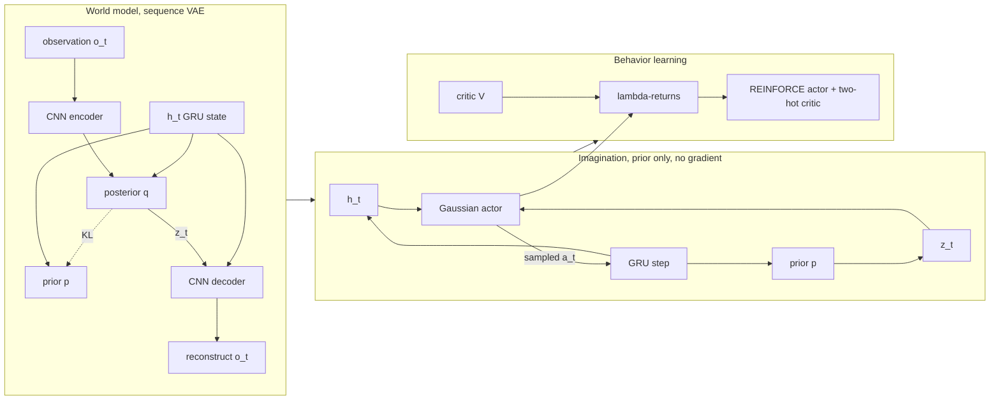
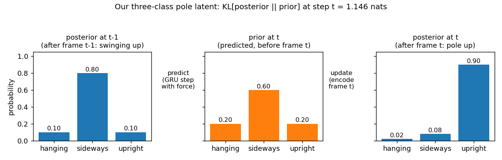
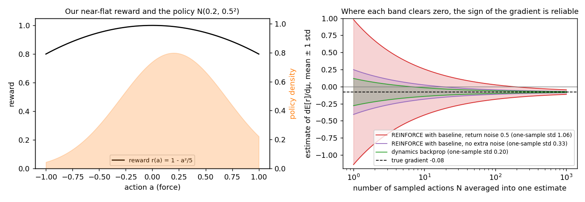
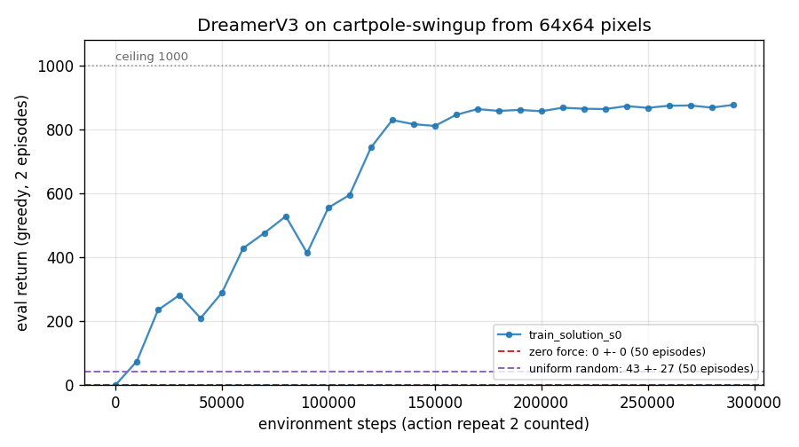
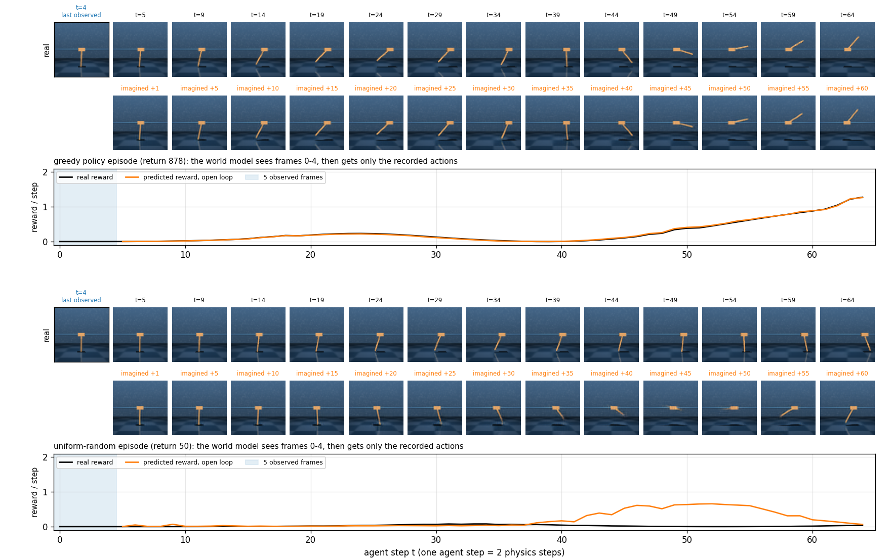
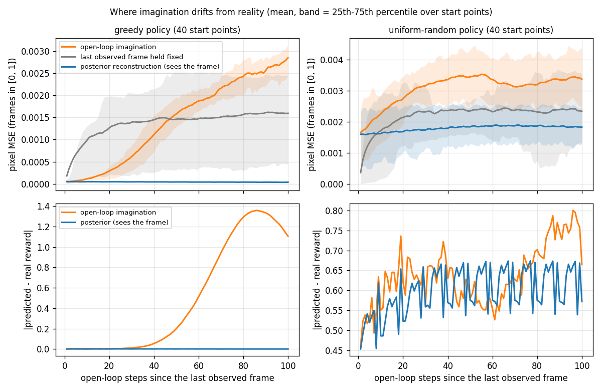
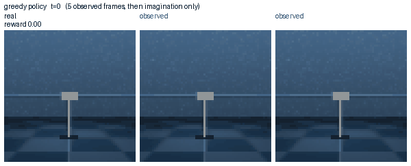
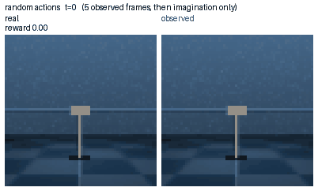

# A12 - world models (RSSM and DreamerV3)

A world model is a learned simulator of an environment. It is trained on recorded observations,
actions, and rewards, and once trained it can predict what would happen next under any sequence of
actions. A policy can then be trained on trajectories imagined inside that model instead of on
millions of real interactions. This assignment builds DreamerV3: a recurrent state-space model
(RSSM) trained as a sequence variational autoencoder (VAE), and an actor and a critic trained
entirely on rollouts imagined by that model, with the actor improved by the REINFORCE policy
gradient.

The code is a PyTorch port of the DreamerV3 mode of r2dreamer (github.com/NM512/r2dreamer), which
follows the revised DreamerV3 paper (arXiv 2301.04104v2); with shared weights the port reproduces
the reference's outputs, losses, and gradients bit for bit. Fill in the RSSM, the world-model loss,
and the imagined actor-critic, then train a policy on dm_control cartpole-swingup from 64x64
pixels. The policy never sees a real frame while it learns; it learns to swing the pole up inside
imagination and then runs in the real environment. The tests run on CPU in seconds; the full
training run needs a GPU and takes a few hours.

Required reading before starting:
- Hafner, Pasukonis, Ba, Lillicrap 2023, "Mastering Diverse Domains through World Models"
  (DreamerV3), [arXiv:2301.04104](https://arxiv.org/abs/2301.04104). Read version 2, which this
  assignment follows.
- Hafner, Lillicrap, Ba, Norouzi 2019, "Dream to Control: Learning Behaviors by Latent Imagination"
  (Dreamer), [arXiv:1912.01603](https://arxiv.org/abs/1912.01603).
- Hafner, Lillicrap, Fischer, Villegas, Ha, Lee, Davidson 2018, "Learning Latent Dynamics for
  Planning from Pixels" (PlaNet), [arXiv:1811.04551](https://arxiv.org/abs/1811.04551).

## Lecture notes

### What a world model is for

#### The task

The task is the DeepMind Control Suite's cartpole-swingup. A cart runs on a rail with a pole hinged
on top. Each episode starts with the pole hanging straight down. A controller pushes the cart with
one horizontal force in $[-1, 1]$ and must swing the pole up, then keep it upright with the cart
near the middle of the rail. The controller does not get the cart position, the pole angle, or
their velocities. It gets a $64\times64$ RGB camera image of the scene, the view a person would
have watching a video of it.

The physics advances in steps of 0.01 s, which these notes call environment steps, and an episode
lasts 10 seconds, so 1000 environment steps. At every environment step the task pays a reward
between 0 and 1. The reward is a product of four factors: $(1 + \cos\theta)/2$ for the pole angle
$\theta$ from vertical (1 when upright, 0 when hanging), and factors close to 1 when the cart is
near the center, the pole is not spinning, and the force is small. A pole left hanging earns
nothing, and a controller that swings the pole up quickly and holds it collects close to 1 per
step for the rest of the episode. The controller chooses a new force every second environment step
and holds it for two steps (action repeat 2, the standard setup for dm_control from pixels), so an
episode is 500 decisions, which these notes call agent steps. One agent step earns the sum of two
environment-step rewards, between 0 and 2, and the most an episode can return is 1000.

Swinging up is harder than it looks. The motor is too weak to lift the pole directly, so the
controller has to pump energy in by moving the cart back and forth in time with the swing, and
then catch the pole at the top. Pushing in one direction for longer just drags the pole along.

#### Why the obvious approaches fail

The first obvious approach is to learn the policy directly from trial and error: try forces, record
how much reward followed, and adjust the policy toward the forces that did well. This is model-free
reinforcement learning. It works, but each trial gives one noisy number about many decisions, so it
needs many trials. Model-free methods on pixels routinely need tens or hundreds of millions of
steps on harder tasks; a physical robot cannot supply those.

The second obvious approach is to map the current image straight to a force. That fails for a
different reason: one frame shows where the pole is but not which way it is moving. A pole at 45
degrees swinging up needs a different push from a pole at 45 degrees falling back. The controller
needs memory of earlier frames.

The third obvious approach is to learn a simulator that predicts the next image from the current
image and the force, and plan with it. Predicting the next $64\times64\times3$ frame means
predicting 12288 numbers per step, most of them background pixels that have nothing to do with
control, and a rollout feeds the model's own imperfect output back in as the next input, so small
per-step errors compound into a useless prediction within a few steps.

#### The idea

DreamerV3 combines the second and third approaches and fixes both. It learns a model that keeps a
compact internal state (a few thousand numbers) instead of 12288 pixel values, updated at each step
from the previous state, the force, and the new frame. This is the structure of a Bayes filter:
predict the state forward with a motion model, then correct it with the new measurement. The
difference is that the motion model and the measurement model are neural networks learned from
data, and the state has no assigned physical meaning. The internal state solves the memory problem,
because it summarizes all frames so far. Predicting in that compact state rather than in pixels
keeps the prediction problem small.

Once the model is trained, it can roll forward without frames: start from a state the filter
produced on a real episode, choose a force, let the model predict the next state and the reward,
and repeat. This is called imagination. The policy is trained on about a thousand imagined
rollouts per gradient step and never touches the real cartpole during that training. It learns
which forces led to more imagined reward than the model expected, and makes those forces more
likely.

#### Why it matters

The real environment is used only to collect data for fitting the model. Imagined steps cost no
real interaction, so a model-based agent needs far fewer real steps than a model-free one (this is
called sample efficiency). DreamerV3 made this work with a single set of hyperparameters across
continuous control, Atari, Minecraft, and other domains, and it was the first method to collect a
diamond in Minecraft from scratch without human data, a long-standing benchmark and the result
that drew wide attention. The same predict-in-a-latent-space structure reappears in the world
models used for robotics and driving (see "Where this goes next").

### Overview of the rest of the notes

This is the first assignment in the course that uses reinforcement learning, so the notes build the
vocabulary from the beginning, before any of it is used to explain DreamerV3. Most parts of
DreamerV3 are an idea from estimation or control applied with learned networks.

1. The reinforcement learning vocabulary: reward, return, policy, value. The return is the
   discounted cost-to-go of optimal control with the sign flipped, and the task is a partially
   observed control problem.
2. Model-free versus model-based, and why the model lives in a latent space. The model-based
   approach is close in spirit to model predictive control (MPC).
3. The world model as a learned Bayes filter. The prior is the predict step, the posterior is the
   update step. Our three-class pole latent, a single categorical variable, makes both concrete.
4. The pieces of the filter: the gated recurrent unit (GRU), a first-order lag with a learned,
   per-coordinate time constant; the RSSM cell; categorical latents and the straight-through
   estimator for differentiating through a discrete sample.
5. Scale-free prediction targets: symlog and two-hot encoding, a log transform and a
   classification over bins in place of least squares.
6. The training objective: KL divergence, the variational bound (ELBO), and DreamerV3's two KL
   terms with free bits. The KL plays the role of the filter's innovation, the disagreement
   between prediction and measurement.
7. Behavior learning in imagination: imagined rollouts, lambda-returns (an average of returns that
   look different numbers of steps ahead before trusting a learned estimate), the critic, the
   REINFORCE policy gradient with a baseline (our near-flat reward shows why the baseline is
   needed), the actor with return normalization, and dynamics backprop, the estimator earlier
   Dreamer versions used for continuous actions.

Five exercises, placed after the sections they test, are meant to be worked by hand (a calculator
helps). Each has a worked answer that can be expanded.

### The reinforcement learning setup

Reinforcement learning (RL) is control of a plant whose dynamics are unknown, against a scalar
performance signal rather than a quadratic cost, with the state hidden behind a sensor. Its
vocabulary differs from the control literature's, and the rest of these notes uses it constantly, so
it is set out here first.

The *environment* is the system being controlled, here cartpole-swingup. At each discrete step the
environment is in a state $s_t$, the *agent* applies an *action* $a_t$ (for cartpole, one horizontal
force in $[-1, 1]$), and the environment advances to $s_{t+1}$ and emits a scalar *reward* $r_t$.
cartpole-swingup pays a reward at every step. That is a *dense* reward: every single step carries
usable signal, unlike a sparse task that pays only on eventual success. A run from a reset to a
fixed time limit is an *episode*. Some tasks also end early, at a *termination* (a walking robot
falling over); cartpole has no termination, so its episodes always run to the time limit.

The dynamics are assumed *Markov* in $s_t$: the distribution of $s_{t+1}$ and $r_t$ depends on
$s_t$ and $a_t$ and on nothing earlier. That is the same assumption a state-space model makes, and
it is why the whole problem can be phrased in terms of a state rather than a history.

A *policy* $\pi(a \mid s)$ is the controller: a distribution over actions given the state. It is a
distribution rather than a deterministic map for two reasons. Sampling from it is how the agent
tries actions it has not tried before, which is the only way it can discover that a different force
would have done better. And a distribution has a smooth dependence on its parameters, which a hard
argmax does not, so it can be improved by gradient descent.

What gets maximized is not the immediate reward but the *return*, the discounted sum of all future
rewards from step $t$ onward:

$$G_t = \sum_{k=0}^{\infty} \gamma^k\, r_{t+k}, \qquad \gamma \in [0, 1).$$

The *discount* $\gamma$ does two jobs. It keeps the sum finite over an unbounded horizon, and it
weights nearby rewards more than distant ones. The geometric weights sum to $1/(1-\gamma)$, which
gives the useful reading of $\gamma$ as an effective horizon in steps. DreamerV3 uses
$\gamma = 0.997$ (the paper specifies the horizon $1/(1-\gamma) = 333$), so the return looks
roughly 333 agent steps ahead. The objective is to find a $\pi$ maximizing $\mathbb{E}_\pi[G_0]$.

The state $s_t$ is not what the agent gets to see. The observation $o_t$ is the $64\times64$ RGB
render, and as described above a single frame fixes the cart position and pole angle but not their
velocities. This is a partially observed problem, and a memoryless policy $\pi(a \mid o_t)$ cannot
solve it. The standard fix is the one a Bayes filter uses: maintain a running summary of every
observation and action so far that is sufficient to predict the future. In estimation that summary
is the *belief state*. Everything in the RSSM is machinery for learning one from pixels when no
analytic motion model is available.

> **Exercise 1 (how much of the return a short rollout sees).** A pole held perfectly upright
> earns the maximum reward $r = 2$ at every agent step forever. With $\gamma = 1 - 1/333$, what is
> its return $G_0$? What fraction of $G_0$ comes from the first 15 steps? (DreamerV3 cuts every
> imagined rollout after 15 steps and estimates the rest with a learned value function; this
> exercise says how much of the return that estimate has to supply.)

<details>
<summary>Answer</summary>

The return is a geometric series, $G_0 = 2\sum_k \gamma^k = 2/(1-\gamma) = 2 \cdot 333 = 666$.
The first 15 terms sum to $2(1 - \gamma^{15})/(1 - \gamma)$, so their share of $G_0$ is
$1 - \gamma^{15} \approx 0.044$, about 4.4% (the first 15 terms add up to about 29.4). The other
95.6% lies beyond step 15. With $\gamma$ this close to 1, a short imagined rollout sees almost none
of the return directly, and nearly all of it has to come from a learned estimate of the return
beyond the rollout, the critic's values introduced later. The policy can only be as good as those
values.

</details>

### Model-free, model-based, and latent models

*Model-free* RL fits the policy, or a value function, directly from logged transitions
$(o_t, a_t, r_t, o_{t+1})$. *Model-based* RL fits a dynamics model first and then uses it to plan or
to train a policy. In controls terms, given a known linear model and a quadratic cost, LQR solves
this problem in closed form, and MPC solves it online by rolling the model forward and optimizing
over an action sequence. RL is the case where the model is unknown, the
cost is an arbitrary scalar the designer picked, and the state arrives as an image. DreamerV3's
answer is close in spirit to MPC: learn the model from pixels, and then do the optimization inside
the learned model instead of the real world. The difference is that MPC optimizes an action
sequence online at every step, while DreamerV3 trains a policy network in imagination and then runs
it without any lookahead.

PlaNet (Hafner et al. 2018) made the pixel prediction problem tractable by moving it into a compact
latent space and splitting the latent state into two parts. A deterministic recurrent state $h_t$,
carried by a gated recurrent unit (GRU, described below), holds everything the past determined for
certain. A stochastic latent $z_t$ holds what is still uncertain at step $t$. A purely stochastic
recurrence is hard to optimize because every step's gradient has to pass through a random sample; a
purely deterministic one cannot represent "the pole might have tipped either way." Running both in
parallel keeps the memory differentiable and still models uncertainty. This split is the RSSM, and
every model in the Dreamer family is built on it.

Dreamer (Hafner et al. 2019) added the second half: train an actor and a critic purely on
trajectories rolled out inside the learned model, with no environment steps during behavior
learning, and showed that imagined rollouts alone are enough to learn competitive policies from
images. For continuous control it trained the actor by backpropagating the imagined return through
the differentiable dynamics into the action (dynamics backprop, covered later as the alternative to
REINFORCE).

DreamerV2 (Hafner et al. 2020, "Mastering Atari with Discrete World Models",
[arXiv:2010.02193](https://arxiv.org/abs/2010.02193)) changed the latent from a Gaussian to a set of
categorical distributions and was the first model-based agent to reach human-level Atari. DreamerV3
then made the method work across very different domains (continuous control, Atari, Minecraft, with
rewards ranging from $[0, 1]$ to the hundreds) without per-task tuning; the pieces that make this
possible are the subject of most of these notes.

The DreamerV3 paper exists in two versions. The first (January 2023) trained continuous actions
with dynamics backprop, as Dreamer and DreamerV2 did, used a dynamics-loss weight of 0.5, and placed
the two-hot bins evenly in symlog space. The revised version (2024) uses REINFORCE for both
discrete and continuous actions, a dynamics-loss weight of 1, and bins spaced exponentially in raw
value. These notes describe the revised version and return to dynamics backprop at the end.

### How the pieces fit together

The diagram is a map of the three parts (the world model, imagination, and behavior learning) and
the order they run in. Every label on it (posterior, prior,
KL, lambda-return, critic, REINFORCE) is defined in a section below.



The world model is trained on real sequences with the posterior, which sees each frame. Behavior is
trained on imagined sequences with the prior, with no frames, no decoder, and no gradient through
the rollout. In the full training run these alternate: step the real environments with the current
policy and store each transition (frame, action, reward) in the *replay buffer*, a fixed-size store
of the most recent real experience; then take gradient steps on replayed sequences, each of which
fits the world model and trains the actor and critic in imagination, and repeat.

### Prior and posterior as a learned Bayes filter

The words *prior* and *posterior* run through the whole assignment, and the fastest way in is the
Bayes filter, which alternates the same two steps.

A Bayes filter maintains a distribution over the hidden state given everything seen so far. Its
predict step pushes that distribution through the motion model to get $p(s_t \mid o_{1:t-1})$, the
belief before the new measurement arrives. Its update step folds in the new measurement to get
$p(s_t \mid o_{1:t})$, the belief after. In the Kalman filter those are the propagate and the
correct equations, and both are computed from a motion model and a measurement model that were
written down by hand.

The RSSM keeps that structure and learns both pieces instead. The *prior* $p(z_t \mid h_t)$ is the
predict step: given the recurrent summary of the past, what is the latent likely to be before
looking at the new frame. The *posterior* $q(z_t \mid h_t, o_t)$ is the update step: the same
question after looking. (The DreamerV3 paper calls the prior network the dynamics predictor and the
posterior network the encoder; these notes use prior and posterior throughout, and "encoder" only
for the convolutional network that turns a frame into a vector.) Three things differ from the
Kalman case. Both distributions are small neural networks rather than closed-form Gaussian updates.
The latent has no assigned physical meaning: nothing forces a coordinate of $z_t$ to be a pole
angle, so the state is whatever is convenient for predicting the future. And because neither is
derived from a hand-written model, nothing automatically makes the predict step agree with the
update step; that agreement has to be trained in, and it is trained in by penalizing the
divergence between the two.

#### Our three-class pole latent

In DreamerV3 the stochastic latent $z_t$ is 32 separate categorical variables, each over 16 to 96
classes depending on the model size, and what each class means is learned, not designed. To see
the predict-update cycle with numbers, we shrink this to a single categorical variable with three
classes and give the classes a meaning by hand: the pole is hanging, sideways, or upright. We call
this our three-class pole latent. It stands for one of the 32 categorical variables. It keeps the
prior, the posterior, and the divergence between them, which are the objects the world-model loss
works with. It drops the learned meaning of the classes and the other 31 variables.

The figure shows one cycle in the middle of a swing-up. After frame $t-1$ the posterior is
confident the pole is sideways, $(0.10, 0.80, 0.10)$. The predict step advances the recurrent state
with the force applied and produces the prior for step $t$, $(0.20, 0.60, 0.20)$: still most
likely sideways, but less sure, because the force and the pole's motion since the last frame add
uncertainty, as a Kalman predict step inflates the covariance. Frame $t$ then arrives and shows the
pole upright. The update step produces the posterior $(0.02, 0.08, 0.90)$.



The prior put only $0.20$ on "upright", so the frame surprised it. A Kalman filter measures that
surprise with the innovation, the difference between the predicted and the actual measurement. The
RSSM measures it with the KL divergence between posterior and prior, defined in a later section,
which for these numbers is about 1.146 nats. Training penalizes that divergence, so that next time
the prior predicts the swing better.

That penalty makes imagination possible. During world-model training the posterior runs, because
real frames are available. During imagination only the prior runs, because there are no frames to
condition on. If the prior disagrees with the posterior, then an imagined rollout drifts into
latent states the decoder and the reward head were never trained on, and their predictions there
are arbitrary. Pushing the prior toward the posterior keeps imagined states inside the region the
rest of the model was actually fit on.

### The GRU

The deterministic half of the RSSM state is carried by a gated recurrent unit (Cho et al. 2014), a
recurrent layer with a learned, input-dependent blend between keeping the old state and replacing
it. Start from something more familiar. A first-order lag, or a complementary filter, updates a
running estimate as

$$h_t = \alpha\, h_{t-1} + (1 - \alpha)\, \tilde h_t,$$

a convex blend of the old state and a new candidate with a fixed scalar $\alpha$. The GRU is that
update with $\alpha$ promoted to a vector-valued function of the input and the current state:

$$u_t = \sigma\big(W_u [\,x_t,\, h_{t-1}\,]\big), \qquad
g_t = \sigma\big(W_g [\,x_t,\, h_{t-1}\,]\big),$$
$$\tilde h_t = \tanh\big(W [\,x_t,\, g_t \odot h_{t-1}\,]\big), \qquad
h_t = u_t \odot h_{t-1} + (1 - u_t) \odot \tilde h_t,$$

with $x_t$ the layer's input at step $t$, $\sigma$ the logistic sigmoid, $\odot$ elementwise
multiplication, and the bias terms dropped for readability. The *update gate* $u_t$ lies in
$(0, 1)$ per coordinate and decides, separately for each coordinate and separately at each step, how
much of the old value survives; $u_t \approx 1$ holds a coordinate constant for many steps,
$u_t \approx 0$ overwrites it. The *reset gate* $g_t$ decides how much of the old state the
candidate $\tilde h_t$ is even allowed to look at. ($g$ rather than the usual $r$, which is already
the reward here.) This is the polarity PyTorch's `nn.GRUCell` uses.

The gates are functions of the data, so the layer can hold one coordinate
steady while rewriting another: a learned, per-coordinate time constant rather than a fixed one.
And because $h_t$ depends on $h_{t-1}$ through an additive path with coefficient $u_t$ rather than
through a matrix product, the gradient of a loss at step $T$ with respect to $h_0$ picks up a factor
of roughly $\prod_t u_t$ instead of a product of Jacobians. When the gates stay near 1 that product
does not shrink, so gradients survive a long rollout. A gated recurrence is used here for that
reason instead of a plain $h_t = \tanh(W[x_t, h_{t-1}])$.

DreamerV3 uses a variant of this cell. Its update gate is written with the opposite polarity, so
that it multiplies the candidate, $h_t = u_t \odot \tilde h_t + (1 - u_t) \odot h_{t-1}$, and a
bias of $-1$ inside the sigmoid starts it near $\sigma(-1) \approx 0.27$, so the state changes
slowly at initialization. Its reset gate multiplies the candidate's pre-activation instead of
$h_{t-1}$. And its weights are block-diagonal: $h_t$ is split into 8 blocks, and each block's gates
see only that block of $h_{t-1}$ plus a shared projection of the inputs and of the whole state.
The block-to-block weights then cost about one eighth of a dense layer of the same width. The paper
introduces the block structure "to allow for a large number of memory units without quadratic
increase in parameters and FLOPs".

### The RSSM cell

Each step runs the deterministic recurrence and then the stochastic latent:

$$h_t = \mathrm{GRU}\big(h_{t-1},\ W_{\text{in}}[\,z_{t-1},\ a_{t-1}\,]\big),\qquad
z_t \sim q(z_t \mid h_t, o_t)\ \text{(training)}\quad\text{or}\quad p(z_t \mid h_t)\ \text{(imagination)}.$$

$W_{\text{in}}$ projects the previous latent and the previous action to the GRU's input width (in
DreamerV3, $z_{t-1}$, $a_{t-1}$, and $h_{t-1}$ each pass through their own linear layer,
normalization, and activation, and the three results are concatenated; the projection of $h_{t-1}$
lets the blocks of the block-diagonal GRU exchange information). $h_t$ is a plain
deterministic vector, 2048 wide (8 blocks of 256) in the smallest configuration of the reference
implementation. $z_t$ is a set of $n_{\text{cat}}$ categorical variables, each over
$n_{\text{cls}}$ classes, stored as $n_{\text{cat}}$ stacked one-hot vectors (a one-hot vector is
all zeros except a 1 at the chosen class; the next section says more). The prior
$p(z_t \mid h_t)$ is a multilayer perceptron (MLP) from $h_t$ to the categorical logits; the
posterior $q(z_t \mid h_t, o_t)$ is an MLP from $[h_t, e_t]$, where $e_t$ is the encoding of the
observation $o_t$ by a convolutional neural network (CNN), a stack of learned image filters that
turns the $64\times64$ frame into a vector; a mirrored CNN, the decoder, turns a model state back
into a frame. The full model state that every predictor conditions on is the concatenation
$s_t = [h_t, z_t]$. The smallest DreamerV3 model uses $n_{\text{cat}} = 32$ and
$n_{\text{cls}} = 16$, so $z_t$ is a 512-dimensional vector of stacked one-hots; our three-class
pole latent is the case $n_{\text{cat}} = 1$, $n_{\text{cls}} = 3$. For cartpole the action is a
single continuous force $a_{t-1} \in [-1, 1]$, and the same cell takes a one-hot vector when the
action is discrete.

Note the ordering inside one step: $h_t$ is advanced with the *previous* action and latent, and only
then are the prior and posterior read off $h_t$. The recurrence therefore never sees $o_t$ before
predicting from it, so the prior is a true one-step-ahead prediction.

At the first frame of an episode there is no previous step. The filter then starts from zeros for
$h_{t-1}$, $z_{t-1}$, and $a_{t-1}$, the same fixed initial belief for every episode, as a Kalman
filter starts every run from the same prior mean and covariance.

### Logits, one-hot samples, and the straight-through estimator

A categorical distribution over $n_{\text{cls}}$ classes is parameterized by a vector of *logits*,
unnormalized real scores, one per class. The softmax turns them into probabilities,
$\mathbf{p}_c = e^{\ell_c} / \sum_{c'} e^{\ell_{c'}}$, and a draw from the distribution is written as
a *one-hot* vector: all zeros except a 1 in the sampled coordinate. Representing the draw this way
lets a downstream linear layer consume it as an ordinary vector. In our three-class pole latent, a
draw of "upright" is the vector $(0, 0, 1)$.

Discrete latents are used here rather than a Gaussian because the categorical does not have to place
probability mass everywhere between two modes. A Gaussian latent asked to represent "the pole is
falling left or falling right" has to put mass on the interpolation between them; a set of
categoricals can put mass on exactly two settings and nothing in between. Replacing the Gaussian
latent with categoricals is the change DreamerV2 introduced.

The problem is that sampling a one-hot is not differentiable. Nudging a logit does not move the
sampled vector at all until the argmax flips, at which point it jumps; the derivative is zero almost
everywhere and undefined on the boundary. Backpropagation has nothing to work with.

The straight-through estimator sidesteps this by using different values in the forward and backward
passes. The forward pass uses the hard one-hot; the backward pass pretends the softmax probabilities
were used instead:

$$z = \mathrm{onehot}(\text{sample}),\qquad
z_{\text{ST}} = (z - \mathbf{p}).\mathrm{detach}() + \mathbf{p}.$$

`detach` marks a tensor as a constant for the gradient computation. The forward value of
$z_{\text{ST}}$ is exactly $z$, because the detached $-\mathbf{p}$ cancels the added $\mathbf{p}$
numerically. But the detached part contributes no derivative, so
$\partial z_{\text{ST}} / \partial \boldsymbol{\ell}$ equals $\partial \mathbf{p} / \partial
\boldsymbol{\ell}$, the softmax Jacobian. The result is a biased gradient (it is the gradient of a
different function than the one that ran forward), accepted in exchange for a gradient that exists
at all. DreamerV2 and DreamerV3 take straight-through gradients through every categorical sample of
their latents.

In DreamerV3 the straight-through gradient lets the world-model losses reach the encoder: the
reward loss, for example, is computed from $z_t$, $z_t$ is a sample from the posterior, and the
posterior reads the encoder's output.

DreamerV3 adds unimix, a small uniform mixture blended into every categorical before sampling:

$$\mathbf{p} = (1 - u)\,\mathrm{softmax}(\boldsymbol{\ell}) + \frac{u}{n_{\text{cls}}},\qquad u = 0.01.$$

This floors every class probability at $u / n_{\text{cls}}$. No class probability can reach 0,
which would otherwise let $\log \mathbf{p}$ and the KL terms below blow up, and a class the model
has written off can still be sampled and get gradient. The straight-through gradient flows through
this blended $\mathbf{p}$, not through the raw softmax, and the KL terms are computed from the
blended distributions too.

### symlog and two-hot encoding

The world model predicts the reward, and later the critic predicts the return, so both are
regression problems onto a scalar. Squared-error regression onto a scalar target has a loss
and a gradient that scale with the target's magnitude, so a learning rate tuned for one reward
scale is wrong for another.

symlog compresses large magnitudes while staying close to the identity near zero, and has an exact
inverse symexp:

$$\mathrm{symlog}(x) = \mathrm{sign}(x)\,\ln(|x| + 1),\qquad
\mathrm{symexp}(x) = \mathrm{sign}(x)\,(e^{|x|} - 1).$$

It is a logarithm made to work on both signs and to pass through the origin with slope 1. A reward
of 1 maps to 0.69, a reward of 1000 maps to 6.9. Regressing in symlog space therefore turns a
thousandfold spread in reward magnitude into a tenfold spread in target magnitude. DreamerV3
applies symlog to vector observations (joint angles, velocities) before encoding them; image
pixels already lie in $[0, 1]$ and are used as they are.

Two-hot encoding replaces scalar regression with classification over a fixed set of
$n_{\text{bins}} = 255$ bins. A cross-entropy loss over bins has a gradient with respect to each
logit bounded by 1 in magnitude no matter how wrong the prediction is, whereas the gradient of
$(\hat y - y)^2$ grows linearly in the error, so a single outlier target can dominate an update. To
encode a target, find the two adjacent bins it falls between and split a total weight of 1 between
them, more on the nearer bin, linearly in the distance. The label is a length-255 vector, zero
everywhere except those two adjacent entries. Hence the name "two-hot": a one-hot with the mass
split between two neighbors, so that a target landing between bin centers is represented exactly
rather than rounded. The predicted value is the expectation of the bin positions under the
network's softmax.

DreamerV3 places the bins at $B = \mathrm{symexp}(\mathrm{linspace}(-20, 20, 255))$, so they are
spaced exponentially in raw value, dense near zero and sparse far out, and exactly antisymmetric,
$B_{254-i} = -B_i$. The target $y$ is encoded in raw value, with weights linear in raw value
between its two neighboring bins $B_i \le y < B_{i+1}$, and the prediction is the plain
expectation:

$$w_{i+1} = \frac{y - B_i}{B_{i+1} - B_i},\quad w_i = 1 - w_{i+1},\qquad
\hat y = \textstyle\sum_k \mathbf{p}_k\, B_k.$$

The expected bin value of the label is exactly $y$, and since the loss depends only on the
probabilities assigned to the bins, the gradient size is independent of the target's size.

These bins come with a hazard. The outer bins sit at
$\pm\mathrm{symexp}(20) \approx \pm 4.85 \times 10^8$, so a small probability mass $\epsilon$
landing on an extreme bin moves the decoded value by up to $\epsilon \cdot 5 \times 10^8$. (The
first version of the paper placed the bins evenly in symlog space and applied one symexp after the
expectation, which bounds that shift to $40\epsilon$ in symlog units.) DreamerV3 handles the
hazard in two ways. Because the bins are antisymmetric, a uniform softmax decodes to exactly 0, and
the output layer of the reward head and the critic is initialized to zero weights, which makes the
softmax uniform at the start of training. The paper gives the reason: randomly initialized reward
and critic networks "can result in large predicted rewards that can delay the onset of learning".
And when the expectation is computed, positive and negative bins are summed separately, from small
to large magnitude, because adding terms of order $10^8$ with opposite signs loses the precision of
the small ones.

> **Exercise 2 (two-hot encoding of a cartpole reward).** One agent step of cartpole-swingup with
> the pole held upright earns $y = 2$. The symexp bins are $B_k = \mathrm{symexp}(-20 + 0.15748\,k)$
> for $k = 0, \dots, 254$. Find the two bins $y$ falls between, their weights, and check that the
> expectation returns 2. Then suppose a prediction is that label with 1% of its mass moved onto the
> top bin $B_{254}$. What does it decode to? Finally, start from all-zero logits and raise only the top bin's logit by
> 0.01. What does the critic predict?

<details>
<summary>Answer</summary>

$\mathrm{symlog}(2) = \ln 3 \approx 1.0986$, and $-20 + 0.15748\,k = 1.0986$ gives
$k \approx 133.98$. So the bins are $B_{133} = \mathrm{symexp}(0.9449) \approx 1.5725$ and
$B_{134} = \mathrm{symexp}(1.1024) \approx 2.0113$. The weights are linear in raw value:
$w_{134} = (2 - 1.5725)/(2.0113 - 1.5725) \approx 0.974$ and $w_{133} \approx 0.026$. The
expectation is $0.026 \cdot 1.5725 + 0.974 \cdot 2.0113 = 2.000$.

With 1% moved to the top bin, the expectation becomes
$0.99 \cdot 2 + 0.01 \cdot 4.85 \times 10^8 \approx 4.85 \times 10^6$. One percent of stray mass
turns a reward of 2 into about five million.

With all-zero logits the softmax is uniform, $1/255$ per bin, and the antisymmetric bins cancel in
pairs, so the prediction is exactly 0. Raising one logit by 0.01 multiplies that bin's unnormalized
probability by $e^{0.01}$, giving it about $1.01/255.01 \approx 0.00396$ while every other bin
keeps about $0.00392$. The pair $\pm B_{254}$ no longer cancels, and the decoded value is about
$(0.00396 - 0.00392) \cdot 4.85 \times 10^8 \approx 1.9 \times 10^4$. A random output layer would
produce logit differences far larger than 0.01, which is why the output layer starts at zero.

</details>

### KL divergence, nats, and the variational bound

The KL divergence between two distributions over the same finite set is

$$\mathrm{KL}[\,q \,\|\, p\,] = \sum_c q_c \,\ln \frac{q_c}{p_c}.$$

It is non-negative, zero exactly when $q = p$, and asymmetric: $\mathrm{KL}[q \| p] \ne
\mathrm{KL}[p \| q]$ in general. In our three-class pole latent, with posterior
$q = (0.02, 0.08, 0.90)$ and prior $p = (0.20, 0.60, 0.20)$,
$\mathrm{KL}[q \| p] = 0.02 \ln 0.1 + 0.08 \ln(0.08/0.6) + 0.90 \ln 4.5 \approx 1.146$, while
$\mathrm{KL}[p \| q] \approx 1.369$. Because the log is natural, the units are *nats*; one nat is
$1/\ln 2 \approx 1.443$ bits. A KL of 1 nat means the prior is off by about one and a half bits per step, which is the
level DreamerV3's free-bits floor deliberately tolerates.

Unimix bounds the KL. Every $q_c \le 1$ and every $p_c \ge u/n_{\text{cls}}$, so every term
$\ln(q_c/p_c) \le \ln(n_{\text{cls}}/u)$, and averaging over $q$ gives
$\mathrm{KL}[q \| p] \le \ln(n_{\text{cls}}/u)$. For 16 classes and $u = 0.01$ that is
$\ln 1600 \approx 7.38$ nats per categorical variable. Without unimix a prior could drive a class
probability arbitrarily close to 0, and a posterior that puts mass on that class would produce a
KL, and a gradient, without limit. The paper gives this as the reason for unimix: "We occasionally
observed spikes the in KL losses in earlier experiments" (typo in the original), and the 1% mixture
makes it "impossible for them to become deterministic and thus ensuring well-behaved KL losses".

Now the objective. The world model is a latent-variable model: it claims each observation was
generated by first drawing a latent $z$ and then rendering $o$ from it. Fitting it by maximum
likelihood needs $\log p(o) = \log \int p(o \mid z)\, p(z)\, dz$, an integral over every possible
latent, which is intractable. The variational trick introduces a second network $q(z \mid o)$, the
posterior, that guesses which $z$ produced this particular $o$, and uses it to build a computable
lower bound on the intractable quantity. Multiply and divide by $q$ and apply Jensen's inequality,
which says $\log \mathbb{E}[X] \ge \mathbb{E}[\log X]$ for the concave logarithm:

$$\log p(o) \;=\; \log \mathbb{E}_{q(z \mid o)}\!\left[\frac{p(o \mid z)\,p(z)}{q(z \mid o)}\right]
\;\ge\; \mathbb{E}_{q(z \mid o)}\big[\log p(o \mid z)\big] - \mathrm{KL}\big[\,q(z \mid o) \,\|\, p(z)\,\big].$$

The right-hand side is the evidence lower bound (ELBO). Both of its terms are computable: the first
is a reconstruction log-likelihood, the second a KL between two distributions the networks emit
directly. Maximizing the ELBO pushes up a quantity that never exceeds $\log p(o)$, and the gap
between them is exactly $\mathrm{KL}[q(z \mid o) \| p(z \mid o)]$, the error in the posterior's
guess. Fitting a model this way is a variational autoencoder.

Read as losses to minimize, the negative log-likelihood of a Gaussian with fixed
variance is $-\log \mathcal{N}(o; \hat o, \sigma^2 I) = \frac{1}{2\sigma^2}\|o - \hat o\|^2 +
\text{const}$, so a squared-error reconstruction loss is a Gaussian likelihood in disguise. The
negative log-likelihood of a Bernoulli with probability $\hat c$ against a target $c \in \{0, 1\}$
is $-[c \ln \hat c + (1 - c)\ln(1 - \hat c)]$, the binary cross-entropy (BCE). The negative
log-likelihood of a categorical against a soft label $\mathbf{y}$ is $-\sum_k y_k \ln \hat p_k$, the
cross-entropy, which the two-hot loss computes.

### The world-model loss

Applying the bound per step to a sequence, with the conditional prior $p(z_t \mid h_t)$ standing in
for the fixed $p(z)$ above, and adding the reward and continuation heads as two further
observations to reconstruct, gives the world-model loss:

$$\mathcal{L} = \underbrace{\big\| \hat o_t - o_t \big\|^2}_{\text{reconstruction}}
+ \underbrace{\mathcal{L}_{\text{reward}}}_{\text{two-hot cross-entropy}}
+ \underbrace{\mathcal{L}_{\text{cont}}}_{\text{Bernoulli BCE}}
+ \mathcal{L}_{\text{KL}},$$

averaged over batch and time. The squared norm is a sum over all channels and pixels of the frame,
with pixel values in $[0, 1]$, as the Gaussian log-likelihood in the ELBO calls for; only the batch
and time dimensions are averaged. A per-pixel mean would divide the reconstruction
term by the 12288 numbers in a $64\times64\times3$ frame relative to the reward and KL terms, and
the cart and pole, which cover a few percent of the pixels, would contribute almost nothing to the
loss.

The reward head predicts $r_t$ as a two-hot distribution over the 255 bins. The continuation head
predicts $c_t \in \{0, 1\}$, the flag that is 0 when the episode terminated at this step and 1
otherwise, as a Bernoulli logit. The flag marks a termination, not the time limit: an episode cut
off by the time limit could have continued, so its last step keeps $c_t = 1$. cartpole never
terminates, so on this task $c_t = 1$ throughout, but the head is needed in general because a
return must stop accumulating at a termination.

The reward has to be attached to the right state. The reward for taking action $a_{t-1}$ is a
consequence of where the action lands the agent, so the reward head predicts it from the state
$s_t$ after the action, the state that also produced frame $o_t$. In a recorded sequence, step $t$
therefore holds the frame $o_t$, the action $a_{t-1}$ that led to it, and the reward that action
earned. Imagination reads rewards the same way: the reward of an imagined action $a_t$ comes from
the state $s_{t+1}$ after the GRU step. Reading it one index early trains the actor on the reward
for the action it took the step before, an off-by-one that looks plausible and destroys the credit
assignment without raising any error.

### Two KL terms, free bits, and weighting

A single KL term would push the prior and the posterior toward each other with one shared gradient,
and the trivial way to satisfy it is for the posterior to stop encoding anything the prior cannot
already predict, throwing away information from the frame rather than improving the prediction.
In our three-class pole latent, the posterior could reduce its KL to zero by ignoring frame $t$ and
copying the prior $(0.20, 0.60, 0.20)$, at the cost of no longer knowing that the pole is upright.

DreamerV3 splits the KL into two separately weighted terms, each with a stop-gradient
($\mathrm{sg}$, the same `detach` used in the straight-through estimator) on the opposite side, so
that the two directions can be weighted independently:

$$\mathcal{L}_{\text{dyn}} = \max\!\big(1,\ \mathrm{KL}[\,\mathrm{sg}(q)\ \|\ p\,]\big),\qquad
\mathcal{L}_{\text{rep}} = \max\!\big(1,\ \mathrm{KL}[\,q\ \|\ \mathrm{sg}(p)\,]\big),$$

$$\mathcal{L}_{\text{KL}} = \beta_{\text{dyn}}\,\mathcal{L}_{\text{dyn}} + \beta_{\text{rep}}\,\mathcal{L}_{\text{rep}},
\qquad \beta_{\text{dyn}} = 1,\ \ \beta_{\text{rep}} = 0.1.$$

Both terms are numerically the
same KL up to which side is detached, but they deliver gradient to different parameters. The
dynamics term $\mathcal{L}_{\text{dyn}}$ moves the prior toward the posterior, since the posterior
is frozen inside it. The representation term $\mathcal{L}_{\text{rep}}$ moves the posterior toward
the prior, which keeps the posterior from encoding detail the prior can never predict. The $10{:}1$
ratio means the prior is pulled toward the posterior with ten times the weight of the reverse pull,
so the model's first response to a mismatch is to predict better rather than to encode less.
Doubling $\beta_{\text{dyn}}$ doubles the prior's gradient and leaves the posterior's untouched.

Free bits is the $\max(1, \cdot)$ clip. When the KL for a step is already below 1 nat, the clip
makes the term constant there, so its gradient is zero and the optimizer spends capacity on
reconstruction instead of on squeezing an already-predictable latent below a divergence that does
not matter. Since $z_t$ factorizes into $n_{\text{cat}}$ independent categorical variables, the
joint KL is the sum of the KLs of the individual variables. The clip is applied to that single
summed scalar per step and per term (1 nat for the whole latent), and the clipped values are then
averaged over batch and time. Clipping each variable's KL separately would put the effective floor
at $n_{\text{cat}} = 32$ nats and over-regularize the model badly.

> **Exercise 3 (the two KL terms on our three-class pole latent).** Take the step in the figure,
> posterior $q = (0.02, 0.08, 0.90)$ and prior $p = (0.20, 0.60, 0.20)$. Compute
> $\mathcal{L}_{\text{dyn}}$, $\mathcal{L}_{\text{rep}}$, and $\mathcal{L}_{\text{KL}}$. Which
> network gets gradient from which term? Then repeat for a later step at which the frame shows the
> pole sideways and the posterior is $q = (0.15, 0.60, 0.25)$ with the same prior.

<details>
<summary>Answer</summary>

The KL value does not depend on which side is detached, so both terms start from
$\mathrm{KL}[q \| p] = 0.02 \ln(0.1) + 0.08 \ln(0.08/0.6) + 0.90 \ln(4.5) = -0.046 - 0.161 + 1.354
\approx 1.146$ nats. That is above the 1-nat floor, so the clip does nothing:
$\mathcal{L}_{\text{dyn}} = \mathcal{L}_{\text{rep}} \approx 1.146$ and
$\mathcal{L}_{\text{KL}} = 1 \cdot 1.146 + 0.1 \cdot 1.146 \approx 1.261$. The dynamics term sends
gradient only to the prior network (moving $p$ toward $q$, raising its 0.20 on "upright"), with
weight 1. The representation term sends gradient only to the posterior network and, through it,
the encoder (moving $q$ toward $p$), with weight 0.1.

At the later step, $\mathrm{KL}[q \| p] = 0.15 \ln(0.75) + 0.60 \ln(1) + 0.25 \ln(1.25) \approx
-0.043 + 0 + 0.056 = 0.013$ nats. Both terms are clipped to 1, so $\mathcal{L}_{\text{KL}} = 1.1$
and neither network gets any gradient from the KL at this step. The prior already predicts this
frame to within the tolerated level, and all the gradient goes to reconstruction and the reward and
continuation heads.

</details>

### Imagination

Imagination rolls the dynamics forward with the prior only. Start from a real state $(h_0, z_0)$
produced by running the posterior over a sequence drawn from the replay buffer. Then for each step
sample an action from the actor, advance $h_t = \mathrm{GRU}(h_{t-1}, W_{\text{in}}[z_{t-1},
a_{t-1}])$, and sample $z_t \sim p(z_t \mid h_t)$. No decoder runs and no environment is touched;
reward, continuation, and value come from small MLP heads on $[h_t, z_t]$. Each step is one GRU
step, one categorical sample, and a few MLP evaluations, so imagining a large batch of short
rollouts is cheap. DreamerV3 starts one imagined rollout from every posterior state of the replay
batch the world model was just trained on: a batch of 16 sequences of 64 steps gives 1024 start
states.

The starting states are detached from the world model's graph, and the rollout itself is computed
without gradients, because REINFORCE (below) needs only the log-probabilities of the sampled
actions. The actor and critic losses on imagined rollouts therefore never send gradient back into
the world model.

DreamerV3 imagines $H = 15$ steps, so each rollout has 16 states including the start. The horizon
trades one source of error for another. A longer rollout relies less on the critic, because the
lambda-return defined in the next section puts weight $\gamma^H \lambda^{H-1}$ on the final value,
which shrinks as $H$ grows. But it relies more on the world model, whose prediction errors compound
with each imagined step taken without a frame to correct them, and its cost grows in proportion to
$H$.

### Returns, values, and lambda-returns

Behavior learning needs a number to improve: an estimate of the return $G_t$ achievable from a given
state. There are two ways to get one, and the lambda-return mixes them.

The direct way is to add up the rewards actually collected over the rollout. That estimate is
unbiased (it is a sample of the thing being estimated) but it has high variance, because it
accumulates the randomness of every action and every latent sample along the way, and it needs the
whole rollout before it can be computed.

The other way is to learn a *value function*, a network $V(s) \approx \mathbb{E}_\pi[G_t \mid s_t =
s]$ predicting the expected return from a state under the current policy. In actor-critic
terminology the value network is the *critic* and the policy is the *actor*: the critic scores
states, the actor picks actions, and each is trained against the other. With a critic in hand the
return can be *bootstrapped*, truncated after a few steps and completed with the critic's guess:

$$G^{(n)}_t = r_t + \gamma r_{t+1} + \dots + \gamma^{n-1} r_{t+n-1} + \gamma^n V(s_{t+n}),$$

the $n$-step return. Here $r_t$ is the reward of action $a_t$. Small $n$ has low variance, because
only $n$ noisy rewards enter, but high bias, because it inherits whatever the critic has wrong.
Large $n$ is the reverse.

The lambda-return averages all of them with geometrically decaying weights:

$$G^\lambda_t = (1 - \lambda) \sum_{n \ge 1} \lambda^{n-1} G^{(n)}_t, \qquad \lambda \in [0, 1].$$

The weights $(1-\lambda)\lambda^{n-1}$ sum to 1, so this is a proper average. $\lambda = 0$ recovers
the one-step return $G^{(1)}_t$, all bootstrap; $\lambda = 1$ recovers the full rollout, no
bootstrap. DreamerV3 uses $\lambda = 0.95$, weighting the short returns most but keeping a tail.

That infinite sum never has to be evaluated, because it satisfies a backward recursion. Substituting
$G^{(n)}_t = r_t + \gamma G^{(n-1)}_{t+1}$ and splitting off the $n = 1$ term gives

$$G^\lambda_t = r_t + \gamma\big((1 - \lambda) V(s_{t+1}) + \lambda\, G^\lambda_{t+1}\big),$$

one line per step, computed from the end of the rollout backward. Adding the continuation flag and
writing the horizon-$H$ boundary condition gives the form DreamerV3 uses:

$$R_t = r_t + \gamma\, c_t \big((1 - \lambda)\,V_{t+1} + \lambda\, R_{t+1}\big),\qquad R_H = V_H,$$

with $\gamma = 0.997$, $\lambda = 0.95$, and $t$ running over $0, \dots, H-1$. Here $c_t$ is the
continuation flag of the state $s_{t+1}$ the action leads to. It zeros both the bootstrap and the
recursion tail at a termination, which is correct: nothing is collected after the episode ends, so
the return there is just $r_t$. In imagination the flag is the continuation head's predicted
probability, a soft value between 0 and 1. The rollout is cut at $H$ and closed with $R_H = V_H$,
the critic's estimate of everything past the horizon. Unrolling the recursion with $c_t = 1$,
$R_0$ is a weighted sum of the rewards and the critic's values. With $\gamma = 0.997$,
$\lambda = 0.95$, and $H = 15$, the weight on $V_H$ is $\gamma^{15}\lambda^{14} \approx 0.47$ and
the weights $\gamma^t \lambda^{t-1}(1-\lambda)$ on the intermediate values $V_1, \dots, V_{14}$ add
up to about 0.50. Each value is worth a few hundred rewards, so for the upright pole of Exercise 1
the critic's values supply about 97% of $R_0$, in line with that exercise.

### Training the critic

The critic outputs a two-hot distribution over the same 255 bins as the reward head, and is trained
by cross-entropy against the two-hot encoding of the lambda-returns. The returns are detached
first, so the critic chases the target and the target does not move to meet the critic. Each
imagined step's loss is weighted by the cumulative product of $\gamma c$ up to that step, so steps
the model expects to come after a termination count less.

Even detached, the target is not stationary, because it was computed from the critic's own values at
the later states. Every critic update changes the targets for the next update, and a value function
regressing on a target derived from itself can drift or oscillate. The standard fix is a target
network: a frozen copy of the critic, used to compute targets, periodically overwritten from the live
weights. DreamerV3 uses a softer version. It keeps a slow copy whose weights follow the live ones by
an exponential moving average (EMA),

$$\theta_{\text{slow}} \leftarrow \rho\,\theta_{\text{slow}} + (1 - \rho)\,\theta, \qquad \rho = 0.98,$$

and adds a regularizer, with weight 1, pulling the live critic's prediction toward the slow copy's
prediction at the same states (a second cross-entropy, against the two-hot encoding of the slow
critic's value). The slow copy is a low-pass filter on the weight trajectory; the regularizer damps
fast excursions without hard-freezing anything. The returns themselves are computed with the live
critic.

The critic is also trained on real data. DreamerV3 applies the same loss, scaled by 0.3, to the
posterior states of the replayed sequences, with a lambda-return computed over the real rewards and
bootstrapped from the imagined return $R_0$ of the rollout that started at each state. The paper
introduces this replay value loss "to improve value prediction in environments where rewards are
challenging to predict". Its inputs are not detached from the world model, so this one loss also
sends gradient into the world model.

### The policy gradient

The actor has to be improved with respect to $\mathbb{E}[R]$, the expected imagined return. The
gradient of an expectation over a distribution that itself depends on the parameters cannot be
taken by moving the gradient inside the expectation, because the measure being averaged over is
itself changing. DreamerV3 uses the REINFORCE estimator for this, for discrete and continuous
actions alike.

#### REINFORCE, the score-function estimator

REINFORCE comes from a single identity. Write the expectation as an integral and differentiate
under it:

$$\nabla_\theta \int \pi_\theta(a) R(a)\, da = \int R(a)\, \nabla_\theta \pi_\theta(a)\, da
= \int \pi_\theta(a)\, R(a)\, \nabla_\theta \log \pi_\theta(a)\, da,$$

using $\nabla_\theta \log \pi_\theta = \nabla_\theta \pi_\theta / \pi_\theta$. The right-hand side is
an expectation under $\pi_\theta$ again, so it can be estimated by sampling:

$$\nabla_\theta\, \mathbb{E}[R] = \mathbb{E}\big[\,R\,\nabla_\theta \log \pi_\theta(a)\,\big].$$

In words: raise the log-probability of actions that returned more than expected, lower it for
actions that returned less. It needs no differentiable model, only the ability to evaluate
$\log \pi_\theta$ at a sampled action, so it works in any environment including a black-box
simulator, and in imagination it uses the world model's predicted rewards and values but never
their derivatives.

The cost is variance. The estimator learns nothing about *how* the return depends on the action; it
only correlates the return with the log-probability. Subtracting a state-dependent baseline $b(s)$
from $R$ leaves the estimator unbiased, since $\mathbb{E}[b(s)\nabla_\theta \log \pi_\theta] =
b(s)\int \pi_\theta \nabla_\theta \log \pi_\theta\, da = b(s)\int \nabla_\theta \pi_\theta\, da =
b(s)\,\nabla_\theta 1 = 0$, and reduces the variance. The
canonical baseline is the critic, and $A_t = R_t - V(s_t)$ is called the *advantage*: how much better
this action's return was than the average from this state. DreamerV3's actor loss uses this form,
with the advantage detached so only the log-probability carries gradient. Even with a baseline,
noise in the return that has nothing to do with the action (the other sampled actions and latents
along the rollout) goes straight into the estimate, so many samples have to be averaged; each
DreamerV3 update averages over 1024 imagined rollouts of 15 steps.

#### Our near-flat reward

The cartpole reward is a product of four factors: one for the pole being upright, one for the cart
being centered, one for the pole not spinning, and one for the force being small. The last factor
is $1 - a^2/5$ for $|a| \le 1$ (dm_control defines it as $(4 + \tau)/5$ with the tolerance term
$\tau = 1 - a^2$). For a pole that is perfectly upright, centered, and still, the first three
factors are 1 and the reward of one step is $r(a) = 1 - a^2/5$. We call this our near-flat reward.
It is the cartpole reward's direct dependence on the force, the same in swingup and balance. It
drops the effect of the force on later states, which in cartpole is the larger effect, and the
clipping of the action.

Take a policy $a = \mu + \sigma\varepsilon$ with $\varepsilon \sim \mathcal{N}(0, 1)$, $\mu = 0.2$,
and $\sigma = 0.5$. The true gradient is $\frac{d}{d\mu}\mathbb{E}[r] = -2\mu/5 = -0.08$. The
derivative of a Gaussian's log-density with respect to its mean is
$(a - \mu)/\sigma^2 = \varepsilon/\sigma$, so the one-sample REINFORCE estimate is
$r(a)\,\varepsilon/\sigma$, or $(r(a) - b)\,\varepsilon/\sigma$ with a baseline $b$. Every reward
is close to 0.94, and the action moves it by a few percent, so the signal is small next to the
part of the return the action does not affect.

> **Exercise 4 (why REINFORCE needs a baseline).** For our near-flat reward with $\mu = 0.2$ and
> $\sigma = 0.5$, compute the standard deviation of the one-sample REINFORCE estimate with the
> exact baseline $b = \mathbb{E}[r]$ and without any baseline. Then add independent return noise
> $n \sim \mathcal{N}(0, 0.5^2)$ to the return, with the baseline. Roughly how many samples does
> each need before two standard errors are smaller than the size of the true gradient, so that the
> sign of the averaged estimate is reliable? Use $\mathbb{E}[\varepsilon^4] = 3$ and
> $\mathbb{E}[\varepsilon^6] = 15$.

<details>
<summary>Answer</summary>

With the baseline: $b = 1 - (\mu^2 + \sigma^2)/5 = 0.942$ and
$a^2 = \mu^2 + 2\mu\sigma\varepsilon + \sigma^2\varepsilon^2$, so the centered reward is
$r - b = -(2\mu\sigma\varepsilon + \sigma^2(\varepsilon^2 - 1))/5$. Multiplying by
$\varepsilon/\sigma$ gives $-(2\mu\varepsilon^2 + \sigma(\varepsilon^3 - \varepsilon))/5$. Call the
bracket $X$. Its mean is $2\mu$, and $\mathbb{E}[X^2] = 4\mu^2 \cdot 3 + \sigma^2(15 - 2 \cdot 3 + 1)
= 12\mu^2 + 10\sigma^2$ (the cross term has odd powers of $\varepsilon$ and vanishes), so
$\mathrm{Var}[X] = 8\mu^2 + 10\sigma^2 = 2.82$. The estimate's standard deviation is
$\sqrt{2.82}/5 \approx 0.336$.

Without a baseline the estimate is $b\,\varepsilon/\sigma + (r - b)\,\varepsilon/\sigma$. The first
term has variance $b^2/\sigma^2 = 3.549$. The covariance of the two terms is
$(b/\sigma^2)\,\mathbb{E}[\varepsilon^2 (r - b)] = (b/\sigma^2)(-\sigma^2 \cdot 2/5) = -0.377$, so
the variance is $3.549 + 0.113 - 2 \cdot 0.377 = 2.909$ and the standard deviation $1.705$.

With the baseline and return noise, the estimate gains the independent term
$n\varepsilon/\sigma$ with variance $0.25/0.25 = 1$, so the standard deviation becomes
$\sqrt{0.113 + 1} \approx 1.055$.

Two standard errors fall below $0.08$ when $N > 4\,\mathrm{sd}^2/0.08^2$: about 71 samples with
the baseline, 1818 without it, and 696 with the baseline and return noise. Without a baseline, the
constant 0.94 that every action earns is multiplied by random $\varepsilon/\sigma$ and swamps the
signal; subtracting $b$ removes it, a 25-fold saving. A Monte Carlo check with two million samples agrees.

</details>

### The actor, the entropy bonus, and return normalization

DreamerV3's continuous actor is a Gaussian policy. The actor MLP maps $[h_t, z_t]$ to a mean and a
spread for the 1-D force. The mean is $\tanh(\mu)$, so it lies in $(-1, 1)$, and the standard
deviation is $\sigma = 0.9\,\mathrm{sigmoid}(\cdot + 2) + 0.1$, so it lies in $[0.1, 1]$. The floor
keeps a little exploration noise so the policy cannot collapse to a single action. A sample
$a = \tanh(\mu) + \sigma\varepsilon$ is not squashed and can leave $[-1, 1]$; the environment clips
the force, and the world model divides the action by $\max(1, |a|)$ before using it, which for a
1-D action is the same clip. When the trained policy is evaluated, it takes the mean action instead
of sampling (called acting greedily).

The actor loss is REINFORCE with a normalized advantage plus an entropy bonus, averaged over the
$N$ imagined rollouts and their $H$ steps:

$$\mathcal{L}(\theta) = -\frac{1}{NH}\sum_{n,t} w_t \Big[\, \mathrm{sg}\!\Big(\frac{R_t - V(s_t)}{\max(1, S)}\Big)\,
\log \pi_\theta(a_t \mid s_t) + \eta\, \mathcal{H}\big[\pi_\theta(\cdot \mid s_t)\big] \Big],
\qquad \eta = 3 \times 10^{-4}.$$

The weight $w_t$ is the cumulative product of $\gamma c$ up to step $t$, as in the critic loss.
Equation 6 of the revised paper writes the same loss as a sum over steps without the weight; the
mean only rescales the gradient. The entropy $\mathcal{H}(\pi) = -\mathbb{E}[\log \pi(a)]$
measures how spread out the action distribution is. For a Normal it is
$\tfrac12 \ln(2\pi e \sigma^2)$, increasing in $\sigma$, so subtracting $\eta\,\mathcal{H}$ from
the loss is a direct pressure on $\sigma$ to stay large. Without it a policy that has found any
locally decent action shrinks $\sigma$ toward zero, stops sampling alternatives, and stops
learning.

$S$ normalizes the return scale. It is an exponential moving average (decay 0.99) of the spread
between the 5th and 95th percentiles of the imagined returns in the batch (equation 7 of the
revised paper):

$$S = \mathrm{EMA}\big(\mathrm{Per}(R^\lambda, 95) - \mathrm{Per}(R^\lambda, 5),\ 0.99\big).$$

The advantage is divided by $\max(1, S)$. Dividing by the spread of the returns makes the gradient
magnitude independent of the units the reward happens to be in, which lets the entropy coefficient
$\eta = 3 \times 10^{-4}$ stay fixed across tasks: it is traded off against a normalized quantity
rather than against raw reward. Percentiles rather than the minimum and maximum keep a few outlier
returns from shrinking everything else. Clamping the divisor below at 1 stops a task whose returns
are all small (a sparse task before the first reward is found) from being amplified into noise
that would drown out the entropy bonus. Subtracting an offset from the returns would not change the
gradient, which is why only a scale is needed.

> **Exercise 5 (return normalization).** Late in training on cartpole-swingup, suppose the imagined
> returns in a batch have 5th and 95th percentiles of 250 and 340, and one imagined step has
> $R_t = 300$ and $V(s_t) = 295.6$. Early in training, suppose the percentiles are $-0.1$ and $0.5$
> and a step has $R_t = 0.30$, $V(s_t) = 0.25$. Ignoring the EMA (take $S$ to be the current
> spread), compute the normalized advantage in both cases. In which case would dividing by $S$
> instead of $\max(1, S)$ change the answer, and in which direction? How does the entropy weight
> compare with the advantage in each case?

<details>
<summary>Answer</summary>

Late: $S = 340 - 250 = 90$, the raw advantage is $4.4$, and the normalized advantage is
$4.4/90 \approx 0.049$. Dividing by $S$ or $\max(1, S)$ gives the same result because $S > 1$.

Early: $S = 0.6$, the raw advantage is $0.05$, and $\max(1, S) = 1$ leaves it at $0.05$. Dividing
by $S$ instead would raise it to $0.083$, amplifying a small, noisy difference between a return and
a value estimate that are both still nearly zero.

The entropy term's weight is $\eta = 0.0003$ in both cases. Late in training the normalized
advantage of 0.049 is about 160 times the entropy weight, so the actor mostly follows the returns.
Without normalization the raw advantage of 4.4 would be about 15000 times the entropy weight and
the bonus would have no effect at all; with normalization the balance between the two is the same
whether the task pays rewards of size 2 or 2000.

</details>

### The earlier estimator, dynamics backprop

Dreamer, DreamerV2, and the first version of the DreamerV3 paper trained continuous actions
differently, by dynamics backprop (the general literature calls it the reparameterized or pathwise
gradient). The sampled action is written as a function of fixed noise; in Dreamer,

$$a = \tanh(\mu_\theta + \sigma_\theta\, \varepsilon).$$

The gradient then moves inside the expectation, and the imagined return is backpropagated through
the world model into the action:

$$\nabla_\theta\, \mathbb{E}[R] = \mathbb{E}_\varepsilon\Big[\,\nabla_\theta R\big(a(\theta, \varepsilon)\big)\,\Big].$$

The actor loss has no log-probability and no detached advantage, only the same normalization and
entropy bonus:

$$\mathcal{L}_\pi = -\,\frac{\mathbb{E}[R]}{\max(1, S)} - \eta\, \mathbb{E}[\mathcal{H}(\pi)],$$

with $\eta = 3 \times 10^{-4}$ there as well.

Each sample carries the model's derivative $\partial R / \partial a$ rather than a
correlation, so it has lower variance when that derivative is right; on our near-flat reward the
one-sample standard deviation is $2\sigma/5 = 0.2$ against REINFORCE's 0.336, and return noise does
not enter at all (figure). The costs are the reverse of REINFORCE's strengths. It trusts the
learned model's Jacobians through 15 steps, with a biased straight-through gradient at every
categorical sample. It keeps the whole rollout in the autograd graph. And it does not apply to
discrete actions. The revised paper switched to REINFORCE for all actions ("We use the Reinforce
estimator for both discrete and continuous actions") without a separate ablation of that choice.



### Where this goes next

The world-model-then-plan-in-latent-space framing reappears in embodied AI and
vision-language-action (VLA) models, the topic of the capstone. DreamerV4 (Hafner, Yan, Lillicrap
2025, "Training Agents Inside of Scalable World Models",
[arXiv:2509.24527](https://arxiv.org/abs/2509.24527)) replaces the GRU-based RSSM with a transformer
plus flow-matching dynamics trained on offline video, which is where the RSSM lineage goes once it is
scaled. A second branch operates directly in pixel and video space: GAIA (Wayve, driving), Genie and
Genie 2 (DeepMind, interactive worlds), and DIAMOND (Alonso et al. 2024,
[arXiv:2405.12399](https://arxiv.org/abs/2405.12399), a diffusion world model in observation space).
A third position is V-JEPA (Bardes et al. 2024, [arXiv:2404.08471](https://arxiv.org/abs/2404.08471)),
which learns dynamics by predicting future latent features and discards reconstruction entirely
(LeCun's argument that a good world model should predict in feature space, not pixel space). The
RSSM keeps reconstruction as a training signal to ground the latent in observations; JEPA-style
models drop it.

## The assignment

Fill these holes, in order. Each raises `NotImplementedError` until it is written. The docstring
of each gives the signature, shapes, and the conventions of the reference implementation that the
port keeps (several are unusual, and the docstrings say which).

| # | Function | File | Concept from the notes |
|---|---|---|---|
| 1 | [`symlog()`](nets.py) | `nets.py` | symlog |
| 2 | [`symexp()`](nets.py) | `nets.py` | symexp, the inverse of symlog |
| 3 | [`unimix_logits()`](nets.py) | `nets.py` | the 1% uniform mixture |
| 4 | [`categorical_sample()`](nets.py) | `nets.py` | one-hot sample with the straight-through estimator |
| 5 | [`twohot_encode()`](nets.py) | `nets.py` | the two-hot label over symexp-spaced bins |
| 6 | [`twohot_decode()`](nets.py) | `nets.py` | the expected bin value, summed for precision |
| 7 | [`RSSM.prior()`](rssm.py) | `rssm.py` | the prior $p(z_t \mid h_t)$ |
| 8 | [`RSSM.posterior()`](rssm.py) | `rssm.py` | the posterior $q(z_t \mid h_t, o_t)$ |
| 9 | [`RSSM.obs_step()`](rssm.py) | `rssm.py` | one filter step: GRU, then posterior, with the episode-start reset |
| 10 | [`RSSM.img_step()`](rssm.py) | `rssm.py` | one imagination step: GRU, then prior |
| 11 | [`kl_loss()`](rssm.py) | `rssm.py` | the two KL terms with free bits |
| 12 | [`WorldModel.loss()`](world_model.py) | `world_model.py` | the world-model loss |
| 13 | [`lambda_return()`](actor_critic.py) | `actor_critic.py` | the lambda-return recursion |
| 14 | [`imagine()`](actor_critic.py) | `actor_critic.py` | an imagined rollout under the actor |
| 15 | [`actor_loss()`](actor_critic.py) | `actor_critic.py` | REINFORCE with the entropy bonus |
| 16 | [`critic_loss()`](actor_critic.py) | `actor_critic.py` | two-hot cross-entropy plus the slow-critic regularizer |
| 17 | [`imagination_losses()`](actor_critic.py) | `actor_critic.py` | rewards, values, returns, normalized advantage, and both losses |

Notes on specific holes:
- `nets.py` provides `symexp_bins`, `categorical_kl`, the actor's Gaussian, and all the networks.
  `twohot_encode` follows the reference's index and tie conventions (a target on a bin, or outside
  the range, puts 0.5 + 0.5 on one bin). `twohot_decode` sums $(p_i - p_{N-1-i})\,B_i$ over the
  lower half of the antisymmetric bins.
- `categorical_sample` draws with `torch.multinomial` from the unimix probabilities and returns
  `value.detach() + (probs - probs.detach())`, the $z_{\text{ST}}$ formula with parentheses that
  keep the forward value exactly one-hot in floating point.
- `kl_loss` passes both logit tensors through `unimix_logits` before `categorical_kl`, sums over
  the 32 categorical variables, and clips at `cfg.kl_free` = 1. The trainer applies the $\beta$
  weights through `cfg.loss_scales`.
- `obs_step` zeroes $h_{t-1}$, $z_{t-1}$, and $a_{t-1}$ for every row whose `is_first` flag is set,
  before the GRU step. The block GRU (`BlockGRU`, the reference's `Deter`) and the sequence loops
  `observe` and `imagine_with_action` are provided.
- `WorldModel.loss` returns the losses in the order dyn, rep, image, rew, con; the trainer sums
  them in dict order, and another order changes the float rounding of the total.
- `lambda_return` takes arrays where `reward[:, t]` is the reward for arriving at step $t$, so the
  return of state $t$ starts with `reward[:, t + 1]`; in the notes' notation, `reward[:, t + 1]` is
  $r_t$. It returns $T-1$ values for $T$ states, since the last state only supplies the bootstrap.
- `imagine` runs under `torch.no_grad()`, samples each action with `rsample()`, and returns 16
  states and actions for a 15-step horizon. `imagination_losses` recomputes $\log\pi$ from the
  detached features, uses the continuation head's probability as the soft $c$, and gets
  $\max(1, S)$ from the provided `ReturnEMA`.
- `_train.py` (the training loop, replay buffer, LaProp optimizer with adaptive gradient clipping,
  and evaluation), `config.py`, `env.py` (cartpole from pixels), and `viz.py` are provided. The
  replay value loss (`replay_value_loss`) is provided and calls the `lambda_return` and
  `critic_loss` holes.

### Running and validating

Activate the environment (`conda activate nanovision`), then:

```
make test     A=a12_world_models   # run the tests against the top-level files (the ones with holes)
make verify   A=a12_world_models   # run the same tests against the reference solution/
make viz      A=a12_world_models   # render the figures from a reference training run
make viz-mine A=a12_world_models   # render the figures from your own training run
```

`make test` is the command to run while working. It runs the test suite in
`assignments/a12_world_models/tests/` against the top-level files. The tests fail while the holes
raise `NotImplementedError` and pass as the holes are filled in correctly. `make verify` runs the
same suite against the reference answer key in `solution/`: it sets `NANOVISION_IMPL=solution`,
which makes the tests import the reference implementation instead of the top-level files. It passes
from the start, which confirms the tests and environment work. The goal is to make `make test` pass
as `make verify` does. The suite runs on CPU and does not need dm_control.

The tests check:
- `test_symlog_twohot.py`: symlog/symexp inverses, the bins, two-hot labels (with a hand-worked
  case), and the encode-decode round trip.
- `test_categorical.py`: the unimix floor, one-hot samples with the right frequencies, and the
  straight-through gradient.
- `test_rssm.py`: shapes, which inputs prior and posterior read, the `is_first` reset, and
  `img_step` as GRU then prior.
- `test_kl_balancing.py`: the KL value, zero gradient below the free-bits floor, and which network
  each term trains.
- `test_world_model.py`: the loss keys and order, the summed image loss, the reward gradient
  reaching the encoder, and a 150-step overfit.
- `test_lambda_returns.py`: the recursion against a plain loop, soft termination, and the
  $\lambda = 0$ and $\lambda = 1$ limits.
- `test_actor_critic.py`: the REINFORCE and entropy gradients, division by $\max(1, S)$, the critic
  loss, and the imagined rollout.
- `test_gradcheck.py`: float64 gradcheck of symlog, symexp, and the actor loss, and closed-form
  gradients of decode and critic loss.
- `test_update_smoke.py`: two full updates of the whole agent leave every loss finite and move every
  trained parameter.
- `test_forbidden_imports.py`: no RL or world-model library and no import from another assignment.

### Training

Training and the figures need dm_control and MuJoCo, which are not installed by `environment.yml`
by default; install with `pip install dm_control` (or uncomment the `dm_control` line in
`environment.yml`). Rendering uses `MUJOCO_GL=egl` (headless GPU rendering), which `env.py` sets.

Train from the repo root. The default is cartpole-swingup for 200k environment steps (100k agent
steps over 4 parallel environments), with an evaluation every 10k steps:

```
python assignments/a12_world_models/_train.py --seed 0 \
    --save assignments/a12_world_models/out/dreamer.pt | tee assignments/a12_world_models/out/train_s0.log
make viz-mine A=a12_world_models
```

On one RTX 4080 laptop GPU this takes about 3.2 hours with `torch.compile` (on by default for
CUDA), plus about 25 minutes the first time it compiles. Without compilation the update runs about
3.4 times slower (5.3 against 17.9 environment steps per second, measured on cartpole-balance).
Keep the GPU at full clock: a laptop's power saving can throttle it and stretch the run.
`make viz-mine` reads `out/dreamer.pt` and every `out/train*.log`. `make viz` reads
`out/dreamer_solution.pt` and `out/train_solution*.log` instead, so a reference run (trained with
`NANOVISION_IMPL=solution` and those file names) and your own run can sit side by side; `--ckpt`
and `--logs` override the defaults. `--task balance --steps 100000` trains cartpole-balance
instead. Everything after training runs on the CPU, and `viz.py` writes its figures to `out/`;
each is described below. The copies under `assets/` are made by `assets/make_gifs.py`, which
shrinks the GIFs to under 2 MB for this page. `assets/make_figures.py` draws the two figures in
the notes from closed-form numbers, without the assignment code.

### What you should see when you run this

The figures below are from one reference training run, seed 0, which was launched with
`--steps 300000`; the default run stops at the 200k point of the same curve. They show what one
run looks like, not what every run will do: training is stochastic, and a different seed or
machine can learn earlier or later.

`learning_curve.png` plots the evaluation return (the mean of 2 greedy episodes) against
environment steps for every log found, with two baselines measured over 50 seeded episodes and
cached in `out/baselines_<task>.json`. On cartpole-swingup a policy that does nothing scores 0 (the
pole stays hanging) and uniform random forces score $43 \pm 27$. In the run shown, the evaluation
return was 0 at the start and 74 at 10k environment steps, climbed with setbacks to 829 at 130k,
was 856 at 200k (3.2 hours after the start), and stayed between 863 and 876 from 220k to 290k.



In the training log, printed every 5k steps, the KL terms (`loss/dyn` and `loss/rep`, unweighted,
in nats) fell from 3.94 at 5k steps to about 1.8 by 90k and about 1.4 by the end, staying above the
1-nat floor. `ret_p05` and `ret_p95`, the two percentile EMAs behind
$S$, grew with the returns: $-0.035$ and $1.21$ at 5k steps ($S$ just above 1), 248 and 336 at 85k.

The remaining figures come from `viz.py` on the checkpoint at the end of this run (300k steps),
with one greedy episode (return 878.4) and one uniform-random episode (return 50.5), both on env
seed 100. `imagination_vs_real.png` lets the world model observe the first 5 real frames of each
episode and then predict the next 60 open loop, given only the recorded forces. In the greedy
episode the imagined frames and predicted reward track the real ones closely for all 60 steps: the
pole swings back and forth and starts to come up at the same times in both rows.



`imagination_divergence.png` extends the open-loop horizon to 100 steps, averaged over 40 start
points per episode, and compares it with two references: the decoder's error when it sees each
frame (posterior reconstruction), and holding the last observed frame fixed. For the greedy
episode the per-pixel squared error of the imagined frames was 0.00006 one step ahead, 0.00019 at
15 steps (the imagination horizon used in training), 0.00138 at 45, and 0.00284 at 100. Holding
the last observed frame fixed gave 0.00018, 0.00114, 0.00149, and 0.00159 at the same horizons, so
imagination beat the frozen frame for the first 45 or so steps, three times the horizon used in
training, and lost to it beyond about 50. The predicted reward stayed within 0.003 of the real one
up to 15 steps; the error rose to 0.112 at 45 steps and 1.106 at 100.



Open loop, nothing corrects a small error in the imagined pole angle, and the recorded forces,
chosen for the real pole, are wrong for the imagined one. With the actor choosing each force from
the imagined state, the setting the actor is trained in, the imagined episode keeps the pole up.
The greedy episode's predicted return over the imagined steps was 469.5 with the recorded forces,
876.5 with the actor in the loop, and 878.4 in reality. `policy_vs_imagination.gif` shows the
whole episode in three panels: in the middle one (recorded forces) the pole is lying sideways by
about 120 steps, while the right one (actor in the loop) holds it upright for the rest of the
episode, as the real policy does.



Under uniform-random forces the model does much worse, even when it sees the frame. Its posterior
reconstruction error was about 0.0017 per pixel against 0.00005 for the greedy episode, and its
posterior reward error was about 0.45 to 0.65 per step. In `imagination_vs_real.png` the random
episode's imagination swings the pole up while the real pole stays hanging, and the predicted
reward rises to about 0.65 while the real reward stays near 0. In `random_vs_imagination.gif` the
real cart drifts to the right edge of the frame and for stretches of the episode is partly or
entirely out of view; in the greedy episode the cart and pole stay in view throughout. Two
explanations fit, and neither was measured. First, the replay buffer (100k transitions, the last
200k environment steps) holds almost only the trained policy's data by the end of the run, so the
states a random policy visits lie outside what the world model was trained on. Second, when the
cart is out of frame no pixel shows the pole, so the posterior cannot recover the reward from those
frames however it was trained. On this one greedy episode the world model's predictions were close
to reality along the policy's own trajectory.



On cartpole-balance (`--task balance --steps 100000`) doing nothing already scores about 750,
because the pole starts upright, so learning is hard to see; swingup is the default for that
reason. The reference implementation reached 991, 984, and 969 on three seeds (the mean of the
evaluations at 70k, 80k, and 90k steps) and this port 966, 920, and 975.

## Further reading

- PlaNet, [arXiv:1811.04551](https://arxiv.org/abs/1811.04551) - introduces the RSSM and the latent
  sequence-VAE objective. Read before Dreamer.
- Dreamer, [arXiv:1912.01603](https://arxiv.org/abs/1912.01603) - adds the actor-critic trained by
  latent imagination, including the dynamics-backprop gradient for continuous control.
- DreamerV2, [arXiv:2010.02193](https://arxiv.org/abs/2010.02193) - categorical latents and KL
  balancing; first model-based agent at human-level Atari.
- DreamerV3, [arXiv:2301.04104](https://arxiv.org/abs/2301.04104) - the build target. symlog,
  two-hot, free bits, the two weighted KL terms, unimix, return normalization; version 2 uses
  REINFORCE for all actions, version 1 dynamics backprop for continuous ones.
- r2dreamer, github.com/NM512/r2dreamer - the PyTorch implementation this assignment ports (its
  DreamerV3 mode).
- Sutton and Barto, "Reinforcement Learning: An Introduction" (2nd ed., 2018) - the standard
  reference for returns, value functions, TD(lambda), and the policy-gradient theorem, if the RL
  vocabulary in these notes needs more than one page of treatment.
- DIAMOND, [arXiv:2405.12399](https://arxiv.org/abs/2405.12399) - replaces the RSSM latent with a
  diffusion model in observation space; a contrast showing pixel-space diffusion world models are
  competitive on Atari 100k.
- DreamerV4, [arXiv:2509.24527](https://arxiv.org/abs/2509.24527) - where the RSSM lineage goes: a
  transformer plus flow-matching dynamics trained on offline video, then fine-tuned with RL.
- V-JEPA, [arXiv:2404.08471](https://arxiv.org/abs/2404.08471) - the reconstruction-free contrast:
  learn dynamics by predicting future latent features instead of reconstructing frames.
