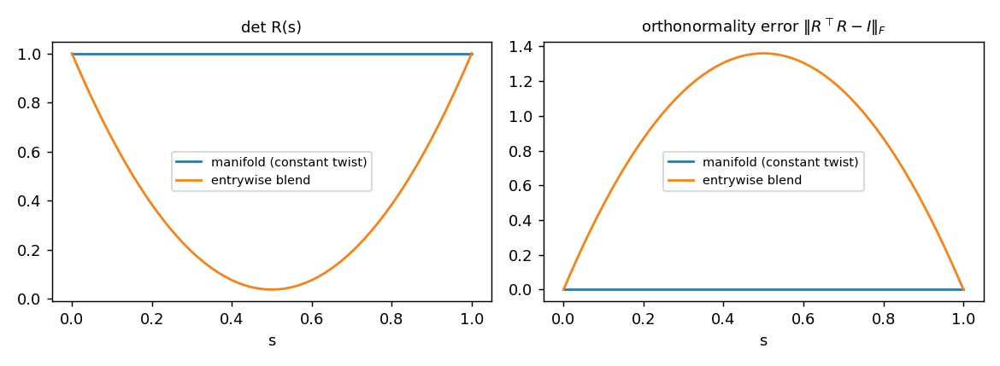

# a14_0 - Lie groups for state estimation

This is the first assignment of the classical SLAM module, and the only new language in the
course: the mechanism code here is C++17 with Eigen, not Python. SLAM and localization ship in
C++, and interviews for those roles ask candidates to write it, so the from-scratch parts of this
module are in C++ to build that fluency. The Python around them (the build, the tests, the Rerun
visualization) is provided.

The assignment builds the machinery every later estimator in the module uses to handle a 3D
rotation or a 3D pose: the exponential and logarithm maps for rotations ($SO(3)$) and rigid
transforms ($SE(3)$), the left and right Jacobians, the adjoint, and the box-plus / box-minus
operations that let an estimator do its linear algebra on a curved space. The later assignments
that carry a 3D pose (the pose refinement inside PnP, the point-to-plane ICP step, and the
pose-graph optimizer) all use this machinery and the twist ordering fixed here. Each of them ships
its own provided copy in its `models.cpp` so that it builds standalone, so they do not literally
link against this code, but the derivations and conventions below are the ones they assume.

Required reading before starting:
- Solà, Deray, Atchuthan, "A micro Lie theory for state estimation in robotics" (2018),
  https://arxiv.org/abs/1812.01537 - the best short reference for everything here.
- Barfoot, *State Estimation for Robotics* (2017), chapter 7 - the standard treatment of the
  SO(3)/SE(3) Jacobians and the adjoint.

## Lecture notes

### What this machinery is for

#### The task

Every estimator later in this module ends up adjusting a pose. PnP refinement starts from a rough
camera pose and repeatedly corrects it so that known 3D points project closer to where they were
seen in the image. The pose-graph optimizer corrects hundreds of robot poses at once so that the
relative motions between them agree with odometry and loop closures. An EKF whose state includes
an orientation corrects that orientation with each measurement and carries a covariance for it.

In all three the inner step is the same. Gauss-Newton or the Kalman update produces a small
correction as a vector, six numbers for a pose (three of translation, three of rotation), and the
estimator has to apply it to the current pose. It also needs a vector-valued error between two
poses (a residual) and a covariance describing how uncertain a pose is. All of that is linear
algebra on vectors.

#### Why the obvious approaches fail

A pose is a rotation matrix $R$ and a translation $t$. The translation is an ordinary vector and
adding a correction to it is fine. The rotation is not.

Storing the nine entries of $R$ and adding a correction to them leaves the set of rotations: the
result is a matrix whose columns are no longer orthonormal, so it stretches or shears space. The
estimator then has to re-orthonormalize after each step, which changes the answer by an amount the
linear algebra did not account for. The visualization in this assignment measures how badly a
related operation goes, blending two rotations entrywise (the second figure below): at the
midpoint between the identity and a rotation of about $2.75$ radians ($158^\circ$) the blended
matrix has determinant roughly $0.04$, so it squashes space nearly flat.

Three numbers would be the right count, since a rotation has three degrees of freedom. Euler
angles provide three numbers but have a singular configuration (gimbal lock, where two of the
three angles turn about the same axis and the Jacobian of anything with respect to them loses
rank). A unit quaternion has four numbers and a constraint, so a correction has to be projected
and renormalized. Both are workable and both put special cases into every estimator.

#### The idea

Keep the pose as an exact matrix, so it is always a valid rotation and translation. Express every
correction, residual, and covariance as a vector in a flat 3- or 6-dimensional space attached to
the pose, called the tangent space. Move between the two with a pair of maps: the exponential map
turns a vector into a rotation or rigid transform, and the logarithm turns it back. A correction
$\xi$ is applied by multiplication, $T \leftarrow T\exp(\widehat{\xi})$, and the error between two
poses is $\log(T_1^{-1}T_2)$. Every estimator in the module is then the familiar vector-space
algorithm with $+$ and $-$ replaced by these two operations.

Two extra pieces make the calculus work. Composition on a group is multiplication, not addition,
so differentiating through it introduces a $3\times3$ (or $6\times6$) correction factor, the
Jacobian of the exponential map. And because multiplication has two sides, every correction can be
written on the left or on the right of the pose, so a convention has to be fixed and kept. Mixing
the two conventions produces errors that the easiest test cases do not reveal, as the section on
left and right perturbations shows.

### Our quarter-turn arc example (one odometry step of a turning vehicle)

To make the formulas concrete we use one small rigid motion throughout. A vehicle starts at the
origin facing $+x$ and, for one second, drives forward at 1 m/s while turning left at
$\pi/2$ rad/s. It ends facing $+y$, a quarter turn later. This is the unicycle from the Kalman
filter assignment integrated exactly for constant speed and turn rate, and in a pose graph it is
one odometry edge: the relative pose between two consecutive robot poses. We call it our
quarter-turn arc example.

The motion is described by six numbers that hold constant for the whole second: a linear velocity
of 1 m/s along the vehicle's own $x$ axis and an angular velocity of $\pi/2$ rad/s about its $z$
axis. Below, those six numbers become the twist $\xi = [1, 0, 0, 0, 0, \pi/2]$, and the pose at
the end is $\exp(\widehat{\xi})$. The vehicle traces a quarter circle of radius $2/\pi = 0.637$ m
(arc length 1 m) and ends at $t = (0.637, 0.637, 0)$, not at $(1, 0, 0)$: the linear velocity is
not the displacement, because the vehicle turns while it drives.

Our example keeps what makes poses hard: rotation and translation are coupled, the order of
operations matters, and left and right corrections differ. It drops rotations about more than one
axis, since the vehicle only turns about $z$. Where an argument needs a second rotation axis (the
non-commuting rotations in the composition section, and an out-of-plane tilt in the Jacobian
exercise), the notes add one explicitly.

The left panel of the figure shows the vehicle's frame along the path $\exp(s\,\widehat{\xi})$ for
$s$ from 0 to 1; every frame is a rigid, unit-length pair of axes. The right panel shows the
entrywise blend $R(s) = (1-s)R_0 + sR_1$, $t(s) = (1-s)t_0 + st_1$ between the same two poses: the
position cuts across the chord, and the axes shrink to $1/\sqrt{2}$ of their length at the
midpoint, where the determinant is $0.5$.


### Overview of the rest of the notes

1. Groups, manifolds, and tangent spaces. Three short definitions that name the objects: the set
   of rotations is curved, and the tangent space is the flat vector space where the linear algebra
   happens.
2. The Lie algebra of $SO(3)$. The tangent space at the identity is the skew-symmetric matrices,
   which are 3-vectors in disguise (the cross-product matrix) and physically are angular
   velocities.
3. The exponential and logarithm maps. Integrating a constant angular velocity gives a rotation,
   in closed form by Rodrigues' formula; the logarithm inverts it, with three numerical special
   cases.
4. Why composition is not addition, and left versus right perturbations. Rotations do not
   commute, so a correction composed onto a rotation is not added to its rotation vector, and it
   can sit on either side.
5. The Jacobians. The $3\times3$ factor that relates a step in the tangent space to a step on the
   group: the derivative an optimizer needs.
6. $SE(3)$: twists, the exponential map, and the adjoint. The same construction for full poses,
   where translation couples through rotation (the reason our arc does not end at $(1, 0, 0)$),
   and the $6\times6$ matrix that moves a twist between frames.
7. Box-plus, box-minus, and interpolation. The two operations that replace $+$ and $-$ in every
   estimator, and the interpolation built from them.

Six exercises, placed after the sections they test, are meant to be worked by hand. Each has a
worked answer that can be expanded.

### Groups, manifolds, and tangent spaces

A position is a vector: two positions add, they scale, and a linear blend of two of them is another
position. A rotation is not. A 3D rotation is a $3\times3$ matrix $R$ with $R^\top R = I$ and
$\det R = +1$, and the set of all of them is $SO(3)$, the special orthogonal group. Averaging two
rotation matrices entrywise generally does not produce a rotation: the columns stop being
orthonormal and the determinant stops being 1, as the figure of our arc example shows. Three definitions say what
$SO(3)$ is instead.

A group is a set with a composition rule that is closed (composing two members gives a member),
associative, has an identity element, and gives every member an inverse that is also a member.
Rotation matrices under matrix multiplication satisfy all four: a product of rotations is a
rotation, matrix multiplication is associative, $I$ is the identity, and $R^{-1} = R^\top$ is again
a rotation. Nothing in that list mentions addition, and $SO(3)$ has none: $R_1 + R_2$ is a matrix,
not a rotation.

A manifold is a set that is curved globally but looks flat locally. The sphere is the standard
picture: it sits in $\mathbb{R}^3$, but every small patch of it looks like a piece of
$\mathbb{R}^2$, so a point on it needs two numbers, not three. $SO(3)$ is the same kind of object
with different numbers. A rotation matrix has 9 entries, and $R^\top R = I$ is an equation between
symmetric matrices, so it imposes 6 independent scalar constraints (3 on the diagonal, 3 off it).
That leaves $9 - 6 = 3$, so $SO(3)$ is a 3-dimensional curved surface inside the 9-dimensional
space of $3\times3$ matrices, matching the familiar count of three rotational degrees of freedom.
The condition $\det R = +1$ selects one of the two disconnected pieces the constraint leaves, the
one containing the identity. $SE(3)$, the rigid transforms, has 6 dimensions the same way, 3 of
rotation and 3 of translation.

A Lie group is both at once: a group whose elements form a manifold, with composition and
inversion smooth functions of their arguments. $SO(3)$ and $SE(3)$ are the two this module uses.

The tangent space at a point of a manifold is the flat space of velocities that curves through
that point can have. On the sphere it is the plane touching the sphere at that point, and it is a
true vector space: tangent vectors add, they scale, and the result is another tangent vector. That
is the property $SO(3)$ itself lacks. Estimation runs on linear algebra. A covariance is the matrix
of second moments of a vector-valued error, and a Gauss-Newton step solves a linear system for a
vector-valued increment; neither has a meaning on a curved surface, and both have one in the
tangent space. Two maps move between the group and the tangent space at its identity, and the
rest of these notes is about those two maps and their derivatives.

### The Lie algebra of SO(3)

Which matrices are tangent to $SO(3)$? Take any smooth curve of rotations $R(t)$ and differentiate
the constraint it satisfies. From $R(t)^\top R(t) = I$,

$$\dot R^\top R + R^\top \dot R = 0 \quad\Longrightarrow\quad \big(R^\top \dot R\big)^\top = -\,R^\top \dot R .$$

So $R^\top \dot R$ is skew-symmetric for every $t$, and at a point where $R = I$ the velocity
$\dot R$ is itself skew-symmetric. The tangent space of $SO(3)$ at the identity is therefore the
set of $3\times3$ skew-symmetric matrices. That set is written $\mathfrak{so}(3)$ and called the
Lie algebra of the group; the fraktur letters and the lowercase name are convention only, and the
object is this vector space plus one extra operation (the bracket) defined at the end of this
section. A skew matrix has 3 free entries, which agrees with the dimension count of the previous
section.

Three free entries means $\mathfrak{so}(3)$ is $\mathbb{R}^3$ in disguise, and the hat operator
makes the correspondence explicit. Hat turns a 3-vector into its skew matrix, and vee inverts hat:

$$\widehat{w} = \begin{bmatrix} 0 & -w_z & w_y \\ w_z & 0 & -w_x \\ -w_y & w_x & 0 \end{bmatrix}, \qquad \widehat{w}\,v = w \times v .$$

The cross-product identity on the right fixes the sign pattern (hat is the familiar cross-product
matrix, often written $[w]_\times$), and a test checks it directly. In basis terms, the three
matrices $G_1 = \widehat{e_1}$, $G_2 = \widehat{e_2}$, $G_3 = \widehat{e_3}$ obtained by hatting
the coordinate axes span $\mathfrak{so}(3)$, and $\widehat{w} = w_x G_1 + w_y G_2 + w_z G_3$. Those
three are called the generators of the group. A generator is a basis vector of the Lie algebra,
read as an infinitesimal motion: $\exp(t\,G_i)$ (the exponential is defined in the next section)
traces out the family of rotations about axis $i$ as $t$ runs over the reals, so $G_i$ generates
that family.

The extra operation is the Lie bracket, which for matrix groups is the commutator
$[A, B] = AB - BA$. It measures how far two elements are from commuting, and $\mathfrak{so}(3)$ is
closed under it: $[\widehat{a}, \widehat{b}] = \widehat{a \times b}$, so the bracket on
$\mathfrak{so}(3)$ is the cross product on $\mathbb{R}^3$ written in matrix form. It comes back in
the composition section as the reason composition on a group is not addition.

A physical reading ties this together. If $R(t)$ is the orientation of a rigid body, then
$R^\top \dot R = \widehat{\omega}$ holds the body-frame angular velocity $\omega$. Angular
velocities add and scale like vectors; orientations do not. The Lie algebra is where the angular
velocities live. In our quarter-turn arc the angular velocity is $\omega = (0, 0, \pi/2)$ rad/s
throughout.

### The exponential map

If a constant angular velocity is a tangent vector, then holding that angular velocity for one
unit of time ought to produce a rotation, and it does. Solving $\dot R = R\,\widehat{w}$ from
$R(0) = I$ gives $R(1) = \exp(\widehat{w})$, the ordinary matrix exponential

$$\exp(X) = I + X + \tfrac{1}{2!}X^2 + \tfrac{1}{3!}X^3 + \cdots .$$

This is the exponential map of $SO(3)$: it sends a tangent vector to a group element. Its argument
$w$ is a rotation vector (axis-angle), read as an axis $u = w/\theta$ and an angle
$\theta = \lVert w \rVert$ in radians.

The infinite series collapses to a closed form because powers of a skew matrix cycle. For a unit
axis $u$, writing $K_u = \widehat{u}$, direct computation gives $K_u^2 = uu^\top - I$ and
$K_u^3 = K_u(uu^\top - I) = -K_u$, since $u \times u = 0$. Every higher power is therefore $\pm K_u$
or $\pm K_u^2$. Substituting $\widehat{w} = \theta K_u$ and grouping the odd and even terms:

$$\exp(\widehat{w}) = I + \Big(\theta - \frac{\theta^3}{3!} + \frac{\theta^5}{5!} - \cdots\Big) K_u + \Big(\frac{\theta^2}{2!} - \frac{\theta^4}{4!} + \cdots\Big) K_u^2 = I + \sin\theta\,K_u + (1 - \cos\theta)\,K_u^2 .$$

That is Rodrigues' formula. Rewriting it with $K = \widehat{w}$, so that the argument is the
rotation vector the code receives rather than the unit axis:

$$R = \exp(\widehat{w}) = I + \frac{\sin\theta}{\theta} K + \frac{1 - \cos\theta}{\theta^2} K^2 .$$

In our quarter-turn arc, $w = (0, 0, \pi/2)$, so $u = e_3$, $\sin\theta = 1$, $\cos\theta = 0$, and
$K_u^2 = \operatorname{diag}(-1, -1, 0)$. Rodrigues gives
$R = I + K_u + K_u^2 = \begin{bmatrix} 0 & -1 & 0 \\ 1 & 0 & 0 \\ 0 & 0 & 1\end{bmatrix}$, the
$90^\circ$ turn about $z$ that the tests also check.

As $\theta \to 0$ the coefficients tend to $\sin\theta/\theta \to 1$ and
$(1-\cos\theta)/\theta^2 \to \tfrac12$, so the small-angle branch is $R \approx I + K + \tfrac12 K^2$.
That branch is required. At $\theta = 0$ the closed form is $0/0$, and near zero $1 - \cos\theta$
is the difference of two nearly equal numbers, so it has lost its significant digits before the
division by $\theta^2$. An optimizer evaluates $\exp$ at tiny increments on every step, which is
exactly the regime where the closed form misbehaves. The reference switches branches at
$\theta < 10^{-8}$.

> **Exercise 1 (the entrywise blend at the midpoint).** Let $R$ be a rotation by angle $\theta$
> about any axis. Show that the midpoint blend $M = (I + R)/2$ has $\det M = \cos^2(\theta/2)$ and
> orthonormality error $\lVert M^\top M - I\rVert_F = \sqrt{2}\sin^2(\theta/2)$. Evaluate both for
> our quarter-turn arc ($\theta = 90^\circ$) and for the visualization's rotation
> ($\theta = 2.7495$ rad). (Use Rodrigues' formula in the unit-axis form
> $R = I + \sin\theta\,K_u + (1-\cos\theta)K_u^2$; $K_u^2 = uu^\top - I$ has eigenvalues $0, -1, -1$.)

<details>
<summary>Answer</summary>

In coordinates whose third axis is $u$, $R$ is the planar rotation
$\begin{bmatrix}\cos\theta & -\sin\theta \\ \sin\theta & \cos\theta\end{bmatrix}$ plus a $1$ on the
axis, so $M$ is $\tfrac12\begin{bmatrix}1+\cos\theta & -\sin\theta \\ \sin\theta & 1+\cos\theta\end{bmatrix}$
plus a $1$, and $\det M = \tfrac14\big((1+\cos\theta)^2 + \sin^2\theta\big) = (2 + 2\cos\theta)/4 = \cos^2(\theta/2)$.

For the orthonormality error, $M^\top M = (2I + R + R^\top)/4$, and Rodrigues gives
$R + R^\top = 2I + 2(1-\cos\theta)K_u^2$ (the $K_u$ terms cancel because $K_u$ is skew). So
$M^\top M - I = \tfrac12(1-\cos\theta)K_u^2 = \sin^2(\theta/2)\,K_u^2$, and
$\lVert K_u^2\rVert_F = \sqrt{0 + 1 + 1} = \sqrt2$.

At $\theta = 90^\circ$: $\det M = 0.5$ and the error is $\sqrt2/2 = 0.707$, the midpoint frame in
the right panel of the figure. At $\theta = 2.7495$ rad: $\det M = 0.0379$ and the error is
$1.361$, the "roughly $0.04$" and "roughly $1.4$" of the visualization. The determinant reaches
zero at $\theta = \pi$: averaging a half turn with the identity collapses the plane perpendicular
to the axis to a point. (The midpoint is also the worst point of the blend:
$\det((1-s)I + sR) = (1-s)^2 + s^2 + 2s(1-s)\cos\theta$, smallest at $s = 1/2$.)

</details>

### The logarithm map

The logarithm inverts the exponential: given $R$, recover the rotation vector $w$. Both pieces come
out of Rodrigues' formula by taking its symmetric and antisymmetric parts.

For the angle, take the trace. $K_u$ is skew so $\operatorname{tr}K_u = 0$, and
$\operatorname{tr}K_u^2 = \operatorname{tr}(uu^\top - I) = 1 - 3 = -2$, so Rodrigues gives
$\operatorname{tr}R = 3 - 2(1 - \cos\theta) = 1 + 2\cos\theta$, hence

$$\theta = \arccos\!\Big(\frac{\operatorname{tr}R - 1}{2}\Big).$$

For the axis, subtract the transpose. $K_u^2 = uu^\top - I$ is symmetric and $K_u$ is
antisymmetric, so $R - R^\top = 2\sin\theta\,K_u$ and therefore
$\operatorname{vee}(R - R^\top) = 2\sin\theta\,u$, giving

$$w = \theta u = \frac{\theta}{2\sin\theta}\operatorname{vee}(R - R^\top).$$

Three situations break that expression, and each needs its own branch in the code.

Round-off in the trace. Floating-point error can push $(\operatorname{tr}R - 1)/2$ slightly outside
$[-1, 1]$, and $\arccos$ of $1 + 10^{-16}$ is NaN. Clamping the argument to $[-1, 1]$ before the
$\arccos$ costs nothing and removes the failure.

Small angles. As $\theta \to 0$ the factor $\theta/(2\sin\theta)$ is a ratio of two vanishing
quantities. Use $R \approx I + \widehat{w}$ instead, which gives
$w = \tfrac12 \operatorname{vee}(R - R^\top)$ with no division.

Angles near $\pi$. Here $\sin\theta \to 0$ while $\theta$ does not, so the coefficient diverges and
the antisymmetric part it multiplies vanishes; the axis is being read from a quantity that is going
to zero. Use the symmetric part instead. At $\theta = \pi$, Rodrigues gives
$R = I + 2K_u^2 = 2uu^\top - I$, so $R + I = 2uu^\top$, a rank-1 matrix all of whose columns are
multiples of $u$. Normalizing its largest column recovers the axis. The sign is not determined by
that construction, so the reference resolves it against $\operatorname{vee}(R - R^\top)$, which is
small near $\pi$ but still points along the axis. Exactly at $\theta = \pi$ that tiebreaker is zero
and either sign is a correct answer, since $\pi u$ and $-\pi u$ are the same rotation.

The logarithm is many-valued in one more way: rotating by $\theta$ and by $\theta + 2\pi$ about the
same axis produce the same matrix, so $\exp$ is not injective and $\log$ has to choose. Because
$\arccos$ returns a value in $[0, \pi]$, the implementation returns the principal value, the
rotation vector of smallest norm, with $\lVert w \rVert \le \pi$.

> **Exercise 2 (the logarithm of a half turn).** Two of our quarter-turn arcs in a row leave the
> vehicle facing $-x$, with rotation $R = \operatorname{diag}(-1, -1, 1)$. Compute $\theta$ from
> the trace. Explain why the generic formula for $w$ cannot be used, and recover $w$ with the
> near-$\pi$ branch. Which sign does the tiebreaker pick?

<details>
<summary>Answer</summary>

$\operatorname{tr}R = -1$, so $\cos\theta = (-1 - 1)/2 = -1$ and $\theta = \pi$. $R$ is symmetric,
so $R - R^\top = 0$ and $\sin\pi = 0$: the generic formula is $0/0$.

The near-$\pi$ branch uses $R + I = \operatorname{diag}(0, 0, 2) = 2uu^\top$. Its largest column is
$(0, 0, 2)$, which normalizes to $u = (0, 0, 1)$, so $w = (0, 0, \pi)$. The tiebreaker
$\operatorname{vee}(R - R^\top)$ is exactly zero, so it does not flip the sign, and the answer stays
$(0, 0, \pi)$. The other sign, $(0, 0, -\pi)$, is an equally correct logarithm: a left half turn
and a right half turn end in the same orientation. So a test of $\log$ at exactly $\pi$ has to
compare rotations, not rotation vectors; the test suite's random rotations stay below $2$ rad to
avoid the question.

</details>

### Why composition is not addition

For scalars $\exp(a)\exp(b) = \exp(a+b)$. For matrices that holds only when $A$ and $B$ commute,
and rotations do not: a quarter turn about $x$ followed by a quarter turn about $z$ is a different
rotation from the same two in the other order. Applied to $e_1$, one order gives $e_3$ and the
other gives $e_2$. So in general $\exp(\widehat{a})\exp(\widehat{b}) \ne \exp(\widehat{a + b})$,
and there is no way to compose two rotations by adding their rotation vectors.

The Baker-Campbell-Hausdorff formula (BCH) says exactly what the discrepancy is. It is the series
for the tangent vector whose exponential equals the product:

$$\log\big(\exp(A)\exp(B)\big) = A + B + \tfrac{1}{2}[A,B] + \tfrac{1}{12}\big[A,[A,B]\big] - \tfrac{1}{12}\big[B,[A,B]\big] + \cdots,$$

where every term past the first two is built from nested Lie brackets. Two readings of that matter
here. First, the entire correction is made of brackets, so if $A$ and $B$ commute all of it
vanishes and the scalar rule returns; the brackets measure how much the curvature of the group
changes the answer. Second, when one of the two arguments is small the series becomes a usable
approximation, because the nested terms are higher order in the small argument. Keeping only terms
of first order in a small $\delta$:

$$\log\big(\exp(\widehat{w})\exp(\widehat{\delta})\big) \approx w + J_r^{-1}(w)\,\delta, \qquad
\log\big(\exp(\widehat{\delta})\exp(\widehat{w})\big) \approx w + J_l^{-1}(w)\,\delta .$$

The two matrices $J_r^{-1}$ and $J_l^{-1}$ collect the whole infinite tail of bracket terms (every
term linear in $\delta$, at any order in $w$) into one $3\times3$ matrix each. They are the inverse
right and left Jacobians defined two sections below. In words: composing a small rotation onto a
group element changes its rotation vector by the small rotation times a matrix factor, not by the
small rotation itself, and the factor depends on which side the small rotation goes. The next
section is about the sides.

> **Exercise 3 (BCH to second order).** Let $a = (0.1, 0, 0)$ and $b = (0, 0, 0.1)$, two
> $0.1$ rad rotations about $x$ and $z$. Using $[\widehat{a}, \widehat{b}] = \widehat{a \times b}$,
> compute $\log(\exp(\widehat a)\exp(\widehat b))$ to second order. What changes if the order of the
> product is reversed?

<details>
<summary>Answer</summary>

$a \times b = (0.1)(0.1)\,(e_1 \times e_3) = -0.01\,e_2$, so to second order

$$\log\big(\exp(\widehat a)\exp(\widehat b)\big) \approx a + b + \tfrac12\, a \times b = (0.1,\ -0.005,\ 0.1).$$

The exact logarithm (computed numerically) is $(0.099917, -0.005, 0.099917)$; the remaining
difference of $8 \times 10^{-5}$ in the $x$ and $z$ entries is the third-order bracket terms.
Reversing the order flips the sign of the bracket, giving $(0.1, +0.005, 0.1)$. Neither order is
the sum $a + b = (0.1, 0, 0.1)$: the composition picks up a rotation about $y$, the axis
perpendicular to both, of size proportional to the product of the two angles.

</details>

### Left and right perturbations

On a vector space, "the estimate plus a small error" means one thing. On a group it means two
things, because multiplication has two sides:

$$R = \bar R\,\exp(\widehat{\delta_r}) \quad \text{(right)}, \qquad R = \exp(\widehat{\delta_l})\,\bar R \quad \text{(left)} .$$

Both describe the same true rotation $R$ relative to the same estimate $\bar R$; they differ in the
coordinates the error is written in. The right form applies the correction in the body frame, in
the axes the body already carries. The left form applies it in the world frame. A gyro scale error
or a wheel-slip error is generated in the body and is naturally written on the right; an error in
where the map's origin sits is a world-frame quantity and is naturally written on the left.

The two are related by one identity. For any rotation and any 3-vector,
$R\,\widehat{a}\,R^\top = \widehat{Ra}$, so conjugating the exponential gives
$\bar R \exp(\widehat{\delta_r})\bar R^\top = \exp(\widehat{\bar R \delta_r})$, hence

$$\delta_l = \bar R\,\delta_r, \qquad \Sigma_l = \bar R\,\Sigma_r\,\bar R^\top .$$

In our quarter-turn arc the end orientation $\bar R$ is a $90^\circ$ turn about $z$. An orientation
error about the body's $x$ axis (a roll error) is, written on the left, an error about the world's
$y$ axis, because the body's $x$ axis now points along world $y$.

A covariance stated in the wrong convention is therefore wrong by a rotation. The two agree exactly
when $\bar R = I$ or when $\Sigma_r$ is isotropic, so the mistake is invisible in the test cases
that are easiest to write (a pose at the identity, equal uncertainty on all axes), and shows up as
a slowly rotating inconsistency in a filter that has been running for a while. $SE(3)$ behaves the
same way, with the adjoint (defined below) in place of $\bar R$.

This assignment, the PnP refinement, and the pose-graph optimizer use the right convention:
$T \boxplus \xi = T\exp(\widehat{\xi})$, perturbations in the body frame. So $J_r$ and $J_r^{-1}$
are the Jacobians the downstream derivations use, and $J_l$ is present because the $SE(3)$
exponential needs it internally. The ICP assignment is the one exception: it composes its
increment on the left, $T \leftarrow \exp(\widehat{\xi})\,T$, because it solves for the increment
using source points that have already been moved by the current $T$, and its notes explain the
switch.

### The Jacobians

Perturb the input of the exponential map by a small $\delta$; how does the output move? An
optimizer needs the answer because it works entirely in the tangent space: it solves for a
tangent-space increment and needs to know how much the group element, and therefore the residual,
moves per unit of that increment. Because motion on a group is expressed by multiplication and
multiplication has two sides, there are two answers.

The right Jacobian $J_r(w)$ is defined by

$$\exp(\widehat{w + \delta}) \approx \exp(\widehat{w})\,\exp\big(\widehat{J_r(w)\,\delta}\big),$$

to first order in $\delta$: adding $\delta$ to the tangent vector has the same effect as
multiplying on the right by the small rotation $\exp(\widehat{J_r\delta})$. The left Jacobian $J_l$
is the identical statement with the small rotation on the left. Rearranging the right definition
gives a form that can be evaluated numerically without any derivation,

$$J_r(w)\,\delta = \log\!\big(\exp(\widehat{w})^{-1}\,\exp(\widehat{w + \delta})\big),$$

so column $i$ of $J_r(w)$ is that expression evaluated at $\delta = \varepsilon e_i$ and divided by
$\varepsilon$. A central difference in each of the three coordinates produces the whole matrix,
and the tests check the analytic closed form against it.

Both Jacobians have closed forms. With $K = \widehat{w}$ and $\theta = \lVert w \rVert$,

$$J_l(w) = I + \frac{1 - \cos\theta}{\theta^2} K + \frac{\theta - \sin\theta}{\theta^3} K^2, \qquad J_r(w) = J_l(-w) = J_l(w)^\top .$$

The relation between $J_r$ and $J_l$ is one line of algebra. Negating $w$ flips the sign of $K$ and
leaves $K^2$ unchanged; transposing does the same thing, since $K^\top = -K$ makes
$(K^2)^\top = K^2$. The small-angle limits are $(1-\cos\theta)/\theta^2 \to \tfrac12$ and
$(\theta - \sin\theta)/\theta^3 \to \tfrac16$, so $J_l \approx I + \tfrac12 K + \tfrac16 K^2$ near
zero. (Barfoot, chapter 7, derives the closed form; the $SE(3)$ section below obtains $J_l$ a
second way, as an integral.)

The inverses have closed forms too, which is why the assignment asks for them as separate functions
rather than as a $3\times3$ matrix solve:

$$J_l^{-1}(w) = I - \tfrac{1}{2} K + \frac{1}{\theta^2}\Big(1 - \frac{\theta}{2}\cot\frac{\theta}{2}\Big) K^2, \qquad J_r^{-1}(w) = J_l^{-1}(-w),$$

with the small-angle series $J_l^{-1} \approx I - \tfrac12 K + \tfrac{1}{12}K^2$, which follows from
$\tfrac{\theta}{2}\cot\tfrac{\theta}{2} = 1 - \theta^2/12 - O(\theta^4)$. $J_l$ divides by
$\theta^3$ and $J_l^{-1}$ evaluates a cotangent at $\theta/2$, so both need a small-angle branch for
the same reason $\exp$ does. $J_l$ is also singular at $\theta = 2\pi$, which is where the
$\cot(\theta/2)$ in $J_l^{-1}$ diverges, but the logarithm never returns an angle above $\pi$, so
this module never reaches it.

The $J_r^{-1}$ that came out of the BCH truncation in the composition
section and the $J_r$ defined here are inverse matrices, so one pair of functions answers both
"how much does the group element move per unit of tangent step" and "how much does the tangent
vector move per unit of group multiplication".

> **Exercise 4 (the right Jacobian of our arc's rotation).** For $w = (0, 0, \pi/2)$, the rotation
> of our quarter-turn arc, compute $J_l(w)$ from the closed form, then $J_r(w)$. Now tilt the
> rotation vector out of the plane, $w + \varepsilon e_1$. By the defining property, which
> body-frame rotation does that produce, about which axis and by how much?

<details>
<summary>Answer</summary>

$\theta = \pi/2$ and $K = \tfrac{\pi}{2}\widehat{e_3}$, with
$\widehat{e_3}^2 = \operatorname{diag}(-1, -1, 0)$. The coefficient on $K$ is
$(1 - 0)/\theta^2$, so that term is $\tfrac{1}{\theta}\widehat{e_3} = \tfrac{2}{\pi}\widehat{e_3}$.
The coefficient on $K^2$ is $(\theta - 1)/\theta^3$, so that term is
$\tfrac{\theta - 1}{\theta}\widehat{e_3}^2 = (1 - \tfrac{2}{\pi})\widehat{e_3}^2$. Adding,

$$J_l(w) = \begin{bmatrix} 2/\pi & -2/\pi & 0 \\ 2/\pi & 2/\pi & 0 \\ 0 & 0 & 1 \end{bmatrix} = \begin{bmatrix} 0.637 & -0.637 & 0 \\ 0.637 & 0.637 & 0 \\ 0 & 0 & 1 \end{bmatrix}, \qquad J_r(w) = J_l(w)^\top .$$

$J_r(w)\,e_1 = (2/\pi, -2/\pi, 0) = 0.637\,(1, -1, 0)$. So adding $\varepsilon e_1$ to the rotation
vector is, to first order, a body-frame rotation about the axis $(1, -1, 0)/\sqrt2$, the body $x$
axis turned $45^\circ$ clockwise, by angle $\varepsilon \cdot 2\sqrt2/\pi = 0.900\,\varepsilon$.
Changing a rotation-vector coordinate does not rotate the body about that coordinate's axis: for a
tilt perpendicular to the rotation axis, the effective axis is turned back by half the current
rotation angle and the amount shrinks by $2\sin(\theta/2)/\theta$. A finite-difference evaluation
of the defining property gives the same column. An optimizer that treated $\delta$ as a body-frame
rotation without this factor would step in the wrong direction.

</details>

### Twists and the SE(3) exponential

$SE(3)$ is the group of rigid transforms, stored as the $4\times4$ matrix

$$T = \begin{bmatrix} R & t \\ 0 & 1 \end{bmatrix}, \qquad T^{-1} = \begin{bmatrix} R^\top & -R^\top t \\ 0 & 1\end{bmatrix},$$

acting on homogeneous points, with composition by matrix multiplication. Its tangent space follows
from the same differentiate-the-constraint argument as before. A curve $T(t)$ through the identity
has a velocity whose top-left block is skew (the $SO(3)$ argument applied to the rotation block),
whose top-right block is an unconstrained 3-vector, and whose bottom row is zero because the bottom
row of every $T$ is the constant $[0,0,0,1]$. That is $\mathfrak{se}(3)$: six free numbers. The
module packs them into a 6-vector with the translation part first,

$$\xi = \begin{bmatrix}\rho \\ \theta\end{bmatrix}, \qquad \widehat{\xi} = \begin{bmatrix} \widehat{\theta} & \rho \\ 0 & 0\end{bmatrix} .$$

Here $\theta$ is the rotation part, itself a rotation vector, and $\lVert \theta \rVert$ is written
out whenever the angle is meant. The $[\rho; \theta]$ ordering is fixed across the whole module;
the opposite ordering (rotation first) is equally common in the literature and is the usual source
of a sign or argument error later.

A tangent vector of $SE(3)$ is called a twist: the instantaneous velocity of a rigid body, six
numbers holding an angular part $\theta$ and a linear part $\rho$. Holding a constant twist for one
unit of time sweeps out a screw motion, a rotation about a fixed axis combined with a translation
along that same axis, the way a bolt advances into a nut. The screw is not a special case. Chasles'
theorem says every rigid displacement can be written as one screw motion, which is why a single
6-vector describes the motion from any pose to any other. Our quarter-turn arc,
$\xi = [1, 0, 0, 0, 0, \pi/2]$, is a screw with zero advance: a rotation about the vertical axis
through the arc's center at $(0, 2/\pi, 0)$.

The screw picture explains why the translation part of $\exp(\widehat{\xi})$ is not simply $\rho$.
The body travels with body-frame linear velocity $\rho$ while it is rotating, so the displacement in
world coordinates is the integral of that velocity rotated by however much rotation has accumulated
at each instant:

$$t = \int_0^1 \exp(s\,\widehat{\theta})\,\rho\;ds = \Big(\int_0^1 \exp(s\,\widehat{\theta})\,ds\Big)\rho .$$

Evaluate that integral term by term with Rodrigues, writing $u = \theta/\lVert\theta\rVert$:
$\int_0^1 \sin(s\lVert\theta\rVert)\,ds = (1 - \cos\lVert\theta\rVert)/\lVert\theta\rVert$ and
$\int_0^1 (1 - \cos(s\lVert\theta\rVert))\,ds = 1 - \sin\lVert\theta\rVert/\lVert\theta\rVert$, so

$$\int_0^1 \exp(s\,\widehat{\theta})\,ds = I + \frac{1 - \cos\lVert\theta\rVert}{\lVert\theta\rVert}\,\widehat{u} + \Big(1 - \frac{\sin\lVert\theta\rVert}{\lVert\theta\rVert}\Big)\widehat{u}^2 = J_l(\theta),$$

which is the $SO(3)$ left Jacobian written in the unit-axis form. So the coupling matrix that turns
linear velocity into displacement is the left Jacobian, and no new function is needed:

$$\exp(\widehat{\xi}) = \begin{bmatrix} \exp(\widehat{\theta}) & J_l(\theta)\,\rho \\ 0 & 1\end{bmatrix} .$$

$\rho$ is therefore not the translation but the linear velocity that produces it; the two coincide
only when $\theta = 0$, where $J_l = I$. Inverting is immediate. Read $\theta = \log(R)$ off the
rotation block, then $\rho = J_l(\theta)^{-1}\,t$. That is why the assignment asks for $J_l^{-1}$ as
a function of its own.

> **Exercise 5 (the end pose of our arc).** Compute $\exp(\widehat{\xi})$ for our quarter-turn arc,
> $\xi = [1, 0, 0, 0, 0, \pi/2]$, using $J_l$ from Exercise 4. Check that the end point lies on a
> circle of radius $2/\pi$ and that the arc to it has length 1. Then compute the pose after two
> arcs in a row, $\exp(\widehat{\xi})\exp(\widehat{\xi})$, and compare it with $\exp(2\widehat{\xi})$.

<details>
<summary>Answer</summary>

The rotation block is the $90^\circ$ turn about $z$ from the exponential map section. The
translation $J_l(\theta)\rho$ is the first column of $J_l$, $(2/\pi, 2/\pi, 0) = (0.637, 0.637, 0)$:

$$\exp(\widehat{\xi}) = \begin{bmatrix} 0 & -1 & 0 & 0.637 \\ 1 & 0 & 0 & 0.637 \\ 0 & 0 & 1 & 0 \\ 0 & 0 & 0 & 1 \end{bmatrix}.$$

A vehicle turning at $\omega = \pi/2$ rad/s with speed $v = 1$ m/s drives a circle of radius
$v/\omega = 2/\pi$ centered at $(0, 2/\pi)$. The end point is at distance
$\sqrt{(2/\pi)^2 + 0^2} = 2/\pi$ from the center, and a quarter of the circumference is
$\tfrac{\pi}{2}\cdot\tfrac{2}{\pi} = 1$, the distance driven.

Two arcs: the product has rotation $\operatorname{diag}(-1, -1, 1)$ (the half turn of Exercise 2)
and translation $R_1 t_1 + t_1 = (-0.637, 0.637, 0) + (0.637, 0.637, 0) = (0, 1.273, 0)$, the top
of the circle at $(0, 4/\pi, 0)$. $\exp(2\widehat{\xi})$ gives the same matrix, because a twist
commutes with itself: every bracket in BCH vanishes when $A = B$. Two different twists, say a left
arc followed by a straight segment, would not compose by adding.

</details>

### The adjoint

The adjoint answers a frame question: given a twist expressed on one side of a transform, what is
the equivalent twist on the other side?

Start from conjugation. For any invertible $T$, the series definition gives
$T\exp(X)T^{-1} = \exp(TXT^{-1})$, because every term $X^k$ becomes $TX^kT^{-1}$ once the inner
$T^{-1}T$ pairs cancel. When $X = \widehat{\xi}$ is in $\mathfrak{se}(3)$ and $T$ is in $SE(3)$,
the conjugate $T\widehat{\xi}T^{-1}$ is again in $\mathfrak{se}(3)$, so it is the hat of some
6-vector. That 6-vector depends linearly on $\xi$, and the $6\times6$ matrix implementing the map
is the adjoint:

$$\widehat{\mathrm{Ad}_T\,\xi} = T\,\widehat{\xi}\,T^{-1}, \qquad\text{equivalently}\qquad T\exp(\widehat{\xi})\,T^{-1} = \exp\big(\widehat{\mathrm{Ad}_T\,\xi}\big).$$

Working the block algebra out for $T = \begin{bmatrix} R & t \\ 0 & 1\end{bmatrix}$ and
$\xi = [\rho;\theta]$ (the top-left block of the conjugate is
$R\widehat{\theta}R^\top = \widehat{R\theta}$, and the top-right block is
$R\rho - \widehat{R\theta}\,t = R\rho + t \times R\theta$) gives

$$\mathrm{Ad}_T = \begin{bmatrix} R & \widehat{t}\,R \\ 0 & R \end{bmatrix} .$$

The angular part transforms by $R$ alone, as any 3-vector does. The linear part picks up the extra
term $\widehat{t}R\,\theta = t \times (R\theta)$, which is the lever arm: an angular velocity about
a point offset by $t$ shows up as a linear velocity at the origin, with magnitude proportional to
the offset. With the rotation-first ordering the off-diagonal block moves to the bottom left, so
the formula and the ordering have to match.

Multiplying the identity on the right by $T$ puts it in the form the tests check and the form
worth memorizing:

$$T\exp(\widehat{\xi}) = \exp\big(\widehat{\mathrm{Ad}_T\,\xi}\big)\,T .$$

Read left to right: a twist applied on the right of $T$, which is a body-frame perturbation,
produces the same transform as a different twist applied on the left, which is a spatial-frame
(world-frame) perturbation, and $\mathrm{Ad}_T$ converts body to spatial. The reverse direction is
$\mathrm{Ad}_{T^{-1}} = (\mathrm{Ad}_T)^{-1}$. This is the $SE(3)$ version of
$\delta_l = \bar R \delta_r$ from the perturbations section, and covariances move with it the same
way: $\Sigma_l = \mathrm{Ad}_T\,\Sigma_r\,\mathrm{Ad}_T^\top$.

The adjoint is also how the chain rule works through a product of transforms. Perturb the left
factor of $T_a T_b$ on the right by $\delta$ and push the perturbation out to the end of the
product by inserting $T_b T_b^{-1}$ (the identity above with $T = T_b^{-1}$):

$$T_a\exp(\widehat{\delta})\,T_b = T_a T_b \exp\big(\widehat{\mathrm{Ad}_{T_b^{-1}}\,\delta}\big).$$

A perturbation of an inner factor reappears at the output as the same perturbation carried through
one adjoint. The pose-graph residual in the factor-graph assignment is
$\log\!\big(T_{\text{meas}}^{-1} T_i^{-1} T_j\big)$, and its derivatives with respect to right
perturbations of $T_i$ and $T_j$ come out as an inverse right Jacobian (the $6\times6$ $SE(3)$
version, provided in that assignment), an adjoint of exactly this kind, and a minus sign on the $i$
side. Using $\mathrm{Ad}_T$ where $\mathrm{Ad}_{T^{-1}}$ belongs produces a Jacobian of the right
shape, and it agrees with the correct one when $T_b$ is the identity, so a test built around
identity poses does not catch the mistake.

> **Exercise 6 (body and world errors at the end of our arc).** Let $T = \exp(\widehat{\xi})$ be
> the end pose of our quarter-turn arc from Exercise 5. (a) Compute $\mathrm{Ad}_T\,\delta$ for a
> small body-frame yaw $\delta = [0, 0, 0, 0, 0, \varepsilon]$ and for a small body-frame forward
> step $\delta = [\varepsilon, 0, 0, 0, 0, 0]$, and say what each world-frame twist means.
> (b) If the planar position error at the end of the arc has covariance
> $\Sigma_r = \operatorname{diag}(0.01, 0.0025)$ m$^2$ in the body frame (forward, lateral) and
> the orientation is exact, what is the covariance in the world frame?

<details>
<summary>Answer</summary>

(a) With $R$ the $90^\circ$ turn about $z$ and $t = (2/\pi, 2/\pi, 0)$, the yaw gives
$\mathrm{Ad}_T\delta = [t \times (R\,\varepsilon e_3);\ R\,\varepsilon e_3]$. $R e_3 = e_3$ and
$t \times e_3 = (t_y, -t_x, 0) = (2/\pi, -2/\pi, 0)$, so

$$\mathrm{Ad}_T\delta = \varepsilon\,[0.637,\ -0.637,\ 0,\ 0,\ 0,\ 1].$$

Turning the vehicle in place is, seen from the world origin, a turn about the origin plus a linear
velocity: the lever-arm term. Rotating about the origin by $\varepsilon$ alone would carry the
vehicle's position along $\varepsilon(-0.637, 0.637)$; the linear part cancels that, so the
vehicle's position stays put.

The forward step gives $[R\,\varepsilon e_1;\ 0] = [0, \varepsilon, 0, 0, 0, 0]$: the vehicle's
forward direction at the end of the arc is world $+y$. No lever arm appears because there is no
rotation.

(b) With no rotational uncertainty, the position block of $\mathrm{Ad}_T\Sigma_r\mathrm{Ad}_T^\top$
is $R\Sigma_r R^\top$. The $90^\circ$ rotation swaps the axes, giving
$\operatorname{diag}(0.0025, 0.01)$: the larger forward uncertainty now lies along world $y$. A
filter that stored $\Sigma_r$ and read it as a world-frame covariance would put the long axis of
the error ellipse along world $x$, across the direction of travel.

</details>

### Box-plus, box-minus, and geodesic interpolation

Every estimator has an update of the form "estimate plus a correction", $x \leftarrow x + \delta$,
and a residual of the form "measured minus predicted". Neither $+$ nor $-$ exists on a group. A
retraction supplies the first: a map that takes a group element and a tangent vector and returns a
nearby group element, agreeing with ordinary addition to first order at $\delta = 0$. The
exponential is the retraction used throughout this module. Written box-plus, with box-minus as its
inverse and the right convention fixed above:

$$T \boxplus \xi = T\,\exp(\widehat{\xi}), \qquad T_2 \boxminus T_1 = \log\!\big(T_1^{-1} T_2\big).$$

Box-plus takes a group element and a tangent correction and returns the nearby group element.
Box-minus takes two group elements and returns the tangent vector from the first to the second,
expressed in the first one's body frame. They invert each other in both directions,
$(T \boxplus \xi) \boxminus T = \xi$ and $T_1 \boxplus (T_2 \boxminus T_1) = T_2$, which is what the
box-plus test asserts. In our quarter-turn arc, $\exp(\widehat{\xi}) \boxminus I = \xi$: box-minus
of the end pose from the start pose recovers the twist that generated the motion.

Every estimator downstream is then the familiar vector-space algorithm with $+$ replaced by
$\boxplus$ and $-$ by $\boxminus$. An extended Kalman filter whose state is a pose carries the mean
as a group element and the covariance as the covariance of the tangent-space error, and updates the
mean with $\boxplus$. A Gauss-Newton step solves the normal equations for a tangent increment and
retracts it with $\boxplus$. A residual between a measured and a predicted pose is a $\boxminus$.

Interpolation is the same two operations. $T_1 \boxminus T_0$ is the twist that carries $T_0$ to
$T_1$ in one unit of time, so scaling it and retracting traces the path:

$$T(s) = T_0 \boxplus \big(s\,(T_1 \boxminus T_0)\big), \qquad s \in [0,1].$$

This is the constant-twist path, the screw motion from one pose to the other, and it stays on the
manifold at every $s$ by construction, because $\exp$ of any twist is a valid transform. For our
quarter-turn arc it is the left panel of the arc figure: the vehicle's own path. For the rotation
part alone this is the geodesic, the shortest path on $SO(3)$ under its natural metric (the
one in which the distance between two rotations is the angle of the rotation between them), and it is the same curve traced by slerp, the spherical linear interpolation used on unit
quaternions. For full $SE(3)$, whether the screw path is also the shortest one depends on how
translation and rotation are weighed against each other in the metric, so the property to rely on
is the one the visualization measures: the path never leaves the manifold, while the entrywise
blend $R(s) = (1-s)R_0 + sR_1$ leaves it immediately.

The figure shows that measurement for the pose pair in the visualization, the identity and a pose
whose rotation is $2.75$ rad about the axis $(0.4, -1.6, 2.2)$. Along the constant-twist path the
determinant stays at 1 and the orthonormality error at 0 (both within $2 \times 10^{-15}$). Along
the blend the determinant falls to $0.038$ and the error rises to $1.36$ at $s = 1/2$, the values
Exercise 1 predicts.



## The assignment

Fill these holes, in order. Each is one `NOT_IMPLEMENTED` throw with a matching test; the
declaration and comments in each file give the signature and shapes.

| # | Function | File | Concept from the notes |
|---|---|---|---|
| 1 | [`hat3()`](so3.cpp) | `so3.cpp` | the hat operator, $\widehat{w}\,v = w \times v$ |
| 2 | [`vee3()`](so3.cpp) | `so3.cpp` | vee, the inverse of hat |
| 3 | [`so3_exp()`](so3.cpp) | `so3.cpp` | Rodrigues' formula with the small-angle branch |
| 4 | [`so3_log()`](so3.cpp) | `so3.cpp` | the logarithm with its clamp, small-angle, and near-$\pi$ branches |
| 5 | [`so3_left_jacobian()`](so3.cpp) | `so3.cpp` | $J_l(w)$ |
| 6 | [`so3_left_jacobian_inv()`](so3.cpp) | `so3.cpp` | $J_l^{-1}(w)$ in closed form |
| 7 | [`so3_right_jacobian()`](so3.cpp) | `so3.cpp` | $J_r(w) = J_l(-w)$ |
| 8 | [`so3_right_jacobian_inv()`](so3.cpp) | `so3.cpp` | $J_r^{-1}(w) = J_l^{-1}(-w)$ |
| 9 | [`hat6()`](se3.cpp) | `se3.cpp` | $\widehat{\xi}$ for $\xi = [\rho; \theta]$ |
| 10 | [`vee6()`](se3.cpp) | `se3.cpp` | the inverse of `hat6` |
| 11 | [`se3_exp()`](se3.cpp) | `se3.cpp` | the $SE(3)$ exponential, translation $J_l(\theta)\rho$ |
| 12 | [`se3_log()`](se3.cpp) | `se3.cpp` | the $SE(3)$ logarithm, $\rho = J_l(\theta)^{-1}t$ |
| 13 | [`se3_adjoint()`](se3.cpp) | `se3.cpp` | $\mathrm{Ad}_T$ for the $[\rho; \theta]$ ordering |
| 14 | [`se3_boxplus()`](se3.cpp) | `se3.cpp` | $T \boxplus \xi = T\exp(\widehat{\xi})$ |
| 15 | [`se3_boxminus()`](se3.cpp) | `se3.cpp` | $T_2 \boxminus T_1 = \log(T_1^{-1}T_2)$ |

You may not include an existing Lie-group or solver library (Sophus, manif, Ceres, GTSAM, g2o); a
test enforces this by scanning the sources.

Notes on specific holes:
- The declarations are in `so3.hpp` and `se3.hpp`; `Vector6d` and `Matrix6d` are Eigen typedefs
  defined in `se3.hpp`. The holes in `se3.cpp` call the `so3.cpp` functions.
- `kEps = 1e-8` at the top of `so3.cpp` is the small-angle threshold for every Taylor branch
  ($\exp$, $\log$, $J_l$, $J_l^{-1}$). In `so3_log`, the reference uses the same threshold on
  $\pi - \theta$ to select the near-$\pi$ branch.
- `so3_right_jacobian` and `so3_right_jacobian_inv` can be written in one line each from the left
  versions, using $J_r(w) = J_l(-w)$.

### Building and running

This module needs a C++17 compiler, plus CMake, pybind11, and Eigen. Those three are in the conda
env; the compiler is the system `g++` or `clang++` (see the repo's `environment.yml` a14 block).
CMake is never called by hand. Importing `_impl.py`, which the tests and `viz.py` do, configures
and builds a pybind11 extension with CMake: from the top-level `so3.cpp`/`se3.cpp` by default, or
from `solution/` under `NANOVISION_IMPL=solution`. The build is cached under `build/student/` or
`build/solution/`, so the first run compiles (a few seconds) and later runs are incremental.

Activate the environment first (`conda activate nanovision`); the Makefile calls the `python` on
the path. Then:

```
make verify   A=a14_0_lie_se3   # build + run the reference (solution/); the green target
make test     A=a14_0_lie_se3   # build + run YOUR code; red until the holes are filled
make viz      A=a14_0_lie_se3   # render the manifold-vs-naive interpolation (reference)
make viz-mine A=a14_0_lie_se3   # the same, from YOUR code, once the holes are filled
```

`make verify` runs the suite against `solution/` and is green from the start, so it shows the
target before any code is written. `make test` runs the same suite against the top-level
`so3.cpp`/`se3.cpp`: the holes throw `NOT_IMPLEMENTED` and surface as failing tests, and the suite
goes green as they are filled. `make test` also accepts `K="jacobian"` to run only matching tests
and `SKIP_HOLES=1` to report unfilled holes as skips instead of failures.

Filling the holes in the listed order brings the suite green in groups:
- `test_so3.py`: the hat/vee round trip and skew-symmetry, $\widehat{w}\,v = w \times v$, $\exp$
  produces a rotation, the exp/log round trip over 50 random rotations with angles in
  $[0.1, 2]$ rad, the small-angle branch at $\lVert w\rVert \approx 2 \times 10^{-10}$, and the
  $90^\circ$ turn about $z$.
- `test_jacobians.py`: $J_l J_l^{-1} = I$ and $J_r J_r^{-1} = I$, $J_r(w) = J_l(-w) = J_l(w)^\top$,
  and the numerical-versus-analytic right-Jacobian check (central differences at step $10^{-6}$,
  tolerance $10^{-6}$), the gate that catches a wrong derivation.
- `test_se3.py`: hat6/vee6 and the block structure of $\widehat{\xi}$, $\exp$ produces a valid
  transform, the $SE(3)$ exp/log round trip, and the box-plus / box-minus pair in both directions.
- `test_adjoint.py`: the conjugation identity, the body-to-spatial direction
  $T\exp(\widehat{\xi}) = \exp(\widehat{\mathrm{Ad}_T\xi})\,T$, and $\mathrm{Ad}_I = I$.
- `test_forbidden_imports.py`: no Lie-group or solver library is included.

Pytest collects the test files alphabetically rather than in that order, so the adjoint failures
appear at the top of the output even though they are the last thing to fix. The tolerances
($10^{-9}$ for round trips and identities) and the random seed are in `config.py`.

`make viz` writes a Rerun recording to `out/lie_interp.rrd` (headless, for CI). Add `SHOW=1`
(`make viz A=a14_0_lie_se3 SHOW=1`) to open the interactive viewer instead: orbit the two
coordinate frames as they interpolate over 60 steps between the identity and
`se3_exp([2, 1, 0.5, 0.4, -1.6, 2.2])`, and scrub the timeline. `make viz-mine` runs the same
against the top-level code, to check a finished implementation by eye.

What you should see when you run this. The manifold frame sweeps a clean screw motion with its
determinant pinned at 1 and orthonormality error at 0; the naive componentwise-blended frame (drawn
offset by 3 units along $y$ so the two do not overlap) shears, and its determinant dips to near
zero (about $0.04$) at the midpoint while its orthonormality error peaks near $1.4$, as in the
blend figure above.

The figures in the notes are generated by `assets/make_figures.py` (run it from `assets/`), which
reimplements the closed-form $\exp$ in NumPy and prints the values quoted in the notes.

## In interviews

This material is asked about directly in perception, robotics, and AV interviews.

Why rotations need a manifold, not a vector space. The short answer, which the visualization makes
concrete: rotations do not add or interpolate linearly and stay rotations. The follow-up is usually
about parameterizations and their failure modes. Euler angles hit gimbal lock, the configuration
where the middle rotation aligns two of the three axes so that two of the angles turn about the
same direction and one degree of freedom disappears from the parameterization, and they are also
discontinuous at the wrap. A quaternion is a clean four-number representation with no gimbal lock,
but it is a double cover of $SO(3)$, meaning $q$ and $-q$ name the same rotation, and it has to be
renormalized as errors accumulate. Carrying the state as a matrix and the correction as a rotation
vector gives a 3-parameter local coordinate with no constraint to maintain and no singularity
anywhere in a ball of radius $\pi$, which is why estimators use it.

Exp / log and where they show up. Be able to write Rodrigues' formula and its small-angle limit on
the spot, and explain why the small-angle branch exists (the $1/\theta$ and $1/\theta^2$ terms
lose precision near zero, and exp is evaluated at tiny increments constantly). Know that log is
multivalued (a rotation by $\theta$ and by $\theta + 2\pi$ share a matrix) and that the
implementation picks the principal value, with a special case near $\theta=\pi$.

Left versus right Jacobian. This probes whether a candidate understands that a perturbation can sit
on either side of a group element, and that the covariance being propagated is tied to that choice:
the same uncertainty written on the other side is $\Sigma_l = \bar R \Sigma_r \bar R^\top$. Be able
to state the defining property
$\exp(\widehat{w+\delta}) \approx \exp(\widehat{w})\exp(\widehat{J_r(w)\delta})$ and that
$J_r(w) = J_l(-w) = J_l(w)^\top$.

The adjoint. Expect "what does the adjoint do": it changes the frame a twist is expressed in, body
to spatial, via $T\exp(\widehat{\xi})T^{-1} = \exp(\widehat{\mathrm{Ad}_T\,\xi})$. The follow-up is
what it is good for: a perturbation of an inner factor of a product of transforms comes out at the
end of the product multiplied by an adjoint,
$T_a\exp(\widehat{\delta})T_b = T_aT_b\exp(\widehat{\mathrm{Ad}_{T_b^{-1}}\delta})$, which is how a
chain of poses is differentiated, and exactly the pose-graph setting in the factor-graph
assignment.

Box-plus and on-manifold optimization. How do you run Gauss-Newton or an EKF when the state is a
pose? Linearize in the tangent space, solve for a tangent-space increment $\delta$, and retract with
$x \boxplus \delta = x \exp(\widehat\delta)$, repeating. Every later assignment in this module is
an instance of that pattern.

A classic on-the-spot coding ask for this topic is to implement `hat`, Rodrigues, and its
small-angle limit, which is the first three holes here.

## Where this goes next

The Kalman filter assignment works in the plane, where a heading is one angle and wrapping it to
$(-\pi, \pi]$ does the job of the logarithm. The multi-view assignment refines a PnP camera pose
with the right-perturbation retraction $T \leftarrow T\exp(\widehat{\xi})$. The ICP assignment
solves for a twist in the $[\rho; \theta]$ ordering and composes it on the left. The factor-graph
assignment uses everything here: residuals are $SE(3)$ logarithms, their Jacobians combine the
inverse right Jacobian with an adjoint, and every Gauss-Newton step retracts with $\boxplus$.

## Further reading

- Solà, Deray, Atchuthan, "A micro Lie theory for state estimation in robotics" (2018),
  https://arxiv.org/abs/1812.01537 - exp/log, Jacobians, adjoint, box-plus, with the conventions
  used here.
- Barfoot, *State Estimation for Robotics* (2017), ch. 7 - the SO(3)/SE(3) Jacobians and
  uncertainty on Lie groups in depth.
- Murray, Li, Sastry, *A Mathematical Introduction to Robotic Manipulation* (1994), ch. 2 - twists,
  screws, and the adjoint from the kinematics side.
- Blanco, "A tutorial on SE(3) transformation parameterizations and on-manifold optimization"
  (2010) - the derivations of the SE(3) Jacobians and retraction.
