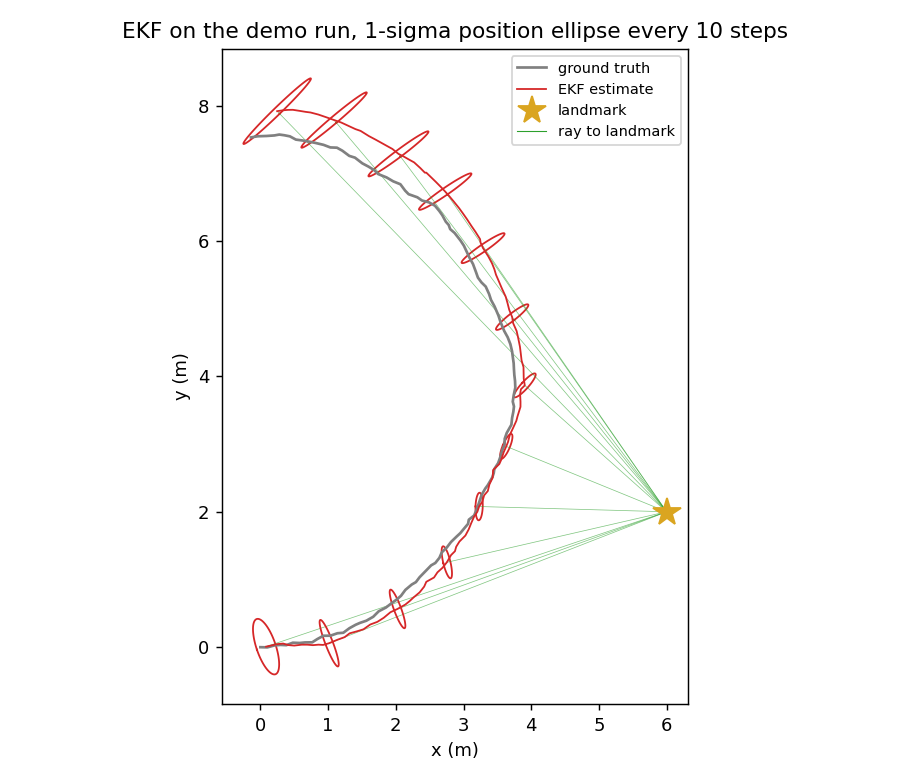

# a14_1 - Kalman filtering: KF, EKF, UKF, and the information form

The second assignment of the classical SLAM module, again in C++17 with Eigen. It covers the
Gaussian filters at the center of classical state estimation: the linear Kalman filter (KF), the
extended Kalman filter (EKF) for nonlinear motion and measurement models, the unscented Kalman
filter (UKF), and the information (canonical) form. The unicycle motion model, the range-bearing
measurement model, and their Jacobians written here reappear in the EKF-SLAM assignment, which
carries them over as provided code and builds a joint robot-plus-map filter on top.

The Python around the C++ (the build, the tests, the Rerun visualization) is provided, as in the
Lie-group assignment. The UKF's sigma-point loop is also provided in Python; the graded C++ is the
unscented-transform math it calls (see the assignment section).

Required reading before starting:
- Thrun, Burgard, Fox, *Probabilistic Robotics* (2005), chapter 3 - the Gaussian filters (KF,
  EKF, information filter) derived from the Bayes filter, and the cleanest statement of the
  recursion.
- Julier and Uhlmann, "Unscented filtering and nonlinear estimation," Proceedings of the IEEE
  92(3), 2004 - the sigma-point transform and the $\alpha,\beta,\kappa$ weights.

## Lecture notes

### What these filters are for

#### The task

The demo in this assignment is a planar robot driving a slow arc. Its state is its pose
$x = [p_x, p_y, \theta]$, position in meters and heading in radians. It is commanded to drive
forward at 1 m/s while turning at 0.25 rad/s, so over its 12 seconds it swings through about
$170^\circ$ on an arc of radius 4 m, but the commands are executed imperfectly: every 0.1 s the
true pose drifts from the commanded one by a small random amount. Ten times per second a sensor
on the robot reports two numbers about one landmark at the known position $(6, 2)$: the range
(distance to the landmark, with noise of standard deviation 0.15 m) and the bearing (the
landmark's direction measured from the robot's heading, with noise of standard deviation $3^\circ$). The
job is to estimate the pose at every step, together with a covariance that matches the actual
size of the error.

#### Why the obvious approaches fail

Integrating the commands alone (dead reckoning) gives a pose estimate that drifts without bound,
because each step's execution error is added to the last and nothing pulls it back. Using the
sensor alone does not work either: one reading is two numbers, the pose is three, and the
reading cannot be inverted for the pose. There is a whole curve of poses that would have produced
exactly the same reading (shown in the figure below). Stacking every reading so far into one
batch least-squares problem would work, but its size grows with time, and the robot needs an
estimate now, at every step.

#### The idea

Keep a Gaussian belief over the pose, a mean and a covariance, and update it recursively. The
commands move the mean and grow the covariance; each reading pulls the mean toward poses that
explain it and shrinks the covariance in the directions the reading constrains. Every filter in
this assignment does the update the same way, by conditioning a joint Gaussian of state and
measurement on the observed measurement. They differ only in how they compute that joint
Gaussian when the models are nonlinear: the EKF linearizes the models with Jacobians, and the
UKF pushes a handful of chosen sample points (called sigma points below) through the exact
models. The information form
stores the same Gaussian differently so that an update is an addition. The whole assignment is
these few ideas, implemented carefully enough (angle wrapping, a covariance update that stays
valid in floating point, a well-conditioned sigma-point set) to run without failing.

### Our first-reading example (one landmark reading at the start pose)

To make the formulas concrete we use one small case taken from the demo: the robot at its start
pose, at the origin facing $+x$, so $x = [0, 0, 0]$, with the demo's initial covariance
$P_0 = \operatorname{diag}(0.2, 0.2, 0.1)$ (position standard deviation $0.447$ m on each axis,
heading standard deviation $0.316$ rad, about $18^\circ$). It takes one range-bearing reading of
the landmark at $(6, 2)$, which is $6.32$ m away at a bearing of $18.4^\circ$. We call this our
first-reading example. It keeps everything nonlinear about the real problem (the square root and
arctangent in the sensor model, the heading coupling) and drops only the passage of time, which
the later steps of the demo add back.

The left panel shows why the reading cannot be inverted. The three poses drawn all see the
landmark at the same range and the same bearing: moving along the dotted circle around the
landmark keeps the range fixed, and turning the robot by the same angle it moved around the
circle keeps the bearing fixed. The right panel shows what one EKF update does with the reading
(the EKF is defined below). The prior position uncertainty is a circle of radius $0.447$ m. After
the update, the standard deviation along the ray to the landmark drops to $0.142$ m, close to the
range noise, while the standard deviation across the ray stays at $0.437$ m, almost unchanged.
The heading standard deviation drops from $18^\circ$ to $4.9^\circ$, even though the reading
cannot separate heading from motion around the circle. The bearing constrains only the
combination of across-ray position and heading, and the prior already bounds the across-ray
position: $0.447$ m at $6.32$ m is an angle of about $4^\circ$. That position prior combined with
the $3^\circ$ bearing noise leaves the heading uncertain by about $5^\circ$, and the exact update
gives $4.9^\circ$. The unobservable direction is still there; the prior on position limits
how far along it the belief can spread.


### Overview of the rest of the notes

1. The Bayes filter. The exact recursion every filter here approximates; familiar from
   *Probabilistic Robotics*, stated briefly.
2. Why Gaussians close the recursion. Three properties of Gaussians (affine maps, sums,
   conditioning) turn the recursion into matrix algebra. Conditioning is the update of every
   filter in the assignment, and its gain is a least-squares regression coefficient.
3. Covariance and positive definiteness. Why the covariance must stay symmetric positive
   definite, and what breaks when it does not.
4. The linear KF and the Joseph form of its covariance update, chosen for floating-point safety.
5. The EKF, with the unicycle and range-bearing models and their Jacobians, angle wrapping, and
   filter consistency.
6. What one landmark determines: the null space of the measurement Jacobian, which is the
   unobservable motion in the figure above.
7. The unscented transform, its parameters, and the UKF built from it.
8. The information form, where a measurement update is the addition of a term
   $H^\top R^{-1} H$, and why SLAM back-ends (the optimizers that estimate a whole trajectory
   and map from all measurements at once, as in the factor-graph assignment) prefer it.

Five exercises, placed after the sections they test, are meant to be worked by hand. Each has a
worked answer that can be expanded.

A note on notation. These notes write the covariance as $P$, the predicted (prior) belief as
$(\mu^-, P^-)$, and the updated (posterior) belief as $(\mu^+, P^+)$. *Probabilistic Robotics*
writes $\Sigma$ for the covariance and $\bar\mu, \bar\Sigma$ for the predicted belief; the
objects are the same. The two steps of every filter are called prediction (push the belief
through the motion model) and update (fold in a measurement); Thrun calls the update the
correction step.

### The Bayes filter

A filter tracks a hidden state $x$ (a robot pose, a velocity, a landmark position) that is never
observed directly. What it stores is a belief: the probability density over the state given
everything seen so far,

$$b_k(x) = p\big(x_k = x \mid z_{1:k},\, u_{1:k}\big),$$

with $u_k$ the control applied between step $k-1$ and step $k$ and $z_k$ the measurement at step
$k$. Two modeling assumptions make this belief updatable one step at a time. The state is Markov:
the next state depends only on the previous state and the current control, so
$p(x_k \mid x_{0:k-1}, u_{1:k}) = p(x_k \mid x_{k-1}, u_k)$. And a measurement depends only on
the state it was taken from: $p(z_k \mid x_{0:k}, z_{1:k-1}) = p(z_k \mid x_k)$. Together they
mean the past enters only through $b_{k-1}$, never through the raw history.

Under those two assumptions the recursion is two lines. Prediction pushes the belief through the
motion model,

$$\bar b_k(x) = \int p(x \mid x', u_k)\, b_{k-1}(x')\, dx',$$

the chance of being at $x'$ times the chance of moving from $x'$ to $x$, summed over every $x'$.
The update folds in the measurement by Bayes' rule,

$$b_k(x) = \frac{p(z_k \mid x)\, \bar b_k(x)}{\int p(z_k \mid x')\, \bar b_k(x')\, dx'}.$$

This is the exact posterior, for any models and any noise. Both lines are operations on whole
functions, so running them in general needs a representation of an arbitrary density and an
integral over the state space at every step, and neither is available in closed form.

Two cases escape. If the state takes finitely many values, the integrals become sums and the
belief is a table of probabilities: the histogram filter. If the belief is Gaussian and the
models are linear, both lines stay Gaussian and reduce to matrix algebra: the Kalman filter, the
subject of this assignment. Particle filters keep the generality by giving up exactness,
representing $b_k$ by weighted samples.

### Why Gaussians close the recursion

A Gaussian belief is written $x \sim \mathcal{N}(\mu, P)$ with density

$$p(x) = \frac{1}{\sqrt{(2\pi)^n \det P}} \exp\!\Big(-\tfrac12 (x-\mu)^\top P^{-1} (x-\mu)\Big),$$

so the entire belief is a mean vector $\mu$ ($n$ numbers) and a covariance matrix $P$
($n(n+1)/2$ numbers), a fixed size however long the filter runs. The pair $(\mu, P)$ is the
moment form of the Gaussian (Thrun et al. call it the moments parameterization), as opposed to the
information form at the end of these notes.
Three standard properties of Gaussians turn the two integral lines into arithmetic on $\mu$ and
$P$.

The first is behavior under an affine map. If $x \sim \mathcal{N}(\mu, P)$ and $g = Ax + b$, then
$g$ is Gaussian with mean $A\mu + b$ and covariance

$$\operatorname{Cov}(Ax + b) = \mathbb{E}\big[A(x-\mu)(x-\mu)^\top A^\top\big] = A P A^\top,$$

straight from the definition of covariance. The second is that independent Gaussians add: the sum
of $\mathcal{N}(\mu_1, P_1)$ and an independent $\mathcal{N}(0, Q)$ is
$\mathcal{N}(\mu_1, P_1 + Q)$. These two together are the prediction step.

The third is conditioning, and it is the whole update step. Stack the state and the measurement
into one jointly Gaussian vector,

$$\begin{bmatrix} x \\ z \end{bmatrix} \sim \mathcal{N}\!\left( \begin{bmatrix} \mu_x \\ \hat z \end{bmatrix},\ \begin{bmatrix} P_{xx} & P_{xz} \\ P_{xz}^\top & P_{zz} \end{bmatrix} \right).$$

Here $\hat z$ is the predicted measurement (the mean of $z$ before it is observed), $P_{zz}$ is
the covariance of the measurement, and $P_{xz}$ is the cross-covariance between state and
measurement. Conditioning on an observed value of $z$ gives another Gaussian, with

$$\mu^+ = \mu_x + K\,(z - \hat z), \qquad P^+ = P_{xx} - K\,P_{zz}\,K^\top, \qquad K = P_{xz}\,P_{zz}^{-1}.$$

The gain $K = P_{xz}P_{zz}^{-1}$ is a regression coefficient: the least-squares slope of $x$ on
$z$. So $K(z-\hat z)$ is the best linear prediction of how far the state is from its prior mean,
given how far the measurement landed from its predicted value. The correction grows with how
strongly state and measurement covary and shrinks as the measurement becomes more uncertain.

Every filter in this assignment computes exactly those three expressions. They differ only in how
they obtain $\hat z$, $P_{xz}$, and $P_{zz}$: the KF from a matrix $H$, the EKF from the Jacobian
of a nonlinear $h$, and the UKF from sigma points pushed through $h$. With that in view, the
UKF's update, which looks like a separate set of formulas, is the same formula with different
ingredients.

> **Exercise 1 (conditioning by hand).** A scalar state has prior $x \sim \mathcal{N}(0, 1)$. A
> sensor reports $z = 2x + v$ with $v \sim \mathcal{N}(0, 1)$ independent of $x$, and reads
> $z = 3$. Compute $\hat z$, $P_{xz}$, $P_{zz}$, the gain $K$, and the posterior mean and
> variance. What are the units of $K$ if $x$ is in meters and $z$ in volts?

<details>
<summary>Answer</summary>

The predicted measurement is $\hat z = 2 \cdot 0 = 0$. The cross-covariance is
$P_{xz} = \operatorname{Cov}(x, 2x + v) = 2 \operatorname{Var}(x) = 2$. The measurement variance
is $P_{zz} = 4 \cdot 1 + 1 = 5$. So $K = 2/5 = 0.4$, and

$$\mu^+ = 0 + 0.4 \cdot (3 - 0) = 1.2, \qquad P^+ = 1 - 0.4 \cdot 5 \cdot 0.4 = 0.2.$$

$K$ is in meters per volt: it converts a surprise in the measurement into a correction of the
state, as a regression slope does. A naive inversion of the sensor would give $x = z/2 = 1.5$;
the filter stops at $1.2$ because the prior at $0$ carries weight. The posterior variance $0.2$
is below both the prior variance $1$ and the variance $R/4 = 0.25$ of the inverted measurement.

</details>

### Covariance, ellipses, and positive definiteness

A covariance $P$ is symmetric, and for any direction $v$ the scalar $v^\top P v$ is the variance
of the state along $v$, so it cannot be negative. A matrix that is symmetric with $v^\top P v > 0$
for every nonzero $v$ is symmetric positive definite, abbreviated SPD throughout this module.
Positive semidefinite (PSD) is the same with $\ge 0$, allowing directions of exactly zero
variance.

The geometry is an ellipse. The level sets of the Gaussian density are the sets where the
quadratic form in the exponent is constant,

$$\{x : (x - \mu)^\top P^{-1} (x - \mu) = c^2\},$$

an ellipsoid centered at $\mu$ whose axes point along the eigenvectors of $P$ and whose
semi-axis lengths are $c\sqrt{s_i}$ for the corresponding eigenvalues $s_i$. The 1-sigma ellipses
in the figures are this set with $c = 1$ in the two position coordinates. In two dimensions it
contains $1 - e^{-1/2} \approx 39\%$ of the probability mass, not the $68\%$ that the
one-dimensional 1-sigma interval contains.

All of that requires SPD, and a filter that loses it breaks in specific ways. $P^{-1}$ stops
existing, so the density and the information form are undefined. The Cholesky factorization that
the UKF uses to build its sigma points fails outright. A negative eigenvalue means the filter
claims negative variance along some direction, which usually shows up as a gain that overcorrects
and an estimate that runs away. Two choices below follow from this: the Joseph form of the
covariance update, which keeps $P$ symmetric and PSD under round-off, and the UKF's need for a
valid Cholesky factor to build its point set at all.

### The linear Kalman filter

When the motion and measurement are linear with additive Gaussian noise,

$$x_{k} = F x_{k-1} + B u_k + w_k, \quad w_k \sim \mathcal{N}(0, Q), \qquad z_k = H x_k + v_k, \quad v_k \sim \mathcal{N}(0, R),$$

the belief stays exactly Gaussian by the three properties above. Prediction is an affine map plus
independent noise:

$$\mu^- = F\mu + B u, \qquad P^- = F P F^\top + Q.$$

$F P F^\top$ is the affine-map rule, and $+Q$ is the process noise that makes the robot less
certain the longer it moves without a measurement.

The update is the conditioning formula. With $z = Hx + v$ and $v$ independent of $x$, the
predicted measurement is $\hat z = H\mu^-$, the cross-covariance is $P_{xz} = P^- H^\top$, and
the measurement covariance is $P_{zz} = H P^- H^\top + R$. Substituting into
$K = P_{xz}P_{zz}^{-1}$ gives the standard names. The innovation $y = z - H\mu^-$ is what the
measurement says minus what was predicted, its covariance is the innovation covariance
$S = H P^- H^\top + R$ (the same matrix as $P_{zz}$), the gain is $K = P^- H^\top S^{-1}$, and

$$\mu^+ = \mu^- + K y, \qquad P^+ = (I - K H) P^- (I - K H)^\top + K R K^\top.$$

A scalar case makes the gain concrete. A constant scalar (a fixed distance, say) is read over
and over by a sensor with measurement variance $R = 0.25$, starting from prior variance
$P = 1.0$, so $H = 1$, $F = 1$, and $Q = 0$. Each new reading should be averaged in with the
earlier ones, and we call this our scalar averaging example. For the first reading
$K = P/(P + R) = 0.8$, and the estimate moves $80\%$ of the way toward the measurement, because
the measurement is four times more certain than the prior. The posterior variance $(1-K)P = 0.2$
is smaller than either input. As $R \to 0$ the gain goes to 1 and the filter believes the sensor
completely; as $R \to \infty$ the gain goes to 0 and the measurement is ignored.

Chain that update over many readings and the averaging appears. Each update adds $1/R$ to the
inverse variance, so after $N$ readings $P_N = (1/P_0 + N/R)^{-1}$, which tends to $R/N$: the
variance of the mean of $N$ independent readings. After $400$ updates with $R = 0.25$,
$P_N = 1/1601$, within $10^{-4}$ of $R/N = 1/1600$. The mean likewise becomes a weighted average
of the prior mean and the readings, with the prior's weight shrinking as $N$ grows.

The KF is optimal in two senses. For a linear-Gaussian system it is not an approximation: it
reproduces the exact Bayes posterior, so its mean is the minimum mean-squared-error estimate of
the state. Drop the Gaussian assumption but keep the linear models and the noise covariances, and
the same equations still give the minimum-variance estimate among all estimators that are linear
in the measurements.

### Why the Joseph form

The covariance update above is written in the Joseph form, not the shorter
$P^+ = (I - KH)P^-$. The long form comes from tracking the estimation error. Write
$e^- = x - \mu^-$ and $e^+ = x - \mu^+$. Substituting $\mu^+ = \mu^- + K(Hx + v - H\mu^-)$
gives

$$e^+ = (I - KH)\,e^- - K v,$$

and since $e^-$ and $v$ are independent, the covariance of that expression is
$(I - KH)P^-(I - KH)^\top + K R K^\top$. This holds for any gain $K$, optimal or not. The long
form reduces to the short form after substituting the specific optimal gain
$K = P^-H^\top S^{-1}$, so the short form is correct only at that exact gain.

At the optimal gain the two are algebraically equal, but they behave differently in floating
point. The short form subtracts two nearly equal matrices, which loses significant digits and
does nothing to enforce symmetry, so over a long run round-off can drift $P$ into a
non-symmetric or indefinite matrix. The Joseph form is a sum of two terms of the shape $MNM^\top$
with $N$ SPD, each symmetric and PSD by construction, so the sum stays symmetric and PSD whatever
the arithmetic does. It costs a couple of extra matrix products, and both the KF and the EKF here
use it.

> **Exercise 2 (a suboptimal gain).** In our scalar averaging example ($P^- = 1$, $H = 1$,
> $R = 0.25$), use the gain $K = 0.5$ instead of the optimal $0.8$, as a mistuned or simplified
> filter might. Compute the posterior variance with the Joseph form and with the short form. Which
> one is the actual variance of the error $e^+$? Compare both with the posterior variance at the
> optimal gain.

<details>
<summary>Answer</summary>

Joseph form: $(1 - 0.5)^2 \cdot 1 + 0.5^2 \cdot 0.25 = 0.25 + 0.0625 = 0.3125$.
Short form: $(1 - 0.5) \cdot 1 = 0.5$.

The error is $e^+ = (1 - K)e^- - Kv$, a combination of independent terms, so its variance is
exactly the Joseph value $0.3125$ (a Monte Carlo run with $10^6$ samples gives $0.3128$). The
short form reports $0.5$, which is wrong. At the optimal gain both forms give $0.2$, and the
suboptimal gain's true variance $0.3125$ is larger, as it must be. The short form is not a
general covariance formula; it is the Joseph form simplified with an identity that holds only at
the optimal gain. In floating point the computed gain is never exactly optimal, which is the
same failure on a smaller scale.

</details>

### The extended Kalman filter

Real motion and measurement models are nonlinear: a robot turns, a range sensor computes a square
root. A Gaussian pushed through a nonlinear function is no longer Gaussian, so the recursion no
longer closes. The EKF forces it closed by replacing each function with its first-order Taylor
expansion at the current mean, which is affine, and affine maps keep Gaussians Gaussian.

For a nonlinear motion model $f(x, u)$ and measurement model $h(x)$, the prediction and update
are the KF equations with the Jacobians

$$F_x = \left.\frac{\partial f}{\partial x}\right|_{\mu}, \qquad H = \left.\frac{\partial h}{\partial x}\right|_{\mu},$$

while the mean itself goes through the exact nonlinear model: $\mu^- = f(\mu, u)$ and
$y = z - h(\mu^-)$. The covariance still propagates as $F_x P F_x^\top + Q$, and the measurement
blocks are still $P_{xz} = P^- H^\top$ and $P_{zz} = H P^- H^\top + R$.

#### The unicycle motion model

The demo's robot is a unicycle: a vehicle that can drive forward and turn but cannot slide
sideways. Its state is $x = [p_x, p_y, \theta]$ and its control is $u = [v, \omega]$ (forward
speed and turn rate). Integrated over a time step $\Delta t$ with a forward Euler step, which
holds the heading fixed at its value at the start of the interval,

$$p_x' = p_x + v\,\Delta t\cos\theta, \quad p_y' = p_y + v\,\Delta t\sin\theta, \quad \theta' = \theta + \omega\,\Delta t.$$

Exact integration of constant $v, \omega$ traces a circular arc; the forward Euler step replaces
that arc with a straight segment along the starting heading, so it has a discretization error
that grows with $\omega\,\Delta t$. That error does not reach the filter in this demo, because
the demo's simulator generates the ground truth with the same forward Euler expressions; the only
motion error the filter faces is the injected process noise.

#### The range-bearing measurement model

The measurement is a range and bearing to a known landmark at $\ell = [\ell_x, \ell_y]$. With
$dx = \ell_x - p_x$, $dy = \ell_y - p_y$, and $q = dx^2 + dy^2$,

$$h(x) = \begin{bmatrix} r \\ \phi \end{bmatrix} = \begin{bmatrix} \sqrt{q} \\ \operatorname{atan2}(dy, dx) - \theta \end{bmatrix},$$

so $r$ is the distance to the landmark and $\phi$ is its direction relative to where the robot is
pointing, which is what a bearing sensor mounted on the vehicle reports. The Jacobians are

$$F_x = \begin{bmatrix} 1 & 0 & -v\,\Delta t\sin\theta \\ 0 & 1 & v\,\Delta t\cos\theta \\ 0 & 0 & 1 \end{bmatrix}, \qquad H = \begin{bmatrix} -dx/r & -dy/r & 0 \\ dy/q & -dx/q & -1 \end{bmatrix}.$$

In our first-reading example ($x = [0, 0, 0]$, $\ell = (6, 2)$), $dx = 6$, $dy = 2$, $q = 40$,
$r = 6.325$, and

$$H = \begin{bmatrix} -0.949 & -0.316 & 0 \\ 0.05 & -0.15 & -1 \end{bmatrix}.$$

#### Angles and singularities

The bearing $\phi$ is an angle, so its residual must be wrapped to $(-\pi, \pi]$: a measurement at
$+179^\circ$ and a prediction at $-179^\circ$ are $2^\circ$ apart, not $358^\circ$, and an
unwrapped innovation injects a huge spurious correction. The heading state is likewise kept
wrapped. This is the most common bug in an EKF on a pose; the wrap belongs in the bearing
residual and after the mean update. The range-bearing model is also singular at zero range: $H$
has $1/r$ and $1/r^2$ terms, so a landmark at the robot's exact position has undefined bearing
and an infinite Jacobian. Real sensors never report zero range and the demo keeps the landmark at
least a couple of meters away, so the filter does not guard against it, but it is a degeneracy
to be aware of.

#### Where the EKF fails, and consistency

The EKF's weakness is the linearization. $F_x$ and $H$ describe the models only in a small
neighborhood of $\mu$, while the covariance says the state might be anywhere in an ellipse around
$\mu$. When a model curves appreciably over that ellipse, the linear map is a poor substitute and
the propagated covariance is wrong, usually too small.

Too small is the dangerous direction, and the name for the failure is inconsistency. A filter is
consistent when its reported uncertainty matches its actual errors: the innovation
$y = z - h(\mu^-)$ should look like a zero-mean draw from $\mathcal{N}(0, S)$. That is checkable,
because the normalized innovation squared $y^\top S^{-1} y$ then averages to the dimension of $z$
over a long run. An overconfident filter reports an $S$ that is too small. It treats each new
measurement as less informative than the prediction it already has, discounts corrections that
would have pulled it back, and diverges while its covariance ellipse keeps shrinking.

> **Exercise 3 (one EKF prediction from the start pose).** In our first-reading example, before
> the reading, the robot drives one step: $u = [1, 0.25]$, $\Delta t = 0.1$, process noise
> $Q = \operatorname{diag}(0.02^2, 0.02^2, 0.01^2)$, starting from $\mu = [0, 0, 0]$ and
> $P_0 = \operatorname{diag}(0.2, 0.2, 0.1)$. Compute $\mu^-$, $F_x$, and $P^-$. Which entry of
> $P^-$ is nonzero that was zero in $P_0$, and what does it mean physically?

<details>
<summary>Answer</summary>

The mean moves forward along the heading and turns:
$\mu^- = [0 + 0.1\cos 0,\ 0 + 0.1 \sin 0,\ 0 + 0.025] = [0.1, 0, 0.025]$.

At $\theta = 0$ the Jacobian is

$$F_x = \begin{bmatrix} 1 & 0 & 0 \\ 0 & 1 & 0.1 \\ 0 & 0 & 1 \end{bmatrix},$$

because $-v\Delta t \sin 0 = 0$ and $v\Delta t\cos 0 = 0.1$. Then $F_x P_0 F_x^\top$ has
$(y, y)$ entry $0.2 + 0.1^2 \cdot 0.1 = 0.201$ and $(y, \theta)$ entry $0.1 \cdot 0.1 = 0.01$.
Adding $Q$:

$$P^- = \begin{bmatrix} 0.2004 & 0 & 0 \\ 0 & 0.2014 & 0.01 \\ 0 & 0.01 & 0.1001 \end{bmatrix}.$$

The new nonzero entry is the $p_y$-$\theta$ covariance $0.01$. Driving forward with an uncertain
heading spreads the position sideways (here along $y$, perpendicular to the direction of travel),
and the sideways error is correlated with the heading error: if the robot actually faced a little
to the left, it also ended up a little to the left. The correlation coefficient is only $0.07$
after one step, but it builds up step by step, and it is how a later bearing measurement, which
constrains a mix of lateral position and heading, corrects both.

</details>

### What one landmark determines

Observability asks whether the measurements determine the state at all, before any question of
noise. Locally the test is the rank of the map from state to measurement, which is the rank of
$H$.

Here $H$ is $2 \times 3$: two measurement numbers, three state numbers. For any $r > 0$ its two
rows are independent, so its rank is 2 and its null space is one dimensional. Solving $H\nu = 0$
for the null vector $\nu$ gives

$$\nu \propto \begin{bmatrix} -dy \\ dx \\ -1 \end{bmatrix}.$$

That direction has a physical reading, and it is the motion in the left panel of the
first-reading figure. The vector $(-dy, dx)$ is perpendicular to the line from the robot to the
landmark, so moving along it swings the robot around the landmark at constant distance; the third
component turns the robot by the matching amount. Range is unchanged because the distance did
not change, and relative bearing is unchanged because the landmark moved in the robot's field of
view by exactly as much as the robot turned. One range-bearing reading of one landmark therefore
pins down two combinations of the three pose numbers and says nothing at all about the third. In
our first-reading example $\nu \propto [-2, 6, -1]$, and $H\nu = 0$ can be checked with the numeric
$H$ above.

Motion recovers the missing direction. As the robot drives, the geometry changes, and the
unobservable direction at one instant is not the unobservable direction at the next, so
successive measurements constrain different combinations. The recovery is slow when the landmark
is far away and the geometry changes little. The consequence for the position estimate is an
ellipse that stays stretched across the ray to the landmark and narrow along it. The along-ray
direction is measured directly by the range. The across-ray direction is reached only through the
bearing angle, whose noise (a few degrees in this demo) turns into a lateral error proportional
to the distance, and whose information is shared with the uncertain heading.

### The unscented transform

The UKF handles the same nonlinearity without Jacobians. Instead of approximating the function,
it approximates the distribution: represent the Gaussian by a small set of deterministically
chosen points, push each one through the exact function, and fit a Gaussian to where they land.
This is moment matching. The point set is built so that its weighted mean and weighted covariance
are exactly $\mu$ and $P$, and the same weighted sums are read off after the transformation. The
points are called sigma points, and the procedure is the unscented transform.

Building the point set needs a matrix square root of the covariance, a matrix $M$ with
$M M^\top = P$. It is the matrix version of $\sqrt{\sigma^2} = \sigma$: the columns of $M$ are $n$
directions whose outer products add up to $P$, so scattering points along them reproduces the
spread that $P$ describes. The one used here is the Cholesky factor, the unique lower-triangular
$M$ with positive diagonal satisfying $M M^\top = P$, which exists exactly when $P$ is SPD and
costs about a third of a matrix inversion to compute. The choice is not canonical: any $M$ with
$M M^\top = P$ works, including the symmetric square root built from eigenvectors, and all of them
give the same recovered mean and covariance for a linear map. They place the points differently,
so for a nonlinear $f$ they give slightly different answers, and the convention is to fix one and
stay with it.

For an $n$-dimensional state the transform uses $2n+1$ points: the mean, and one symmetric pair
straddling the mean along each column of the square root. Writing $\lambda$ for a scaling
parameter defined in the next section, and $L$ for the Cholesky factor of $(n+\lambda)P$ (so
$L = \sqrt{n+\lambda}\,M$), with columns numbered from 1,

$$\mathcal{X}_0 = \mu, \qquad \mathcal{X}_i = \mu + L_{:,i}, \qquad \mathcal{X}_{i+n} = \mu - L_{:,i} \quad (i = 1\dots n).$$

After propagating the points through $f$ or $h$ to get $\mathcal{Y}_i$, the transformed mean and
covariance are weighted sums:

$$\mu' = \sum_i W^m_i \mathcal{Y}_i, \qquad P' = \sum_i W^c_i (\mathcal{Y}_i - \mu')(\mathcal{Y}_i - \mu')^\top + Q,$$

with mean weights $W^m_i$ and covariance weights $W^c_i$ given by

$$W^m_0 = \frac{\lambda}{n+\lambda}, \quad W^c_0 = \frac{\lambda}{n+\lambda} + (1 - \alpha^2 + \beta), \quad W^m_i = W^c_i = \frac{1}{2(n+\lambda)}.$$

The $+Q$ is the additive noise of the model being transformed: process noise $Q$ in prediction,
measurement noise $R$ in the update.

The $(n+\lambda)$ inside the square root and the $1/(2(n+\lambda))$ in the weights are the same
constant, chosen so that the two cancel. Feed the identity map in and check: the $\pm$ pairs make
the weighted mean equal $\mu$ because the mean weights sum to 1, and the weighted covariance is
$\sum_{i=1}^{n} \frac{1}{2(n+\lambda)} \cdot 2\, L_{:,i} L_{:,i}^\top = \frac{1}{n+\lambda} L L^\top = P$.
The point set carries $\mu$ and $P$ exactly.

The same cancellation makes the transform exact for any affine $g = Ax + b$: the weighted sums
commute with the affine map, so they return $A\mu + b$ and $A P A^\top$ with no error beyond
floating point. That is why the UKF and the KF produce identical posteriors on a linear-Gaussian
system.

The transform is more accurate than linearization when the function curves. In our $e^x$
example, $x \sim \mathcal{N}(0.3,\, 0.4^2)$ is pushed through $f(x) = e^x$. The true mean of $f(x)$ is
$e^{\mu + \sigma^2/2} = 1.4623$. The EKF's answer is $f(\mu) = e^{0.3} = 1.3499$, off by $0.11$,
because linearization moves the mean through the function and drops the curvature term entirely.
The unscented transform with this assignment's parameters ($\alpha = 0.5$, $\beta = 2$,
$\kappa = 0$, introduced next) returns $1.4582$. The figure shows why: the tangent line passes
through $f(\mu)$, while the three sigma points sample the curve on both sides of the mean, and
the convex curve lifts the outer two.


A Taylor expansion of $f$ around $\mu$ gives the reason in general. The true mean is
$f(\mu) + \tfrac12 f''(\mu)\sigma^2 + \tfrac18 f''''(\mu)\sigma^4 + \dots$. The weighted sum over
the symmetric point set reproduces the $f(\mu)$ and $\tfrac12 f''(\mu)\sigma^2$ terms exactly for
any spread, and the first disagreement is in the $\sigma^4$ term. "Second-order accurate" means
exactly that: agreement with the true transformed mean through the $\sigma^2$ term, where the EKF
agrees only through $f(\mu)$.

### The sigma-point parameters

Three numbers control the point set, through $\lambda = \alpha^2(n + \kappa) - n$. All of them
act through the single scale factor $n + \lambda = \alpha^2 (n + \kappa)$, which multiplies $P$
before the Cholesky and divides the weights.

$\alpha$ sets the spread. The columns of a square root of $P$ get multiplied by
$\sqrt{n+\lambda} = \alpha\sqrt{n+\kappa}$, so $\alpha$ is the fraction of the natural spread
$\sqrt{n+\kappa}$ at which the points sit. This assignment uses $\alpha = 0.5$, $\kappa = 0$,
which for the 3-dimensional pose puts the points at $0.5\sqrt{3} \approx 0.87$ times the
square-root columns of $P$, just inside one standard deviation. A small $\alpha$ keeps the points
in a tight neighborhood where the local behavior of $f$ dominates, which is the argument for the
textbook $\alpha = 10^{-3}$, but it makes the weights large and of opposite sign: with $\kappa = 0$ the center weight is
$W^m_0 = 1 - 1/\alpha^2$, so $\alpha = 10^{-3}$ makes it about $-10^6$ while the other weights
sum to $+10^6$, and the weighted sums lose digits to cancellation. $\alpha = 0.5$ gives
$W^m_0 = -3$ against $2n$ weights of $2/3$ each, which sum to 1 without large cancellation. A
negative center weight is not a bug: the weights must sum to 1, and drawing the points in closer
than $\sqrt{n}$ makes the outer weights larger than $1/(2n)$, so the center weight has to go
below zero to compensate.

$\kappa$ is a second spread parameter, historically the only one. The standard choice
$\kappa = 3-n$ comes from the scalar analysis above: with $\alpha = 1$ it makes
$n + \lambda = 3$, and $3$ is the value at which the $\sigma^4$ term of the weighted sum matches
the fourth moment of a Gaussian, so the transform gains one more order of accuracy. It goes
negative for $n > 3$, which in the original unscaled transform, where $\kappa$ was the only
parameter, drives the center weight negative and can leave the recovered covariance indefinite.
Fixing $\kappa = 0$ and tuning the spread with $\alpha$ is the common default, and the one used
here.

$\beta$ appears in exactly one place, the extra $(1 - \alpha^2 + \beta)$ on the center covariance
weight $W^c_0$, and does not touch the mean weights. Its job is to correct the covariance for the
fourth-moment error that the mean-weight choice leaves behind; $\beta = 2$ is the value that does
this best when the underlying distribution really is Gaussian. Dropping $\beta$ gives a filter
whose mean is still right and whose covariance is quietly wrong, but only when the transformed
function is nonlinear: for the identity and for any affine map the propagated center point lands
exactly on the recovered mean, so $\mathcal{Y}_0 - \mu' = 0$ and the weight multiplies a zero
matrix. A test of the transform on affine maps therefore cannot detect a missing $\beta$; only a
direct check of $W^c_0 - W^m_0 = 1 - \alpha^2 + \beta$, or a nonlinear test, can.

> **Exercise 4 (the unscented transform of $x^2$).** Let $x \sim \mathcal{N}(1, 1)$ and
> $f(x) = x^2$. With $n = 1$, $\alpha = 0.5$, $\beta = 2$, $\kappa = 0$, compute $\lambda$, the
> three sigma points, the weights $W^m$ and $W^c$, and the unscented mean and variance of $f(x)$.
> Repeat the variance with $\beta = 0$. Compare with the exact values
> ($\mathbb{E}[x^2] = \mu^2 + \sigma^2$, $\operatorname{Var}[x^2] = 4\mu^2\sigma^2 + 2\sigma^4$
> for a Gaussian) and with the EKF's linearized answer.

<details>
<summary>Answer</summary>

$\lambda = 0.25 \cdot 1 - 1 = -0.75$, so $n + \lambda = 0.25$ and $\sqrt{n+\lambda} = 0.5$. The
sigma points are $1$, $1.5$, $0.5$. The weights are $W^m_0 = -0.75/0.25 = -3$,
$W^m_1 = W^m_2 = 1/(2 \cdot 0.25) = 2$, and $W^c_0 = -3 + (1 - 0.25 + 2) = -0.25$, with
$W^c_1 = W^c_2 = 2$.

The images are $f = 1, 2.25, 0.25$. The mean is $-3 \cdot 1 + 2 \cdot 2.25 + 2 \cdot 0.25 = 2$.
The deviations from it are $-1$, $0.25$, $-1.75$, so the variance is

$$-0.25 \cdot 1 + 2 \cdot 0.0625 + 2 \cdot 3.0625 = 6.0.$$

With $\beta = 0$, $W^c_0 = -2.25$ and the variance is $-2.25 + 0.125 + 6.125 = 4.0$.

Exact: $\mathbb{E}[x^2] = 1 + 1 = 2$ and $\operatorname{Var}[x^2] = 4 + 2 = 6$ (a Monte Carlo
run with $10^7$ samples gives $2.001$ and $6.001$). The unscented transform with $\beta = 2$ gets
both exactly. With $\beta = 0$ the mean is still right but the variance is $4$, missing the
$2\sigma^4$ term, which is the fourth-moment correction $\beta$ exists to supply. The EKF
linearizes $x^2$ at $\mu = 1$ with slope $2$, giving mean $f(\mu) = 1$ (wrong by $\sigma^2$) and
variance $2^2 \cdot 1 = 4$ (also missing the $2\sigma^4$ term).

</details>

### The unscented Kalman filter

Wiring the transform into a filter is mechanical. Prediction generates sigma points from
$(\mu, P)$, pushes them through $f$, and reads back the transformed Gaussian with $Q$ added. The
update generates sigma points again from the predicted $(\mu^-, P^-)$, pushes them through $h$ to
get measurement points $\mathcal{Z}_i$, and applies the unscented transform with $R$ added to
obtain $\hat z$ and $P_{zz} = S$. Regenerating the points rather than reusing the propagated ones
costs one extra Cholesky and keeps the point set consistent with the covariance it is supposed
to represent.

That leaves the cross-covariance $P_{xz}$, which the transform does not produce because it
involves two different point sets:

$$P_{xz} = \sum_i W^c_i (\mathcal{X}_i - \mu^-)(\mathcal{Z}_i - \hat z)^\top.$$

With all three ingredients the update is the conditioning formula from the start of these notes,
unchanged: $K = P_{xz} S^{-1}$, $\mu^+ = \mu^- + K(z - \hat z)$, and $P^+ = P^- - K S K^\top$.

Against the EKF, the UKF trades derivation effort for evaluation cost. It needs no Jacobians at
all, which matters when $h$ is a block of code rather than a formula, and it tracks curvature to
one order better. It costs $2n+1$ evaluations of $f$ and $h$ per step plus a Cholesky, against
one evaluation and one Jacobian for the EKF. Both reduce to the KF on a linear system.

### The information form

The information (canonical) form stores the same Gaussian in a second parameterization. The
reason it exists is visible in the logarithm of the density. Dropping constants,

$$\log p(x) = -\tfrac12 (x-\mu)^\top P^{-1} (x - \mu) + c = -\tfrac12 x^\top P^{-1} x + x^\top P^{-1}\mu + c'.$$

A Gaussian is a quadratic in the exponent, and a quadratic is determined by its second-order and
first-order coefficients. Those two are the information matrix $\Omega = P^{-1}$ and the
information vector $\eta = \Omega\mu$. The name comes from the fact that for a Gaussian with known
covariance, $P^{-1}$ is the Fisher information the distribution carries about its own mean: how
sharply the log-density curves, which is how strongly the data pins the parameter down.

Additivity follows. Bayes' rule multiplies the prior by the likelihood, multiplying densities adds
log-densities, and adding log-densities adds quadratics coefficient by coefficient. For a
linear-Gaussian measurement $z = Hx + v$,

$$\log p(z \mid x) = -\tfrac12 (z - Hx)^\top R^{-1}(z - Hx) + c = -\tfrac12 x^\top H^\top R^{-1} H x + x^\top H^\top R^{-1} z + c'',$$

and adding the two quadratics gives the update this assignment implements:

$$\Omega^+ = \Omega^- + H^\top R^{-1} H, \qquad \eta^+ = \eta^- + H^\top R^{-1} z.$$

No inverse of a state-sized matrix appears, only the inverse of the measurement-sized $R$. Each
sensor contributes an independent additive term, so fusing several sensors is adding their
contributions in any order, and the result equals running the KF updates one after another.

The term $H^\top R^{-1} H$ is the measurement's information $R^{-1}$ pulled back into state space
through $H$. It has the same null space as $H$, so a direction the sensor cannot see receives
exactly zero information, which is the observability statement from earlier written as a matrix.
Our scalar averaging example fits here too: with $H = 1$ and a static state, $N$ updates give
$\Omega_N = \Omega_0 + N/R$, so $P_N \to R/N$ in one line instead of a chained recursion.

The other half of the recursion is where the information form is expensive. Prediction, cheap in
the moment form, becomes $\Omega^- = (F \Omega^{-1} F^\top + Q)^{-1}$, so it inverts a
state-sized matrix twice per step. The mean is also not stored directly; recovering it means
solving $\Omega\mu = \eta$. The choice of form is a trade over which step dominates. Filters that
predict constantly and measure rarely favor the moment form; multi-sensor fusion and SLAM
back-ends, which accumulate large numbers of constraints, favor the information form. The other
reason back-ends favor it is sparsity. A pose graph is a set of robot poses (the states) linked
by relative-pose measurements (the constraints). Its information matrix has a nonzero block
only where a constraint couples two states, which for a robot revisiting a few places is almost
all zeros, while its inverse, the covariance, is dense because every state is correlated with
every other.

> **Exercise 5 (the information in one reading).** In our first-reading example, the position
> part of $H$ is $(-0.949, -0.316)$ in the range row and $(0.05, -0.15)$ in the bearing row, and
> $R = \operatorname{diag}(0.15^2, (3^\circ)^2)$ with $3^\circ = 0.05236$ rad. Let
> $d = (6, 2)/\sqrt{40}$ be the unit vector toward the landmark and $p = (-2, 6)/\sqrt{40}$ the
> unit vector across the ray. (a) Show that the range row's position part is $-d$ and the bearing
> row's is $-p/r$. (b) If the heading were known exactly, how much information does the reading
> add along $d$ and along $p$, and what standard deviations do those correspond to? (c) Compute
> $\nu^\top H^\top R^{-1} H\, \nu$ for the null vector $\nu = [-2, 6, -1]$, and say what it means for the across-ray
> position once the heading is uncertain.

<details>
<summary>Answer</summary>

(a) $d = (0.949, 0.316)$, so the range row's position part $(-0.949, -0.316)$ is $-d$. With
$p = (-0.316, 0.949)$ and $r = 6.325$, $-p/r = (0.05, -0.15)$, the bearing row's position part.
The range responds only to motion along the ray and the bearing (at fixed heading) only to motion
across it, scaled by $1/r$.

(b) With the heading fixed, only the position block of $H^\top R^{-1} H$ matters. Along $d$ only
the range row contributes: $1/0.15^2 = 44.4\ \text{m}^{-2}$, a standard deviation of $0.15$ m.
Along $p$ only the bearing row contributes:
$(1/r)^2 / 0.05236^2 = 1/(40 \cdot 0.002742) = 9.12\ \text{m}^{-2}$, a standard deviation of $0.331$ m, which is $r\sigma_\phi$: the angular noise
times the distance. Even with a perfect heading the reading constrains the across-ray position
2.2 times more loosely than the along-ray position.

(c) $H\nu = 0$, so $\nu^\top H^\top R^{-1} H\, \nu = 0$: the reading adds no information along
$\nu$.
The full $3 \times 3$ matrix $H^\top R^{-1} H$ has eigenvalues $0$, $44.4$, and $373.9$. The
across-ray position and the heading enter the bearing together, and the reading constrains only
their combination. Unless the prior already knows the heading well, the bearing's
$9.12\ \text{m}^{-2}$ of across-ray information is shared with the heading, which is why the posterior
in the first-reading figure stays $0.437$ m wide across the ray while the heading tightens to
$4.9^\circ$.

</details>

## The assignment

Fill these holes, in order. Each is one `NOT_IMPLEMENTED` throw with a matching test; the
declaration and comments in each file give the signature and shapes.

| # | Function | File | Concept from the notes |
|---|---|---|---|
| 1 | [`kf_predict()`](kalman.cpp) | `kalman.cpp` | KF prediction $\mu^- = F\mu + Bu$, $P^- = FPF^\top + Q$ |
| 2 | [`kf_update()`](kalman.cpp) | `kalman.cpp` | KF update with the Joseph-form covariance |
| 3 | [`ekf_f()`](kalman.cpp) | `kalman.cpp` | the forward-Euler unicycle model, heading wrapped |
| 4 | [`ekf_h()`](kalman.cpp) | `kalman.cpp` | the range-bearing model, bearing wrapped |
| 5 | [`ekf_F_x()`](kalman.cpp) | `kalman.cpp` | the motion Jacobian $F_x$ |
| 6 | [`ekf_H()`](kalman.cpp) | `kalman.cpp` | the measurement Jacobian $H$ |
| 7 | [`ekf_predict()`](kalman.cpp) | `kalman.cpp` | EKF prediction: mean through $f$, covariance through $F_x$ |
| 8 | [`ekf_update()`](kalman.cpp) | `kalman.cpp` | EKF update: wrapped bearing residual, Joseph form, wrapped heading |
| 9 | [`ukf_sigma_points()`](kalman.cpp) | `kalman.cpp` | the $2n+1$ sigma points and the weights $W^m$, $W^c$ |
| 10 | [`ukf_unscented_transform()`](kalman.cpp) | `kalman.cpp` | the weighted mean and covariance plus additive noise |
| 11 | [`ukf_cross_covariance()`](kalman.cpp) | `kalman.cpp` | the cross-covariance $P_{xz}$ |
| 12 | [`moments_to_information()`](kalman.cpp) | `kalman.cpp` | $\Omega = P^{-1}$, $\eta = \Omega\mu$ |
| 13 | [`information_to_moments()`](kalman.cpp) | `kalman.cpp` | the inverse conversion |
| 14 | [`information_update()`](kalman.cpp) | `kalman.cpp` | the additive information update |

You may not include an existing estimation or solver library; a test scans the sources.

Notes on specific holes:
- `wrap_angle` (wrap to $(-\pi, \pi]$) is provided in `kalman.hpp`. Use it in `ekf_f`, `ekf_h`,
  on the bearing component of the residual in `ekf_update`, and on the heading after the mean
  update.
- `ukf_sigma_points` returns the points as the rows of a $(2n+1) \times n$ matrix, row 0 the mean
  point, so the $\pm$ pair for column $i$ of $L$ sits in rows $1+i$ and $1+n+i$ (zero-based $i$).
  Eigen's `.llt().matrixL()` gives the Cholesky factor.
- The UKF predict and update loops (`ukf_predict`, `ukf_update` in `_helpers.py`) are provided
  Python: they call the three UKF holes, propagate each sigma point through $f$ or $h$, and apply
  $K = P_{xz}S^{-1}$ and $P^+ = P^- - KSK^\top$. The visualization passes them a residual that
  wraps the bearing.
- The UKF parameters $\alpha = 0.5$, $\beta = 2$, $\kappa = 0$, the tolerances, and the demo's
  simulation settings are in `config.py`.

### Building and running

Same toolchain as the Lie-group assignment: a C++17 compiler plus CMake, pybind11, and Eigen (the
`environment.yml` a14 block). You never call CMake by hand: importing `_impl.py` (which the tests
and `viz.py` do) configures and builds a pybind11 extension with CMake, from the top-level
`kalman.cpp` by default or from `solution/kalman.cpp` under `NANOVISION_IMPL=solution`. The build
is cached under `build/student/` or `build/solution/`, so only the first run or a source change
compiles.

Activate the environment first (`conda activate nanovision`); the Makefile calls the `python` on
the path. Then:

```
make verify A=a14_1_kalman   # build + run the reference (solution/); the green target
make test   A=a14_1_kalman   # build + run YOUR code; red until the holes are filled
make viz    A=a14_1_kalman        # render the EKF-vs-UKF tracking run (reference)
make viz-mine A=a14_1_kalman      # the same, from YOUR code, once the holes are filled
```

`make test` also accepts `K="ekf"` to run only matching tests and `SKIP_HOLES=1` to report
unfilled holes as skips instead of failures.

The test order is the intended workflow:
- `test_kf.py`: prediction and the Joseph update against an independent NumPy reference; a check
  that an update shrinks the covariance trace and leaves it symmetric and SPD; and
  `test_kf_static_scalar_converges`, our scalar averaging example run for $400$ updates with
  $R = 0.25$, asserting the variance lands within $10^{-4}$ of $R/N$.
- `test_ekf.py`: the analytic Jacobians against central differences, which catches a wrong
  derivative before anything else runs. The finite-difference comparison wraps the bearing
  difference before dividing, so the check stays valid across the $\pm\pi$ seam. Then the bearing
  wrap, SPD preservation over 30 predict-update cycles, an update that reduces the trace, and a
  tracking run on the simulated unicycle.
- `test_ukf.py`: `test_ukf_weights` checks that the mean weights sum to 1 and checks
  $W^c_0 - W^m_0 = 1 - \alpha^2 + \beta$ directly, because the affine tests cannot catch a
  missing $\beta$; `test_ukf_recovers_its_own_gaussian` pushes the points through the identity
  map and recovers $\mu$ and $P$; a test checks exactness on an affine map; and
  `test_ukf_matches_kf_linear_run` runs the KF and the UKF on the same linear-Gaussian
  constant-velocity system and checks agreement to $10^{-6}$ at every step.
- `test_information.py`: the moment-information round trip, equivalence of the information
  update with the KF update, and `test_information_fuses_two_sensors_additively`, which checks two
  additive information updates against two sequential KF updates.
- `test_forbidden_imports.py`: no estimation or solver library is included.

`make viz` writes a Rerun recording to `out/kalman_track.rrd`. Add `SHOW=1` for the interactive
viewer: a unicycle drives an arc observed only by range-bearing to one landmark, and the EKF (red)
and UKF (blue) estimates track it with their 1-sigma covariance ellipses, on a timeline you can
scrub. The scalar panels compare the two filters' position error and covariance trace.

The figures in the notes and below are generated by `assets/make_figures.py` (run it from
`assets/`), which reimplements the EKF and the UKF in NumPy with the same simulator settings and
seed as `viz.py`. It also prints the demo-run statistics quoted below: the across-ray to
along-ray ratio, the heading standard deviation range, each filter's mean position error, and
the largest EKF-UKF gap. These printed values agree with the reference C++ filters run on the
same data, to the digits quoted.

What you should see when you run this. The ellipses stay stretched across the ray to the
landmark, the direction a single reading cannot constrain, and narrow along it, the direction the
range measures directly. Over the demo run the EKF's across-ray standard deviation is 3 to 13
times the along-ray one (median about 6), with the largest ratios near the end, where the robot
is farthest from the landmark (about 8.3 m); the heading standard deviation stays between
$4.1^\circ$ and $4.9^\circ$ for the whole run. The EKF and UKF position estimates stay within
about 3 cm of each other, while each is about 0.21 m from the ground truth on average, which is what
to expect when the models curve little over ellipses this small.



## In interviews

KF versus EKF versus UKF. Know the one-line distinction: the KF is exact for linear-Gaussian
systems; the EKF handles nonlinearity by linearizing the model with a Jacobian at the mean; the
UKF handles it by propagating sigma points through the exact model and refitting a Gaussian. The
EKF needs derived Jacobians and degrades when the model curves over the covariance; the UKF needs
no Jacobians and matches the true transformed mean one order further, at a cost of $2n+1$ model
evaluations per step. Both reduce to the KF on a linear system.

Why the Joseph form. Expect "what's wrong with $P^+ = (I-KH)P$?" The answer: it is correct in
exact arithmetic at the optimal gain, but it subtracts nearly equal matrices and enforces
nothing, so round-off can drift the covariance non-symmetric or indefinite and the estimate
diverges; the Joseph form is a sum of symmetric PSD terms, stays valid, and holds for any gain.

The information filter and where it wins. Be able to state the dual ($\Omega = P^{-1}$,
$\eta = \Omega\mu$), that it is the quadratic form of the log-density, and that Bayes' rule
therefore turns into addition. That additivity makes multi-sensor fusion and sparse back-ends
natural, helped by the information matrix of a pose graph being sparse while the covariance is
dense. The trade-off: prediction is the expensive step in information form, and reading out the
mean needs a solve.

Observability. A favorite follow-up: with a single range-bearing landmark, is the planar pose
observable? A single reading gives two numbers for three unknowns, and the unconstrained direction
is orbiting the landmark while turning by the same angle, which leaves both range and relative
bearing unchanged. Motion recovers it as the geometry changes, slowly when the landmark is
distant, which the visualization shows as an ellipse stretched across the landmark ray. Be ready
to follow up on filter consistency: the covariance should match the actual error spread,
testable by checking that $y^\top S^{-1} y$ averages the measurement dimension.

A classic on-the-spot request is to write the scalar (1D) Kalman update from scratch:
$K = P/(P+R)$, $\mu \leftarrow \mu + K(z-\mu)$, $P \leftarrow (1-K)P$. The matrix version is the same three
lines: $K = PH^\top(HPH^\top + R)^{-1}$, $\mu \leftarrow \mu + K(z - H\mu)$,
$P \leftarrow (I - KH)P$.

## Where this goes next

The EKF-SLAM assignment carries over the unicycle model, the range-bearing model, and their
Jacobians as provided code, and grows the state from the robot pose to the pose plus every
landmark position. The observability argument above returns there: with unknown landmarks, the
whole map and robot can be shifted and rotated together without changing any measurement.

## Further reading

- Thrun, Burgard, Fox, *Probabilistic Robotics* (2005), chapter 3 for the Gaussian filters and
  chapter 7 for EKF localization against known landmarks, which uses the same range-bearing model
  as here.
- Julier and Uhlmann, "Unscented filtering and nonlinear estimation," Proc. IEEE 92(3), 2004 -
  the sigma-point transform and weight derivation.
- Barfoot, *State Estimation for Robotics* (2017), chapter 3 for linear-Gaussian estimation and
  the batch-versus-recursive view, chapter 4 for the nonlinear filters including the sigma-point
  family.
